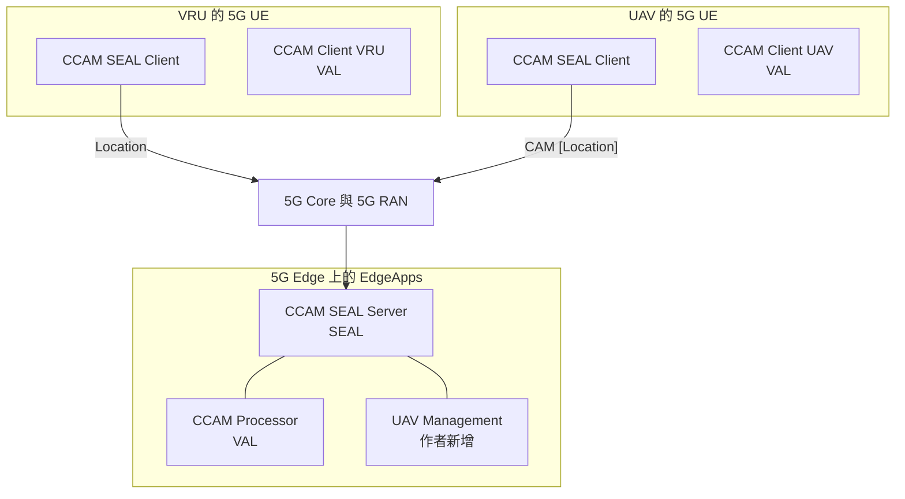
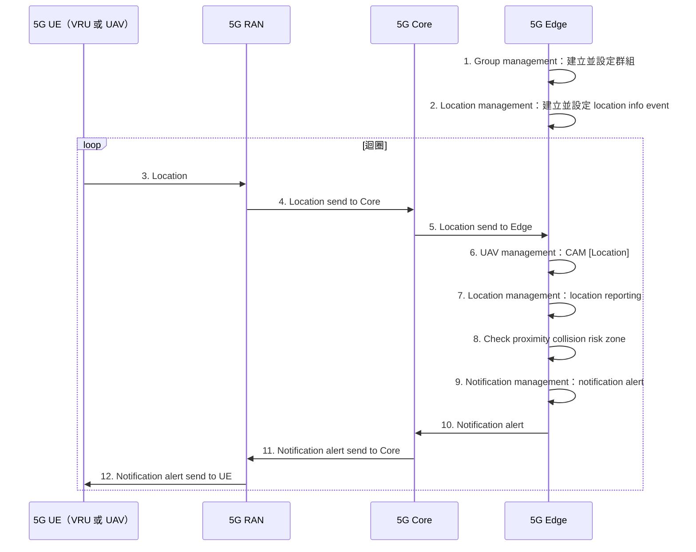

# SEAL 作為邊緣應用（Charpentier 等，2024）

| 項目 | 內容 |
| --- | --- |
| 標題 | 3GPP SEAL as an Edge Application: The Ultimate Enabler of Flexible and Universal Communication between Vulnerable Road Users and Autonomous Vehicles |
| 作者與單位 | Vincent Charpentier、Amaryllis Leyendeckers、Miguel Camelo、Johann Marquez-Barja、Nina Slamnik-Kriještorac；University of Antwerp–imec，IDLab（Faculty of Applied Engineering 與 Department of Computer Science），比利時 |
| 出處 | IEEE VTC2024-Fall，2024（作者版未印研討會名稱與頁碼，此欄依任務指示） |
| DOI 或連結 | 10.1109/VTC2024-Fall63153.2024.10757707 |
| 本次閱讀的版本 | 作者版，共 5 頁 |
| 類型 | 實作與實測（proof of concept，單一場域的延遲量測） |

## 一分鐘版本

這篇論文把 SEAL 的 server 與 client 做成部署在 5G 邊緣的應用，用來在行人與自動駕駛車之間傳遞碰撞警示，讓只有 5G 連線、沒有車聯網專用硬體的裝置也能參與。作者實作了群組管理、位置管理兩項 SEAL 服務，通知管理則因為找不到已定義的 API 而自行設計。在安特衛普港的 5G SA 場域量到：邊緣上一輪處理平均 64.9 ms（近）與 67.24 ms（遠），整條路徑合計 137.07 ms 與 164.12 ms，超過作者引用的 100 ms 門檻。對你的用處有兩點：它是少數有實測數字的 SEAL 實作報告；它列出的規格缺口中，通知管理 API 這一項在本地 Release 20 規格中仍然找不到。

## 1. 要解決的問題

自動駕駛車沒有駕駛，行人無法再靠眼神確認車輛是否注意到自己，所以需要通訊來取代（§I）。

現有的車聯網通訊有兩個問題（§I）：

- 沒有一套能連接所有類型使用者的共同通訊堆疊。
- ITS-G5 與 C-V2X 都需要專用硬體，這些硬體是為車輛設計的，裝不到行人攜帶的手機或穿戴裝置上。

作者的主張是：把這類通訊做成 5G 網路邊緣提供的服務，任何能連上 5G 的裝置都能使用，不需要專用硬體（§I、圖 1）。

論文用到的領域名詞如下，第一次接觸可以先看這張表。

| 名詞 | 說明 |
| --- | --- |
| VRU | Vulnerable Road User，行人、自行車騎士等易受傷害的用路人 |
| UAV | 這篇論文定義為 Unmanned Automated Vehicle，指 SAE level 5 的地面自動駕駛車（§I、表 I）。不是 3GPP 常說的無人機 |
| CCAM | Connected, Cooperative, and Automated Mobility，歐洲對車聯網與自動駕駛協作通訊的總稱 |
| ITS-G5 | 以 IEEE 802.11p 為基礎的車用短距離無線通訊，歐洲的車聯網標準之一 |
| C-V2X | Cellular Vehicle-to-Everything，以行動網路技術為基礎的車聯網通訊 |
| CAM | Cooperative Awareness Message，ETSI 定義的車輛狀態廣播訊息，內含位置 |
| NaaS | Network-as-a-Service，把網路能力當成服務提供給產業 |
| EdgeApp | VITAL-5G 計畫（EU H2020）提出的邊緣應用形式，以 VNF 的方式部署在 5G 邊緣，並用一份 blueprint 描述它對網路、服務與硬體的需求（§I） |

**解讀：** 表中 UAV、NaaS、EdgeApp 的說明依論文 §I；VRU 的舉例、CCAM 與 ITS-G5 的「歐洲」定位、CAM 的白話說明是我們補充的一般知識，論文只寫出全名，並說 ITS-G5 即 IEEE 802.11p、CAM 等訊息由 ETSI 標準化。

## 2. 需要的背景

論文對 SEAL 的介紹只有 §II-A 一節，內容是：SEAL 從 Release 16 開始提供產業應用共用的支援服務；主要實體是 VAL client、VAL server、SEAL client、SEAL server；每項 SEAL 服務以 service-based interface 上的 API 提供。圖 2 列出十項服務：location management、group management、configuration management、identity management、key management、network resource management、data delivery、notification management、network slice capability enablement、application data analytics enablement。論文引用的規格版本是 TS 23.434 V19.0.0（2023-12）（註腳 3、12）。

論文接著說 SEAL「尚未完全標準化」，所以這篇只做 proof of concept，並以此找出 SEAL 的缺口（§II-A）。

**解讀：** §II-A 有一句與規格不一致。論文寫「與 CAPIF 整合後，VAL server 可以作為 API Exposing Function（AEF）」。本地 TS 23.434 V20.1.0 §6.4 的寫法相反：SEAL server 是 CAPIF 的 API exposing function，VAL server 是 API invoker。論文這句引自參考文獻 [9]，我們沒有查 [9] 的原文，無法判斷是 [9] 的寫法還是轉述時的筆誤。

## 3. 方法與架構

### 3.1. 四個方塊各是什麼

下圖依論文圖 1 重繪，方塊名稱照原圖。圖 1 的圖例把方塊分成 VAL 與 SEAL 兩類，UAV Management 另以第三種顏色標示。

依論文圖 1 重繪。邊緣內三個方塊之間的連線經過簡化；原圖只畫出一條從 CCAM SEAL Server 往上的線，沒有標示介面名稱。

| 通用模型的方塊 | 論文中的對應 | 部署位置 | 出處 |
| --- | --- | --- | --- |
| SEAL server | CCAM SEAL Server，內含 location management server、group management server 等 | 5G 邊緣的 EdgeApp | 圖 1、圖 2 |
| SEAL client | CCAM SEAL Client，內含 location management client、group management client 等 | VRU 與 UAV 的 5G UE | 圖 1、圖 2 |
| VAL client | CCAM Client，論文稱為「VAL CCAM client」，是在 UAV 與 VRU 上傳送 CCAM 訊息的輕量應用 | VRU 與 UAV 的 5G UE | 圖 1、§II-B |
| VAL server | CCAM Processor，論文稱為「VAL CCAM processor」，負責處理 CCAM 訊息 | 5G 邊緣的 EdgeApp | 圖 1、§II-B |

**解讀：** 論文沒有使用「VAL server」稱呼 CCAM Processor，只在圖 1 把它標成 VAL。把它對應到 VAL server 是我們依通用模型做的判斷。

SEAL server 與 VAL 的處理元件都在同一個邊緣上。執行環境是 OpenStack 上的一台虛擬機，1 核心 CPU、4 GB RAM（§IV-A）。

### 3.2. 用了哪些 SEAL 服務與 API

| 功能 | 論文用的 API | 論文給的來源 | 照規格或自行補上 |
| --- | --- | --- | --- |
| 把實體分成 VRU 與 UAV 兩群 | SEAL Group Management | REL-18 `TS29549_SS_GroupManagement.yaml`（註腳 7） | 論文稱使用既有 API（§III-B） |
| 建立 location information event，把兩個群組加為訂閱者 | SEAL Events | REL-18 `TS29549_SS_Events.yaml`（註腳 8） | 論文稱使用既有 API（§III-B） |
| 訂閱後持續取得位置 | SEAL Location Reporting | REL-18 `TS29549_SS_LocationReporting.yaml`（註腳 10） | 論文稱使用既有 API（§III-B） |
| 把 UAV 送來的 CAM 轉成 location report | UAV management | 無 | 作者在 EdgeApp 中介層新增的軟體區塊（§III-B） |
| 比對兩者位置是否落入彼此的碰撞風險區 | 無 API 名稱 | 無 | 作者實作，圖 4 標為 EdgeApp 而非 SEAL（§III-B、圖 4） |
| 送出警示 | SEAL notification management | 無 | 作者自行設計新的 API，理由是 SEAL 的通知 API 尚未定義（§III-B、§V） |

作者考慮過 VAE（V2X Application Enabler，TS 23.286，建立在 SEAL 之上的車聯網專用支援層）後決定不用。理由是 VAE 的 API 同樣使用 SEAL API，沒有提供這個情境需要的其他功能；VAE 的 VRU zone management 使用 location information event，而作者認為該事件只能追蹤位置進出預先定義的區域，不適合會變動的區域（§III-B）。

位置的來源在兩種終端不同：UAV 送 CAM 訊息，VRU 透過 SEAL client 直接發布即時位置（§III-B）。車輛的位置來自 GPS USB 模組（§III-A）。

### 3.3. 資料流

下圖依論文圖 4 重繪。步驟 1、2 只做一次，步驟 3 到 12 是重複執行的迴圈。圖 4 以顏色區分：步驟 1、2、7、9 屬於 SEAL，步驟 6、8 屬於 EdgeApp。

依論文圖 4 重繪。步驟 11 的文字照原圖，依箭頭方向應是從 Core 送往 RAN。

**未能確認：** 圖 4 的步驟 1、2 畫成邊緣自己對自己的呼叫，論文沒有說是哪個元件呼叫這些 API（CCAM Processor、UAV management，或 SEAL server 自己）。因此看不出 SEAL-S 這條介面在實作中是否真的存在。

## 4. 實驗與結果

### 4.1. 設定

| 項目 | 內容 | 出處 |
| --- | --- | --- |
| 場域 | 比利時 Antwerp-Bruges 港，VITAL-5G 計畫的 5G SA 試驗場，港區內一個壅塞的路口 | §II-B、§III-A、圖 3 |
| 扮演 UAV 的車 | Smart Highway 測試平台的 BMW，裝 GPS USB 模組與 5G SA Peplink 數據機（MAX HD1 Dome Pro，註腳 6） | §III-A |
| VRU | 攜帶智慧型手機、以 5G 連線 | §II-B |
| 基地台 | 一座 gNodeB，車與 VRU 都連到它 | §III-A |
| 切片 | 透過 EdgeApp blueprint 指定使用 URLLC slice | §I、§IV |
| 邊緣運算 | OpenStack 虛擬機，1 核心 CPU、4 GB RAM | §IV-A |
| 兩個情境 | 近：UAV 與 VRU 距 gNodeB 約 100 公尺；遠：約 3000 公尺 | §IV-A |
| 資料量 | 每個位置約 3000 筆延遲資料 | §IV-A |
| 比較基準 | 參考文獻 [11] 的綜述：邊緣系統的總處理時間須在 100 ms 內 | §IV |

作者自己把這些量測稱為 preliminary validation rounds，並說港區的船隻、橋樑、起重機、卡車與天氣會干擾訊號（§IV-A）。

### 4.2. 各段延遲

下表是圖 5 長條上標示的數值，單位 ms。方括號是圖 4 的步驟編號。

| 圖 5 的項目 | 對應步驟 | 近 | 遠 |
| --- | --- | --- | --- |
| Groups | 1 | 22.52 | 23.45 |
| Event | 2 | 25.72 | 31.02 |
| Location | 3–5（UE 到邊緣） | 11.64 | 21.35 |
| UAV management | 6 | 0.18 | 0.20 |
| Location reporting | 7 | 12.16 | 12.41 |
| Check proximity | 8 | 16.87 | 16.95 |
| Notification management | 9 | 35.89 | 37.68 |
| Notification | 10–12（邊緣到 UE） | 12.29 | 21.06 |

論文正文給的合計如下（§IV-A）：

| 範圍 | 近 | 遠 | 與 100 ms 相比 |
| --- | --- | --- | --- |
| 邊緣上的迴圈運算，步驟 6、7、8、9 的平均 | 64.9 ms | 67.24 ms | 符合 |
| 端到端，步驟 1 到 12 | 137.07 ms | 164.12 ms | 不符合 |

作者對端到端超標的說明是：邊緣的運算能力已足夠，未來應研究 EdgeApp 最合適的資源需求（§IV-A）。

**解讀：** 從數字看得到三件事。第一，距離只影響空中介面的兩段（步驟 3–5、10–12），邊緣上的四段幾乎不變。第二，最慢的一段是步驟 9 的 notification management，約 36 到 38 ms，而這一段正是作者自己設計的 API。第三，步驟 8 只是比對兩個經緯度，卻要約 17 ms，論文沒有解釋時間花在哪裡。

**解讀：** 端到端的 137.07 ms 把步驟 1、2 也加進去了。依圖 4，這兩步是建立群組與事件的一次性設定，不在迴圈內。只算迴圈（步驟 3 到 12），用論文的數字相加是 11.64 + 64.9 + 12.29 = 88.83 ms（近）與 21.35 + 67.24 + 21.06 = 109.65 ms（遠）。也就是說，近的情境其實低於 100 ms，遠的情境仍然超過。這個算法是我們的，論文沒有這樣呈現。

### 4.3. 與 ITS-G5、C-V2X 的比較

比較對象不是這次實驗量的，而是引用作者 2022 年的前作 [3]（§IV-B）：

| 技術 | CAM 訊息的平均延遲（近距離） | 來源 |
| --- | --- | --- |
| ITS-G5 | 4.45 ms | 前作 [3] |
| C-V2X | 22.79 ms | 前作 [3] |
| 本文系統，UAV 到邊緣（步驟 3–5） | 11.64 ms | 本文圖 5 |
| 本文系統，邊緣到 UAV 的通知（步驟 10–12） | 12.29 ms | 本文圖 5 |

論文的結論是 ITS-G5 仍然最低；本文系統比 C-V2X 低 48.89%，原因之一是 C-V2X 跑在 4G，本文跑在 5G SA（§IV-B）。

**解讀：** 這個比較的條件並不對等。[3] 是在 Smart Highway 測試平台量的，本文是在港區量的；兩邊的距離、環境、量測方式是否相同，本文沒有交代。另外，ITS-G5 與 C-V2X 的數字是一則訊息從發送端到接收端的延遲，本文拿來比的 11.64 ms 只是 UE 到邊緣的單程，還沒有經過邊緣處理與下行通知。若要比「一方發出位置到另一方收到警示」，本文系統對應的是 4.2 節的 88.83 ms 或 109.65 ms。

## 5. 限制

### 5.1. 文獻自己承認的

- 量測是初步的，未來要對各層延遲做更多研究（§IV-A、§VI）。
- 只測了一台車與一位 VRU，未來要在擁擠、多樣、有多個 VRU 與 UAV 的環境實驗（§VI）。
- 沒有分析安全與隱私（§VI）。
- 端到端延遲不符合 100 ms（§IV-A）。
- UAV 以 API 把 CAM 送到邊緣是假設中的進展，相關 API 仍需開發與驗證（§V）。

### 5.2. 我們看到的

- **量測方法沒有交代。** 論文沒有說延遲是怎麼量的：時間戳記打在哪裡、UE 與邊緣的時鐘如何同步、步驟 3–5 是單一裝置還是兩個裝置的平均。只報平均值，沒有分布、百分位數或最大值；對安全用途而言，尾端延遲比平均重要。
- **數字有小出入。** 圖 5 的近距離 Check proximity 標示為 16.87，四段相加是 65.10 ms，正文寫 64.9 ms；若該值是 16.67 才會得到 64.90，端到端的 137.07 ms 也才吻合。差距 0.2 ms，不影響結論。另外 (22.79 − 11.64) / 22.79 是 48.92%，正文寫 48.89%。
- **「UAV」是由測試車扮演的。** 論文說這台 BMW「acting as the UAV」（§III-A），沒有說它是否具備自動駕駛功能。使用情境提到系統可以要求 UAV 完全停止（§II-B），但實驗只量到通知送達，沒有量車輛收到後的反應。
- **碰撞風險區沒有定義。** 區域的大小、形狀、判定方法、位置回報頻率都沒有寫。論文也沒有報告警示是否正確（誤報、漏報），只報告延遲。
- **實作細節不足以重現。** 沒有說 SEAL client 與 server 之間用什麼協定、通知如何送到手機、自行設計的 notification API 長什麼樣、URLLC slice 的參數、頻段與核心網路產品。論文沒有提到程式碼是否公開。
- **是否經過 CAPIF 沒有說。** CAPIF 只出現在背景介紹；實作中 SEAL API 是否經 CAPIF 發布與授權，論文沒有提。
- **對規格的幾項描述不精確。** 見第 2 節關於 AEF 的說明，以及第 6 節的查證。

## 6. 與 SEAL 的關係

SEAL 是這篇論文的主題。論文直接引用 TS 23.434 V19.0.0 與 3GPP Forge 上 REL-18 分支的 TS 29.549 OpenAPI 檔，並在 §V 列出它認為的四項缺口：

1. SEAL 文件不完整，常引用尚未開發的章節或 API；notification management 在 API 文件中完全沒有。
2. 變數命名不一致。例子是 location report 中的 altitude 不在 geographic location 區塊，而在 shape 區塊。
3. 3GPP 沒有為使用 SEAL 的產業服務提供延遲準則，這對 VAE 特別重要。
4. UAV 以 API 把 CAM 送到邊緣，需要再開發專用的 API。

以下是我們用本地 Release 20 規格對前兩項缺口與 §III-B 兩項說法所做的查證，都不是論文的內容。

**解讀：** 缺口 1 說通知管理沒有 API。這在本地 Release 20 仍然成立，但要說得更精確。

- TS 23.434 V20.1.0 第 17 章有通知管理的功能模型（NM-UU、NM-C、NM-S 三個參考點）與程序，包含 create notification channel、open notification channel、notification message 等 information flow（§17.2、§17.3）。所以 Stage 2 的程序是有的。
- 同一份規格的表 15.3-1 把 Snm 的 API 指向 §17.4，但第 17 章只到 §17.3.5，沒有 §17.4。
- TS 29.549 V20.1.0 的服務清單（§5.2 到 §5.14）與 Annex A（A.1 到 A.41）中，沒有任何通知管理的 API；全文搜尋「notification management」「notification channel」沒有結果。
- 所以論文說「API 文件中沒有 notification management」，以 VAL server 呼叫 SEAL server 的 SEAL-S 這一側而言，到 Release 20 仍然如此。這與既有的《Release 20 SEAL 04 服務 API 與 CAPIF》第 1 節記錄的落差一致。

**未能確認：** 通知管理在終端這一側（NM-UU）的 Stage 3 協定可能定義在 TS 24.542。這份規格不在本地語料中，我們只憑印象提出，沒有查證它的存在與內容。若它存在，論文說的「完全沒有」就只適用於 TS 29.549 這份 API 規格，不適用於整個 3GPP。

**解讀：** §III-B 說現有事件只能追蹤位置進出預先定義的區域。這個說法與本地 Release 20 不符。TS 29.549 V20.1.0 的 `SEALEvent` 有三個位置相關事件：`LM_LOCATION_INFO_CHANGE`（VAL 使用者或 UE 的位置資訊）、`LM_LOCATION_DEVIATION_MONITOR`（偏離關注區域）、`LM_LOCATION_AREA_MONITOR`（進出特定位置的 UE 清單）。§5.2.2 說明 SS_LocationInfoEvent 就是用 `LM_LOCATION_INFO_CHANGE` 讓 VAL server 訂閱並接收位置通知。另外 `LocationInfoCriteria` 可以用一台參考 UE 加上 `proxRange` 來定義區域，也就是區域可以跟著某台 UE 移動。論文引用的是 REL-18 分支，本地沒有 Release 18 的 TS 29.549，無法確認當時的內容是否相同。

**解讀：** §III-B 說用 SS_LocationReporting 持續監測位置。依 TS 29.549 V20.1.0 §5.2.1，SS_LocationReporting 的用途是讓 VAL server 設定位置回報的觸發條件，接收位置則是 SS_LocationInfoEvent 的工作。論文把前者描述成「訂閱後持續監測位置」的手段，與規格的分工不完全一致；實際上兩支 API 它都用了，所以功能上說得通。

**未能確認：** 缺口 2 說 altitude 放在 shape 區塊。SEAL 的位置資料型別引用 TS 29.122 的 `LocationInfo`，其中的 `geographicArea` 再引用 TS 29.572 的 `GeographicArea`。本地沒有 TS 29.572 的 schema，無法確認 altitude 欄位的確切位置。

**解讀：** 論文標題把 SEAL 稱為 edge application，但規格中 SEAL 是應用與網路之間的支援層，與邊緣運算的 Edge Enabler Layer（TS 23.558）是不同的東西。這篇論文的「邊緣」指的是部署位置：把 SEAL server 與 VAL 的處理元件一起放在 5G 邊緣。論文沒有提到 TS 23.558 的 EES 或 ECS。

**解讀：** 論文描述的 SEAL server 只處理 UE 經 5G 網路送上來的位置。論文沒有描述 SEAL server 以 AF 的身分呼叫 NEF 或任何核心網路功能；圖 4 中 5G Core 只出現在轉送位置與警示的步驟。規格中位置管理 server 可以向網路取得位置來補充終端的回報，這一部分論文沒有實作，也沒有討論。

## 7. 與 NWDAF 的關係

論文沒有提到 NWDAF，也沒有提到 NEF、AF 或 federated learning。全文搜尋這些詞沒有結果；「AI」只出現在參考文獻 [8] 的標題裡。「analytics」只出現在介紹 SEAL 服務清單時的 application data analytics enablement（圖 2、§II-A），而且論文沒有使用這項服務。

**解讀：** 論文中作者自己實作的「check proximity collision risk zone」（步驟 8），在論文之後的規格裡有了標準化的對應。TS 23.436 的 Collision Detection Analytics 由 2024-09 的 CR 0037 加入（V19.2.0，依 TS 23.436 V20.2.0 Annex B 的變更紀錄），晚於論文引用的 2023-12 版本。依本地 TS 23.436 V20.2.0 §6.10 與 §8.14：

- ADAE（Application Data Analytics Enablement，SEAL 的應用層資料分析服務）server 接受 VAL server、LM server 等消費者訂閱 collision detection analytics。
- 它的資料來源明列「5GC NFs（例如 GMLC、NWDAF）、ADAE client、LM server、LM client、第三方 LM server」與 A-ADRF 的歷史資料。
- 輸出包含目標 VAL UE 與可能發生碰撞的 VAL UE 清單，分析型態可以是 statistics 或 predictions。

**解讀：** 也就是說，這篇論文的使用情境在 Release 19 之後有一條可以用到 NWDAF 的標準路徑，而論文走的是不經過核心網路的純應用層路徑。

**解讀：** 另一個接點在位置管理。TS 23.434 的位置管理程序會使用 NWDAF 的 UE mobility analytics 來推估或預測位置（見既有的《Release 20 SEAL 02 服務模板與位置管理》第 6 節）。論文量到位置上行需要 11.64 到 21.35 ms、整個迴圈約 89 到 110 ms；在這種延遲下，用預測位置而不是最後回報的位置來判斷碰撞，是論文沒有碰的方向。

## 8. 對你的研究可以怎麼用

以下全部是解讀。

- **當成引用來源。** 可以引用它來支持兩個說法：SEAL 已有在真實 5G SA 場域的實作；SEAL 的通知管理缺少可直接實作的 API。引用第二點時建議同時附上本地 Release 20 的查證（第 6 節），說明這個缺口到 V20.1.0 仍在。
- **當成延遲的參考值。** 表中的分段數字可以作為「SEAL 服務放在邊緣時，一次 API 處理大約多久」的量級參考：單一步驟約 12 到 38 ms，設備是 1 核心、4 GB 的虛擬機。若你在 free5GC 上量 NWDAF 或 SEAL 相關程序的延遲，可以用同樣的分段方式呈現。引用時要註明它只有平均值，量測方法不明。
- **當成實驗設計的反面教材。** 它的比較基準來自另一篇論文、另一個場域，且比的不是同一段路徑。你做對照實驗時，應該在同一環境量對照組，並明確說明起點與終點。
- **當成研究缺口的佐證。** 論文走純應用層路徑，沒有使用任何核心網路能力。對應的標準化路徑是 ADAE 的 collision detection analytics，資料來源包含 NWDAF。「同一個情境，經 NWDAF 的預測性分析能否比純應用層的即時比對更早發出警示」是這篇論文留下的空白，也是 NWDAF 可以接上的地方。這個題目是否值得做，取決於你的研究範圍是否涵蓋應用層。
- **可重用的程式或資料：** 沒有。論文沒有提到公開的程式碼或資料集。
- **與 federated learning 的關係：** 沒有。論文不涉及模型訓練。

## 9. 值得追的參考文獻

- [9] S. P. Shah, B. J. Pattan, N. Gupta, N. D. Tangudu, and S. Chitturi, "Service enabler layer for 5g verticals," in 2020 IEEE 3rd 5G World Forum (5GWF), 2020, pp. 269–274, doi: 10.1109/5GWF49715.2020.9221425。這是論文介紹 SEAL 與 CAPIF 關係時的依據，可用來確認第 2 節指出的 AEF 說法出自哪裡。
- [10] D. Fragkos, G. Makropoulos, P. Sarantos, H. Koumaras, A.-S. Charismiadis, and D. Tsolkas, "5g vertical application enablers implementation challenges and perspectives," in 2021 IEEE International Mediterranean Conference on Communications and Networking (MeditCom), 2021, pp. 117–122, doi: 10.1109/MeditCom49071.2021.9647460。標題直接談 vertical application enabler 的實作挑戰，是另一份實作面的報告。
- [7] V. Charpentier, N. Slamnik-Kriještorac, G. Landi, M. Caenepeel, O. Vasseur, and J. M. Marquez-Barja, "Paving the way towards safer and more efficient maritime industry with 5g and beyond edge computing systems," Computer Networks, vol. 250, p. 110499, 2024, doi: 10.1016/j.comnet.2024.110499。EdgeApp、blueprint 與 VITAL-5G 場域的細節都指向這篇，本文缺的部署資訊可能在這裡。
- [3] V. Charpentier, N. Slamnik-Krijestorac, and J. Marquez-Barja, "Latency-aware c-its application for improving the road safety with cam messages on the smart highway testbed," in IEEE INFOCOM 2022 - IEEE Conference on Computer Communications Workshops (INFOCOM WKSHPS), 2022, pp. 1–6, doi: 10.1109/INFOCOMWKSHPS54753.2022.9798350。ITS-G5 的 4.45 ms 與 C-V2X 的 22.79 ms 出自這篇，要判斷 4.3 節的比較是否公平必須看它的量測條件。
- [11] S. Hakak, T. R. Gadekallu, P. K. R. Maddikunta, S. P. Ramu, P. M, C. De Alwis, and M. Liyanage, "Autonomous vehicles in 5g and beyond: A survey," Vehicular Communications, vol. 39, p. 100551, 2023, doi: 10.1016/j.vehcom.2022.100551。100 ms 門檻的來源。論文正文把作者寫成「Hakaka」，參考文獻列的是 Hakak。

## 10. 閱讀建議

全文 5 頁，約 20 到 30 分鐘可以讀完。

- 必看：圖 1（部署與四個方塊）、圖 4（十二個步驟）、圖 5（分段延遲）、§III-B（用了哪些 API、為什麼不用 VAE）、§V（缺口清單，只有一段）。
- 可以略過：§I 前半關於自動駕駛分級與 CCAM 的鋪陳、表 I、§II-A 對 SEAL 的介紹（你已有的 SEAL 解讀文件比它完整且準確）。
- 讀 §IV 時請對照本文件第 4 節：正文的端到端數字包含一次性設定步驟，與 ITS-G5、C-V2X 的比較引用自前作。

## 查證紀錄

**逐項核對過的內容**

- 以 `pdftotext -layout` 轉出全文，並用 Read 工具直接看了 PDF 第 1 到 5 頁。圖 1、圖 2、圖 3、圖 4 以頁面影像確認方塊名稱、箭頭與圖例。
- 圖 5 是點陣圖，文字無法擷取。我們把該圖從 PDF 取出並放大，逐一讀取 16 個數值標籤；Check proximity 的近距離值另外量了長條的像素高度，換算約 16.9 ms，確認標籤是 16.87 而不是 16.67。
- 正文數字：64.9、67.24、137.07、164.12、12.29、21.06、11.64、21.35、4.45、22.79、48.89%、100 ms、約 100 公尺、約 3000 公尺、約 3000 筆、1 核心 CPU、4 GB RAM，都與 §IV 的原文一致。
- 重算：遠距離四段相加 67.24，與正文一致；遠距離十二步相加 164.12，與正文一致；近距離四段相加 65.10，與正文的 64.9 不一致；近距離十二步以 64.9 計為 137.07，以圖上數值計為 137.27；降幅重算為 48.92%。
- 註腳 3、6 到 13 的規格版本與檔名、參考文獻 [3]、[7]、[9]、[10]、[11] 的書目資料，都對照過原文。
- 規格查證使用本地 `specs/Rel-20/`：TS 23.434 V20.1.0 的 §6.2、§6.4、第 15 章表 15.3-1、第 17 章全文與原始目錄；TS 29.549 V20.1.0 的 §5 與 §7 的小節清單、Annex A 清單、§5.2.1、§5.2.2、`TS29549_SS_Events.yaml` 的 `SEALEvent` 與 `LocationInfoCriteria`；TS 23.436 V20.2.0 的 §6.10、§8.14 與 Annex B。
- 以關鍵字搜尋確認論文全文沒有 NWDAF、NEF、AF、federated、machine learning 等詞。

**無法確認的內容**

- Release 18 的 TS 29.549 與 TS 29.486 不在本地，無法確認論文當時引用的 REL-18 YAML 內容；VAE 的 VRU zone management 是否如論文所說使用 location information event，沒有查證。
- TS 29.572 的 `GeographicArea` schema 不在本地，altitude 欄位位置的說法沒有查證。
- TS 24.542 是否定義通知管理的終端側協定，沒有查證。
- 參考文獻 [3]、[9]、[11] 的原文都沒有讀，所以 ITS-G5 與 C-V2X 數字的量測條件、AEF 說法的出處、100 ms 門檻的原始脈絡都只依本文的轉述。
- 正文「all the different levels (5)」中的「(5)」指什麼，以及 §III-B「collision risk zone, shown in Fig. 5」為何指向延遲圖，原文沒有說明，推測是圖號誤植。
- 出處（VTC2024-Fall）與 DOI 取自任務指示。作者版 PDF 本身沒有印研討會名稱、頁碼與 DOI，無法從全文核對。
- 這次閱讀沒有發出任何網路請求。
