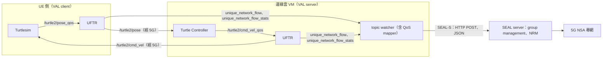

# ROS2 設定自動轉成 SEAL 請求（Szabó，2023）

| 項目 | 內容 |
| --- | --- |
| 標題 | Toward the Automatic Network Resource Management of Robot Operating System in Programmable Mobile Networks |
| 作者與單位 | Géza Szabó（Senior Member, IEEE），Ericsson Hungary Ltd.，Budapest。單一作者 |
| 出處 | IEEE Access, vol. 11, pp. 65934–65955, 2023（2023-06-27 線上刊出） |
| DOI 或連結 | 10.1109/ACCESS.2023.3289922 |
| 本次閱讀的版本 | 出版社正式版（開放取用，CC BY-NC-ND 4.0），共 22 頁 |
| 類型 | 實作與實測（另含兩個架構提案；多數「評估」是估算或論述，實測只有三項） |

## 一分鐘版本

工廠應用若要向 5G 網路要 QoS，開發者得自己蒐集 IP 位址、算出 QoS 需求、再組出 SEAL 請求。這篇論文針對 ROS2（Robot Operating System 2，機器人軟體常用的開源框架，節點之間以 topic 發布與訂閱訊息）把這件事自動化：開發者只要在 topic 名稱後加上 `_qos`，一個代理節點就會量出該 topic 的流量與 5-tuple，另一個對應節點把它換算成 QCI，並向 SEAL server 送出群組建立與端對端 QoS 管理請求。實驗對象是 ROS2 的教學模擬器 Turtlesim，網路是一張 5G NSA 專網。實測數字有三組：代理節點的 CPU 負載（HD 影像串流時 27%）、CPU 週期分布、以及連續十次 QoS 變更的累計時間。對讀者的用處：這是少數把 TS 23.434 的 NRM 訊息實際接到真實網路的公開實作，並且明確留下「網路如何取得監測資料」這個空位，NWDAF 正好可以填。

## 1. 要解決的問題

- 傳統上行動網路要透過 O&M 介面設定，只有營運者能操作；工廠每次變更都要向營運者提出 customer service request，包含多個人工步驟（§I）。
- NEF 的 API 可以自動化一部分設定，但屬於低階的可程式化能力，對應用開發者不友善，所以 3GPP 才定義 SEAL（§I）。
- 作者認為 SEAL 仍然要求開發者手動蒐集資訊元素、組 HTTP 請求、解析回覆。目標是讓 ROS2 使用者「比現行 3GPP 標準定義的方式更容易、更自動」地用到 SEAL（§I-A）。
- 具體的技術障礙：ROS2 預設讓同一對節點之間的所有 topic 共用同一組 5-tuple，網路無法對個別 topic 給不同 QoS（§III-B1，引用 [24]）。

## 2. 需要的背景

| 名詞 | 一句話說明 | 論文出處 |
| --- | --- | --- |
| ROS2 | 機器人應用的開源軟體框架。節點（node）之間用 topic 傳訊息，發布者（publisher）送、訂閱者（subscriber）收 | §II-C |
| DDS、FastDDS | DDS（Data Distribution Service）是 ROS2 底層採用的發布訂閱傳輸中介軟體；FastDDS 是 eProsima 的實作，本文只支援它 | §II-C、§III-A2.c |
| ROS2 QoS policy | ROS2 自己的一組傳輸設定，例如 reliability（best effort 或 reliable）、lifespan、history、depth、durability、deadline。與 3GPP 的 QoS 是兩套東西 | §III-A1.b、§III-C2 |
| Unique network flows | ROS2 Galactic 版起的功能，讓指定的 publisher 或 subscription 使用獨立的埠號、DSCP 或 IPv6 Flow Label，並可用 `get_network_flow_endpoints()` 查出本端的 IP 與埠 | §III-B1.a |
| Turtlesim | ROS2 的入門教學模擬器，畫面上一隻烏龜依速度指令移動。不是機器人，也沒有物理模擬 | §III-C1 |
| QCI | QoS Class Identifier，EPS（4G 核心）的標準化 QoS 等級，定義在 TS 23.203 表 6.1.7。5GC 的對應物是 5QI | §III-C2 |
| NRM | SEAL 的 network resource management 服務。VAL server 透過它向網路要求或調整傳輸資源 | §II-B |
| MOS | Mean Opinion Score，電信業用 1 到 5 分表示使用者感受品質的指標 | §IV-A |

論文把整個系統比作 IEEE P2940（機器人敏捷性量測標準）的閉迴路控制模型：資訊蒐集是 sensor，資源請求是 controller（§III、圖 1）。這個比喻決定了論文的章節名稱，但不影響理解方法。

## 3. 方法與架構

### 3.1. 兩個節點與資料流

論文摘要說的「information collecting proxy node」與「mapping node」，在內文分別叫做 Unique Flow Topic Relay（UFTR）與 topic watcher（內含 QoS mapper）。

| 節點 | 位置 | 做什麼 | 出處 |
| --- | --- | --- | --- |
| UFTR（代理節點） | 每個 ROS2 應用旁各一個 | 訂閱帶 `_qos` 標記的 topic，去掉標記後重新發布；重新發布時開啟 unique network flow，使該 topic 有自己的 5-tuple。同時量測 bandwidth、interarrival time、frequency | §III-B2、圖 3 |
| topic watcher（對應節點） | 邊緣雲的 VM，與控制器同側 | 訂閱 UFTR 發布的兩個 topic，維護一份活躍 topic 的字典，把統計值換成 QCI，呼叫 SEAL server | §III-C2、§III-D、圖 5 |

UFTR 是 ROS2 既有工具 `topic_tools` 中 relay 節點的擴充。它用 rclcpp 的 `GenericPublisher` 與 `GenericSubscription` 轉送二進位資料，不解析訊息內容，所以適用任何訊息型別（§III-B2）。

5-tuple 分兩半取得。來源 IP 與埠用 `get_network_flow_endpoints()` 查；這個 API 只回傳本端資訊。目的 IP 與埠 ROS2 層看不到，論文改從 FastDDS 的 subscriber discovery 事件（`ReaderDiscoveryInfo`）取得（§III-B1）。這是本文只支援 FastDDS 的原因。

UFTR 把結果發布在兩個 ROS2 topic 上：`unique_network_flow`（5-tuple 與 topic 出現或消失的事件）與 `unique_network_flow_stats`（統計值，每 10 秒一筆）（§III-B2、§III-C2）。

依論文圖 5 與圖 6 簡化重繪；HTTP 與 JSON 出自 §VI-B 的文字。

### 3.2. ROS2 設定到 SEAL 請求的對照

| ROS2 側的來源 | 取得方式 | 對應到的 3GPP 欄位或請求 | 規則 | 出處 |
| --- | --- | --- | --- | --- |
| DDS domain ID | `rclpy.get_default_context().get_domain_id()` | Group creation request（論文引 TS 23.434 §10.3.2.1），之後再建立成員關係 | 同一個 domain ID 的節點放進同一個 device group，論文稱它對應 5G NPN 內的一個邏輯網路、一個 5GLAN group | §III-D3、圖 6 |
| topic 名稱的 `_qos` 標記 | 開發者在 launch file 加標記或 remap | 決定哪些 topic 要處理 | 只有被標記的 topic 經 UFTR 轉送並取得獨立 5-tuple | §III-B2 |
| 來源 IP、埠 | `get_network_flow_endpoints()` | end-to-end QoS management request 的 IP address（論文擴充成 UDP/IP flow 層級的識別） | 直接填入 | §III-B1.a、§III-C |
| 目的 IP、埠 | FastDDS subscriber discovery | 同上 | 直接填入 | §III-B1.b |
| QoS reliability | ROS2 QoS policy | PELR（Packet Error Loss Rate） | reliable 對應 10⁻⁵，best effort 對應 10⁻² | §III-C2、Listing 1 |
| 量到的發布頻率 | UFTR 統計 | PDB（Packet Delay Budget） | 「直接由量到的封包產生頻率設定」，即以發布週期當作延遲預算 | §III-C2、Listing 1 |
| lifespan | ROS2 QoS policy | 不產生欄位 | 若 PDB 大於 lifespan 則發出警告，因為訊息會被 ROS2 視為過期 | §III-C2 |
| 前後兩個量測視窗的傳送速率 | UFTR 統計 | Resource Type | 差距在 10% 以內視為 GBR，否則 Non-GBR | §III-C2 |
| 量測視窗長度 | UFTR 統計 | DRAW（Data Rate Averaging Window） | 至少 2000 ms；視窗較短則警告 | §III-C2 |
| 平均封包大小 | 視窗內位元組數除以訊息數 | MDBV（Maximum Data Burst Volume） | 只分兩類：255 bytes 以下的小封包，以及 1354 bytes 的 MTU | §III-C2 |
| liveliness 的 lease duration | ROS2 QoS policy（選用） | 明確撤銷該 flow 的 NRM 請求與監測訂閱 | 失去 liveliness 時觸發 | §III-C2 |
| history、depth、durability、deadline | ROS2 QoS policy | 不使用 | 論文認為與無線傳輸設定無關 | §III-C2 |

上面六個參數（RT、PL、PDB、PELR、MDBV、DRAW）算出後，程式以一串條件判斷逐列比對 TS 23.203 表 6.1.7，選出 QCI。Listing 1 只印出一個例子：RT 為 GBR、PDB ≤ 100、PELR ≤ 10e-2 時選 QCI 1（Conversational Voice）。

**未能確認：** QCI 如何寫進 end-to-end QoS management request 的「End-to-end QoS requirements」欄位，論文沒有給出請求內容的範例。Priority Level 的來源也沒有說明。

**未能確認：** Listing 1 印出的算式是 `PDB = 1. / i.window_rate * 10e3`，並與 `qos_profile.lifespan.nanoseconds / 10e9` 比較。`10e3` 是 10⁴、`10e9` 是 10¹⁰，照字面兩邊單位不一致，也不是毫秒。無法從論文判斷這是排版簡化還是實際程式如此。

### 3.3. 呼叫了哪些 SEAL 訊息

圖 6 的順序如下。回覆中的 HTTP 狀態碼照圖抄錄。

1. ROS2 節點啟動完成後，topic watcher 依 domain ID 向 SEAL server 請求建立群組（回 201 Created），再建立裝置的群組成員關係（回 201 Created）。SEAL server 通知裝置已連上群組。
2. topic watcher 訂閱兩個 UFTR 的 `unique_network_flow`，算出 QoS，送出「e2e QoS management request」。SEAL server 若能滿足，回「Application QoS change notification」。
3. topic watcher 送「QoS monitoring request」（可單次查詢或訂閱），SEAL server 週期性回「unicast QoS monitoring notification」。
4. 結束時取消監測訂閱（回 200 Deleted）、刪除群組（回 200 Deleted）。

| 論文使用的訊息 | 論文引用的條號 | 論文中的方向 | 本地 TS 23.434 V20.1.0 的方向 |
| --- | --- | --- | --- |
| Group creation request | §10.3.2.1 | topic watcher → SEAL server | group management client 或 VAL server → group management server |
| end-to-end QoS management request | §14.3.2.13 | topic watcher → SEAL server（圖 5 標為 SEAL-S） | NRM client → NRM server |
| Application QoS change notification | §14.3.2.16 | SEAL server → topic watcher（圖 6）；但內文兩處寫「NRM client → NRM server」 | NRM server → NRM clients |
| QoS downgrade indication | §14.3.2.15 | SEAL server → topic watcher（圖 9） | NRM client → NRM server |
| Unicast QoS monitoring notification | §14.3.2.22 | SEAL server → topic watcher | NRM server → VAL server |
| 群組成員建立、監測取消訂閱、群組刪除 | 未引條號 | topic watcher → SEAL server | 未比對 |

**解讀：** 摘要說的「network monitoring」（§I-A 稱 connection monitoring）對應 TS 23.434 的 unicast QoS monitoring。依據有兩個：論文引用的 §14.3.2.22 正是這個程序的通知訊息；論文引用的 TS 29.549 §7.4.2.4.2.3 在本地 Rel-20 是 `SS_NetworkResourceMonitoring` API 的 `MeasurementData` 型別，八個屬性與論文 §III-A2.d 列的八項完全相同。在 TS 23.434 中它屬於 NRM（§14.3.3.4、§14.4.4），不是獨立的 SEAL 服務。所以論文說的「三項功能」，以規格的分類是 group management 與 NRM 兩項服務，其中 NRM 用到資源請求與 QoS 監測兩組程序。

### 3.4. 三種部署方式

| 方式 | 內容 | 成熟度 | 出處 |
| --- | --- | --- | --- |
| 應用是 network exposure 的使用者 | 即 3.1 到 3.3 節的基本做法 | 有實作並在專網上執行 | §III |
| 網路是 application exposure 的使用者（VASEAL） | 作者自創的 Vertical Application Service Enabling Architecture Layer：應用對外發布 `/MOS` topic 回報品質，並訂閱 `/application_adaptation_request` 接受降速要求。一個稱為 MOS/QoS ratio maximizer 的節點在維持 MOS 的前提下降低請求的 QoS；網路資源不足時反過來要求應用降低控制頻率 | 概念加上 RL 示範；VASEAL 不是 3GPP 規格 | §IV、圖 7 到圖 9、§VI-A3 |
| Tunnel mode | 兩端的 UFTR 之間先建好多條 topic 隧道（名稱帶 `_QCI_7`、`_QCI_8` 等），每條對應一個已建立的 dedicated bearer。要變更 QoS 時由 UFTR 在 ROS2 層把訊息切到另一條隧道，不必重建 bearer。訊息另加時間戳與序號，用來量 message age 與掉包 | 有實作並有時間量測 | §V、圖 10、圖 11、§VI-D |

Tunnel mode 要解決的限制是：Rel-17 SEAL 對 unicast resource 只定義了建立與刪除，沒有更新；更新一次等於拆掉再建一條 bearer，需要數秒（§VI-A2.b、§VI-D）。

## 4. 實驗與結果

### 4.1. 設定

- 應用：Turtlesim。一個外部控制器以閉迴路控制烏龜繞圈，兩者之間有兩個單向 topic：位置 `/turtle2/pose` 與速度指令 `/turtle2/cmd_vel`（§III-C1、圖 4）。
- 網路：部署在廠區的 5G Non-Standalone（NSA）專網（NPN），附整合的邊緣雲。topic watcher 與控制器跑在邊緣雲的常駐 VM；跑 ROS2 應用的機器接一台插 SIM 卡的 UE（§III-D）。
- 節點探索用 FastDDS Discovery Server，因為不要求 UE 支援 Ethernet PDU session 與多播（§III-D2）。
- 軟體：ROS2（內文提到 Humble 與 Galactic）、FastDDS、Ray 2.2.0 與 RLlib（§VI-A3）。
- §VI-D 的量測沒有背景流量，系統上只有受測的一台 UE。

**未能確認：** SEAL server 由誰提供。論文沒有說它是產品、原型或模擬端點，也沒有列出端點 URL 或 API 名稱。論文提到兩項先前的工作：[9] 的第一作者就是本文作者，§I 稱它展示了 SEAL exposure 介面；[11] 的共同作者之一列在本文致謝中，§II-A 稱它在商用 5G NPN 上加裝了 exposure 能力。本文的 SEAL server 可能沿用其中之一，但這是推測。

**未能確認：** SEAL server 如何把請求送進核心網路（Rx、SCEF、NEF 或私有介面），論文沒有說明。

### 4.2. 結果

| 評估項目 | 做法 | 結果 | 出處 |
| --- | --- | --- | --- |
| 設定所需的程式行數（論文縮寫 LOF） | 估算，不是量測 | 手動呼叫 NRM 至少要填 4 個資訊元素（list of VAL UEs、user ID、IP address、end-to-end QoS requirements），外加 HTTP 函式庫、JSON 組裝與回覆解析；本文的 SEAL API handler 約 200 行；使用者只需在 topic 名稱加幾個字元，或在 launch file 加幾行 remap | §VI-B、圖 16 |
| UFTR 的 CPU 週期分布 | 以 debug symbol 編譯後用 `perf` 分析 | 處理新 DDS topic 事件與統計計算 14.8%；DDS 訂閱與重新發布各 5.76%；network busy wait 37.7%；其他 ROS2 系統呼叫 36% | §VI-C.a、圖 17 |
| UFTR 的 CPU 負載 | 轉送攝影機影像 topic；關閉 FastDDS 的本機最佳化作為最差情況；Intel i7 9700k | 320×240 為 9%；640×480 為 14%；1280×720 為 27%。圖 18 的標籤為 bgr8、30 Hz，流量分別標為 7、21.06、58.12 Mbytes/s | §VI-C.a、圖 18 |
| QoS mapper 的負載 | 沒有量測，只有論述 | 「預期不會造成明顯負載」，理由是 topic 多半只在初始化時建立 | §VI-C.b |
| MOS/QoS ratio maximizer 的負載 | 沒有量測，只有論述 | 訓練階段耗 CPU，可改用 GPU 或離線訓練；推論階段負載不明顯 | §VI-C.c |
| RL 訓練 | RLlib 多代理環境、PPO、`ExternalEnv`；horizon 128；每個 topic 一個代理但共用一個 policy；reward = w1 × mos + latency − drop，w1 = 200 | episode reward mean 約在 15k step 達到最大；20k step 後 entropy 顯示已無可學 | §VI-A3、圖 14 |
| RL 推論結果 | 訓練後各 topic 的設定 | 見下表 | 圖 15 |
| NRM 請求的執行時間 | 5G NSA 專網，連續 10 次 NRM 更新；每次更新是一次 unicast resource 刪除加一次建立 | 初始建置階段兩種模式耗時相同；之後基本模式的累計時間逐次增加，tunnel mode 持平。論文結論：tunnel 切換是次秒級，bearer 建立要數秒 | §VI-D、圖 19 |

圖 15 的數值照錄如下。圖上沒有標單位。

| topic | bandwidth | jitter | MOS | latency | dropped packet | control speed |
| --- | --- | --- | --- | --- | --- | --- |
| /turtle1/pose | 1484 | 0.0163 | 4.9405 | 0 | 248 | （空白） |
| /turtle1/cmd_vel | 525 | 0.0999 | 4.9405 | 1 | 254 | 0.5 |
| /turtle2/pose | 1500 | 0.0161 | 4.6904 | 4 | 252 | （空白） |
| /turtle2/cmd_vel | 131 | 0.4 | 4.6904 | 0 | 184 | 2 |

論文對這張表的說明：Turtle 1 把速度降為原本的一半，只承受少量掉包與延遲，得到較高的 MOS；Turtle 2 承受較多掉包與延遲，但速度加倍（§VI-A3.d）。latency 欄是 UFTR 延遲封包的次數；dropped packet 欄是「每 n 個封包丟一個」的 n，數值越大丟得越少（§VI-A3.a）。

**解讀：** 圖 19 沒有標數值，以下是目視長條的近似值，不是論文給的數字。縱軸單位是分鐘。群組管理到連線建立三步，兩種模式都在約 3.0 到 3.2 分鐘；第 1 次 NRM 請求後基本模式約 3.4、tunnel mode 約 3.6；第 10 次後基本模式約 5.2，tunnel mode 仍約 3.6。換算下來基本模式每次 NRM 更新約增加 0.2 分鐘（約 12 秒）。

**未能確認：** 圖 19 的前兩個階段（裝置開通、ROS2 網路建置）沒有長條，第三階段卻從約 3 分鐘起算，論文沒有說明這 3 分鐘包含什麼。

實際流程中是否走完「QoS 請求進到核心網路」這一步：§VI-D 寫明量測在 5G NSA 專網上進行，NRM 更新以資源刪除與建立執行，並描述網路為新的 QoS 需求建立 dedicated bearer。所以依論文的說法，請求確實觸發了真實網路的 bearer 建立。但論文沒有呈現網路側的證據，例如 bearer 的 QCI 或訊令紀錄。

## 5. 限制

### 5.1. 文獻自己承認的

論文沒有獨立的限制章節，以下散見各節。

- 透過 SEAL 取得的網路監測資料是整條連線的，不是個別 ROS2 節點的（§III-A2.d）。
- ROS2 內建的 Topic Statistics 需要訊息帶時間戳，無法支援任意訊息型別；FastDDS Statistics 需要重新編譯，且不是所有 ROS 套件都相容（§III-A2.b、§III-A2.c）。
- 現行 ROS2 與 3GPP SEAL 的設計都是在連線初始化時做 NRM、之後不改，所以動態 NRM 的粒度很粗（§VI-A2.b）。
- 帶 throttle 的 UFTR 只能加入掉包與延遲，不能改善連線（§VI-A3.b）。
- AI 元件只是概念示範，可以換成針對使用情境最佳化的演算法（§VI-C.c）。
- 圖 19 的確切數值與終端和網路有關，應看的是量級（§VI-D）。
- 只用了 SEAL 的 unicast flow 管理；TSN 與 multicast、以及其他 SEAL 功能留待後續（§VII）。

### 5.2. 我們看到的

以下全部是解讀。

- **沒有評估 QoS 請求是否有效。** 論文沒有比較請求 QoS 前後的端對端延遲、掉包或控制誤差，也沒有列出兩個 topic 最後被對應到哪個 QCI。能確認的只有「請求送得出去、bearer 建得起來、花多少時間」。
- **應用太簡單。** Turtlesim 沒有真實的控制品質要求，無法說明對應規則對實際機器人是否合理。10% 的 GBR 門檻、10 秒的視窗、兩類 MDBV 都是經驗值，沒有敏感度分析。
- **網路是 NSA，QoS 模型是 EPS 的。** 論文引言談 5GC 的 SBA 與 NEF，但實驗用的是 QCI、dedicated bearer 與 TS 23.203。對應到 5GC SA 需要改成 5QI 與 QoS flow，論文沒有處理。
- **行數評估沒有對照組。** 圖 16 是沒有數字的面積圖，內文只給「至少一行」的假設與自己 handler 的約 200 行，沒有手動整合的實際行數可比。
- **只量了 CPU，沒有量延遲。** UFTR 讓每個 topic 多經過一次轉送，對控制迴路的延遲影響沒有數據。
- **VASEAL 的實驗是自我模擬。** 品質劣化由 UFTR 自己丟包與延遲產生。圖 9 的資源耗盡流程是設計圖，§VI-D 的量測沒有背景流量，所以沒有任何一次真實的 QoS downgrade。RL 只呈現一次訓練，沒有基準方法。
- **MOS 的定義前後不一。** §IV-A2 說兩隻烏龜的控制迴路每差 10 Hz，較慢者的 MOS 減 1；§VI-A3.a 說 mos 是目標位置與目前位置的平方誤差再依處理速度縮放。
- **命名不一致，增加重現難度。** 標記在 §III-B2 寫 `_QoS`、在 §III-D2 寫 `_qos`；topic 在內文是 `unique_network_flow`，在 §III-C2 是 `unique_flow`，在 Listing 1 是 `unique_topic_flow`；內文多處把 PDB 寫成 PDP。
- **對標準的敘述有幾處可疑。** §I 說 NF 把服務註冊到 NEF 以供其他 NF 探索，這是 NRF 的功能。參考文獻 [23] 引用 NWDAF 時給的是 TS 33.521（安全保證規格），不是 TS 23.288。§VI-D 舉例預設 bearer 使用 QCI 83；在本地 Rel-18 TS 23.501 表 5.7.4-1 中，同號的 5QI 83 屬於 Delay-critical GBR 群組，而預設 bearer 一般是 Non-GBR。TS 23.203 不在本地，QCI 83 本身未直接查證。

## 6. 與 SEAL 的關係

SEAL 是這篇論文的主題，不是旁及。論文引用 TS 23.434 的 Rel-17 版本（參考文獻 [8] 的檔名為 23434-h20）與 TS 29.549（[22]），並逐條引用資訊流的條號。作者簡介載明他在 2021 到 2022 年是 3GPP SA6 的代表。

論文使用的 SEAL 概念：VAL、VAL server、VAL client、SEAL client、SEAL service server、SEAL-S、SEAL-UU（圖 2、圖 5），以及 group management 與 NRM 兩項服務。論文沒有提到 CAPIF（Common API Framework，TS 23.222，SEAL API 對外開放所依循的框架）、location management、configuration management，也沒有提到 ADAE 或 AIMLE（這兩者在 2023 年尚未成形或剛起步）。

**解讀：** 論文對 SEAL 的用法與規格有三處出入，引用時要留意。

1. **end-to-end QoS management request 被當成 SEAL-S 的請求使用。** 規格 §14.3.2.13 定義它由 UE 上的 NRM client 發給 NRM server，屬於 §14.3.5「network-assisted UE-to-UE 通訊的 QoS 管理」。論文卻由 VAL server 側的 topic watcher 發出，並在圖 5 標為 SEAL-S。規格中 VAL server 要資源的正規入口是 `SS_NetworkResourceAdaptation` API（§14.4.2）。
2. **通知訊息的方向與規格不同。** QoS downgrade indication 在規格是 NRM client 回報給 NRM server；論文圖 9 用它表示 SEAL server 通知應用「資源不足」。Application QoS change notification 在本地 Rel-20 是 NRM server 發給 NRM client；論文內文寫成 client 到 server，圖 6 又畫成 server 回覆。本地沒有 V17.2.0，無法確認 Rel-17 當時的寫法。
3. **群組建立請求的屬性對不上所引條號。** 論文說 device group 的屬性是名稱、通訊類型（IP 或 Ethernet）、VLAN ID、預設 QoS 參數，並回覆 5GLAN group 的 external group identifier。本地 Rel-20 的 §10.3.2.1 沒有這些欄位；通訊類型與 5G LAN-Type 出現在 §10.3.2.26 Configure VAL group request，external group ID 出現在 TS 29.549 的 GroupManagement 資料模型（`extGrpId`、`com5GLanType`）。VLAN ID 與預設 QoS 在本地 TS 23.434 找不到。

**解讀：** 論文指出的「Rel-17 SEAL 不支援更新既有 unicast resource」在後續版本已有變化：本地 Rel-20 的 §14.4.2.2a 有 `Reserve_Network_Resource_Modify` operation。是哪一個 Release 加入的，本次沒有查證。

**解讀：** VASEAL 是作者的提案，3GPP 沒有採用這個名稱。但「應用把自身品質回報給支援層」這個方向，後來在 ADAE（Application Data Analytics Enablement，TS 23.436，SEAL 之上的應用層資料分析服務）的 VAL performance analytics 可以看到相近的想法。兩者之間有無沿革關係，本次沒有查證。

## 7. 與 NWDAF 的關係

論文只提到 NWDAF 一次。§III-A2.d 談 SEAL 的 QoS 監測時寫道：TS 23.434 沒有定義網路如何取得這些資訊，可以讓 NWDAF 參與，或對已建立的連線主動探測。除此之外沒有任何關於 NWDAF、analytics ID、federated learning 的內容。實驗中也沒有 NWDAF。

**解讀：** 論文留下的這個空位，在本地 Rel-20 的 TS 23.434 已經被規格填上。§14.3.3.4.1 與 §14.3.3.4.4 寫明 NRM server 經 NEF 的 AnalyticsExposure 取得 NWDAF 的 UE Communication Analytics（TS 23.288 §6.7.3）與 DN Performance Analytics（TS 23.288 §6.14），再彙整成 QoS monitoring data 給 VAL server。所以論文的 topic watcher 收到的 unicast QoS monitoring notification，在現行規格下資料來源之一就是 NWDAF。

**解讀：** 另外三個可以接上的點。

- 論文的 `/MOS` topic 是應用回報的品質分數。TS 23.288 §6.4.2 的 Service Experience analytics 以 AF 提供的 Service Experience（可為自訂 MOS）作為輸入，兩者形式相同。
- 論文的 QoS downgrade 是事後通知。TS 23.288 §6.9 的 QoS Sustainability analytics 可以預測某區域未來的 QoS 變化，能把 MOS/QoS ratio maximizer 的反應由事後改為事前。
- 論文的 QoS mapper 用 ROS2 層的 10 秒統計推估流量特性。這是應用側的觀測，可以與 NWDAF 的網路側觀測互相對照。

## 8. 對你的研究可以怎麼用

以下全部是解讀。

- **引用來源。** 可引用它說明三件事：SEAL NRM 已有接上真實專網的公開實作；應用側的資訊（topic 流量、QoS policy）可以自動轉成網路請求；SEAL 的 QoS 監測在 Rel-17 沒有規定資料來源，作者點名 NWDAF 是選項之一（§III-A2.d）。最後一點可以直接支持「NWDAF 作為 SEAL NRM 監測資料來源」的動機。
- **實驗設計的對照。** 圖 19 的做法是量「連續 N 次 QoS 變更的累計時間」，並比較兩種機制。若要評估 NWDAF 分析驅動的 QoS 調整，可以沿用這個指標，並把論文的「每次變更要重建 bearer、約數秒」當作基準。
- **可重用的程式。** 論文稱程式碼開源於 `https://github.com/Ericsson/ros2-3gppSA6-mapper`，demo 影片在 `https://youtu.be/JXGAHvDSU4o`（兩個網址照論文抄錄，未開啟確認）。§VI-B 說 QoS mapper 透過一個抽象類別送出請求，可以把 SEAL 呼叫換成 NEF 呼叫。若要在 free5GC 上做應用側的流量產生與自動 QoS 請求，這是一個現成的起點；但要自行把 QCI 對應改成 5QI，並把端點改成 free5GC 的 NEF 或 PCF。倉庫內是否附 SEAL server 的模擬端點，未確認。
- **待填補的缺口。** (1) 論文沒有驗證 QoS 請求的效果，也沒有任何網路側的分析。(2) MOS/QoS ratio maximizer 是每個 topic 一個代理、共用一個 policy 的 RL；若多個工廠或多個機器人單元各自訓練而不共享原始資料，就是 federated learning 的情境，論文沒有觸及。(3) 論文的對應規則是固定的條件判斷，以 NWDAF 的分析結果動態調整對應是未做的方向。
- **不適合拿來做什麼。** 它不能當作 SEAL server 實作的參考，也不能當作 CAPIF、ADAE、AIMLE 的資料來源。它對規格訊息方向的用法不嚴謹，不宜當作 SEAL 程序的說明。

## 9. 值得追的參考文獻

- [9] G. Szabó, G. Seres, M. L. Mikecz, M. Hortobágyi, S. Rácz, J. Peto, and T. Cinkler, "Assessment of the efficiency of 5G network exposure for the industrial Internet of Things," in Proc. IEEE Conf. Standards Commun. Netw. (CSCN), Dec. 2021, pp. 52–58. 本文稱它展示了 SEAL exposure 介面大幅簡化工業 5G 裝置的系統整合。我們推測本文的 SEAL server 可能出自這項工作，所以它是補足實作細節的首選。
- [11] A. Karaagac, O. Dobrijevic, D. Schulz, G. Seres, A. Nazari, H. Przybysz, and J. Sachs, "Managing 5G non-public networks from industrial automation systems," in Proc. IEEE 19th Int. Conf. Factory Commun. Syst. (WFCS), Apr. 2023, pp. 1–8. 本文稱它是最早有紀錄的原型之一，在商用 5G NPN 上加裝 exposure 能力並由工業自動化系統操作。
- [10] 5G-ACIA, "Exposure of 5G Capabilities for Connected Industries and Automation Applications," 2021. 工業界對 5G exposure 的需求白皮書，本文稱它是 3GPP 標準化工作的輸入，並依它 §4.2.3 的建議做 IP flow 層級的識別。我們推測本文的 device group 等用語也來自這裡。
- [13] G. Szabo, J. Peto, L. Nemeth, and A. Vidacs, "Information gain regulation in reinforcement learning with the digital twins' level of realism," in Proc. IEEE 31st Annu. Int. Symp. Pers., Indoor Mobile Radio Commun., Aug./Sep. 2020, pp. 1–7. 同作者以 RL 做自主 NRM 的前作，本文稱 URLLC 連線請求可降到約 30% 的無線時間；想看 AI 與 NRM 結合的完整實驗應讀這篇。
- [12] G. Szabó, S. Rácz, N. Reider, J. Pető, and R. R. Aschoff, "Quality of control-aware resource allocation in 5G wireless access networks," in Proc. IEEE 19th Int. Symp. World Wireless, Mobile Multimedia Netw. (WoWMoM), Jun. 2018, pp. 1–6. 動態 NRM 的動機來源，本文稱平均可省下 54% 的無線時間而不降低產能。
- [24] Ananya Muddukrishna, "ROS2 Design, Unique Network Flows," May 2021. https://design.ros2.org/articles/unique_network_flows.html。說明 ROS2 為什麼需要、以及如何提供獨立的 5-tuple，是理解 UFTR 的前提。

## 10. 閱讀建議

全文 22 頁，其中參考文獻約 2 頁，大量篇幅是 ROS2、DDS、RLlib 的背景說明。只讀必要部分約 1 小時；通讀約 2.5 到 3 小時。

**必讀：**

- 摘要與 §I-A（貢獻）。
- §III-B（UFTR 如何取得 5-tuple）與圖 3。
- §III-C2 與 Listing 1（QoS 對應規則），搭配圖 5。
- §III-D3、§III-D4 與圖 6（與 SEAL server 的訊息順序）。
- §VI-B（行數估算）與 §VI-D、圖 19（NRM 執行時間）。

**選讀：**

- §III-A2.d（SEAL 的三種監測訊息，以及提到 NWDAF 的那一段，只有半欄）。
- §IV 開頭與 §IV-C、圖 8、圖 9（VASEAL 的想法）。
- §V-A、§V-B2 與圖 10（tunnel mode）。
- §VI-C.a 與圖 17、圖 18（CPU 負載）。

**可以略過：**

- §II-C（ROS2 簡介）。
- §III-A1、§III-A2.a 到 c（ROS2 各層統計方法的比較與作者試過但放棄的做法）。
- §III-D1（裝置開通，一般性描述）。
- §IV-A、§IV-B（MOS 的歷史與 3GP-DASH 的類比）。
- §V-B1（DSCP 與 diffserv 的討論，結論是 ROS2 沒有對應 API）。
- §VI-A2.a（ROS2 QoS override 的設計沿革）。
- §VI-A3 中介紹 Ray、RLlib、`ExternalEnv` 的段落。
- §VI-C.a 後半（FastDDS 共享記憶體的說明）。

## 查證紀錄

- **全文：** 以 `pdftotext -layout` 轉出全文（1374 行）並讀完，含參考文獻與作者簡介。
- **直接看過的 PDF 頁面：** 第 3 到 8 頁（圖 1 到圖 5、Listing 1）、第 10 到 14 頁（圖 6 到圖 11）、第 17 到 20 頁（圖 12 到圖 19）。圖 14、15、16、17、18、19 另以 300 dpi 局部放大確認。
- **逐一對回原文的數字：** PELR 的 10⁻⁵ 與 10⁻²；GBR 的 10% 門檻；統計週期 10 秒；DRAW 2000 ms；MDBV 的 255 bytes 與 1354 bytes；w1 = 200；horizon 128；Ray 2.2.0；15k 與 20k step；圖 15 全部 22 個數值；CPU 週期 14.8%、5.76%、37.7%、36%；CPU 負載 9%、14%、27% 與 Intel i7 9700k；圖 18 的 7、21.06、58.12 Mbytes/s；handler 約 200 行；4 個資訊元素；頁碼 65934–65955；[12] 的 54% 與 [13] 的約 30%。
- **對照本地規格（Rel-20，TS 23.434 V20.1.0 與 TS 29.549）確認的項目：** §10.3.2.1、§10.3.2.26、§14.3.2.13、§14.3.2.15、§14.3.2.16、§14.3.2.20、§14.3.2.22 的標題、方向與欄位；§14.3.3.4 的 unicast QoS monitoring 程序與其中對 NWDAF 分析的引用；§14.3.5 的適用範圍；§14.4 的 API 清單；TS 29.549 §7.4.2.4.2.3 的 `MeasurementData`；GroupManagement OpenAPI 的 `extGrpId` 與 `com5GLanType`。另查 Rel-18 TS 23.288 §6.4.2、§6.9 與 TS 23.501 表 5.7.4-1。
- **版本落差：** 論文引用的是 TS 23.434 V17.2.0，本地只有 V20.1.0。條號與標題在兩版之間相符，但欄位與方向是否在 Rel-17 就如此，無法確認。第 6 節的比較都是以 Rel-20 為準。
- **無法確認的內容：** SEAL server 的提供者與其對核心網路的介面；QCI 寫入請求的方式；Listing 1 算式的單位；圖 19 起始的約 3 分鐘包含什麼；RL 訓練時 5G 網路是否在迴路中；圖 15 的單位；圖 16 各區塊代表的行數。圖 19 的讀值是目視近似。
- **未做的事：** 沒有開啟 GitHub 倉庫與 YouTube 影片；沒有閱讀任何被引用的文獻，第 9 節對各文獻的描述僅根據本文的轉述。本次沒有發出任何網路請求。
