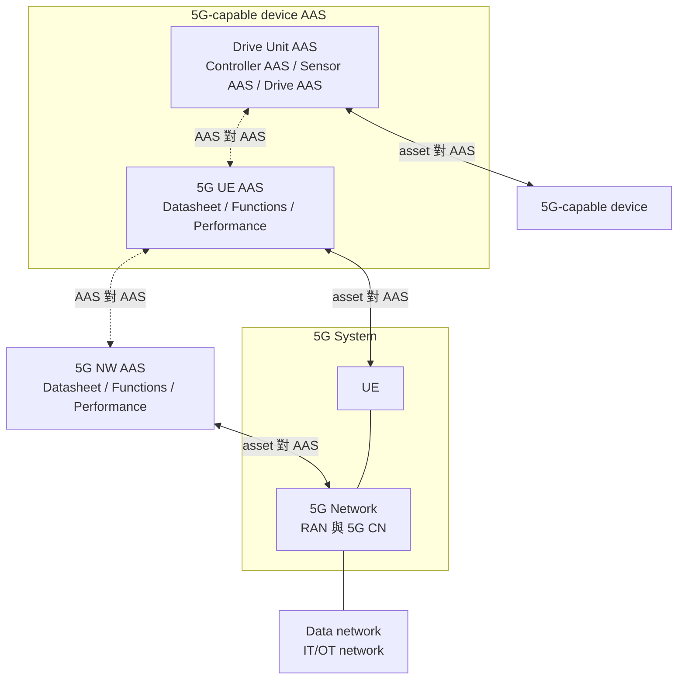
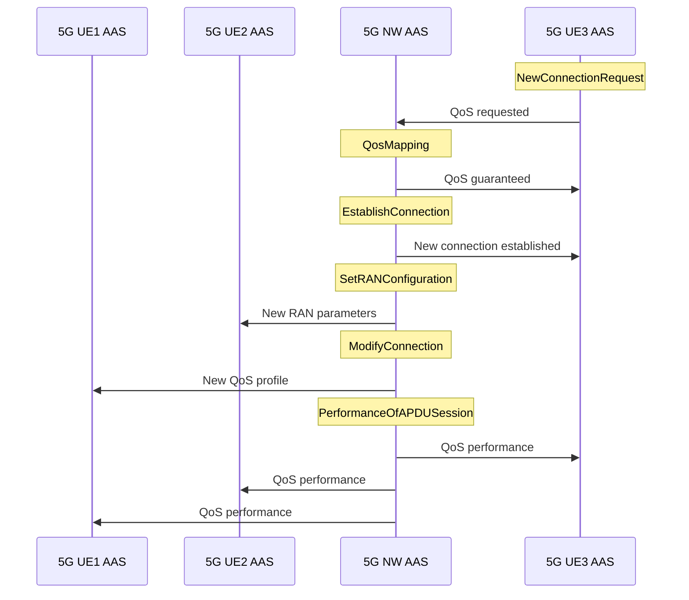

# 5G 的 Asset Administration Shell（Gómez-Jerez 等，2024）

| 項目 | 內容 |
| --- | --- |
| 標題 | 5G UE and Network Asset Administration Shells for the Integration of 5G and Industry 4.0 Systems |
| 作者與單位 | Jorge Gómez-Jerez、Jorge Cañete-Martín、M.Carmen Lucas-Estañ、Javier Gozalvez；Uwicore laboratory, Universidad Miguel Hernandez de Elche, Elche (Alicante), Spain |
| 出處 | Proc. of 2024 IEEE International Conference on Emerging Technologies and Factory Automation (IEEE ETFA 2024), Sept. 2024, Padova, Italy（照 PDF 首頁的引用格式；PDF 未列頁碼） |
| DOI 或連結 | DOI 10.1109/ETFA61755.2024.10710725；<https://ieeexplore.ieee.org/document/10710725>；arXiv 2606.18762（編號由本次任務指示提供，PDF 頁面上沒有印 arXiv 編號） |
| 本次閱讀的版本 | 作者版（PDF 首頁標示 author-created postprint version），共 8 頁 |
| 類型 | 架構提案（附公開釋出的資料模型實作；沒有接 5G 網路，沒有量測） |

## 一分鐘版本

這篇論文為 5G 系統定義了兩份 Asset Administration Shell（AAS，Industry 4.0 用來描述一項資產的標準化數位表示）：一份描述 5G UE，一份描述 5G 網路，目的是讓工廠的應用不必理解 5G 的管理細節就能讀取 5G 的資料、呼叫 5G 的能力。論文的實質內容是一份資料模型：5G NW AAS 有 9 個 submodel，5G UE AAS 有 6 個 submodel，逐一列出欄位與 operation，並用 AASX Package Explorer 與 BaSyx Python SDK 建成檔案後公開在 GitHub。論文沒有實驗，沒有接上任何 5G 核心網路，也沒有說明這些欄位的值要從 5G 的哪個 API 取得。NWDAF、NEF、SEAL 在全文中只被點名為「5G 提供的分析與開放介面」，各出現三到四次，沒有任何串接。對讀者的用處是：它提供一份工廠端期待從 5G 拿到哪些資料的清單，其中 `QosPrediction` submodel 的訂閱欄位與 NWDAF 的 QoS Sustainability analytics 幾乎一一對應，而「AAS 與 5G 之間的那一段」是論文留下的空白。

## 1. 要解決的問題

5G 能滿足工業應用的延遲、可靠度與頻寬需求，也能以 Non-Public Network（NPN）部署在工廠內，但 5G 網路的管理很複雜，會妨礙它整合進工業環境。論文認為需要一種工具，把網路管理的複雜度隱藏起來（§I）。

Industry 4.0 處理互通性的通用做法是 AAS。產業聯盟 5G-ACIA（5G Alliance for Connected Industries and Automation）在白皮書 [5] 中主張把 UE 與網路其餘部分分開建模，提出 5G UE AAS 與 5G NW AAS 兩個概念，並給了應該納入哪些參數的指引，但沒有給出完整設計（§I）。

論文對既有研究的評價如下（§I）：

| 文獻 | 做了什麼 | 論文指出的不足 |
| --- | --- | --- |
| [6]、[7] | 在工業機器的 AAS 內加入 Wireless Module submodel，[7] 再加入 QoS submodel | 只涵蓋裝置端，沒有網路 AAS；不符合 5G 標準 |
| [8] | 在 5G UE 與 NW AAS 內定義 Intent submodel，用於 intent-driven 的網路管理 | 見表後說明 |
| [9] | 定義含主動 operation 的 5G submodel：建立或釋放 PDU session，以及向 5G 網路取得某個 UE 的訂閱資料 | 只處理這一項功能 |

論文另外指出，[6]、[7]、[8] 的 AAS 都只有可讀寫的被動資料，而且沒有公開釋出（§I）。

論文主張自己的貢獻是：第一個公開釋出的完整 5G 系統 AAS，同時符合 3GPP 標準、Plattform Industrie 4.0 的 AAS 規範與 5G-ACIA 的指引，包含被動屬性與主動 operation（摘要、§I）。「第一個」的說法在 §I 附有「To the authors' knowledge」的限定。

## 2. 需要的背景

以下名詞依論文 §I、§II 的說明整理。

- **Plattform Industrie 4.0**：德國推動 Industry 4.0 的組織，AAS 的規範由它發布（[3]、[16]）。
- **Asset**：Industry 4.0 中任何需要被管理的實體或邏輯對象，包含機器、文件、材料、軟體（§II）。
- **AAS（Asset Administration Shell）**：一項 asset 的標準化數位表示，提供它的特性、能力、狀態與運作資料，同時也是其他系統存取這項 asset 的虛擬介面（§II）。
- **Submodel**：AAS 內部的資料分組單位。一份 AAS 由多個 submodel 組成，每個 submodel 內是 submodel element，型別可以是 property、list、collection 等（§II）。
- **被動部分與主動部分**：被動部分是可經訊息介面（例如 API）讀取或修改的資料。主動部分是 operation，描述可以執行的技術功能，例如重新配置某個程序（§II）。
- **AAS 的三種型別**（Plattform Industrie 4.0 [3] 的分類，§II）：

| 型別 | 名稱 | 互動方式 |
| --- | --- | --- |
| Type 1 | passive | 以檔案交換資料，格式為 AASX、XML、JSON 或 AutomationML |
| Type 2 | re-active | 經標準介面（REST 或 OPC UA）互動，採 client/server 或 publisher/subscriber 模型 |
| Type 3 | pro-active | AAS 之間 peer-to-peer 互動，可以協作並依互動結果調整自己的行為，例如協商 |

- **OPC UA（Open Platform Communications Unified Architecture）**：工業自動化常用的通訊與資料建模標準，論文把它當作 AAS 之間的標準通訊介面之一（§I、§II）。
- **AASX Package Explorer**：建立與檢視 AAS 檔案的開源工具（[11]）。**BaSyx**：Eclipse 的開源 AAS 軟體，論文使用它的 Python SDK（[12]）。
- **TSN（Time-Sensitive Networking）**：工廠使用的確定性乙太網路；整合時 5G 網路整體被視為一台 TSN bridge，稱為 5GS Logical Bridge（§IV-G）。

**解讀：** 對熟悉核心網路的讀者，可以把 AAS 想成「一份有固定 schema 的資源樹，加上一組可呼叫的 operation，對外用 REST 或 OPC UA 提供」。Submodel 相當於這棵樹的第一層分組。它與 NF 的 SBI 資源模型相似，差別在 schema 的規範來自 Industry 4.0，不來自 3GPP。

## 3. 方法與架構

### 3.1. 整體配置

論文把 5G 系統的 AAS 拆成 5G UE AAS 與 5G NW AAS。5G UE AAS 應作為一個 submodel 放進「具 5G 能力的工業裝置」的 AAS 內；5G NW AAS 描述 RAN 與核心網路中最相關的功能（§III）。

依論文圖 1 重繪。原圖另以虛線框標出「5G AAS」，範圍是 5G UE AAS 加上 5G NW AAS。

圖 1 中有兩種介面：AAS 與 AAS 之間的介面，以及 AAS 與它所代表的 asset 之間的介面。**未能確認：** 論文只畫出「asset 對 AAS」這條線，沒有說明 5G NW AAS 與 5G 網路之間用什麼協定或 API 連接。這一段正是 NWDAF、NEF、SEAL 可能出現的位置，詳見第 6、7 節。

### 3.2. 設計原則

- **以功能分組，不以節點分組。** 5G 網路由許多實體與邏輯元件組成，逐節點建模很複雜。論文改把資訊依 5G 網路的功能或操作分組，理由是比較容易演進與擴充，實作時也可以只保留需要的功能（§III、§VII）。
- **資料以事件訂閱的方式提供。** 資料可以隨選、週期性或事件觸發取得。事件觸發的例子是被監測的參數超過門檻，或某個 UE 進入工廠內的特定區域。每個需要訂閱的 submodel 都保存一份「已請求的訂閱清單」，以及每筆訂閱的「已通知事件清單」；保留事件紀錄是為了追蹤 5G 系統的演變（§III）。
- **兩份 AAS 都屬於 Type 2（re-active）。**（§III、§IV-I）
- **對外介面是 OPC UA。** 原文是兩份 AAS「will be able to interface with other AASs and industrial applications using OPC UA」（§III）。
- **另含五個預設 submodel**：Nameplate、Identification、Documentation、Service、TechnicalData，使用 Plattform Industrie 4.0 的標準模板（§III，[17]、[18]）。這五個不在圖 2、圖 3 內。

### 3.3. 5G NW AAS 的 submodel

下表依 §IV 與圖 2 整理。「論文寫明的依據」欄只列論文自己引用或點名的來源。最後一欄是我們的對應，不是論文的內容。

| Submodel | 內容 | Operation | 論文寫明的依據 | 解讀：實際部署時可能的 5G 來源 |
| --- | --- | --- | --- | --- |
| `NPN5GNWIdentity`（§IV-A） | PLMN ID 或 NPN ID | 無 | 未指明 | 部署設定，靜態資料 |
| `AssetServiceRegistry`（§IV-B） | Asset Service 描述、Integrator Company、規劃參考資料、工廠的 5G 涵蓋圖、網路業者與工廠之間的 SLA（含衡量指標與各 service type 的預期效能） | 無 | 5G-ACIA [5] | 規劃與合約文件，不來自 5G 介面 |
| `Network5GDataSheet`（§IV-C） | 支援的 3GPP release、支援與使用的頻段、DL 與 UL 最大資料速率、支援的網路協定；網路拓樸：每個 RAN 與 CN 節點的型別、IP、連線、位置、所在虛擬機與其運算及記憶體資源；RAN 節點另有最大發射功率、頻段、接收靈敏度；節點間的鏈路與容量 | 無 | 未指明 | 管理系統（OAM）或部署清單 |
| `VirtualNetworks`（§IV-D；圖 2 寫作 `VirtualsNetwork`） | Network slice 清單：S-NSSAI、可配置屬性與其值、執行該 slice 的虛擬機運算資源。VLAN 清單：IP 位址、VLAN ID、priority、VLAN tag、配置的運算資源 | `NetworkSliceReconfiguration`、`VLANReconfiguration` | TS 23.501 [19]；slice 屬性取自 GSMA Generic Network Slice Template [20] | 切片管理屬於管理系統；SEAL 一側的對應是網路切片能力支援（NSCE） |
| `Connectivity`（§IV-E） | 已 attach 的 UE 清單（PEI、GPSI）；已建立的 PDU session 清單；每個 session 的 QoS flow：QFI、UE 請求的 QoS profile、網路保證的 QoS profile、alternative QoS profile | `EstablishConnection`、`QosMapping`、`SetRANConfiguration`、`ModifyConnection` | TS 23.501 [19]；QoS mapping 引 TS 29.513 [21]；PDU session 修改程序引 [14] | AMF、SMF 的事件開放；QoS 請求走 PCF（直接或經 NEF）；SEAL 一側的對應是網路資源管理（NRM） |
| `QosPerformance`（§IV-F） | 每次封包傳輸、每個 QoS flow、每個 PDU session 的 service availability、reliability、PER、service bit rate、BLER、data throughput、latency；計算週期 update time；每個邏輯網路（slice 或 VLAN）的 PER、BLER、reliability、latency、throughput；訂閱清單與已通知事件 | `PerformanceOfAPacketTx`、`PerformanceOfAQoSFlow`、`PerformanceOfAPDUSession`、`SubscriptionManagement` | 指標定義引 TS 22.261 [22]；訂閱「leveraging the 5G exposure capabilities introduced with NWADF, NEF and SEAL」（原文拼作 NWADF） | NEF 的 QoS 監測事件、NWDAF 的統計型分析、SEAL NRM 的 QoS 監測 |
| `TSNCapabilities`（§IV-G） | 5GS Bridge delay、每個 port 的傳播延遲；配置參數（IP、ports、VLAN-ID、VLAN priority）；啟用中的 TSN flow 清單，每個 flow 含 TSCAI（TSC Assistance Information）的 survival time、packet arrival time、periodicity | 無 | TS 23.501 [19] | TSN AF 或 TSCTSF；TS 23.434 §14.2.2.2 規定 SEAL NRM server 在 TSN 整合時作為 TSN AF |
| `Location`（§IV-H） | 每個連線 UE（以 PEI 識別）的直角座標位置、速度、加速度；LCS QoS Class（定位精度與回應時間）；訂閱清單與已通知事件 | `SubscriptionManagement` | TS 23.273 [23] | 5G 定位服務（LCS）、NEF 的位置事件；SEAL 一側的對應是位置管理 |
| `QosPrediction`（§IV-I） | 訂閱清單：要預測的 QoS 參數、預測的時間範圍、需要預測的區域或路徑；可預測整個網路或特定 UE 連線的 QoS；已通知的預測事件 | `SubscriptionManagement` | 「With NWDAF, a 5G network can provide not only analytics but also the capacity to predict the QoS of 5G connections」 | NWDAF 的 QoS Sustainability analytics（TS 23.288 §6.9） |

圖 2 另外列出文字沒有提到的欄位，例如 `TSNCapabilities` 內的 `BridgeID`、`TrafficClasses`、`TimeSyncronizationStatus`，以及每個 TSN flow 的 `DestinationIP`、`DestinationMacAddress`、`StreamId`。

論文對 operation 的用語是「should emulate」或「includes the possibility to implement」。`NetworkSliceReconfiguration`、`VLANReconfiguration`、`EstablishConnection`、`ModifyConnection` 用的是 emulate（§IV-D、§IV-E）。`SetRANConfiguration` 用來設定支援特定 QoS profile 所需的 RAN 參數，例如使用的 MCS、最大重傳次數、5G numerology，也可以用來評估某組 RAN 參數能達到什麼效能（§IV-E）。

### 3.4. 5G UE AAS 的 submodel

下表依 §V 與圖 3 整理，欄位意義同上表。

| Submodel | 內容 | Operation | 論文寫明的依據 | 解讀：實際部署時可能的來源 |
| --- | --- | --- | --- | --- |
| `UE5GIdentification`（§V-A；圖 3 寫作 `Ue5GIdentification`） | IMSI、PEI、GPSI、PIN、ICCID、SPN（Service Provider Name）、認證憑證與其狀態、UE 的 IP 與 MAC 位址 | 無 | 未指明 | UE 與 SIM 的本地資訊 |
| `UE5GDatasheet`（§V-B） | 支援的 operating bands 與 duplex mode、最大傳輸頻寬；收發特性：最大輸出功率、output power dynamics、輸出 RF 頻譜發射、reference sensitivity power level、adjacent channel selectivity、收發天線數與 layer 數 | 無 | TS 38.101 [24] | UE 的規格文件 |
| `NetworkAccessRestrictions`（§V-C） | UE 可連線的 cell 清單（CGI）；UE 可連線的 slice 清單（S-NSSAI），由網路連同保證的 QoS profile 一起決定 | 無 | 5G-ACIA [25] | 訂閱資料與網路核發的 slice 清單 |
| `UEAttachAndConnectionStatus`（§V-D） | 是否 attach、RRC 狀態；啟用中的 PDU session 與 QoS flow，各含請求與保證的 QoS profile；滿足保證 QoS 所需的 RRM 參數：MCS 與 CQI 表、目標 BLER、排程型別與策略、HARQ 最大重傳次數、重複次數 k、功率控制的最大發射功率 | `NewConnectionRequest`、`ConnectionModificationRequest` | 未指明 | UE modem 的本地狀態 |
| `QosMonitoring`（§V-E） | 訊號品質 RSSI、RSRP、RSRQ；所有 PDU session 的整體效能：平均 data throughput、斷線比例、handover 成功率、SINR、平均 BLER 與 PER；每個 PDU session 與 QoS flow 的效能（指標同 `QosPerformance`）；update time；兩組訂閱清單 | `SubscriptionRequest`、`SubscriptionManagement` | 5G-ACIA [10] | UE modem 的量測，加上 5G NW AAS 的通知 |
| `Location`（§V-F） | UE 目前位置、要求的定位服務品質（LCS QoS Class、accuracy、response time）；兩組訂閱清單 | `SubscriptionRequest`、`SubscriptionManagement` | TS 23.273 [23]；論文說位置資訊由網路產生後傳給 UE | 5G NW AAS 的 `Location` submodel |

`QosMonitoring` 與 UE 的 `Location` 各有兩組訂閱清單，方向相反（§V-E、§V-F，圖 3）：

- `ListOfNWSubscriptions` 與 `SubscriptionRequest`：5G UE AAS 作為訂閱者，向 5G NW AAS 訂閱事件，並保存收到的事件。
- `ListOfSubscriptions` 與 `SubscriptionManagement`：5G UE AAS 作為提供者，接受同一台工業裝置上的應用訂閱，並保存已通知的事件。

UE 的 PDU session 資訊、效能資訊、位置資訊在 5G NW AAS 內都有一份。論文說明重複的理由是讓實作在 5G 裝置上的工業應用也能存取這些資料（§V-D、§V-E、§V-F）。

### 3.5. 應用範例

§VI 用一個情境說明兩份 AAS 可能的用法，改編自 5G-ACIA [10] 的 QoS 管理案例。工廠內有兩台 5G 工業機器人（UE1、UE2）已有連線，各有保證的 QoS profile。新的製程需要高解析度影像檢測，一台 5G 攝影機（UE3）啟動並請求高頻寬的新連線。

依論文圖 4 重繪。

流程的含意（§VI）：5G NW AAS 依網路目前狀態、請求的 QoS（含優先權）與既有連線的 QoS profile，決定能保證給 UE3 的 QoS profile。UE3 加入後網路狀態改變，5G NW AAS 為 UE2 設定新的 RAN 參數以維持它的保證 QoS，例如增加重傳次數；並修改 UE1 的 QoS profile。最後估計三條連線的效能，確認 QoS 需求是否滿足，結果經訂閱與事件提供給工業應用。

**解讀：** 在這個範例裡，5G NW AAS 做了 admission control、QoS 協商與 RAN 參數調整的決策，角色比「網路的數位表示」大得多，更接近一個網路控制器。論文沒有說明這些決策實際由誰執行、5G NW AAS 與 PCF、SMF、gNB 之間如何分工。

## 4. 實驗與結果

論文沒有實驗，沒有模擬，沒有任何量測數字，也沒有結果表。全文沒有出現 testbed、measurement 結果、free5GC、Open5GS 或任何商用核心網路的名稱（以全文文字檢索確認）。

論文用來支持主張的只有四樣東西：

- **資料模型本身。** 圖 2、圖 3 與 §IV、§V 的逐項說明。
- **建模工具。** 兩份 AAS 以 AASX Package Explorer [11] 與 BaSyx [12] 的 Python SDK 實作（§I、§III）。
- **公開釋出。** 實作與程式碼放在 GitHub [1]（摘要、§I、§III、§IV、§VII）。
- **一個走過流程的範例。** §VI 與圖 4，論文自己的措辭是「an example of the potential use」。

**未能確認：** 「實作」的實際範圍。論文稱 AAS 屬於 Type 2，但沒有描述有無執行中的 AAS server、OPC UA 或 REST 端點是否可用、operation 背後有無可執行的程式。論文對 operation 一律使用「should emulate」「possibility to implement」，§VII 也說 operation「can be tailored to future specific use cases」。本次閱讀沒有連線檢視 GitHub repository，無法確認其中是 AASX 模型檔、BaSyx 的物件定義，或另有可執行的邏輯。

公開釋出的網址，照論文參考文獻抄錄：

| 項目 | 網址 |
| --- | --- |
| 論文的 5G AAS 實作 [1] | <https://github.com/uwicore/5G-AAS> |
| AASX Package Explorer [11] | <https://github.com/admin-shell-io/aasxpackageexplorer> |
| BaSyx Python SDK [12] | `https://github.com/eclipsebasyx/basyx-python-sdk`（PDF 中的寫法；跨行處可能少了連字號，未上網查證） |
| Plattform Industrie 4.0 的 submodel 模板瀏覽器 [18] | <https://admin-shell-io.com/5011/> |

## 5. 限制

### 5.1. 文獻自己承認的

論文沒有獨立的限制或未來工作章節。可以從文字中讀出的自我限定有三點：

- 目前的實作是 Type 2（re-active），不是 Type 3（pro-active）。`QosPrediction` submodel 是為了日後演進到 Type 3 而預留的（§IV-I）。
- Operation 的內容要等到具體使用情境才會確定（§VII）。
- §VI 的範例是「potential use」，不是已實現的系統。

### 5.2. 我們看到的

**解讀：** 以下各點都是我們的評估。

- **沒有驗證。** 沒有任何資料顯示這份模型能被實際的工業應用使用，也沒有檢驗欄位是否足夠或過多。「完整」的依據只有對照 5G-ACIA 白皮書。
- **AAS 與 5G 之間的連接是空白。** 每個欄位的值從哪個 NF、哪個 API 取得，更新頻率多少，論文都沒有交代。§III 說 AAS「following the exposure interfaces in 5G」，但沒有任何 submodel 對應到具體的 3GPP 服務操作。
- **部分 operation 超出 5G 現有開放能力的範圍。** `SetRANConfiguration` 要指定 MCS、重傳次數與 numerology，`QosMapping` 要由 AAS 決定保證的 QoS profile。這些在 5G 系統內分別是 gNB 排程器與 PCF、SMF 的職責，NEF 沒有開放這種粒度的控制。論文沒有討論誰有權限做這些事。
- **UE 與網路兩邊的重複資料沒有一致性機制。** PDU session、效能、位置都存兩份，論文沒有說明以誰為準、如何同步。
- **敏感資料的存取控制沒有設計。** `UE5GIdentification` 內有 IMSI 與 PIN。§II 提到 AAS 介面可以控制存取，但沒有針對這些欄位的說明。
- **位置用直角座標表示，沒有說明座標系。** 與 5G 定位服務回報的地理座標之間如何轉換沒有交代（§IV-H）。
- **原文有幾處不一致**，列在本文最後的「查證紀錄」。

## 6. 與 SEAL 的關係

**文獻提到多少。** SEAL 在論文正文出現三次，另有一筆參考文獻，沒有任何 SEAL 的圖：

| 位置 | 原文內容 |
| --- | --- |
| §III 第三段 | 5G 定義了分析與開放的介面及服務，包含 NWDAF、NEF 與 SEAL |
| §III 註腳 1 | 5G 透過 SEAL enablers 簡化開發產業應用常用資訊的取得，例如 group、location、identity 與 network resource management [15] |
| §IV-F | 外部應用或 AAS 訂閱 QoS 效能時，是「leveraging the 5G exposure capabilities introduced with NWADF, NEF and SEAL」 |
| 參考文獻 [15] | 3GPP TS 23.434 V17.7.0（Rel-17），Sep. 2022 |

**是否真的串接了 SEAL。** 沒有。判斷依據如下：

- 全文沒有出現 SEAL server、SEAL client、VAL、CAPIF、SEAL-S、SEAL-UU，也沒有任何一個 SEAL API 的名稱。SEAL 只以整體名稱出現。
- 沒有任何 submodel 的欄位或 operation 被標示為由 SEAL 的某項服務提供。§IV-F 那一句是唯一落在 submodel 層級的提及，而且是三者並列的概括說法。
- §IV-H 的 `Location` submodel 與 §IV-D 的 slice 重新配置都沒有提到 SEAL，雖然這兩項在 SEAL 有直接對應的服務。
- 論文沒有接任何 5G 網路（見第 4 節），因此也不可能接 SEAL server。

結論：SEAL 在這篇裡是設計層次的背景說明，說的是資料「可以」經由這類介面取得。

**解讀：** 論文把 SEAL 與 NWDAF、NEF 並列為「5G 的開放介面」，這個歸類比較粗略。依 TS 23.434，SEAL 是位於產業應用層（VAL，Vertical Application Layer）與 3GPP 網路之間的一層共用服務；SEAL server 對核心網路的身分是 AF，本身要經過 NEF 或直接使用網路能力。三者不在同一層。

**解讀：** 5G NW AAS 與 SEAL server 在架構上站在同一個位置：兩者都夾在產業應用與 5G 網路之間，把網路能力整理成應用容易使用的形式。差別在對上的介面，AAS 用 Industry 4.0 的資料模型與 OPC UA 或 REST，SEAL 用 CAPIF（Common API Framework，3GPP 定義的 API 開放框架）下的 RESTful API。因此合理的組合是把 SEAL server 放在 5G NW AAS 的下方，作為它的資料來源之一。逐項對應如下：

| 論文的 submodel 或 operation | SEAL 的對應（TS 23.434） | 對應的程度 |
| --- | --- | --- |
| NW `Location`：位置訂閱、週期回報、UE 進入區域時通知 | 位置管理：位置資訊訂閱（§9.3.7）、事件觸發通知（§9.3.8）、區域監測（§9.3.12） | 高。訂閱與通知的結構相同 |
| UE `Location` 與 `QosMonitoring`：裝置端的資料與訂閱 | SEAL client 在終端上的角色 | 中。SEAL client 向 SEAL server 回報；論文的 UE AAS 則是向 NW AAS 訂閱並服務本機應用 |
| `Connectivity` 的 `ModifyConnection`、`QosMapping` | 網路資源管理（NRM）的 unicast resource management（§14.3.3） | 中。NRM 以 AF 身分請求 QoS，由網路決定結果；論文讓 AAS 自己決定 |
| `QosPerformance` 的訂閱 | NRM 的 QoS 監測（§14.3.3）與事件監測（§14.3.6） | 中 |
| `TSNCapabilities` | NRM server 作為 TSN AF（§14.2.2.2） | 中。SEAL 定義了取得 5GS TSN bridge 資訊的角色；論文只定義欄位 |
| `VirtualNetworks` 的 `NetworkSliceReconfiguration` | 網路切片能力支援（NSCE，§16；細節在 TS 23.435） | 低。本地沒有 TS 23.435，未核對 |
| 「一個或一組 UE」的效能與位置（§IV-F、§IV-H） | 群組管理（§10） | 低。論文沒有定義群組的資料結構 |

SEAL 與核心網路的互動方式可參考既有解讀文件[第 03 篇][seal-03]，位置管理見[第 02 篇][seal-02]。

## 7. 與 NWDAF 的關係

**文獻提到多少。** NWDAF 在正文出現四次（其中一次拼成 NWADF），沒有引用 TS 23.288：

| 位置 | 原文內容 |
| --- | --- |
| §III 第三段 | 與 NEF、SEAL 並列為 5G 的分析與開放介面 |
| §III 註腳 1 | NWDAF 從各個 5G 核心網路功能與 AF 收集資料並產生統計，例如網路效能或 network slicing 相關的統計 [13]；這些統計可以經 NEF 開放給外部應用 [14] |
| §IV-F | `QosPerformance` 的訂閱利用 NWADF、NEF、SEAL 帶來的開放能力 |
| §IV-I | 有了 NWDAF，5G 網路除了分析之外還能預測 5G 連線的 QoS；這類預測對主動式的網路管理很重要，可以依 UE 的移動、流量需求或網路狀態預先因應 |

**是否真的串接了 NWDAF。** 沒有。判斷依據如下：

- 全文沒有出現任何 Analytics ID、任何 NWDAF 服務操作名稱，也沒有 AnLF、MTLF、ML model 等字樣。
- `QosPrediction` submodel 只有訂閱清單、已通知事件清單與一個 `SubscriptionManagement` operation（§IV-I，圖 2）。論文沒有說明預測值由誰計算、如何填入。
- §IV-I 明說這個 submodel 是為了「facilitate its future evolution to a type 3 or pro-active AAS」而放進去的，目前的實作是 Type 2。
- §VI 的範例沒有用到 `QosPrediction`，也沒有出現 NWDAF。
- 參考文獻 [14] 是 TS 29.520（NWDAF 的 Stage 3 服務規格），但正文引用 [14] 的兩處分別是在講 NEF 與 PDU session 修改程序，沒有用它說明 NWDAF 的任何介面。

結論：NWDAF 在這篇裡是 `QosPrediction` 與 `QosPerformance` 兩個 submodel 的動機來源，停在「預測能力來自 NWDAF」這一句話，沒有設計出介面，也沒有實作。

**解讀：** `QosPrediction` 的訂閱欄位可以對到 NWDAF 的 QoS Sustainability analytics（TS 23.288 §6.9.1）的請求參數：

| 論文 `QosPrediction` 訂閱的內容（§IV-I） | QoS Sustainability analytics 的請求參數（TS 23.288 §6.9.1） |
| --- | --- |
| 要預測的 QoS 參數 | Analytics Filter Information 的 QoS requirements：5QI 與附加 QoS 參數，或 Resource Type、PDB、PER |
| 預測的時間範圍 | Analytics target period |
| 需要預測的區域或路徑（area or path of interest） | Location information：Area Of Interest 或 path of interest |
| 特定 UE 連線的預測 | Target of Analytics Reporting：any UE 或 UE 清單 |
| 隨選、週期或事件觸發 | Request-Response 或 Subscribe-Notify；Reporting Threshold |

論文連用詞「area or path of interest」都與 TS 23.288 一致，但沒有引用它。

**解讀：** 其他 submodel 與 NWDAF 分析的可能對應：

- `QosPerformance` 的每 slice 效能，可以由 slice load level 相關分析（TS 23.288 §6.3）或 Observed Service Experience（§6.4）的統計補充。
- `QosPerformance` 的每 UE 使用者面效能，接近 DN Performance Analytics（§6.14）提供的流量速率、封包延遲與封包遺失率。
- `Location` 目前只有現況，沒有預測。若要擴充，對應的是 UE mobility analytics（§6.7.2）。

**解讀：** 在論文的架構裡，5G NW AAS 相對於 NWDAF 是一個分析消費者。它要取得 NWDAF 的分析，就必須以 AF 的身分直接訂閱，或經 NEF 取得，或再透過 SEAL server 間接取得。論文沒有選定其中任何一條路徑。

## 8. 對你的研究可以怎麼用

本節全部屬於解讀。

- **當作「產業端需求清單」的引用來源。** 這篇與它依據的 5G-ACIA 白皮書 [5]、[10] 說明了工廠應用期待從 5G 取得哪些資料。在論文的動機段可以引用它說明：工業界的 AAS 設計已經把 NWDAF 的 QoS 預測列為必要能力，但介面尚未被定義或實作。引用時要注意它對 NWDAF 與 SEAL 都只有點名，不能寫成「該文整合了 NWDAF」。
- **可以填補的缺口：AAS 的南向介面。** 論文完全沒有做 5G NW AAS 與 5G 核心網路之間的連接。一個具體的工作是寫一個轉接器，向 free5GC 上的 NWDAF 訂閱 QoS Sustainability analytics，把通知寫進 `QosPrediction` 的已通知事件清單。這樣就有一個來自 Industry 4.0 的真實分析消費者，可以用來展示 NWDAF 的分析如何到達應用。
- **可以當作 SEAL 路徑與直連路徑的比較情境。** 同一個 `QosPrediction` 訂閱，可以分別經「AAS 作為 AF 直接訂閱 NWDAF」「經 NEF」「經 SEAL NRM server 或 ADAE」三條路徑實現。這篇提供了上層的固定需求，適合拿來比較三條路徑的差異。
- **可重用的程式與資料。** 論文公開了 AAS 模型（網址見第 4 節）。若要做上述轉接器，可以直接使用它的 submodel 定義，不必自己設計 schema。repository 的實際內容本次沒有檢視，使用前需要先確認。
- **與 federated learning 的關係。** 沒有。論文沒有討論模型訓練、資料分佈或多方協作。唯一提到學習的地方是 §IV-D 以 Reinforcement Learning 作為觸發 slice 重新配置的例子，沒有展開。
- **沒有可以對照的實驗設計或資料集。** 論文沒有實驗，也沒有釋出量測資料。

## 9. 值得追的參考文獻

以下照論文的參考文獻抄錄。

- [5] 5G-ACIA, *Using Digital Twins to Integrate 5G into Production Networks*, 5G-ACIA White Paper, Feb. 2021. 這篇論文的直接依據，5G UE AAS 與 5G NW AAS 的概念出自這裡。
- [10] 5G-ACIA, *Exposure of 5G Capabilities for Connected Industries and Automation Applications*, 5G-ACIA White Paper, v2, Feb. 2021. 工業應用需要 5G 開放哪些能力的需求來源，§VI 的範例也改編自它。
- [9] D. Rossi, G. Tontini, D. Borsatti and F. Callegati, "Integration of 5G connectivity with the Asset Administration Shell in Industry 4.0", in *Proc. of the 13th International Conference on Network of the Future (NoF)*, Ghent, Belgium, 2022, pp. 1-3. 依論文的描述，它的 AAS operation 會建立或釋放 PDU session，並向 5G 網路取得 UE 的訂閱資料，是既有研究中最接近「真的接上 5G 網路」的一篇。
- [8] R. F. Ustok, A. Cihat Baktir and E. D. Biyar, "Asset Administration Shell as an Enabler of Intent-Based Networks for Industry 4.0 Automation", in *Proc. 2022 IEEE 27th International Conference on Emerging Technologies and Factory Automation (ETFA)*, Stuttgart, Germany, 2022, pp. 1-8. 用 AAS 承載 intent 的做法，與 `QosPrediction`、QoS 協商這類需求相鄰。
- [25] 5G-ACIA, *5G QoS for Industrial Automation*, 5G-ACIA White Paper, Nov. 2021. 工業自動化對 5G QoS 的需求整理，可用來界定 QoS 預測的應用情境。
- [15] 3GPP, TSG SA; Service Enabler Architecture Layer for Verticals (SEAL); Functional architecture and information flows; Rel.17, 3GPP TS 23.434 V17.7.0, Sep. 2022. 論文引用的 SEAL 版本是 Rel-17；本工作區的解讀文件依 Rel-20，比對時要留意版本差異。

## 10. 閱讀建議

全文 8 頁，沒有數學與實驗，約 30 到 40 分鐘可以讀完。

- **必看：** 圖 2（第 4 頁）與圖 3（第 6 頁）。兩張圖就是論文的全部產出，比文字完整。
- **必看：** §III 第三段與註腳 1（第 2 至 3 頁）、§IV-F 最後一段、§IV-I。NWDAF、NEF、SEAL 的全部提及都在這四處，合計不到一頁。
- **建議看：** §VI 與圖 4（第 7 至 8 頁），了解作者設想 AAS 之間如何互動。
- **可以略過：** §IV-D、§IV-E 中對 network slicing、VLAN、QoS flow、5QI 的說明，以及 §V-A 對 IMSI、PEI、GPSI 的說明。這些是寫給工業自動化讀者的 5G 入門，對熟悉核心網路的讀者沒有新內容。
- **可以略過：** §II，本文第 2 節已涵蓋。

## 查證紀錄

**核對方式。** 以 `pdftotext -layout` 轉出全文，並直接讀取 PDF 的 8 頁。圖 1（第 2 頁）、圖 2（第 4 頁）、圖 3（第 6 頁）、圖 4（第 7 頁）另外以較高解析度轉成影像逐項檢視。圖內文字是影像，無法以文字檢索，欄位名稱是對照影像抄錄的。

**已核對的內容。**

- Submodel 數量：5G NW AAS 9 個（§IV-A 至 §IV-I，圖 2 有 9 個方塊），5G UE AAS 6 個（§V-A 至 §V-F，圖 3 有 6 個方塊）。兩張表的 submodel 名稱、欄位與 operation 名稱都對照過正文與圖。
- 預設 submodel 五個的名稱（§III）。
- AAS Type 1、2、3 的定義（§II）。
- SEAL、NWDAF、NEF 的出現次數：以文字檢索 `SEAL`、`NWDAF`、`NWADF`、`NEF` 逐一確認。SEAL 在正文三處加參考文獻 [15]；NWDAF 在正文四處，其中 §IV-F 拼作 NWADF；NEF 在正文三處。
- 「沒有接 5G 網路、沒有量測」：以文字檢索 `free5GC`、`Open5GS`、`testbed`、`measure` 確認。`measure` 只出現在描述文獻 [6] 的訊號量測與 SLA 指標兩處，與本文的實驗無關。
- 圖 4 的訊息順序與 §VI 的文字描述一致。
- 第 4 節的四個網址與第 9 節的六筆參考文獻，逐字對照第 8 頁。
- 第 6、7 節引用的 3GPP 條號，對照本地 `specs/Rel-20/` 的 TS 23.434（§9.3.7、§9.3.8、§9.3.12、§10、§14.2.2.2、§14.3.3、§14.3.6、§16）與 TS 23.288（§6.3、§6.4、§6.7.2、§6.9.1、§6.14）的標題與內容。論文引用的是 Rel-17，本文的對應是用 Rel-20 做的。

**原文中的疑點。**

- 參考文獻 [13] 與 [14] 的引用位置看起來互換了。註腳 1 用 [13]（TS 23.502）說明 NWDAF、用 [14]（TS 29.520，NWDAF 的 Stage 3 服務）說明 NEF；§IV-E 用 [14] 說明 PDU session 修改程序。若把兩者對調，三處都說得通。這是我們的推測。另外 [14] 的條目同時寫了「Rel 17」與「V18.5.1」。
- §VI 最後寫效能結果更新到「5G UE AASs (`QosPerformance` submodel) and 5G NW AAS (`QosMonitoring` submodel)」，與 §IV-F、§V-E 的歸屬相反。本文依 §IV、§V 與圖 2、圖 3：`QosPerformance` 屬於 5G NW AAS，`QosMonitoring` 屬於 5G UE AAS。
- §VI 寫 5G NW AAS 使用「the `SetRANConfiguration` operation in the 5G UE AAS」，但這個 operation 定義在 5G NW AAS 的 `Connectivity` submodel（§IV-E、圖 2），圖 3 的 5G UE AAS 沒有它。
- 圖與正文的命名不一致：圖 2 的 `VirtualsNetwork` 對正文的 `VirtualNetworks`；圖 3 的 `Ue5GIdentification`、`UeAttachAndConnectionStatus` 對正文的 `UE5GIdentification`、`UEAttachAndConnectionStatus`。圖內另有拼字錯誤（`Aceleration`、`ReferenceSensityPoweLevel`、`TimeSyncronizationStatus`）。本文表格採用正文的寫法。
- §V-A 說 `UE5GIdentification` 包含 ICCID，但圖 3 的欄位清單沒有 ICCID。
- §II 以 [1]（作者自己的 GitHub repository）作為「AAS 的資訊以 submodel 組織」的出處，看起來是誤植。

**無法確認的內容。**

- GitHub repository [1] 的實際內容，以及 operation 是否有可執行的實作。本次沒有發出任何網路請求。
- BaSyx Python SDK 的網址在 PDF 中是 `eclipsebasyx`，是否為跨行造成的連字號遺漏無法從 PDF 判斷。
- arXiv 編號 2606.18762 與 IEEE Xplore 正式版的頁碼。PDF 沒有印出這兩項，本文沒有上網核對。
- 正式出版版本與這份作者版在內容上是否有差異。

[seal-02]: ../../../specification-guides/nwdaf-vertical-application/Release%2020%20SEAL%2002%20服務模板與位置管理.md
[seal-03]: ../../../specification-guides/nwdaf-vertical-application/Release%2020%20SEAL%2003%20與核心網路的互動.md
