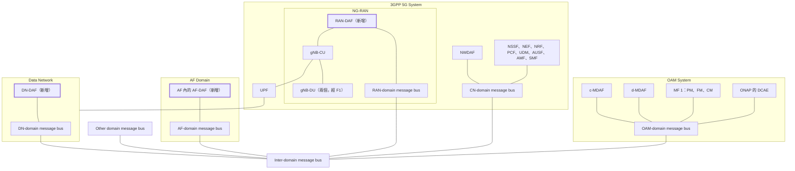

# 端到端資料分析框架（Pateromichelakis 等，2019）

| 項目 | 內容 |
| --- | --- |
| 標題 | End-to-End Data Analytics Framework for 5G Architecture |
| 作者與單位 | Emmanouil Pateromichelakis、Qing Wei、Ömer Bulakci（Huawei GRC，Munich）；Fabrizio Moggio（Telecom Italia）；Christian Mannweiler（Nokia Bell Labs）；Paul Arnold（Deutsche Telekom）；Mehrdad Shariat（Samsung Electronics R&D Institute UK）；Michael Einhaus（Leipzig University of Telecommunications）；Antonio De Domenico（CEA LETI） |
| 出處 | IEEE Access, vol. 7, pp. 40295–40312, 2019（Special Section on Roadmap to 5G）。2019-01-10 收稿，2019-02-10 接受，2019-03-05 刊出。經費來自 H2020 計畫 5G-MoNArch（Agreement 761445） |
| DOI 或連結 | 10.1109/ACCESS.2019.2902984 |
| 本次閱讀的版本 | 出版社正式版，共 18 頁 |
| 類型 | 架構提案（附一段小規模量測示例與一組模擬） |

## 一分鐘版本

這篇論文於 2019 年 1 月投稿，當時 3GPP 的分析功能只有核心網路的 NWDAF 與管理面的 MDAF（Management Data Analytics Function，SA5 定義的管理面分析功能），而且兩者都還在早期。作者主張分析應該是端到端的，所以在既有兩者之外再加三個實體：應用側的 AF-DAF、資料網路側的 DN-DAF、無線接取側的 RAN-DAF，全部用「各網域一條 message bus，再加一條跨網域 message bus」的服務化方式接起來。論文沒有實作這個架構，只用一個 V2X 案例示範 AF-DAF 與 RAN-DAF 的配合：一條萊比錫的 LTE 行車量測路線（517 個 SINR 樣本）加上一組 Monte-Carlo 模擬，模擬中兩個演算法合用比只用第一個在中位數多 16% 的 V2V 吞吐量。對讀者的用處是：它是「在 NWDAF 之外放一個應用層分析實體」這個想法的早期學術來源，而且直接點名 3GPP SA6 的 application enabler server 可以放分析功能，但它的架構與後來的 ADAE（TS 23.436）在方向與組成上都不相同。

## 1. 要解決的問題

論文認為分析功能分散在各網域，無法支撐切片與垂直產業需要的端到端保證。它在 §V 開頭列出三個具體缺口：

- RAN、CN、OAM、應用網域、資料網路（DN）各自的資料分析，在 5G 架構中尚未完整規範。
- 不同分析功能之間如何互動、交換哪些參數，還沒有被具體討論。
- 依切片或服務需求，端到端地設定與編排分析功能，還不被支援。

§III-D 另外指出當時的用法限制：分析「僅限於單一網路功能、單一切片之內」，而端到端的服務保證需要同時考慮切片內與切片間、控制面與管理面的資訊，以及來自應用層的回饋。

§V 也點出服務化架構本身的限制：NG-RAN 的功能不支援 SBA，而且服務的提供與使用無法跨網域（例如 RAN 與 CN）或跨平面（控制面與管理面）；3GPP 把服務的使用大致限制在核心網路控制面的 NF 之間。

## 2. 需要的背景

### 2.1. 論文描述的 2019 年標準現況

以下是論文 §III-D、§III-E、§IV 的說法，時間點是 2018 年 12 月前後（它引用的規格版本多為 2018 年 9 月到 12 月）。

| 網域 | 當時做到哪裡 | 論文認為還缺什麼 | 出處 |
| --- | --- | --- | --- |
| 核心網路（SA2） | Release 15 的 SBA 已有 NWDAF，讓 NF 取得營運商的分析，用途舉例為切片選擇與控制；PCF 可用每切片分析做政策決定，NSSF 可用負載分析選切片。NWDAF 沿用其他 NF 的服務暴露機制收集資料與提供分析 | Release 16 的研究項目 FS_eNA（TR 23.791）才要釐清分析能力的用法與框架；統一的資料收集與分析暴露服務還在提案中；NWDAF 如何把分析提供給 OAM「仍在討論」 | §III-D、§IV-B |
| 管理面（SA5） | Release 15 有服務化的管理架構（TS 28.533），MDAF 對外提供一個或多個 MDAS（Management Data Analytics Service）；MDAS 可存在於 NF、切片子網、切片三個層級，可集中部署或依網域部署 | TS 28.550 只定了兩項要求：讓授權的使用者要求收集「切片與切片子網」及「網路」的 management analytical KPI；KPI 的格式、分類與計算方法「尚未定義」 | §IV-C |
| RAN（RAN3、SA5） | 只有兩個 Release 16 研究項目：SA5 的 Study on SON for 5G（TR 28.861）與 RAN3 的 RAN-Centric Data Collection and Utilization for LTE and NR（RP-182105） | 是否引入一個負責資料收集與利用的 RAN 邏輯實體還在評估，它算控制功能或管理功能也未定 | §III-E、§VII |
| 應用層（SA6） | SA6 正在研究 V2X Application Enabler Server（TR 23.795） | 應用與網路之間的互動不夠靈活、不夠動態 | §III-A |

論文列出的 FS_eNA 使用情境（§IV-B）包含：NWDA-assisted 的 QoS provision、traffic handling、客製化移動管理、政策決定、QoS 調整、5G 邊緣運算、NF 負載平衡、切片 SLA 保證、可預期的網路效能，以及從 AF 取得資訊、UE 驅動的分析分享（UE 提供定位或情境資訊給 NWDAF）。

**解讀：** 論文沒有引用 TS 23.288，因為當時這份規格還不存在；它對 NWDAF 的描述停在 TS 23.501 V15.3.0 與 TR 23.791 V2.0.0。讀這一段時請把它當成「TS 23.288 出現之前」的快照，而不是現況。

### 2.2. 論文使用的分類

論文在 §II 把分析分成三個面向，後面的表 I 就用這套分類：

- **被分析的參數**（§II-A）：UE／session 相關、網路相關（RAN、傳輸網、CN）、服務相關（在終端或 AF 做的分析，例如 V2X 的 UE 軌跡、交通狀況、自動駕駛等級）、管理相關（PM、FM）、雲端相關。
- **時間尺度**（§II-B）：real-time（毫秒級，例如通道預測）、near-real time／non-real time（秒到小時）、on demand。
- **分析類型**（§II-C）：descriptive（現在發生什麼）、diagnostic（過去發生什麼、為什麼）、predictive（可能發生什麼）、prescriptive（該採取什麼行動）。

其他名詞：O-RAN 的 RIC（RAN Intelligent Controller）是把 RRC／RRM 這類無線控制功能虛擬化後集中放置的控制器；CU／DU 是 gNB 拆成的集中單元與分散單元，中間是 F1 介面；ONAP DCAE 是開源網路自動化平台 ONAP 中負責資料收集與分析的模組。

## 3. 方法與架構

### 3.1. 整體架構

論文保留 NWDAF 與 MDAF，新增三個實體，並讓每個網域各有一條 message bus，再由一條 inter-domain message bus 串起來（§V、圖 7）。論文沒有展開 AF-DAF、DN-DAF、RAN-DAF 的縮寫。

依論文圖 7 重繪；省略 UE、gNB-CU 與 AMF、UPF 與 SMF 之間的連線。

**解讀：** 圖 7 的 c-MDAF、d-MDAF 沒有在內文展開，依 §IV-C 應是 centralized MDAF 與 domain MDAF。圖中既有的分析功能是橘色、新增的三個是藍色，這個配色的意義是我們從圖判讀的，論文沒有圖例。

message bus 負責三件事：服務的註冊、探索、使用（§V）。它可以附帶負載平衡、failover、安全、訊息遞送規則、協定轉換，並把服務暴露到 inter-domain message bus 的服務目錄。這個設計引用 ETSI ZSM 參考架構 [27]。

論文特別說明它只定義放分析功能的「位置」：用什麼預測器與演算法、是否需要多個實體反覆互動，都被歸為實作議題，不在架構內（§V）。

### 3.2. 三個新增實體

| 項目 | AF-DAF | DN-DAF | RAN-DAF |
| --- | --- | --- | --- |
| 定義 | 應用層的分析功能。讓營運商依需求部署為 AF 網域客製的新功能，或讓垂直產業自己做支援端到端服務運作的分析（§V） | 營運商或垂直產業放在 DN 的功能，提供「非 3GPP 網路」（例如都會區 WAN）的服務或效能資料（§V） | 為 RAN 的功能（例如 RRM）做即時分析。理由是 RAN 要快速決策，而且無線量測的儲存與分析可能因商業因素不宜交給 CN 或 OAM（§V） |
| 位置 | 3GPP 5GS 之外的 AF Domain，畫在 AF 方塊內（圖 7）；案例中在 App Server（圖 8） | 3GPP 5GS 之外的 Data Network（圖 7）；案例中在 Edge Cloud（圖 8） | NG-RAN 內，與 gNB-CU 相連（圖 7）；案例中在 CU 層（圖 8）。屬於控制功能或管理／SON 功能未定（§V、§VII） |
| 誰部署 | 營運商或垂直產業（§V） | 營運商或垂直產業（§V） | 未明說 |
| 資料來源 | 沒有逐項列出。提到的有：每位使用者或群組的應用 session 資訊（§III-A）、V2X 應用伺服器或 client 預測的 UE 路線（§VI）、RAN-DAF 濾波後的 SINR 樣本（§VI-A） | 非 3GPP 網路的服務與效能資料，沒有細節 | UE 週期回報的原始無線量測（§VI-A）、AF-DAF 提供的 UE 路線與流量預測（§VI） |
| 消費者 | 與 CN 的 NWDAF 互動（§V）；案例中把預測交給 RAN-DAF（§VI）；目的是協助網路的 QoS 與資源配置（§III-A） | 5GS 或 OAM 網域內的其他分析功能（§V） | CU 或 DU 內的 RRM（排程器）（§VI）；AF-DAF 也使用它處理過的量測（§VI-A） |
| 與 NWDAF 的介面 | 經 NEF，或經 inter-domain message bus（§V） | 圖 7 只畫出經 message bus；§VII 提到 AF 與 DN 的分析都需要 NEF 支援暴露 | 不論是控制功能或管理功能，都經 inter-domain message bus（§V） |
| 與 MDAF 的介面 | 圖 7 經 message bus；內文沒有另外說明 | 同左，目標含 OAM 網域（§V） | 經 inter-domain message bus（§V） |
| 表 I 中的分析項目 | 7 項（見 3.3） | 沒有出現在表 I | 6 項（見 3.3） |

**未能確認：** 三個實體與 NWDAF、MDAF 之間都沒有定義具體的服務操作、參數或參考點。論文只說「經 message bus」或「經 NEF」，因此表中的介面欄只能寫到這個粒度。DN-DAF 在全文只有 §V 的一段定義與 §VI 的一句話（第三方分析可部署為 AF 或 Local DN，供有 MEC 的 RAN 節點使用），它與 AF-DAF 的分工沒有說清楚。

### 3.3. 表 I：哪種分析放在哪裡

以下照論文表 I 整理，括號內是分析類型。

| 類別 | 參數 | 放置位置（分析類型） | 時間尺度 |
| --- | --- | --- | --- |
| UE 相關 | Mobility | RAN-DAF（prescriptive）；AF-DAF（descriptive、predictive） | Real-time |
| UE 相關 | Interference level | RAN-DAF（predictive、prescriptive） | Real-time |
| UE 相關 | UE QoS | NWDAF（diagnostic、predictive）；AF-DAF（prescriptive） | Real-time／non-real time |
| 網路相關 | Radio resource situation | RAN-DAF（diagnostic、predictive、prescriptive） | Real-time／non-real time |
| 網路相關 | Traffic／load situation | NWDAF（diagnostic、predictive）；MDAF（prescriptive） | Non-real time |
| 網路相關 | Backhaul conditions／availability | RAN-DAF（descriptive、predictive）；NWDAF（diagnostic）；MDAF（prescriptive） | Non-real time |
| 網路相關 | Cell density | NWDAF（diagnostic、predictive）；MDAF（prescriptive） | Non-real time |
| 網路相關 | Network QoS | RAN-DAF 與 NWDAF（diagnostic、predictive）；AF-DAF（prescriptive） | Real-time／non-real time |
| 服務相關 | New／modified slice | UE 與 AF-DAF（prescriptive） | Real-time／non-real time |
| 服務相關 | NW assistance（V2X） | RAN-DAF 與 NWDAF（predictive）；AF-DAF（prescriptive） | Real-time／non-real time |
| 服務相關 | UE route／trajectory（V2X） | AF-DAF（prescriptive） | Real-time／non-real time |
| 服務相關 | Level of automation change（V2X） | UE 與 AF-DAF（prescriptive） | Real-time／non-real time |
| 管理相關 | PM | MDAF（descriptive、diagnostic） | Non-real time |
| 管理相關 | FM | MDAF（descriptive、diagnostic） | Non-real time |

**解讀：** 表 I 透露了作者的分工想法：NWDAF 與 RAN-DAF 負責「網路會怎樣」的診斷與預測，AF-DAF 多半被分到 prescriptive，也就是「應用該怎麼因應」。論文沒有解釋這個分配的理由。

### 3.4. 應用層分析功能做什麼

§III-A 把應用與網路之間的分析分成兩個方向：

1. **應用提供分析給網路。** 第三方透過經授權的 AF，把每位使用者或群組的應用 session 資訊分析交給營運商，協助網路的 QoS 與資源配置。論文認為這適合 V2X，因為應用伺服器掌握車隊編組、精確定位等資訊，並說這類 application-driven analytics 可能落在 3GPP SA6 的範圍 [8]。
2. **網路提供分析給應用。** 網路依自身的統計與預測，告知未來的資源與 QoS。應用伺服器訂閱後可提前調整服務，例如網路預告 QoS 將下降時，車輛降低自動駕駛等級。

為了讓這兩個方向動態進行，論文提出一個「middleware」（圖 1）。圖 1 的方塊標為「Middleware / Application Enabler Server」，方塊內畫了一個「Data Analytics Function」，四個步驟是：

1. 網路把 UE 與 RAN 的 context 交給 middleware。
2. middleware 向 Application Server 發出警示或網路狀態報告。
3. Application Server 回報自動駕駛等級（LoA）的變更。
4. middleware 向網路要求 QoS 或資源調整。

論文說這個 middleware 可以位在網路側或應用側，而且「正在 3GPP SA6 研究，名為 V2X Application Enabler Server [8]」；它也可以是 O-RAN RIC 上的第三方（例如 OEM）應用（§III-A）。

AF-DAF 與 AF 的關係有三種說法，彼此相容：分析功能可以實作成「一個新 AF，或新 AF 的一部分」；「AF 或專用的 AF-DAF」都能與 NWDAF 互動；圖 7 把 AF-DAF 畫在 AF 方塊裡面（§V）。§III-D 另外提到 AF 可以是第三方的，也可以是 PLMN 自有、獲授權與 5GS 緊密互動的。

**未能確認：** 圖 1 的 middleware 與 §V 的 AF-DAF 是不是同一個東西，論文沒有說。兩者都在應用側做分析，但 §V 沒有回頭引用圖 1。

### 3.5. 跨網域的授權

論文認為現有的授權以「服務」為單位（NRF 依 NF profile 授權），不夠細，提出改成以「資料元素」（data element）為單位（§V），三個要點是：

- 每個資料元素有多個存取等級。
- 使用者依 profile 被歸到至少一種角色。
- 由產生該資料元素的功能（資料的擁有者）定義各角色可用的存取等級；可以在註冊一條資料流時定義，也可以逐筆定義。

論文只提出原則，沒有設計訊息或程序。

## 4. 實驗與結果

論文沒有實作 §V 的架構：沒有 message bus、沒有 AF-DAF 或 RAN-DAF 的程式，也沒有量測跨網域的訊令或延遲。§VI 的案例只有兩部分：一段量測示例與一組模擬，兩者之間沒有資料上的連結。

### 4.1. 案例的設定

案例是 V2X（§VI、圖 8）。資訊的流向如下：

1. OAM 把 RAN 設定與 RRM 政策交給 RAN；這些政策可以預先設定，也可由 MDAF 或 NWDAF 觸發。
2. 第三方分析（部署為 AF 或 Local DN）預測 UE 的路線，交給 RAN-DAF。理由是網路未必知道 UE 的精確位置，而 V2X 的應用伺服器或 client 可以預測路線。
3. RAN-DAF 結合預測路線與流量需求，估計每條鏈路的使用率（式 1）、預期 SINR（式 2）與預期鏈路容量（式 3）。
4. CU 或 DU 的 RRM 依這些預期值提前調整，不必等待即時量測。

移動模型引用 SLAW（Self-similar Least-Action Walk）[31]，這是從真人步行軌跡歸納出的模型。

### 4.2. 量測示例

| 項目 | 內容 | 出處 |
| --- | --- | --- |
| 地點與對象 | 德國萊比錫的一條行車路線；車載 UE 連上當地的 LTE 行動網路，量測下行 SINR | §VI-A、圖 9 |
| 規模 | 517 個樣本（圖 9 圖例各區間的樣本數相加）；圖 10 的橫軸約到 500 | 圖 9、圖 10 |
| SINR 分布 | 15 到 20 dB 佔 42.17%（218 個）；10 到 15 dB 佔 29.59%（153 個）；20 到 25 dB 佔 13.93%（72 個）；5 到 10 dB 佔 10.64%（55 個）；低於 5 dB 合計 19 個 | 圖 9 圖例 |
| 觀察 | 路線上的 A、B 兩點之間 SINR 明顯偏低，論文稱為對自動駕駛可靠度有風險的區域 | §VI-A、圖 10 |
| 處理 | 假設原始 SINR 週期回報給 RAN-DAF，RAN-DAF 做濾波（舉例為移動平均），之後「可以」交給 AF-DAF 建立路段的預測模型 | §VI-A |
| 第二組量測 | 以 srsLTE 架設的虛擬化 eNB，量測 channel encoder 的處理時間與 transport block size 的關係，系統頻寬 5、10、20 MHz | §VI-A、圖 11 |

摘要所說的「novel database」在內文只有三處描述：資料庫「位於 RAN」（§I）、「可能位於 CU」（§VI-B）、部署在集中的 RAN 節點並執行預測演算法（§IV-A）。資料庫的結構、容量、軟體與介面都沒有說明。

**未能確認：** 量測使用的設備與工具、取樣間隔、路線長度、量測日期、營運商，論文都沒有寫。預測模型沒有建立，所以沒有任何預測準確度的數字。

### 4.3. 模擬

模擬評估兩個演算法（§VI-B）。Algorithm 1 依 V2V 路徑上行與下行兩段的預期 SINR 比值，從 7 種 TDD 樣式（20/80 到 80/20）中選一種。Algorithm 2 用圖著色法為各鏈路分配 RBG（Resource Block Group，排程用的資源區塊群組），讓互相干擾的鏈路不共用同一組，細節在 [33]。

| 參數 | 設定（表 II） |
| --- | --- |
| 基地台與使用者 | 4 個 BS，ISD=250（表中未寫單位）；24 位使用者，每個 snapshot 隨機選取並配成 12 對（12 條經基地台轉送的 V2V session） |
| TTI | 1 ms |
| 通道模型 | 3GPP Urban Macro（TR 36.814 V9.2.0），LoS 與 NLoS 混合；shadowing 標準差 LoS 為 4 dB、NLoS 為 6 dB |
| 功率 | UE 20 dBm，BS 46 dBm |
| 頻譜與頻寬 | 3.5 GHz；20 MHz（100 個 RB，或 25 個各含 4 個 RB 的 RBG）；每條鏈路至少分配 1 個 RBG |
| Snapshot | 2000 個，每個 10 個 TTI；同一 snapshot 內通道相關（假設移動速度最高 50 km/h） |
| 其他 | 訊令負擔 20%；最低吞吐量需求每位使用者 1 Mbps |

指標是 V2V 端到端吞吐量，定義為上行段與下行段兩者的較小值。比較三種做法（圖 13）：

- 基準：各 BS 各自以 PF 排程，上下行樣式固定（第 1 到 5 個 TTI 上行、第 6 到 10 個 TTI 下行）。
- 只用 Algorithm 1：調整 TDD 樣式，RB 分配不協調。
- Algorithm 1 加 Algorithm 2。

論文給的數字只有一個：兩個演算法合用，相對於「Algorithm 1 加不協調的 PF 排程」，在 CDF 的中位數增益為 16%，在第 10 百分位沒有增益；論文解讀為增益主要落在平均通道品質較好的 V2V 路徑。兩種做法都優於基準，但論文沒有給相對於基準的數字。

**解讀：** 從圖 13 目測，三條曲線的中位數大約是 0.65、1.5、1.8 Mbps（基準、只用 Algorithm 1、兩者合用）。這些是我們讀圖的估計值，不是論文的數字。同一張圖也顯示，即使兩個演算法合用，仍有約三成的 V2V 路徑低於表 II 的 1 Mbps 需求；論文沒有討論這一點。

圖 12 另外用一個示意例子說明調整 PDB（Packet Delay Budget）的想法：上下行原本各 5 ms，上行重傳會超過 5 ms 而丟包；依通道預測把上行放寬到 8 ms、下行縮為 2 ms，就能完成重傳。這是示意圖，不是實驗結果。

## 5. 限制

### 5.1. 文獻自己承認的

§VII 列為待研究的問題：

- 沒有比較不同的預測器與演算法；論文只處理架構與 RAN 側的分析。
- 假設全系統都是 SBA；網路若含 LTE、WiFi 等其他技術，如何向後相容需要研究。
- AF 與 DN 側的分析依賴 NEF 的暴露能力；多層分析若要頻繁交換訊令來共同預測，訊令延遲會受影響。
- RAN-DAF 在 3GPP 會被定義成控制功能或管理功能還不確定，這會影響它與 OAM、CN、應用網域的介面。
- 多層分析的複雜度，以及毫秒級的通道品質分析是否有用、是否準確，需要再研究。
- 若預測失誤會影響整個系統，則依賴分析做決策時需要確保功能的可用性與可靠度。
- 來自終端、應用或其他網域的分析，其可信度與資料完整性如何確保。
- 分散進行分析時，信賴區間如何計算。

### 5.2. 我們看到的

**解讀：** 以下都是我們的評估。

- **架構本身沒有被驗證。** §VI 的案例只涉及 RAN-DAF 與 AF-DAF 的概念性配合，DN-DAF、NWDAF、MDAF、message bus、資料元素授權都沒有出現在任何實驗中。摘要所說的「implementation」實際上是量測圖加模擬。
- **模擬沒有隔離出「分析」的貢獻。** 增益來自 TDD 樣式調整與多基地台協調排程。論文主張分析的好處是省下即時量測與訊令，但沒有量化訊令量，也沒有與「使用即時量測的集中式排程」比較。
- **預測誤差如何進入模擬沒有交代。** 表 II 與內文都沒有說明預期 SINR 是完美已知還是帶誤差。若是完美已知，16% 是上限。
- **量測規模小而且與模擬無關。** 一條路線、517 個樣本、LTE 而非 5G；模擬使用的是 3GPP 通道模型，沒有用到這批量測。
- **基準偏弱。** 基準是固定的上下行各半加上不協調排程，任何動態 TDD 方法都容易勝過它。
- **介面只到方塊圖的程度。** 沒有服務操作、資訊元素或程序，無法據以實作，也無法與後來的標準逐項比對。
- **對標準的描述有時效性。** 內容停在 2018 年底，早於 TS 23.288、DCCF、ADRF、MTLF 等後來的設計。
- **原文有幾處編校錯誤，閱讀時會造成混淆：** §VI-A 內文有兩處把圖 10 與圖 11 的編號寫反（SINR 樣本實際在圖 10，處理時間在圖 11）；§VI-B 把「channel quality indicator」的縮寫寫成 5QI；參考文獻 [14] 缺年份、[19] 的年份寫成「May 201」。
- **移動與流量預測的出處不直觀。** §VI 說這個做法來自 [30]，而 [30] 的標題是 HTTP 自適應串流的 QoE 論文；要追這個模型時，直接看 SLAW 的原始論文 [31] 比較省事。

## 6. 與 SEAL 的關係

### 6.1. 論文提到多少

論文沒有出現 SEAL、CAPIF、API、northbound 這些詞（全文檢索為零）。它提到 SA6 兩次，都在 §III-A：

- application-driven analytics「可能屬於 3GPP 的範圍，特別是 3GPP SA6 的範圍 [8]，SA6 定義 V2X 與未來工廠的應用層支援」。
- 圖 1 的 middleware「正在 3GPP SA6 研究，名為 V2X Application Enabler Server [8]」。

[8] 是 TR 23.795 V16.0.0（Study on Application Layer Support for V2X Services，2018 年 9 月）。論文與垂直產業 API 最接近的概念是「經 NEF 暴露」與「垂直產業需要 3GPP 網路選擇性地暴露資料」（§V、§VII），沒有談應用使能層作為一個通用層。

**解讀：** SEAL 是 3GPP SA6 在 TS 23.434 定義的一組共用服務，位在產業應用（VAL）與 3GPP 網路之間；VAE（V2X Application Enabler，TS 23.286）是建立在 SEAL 之上、專為 V2X 的 enabler。論文引用的 TR 23.795 是 VAE 的前期研究。本地 TS 23.434 的 change history 顯示它的 skeleton 建立於 2019 年 1 月（SA6#28），與論文收稿同月，所以論文寫作時 SEAL 還沒有成形，沒有提到它是合理的。

### 6.2. 「ADAE 前身」的查證

ADAE（Application Data Analytics Enablement，TS 23.436）是 SEAL 的應用資料分析支援服務，由 ADAE server 向 VAL server 提供應用層的統計與預測。以下比較全部是**解讀**，依據是論文與本地 TS 23.436 V20.2.0。

**相同或相近之處：**（表中的 ECSP 是邊緣運算服務提供者，EAS 是邊緣應用伺服器，EEL 是邊緣支援層，三者都來自 3GPP 的邊緣應用架構 TS 23.558。）

| 面向 | 論文 | TS 23.436 |
| --- | --- | --- |
| 分析實體在 5GC 之外、屬於應用側 | AF-DAF 在 3GPP 5GS 之外的 AF Domain（§V、圖 7） | ADAE server 畫在 Data Network／Edge Data Network 內（圖 5.3-1） |
| 以 AF 的身分面對核心網路 | 分析功能可實作成新 AF 或其一部分，經 NEF 與 NWDAF 互動（§V） | ADAE server acting as AF，經 N33 到 NEF（§5.2.2） |
| 把分析功能放進 application enabler server | 圖 1 在「Middleware / Application Enabler Server」內畫了 Data Analytics Function，並指向 SA6 | ADAE server 是 SEAL server，為 VAL 應用提供分析（§5.4.3） |
| 使用網路側與管理側的分析 | 表 I 中 AF-DAF 的 prescriptive 分析建立在 NWDAF、RAN-DAF 的預測之上 | AR-4.2-c 要求 ADAE 能使用網路與管理資料分析服務；§8.2 的 NOTE 提到訂閱 NWDAF |
| 營運商或第三方都可部署 | 營運商或垂直產業（§V） | 邊緣部署時可由 ECSP 或 MNO 部署（Annex A.3） |
| 部分分析項目的主題 | UE route／trajectory、QoS 下降的預告（表 I、§III-A） | location-related UE group analytics 含 UE group route prediction（§6.11）；UE-to-UE 應用效能分析含 QoS 下降預告（§6.3） |
| 終端側也可做分析 | 表 I 把 UE 列為部分分析的位置 | ADAE client 可偵測或預測應用 QoS 變化（§8.4 步驟 6） |

**不同之處：**

| 面向 | 論文 | TS 23.436 |
| --- | --- | --- |
| 主要服務方向 | §V 與案例中，AF-DAF 主要把應用側的分析交給網路（NWDAF、RAN-DAF），用來改善網路的資源配置；網路到應用的方向只在 §III-A 與圖 1 以 middleware 描述 | ADAE server 的消費者主要是 VAL server，目的是讓應用自己調整（§6.1 到 §6.3） |
| 功能模型 | 單一功能方塊，沒有 client 與 server 之分 | 依 SEAL 通用模型分成 ADAE client 與 ADAE server，有 ADAE-UU、ADAE-C、ADAE-S、ADAE-PC5（§5.2、§5.5） |
| 對應用的介面 | 各網域的 message bus，沿用並擴充 NRF 式的註冊與授權 | ADAE-S 是 CAPIF-2 的實例，ADAE server 是 CAPIF 的 API exposing function（§5.4.3、§5.5.5） |
| 資料收集協調與儲存 | 應用側沒有對應實體；論文的資料庫在 RAN 側 | A-DCCF 協調資料收集，A-ADRF 保存歷史資料與分析（§5.3） |
| 與 A-DCCF、A-ADRF 的對應 | 無。最接近的是資料元素授權一段提到資料可發布到「NWDAF 或 repository」（§V） | 兩者是 ADAE 內部架構的正式實體，各有 API（第 9 章） |
| RAN 側 | RAN-DAF 是三個新增實體之一，案例也以它為主 | 沒有 RAN 分析實體；資料來源是 5GC、OAM、SEAL、EEL、VAL server／EAS、VAL UE（§5.3） |
| DN 側 | 另設 DN-DAF | 沒有另設實體；ADAE 自己涵蓋邊緣負載等分析（§6.7、Annex A.3） |
| 分析項目的性質 | 以 V2X 為例、偏向給網路的建議 | 應用效能、切片別應用效能、服務 API、邊緣負載、位置準確度等（§6） |
| AI/ML | 演算法不在架構內（§V） | 可使用 AIMLE（SEAL 的 AI/ML 支援服務，TS 23.482）的訓練等服務（§5.2.4） |

**判斷：** 這篇論文與 ADAE 在「問題意識」上相近：5GC 之外需要一個應用側的分析實體，它以 AF 的身分使用 NWDAF 的分析，而且論文在 2019 年就指出 SA6 的 application enabler server 是放置分析功能的候選位置。但在「架構」上兩者不同：ADAE 的 client／server 模型、CAPIF、A-DCCF、A-ADRF 在論文中都找不到對應，論文的重心（RAN-DAF、message bus、應用提供分析給網路）也沒有出現在 TS 23.436。把它稱為「概念上的早期同類提案」站得住，稱為「ADAE 的架構前身」則沒有依據。

**未能確認：** 兩者之間是否有實際的傳承關係，從這兩份文件無法證明。可以確認的事實只有三項：TS 23.436 的參考文獻只列 3GPP 與 GSMA 文件，沒有引用這篇論文；AF-DAF、DN-DAF、RAN-DAF 三個名稱在本地 TS 23.436 與 TS 23.434 全文檢索都沒有出現；時間上，論文於 2019 年 3 月刊出，TS 23.436 的 skeleton 建立於 2022 年 10 月（SA6#51-e），V18.0.0 於 2023 年 6 月發布，ADAE 功能模型於 2022 年 12 月寫入 TS 23.434（V18.3.0），相隔約三年半。

**未能確認：** 撰寫本文時的印象是，第一作者後來在 SA6 參與 ADAE 相關的標準工作。這個印象不是來自上述兩份文件，本次也沒有上網查證，請不要直接引用。它若屬實，會是比文件比對更直接的線索；可以從 3GPP 的 ADAE work item 與其研究報告的 rapporteur 及貢獻文件紀錄查證。論文本身只在作者簡介寫他參與 3GPP 標準化活動（p. 40311）。

**後續查證（2026-10-13）：** 這個印象後來有了出處。同一位第一作者 2022 年的論文（[第 12 篇][lit-12]）在作者簡介中寫明，他自 SA6 擴展到 application enablement 領域起就參與其中，並且正在主導 application data analytics enablement 這個主題。該論文引用了本篇一次，用途是說明資料分析對營運商有用，沒有提到 AF-DAF、DN-DAF、RAN-DAF，也沒有說明 ADAES 與本篇架構的關係。所以可以確認的是「同一位作者的早期提案與後續標準工作」，仍然不能說「ADAE 源自本篇的架構」。

## 7. 與 NWDAF 的關係

論文大量討論 NWDAF，它是整個提案的出發點之一。論文的說法整理如下：

- NWDAF 是既有架構的一部分，提案保留它，並把它掛在 CN-domain message bus 上（圖 7）。
- 表 I 分給 NWDAF 的項目是 UE QoS、traffic／load situation、cell density、network QoS、V2X 的 NW assistance（診斷與預測），以及 backhaul conditions（診斷）。
- NWDAF 的資料來源被擴大：AF-DAF 經 NEF 或 inter-domain message bus 提供應用側分析（§V）；FS_eNA 的情境中 UE 也是資料來源（§IV-B）。
- NWDAF 也可以觸發 RAN 的 RRM 政策變更（§VI）。
- 授權方面，論文以 NWDAF 的 NF Service Authorization 為例，主張改為以資料元素為單位（§V）。

論文沒有提到模型訓練、模型分享、federated learning，也沒有 AnLF／MTLF 的區分；「machine learning」只在結論與作者簡介各出現一次。

**解讀：** 論文中的幾個想法，在本地 TS 23.288 V20 可以找到主題相近的章節。以下只依章節標題對應，沒有逐條比對內容。

| 論文的想法 | TS 23.288 中主題相近的章節 |
| --- | --- |
| 網路預告 QoS 下降給 V2X 應用（§III-A） | §6.9 QoS Sustainability Analytics |
| UE 移動與軌跡的分析（表 I） | §6.7.2 UE mobility analytics |
| UE 作為資料來源（§IV-B 的 UE-driven analytics sharing） | §6.2.8 Data Collection from the UE Application |
| NWDAF 與 OAM、MDAF 的互動（§IV-B、§IV-C） | §6.2.3 Data Collection from OAM、§6.2.14 Analytics Collection from MDAF |
| 資料的發布、儲存與 repository（§V） | 第 5A 章 DCCF、第 5B 章 ADRF |
| AF 側與 NWDAF 共同做分析（AF-DAF） | §6.2H Vertical Federated Learning among NWDAFs and AFs |

**解讀：** 論文對 RAN-DAF 的理由之一是「無線量測的儲存與分析可能因商業因素不能交給 CN 或 OAM」（§V）。這是「資料不能離開所屬網域」的早期陳述，與 federated learning 的動機相同，但論文沒有往這個方向發展。§VII 提到的「分散分析時的信賴區間」與「多個節點之間多次迭代」也只是點到為止。

**未能確認：** 3GPP 後來是否在 RAN 側定義了對應 RAN-DAF 的功能，本地規格庫沒有 RAN 系列規格，無法查證。

## 8. 對你的研究可以怎麼用

以下全部屬於解讀。

- **當作引用來源。** 寫相關研究時，可以引用它說明「2019 年已有人主張在 NWDAF 與 MDAF 之外需要應用層的分析實體，並指向 SA6 的 application enabler」。引用時請寫成「概念相近的早期提案」，不要寫成 ADAE 的來源，理由見 6.2。
- **當作分類框架。** 表 I 的「參數、分析類型、放置位置、時間尺度」四欄，可以拿來整理你自己的分析項目，或用來說明某項分析為什麼適合放在 NWDAF 而不是應用側。
- **當作 federated learning 的動機佐證。** §V 關於無線量測不宜離開 RAN 的說法，以及 §VII 關於跨網域分析可信度與信賴區間的問題，可以引用來說明為什麼跨網域分析需要「資料留在原地」的做法。論文本身沒有 FL 的內容。
- **當作實驗設計的對照，但需要自己補。** 案例的資訊流（應用側預測 UE 路線，交給網路側做 QoS 預測）對應到今天的路徑是 AF 經 NEF 提供資料給 NWDAF。這可以在 free5GC 上設計成一個實驗，但論文沒有提供任何可重用的東西。
- **待填補的缺口。** 論文留下三個沒有做的事：跨網域分析的訊令與延遲成本沒有量測；資料元素層級的授權只有原則；預測誤差對決策的影響沒有評估。這三項在後來的標準架構下都還可以做。
- **可重用的程式或資料：沒有。** 論文沒有公開程式、量測資料或模擬器；量測資料只以圖呈現。

## 9. 值得追的參考文獻

- [8] Study on Application Layer Support for V2X Services, v16.0.0, document TR 23.795, 3GPP, Sep. 2018. 論文唯一引用的 SA6 文件，是 VAE 的前期研究，可用來看當時 SA6 對 application enabler 的設想。
- [22] Study of Enablers for Network Automation for 5G, v.2.0.0, document TR 23.791, 3GPP, Dec. 2018. FS_eNA 的研究報告，是 TS 23.288 之前 NWDAF 使用情境的來源。
- [23] Discussion About How SA5/ SA2 / RAN3 Could Work Together to Guarantee Network Slice SLA, document S5-186486, Oct. 2018. 圖 6 的出處，說明當時 SA2、SA5、RAN3 三方分析如何分工的討論。
- [25] Management and Orchestration; Performance Assurance, v2.2.0, document TS 28.550, 3GPP, Dec. 2018. 論文描述 MDAS 要求的依據，可對照 MDAF 後來的發展。
- [27] Zero-Touch Network and Service Management (ZSM), Reference Architecture, V0.7.1, document GS ZSM 002, ETSI, Nov. 2018. 論文的網域 message bus 與跨網域 message bus 概念的來源。
- [33] E. Pateromichelakis and K. Samdanis, "A graph coloring based inter-slice resource management for 5G dynamic TDD RANs," in Proc. IEEE Int. Conf. Commun. (ICC), Kansas City, MO, USA, May 2018, pp. 1–6. Algorithm 2 的完整說明與評估；只有要重現模擬時才需要。

## 10. 閱讀建議

- **必看：** §III-A 與圖 1（應用與網路之間的兩個方向、middleware 與 SA6 的關係）；§V 全部，含圖 7 與表 I（提案本體，約三頁）；§VII（待研究問題）。
- **想了解 2019 年的標準現況再看：** §IV-B（NWDAF 與 FS_eNA）、§IV-C（MDAF 與 MDAS）。
- **可以略過：** §II（分類，表 I 已涵蓋）；§III-C 與 §IV-A（RAN 的使用情境與 CU／DU、RRM 功能切分，偏無線）；§VI-B 的兩個演算法與圖 12（與核心網路及應用層無關）。
- **閱讀時注意：** §VI-A 內文有兩處把圖 10、圖 11 的編號寫反。
- **時間：** 只看必看的部分約 40 分鐘；全文約 2 小時。

## 查證紀錄

- **全文：** 以 `pdftotext -layout` 轉出全文並讀完 18 頁（含參考文獻與作者簡介）。
- **直接看過的 PDF 頁面與圖表：** 第 4 頁圖 1；第 6 頁圖 2；第 7 頁圖 3、圖 4；第 10 頁圖 6；第 11 頁圖 7；第 12 頁表 I、圖 8；第 14 頁圖 9、圖 10、圖 11；第 15 頁圖 12 與兩個演算法；第 16 頁表 II、圖 13。圖 7、表 I、表 II、圖 9 圖例、圖 13 另以高解析度放大核對。圖 5 只讀了圖說與內文，沒有放大看。
- **表 I：** 文字轉檔沒有保留表格內容，本文 3.3 的表是從放大後的頁面影像逐列抄錄，14 列都與影像核對過一次。
- **表 II：** 同樣從影像抄錄。ISD=250 的單位原表未寫，本文照錄。
- **量測樣本數：** 圖 9 圖例七個區間為 72、218、153、55、13、5、1，合計 517；以 517 為分母重算的百分比與圖例的七個百分比全部相符。
- **模擬結果：** 「中位數 16%」「第 10 百分位沒有增益」與 §VI-B 原文核對。0.65、1.5、1.8 Mbps 與「約三成低於 1 Mbps」是我們從圖 13 讀出的估計值，已標為解讀。
- **圖 12：** 8 ms 與 2 ms 來自圖中的標註文字，內文只寫「Delay Budget of 5ms for UL/DL」。
- **關鍵字檢索：** SEAL、CAPIF、API、northbound、federated、ADRF、DCCF、23.288 在全文出現 0 次；SA6 出現 2 次；machine learning 出現 2 次。
- **本地規格：** 讀了 TS 23.436 V20.2.0 的 Introduction、第 1、2、4、5、6 章、§8.2 的 NOTE、§8.4、§8.12、Annex A，看了圖 5.3-1 的影像，並從 Annex B 取得 change history 的日期。TS 23.434 只查了 Annex F 的 change history。TS 23.288 只核對了章節標題是否存在，沒有讀內容。
- **無法確認的事項：** 量測的設備、取樣間隔與日期；模擬中預測誤差的處理；圖 1 的 middleware 與 AF-DAF 是否為同一實體；DN-DAF 的具體功能；論文與 ADAE 是否有傳承關係；第一作者後來在 SA6 的角色（僅為印象，未查證）；RAN 側後續標準是否有對應 RAN-DAF 的功能。
- **網路請求：** 本次沒有發出任何網路請求。

[lit-12]: 12%20Pateromichelakis%202022%20ADAES%20與%20NetApps.md
