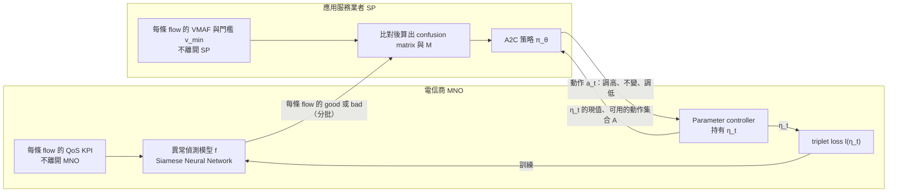

# ATELIER：有限信任下為服務量身訂做的網路分析（Milani 等，2024）

| 項目 | 內容 |
| --- | --- |
| 標題 | ATELIER: Service Tailored and Limited-Trust Network Analytics Using Cooperative Learning |
| 作者與單位 | Mattia Milani（Nokia S&T, Munich；Universidad Carlos III de Madrid）、Dario Bega（Nokia Bell-Labs, Stuttgart）、Marco Gramaglia（Universidad Carlos III de Madrid）、Pablo Serrano（Universidad Carlos III de Madrid）、Christian Mannweiler（Nokia S&T, Munich） |
| 出處 | IEEE Open Journal of the Communications Society, vol. 5, pp. 3315–3330, 2024 |
| DOI 或連結 | 10.1109/OJCOMS.2024.3401746；程式碼 <https://github.com/nokia/SNNExperimentFramework>（論文註腳 1） |
| 本次閱讀的版本 | 出版社正式版（開放取用，CC BY-NC-ND 4.0），共 16 頁 |
| 類型 | 實作與實測（用模擬的行動網路產生資料集，再離線訓練與評估兩個深度學習模型） |

本文另外參考同作者群的研討會前作 "Optimizing Predictive Analytics in 5G Networks Through Zero-Trust Operator-Customer Cooperation"（IEEE NFV-SDN 2023, pp. 123–128，即期刊版的參考文獻 [4]，本次讀的是 7 頁 postprint）。凡是取自前作的內容都會寫明「前作」。

## 一分鐘版本

電信商（MNO）想提供「這條 flow 的品質好或壞」的分析給應用服務業者（SP），但只有 SP 知道使用者實際的 QoE；雙方可能是競爭者，所以 MNO 不給原始 QoS 資料，SP 不給 QoE 標籤。ATELIER 讓兩邊各訓練一個模型：MNO 用 Siamese Neural Network 做異常偵測，SP 用 reinforcement learning 決定如何調整 MNO 損失函數裡的一個參數 η。跨越邊界的只有三樣東西：每條 flow 的 good／bad、η 的現值、以及「調高、不變、調低」三選一的動作。在三支影片、三個 QoE 門檻共九個情境中，ATELIER 的 accuracy 相對於 MNO 自己用門檻標記訓練的 Baseline 最多高出 37.3%（§V-B1；摘要寫 37.7%），precision 在部分情境約為 Baseline 的兩倍（§V-B2）。對做 NWDAF federated learning 的讀者，這篇是「NWDAF 與 AF 之間不交換梯度也不交換標籤」的一個極端設計，可以拿來和 TS 23.288 的 vertical federated learning 對照；但論文沒有信任模型的形式化分析，也沒有和任何 FL 方法做實驗比較。

## 1. 要解決的問題

SP 在 MNO 的網路上以 OTT（Over The Top，應用直接跑在網路上、不與電信商整合）的方式提供服務。論文認為這對雙方都不好：MNO 變成「dumb pipe」，SP 也無法要求網路為服務做調整（§I）。

論文把原因歸結為雙方缺乏信任。例子是 triple play：電信商自己也賣影音服務，與 SP 是直接競爭者；另一個例子是 MNO 不信任由 SP 驅動的網路重組態（§I）。

具體的題目是網路分析。MNO 預設提供的分析只看網路的 QoS，不知道 SP 的 QoE，所以兩者會不一致（§II-B）。要讓分析對齊 QoE 有兩個互相牽制的難處（§II-B1）：

1. QoS 到 QoE 的對應是非線性、多變數的，而且每支影片不同（圖 3），需要用資料訓練模型。
2. QoS 與 QoE 資料都昂貴而敏感，雙方都不願把原始資料交給可能的競爭者。

最直接的做法是把 QoS 與 QoE 放在一起訓練：若由 MNO 訓練，SP 要交出標籤；若由 SP 訓練，MNO 要交出原始 QoS（§II-B2 註腳 2）。論文要在兩者都不發生的前提下，讓 MNO 的分析仍然能對齊 SP 的 QoE。

## 2. 需要的背景

**QoE 的量測。** 論文用 VMAF（Video Multi-method Assessment Fusion，Netflix 提出的影片品質估計指標，分數 0 到 100）當作 SP 的 QoE（§III、§III-C1）。SP 設一個門檻 v_min，VMAF 高於它的 flow 算 satisfactory，低於它算 unsatisfactory。

**Similarity learning 與 Siamese Neural Network（SNN）。** SNN 由數個共用權重的網路組成，把輸入投影成潛在空間的 embedding，再用 embedding 之間的距離判斷相似與否。它只需要「相似」與「不相似」的範例，不需要類別標籤，而且對類別不平衡較不敏感（§III-B、§III-B1）。論文用三個輸入的版本，搭配 triplet loss。

**Advantage Actor-Critic（A2C）。** 一種 reinforcement learning 演算法：actor 輸出下一個動作的機率分布，critic 評估決策的好壞（§III-C2）。

**論文對學習方式的分類（表 1）。** 這張表是論文主張「現有方式都不適用」的依據：

| Approach | Architecture | Knowledge | Interactions among elements |
| --- | --- | --- | --- |
| Single Server | Centralized | Common data and objective function | None |
| Centralized | Hub and Spoke | Shared Data | Data exchange |
| Multi-agent or Federated learning | Distributed | Objective function | Model exchange |
| Limited trust / Cooperative learning | Multiple instances | None | Steering signals |

**論文引用的 3GPP 背景。** TR 28.824（SA5 對 network slice 管理能力曝露的研究）把第三方分成三個存取等級，從 baseline 到 hyperscaler（§II-B）。TS 23.288 的分析框架讓包含 SP 在內的不同 NF 取得分析（§II-B）。論文另外提到 O-RAN、5G-ACIA（推動 5G 用於工業自動化的產業聯盟）、CAMARA（Linux Foundation 之下定義電信網路開放 API 的專案）作為開放介面的例子（§I、§VI）。

## 3. 方法與架構

### 3.1. 整體想法

論文把這種合作方式稱為 cooperative learning：兩個各自獨立的智慧元件朝共同目標互動，但不交換需要商業協議才能交換的資料、函式或模型（§II-A）。MNO 先只用 QoS 訓練一個「vanilla」模型，把細緻的 QoS 統計轉成粗略的定性資訊交給 SP，並曝露一個以上會影響訓練的參數；SP 拿分析結果和自己的敏感資訊比對，回傳新的參數（§II-B3）。

依論文圖 4 與圖 6 重繪，並加入 §III-B2、§III-C2、§IV-D2 的文字資訊；跨越兩個方框的三條線就是全部的跨邊界交換。

### 3.2. 誰持有什麼、交換什麼、各自學到什麼

| | MNO | SP |
| --- | --- | --- |
| 持有的原始資料 | 每條 flow 的 QoS KPI 時間序列，共 6 個特徵（附錄 A-B） | 每條 flow 的 VMAF，以及其他商業指標（§II-B3、§III-C1） |
| 持有的標籤 | 沒有真實標籤。只有自己用 KPI 門檻切出的三個集合（§IV-C） | 真實標籤：VMAF 與 v_min 比較的結果（§III-C1） |
| 持有的模型 | SNN 模型 f 與損失函數 l(η_t)（§III-B） | A2C 策略網路 π_θ（§III-C2） |
| 送給對方 | 每條 flow 的 good／bad，以大小為 β_SP 的批次提供（§IV-D2）；每個訓練週期後的 η（§III-B2）；動作集合 A（圖 4） | 動作 a_t ∈ {a+, a=, a−}，把 η_t 調高 Δa、不變、或調低 Δa（§III-C2） |
| 不送給對方 | 原始 QoS 指標、可能洩漏 UE 位置或網路拓撲的 metadata（§II-B1）、模型與梯度（§I、§II-A） | QoE 指標（也就是標籤）（§II-B1）、confusion matrix、M、v_min、π_θ |
| 訓練結束後得到 | 一個對齊該 SP 的 QoE 門檻的模型 f，之後單獨用於推論（§III-C2） | 一個會調整 η 的策略 π_θ，以及每條 flow 的 good／bad 分析 |

**解讀：** 表中 SP 側「不送給對方」的 confusion matrix、M、v_min、π_θ，論文沒有逐項列出，是依 §III-C 的流程整理的：這些量都只在 SP 內部計算，圖 4 與圖 6 中由 SP 指向 MNO 的箭頭只有動作 a。

**解讀：** SP 要把收到的 good／bad 和自己的 VMAF 逐條比對，所以雙方必須能指認同一條 flow。論文只在 §III-C1 提到分析可以針對單一 UE、UE 群組、slice、應用或特定 UP path 請求，讓 SP 得以把分析和本地資訊關聯起來；用什麼識別碼對齊、對齊本身是否洩漏資訊，論文沒有討論。

### 3.3. MNO 側：可被引導的異常偵測（similarity learning 負責的部分）

MNO 的模型 f 有兩個區塊（圖 5）：SNN 把 flow 的特徵投影成 embedding，DST 層計算 embedding 之間的歐氏距離。三個輸入分別是 positive reference s+、anchor s_a、negative reference s−（§III-B1）。

損失函數是 triplet loss，其中 d+ 是 anchor 與 positive 的距離，d− 是 anchor 與 negative 的距離（式 2）：

`l(η_t) = max(0, ‖d+‖₂ − ‖d−‖₂ + η_t)`

η 是 margin，強制 positive 與 negative 之間至少隔開這段距離。η 越大，anchor 被推得離 negative 越遠、離 positive 越近；η 小或為負則相反（§III-B2）。論文選擇把 η 當成曝露給 SP 的唯一可調參數，並指出也可以改曝露別的東西，例如 dropout 比例或 batch 大小（§III-B2）。

SNN 的第一層是 LSTM，之後攤平接數層 dense layer，optimizer 是 Adam、learning rate 0.0001（附錄 B-B）；embedding 是 4 維（§V-C2）。

MNO 沒有標籤，所以先用門檻自己切出三個集合（§IV-C）：

- Ĝ（very likely good）：所有 KPI 都在「可接受門檻」之內。
- B̂（very likely bad）：至少一個 KPI 超過「不可接受門檻」。
- Û（undecided）：其餘。

接著有兩種只靠 MNO 自己的訓練方式，它們同時也是實驗的比較基準：

- **Baseline**（§IV-C1）：只用 Ĝ 與 B̂ 組 triplet 訓練 f，Û 完全不用。
- **Self-Labelling（SL）**（§IV-C2）：用剛訓練好的 f 計算 Û 中每個樣本 u 到隨機挑選的 s+、s− 的距離；若 d+(u) < d−(u) − η 就併入 Ĝ，若 d−(u) < d+(u) − η 就併入 B̂，然後重新訓練。重複到 Û 清空或達到次數上限 T_SL。

### 3.4. SP 側：對齊商業指標（reinforcement learning 負責的部分）

SP 把 MNO 的 good／bad 和自己的 satisfactory／unsatisfactory 比對成 confusion matrix，其中 false positive（FP）是「MNO 說 good 但實際 unsatisfactory」。SP 的指標 M 把 FP 的代價加倍（式 3）：

`M = (TP + TN) / (TP + TN + 2FP + FN)`

RL 的設定（§III-C2）：

| 元素 | 定義 |
| --- | --- |
| Agent | SP 的 A2C 網路 π_θ，actor 與 critic 共用同一個網路 |
| Environment | MNO 的模型 f 及其訓練過程 |
| Action | A = {a+, a=, a−}，把 η_t 調高 Δa、不變、調低 Δa |
| State σ_t | η_t 的現值、時間 t 的 confusion matrix、最近 K 個 confusion matrix |
| Reward | 先算 M 在最近 K 步的折扣和（式 4），再取 r_t = sign(M_{t+1} − M_t)（式 5） |
| 目標 | 最大化折扣報酬 R_t = r_t + γR_{t−1}（式 6） |

論文為了簡化只處理單一服務、單一 actor，並說明可以讓多個 actor（例如每個服務一個）共用同一個 critic（§III-C2）。

### 3.5. 訓練流程

訓練分兩個階段，每個階段凍結其中一個網路（§IV-D、Algorithm 1 與 2）。

**第一階段（Algorithm 1，目的是訓練 π_θ）：**

1. 隨機初始化 f 與 π_θ，η 設為預設值；用 Ĝ、B̂ 組出訓練集 D_t。
2. MNO 以 Baseline 方式訓練 f。
3. 重複 T_SL 次：執行 SL 擴充集合並重組 D_t，然後進入協作訓練。協作訓練中 MNO 把 good／bad 分批給 SP；SP 計算 M、更新 π_θ、輸出動作；動作套用到 η_t。
4. 重設 f 與 η，回到步驟 2，直到 π_θ 收斂。收斂條件是最近若干次訓練的平均 reward 高於門檻 RL_c，或達到最大次數。
5. 凍結 π_θ。

**第二階段（Algorithm 2，目的是產出對齊後的 f）：**

1. 重設 f 與 η，重新產生 D_t。
2. MNO 依序執行 Baseline 與 SL，訓練過程中由凍結的 π_θ（只做 exploitation）持續調整 η。
3. 產出的 f 就是提供給該 SP 的客製化分析模型。

**解讀：** 第二階段雖然只訓練 f，π_θ 的輸入仍然是 SP 當下算出的 confusion matrix，所以 SP 在這個階段仍須在線上，並持有這些訓練用 flow 的 VMAF。只有訓練完成後的推論不需要 SP 參與。

### 3.6. 信任模型：limited trust 保證了什麼、沒保證什麼

論文對 limited-trust collaboration 的定義是：雙方之間的資訊交換受到限制，以防止敏感資訊的洩漏或被推論；在使用 AI 的環境中，它禁止交換原始資料、標籤、甚至訓練中的梯度，允許交換聚合過或較不關鍵的資訊（§I）。

論文明寫的保證：

- 兩個方向都沒有原始資料交換（§II-B1）。
- 雙方都不知道對方演算法的內部，包含對方使用的敏感資訊（§II-B3）。
- MNO 保有對曝露參數的控制權，論文稱這可以防止惡意行為（§III-B2）。

論文沒有提供的東西：

- 沒有形式化的隱私定義，也沒有威脅模型（對手是誰、能做什麼、想推論什麼）。
- 沒有對 good／bad 輸出或動作序列做任何資訊洩漏分析或實驗。全文 "leak" 相關字眼出現 4 次，都在動機與原則的敘述（§I、§II-A、§II-B1）；"attack" 只出現在介紹他人 differential privacy 研究的句子（§II-A）。
- 沒有使用 differential privacy、同態加密或 multi-party computation。論文提到這些技術（文獻 [9]–[13]），但認為它們保護的是傳送者的身分或資料傳輸，沒有解決「必須信任負責計算分析的集中實體」的問題；各方仍要對損失函數與 ground truth 的對應有共同認知，所以仍需要完全信任（§II-A）。

**解讀：** 這個保證屬於「介面上只允許這幾種訊息」的結構性限制，不是可量化的隱私保證。每一步動作只有三種取值，單步最多攜帶 log₂3 ≈ 1.58 bit，這是我們的計算，論文沒有寫。但動作是 confusion matrix 的函數，而 MNO 可以決定每一輪送出哪些 flow 的哪些判定，原則上能設計多輪查詢去推測 SP 的標籤或 v_min。反方向上，SP 拿到的 good／bad 本來就是產品，但長期累積後 SP 也能觀察 MNO 的判定如何隨 η 變化。這兩種推論的難度都沒有被評估。

**解讀：** 論文的 Index Terms 寫 "Zero-trust networks"，前作通篇使用 "zero-trust"，期刊版內文改用 "limited trust"。這裡的 zero-trust 指「雙方不互信、不交換敏感資料」，與資安領域以持續驗證為核心的 zero trust architecture 不是同一件事。

### 3.7. 與 federated learning、vertical federated learning、split learning 的異同

論文自己的比較只有兩類：centralized，以及合併成一類的 multi-agent／federated learning（表 1、圖 1、§II-A）。它排除 FL 的理由是：FL 需要以模型交換為基礎的緊密互動，可能透露對應資料集的敏感資訊；SP 必須分享部分內部智慧才能調整 MNO 端的演算法，MNO 也要把模型資訊分發回去（§II-A）。

論文沒有提到 vertical federated learning 或 split learning；全文沒有出現 "vertical" 與 "split learning"，實驗也沒有任何 FL 類的比較對象。以下整張表是**解讀**，3GPP 的欄位依本地 Release 20 TS 23.288 V20.2.0，split learning 的欄位依一般認知。

| 面向 | ATELIER | Horizontal FL（TS 23.288 §5.3） | Vertical FL（TS 23.288 §5.4、§6.2H） | Split learning |
| --- | --- | --- | --- | --- |
| 資料如何分布 | 特徵全在 MNO，標籤全在 SP | 各 client 的特徵空間相同、樣本不同 | 各參與者對同一批樣本持有不同特徵空間；VFL server 用標籤計算訓練資訊 | 通常是一方持有特徵，另一方持有標籤或後半段模型 |
| 跨邊界交換的內容 | 每條 flow 的最終判定、η 的現值、三選一的動作 | local model 資訊與 global model | client 回報 intermediate training result；server 回送 intermediate model training information（例如梯度或損失資訊），以樣本為粒度 | 切割層的輸出與回傳的梯度 |
| 標籤持有者的角色 | 只訓練一個調參策略，不參與預測 | 各 client 都有標籤 | 匯總各方中間結果並計算最終結果 | 持有模型的一段 |
| 推論時誰要在場 | 只有 MNO | 任一持有模型者 | server 與各 client 都要（§6.2H.2.4） | 兩方都要 |
| 是否交換梯度 | 否，定義上就禁止（§I） | 交換模型資訊 | 是 | 是 |

**解讀：** 這張表帶出三個觀察。第一，ATELIER 的資料切分是「特徵在一方、標籤在另一方」，本質上是垂直切分的問題；horizontal FL 在這個情境根本不適用，論文拿來當對照的 FL 其實不是最接近的替代方案。第二，VFL 的 per-sample 梯度資訊正是 ATELIER 依定義禁止交換的東西，所以 ATELIER 可以視為把 VFL 的回饋通道壓到極窄的版本：SP 能影響的只有一個純量超參數，無法影響 MNO 模型的權重方向。第三，代價是表達能力：SP 的知識只能透過 η 進入模型，當 QoS 特徵本身不足以區分 QoE 時，調 η 沒有幫助。

## 4. 實驗與結果

### 4.1. 設定

| 項目 | 內容 | 出處 |
| --- | --- | --- |
| 網路 | srsRAN（開源的 4G／5G 軟體堆疊；論文稱其為 Rel. 16 相容的 UE、gNB、Core），fronthaul 改走 socket，全部以 Docker 執行；1 個 UE、1 個 gNB、1 個 5GC | 附錄 A-A、A-C |
| 串流 | FFmpeg server（放在 5GC 容器內模擬雲端）對 UE 上的 FFmpeg client，以 RTP 傳送 | 附錄 A-A、A-C |
| 損傷 | 用 Linux 的 `tc` 在 Core 到 RAN 的介面加入：無損傷；[0.5 - 3]% packet drop rate with 50% correlation；[100 - 600] ± 50 ms delay（常態分布） | 表 2 |
| 特徵擷取 | 用 Wireshark 側錄，模擬網路內的 Deep Packet Inspection | 附錄 A-A |
| 影片 | 取自 CDVL 資料庫：Big Buck Bunny（24 秒，卡通）、Bottle（15 秒）、Scarlet-Oak（24 秒，實拍加電腦文字） | 表 3 |
| QoS 特徵 | 6 個：Packet Drop Rate（PDR）、Byte Drop Rate（BDR）、Inter-Packet Time 的平均、標準差、偏度、峰度 | 附錄 A-B |
| 資料量 | 共 3600 次實驗；每秒彙總一次，每個樣本 w = 9 秒 | 附錄 A-C、表 5 |
| 情境 | 3 支影片 × v_min ∈ {80, 90, 99}，共 9 個 | §V-B |
| 比較基準 | Baseline（§IV-C1）與 SL（§IV-C2），都是 MNO 不靠 SP 的做法 | §V-B1 |
| 指標 | accuracy，以及 precision = TP / (TP + FP) | §V-B |
| 重複次數 | 每個情境 50 次實驗的平均與 95% 信賴區間 | 圖 9、圖 10 |

MNO 切集合用的門檻（表 4）：

| KPI | G_k | B_k |
| --- | --- | --- |
| Packet Drop Ratio | 0.0 | 0.1 |
| Byte Drop Ratio | 0.03 | 0.08 |
| Avg. interarrival time [ms] | 0.02 | 0.06 |
| Std. interarrival time [ms] | 0.02 | 0.06 |
| Skw. interarrival time | 7 | 55 |
| Kur. interarrival time | 8 | 55 |

主要超參數（表 5）：預設 η = 20.0，Δa = 10.0，T_SL = 10，batch 大小 100，SNN 每個訓練週期 10 個 epoch，γ = 0.8，RL 的 Adam learning rate 0.0008，RL 最多 200 個 episode。

### 4.2. 標記策略的效果

用表 4 的門檻，Bunny 影片的樣本分布是 Ĝ 8%、B̂ 40%、Û 52%（§V-A1）。也就是有一半以上的樣本，MNO 單靠門檻無法判定。

門檻切出的兩端是可靠的：Ĝ 的 flow 幾乎全部 VMAF 遠高於 90；B̂ 有超過 90% 的 flow VMAF 低於 40，且沒有任何 flow 高於 80（§V-A1、圖 7b）。

SL 能快速消化 Û：在 Bottle、v_min = 80 的單次實驗中，第三次迭代後仍未判定的樣本不到最初 Û 的 3%（§V-A2、圖 8a）。50 次實驗的平均顯示，被正確標記的比例隨迭代上升，錯誤標記的只占少數（圖 8b）。

### 4.3. 主要結果

論文內文給出的數字只有兩個：

- Accuracy：論文稱所有情境中 ATELIER 都優於其他做法；Baseline 與 ATELIER 的差距最高達 37.3%，發生在 Bottle 影片、v_min = 99（§V-B1）。差距小的情境是 MNO 的分析本來就和 SP 的指標相近，例如 Bunny、v_min = 80。
- Precision：部分情境相較 Baseline 達到 2× 的提升（§V-B2）。

「最多提升 37.7%」出自摘要，摘要沒有寫條件；內文唯一對應的數字是上面的 37.3%。兩者不一致，內文的條件是「Bottle、v_min = 99、ATELIER 相對於 Baseline 的 accuracy」。

**解讀：** 論文沒有數值表。下表是我們從圖 9、圖 10 的長條高度量測的近似值（單位 %，誤差約 ±1），不是論文給的數字。

| 影片 | v_min | Accuracy：Baseline／SL／ATELIER | Precision：Baseline／SL／ATELIER |
| --- | --- | --- | --- |
| Bunny | 80 | 88／94／95 | 88／86／89 |
| Bunny | 90 | 88／94／94 | 86／86／88 |
| Bunny | 99 | 76／81／83 | 53／51／57 |
| Bottle | 80 | 82／89／88 | 83／82／90 |
| Bottle | 90 | 80／85／85 | 75／74／88 |
| Bottle | 99 | 37／61／75 | 22／23／42 |
| Scarlet | 80 | 67／79／80 | 54／57／63 |
| Scarlet | 90 | 68／79／79 | 52／55／59 |
| Scarlet | 99 | 61／76／79 | 40／44／58 |

**解讀：** 從這些近似值可以讀出四件事。

1. 37.3% 是百分點的差（約 37 → 約 75），不是相對提升；相對於 Baseline 約為兩倍。
2. 相對於 SL，同一情境的 accuracy 差距約 14 個百分點；其餘八個情境 ATELIER 與 SL 的 accuracy 差距都在 3 個百分點以內。Accuracy 的提升大部分來自 SL，而 SL 不需要 SP。
3. 在 Bottle 的 v_min = 80 與 90，圖上 ATELIER 的 accuracy 並沒有高於 SL，信賴區間重疊。這與內文「所有情境都優於其他做法」的說法不完全相符。
4. SP 的回饋真正帶來差別的是 precision：SL 的 precision 在 Bunny 與 Bottle 和 Baseline 幾乎相同或略低，在 Scarlet 只高出約 3 到 4 個百分點；ATELIER 則在九個情境都高於兩者。這與 M 把 FP 加倍計算的設計一致。但 v_min = 99 時 precision 的絕對值仍低，Bottle 約 42%，表示被 MNO 判為 good 的 flow 仍有一半以上不符合 SP 的要求。

### 4.4. 內部行為

圖 11 展示 Bottle、v_min = 80 的單次實驗。論文的描述是：平均 reward 隨 episode 上升後趨穩；η 從初始值上升到帶來最佳 reward 的數值；actor 的動作機率中 a− 很快下降，a+ 與 a= 互換比重後達到平衡，最可能的動作是維持 η 不變（§V-C1）。

**解讀：** 從圖上讀，η 由 20 附近上升到 100 左右（圖 11b）；平均 reward 的曲線在整個訓練過程都有明顯震盪，最高約為 0（圖 11a）；三個動作的機率在最初幾步之後幾乎不再變化，a= 約 0.45、a+ 約 0.35、a− 約 0.2（圖 11c）。

圖 12 用 UMAP（把高維資料降到 2 維的視覺化演算法）畫出 Bottle、v_min = 99 的 embedding。Baseline 之下許多 undecided 樣本落在 good 與 bad 區域之外；SL 有改善；ATELIER 之下樣本清楚分成靠近 good 與靠近 bad 的兩群，只有少數落在錯的一邊（§V-C2）。

## 5. 限制

### 5.1. 文獻自己承認的

論文沒有獨立的限制或未來工作段落，結論（§VII）也沒有提。散見各處的範圍限定有：

- 只處理單一服務與單一 actor，多服務的做法只有文字說明（§III-C2）。
- 偵測到 bad flow 之後的修正動作，以及與編排演算法的結合，不在範圍內（§III-A 註腳 3、§III-C）。
- 只聚焦在客製化分析這一個案例，並表示其構想可套用到其他情境與其他隱私保護機制（§II-B2）。
- 距離度量與 M 的形式都只是其中一種選擇（§III-B2 註腳 5、§III-C1 註腳 6）。

### 5.2. 我們看到的

以下全部是**解讀**。

- **信任主張沒有被驗證。** 如 3.6 節所述，沒有威脅模型，也沒有洩漏分析。論文的實驗只衡量分析準確度，沒有任何一個實驗衡量 limited trust 是否成立。
- **比較基準都是自己的消融版本。** Baseline 與 SL 都是 MNO 單獨訓練。缺少兩個關鍵對照：把 QoS 與 VMAF 放在一起訓練的上限（可以看出 limited trust 的代價是多少），以及 vertical FL 或 split learning（可以看出只交換一個純量是否夠用）。
- **缺少「固定 η」的對照。** 圖 11c 的動作機率在最初幾步之後幾乎是水平線，η 大致單調上升到 100 左右（圖 11b）。SP 若用同樣的回饋對 η 做簡單的格點搜尋，是否能得到相近結果，論文沒有比較。RL 這個元件的必要性因此沒有被證明。
- **沒有說明訓練、驗證、測試資料的切分。** 圖 9、圖 10 的 accuracy 與 precision 是在哪些樣本上計算的，論文沒有寫。若評估用的樣本與 SP 提供回饋用的樣本相同，結果會偏樂觀。
- **測試環境單純。** 1 個 UE、1 個 gNB，沒有真實無線電；損傷是用 `tc` 在 Core 到 RAN 之間注入的丟包與延遲；三支影片長度只有 15 到 24 秒；用 RTP 傳送而非 adaptive streaming，沒有碼率切換與重新緩衝這類常見的 QoE 因素。
- **「標籤」本身是模型估計值。** VMAF 是影片品質的估計，不是使用者實際回報；它還需要原始影片作參考才能計算，真實的 SP 在線上未必能對每條 flow 取得。
- **沒有成本數字。** Algorithm 1 的外層迴圈每次都把 f 重設後重新訓練，上限 200 個 episode；每一對（SP、服務、門檻）都要一個獨立的模型。論文沒有報告訓練時間、互動輪數或訊息量。
- **沒有用到任何 3GPP 介面。** 測試環境中沒有 NWDAF、AF、NEF；特徵來自 Wireshark 側錄。論文稱設計並實作了新的 exposure interface（§I），但全文沒有介面的訊息格式或 API 定義。

**未能確認：** MNO 與 SP 兩個模型在程式中是否真的是兩個隔開的程序、只透過介面交換上述三種訊息，或是同一個程序內的兩個物件。這要看 GitHub 上的程式碼才能判斷，本次沒有查看。

**未能確認：** 模型 f 在推論時把一條 flow 判為 good 或 bad 的確切規則。論文只在 SL 的步驟 4 寫了帶 margin 的距離比較，沒有單獨說明提供分析時的判定方式。批次大小 β_SP 的數值也沒有出現在表 5。

**未能確認：** 表 4 中 Packet Drop Ratio 門檻 0.1 的單位。表 2 的丟包率範圍是 0.5 到 3%，圖 7a 的橫軸是 0.1 到 0.4，論文沒有標示它是比例還是百分比。

## 6. 與 SEAL 的關係

論文沒有提到 SEAL、VAL、CAPIF、ADAE、AIMLE；這些字在全文與前作中都沒有出現。它提到的應用側介面只有抽象的「Exposure API」（圖 2、§II-B3），以及作為趨勢例子的 CAMARA、5G-ACIA 與 TR 28.824。以下都是**解讀**。

- **角色對應。** 論文的 SP 持有 QoE 與商業指標，位置相當於 SEAL 模型中的 VAL server（產業應用的後端）。論文的 Exposure API 位於 MNO 與 SP 之間，相當於 NEF 的北向介面；若這項分析由電信商營運的 SEAL server 提供，則相當於 VAL server 經 SEAL-S 呼叫的 API。
- **與 ADAE 的關係。** ADAE（Application Data Analytics Enablement，TS 23.436）是 SEAL 中提供應用層分析的服務，其資料來源包含 VAL server（本工作區的 SEAL 06 解讀文件引 TS 23.436 §5.3）。也就是說 ADAE 的前提是應用後端願意把應用資料交給 ADAE server。ATELIER 處理的正是這個前提不成立的情況：應用後端不交資料，只交調整訊號。
- **與 AIMLE 的關係。** AIMLE（AI/ML Enablement，TS 23.482）提供應用層的模型訓練與 FL 參與者管理，§6 的功能描述包含 AIMLE client 之間的 VFL。它協調的是應用層成員之間的訓練，參與者組合與 ATELIER 的「MNO 對 SP」不同。
- **缺口。** 就我們查到的範圍，SEAL 沒有讓 VAL server 回傳「請這樣調整分析模型訓練」的 API。TS 23.436 §6 有一處提到以 ML-enabled ADAE analytics 的 performance feedback 偵測模型劣化，語意是效能監控，不是引導訓練。我們沒有逐條查完 TS 23.436 與 TS 23.482，這個判斷只基於關鍵字檢索。

## 7. 與 NWDAF 的關係

### 7.1. 期刊版寫了什麼

期刊版內文提到 NWDAF 兩次，另有圖 2 的一個方框：

- §II-B1：依循 5G 架構，作者設想這個服務可以實作在 NWDAF，並備有針對各服務與業者的模型目錄。
- §III：動機是 NWDAF 提供的 "Abnormal UE behaviour" 分析，論文說它把 traffic flow 分類為 bad 或 good（引用的是文獻 [17]，不是規格本身）。
- 圖 2：Network Operator 內的 NWDAF 方框包含 Model Repository、Data Collection、"Vanilla" Model、Aligned Model(s)，下方是 Exposure API；Service Provider 側是 Service 1 到 Service N，往下的箭頭是 Analytics，往上是 Feedback。
- §III-C1：引用 TS 23.288 說明分析請求可以針對單一 UE、UE 群組、slice、應用或特定 UP path。

期刊版沒有出現 AF、NEF、AnLF、MTLF、NRF，也沒有任何服務名稱或程序。

### 7.2. 前作補充了什麼

以下出自前作（NFV-SDN 2023）§II-B、§III 與其圖 2、圖 3。

- **角色對應。** 電信商對應 NWDAF，Zero-Trust customer 對應 AF。前作圖 2 把 steering signal 畫成送進 MTLF，baseline analytics 與 tailored analytics 由 AnLF 送出。
- **五步驟流程。**
  1. NWDAF 更新存放在 NRF 的 profile，加入可用的 AI/ML 模型清單與各模型的 configurable parameters。模型架構之類的超參數不曝露，模型權重不算 configurable parameter。
  2. Setup：AF 與 NWDAF 約定分析類型、訓練中要調整的參數、參數更新的週期。
  3. NWDAF 收集資料並開始訓練，依約定週期把在 validation dataset 上得到的分析送給 AF；AF 評估後回傳 steering signal。
  4. NWDAF 更新參數後繼續訓練。步驟 3 與 4 重複到訓練結束。
  5. NWDAF 用訓練好的模型產出客製化分析。
- **Steering signal 的兩種形式。** 一種是高階意圖，只告訴 NWDAF 目前的分析是 "good" 或 "bad"，由 NWDAF 自行決定怎麼改參數；另一種是直接給新的參數值或增減量。期刊版採用後者。
- **沒有寫的。** 前作沒有提到 NEF，圖 3 的 AF 直接與 NWDAF 互動；沒有任何服務操作名稱；steering signal 是用 validation 資料上的混淆情形算出來的，由誰、用什麼演算法產生留作未來工作，這正是期刊版用 RL 補上的部分。

### 7.3. 我們的對應

以下全部是**解讀**，依本地 Release 20 TS 23.288 V20.2.0。

- **論文對 Abnormal behaviour 分析的描述與規格不同。** TS 23.288 §6.7.5 的 Abnormal behaviour 分析找的是行為異常的 UE，以 Exception ID 表示，例如 Unexpected UE location、Suspicion of DDoS attack、Unexpected long-live/large rate flows。它不是依 QoS 把 flow 分成 good 與 bad。論文是把它當作動機，實際做的事更接近 QoE 的二元分類。
- **規格既有的做法是「AF 把標籤交給 NWDAF」。** Observed Service Experience 分析（§6.4）的輸入資料包含 AF 提供的 Service Experience，可以是 MOS、video MOS 或自訂 MOS（§6.4.2）。這正是 ATELIER 要避免的情況。ATELIER 可以定位成：AF 不願提供 Service Experience 時，NWDAF 仍想對齊 QoE 的替代做法。
- **規格既有的回饋通道語意不同。** Analytics Feedback Information（§6.1.1、§6.1.3）讓消費者告知自己已依先前的分析採取動作、可能影響 ground truth，用途是 accuracy monitoring（§6.2D、§6.2E），不是調整訓練參數。
- **與 VFL 的對照。** 本地 Release 18 的 TS 23.288 沒有 VFL；Release 20 的 §5.4 與 §6.2H 定義了 NWDAF 與 AF 之間的 VFL（任務說明指出這項功能自 Release 19 加入，本地沒有 Release 19 的 TS 23.288，本次未查）。在規格中，untrusted AF 的訊息經 NEF 轉送，使用 Nnef_VFLTraining_Subscribe、Naf_VFLTraining_Subscribe 等服務；訓練前有 sample alignment 的準備程序（§6.2H.2.2）；推論時 server 仍要收集各 client 的中間結果（§6.2H.2.4）。與 ATELIER 的逐項差異見 3.7 節的表。
- **若要放進 NWDAF 的功能切分。** 模型 f 的訓練屬於 MTLF，產出 good／bad 屬於 AnLF，SP 是 AF（不受信任時經 NEF）。Steering signal 與 configurable parameters 在現行規格中都沒有對應的資訊元素。

## 8. 對你的研究可以怎麼用

以下全部是解讀。

- **引用來源。** 寫 NWDAF 與 AF 之間的協作學習動機時，這篇可以用來支持「應用業者與電信商可能是競爭者，不願交換標籤甚至梯度」這個論點，並作為「交換量最小」那一端的代表作。引用 3GPP 功能對應時要引前作，期刊版幾乎沒寫。
- **實驗設計的對照。** 這篇缺的正好是你能做的：在同一份資料上比較三種作法，(a) AF 直接提供 Service Experience 的集中式訓練，(b) TS 23.288 §6.2H 的 VFL，(c) ATELIER 式的純量引導。除了 accuracy 與 precision，再加上跨邊界的訊息量、互動輪數，以及一個實際的標籤推論攻擊。這樣能回答論文沒回答的問題：limited trust 要付出多少準確度，又換到多少隱私。
- **可重用的程式與資料。** 論文稱所有元件與資料產生工具都已開源在 <https://github.com/nokia/SNNExperimentFramework>（§I 註腳 1）。資料產生流程（srsRAN、FFmpeg、`tc`、Wireshark、VMAF）可以搬到 free5GC 的環境重做，把 srsRAN 的核心換成 free5GC。**未能確認：** 3600 次實驗的資料集本身是否一併公開，論文沒有明說，本次也沒有查看該 repository。
- **待填補的缺口。** 前作的五步驟流程只有概念，沒有服務操作與資訊元素。在 free5GC 的 NWDAF 上把它具體化是一個可做的題目：NRF profile 如何描述 configurable parameters、訓練中的分析如何送給 AF、steering signal 走哪個服務、經不經 NEF。另一個缺口是 3.6 節指出的洩漏分析。
- **SEAL 這一側。** 這篇提供了一個具體例子，說明應用層持有的 QoE 可以不以資料的形式、而以訓練引導訊號的形式進入網路分析。讀 ADAE 與 AIMLE 時可以用它來問：規格是否假設應用後端一定願意交出資料。

## 9. 值得追的參考文獻

- [4] M. Milani, D. Bega, M. Gramaglia, and C. Mannweiler, "Optimizing predictive analytics in 5G networks through zero-trust operator-customer cooperation," in Proc. IEEE Conf. Netw. Funct. Virtual. Softw. Defined Netw. (NFV-SDN), 2023, pp. 123–128. 前作；NWDAF 與 AF 的角色對應和五步驟流程都在這裡。
- [34] C. Huang et al., "Addressing the loss-metric mismatch with adaptive loss alignment," in Proc. Int. Conf. Mach. Learn., 2019, pp. 2891–2900. 論文自述的主要靈感來源：用 RL 調整損失函數參數，讓訓練對齊真正的評估指標。
- [31] A. Collet, A. Banchs, and M. Fiore, "LossLeaP: Learning to predict for intent-based networking," in Proc. INFOCOM IEEE Conf. Comput. Commun., 2022, pp. 2138–2147. 多個模型依外部回饋合作最佳化網路服務，但發生在同一個電信商內部，是「沒有信任邊界」的對照版本。
- [16] A. Collet, A. Bazco-Nogueras, A. Banchs, and M. Fiore, "AutoManager: A Meta-learning model for network management from intertwined forecasts," in Proc. IEEE Int. Conf. Comput. Commun., 2023, pp. 1–10. 處理 QoE 指標與 QoS、網路參數之間關係不明確的問題。
- [17] M. A. Garcia-Martin, M. Gramaglia, and P. Serrano, "Network automation and data analytics in 3GPP 5G systems," IEEE Netw., early access, Oct. 6, 2023, doi: 10.1109/MNET.2023.3321524. 同一研究群對 NWDAF 的整理，論文對 Abnormal behaviour 分析的說法引自此處。
- [14] "Study on network slice management capability exposure, (Release 17), Version 18.0.1," 3GPP, Sophia Antipolis, France, Rep. TR 28.824, Jul. 2023. SA5 對第三方曝露管理能力的研究，三個存取等級的出處，可以和 SA6 的 SEAL、CAPIF 對照。

## 10. 閱讀建議

- **必讀：** §II-B（問題與兩個原則）、§III 全部（方法）、§IV-C 與 §IV-D 含 Algorithm 1 與 2（訓練流程）、§V-B（主要結果）。
- **必看的圖表：** 表 1、圖 2、圖 4、圖 6、圖 9、圖 10。圖 9 與圖 10 請自己看長條，不要只讀內文的結論。
- **可以略過：** §VI 相關研究、附錄 A 與 B（除非要重做資料集或複製模型）、§V-C 的內部行為分析。
- **要查 3GPP 對應時：** 讀前作的 §II-B、§III 與其圖 2、圖 3，約 20 分鐘。
- **時間：** 期刊版的必讀部分約 1.5 小時。論文的交叉引用有幾處錯誤（見查證紀錄），遇到對不上的節號不必深究。

## 查證紀錄

**看過的 PDF 頁面。** 期刊版第 1 到 15 頁全部以頁面影像看過，涵蓋表 1 到表 5、圖 1 到圖 14、Algorithm 1 與 2；第 16 頁是參考文獻與作者簡介，以文字檢視。圖 7 到圖 12 另以 220 到 400 dpi 重新轉檔放大檢視。前作以文字全文閱讀，並以頁面影像看過含圖 2、圖 3 的那一頁。

**逐項對照過原文的數字與主張。**

- 首頁資訊：作者、單位、卷期頁碼、DOI、授權。
- 表 1 的四列內容、表 2 的三個情境、表 3 的影片長度、表 4 的全部門檻、表 5 中本文引用的超參數。
- 式 2、式 3、式 4 到式 6 的形式。
- Ĝ 8%、B̂ 40%、Û 52%；Ĝ 的 VMAF 遠高於 90；B̂ 超過 90% 低於 40 且無 flow 高於 80；SL 第三次迭代後少於最初 Û 的 3%。
- 37.3%（§V-B1，Bottle、v_min = 99、Baseline 對 ATELIER）、37.7%（摘要）、2×（§V-B2）、50 次實驗與 95% 信賴區間（圖 9、圖 10 圖說）、3600 次實驗、learning rate 0.0001 與 0.0008、embedding 4 維。
- 關鍵字計數：期刊版文字層中 NWDAF 出現 2 次，AF、NEF、AnLF、MTLF、SEAL、CAPIF、"vertical"、"split learning" 皆為 0 次；前作中 NWDAF 23 次、NEF 0 次。
- 3GPP 規格的敘述：對照本地 Release 20 TS 23.288 V20.2.0 的 §5.3、§5.4、§6.1.1、§6.1.3、§6.2H.1、§6.2H.2.2 到 §6.2H.2.4、§6.4.1、§6.4.2、§6.7.5，以及 TS 23.482 §6 與 TS 23.436 §6 的關鍵字檢索結果。本地 Release 18 的 TS 23.288 檢索不到 vertical federated learning。

**不是論文給的數字。** 4.3 節的九情境數值表是從圖 9、圖 10 以 400 dpi 量測長條像素高度換算的近似值。4.4 節解讀中的 η 與動作機率是圖 11 的目視讀值。3.6 節的 1.58 bit 是我們的計算。

**原文中有疑問或不一致之處。**

- 摘要寫 37.7%，內文寫 37.3%。
- 內文稱所有情境 ATELIER 都優於其他做法，但圖 9b 的 v_min = 80 與 90 看不出 ATELIER 高於 SL。
- §V-A1 稱 Û 有 20% 的 flow VMAF 低於 60，但圖 7b 的曲線在 60 處約為 12%，約在 90 處才到 20%。
- 表 2 的延遲範圍是 [100 - 600] ms，圖 3b 的橫軸只到 300 ms。
- 表 5 的 T_SL 是 10，圖 8 畫了 9 次迭代。表 5 把 K 描述為兩個 RL episode 之間的 SGD 迭代數，§III-C2 則把 K 用作 reward 與 state 回看的步數。§IV-D2 提到的 RL_RSGD 與 β_SP 不在表 5。
- 交叉引用錯誤：§II-B1 說實驗設定見「Section II-A」，實際在附錄 A；§III-C1 引「[15] Section IV-D」，TS 23.288 沒有這個節號；§V-B2 以「Fig. 10c」指稱全部情境；§III-B 與 §III-C2 把步驟編號排成「Eq. (1)」到「Eq. (4)」。
- 參考文獻 [15] 把 TS 23.288 標為「Release 16, Version 18.1.0」，版本號 18.1.0 屬於 Release 18。

**無法確認的內容。** 已在 5.2 節與 8 節以「未能確認」標出：兩個模型在程式中是否真的隔離、推論時的判定規則、β_SP 的數值、表 4 丟包門檻的單位、資料集是否公開。另外，圖 9 的 accuracy 是一般的 accuracy 還是式 3 的 M，以及評估所用的樣本範圍，論文都沒有寫明。

**網路請求。** 本次沒有發出任何網路請求，也沒有查看 GitHub repository。
