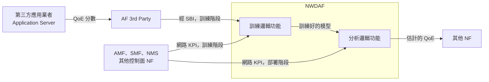

# 以 AF 提供的 QoE 分數訓練 NWDAF 的 QoE 估計模型（Schwarzmann 等，2022）

| 項目 | 內容 |
| --- | --- |
| 標題 | ML-Based QoE Estimation in 5G Networks Using Different Regression Techniques |
| 作者與單位 | Susanna Schwarzmann（Technische Universität Berlin）、Clarissa Cassales Marquezan（Huawei Technologies, Munich）、Riccardo Trivisonno（Huawei Technologies, Munich）、Shinichi Nakajima（Technische Universität Berlin；Berlin Big Data Center；RIKEN Center for AIP, Tokyo）、Vincent Barriac（Orange Innovation/Networks, Lannion）、Thomas Zinner（NTNU, Trondheim） |
| 出處 | IEEE Transactions on Network and Service Management，vol. 19，no. 3，pp. 3516-3532，2022 |
| DOI 或連結 | 10.1109/TNSM.2022.3179924 |
| 本次閱讀的版本 | accepted manuscript（機構典藏版），共 17 頁；頁碼與正式版不同，本文一律引用節號、圖號、表號 |
| 類型 | 模擬（另含一段架構構想與一張質性比較表） |

出處與 DOI 來自任務指示；這份 PDF 本身沒有印期刊卷期。

## 一分鐘版本

電信商（論文稱 MNO）量得到網路 KPI，量不到應用層的使用者體驗（QoE）。論文的構想是：應用業者經 AF 把每個連線的 QoE 分數交給 NWDAF 當訓練標籤，NWDAF 用自己收集的網路 KPI 當特徵訓練迴歸模型；模型部署後，NWDAF 只靠網路 KPI 就能估 QoE（§III-A）。作者用 OMNeT++ 模擬隨選視訊（VoD）與網路電話（VoIP），比較 LASSO、LRR、KRR、SVR、NN 五種迴歸技術。在 1 到 5 分的 MOS 量尺上，整個測試集的 RMSE 落在 0.10 到 0.27 之間，SVR 與 KRR 最準，但訓練最耗資源、推論最慢（圖 8、圖 10、§VII-A）。

對讀者最重要的一點：**這篇沒有比較「只用網路側資料」與「加上應用側資料」。** 應用側資料在這篇只當標籤，不當特徵，所以它回答不了「應用層資料能讓分析變準多少」。論文也沒有寫到任何 3GPP 服務名稱或程序，資料流只停在「AF 經 SBI 把 QoE 交給 NWDAF」這個層次。

## 1. 要解決的問題

應用業者（論文稱 AP，例如 YouTube）能監看影片畫質、卡頓時間等應用層指標，也能收集使用者評分。MNO 只有網路層資料，除非它自己就是應用業者（§I）。

既有的 QoS 到 QoE 對應模型有三個問題：只涵蓋少數服務、設計與更新都麻煩、只看少數網路特徵或彙總後的監測資料。這些模型因此無法支援自動觸發 QoE 導向控制動作的網路（§I）。

論文認為 5G 提供了三項過去沒有的能力（§I、§VII-A）：

- 與外部互動：第三方應用或內容業者可以把實際的 QoE 或 QoE 相關指標傳給 5G 系統。
- 更強的資料收集、處理與曝露能力：可以把網路 KPI 與 QoE 資訊關聯起來，也就是訓練 ML 模型。
- 把 ML 放進網路：部署訓練好的模型，由網路 KPI 得到 QoE。

論文要回答的問題有四個（§III-B）：MNO 如何利用這些新功能估 QoE；NWDAF 需要哪些特徵；該訓練並部署哪一種 ML 模型；選模型時除了準確度還要看什麼。

## 2. 需要的背景

| 名詞 | 說明 |
| --- | --- |
| QoE 與 MOS | QoE 是使用者感受到的服務品質。MOS（Mean Opinion Score）是把它表示成 1 到 5 的分數。論文的迴歸目標就是這個純量（§II-A）。 |
| HAS／DASH | HTTP Adaptive Streaming：影片切成短片段、每段有多種畫質，播放端依量到的吞吐量或緩衝區狀態挑下一段的畫質。DASH 是它的標準化版本（§IV-A2、參考文獻 [19]）。 |
| ITU-T P.1203 | 標準化的 HAS QoE 模型，輸入是各片段的位元率、卡頓次數與時間、起始延遲等應用層指標。論文只用它的視訊模組 P.1203.1、mode 0（§IV-A2）。 |
| CQM | Cumulative Quality Model，另一個 HAS QoE 模型，輸入與 P.1203 同類（§IV-A2、參考文獻 [23]）。 |
| E-model | ITU-T G.107 的語音品質計算模型，由延遲與封包遺失率等傳輸參數算出 MOS（§IV-A2）。 |
| CQI、RLC、HARQ | 無線側的量測：通道品質指標、Radio Link Control 層、混合式自動重傳。論文把它們的統計量當特徵（表 I）。 |
| SWIM | Small World In Motion，一種模擬人在幾個興趣點（POI）之間移動的行動模型（§IV-A1）。 |

五種迴歸技術（§II-A）：

| 縮寫 | 全名 | 一句話 |
| --- | --- | --- |
| LASSO | Least absolute shrinkage and selection operator | 加 L1 正則的線性迴歸，會把許多權重壓成零，可用來挑特徵 |
| LRR | Linear Ridge Regression | 加 L2 正則的線性迴歸，權重變小但很少變成零 |
| KRR | Kernel Ridge Regression | 用 kernel 把特徵映射到高維後做 ridge regression，能學非線性關係；論文用 Gaussian kernel |
| SVR | Support Vector Regression | 類似 KRR，但用 ε-insensitive loss，誤差小於 ε 不計，對離群值較不敏感；論文用 Gaussian kernel |
| NN | Neural Network | 論文只用一層隱藏層（§IV-B） |

## 3. 方法與架構

### 3.1. 構想：AF 給標籤，NWDAF 訓練，之後只靠網路 KPI

論文假設的流程如下（§III-A、圖 1）。

1. 應用業者知道所有應用相關資訊，經 AF 提供 QoE 分數。
2. MNO 讓 NWDAF 從接在 SBI 上的 NF 收集網路 KPI，並在 NWDAF 做統計處理，產生特徵。
3. NWDAF 負責訓練的邏輯功能學習特徵與 QoE 的關係。
4. 準確度夠了以後，模型交給 NWDAF 負責分析的邏輯功能部署。之後即使應用業者沒有經 AF 提供資訊，MNO 也能從自己收集的網路量測資料估 QoE。

依 §III-A 的文字與論文圖 1 整理，非論文原圖。

論文強調部署後 MNO 仍然應該繼續收集實際的 QoE 資料，定期檢查並重新訓練，因為系統會變：例如 VoIP 換了語音編碼，原本學到的關係就可能失效（§III-B）。也就是說，AF 這條資料來源不是訓練完就可以關掉的。

### 3.2. 資料流寫到多細

下表整理論文對資料流的描述程度。「論文沒寫」的項目是用全文關鍵字搜尋確認的。

| 問題 | 論文寫了什麼 | 出處 |
| --- | --- | --- |
| 應用層的哪些指標 | 只有 QoE 分數本身，例如 MOS。§I 提到「QoE 或 QoE 相關指標」，但流程與實驗都只用 QoE 分數 | §I、§III-A、§IV-A2 |
| 由誰提供 | 第三方應用業者，以 YouTube、Netflix 為例 | §III-A |
| 經哪個介面 | AF。論文把 AF 描述成可由第三方擁有並客製的 5G 核心網路功能，接在 SBI 上 | §III-A、圖 1 |
| 交給誰 | NWDAF | §III-A |
| 具體的服務名稱或程序 | **論文沒寫。** 全文沒有出現 `Naf_EventExposure`、NEF、Service Experience analytics、Analytics ID，也沒有任何訊息流程圖 | 全文 |
| 網路 KPI 的來源 | AMF、SMF、NMS（Network Management System）與「任何控制面 NF」；量測項目引用 TS 28.552 | §III-A、圖 1、§IV-A3 |
| 資料收集的信令 | 明講不考慮：假設監測資料已經在 NWDAF | §IV-A1 |
| NWDAF 的內部分工 | 分成訓練與分析兩個邏輯功能，沒有使用 MTLF、AnLF 這兩個名稱 | §III-A |
| QoE 估計給誰用 | 只說 NWDAF 向其他 NF 曝露分析；用途舉了報表、依需求的障礙排除、自動修正動作 | §III-A、§III-B |

論文引用 TS 23.288 只有一次（參考文獻 [3]，版本 17.3.0），用來支持「NWDAF 會收集並提供足夠的統計量」這句話（§I）。

### 3.3. 九個步驟

圖 2 把論文的工作排成資料收集、訓練與測試、部署三個階段，共九個步驟。構想層是 (1) NWDAF 收 KPI 且 AF 給 QoE、(4) NWDAF 訓練功能、(7) NWDAF 分析功能。實驗層是 (2) 網路模擬、(5) 訓練五種迴歸模型。分析層是 (3) 相關性分析、(6) 準確度與影響因素、(8) 資源消耗與估計時間、(9) 質性比較。

**解讀：** 構想層的三個步驟只有文字描述。實驗做的是離線的資料產生、訓練與評估，沒有任何一步在 NWDAF 或 AF 上執行。

### 3.4. 與同系列前兩篇的關係

論文沒有一段專門說明「期刊版比會議版多了什麼」。它對自己前兩篇的描述只有以下幾句：

- 2019 workshop 論文（參考文獻 [15]）：提出利用 NWDAF 與 AF 把 ML 式 QoE 估計整合進 5G 的工作流程，AF 用來傳遞第三方的實際 QoE，NWDAF 收集網路資料並訓練模型（§II-B3）。
- ICC 2020 論文（參考文獻 [5]）：指出移動與靜止的 UE 適用的特徵不同；移動的 UE 需要表達變異程度的特徵，這類特徵要求更細的監測粒度，所以 QoE 估計的成本可能隨移動而上升（§II-B2）。該篇也用 LASSO 做特徵選擇（§II-A）。

論文列出自己與「先前研究」的差異（§II-B 結尾），對象是所有相關研究，不限於自己的前兩篇：估計整個連線的 MOS 而不是個別影響因素；做迴歸而不是分類；同時使用無線側統計量與端到端 flow 統計量；只用 MNO 依 3GPP 規格實際收得到的資料；評估延伸到運算複雜度、可追蹤性、可理解性；涵蓋 VoIP 與 VoD 兩種服務。

**解讀：** 從兩篇的標題看，2019 那篇只談 video streaming，2020 那篇談 accuracy 與 cost 的取捨。這篇期刊版新增的應該是 VoIP、五種迴歸技術的比較、兩種 VoD QoE 模型、資源消耗量測與質性比較表。我們沒有讀前兩篇的全文，這個判斷只根據標題與本篇的敘述。

## 4. 實驗與結果

### 4.1. 模擬環境

| 項目 | 設定 | 出處 |
| --- | --- | --- |
| 工具 | OMNeT++，加上 INET 與 SimuLTE 兩個框架。SimuLTE 模擬的是 4G | §IV-A1 |
| 拓樸 | 一個 access node（AN）服務數量不等的 UE | §IV-A1 |
| UE 數量 | VoD 為 80 與 160，VoIP 為 400；刻意讓 cell 稍微過載，使 MOS 盡量分布到整個範圍 | §IV-A4 |
| 移動 | 靜止，或在 POI 之間步行（3 kmph）或開車（50 kmph），使用 SWIM 模型 | §IV-A1 |
| 移動比例 | 100% 靜止、100% 移動、各半 | §IV-A4 |
| POI | 單一 POI（在 cell 邊緣或非常靠近 AN），或 10 個、100 個隨機擺放的 POI | §IV-A4 |
| 重複 | 每種設定用不同的隨機種子，種子決定 UE 的初始位置 | §IV-A4 |
| VoD | HAS；片段 5 秒、影片總長 400 秒；四種位元率 500 kbps、1 Mbps、1.5 Mbps、3 Mbps；依緩衝區選畫質：低於 10 秒選最低，超過 10、20、30 秒分別選第二、三、四級 | §IV-A2 |
| VoIP | 只模擬接收端；talk spurt 長度為 Weibull 分布（scale 1.4、shape 0.82），靜音期為 Weibull 分布（0.899、1.089）；g726 編碼、40 kbps | §IV-A2 |
| 模擬程式 | `https://github.com/fg-inet/ML-simulation-and-ground-truth` | §IV-A1 註腳 1 |

**未能確認：** 論文沒有寫每種設定跑了幾個種子、每次模擬多長，也沒有寫 VoD 與 VoIP 是否曾在同一次模擬中並存。§IV-A4 分別給出兩種服務的 UE 數量，讀起來像是分開模擬。

### 4.2. 特徵與標籤

**標籤**是每個連線一個 MOS 值，由既有的 QoE 模型算出，不是真人評分（§IV-A2、§IV-A3）。

- VoD：分別用 P.1203 與 CQM 計算，整段影片播完後得到一個分數。論文稱這兩組為 VoD-P.1203 與 VoD-CQM。
- VoIP：用 E-model 在每個 talk spurt 後算一個 MOS，整通電話的分數取平均。

**特徵**全部來自網路側量測。每項 KPI 以每秒一筆的時間序列收集，再對整個連線套用 12 種統計量（表 I、§IV-A3）。

| 網路 KPI | VoD | VoIP |
| --- | --- | --- |
| AN 上行吞吐量 | 有 | 有 |
| AN 下行吞吐量 | 有 | 無 |
| UE 上行吞吐量 | 有 | 無 |
| UE 下行吞吐量 | 有 | 有 |
| 下行 CQI | 有 | 有 |
| 上行 CQI | 有 | 無 |
| TCP round trip time | 有 | 無 |
| 端到端延遲 | 無 | 有 |
| RLC 延遲 | 無 | 有 |
| 下行 HARQ 錯誤率 | 無 | 有 |

12 種統計量是：平均、最小、最大、中位數、標準差、變異數、第 25 與第 75 百分位數、變異係數、峰度、偏度、平均數的標準誤（表 I）。VoD 有 7 項 KPI，共 84 個特徵（§IV-A3）；VoIP 有 6 項 KPI，共 72 個特徵（§VI-A3 的 d = 72）。

論文自己指出一個例外：VoIP 的端到端延遲在模擬中是應用內的量測，MNO 可能很難取得；RLC 延遲則可以直接從 AN 逐 UE 取得（§IV-A3）。

### 4.3. 資料集

表 III 的樣本數與平均 MOS ± 標準差如下。子集的定義是 low 為 MOS < 2.0、medium 為 2.0 ≤ MOS ≤ 3.5、high 為 MOS > 3.5（§V-A）。

| 子集 | VoD-P.1203 樣本數 | VoD-P.1203 MOS | VoD-CQM 樣本數 | VoD-CQM MOS | VoIP 樣本數 | VoIP MOS |
| --- | --- | --- | --- | --- | --- | --- |
| all | 13952 | 2.18±0.60 | 13952 | 1.65±0.79 | 27592 | 4.17±0.49 |
| stationary | 3210 | 2.41±0.82 | 3210 | 1.97±0.98 | 8392 | 4.04±0.67 |
| moving | 10742 | 2.12±0.49 | 10742 | 1.55±0.70 | 19200 | 4.23±0.37 |
| low | 8095 | 1.83±0.07 | 10139 | 1.89±0.13 | 291 | 1.21±0.24 |
| medium | 5067 | 2.46±0.39 | 3295 | 2.68±0.35 | 2136 | 2.97±0.40 |
| high | 790 | 4.02±0.36 | 518 | 3.74±0.16 | 25165 | 4.31±0.18 |

資料很不平衡：VoD 約 60%（P.1203）或 70%（CQM）落在 low，VoIP 約 90% 落在 high。作者選擇不重新取樣，理由是實際部署的 MNO 也會遇到同樣的情況（§V-A）。

論文說彙總後的資料集已公開（§VII-B）。

### 4.4. 訓練方式

資料隨機分成 80% 訓練、20% 測試。訓練集上做 5-fold cross-validation 調超參數：LASSO、LRR、KRR、SVR 用 grid search，NN 用 Adam 最佳化器。選驗證 MSE 最低的超參數組合，最後在測試集上回報誤差（§IV-B）。測試集大小是 VoD 2790 筆、VoIP 5518 筆（§VI-A3）。

表 II 選出的超參數：

| 模型 | 參數 | VoD 選定值 | VoIP 選定值 |
| --- | --- | --- | --- |
| LASSO | λ | 0.0005 | 0 |
| LRR | λ | 10⁻⁹ | 0.1 |
| KRR | λ | 0.07 | 0.01 |
| SVR | C／ε | 4.92／0.01 | 12／0.03 |
| NN | 學習率／epoch 數／神經元數／batch 大小／活化函數 | 0.001／1000／50／200／relu | 0.01／1000／50／200／relu |

### 4.5. 哪些特徵與 QoE 最相關

圖 4 列出 Pearson 相關係數絕對值最高的 40 個特徵（§V-C）。

- VoD（兩種 QoE 模型結果相近）：最高的是 UE 下行吞吐量的平均值（0.90），其次是 UE 上行吞吐量的平均值（0.86）。在 P.1203 下，接下來 16 個特徵也都是 UE 吞吐量的統計量；第一個不屬於 UE 吞吐量的特徵是上行 CQI 的第 25 百分位數（P.1203 為 0.38，CQM 為 0.41）。
- VoIP：最高的是下行 RLC 延遲的標準差（-0.86）。前 19 名都是延遲類特徵，第 20 名才是 UE 下行吞吐量的最大值（-0.17）。

平均下行吞吐量與 VoD 的 MOS 大致呈線性（圖 3b、圖 3c、§V-B）。

### 4.6. 準確度

**±0.1 內算準確。** 圖 5 到圖 7 標出估計值偏離實際值超過 0.1 的比例（§VI-A1）。下表的低估與高估比例抄自圖上的標註；「準確」一欄是我們用 100% 減去兩者算出來的，論文正文只給了 VoIP 的 SVR 約 86.7% 這一個數字。

| 模型 | VoD-P.1203 低估／高估 | 準確 | VoD-CQM 低估／高估 | 準確 | VoIP 低估／高估 | 準確 |
| --- | --- | --- | --- | --- | --- | --- |
| LASSO | 16.95%／23.32% | 59.73% | 28.13%／31.71% | 40.16% | 7.14%／9.95% | 82.91% |
| LRR | 16.88%／22.32% | 60.80% | 27.23%／29.74% | 43.03% | 7.68%／9.39% | 82.93% |
| KRR | 16.30%／14.26% | 69.44% | 22.61%／21.35% | 56.04% | 8.23%／6.76% | 85.01% |
| SVR | 14.48%／16.19% | 69.33% | 21.86%／21.75% | 56.39% | 6.74%／6.56% | 86.70% |
| NN | 14.58%／45.58% | 39.84% | 24.47%／22.64% | 52.89% | 28.76%／6.27% | 64.97% |

NN 在 VoD-P.1203 有將近一半的樣本高估，在 VoIP 明顯傾向低估（§VI-A1）。

**RMSE。** 模型只在整個訓練集上訓練一次，再分別在各子集上評估，沒有針對子集另外訓練（§VI-A2）。下列數字抄自圖 8 長條上的標註。

VoD-P.1203（圖 8a）：

| 子集 | LASSO | LRR | KRR | SVR | NN |
| --- | --- | --- | --- | --- | --- |
| all | 0.18 | 0.18 | 0.19 | 0.16 | 0.22 |
| stationary | 0.25 | 0.24 | 0.26 | 0.21 | 0.29 |
| moving | 0.16 | 0.16 | 0.16 | 0.14 | 0.19 |
| low | 0.10 | 0.10 | 0.15 | 0.08 | 0.15 |
| medium | 0.21 | 0.21 | 0.20 | 0.19 | 0.23 |
| high | 0.47 | 0.45 | 0.41 | 0.40 | 0.52 |

VoD-CQM（圖 8b）：

| 子集 | LASSO | LRR | KRR | SVR | NN |
| --- | --- | --- | --- | --- | --- |
| all | 0.26 | 0.25 | 0.24 | 0.23 | 0.27 |
| stationary | 0.29 | 0.28 | 0.27 | 0.25 | 0.31 |
| moving | 0.25 | 0.24 | 0.23 | 0.23 | 0.26 |
| low | 0.19 | 0.19 | 0.18 | 0.16 | 0.23 |
| medium | 0.39 | 0.38 | 0.35 | 0.37 | 0.35 |
| high | 0.34 | 0.35 | 0.41 | 0.33 | 0.41 |

VoIP（圖 8c）：

| 子集 | LASSO | LRR | KRR | SVR | NN |
| --- | --- | --- | --- | --- | --- |
| all | 0.17 | 0.16 | 0.15 | 0.10 | 0.15 |
| stationary | 0.12 | 0.11 | 0.12 | 0.08 | 0.12 |
| moving | 0.24 | 0.24 | 0.21 | 0.14 | 0.19 |
| low | 0.97 | 1.03 | 0.48 | 0.49 | 0.53 |
| medium | 0.37 | 0.34 | 0.31 | 0.24 | 0.29 |
| high | 0.09 | 0.08 | 0.12 | 0.07 | 0.12 |

論文從這些數字得到的結論（§VI-A2、§VII-A）：

- 在每一種服務、每一個子集，至少有兩種演算法的 RMSE 低於 0.5。
- 整個資料集上最差的是 NN 在 VoD-CQM 的 0.27，作者認為仍然很準。
- VoD 是移動的 UE 估得比較準，VoIP 相反。
- VoD 的 low 子集估得最準，P.1203 下 high 子集的 RMSE 約為 low 的四倍。VoIP 相反，QoE 越高估得越準；作者把 VoIP low 子集的誤差歸因於樣本少，以及低分區延遲特徵與 QoE 的關係較分散。
- 兩種線性模型在 VoIP 的 low 子集失效（0.97 與 1.03）。作者的解釋是線性模型抓不到延遲、延遲變異與 QoE 之間的非線性關係。
- 除了 RMSE，作者還算了 Pearson 相關係數、Spearman 等級相關係數、MSE、median absolute error，結論相同：KRR 與 SVR 在多數情況下最好。這四項指標的數值論文沒有列出。

### 4.7. 資源消耗與時間

圖 9 是訓練與測試時的 CPU 與 RAM 使用率，圖 10 是訓練與測試時間，誤差線是五次重複的標準差（§VI-A3）。

| 項目 | VoD | VoIP |
| --- | --- | --- |
| 訓練時 RAM 最高 | KRR，15.5% | KRR，31.8% |
| 訓練時 CPU 最高 | SVR 與 LASSO | SVR |
| 測試時 CPU 最低 | SVR | SVR |
| 測試整個測試集的時間：LRR、LASSO、NN | 約 0.52 秒（2790 筆） | 約半秒（5518 筆） |
| 測試整個測試集的時間：KRR、SVR | 約 2.3 秒 | SVR 3.9 秒、KRR 約 8 秒 |

訓練時間論文只畫在圖 10 的對數橫軸上，正文沒有給數值。從圖上讀，VoD 的順序由短到長是 LRR、LASSO、KRR、SVR、NN，分別落在 10 秒以內、10 到 100 秒之間、100 到 1000 秒之間（KRR 與 SVR）、1000 秒以上；VoIP 的 NN 接近 10⁴ 秒。這些是我們目測的量級，不是論文給的數字。

作者的結論是：KRR 與 SVR 準確度最高，但訓練資源需求最大、估計時間最長；如果估計結果要用來觸發即時的網路控制，這兩者不適用（§VII-A）。

**未能確認：** 論文沒有寫實驗用的機器規格與 ML 函式庫，只說五種模型用同一個框架、同一台實體機器（§VII-A）。CPU 與 RAM 的百分比因此無法換算成絕對值。

### 4.8. 質性比較

表 IV 從 MNO 的角度比較五種技術。摘錄主要的列：

| 面向 | LASSO | LRR | KRR | SVR | NN |
| --- | --- | --- | --- | --- | --- |
| 訓練複雜度 | O(d³ + d²n) | O(d³ + d²n) | O(n³ + dn²) | O(n³ + dn²) | 與 n 成線性 |
| 測試複雜度 | O(d′) | O(d) | O(dn) | O(dn) | 與 d 成線性 |
| 人能否理解 | 易 | 易 | 中 | 中 | 難 |
| 所需資料量 | 低 | 低 | 中 | 中 | 高 |
| 對離群值的敏感度 | 高 | 高 | 中 | 低 | 中 |
| 找出相關特徵 | 易（內建） | 需另外的步驟 | 需另外的步驟 | 需另外的步驟 | 需另外的步驟 |
| 追蹤模型演變 | 易 | 中 | 中 | 中 | 難 |
| 自動防止 over-fitting | 有 | 有 | 有 | 有 | 無 |
| 適用的問題範圍 | 低 | 低 | 高 | 高 | 高 |

d 是特徵數，n 是訓練樣本數，d′ 是訓練後非零權重的數量。

「可追蹤性」是這張表比較特別的一項。論文的理由是：模型會因為重新訓練而演變，原因可能是內容業者換了經 AF 傳來的 QoE 計算模型、調整了應用設定，或 MNO 換了排程演算法；MNO 會想知道哪些特徵變重要、哪些變不重要（§VI-B4）。

### 4.9. 應用層資料到底帶來多少好處

**論文沒有回答這個問題，因為它沒有做這個比較。**

- 五種模型的特徵全部來自網路側（表 I、§II-A）。應用側資料只有 QoE 分數，而且只當標籤。
- 論文沒有任何一組實驗是「同一個模型，加上或拿掉應用側特徵」。
- 論文主張的好處是另一種：有了 AF 提供的標籤，MNO 可以訓練出一個之後不需要應用側資料的估計器（§III-A、§IV-A2）。「之後不需要」的程度沒有量化；論文反而說 MNO 最好、甚至必須持續收集實際 QoE 來更新與重新驗證模型（§III-B）。
- 取得應用側資料的成本，論文完全沒有討論：沒有談應用業者為什麼願意提供、資料是否可信、隱私、SLA、信令負擔。論文中出現的「成本」只有兩處，都是指網路側特徵的收集與處理成本（§II-B2 引用前作 [5]、§VI-B3）。

**解讀：** 唯一接近「應用側特徵」的是 VoIP 的端到端延遲。論文承認它是應用內的量測，MNO 可能拿不到（§IV-A3），卻仍然放進特徵。圖 4 顯示，與 VoIP 的 MOS 相關性最高的前 19 個特徵中，有 10 個是端到端延遲的統計量，相關係數從 -0.70（平均值，第 4 名）到 -0.28。論文沒有做拿掉它之後的實驗，所以 VoIP 的結果不能當成「純網路側特徵」的結果。

## 5. 限制

### 5.1. 文獻自己承認的

- **用模擬的 4G 資料代替真實的 5G 資料。** 作者主張 5G 的頻寬、延遲、吞吐量變異雖然不同，但特定應用的 QoS 與 QoE 關係不變，所以各模型的估計準確度不受影響，只是資料集的 QoE 會往高分偏移（§VII-B）。
- **只有兩種應用。** 作者主張 VoD 與 VoIP 代表兩種不同的 QoS 與 QoE 基本關係，編碼器或位元率調適演算法的差異影響很小（§VII-B）。
- **資料集不平衡。** 各 QoE 區間的準確度差異有多少來自不平衡，作者說難以判斷（§VII-B）。
- **超參數只試了有限的組合**（§VII-B）。
- **沒有模擬資料收集的信令**，假設監測資料已經在 NWDAF（§IV-A1）。
- **VoIP 的語音處理不代表真實情況**，只求 MOS 能涵蓋整個範圍；也無法使用 POLQA 這類需要參考音訊的模型（§IV-A2）。
- **VoIP 的端到端延遲是應用內量測**，MNO 可能難以取得（§IV-A3）。

### 5.2. 我們看到的

以下全部屬於**解讀**。

- **標籤是公式算出來的，不是使用者給的。** 三組標籤分別是 P.1203、CQM、E-model 的輸出。在模擬裡，這些模型的輸入（位元率、卡頓、延遲、封包遺失）本身就由網路狀況決定。VoIP 的情況最明顯：E-model 的輸入是延遲與封包遺失（§IV-A2），而特徵裡就有端到端延遲的 12 種統計量。VoIP 的高準確度有一部分是在重新擬合一條已知的公式。真實網路中應用業者交來的 QoE 會含有網路看不到的因素，例如內容、裝置、播放器實作，誤差會比較大。

- **RMSE 要對照標籤的標準差來讀。** 一個永遠輸出平均值的估計器，RMSE 約等於表 III 的標準差：P.1203 為 0.60、CQM 為 0.79、VoIP 為 0.49。五種模型在整個資料集上是 0.10 到 0.27，確實好很多。但在子集內就不一定：VoD-P.1203 的 high 子集標準差是 0.36，五種模型的 RMSE 是 0.40 到 0.52；VoIP 的 low 子集標準差是 0.24，RMSE 是 0.48 到 1.03。也就是說，模型能分辨高分與低分，但在樣本稀少的區間內，誤差比該區間標籤本身的離散程度還大。論文沒有提供任何基準線。

- **訓練與測試可能不獨立。** 論文只說資料隨機分成 80% 與 20%（§IV-B）。同一次模擬裡的 UE 共用同一個 cell 的負載，AN 吞吐量這類 cell 層級的特徵對同一次模擬的所有連線幾乎相同。如果同一次模擬的連線同時出現在訓練集與測試集，kernel 方法會特別受益。論文沒有做「留下整組設定不訓練」的測試，所以結果不能說明模型遇到沒看過的負載或移動型態時的表現。**未能確認：** 論文沒有寫切分是以連線還是以模擬為單位。

- **拓樸與負載很單一。** 一個 AN、沒有換手、沒有背景流量、cell 稍微過載。QoE 的分布是這個設定造成的：VoD 多數低分，VoIP 九成高分。

- **估計的單位是整個連線，而且要等連線結束。** 特徵是整段 400 秒影片或整通電話的統計量。論文用「即時控制」當理由判定 KRR 與 SVR 太慢（§VII-A），但以論文的數字換算，最慢的 KRR 在 VoIP 每筆約 1.4 毫秒（8 秒除以 5518 筆），其他都在 1 毫秒以下。真正擋住即時使用的是特徵要等連線結束才算得出來，這一點論文沒有討論。

- **逐 UE、每秒一筆的 KPI 在真實網路不容易取得。** 論文引用 TS 28.552 說這些量測都可以取得，而且可以更細（§IV-A3）。本地規格庫沒有 TS 28.552，我們無法查證。TS 23.288 §6.4.2 列出的逐 UE 無線側輸入（表 6.4.2-3）要經 OAM 以 MDT 取得，項目是 RSRP、RSRQ、SINR、RAN 吞吐量、RAN 封包延遲、RAN 封包遺失率，沒有 CQI 與 HARQ 錯誤率。

- **AF 的標籤與網路 KPI 如何對到同一個連線，論文沒有處理。** 模擬裡兩者天生對齊。真實系統要靠時間戳與識別碼關聯，這正是 TS 23.288 §6.2.4 在處理的事。

- **線性模型的正則化幾乎沒有作用。** 表 II 選出的 λ，LASSO 在 VoIP 是 0，LRR 在 VoD 是 10⁻⁹。λ 為 0 的 LASSO 就是一般的最小平方法，不會挑特徵。表 IV 給 LASSO 的優點（內建特徵選擇、容易追蹤）在這組實驗中沒有被用到。另外 SVR 在 VoIP 選到的 C = 12 與 NN 的 1000 個 epoch 都是搜尋範圍的上限，最佳值可能在範圍外。

- **NN 的結論只適用於單隱藏層的小網路。** 搜尋範圍是 10、50、200 個神經元（表 II）。

- **原文有幾處前後不一致**，引用時要小心：
  - §VI-A2 說 VoD-P.1203 下 SVR 與 NN 對靜止 UE 的 RMSE 是 0.26 與 0.29、對移動 UE 是 0.16 與 0.19。圖 8a 上 SVR 是 0.21 與 0.14；0.26 與 0.16 是 KRR 的數字。
  - §VI-A3 說訓練樣本數 VoD 為 n = 11160、VoIP 為 n = 27592。27592 是表 III 中 VoIP 的全部樣本數，不是 80%；扣掉 5518 筆測試樣本應為 22074。VoD 扣掉 2790 筆是 11162，與 11160 差 2。
  - 表 III 的 VoD-CQM 欄：以 low、medium、high 三列的樣本數加權平均得到約 2.15，與 all 列的 1.65 不符；stationary 與 moving 兩列加權後是 1.65，與 all 相符。三列中至少有一列的平均值有誤，最可疑的是 low 的 1.89。
  - §VI-B6 兩次把 KRR 與 LASSO、NN 並列為適合大量樣本的模型，其中一次直接稱「線性模型 LASSO 與 KRR」。KRR 是 kernel 方法，依上下文應為 LRR。
  - §VII-A 說表現最好的是「KRR 與 LRR」而且難以追溯，依結果與表 IV 應為 KRR 與 SVR。
  - §VI-B4 說 LASSO 會為每個特徵回傳 p-value。一般的 LASSO 不提供 p-value，這句話的意思不明。
  - 表 IV 寫調整 α 來減少特徵數，全文其他地方的正則化參數都叫 λ。

## 6. 與 SEAL 的關係

**論文完全沒有提到 SEAL。** 全文沒有出現 SEAL、VAL、CAPIF、ADAE、SA6 或任何 TS 23.434 系列的規格。論文站在核心網路這一側，應用層只出現一個方塊：第三方的 AF。

**解讀：** 這篇與 SEAL 的關係是間接的，有兩個接點。

- **論文的「AF 3rd Party」在 SEAL 架構下可以由誰擔任。** SEAL server 在核心網路眼中是 AF。SEAL 之下的 ADAE（Application Data Analytics Enablement，TS 23.436，提供應用層資料分析的 SEAL 服務）有一個程序專門處理服務體驗：ADAE client 把服務體驗報告推送給 ADAE server，或由 ADAE server 向 ADAE client 拉取，內容包含端到端回應時間、連線頻寬等應用層量測（Release 20 TS 23.436 §8.9）。這表示應用層已經有一條標準化的路徑把服務體驗集中到一個 AF 上。但 TS 23.436 §8.9 寫的是 ADAE server 用這些報告產生自己的 VAL server performance analytics，沒有寫 ADAE server 把它轉交給 NWDAF。ADAE server 能否擔任論文裡提供 QoE 標籤的 AF，要看它是否具備 TS 23.288 §6.4.2 要求的事件曝露能力與服務協議，不能只因為它是 AF 就成立。

- **方向相反的那條路已經在標準裡。** ADAE server 會使用 NWDAF 的服務體驗分析來產生應用效能分析（TS 23.436 §8.3，見本系列解讀文件第 06 篇第 4 節）。論文談的是應用資料進入 NWDAF，ADAE 談的是 NWDAF 的分析流向應用層。兩者合起來才是完整的迴路。

## 7. 與 NWDAF 的關係

**論文以 NWDAF 為主角，但只寫到概念層次。** NWDAF 從摘要到結論幾乎每一節都出現，集中描述它的是 §III-A。論文對它的描述是：接在 SBI 上、收集並處理其他控制面 NF 的統計量、也能經 AF 取得第三方資料、可拆成訓練與分析兩個邏輯功能（§III-A）。論文沒有寫 Analytics ID、服務操作、資料收集程序、模型如何從訓練功能交給分析功能，也沒有寫誰來消費 QoE 估計結果。

**解讀：** 論文描述的構想在 TS 23.288 中有對應的分析，就是 Observed Service Experience（Analytics ID 為 `Service Experience`，Release 18 TS 23.288 §6.4）。逐項對照如下。

| 論文的說法 | TS 23.288 Release 18 的對應 | 差異 |
| --- | --- | --- |
| AP 經 AF 提供 QoE 分數 | §6.4.2 表 6.4.2-1 的 Service Experience：AF 提供每個 service flow 的 QoE，可以是 MOS、ITU-T P.1203.3 的 video MOS 或自訂 MOS | 規格同時要求 Application ID、IP filter information、UE ID、Timestamp 等欄位；論文只談分數 |
| AF 接在 SBI 上 | §6.4.2：信任域內的 AF 由 NWDAF 直接呼叫 `Naf_EventExposure_Subscribe`（Event ID = Service Experience information）；信任域外的 AF 經 NEF，由 NWDAF 呼叫 `Nnef_EventExposure_Subscribe` | 論文的例子是 YouTube、Netflix 這類第三方，依規格應該走 NEF；論文沒有提 NEF |
| NWDAF 從 AMF、SMF、NMS 收 KPI | §6.4.2 表 6.4.2-2（UPF 的 QoS flow 位元率、封包延遲、封包傳輸與重傳數）、表 6.4.2-3（OAM 的逐 UE 無線量測） | 論文的 CQI、HARQ 錯誤率、TCP RTT、cell 層級吞吐量不在 §6.4.2 列出的輸入中 |
| 標籤與 KPI 對到同一個連線 | §6.2.4 表 6.2.4-1：AF 與 UPF 的資料以時間戳與 IP 5-tuple 關聯 | 論文沒有處理 |
| 訓練與分析兩個邏輯功能 | MTLF 與 AnLF | 論文沒有用這兩個名稱 |
| 用 KPI 估計 QoE | §6.4.4 步驟 2c：NWDAF 用這些資料估計應用的服務體驗 | 規格的輸出是統計或預測，對象可以是單一 UE、UE 群組或 any UE；論文是每個連線一個值 |
| 持續收集實際 QoE 做檢查與重新訓練 | §6.2D、§6.2E 的準確度監測 | 概念相近；我們沒有逐條核對這兩節的程序 |
| AF 的資料當成 ground truth | §6.2.13 對信任域外 AF 資料來源的評等 | 論文沒有考慮 AF 資料不可靠的情況 |

這張表的用意是幫讀者把論文放回規格裡。論文本身沒有做這些對應。

## 8. 對你的研究可以怎麼用

本節全部屬於**解讀**。

- **當引用來源。** 這是「AF 作為 NWDAF 資料提供者」這個主題最完整的學術論文，適合用來支持兩句話：MNO 拿不到應用層指標；AF 加 NWDAF 讓 MNO 能用應用業者的 QoE 訓練自己的估計器。引用時不要說它證明了應用側資料能提升準確度，它沒有做這個比較。

- **當 federated learning 的問題設定。** 論文的資料分布正好是垂直聯邦學習的典型情境：特徵在 MNO（NWDAF），標籤在應用業者（AF）。論文的做法是應用業者把原始的 QoE 分數直接交出去。Release 20 的 TS 23.288 §6.2H 定義了 NWDAF 與 AF 之間的垂直聯邦學習。可以做的研究是：同一個 QoE 估計任務，比較「AF 交出標籤、NWDAF 集中訓練」（這篇論文）與「標籤留在 AF、雙方做垂直聯邦學習」的準確度與代價。這篇論文的數字可以當集中式的對照組。

- **當水平聯邦學習的資料來源，但要先確認。** 論文的資料由多組模擬設定產生（UE 數量、移動比例、POI 配置）。若把每組設定當成一個 NWDAF 的轄區，就得到資料分布不同的多個參與端。**未能確認：** 公開的是彙總後的資料集，裡面是否保留每筆樣本所屬的模擬設定，我們沒有查看。

- **可重用的東西。** 模擬程式與資料集在 §IV-A1 註腳 1 的 GitHub 儲存庫。我們沒有發出網路請求，沒有確認它現在是否還在、內容是否完整。特徵建構方式（每項 KPI 的每秒時間序列乘上 12 種統計量，表 I）可以直接搬到自己的實驗。

- **實驗設計的對照。** 三件事值得學：按移動狀態與 QoE 區間分子集回報誤差；把 CPU、RAM、訓練與推論時間當成模型選擇的依據；表 IV 的質性評比項目可以當成 MTLF 選模型時的檢查清單。三件事要避免：沒有基準線、隨機切分沒有說明單位、標籤由公式產生卻把它的輸入放進特徵。

- **待填補的缺口。** 論文停在概念與離線訓練。以下每一項都沒有人在這篇論文裡做過：
  - 在真實的核心網路上跑完整個程序：AF 以 `Naf_EventExposure` 提供 Service Experience information、NWDAF 的 MTLF 訓練、AnLF 以 `Service Experience` 這個 Analytics ID 對外提供結果。以 free5GC 為基礎實作這條路徑可以補上論文缺的程序面。free5GC 目前有沒有可用的 AF 事件曝露實作，我們沒有查證。
  - 量化應用側資料的價值：加上 AF 能提供的應用層特徵（TS 23.288 表 6.4.2-1a 的 Performance Data，或 UE 經 AF 回報的 QoE metrics）之後準確度提升多少。
  - 標籤稀少或不可靠時的表現：只有一部分連線有 AF 標籤、標籤延遲到達、AF 資料有偏差。
  - 取得應用側資料的成本：信令量、關聯所需的識別碼、應用業者的誘因。

## 9. 值得追的參考文獻

- [15] S. Schwarzmann, C. Cassales Marquezan, M. Bosk, H. Liu, R. Trivisonno, and T. Zinner, "Estimating video streaming QoE in the 5G architecture using machine learning," in Workshop on QoE-based Analysis and Management of Data Communication Networks, 2019, pp. 7–12. 這個系列的第一篇，提出 AF 加 NWDAF 的工作流程；若要找比這篇更具體的流程描述，應該先看它。
- [5] S. Schwarzmann, C. C. Marquezan, R. Trivisonno, S. Nakajima, and T. Zinner, "Accuracy vs. cost trade-off for machine learning based QoE estimation in 5G networks," in IEEE International Conference on Communications: Next-Generation Networking and Internet Symposium, Dublin, Ireland, Jun. 2020. 系列第二篇，談監測粒度與成本，補這篇沒有的成本面。
- [13] S. Sevgican, M. Turan, K. Gökarslan, H. B. Yilmaz, and T. Tugcu, "Intelligent network data analytics function in 5G cellular networks using machine learning," Journal of Communications and Networks, vol. 22, no. 3, pp. 269–280, 2020. 另一篇以 NWDAF 為主體、用 ML 做負載預測與異常偵測的研究，可以對照 NWDAF 相關研究的實驗做法。
- [10] I. Oršolić, P. Rebernjak, M. Sužnjević, and L. Skorin-Kapov, "In-network QoE and KPI monitoring of mobile youtube traffic: Insights for encrypted ios flows," in International Conference on Network and Service Management (CNSM). IEEE, 2018, pp. 233–239. 不靠應用業者合作、直接從加密流量估 QoE 的路線，是這篇論文的替代方案；而且它用了真實行動網路的資料。
- [34] M. Fiedler, T. Hossfeld, and P. Tran-Gia, "A generic quantitative relationship between quality of experience and quality of service," IEEE Network, vol. 24, no. 2, pp. 36–41, 2010. 論文主張結果可以從 4G 模擬推廣到 5G、從兩種應用推廣到其他應用，依據就是這篇。要判斷那個主張站不站得住，得看它。
- [33] D. Raca, D. Leahy, C. J. Sreenan, and J. J. Quinlan, "Beyond throughput, the next generation: a 5G dataset with channel and context metrics," in Proceedings of the Multimedia Systems Conference (MMSys). ACM, 2020, pp. 303–308. 真實 5G 的通道與情境量測資料集，可以用來取代模擬資料。

## 10. 閱讀建議

若只想掌握這篇與 NWDAF 的關係，讀以下部分即可，約 30 到 40 分鐘：

- §I 的後半與 §III-A，加上圖 1：構想的全部內容。
- §III-B 與圖 2：四個研究問題與九個步驟。
- §IV-A3 與表 I：特徵怎麼做。
- 表 III 與圖 8：資料集與主要結果。
- §VII：作者自己的結論與限制。

可以略過的部分：§II-A 是五種迴歸技術的教科書式介紹；§VI-B 的質性討論直接看表 IV 就夠；§V-B 與圖 3 只是把相關性最高的特徵畫成散布圖。

全文 17 頁（含作者簡介一頁），完整讀完約 1.5 小時。圖 5 到圖 8 的數字很小，需要放大看。

## 查證紀錄

**閱讀方式。** 以 `pdftotext -layout` 取得全文文字並通讀。以 Read 工具直接看了第 1、4、5、6、7、8、9、10、11、12、13 頁，涵蓋圖 1 到圖 10 與表 I 到表 IV。圖 4 到圖 10 另外以 `pdftoppm` 放大裁切後逐一讀取圖上的標註。

**逐項核對過的數字。**

- 表 I 的 KPI 與統計量：逐列對照頁面影像。VoD 7 項、VoIP 6 項，乘以 12 得到 84 與 72，與 §IV-A3、§VI-A3 的數字一致。
- 表 II 選定的超參數：逐格對照頁面影像。
- 表 III 全部 36 個數字：對照頁面影像。各欄的 stationary 加 moving、low 加 medium 加 high 都等於 all 的樣本數。三欄的加權平均也重算過，VoD-CQM 欄的不一致就是這樣發現的。
- 圖 5 到圖 7 的 30 個低估與高估百分比：對照放大後的圖。正文的 14.5%、約 17%、約 14%、約 22%、23%、86.7%、29% 與圖相符。
- 圖 8 的 90 個 RMSE：對照放大後的圖，並與正文提到的每個數字比對。除了 §5.2 列出的 SVR 那一處，其餘相符。
- §VI-A3 的資源與時間數字（15.5%、31.8%、2790、5518、0.52 秒、2.3 秒、3.9 秒、約 8 秒）：對照正文。圖 9、圖 10 只用來確認趨勢。
- §IV-A 的模擬參數（片段長度、位元率、緩衝區門檻、Weibull 參數、編碼、UE 數量、速度、POI 設定）：對照正文。
- 圖 4 的相關係數與排名：對照放大後的圖，P.1203 第 19 名與 VoIP 第 20 名的位置逐格數過。
- 第 9 節的六筆參考文獻：對照論文的參考文獻列表抄錄。

**以全文搜尋確認「論文沒寫」的項目。** NEF、EventExposure、Service Experience、MTLF、AnLF、federated、privacy、consent、SLA、SEAL、CAPIF、vertical 在全文都沒有出現。cost 只出現在 §II-B2、§VI-B3 與參考文獻 [5] 的標題。

**對照過的規格。** Release 18 TS 23.288 的 §6.2.4、§6.4.1、§6.4.2、§6.4.4，以及 §6.2.13 的標題與摘要行；Release 20 TS 23.436 的 §8.9，與 §8.3 中提到 NWDAF 服務體驗分析的段落；Release 20 TS 23.288 的 §6.2H 只確認了章節存在。§6.2D、§6.2E 沒有逐條閱讀。

**我們自己算的數字。** 第 4.6 節表中的「準確」欄、第 5.2 節的每筆推論時間、表 III 的加權平均、訓練樣本數的差額，都是由論文數字推算，不是論文給的。

**無法確認的事。**

- 每種模擬設定的種子數與模擬時間長度。
- 訓練與測試的切分是以連線還是以模擬為單位。
- Gaussian kernel 的 γ 實際取值。表 II 沒有列，§VI-B2 只說預設值 γ = 1 也可以用。
- 實驗用的機器規格與 ML 函式庫。
- 圖 10 的訓練時間數值，只能從對數座標目測量級。
- TS 28.552 是否真的能提供論文所用的逐 UE、每秒一筆的量測。本地沒有這份規格。
- 論文註腳的 GitHub 儲存庫與公開資料集目前是否可取得、內容是否保留模擬設定的標記。
- 同系列前兩篇的實際內容。本文只根據這篇對它們的引述與標題。
- 正式出版版本與這份 accepted manuscript 是否有差異，包含 §5.2 列出的幾處不一致是否已在正式版修正。

**網路請求。** 本次閱讀沒有發出任何網路請求。
