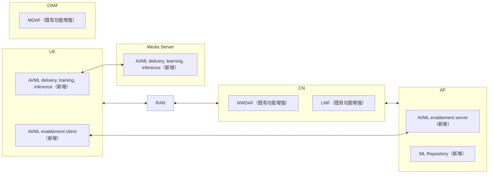

# Release 19 的 AI/ML 標準綜述（Taksande 等，2025）

| 項目 | 內容 |
| --- | --- |
| 標題 | AI/ML in 3GPP 5G Advanced - Services and Architecture |
| 作者與單位 | Pradnya Taksande、Shwetha Kiran、Pranav Jha、Prasanna Chaporkar；Department of Electrical Engineering, Indian Institute of Technology Bombay, India |
| 出處 | arXiv 預印本，arXiv:2512.03728v3 [cs.ET]，2025-12-08。PDF 上沒有期刊或研討會資訊 |
| DOI 或連結 | 無 DOI；<https://arxiv.org/abs/2512.03728> |
| 本次閱讀的版本 | arXiv 版（v3），共 9 頁；正文在第 1 到 8 頁，第 9 頁只有參考文獻後半與致謝 |
| 類型 | 綜述 |

## 一分鐘版本

這篇綜述整理 3GPP Release 19 中由 SA（Service and System Aspects）技術規範組制定的 AI/ML 功能，依領域分成五塊：系統需求、核心網路、媒體服務、應用層、OAM。它把所有功能歸成兩類：「AI for network」（用 AI 改善網路）與「Network for AI」（網路支援 AI 應用）。全文沒有實驗，也沒有新的設計，每個功能用二到四段文字加一張示意圖說明，引用 7 份 3GPP 規格。對讀者有用的地方有三個：一張工作項目總表（表 I）、一段 NWDAF 與 AF 的 vertical federated learning（VFL）說明、一段應用層 AI/ML enablement 的說明。但這三處都很淺，而且 VFL 的訓練機制寫得與 TS 23.288 不一致，技術細節仍要回到規格。

## 1. 要解決的問題

作者指出既有的綜述有兩種缺口（§I）：

- 談 6G 或 RAN 的綜述（論文的參考文獻 [1] 到 [3]）對標準化只做高層次的討論，或不以標準化為重點。
- 談標準化的綜述（[4] 到 [7]）集中在 RAN，沒有充分涵蓋 3GPP SA 的 AI/ML 工作。

作者主張「目前沒有文獻專門從 SA 的角度檢視 Release 19 引入的 AI/ML 能力」，本文要補這個缺口（§I 最後一段）。

**解讀：** 這是一個「整理現況」型的問題，沒有待驗證的假說。評價它的標準是涵蓋是否完整、對標準的描述是否正確。

## 2. 需要的背景

**3GPP 的分工。** 3GPP 分成 RAN、SA、CT 三個技術規範組。SA 負責核心網路功能、安全、OAM 與端到端的應用支援（§I）。表 I 列出 SA 之下各工作組的職責：SA1（新服務與功能需求）、SA2（系統架構）、SA3（安全與隱私）、SA4（多媒體服務）、SA5（管理與編排）、SA6（應用使能）。

**Study Item 與 Work Item。** Study Item 是新功能的可行性研究；Work Item 是研究之後實際撰寫規格的工作（表 I 圖說）。

**兩個典範。** 論文的組織依靠這一組分類（§I、§II）：

| 名稱 | 論文的定義 | 論文舉的例子 |
| --- | --- | --- |
| AI for network（§II 又稱 Network-centric） | 用 AI 最佳化傳統演算法、網路功能與網路營運；涵蓋從網路元件取得、儲存、管理資料，並用來訓練模型 | 以 AI/ML 設計網路資源管理演算法 |
| Network for AI（§II 又稱 AI-centric） | 網路提供有 QoS 保證的通訊、運算與儲存資源，支援 AI/ML 應用；包含支援 FL、應用與雲端之間的資料與模型交換 | UE 上的影像辨識應用需要低延遲連到邊緣或雲端 |

**四項挑戰（§II）。** 論文列出四項挑戰作為後面功能的動機：hierarchical computing（把 AI/ML 工作拆到裝置、邊緣、雲端）、ML 模型的分發與共享、distributed／federated learning、以及 AI for network 的資料取得問題（營運商不願分享網路紀錄、合成資料有分佈偏差、感測資料缺標籤）。圖 1 用一台自駕車說明階層式部署：車內模型處理緊急煞車這類即時工作，邊緣模型處理路徑最佳化，雲端模型處理電池管理最佳化。

## 3. 方法與架構

這是綜述，沒有方法與架構可言。本節改為說明它的涵蓋範圍與組織方式，並把與讀者最相關的三段寫細。

### 3.1. 涵蓋範圍與組織方式

論文依領域分節，每節對應表 I 的一個類別。下表的「工作組」取自表 I；表 I 是以類別對應工作組，沒有逐項功能標示。「歸類」取自各節內文的明文敘述。

| 功能 | 節 | 工作組 | 涉及的網路功能 | 論文引用的規格 | 論文的歸類 |
| --- | --- | --- | --- | --- | --- |
| AI/ML 模型傳輸的系統需求，含裝置直連 | §III | SA1 | 5GS、UE（未指名特定 NF） | TS 22.261 [8] | 該節未明寫 |
| LMF-based AI/ML positioning | §IV-A | SA2；安全屬 SA3 | LMF、NWDAF（MTLF）、UE、RAN | TS 23.273 [9]、TS 33.501 [10] | Network for AI |
| Vertical federated learning | §IV-B | SA2；安全屬 SA3 | NWDAF、AF、NEF | TS 23.288 [11]、TS 33.501 [10] | Network for AI |
| 以 NWDAF 協助 policy control 與 QoS | §IV-C | SA2 | PCF、NWDAF、SMF；圖 4c 另畫出 AMF、UPF、RAN | TS 23.288 [11] | AI for network |
| 訊令風暴（signalling storm）的預防與緩解 | §IV-D | SA2 | NWDAF；分析的使用者為 AMF、SMF、UDM、NRF、PCF、OAM、AF | TS 23.288 [11] | AI for network |
| 媒體服務的 AI/ML | §V | SA4 | UE、media server | TR 26.927 [12] | Network for AI |
| 應用層的 AI/ML enablement | §VI | SA6 | UE（AI/ML enablement client）、AF（AI/ML enablement server、ML repository） | TS 23.482 [13] | Network for AI |
| AI/ML 管理 | §VII | SA5 | MDAF（Management Data Analytics Function，OAM 側的分析功能）、gNB、NWDAF | TS 28.105 [14] | AI for network |

表 I 另列出每個類別的 Study Item 與 Work Item 編號，以及四個 Release 20 的 Study Item（SA2、SA4、SA5、SA6 各一）。SA6 的三筆是：SP-231182「Study on application layer support for AI/ML services」、SP-241008「Stage 2 of Application enablement for AI/ML services」，以及 Release 20 的 SP-250384「Study on Stage 2 for AI/ML service Phase 2」。

圖 3 是全文的總覽圖，標出哪些元件是 Release 19 新增、哪些是既有功能的增強。

依論文圖 3 重繪。原圖的 OAM 方塊沒有畫出連線。

### 3.2. NWDAF 的 federated learning（§IV 開頭、§IV-B）

**篇幅。** §IV-B 共三段，雙欄排版約 27 行，加上圖 4b。Horizontal FL（HFL）作為 NWDAF 的功能只出現一次，是 §IV 開頭列舉 NWDAF 功能時的一句：NWDAF 的功能包含資料收集、分析暴露、模型訓練、「support Horizontal FL (HFL) and Vertical FL (VFL)」。「HFL」在全文的另一次出現是 §VI 的應用層功能清單。論文沒有說明 HFL 的角色或流程。

**NWDAF 的組成（§IV 開頭）。** NWDAF 由 MTLF 與 AnLF 組成，兩者可在同一個 NWDAF，也可部署在不同的 NWDAF instance。MTLF 在 Release 17 引入，Release 19 為了支援 §IV 列的四項功能而增強。

**VFL 的動機（§IV-B 第一段）。** VFL 讓多個實體協同訓練模型，不必暴露各自的原始資料集。論文認為這對行動網路很重要：網路要與外部實體（AF、其他營運商網路）一起進行 AI/ML，同時保護使用者隱私。

**角色與流程（§IV-B 第二段、圖 4b）。** 論文的敘述有五點：

1. NWDAF 與 AF 可以一起訓練出一個 ML 模型。
2. 一個實體（NWDAF 或 AF）擔任 VFL server，其他實體擔任 VFL client；client 可以有多個 NWDAF 或 AF。圖 4b 畫的是一個標為「NWDAF or AF」的 VFL server，下面接四個 client：NWDAF1、NWDAF2、AF1、AF2。
3. VFL server 要求各 client 用自己的資料集在本地訓練，並回報中間結果（intermediate results）。
4. VFL server「把這些模型合併，得出最終的 ML 模型」。
5. AF 若是 untrusted AF（不由營運商架設的 AF），可以經 NEF 與 NWDAF 協調，以支援 VFL 的互動。

untrusted AF 這一點只有一句話，約 3 行。論文沒有說明 NEF 做什麼轉換，也沒有畫進圖 4b。VFL 訓練與推論的詳細流程，論文指向 TS 23.288 [11]。

**安全（§IV-B 第三段）。** TS 33.501 [10] 描述了授權 NWDAF 或 AF 擔任 VFL server 的流程；VFL 過程中的資訊交換以 TLS 保護。

第 4 點與 TS 23.288 的機制不一致，見 §5.3 的查證。

### 3.3. 5G 系統對應用層 AI/ML 的協助（§III）

**篇幅。** §III 共兩段，雙欄排版約 33 行。全節只有一處標引用，是第一段的 TS 22.261 [8]；第二段沒有標引用。這一節談的是 SA1 的服務需求，不是架構或程序。

**Release 18 的需求（§III 第一段）。** 為了支援模型共享、分發與 FL，3GPP 在 Release 18 訂出經由網路連線傳輸模型的系統需求，包含 split model transfer、split inference、FL 三種情境下的上下行速率，對應影像辨識、影音串流、機器人、語音辨識等應用。論文舉的數字：split AI/ML inference 與模型下載的下行速率上限訂為 1.1 Gbps，在熱點區域則為 4 Gbps。

**FL member selection。** 論文對這件事只有一句推論：有了這些基準需求，「AI/ML 模型可以優先選擇位於良好涵蓋區的使用者，作為合適的 FL 成員」（§III 第一段最後一句）。論文沒有描述任何由網路協助挑選成員的機制。

**Release 19 的裝置直連（§III 第二段）。** Release 19 加入以裝置對裝置直連（direct device connection）支援 AI/ML 的需求，應用包含自動駕駛、機器人遠端控制、視訊辨識（video recognition）。例子是 distributed inference：運算資源不足的裝置先算模型的前幾層，把中間資料經直連交給另一台裝置完成推論。論文舉的數字：端點之間以直連做 split AI/ML 推論時，最大體驗速率上限為 1.5 Gbps，端到端延遲上限為 10 msecs，句末註明是工廠機器人應用。原句無法判斷「工廠機器人」這個條件只修飾延遲，還是兩個數字都適用。論文引述一條系統需求：5GS 要能在裝置直連的情況下，動態地把特定 UE 加入或移出 AI/ML FL 任務。

§IV 開頭另有一句相關敘述：Release 18 的 5G 系統已支援語音／視訊辨識、機器人控制、汽車等應用的模型分發、傳輸與訓練。

**解讀：** 核心網路這一側真正的協助機制，是 Release 18 的 TS 23.501 §5.46「Assistance to AI/ML Operations in the Application Layer」，其中由 NEF 提供 Member UE selection assistance（TS 23.502 §4.15.13）。論文沒有引用 TS 23.501 或 TS 23.502，也沒有提到這個機制。讀者若要找「5GS 如何協助應用層挑選 FL 成員」，這篇論文沒有答案。

### 3.4. 應用層的 AI/ML enablement 與分析框架（§VI）

**篇幅。** §VI 共三段，雙欄排版約 36 行，英文約 300 字，加上圖 5b。以 pdftotext 的字數估算（含圖說），約佔全文的 6%。其中應用層分析框架約 10 行，AI/ML enablement layer 約 24 行，最後 2 行是歸類。全段只引用一份規格（TS 23.482 [13]），沒有引用分析框架所屬的規格。

**應用層分析框架（§VI 第一段前半）。** 3GPP 在 Release 18 引入 Application layer analytics framework，在應用層為垂直產業與 Application Service Provider（ASP）提供通用的暴露與加值服務。它支援的分析包含：端到端應用效能、邊緣伺服器負載、服務 API、位置準確度、網路切片的效能與分析。Release 19 的增強有兩項：用 AI/ML 技術強化分析，以及支援應用層的 UE 對 UE 通訊。

**AI/ML enablement layer（§VI 第一段後半、第二段、圖 5b）。**

- 定位：在應用層新增一層，為一個或多個垂直應用提供 AI/ML 操作的協助，位置在 UE 或 AF，或兩者都有。
- 控制：應用層 AI/ML 的操作邏輯由 AF 控制。
- 部署：三種方式。集中部署在雲端平台，彙整多個邊緣平台的資料；部署在邊緣平台；跨邊緣與中央雲端的階層式部署。階層式部署對 FL、distributed learning、distributed inference 特別有利。
- 元件：圖 5b 在 UE 側畫一個「AI/ML enablement client」，在 AF 側畫「AI/ML enablement server」與「ML Repository」，兩側經 5G Network 相連。AI/ML enablement server 管理垂直應用的 AI/ML 行為，協助模型與資料的遞送與分發。ML repository 支援 AI/ML 服務的儲存與取回，包含 ML 模型與 FL 成員的註冊／更新。
- 功能清單（一句話列舉，沒有逐項說明）：lifecycle management、模型訓練與分發、FL 成員更新、AI/ML operation management、VFL 成員選擇、供 HFL 使用的 transfer learning 部署、以改善資料網路能源效率為目標的進階分析。

**Release 20 的方向（§VIII）。** 應用層正在研究 ML 模型效能監控、正確性評估，以及跨多營運商網域的服務連續性。

**解讀：** 這一段的深度大約等於規格的目錄：有元件名稱與功能名稱，沒有參考點、API、資訊流，也沒有說明應用後端與 enablement server 是兩個不同的實體。

### 3.5. 其餘各節摘要

- **定位（§IV-A、圖 4a）。** Release 18 在 RAN 引入 AI/ML 定位方法，Release 19 把它整合到核心網路的 LMF 與 NWDAF。模型可以放在 UE、RAN 節點、LMF 或 NWDAF。LMF 可在本地訓練，或請 NWDAF 訓練；效能監控相應地在 LMF 或 NWDAF 進行。
- **Policy 與 QoS（§IV-C、圖 4c）。** Release 18 以前，PCF 依 AF 的服務需求決定 QoS 參數，再反覆向 NWDAF 取 service experience 分析來檢查與調整。Release 19 讓 PCF 提供 QoS 參數與要求的 QoE，NWDAF 回覆可行的 QoS 參數組及各自預測的 QoE。對象可以是單一 UE 或一組 UE。
- **訊令風暴（§IV-D、圖 4d）。** NWDAF 以訓練好的模型監看訊令量的異常偏離，找出來源（NF 或 UE），回報受影響的 NF、可能原因與來源，也能回報附有效期間的預測。緩解動作依營運商政策或網路設定決定。
- **媒體（§V、圖 5a）。** 考慮三種模型切分：在 UE 推論、在 media server 推論、兩者之間 split inference。新增的邏輯功能有 AI inference engine、AI data access/delivery、FL engine。這是研究階段的成果，預期在 Release 20 進入規範工作。
- **OAM（§VII）。** Release 19 把 MDA 框架的 AI/ML 管理能力擴充到 transfer learning、FL、reinforcement learning、distributed learning。

## 4. 實驗與結果

沒有實驗、模擬或實作。論文的主張以兩種東西支持：

- 7 份 3GPP 規格（[8] 到 [14]），都只引到規格編號與版本，沒有條號。
- 表 I 的 15 筆工作項目編號（Release 19 共 11 筆，Release 20 共 4 筆）。

全文出現的量化數字只有 §III 的四個，都是 SA1 的需求值：1.1 Gbps、4 Gbps、1.5 Gbps、10 msecs。條件見 §3.3。

## 5. 限制

### 5.1. 文獻自己承認的

論文沒有限制或 threats to validity 的段落。它只交代了兩個範圍：聚焦在 SA 技術規範組（摘要），以及寫作時 Release 19 處於最後階段、尚未結束（摘要、§VIII）。

### 5.2. 我們看到的

以下都是解讀。

- **深度不足以取代規格。** 每個功能二到四段，沒有服務操作名稱、資訊元素、程序步驟。引用不帶條號，讀者無法順著引用找到對應條文。
- **引用的規格不完整。** 談應用層分析框架卻沒有引用它的規格；談 Release 18 對應用層 AI/ML 的支援卻沒有引用 TS 23.501、TS 23.502。
- **HFL 幾乎沒有內容。** 標題與摘要沒有承諾 HFL，但對做 NWDAF FL 的讀者，這表示 Release 18 的 NWDAF 間 HFL 在本文只有一個名詞。
- **VFL 的訓練機制寫錯。** 見 §5.3 的 A3。
- **兩個典範的歸類有疑問。** §IV-D 最後一段把定位與 VFL 歸為 Network for AI。依論文自己在 §I 的定義，LMF 用模型算位置是用 AI 改善網路功能，比較接近 AI for network。VFL 在 TS 23.288 §5.4 中是針對某個 Analytics ID 訓練模型，產出的是 NWDAF 的分析，同樣比較接近 AI for network。論文給的理由只有一句：這兩項顯示 AI/ML 應用經由網路通訊時可以如何被有效支援（§IV-D 最後一段）。
- **應用層的實體被壓成一個「AF」。** 圖 3 與圖 5b 把 enablement server 與 ML repository 都畫在 AF 方塊內，內文說操作邏輯「由 AF 控制」。規格區分應用後端、enablement server、ML repository 三個實體，這個區分在論文中消失。
- **圖表與內文有小出入。** 表 I 的圖說寫「Release-19」，表內卻有四筆 Release 20。§V 說 UE 與 media server 都新增 FL engine，圖 5a 在 UE 側畫的是「AI/ML training engine」，只有 media server 側有「Federated learning engine」。圖 2 在應用層方塊下列了「VFL support」，§VI 內文只有「VFL member selection」一詞。
- **預印本的粗糙處。** 參考文獻 [1]、[2]、[4]、[5]、[6] 的作者只寫成兩個字母的縮寫（例如「Q. C. et al.」）；[7] 的標題印成「Release I9」；圖 4d 的圖說有拼字錯誤。

### 5.3. 對標準描述的查證

對照的本地規格：TS 23.288 V20.2.0、TS 23.482 V20.3.0、TS 23.436 V20.2.0（以上在 `specs/Rel-20/`），以及 TS 23.501 V18.12.0、TS 23.502 V18.14.0（在 `specs/Rel-18/`）。論文引用的是 Release 19 的版本；下表的「不符」都已排除明顯屬於 Release 20 新增的內容。TS 22.261 與 TS 33.501 不在本地。

**A. NWDAF 的 federated learning**

| 編號 | 論文的敘述 | 規格位置 | 結果 |
| --- | --- | --- | --- |
| A1 | NWDAF 或 AF 擔任 VFL server，其他 NWDAF 或 AF 擔任 client（§IV-B、圖 4b） | TS 23.288 §5.4 第二段 | 大致相符。規格另有限制：AF 擔任 server 時，client 只能是 NWDAF（§5.4；§6.2H.2.3.1 NOTE 1）。圖 4b 沒有表現這個限制 |
| A2 | untrusted AF 經 NEF 與 NWDAF 協調（§IV-B） | TS 23.288 §5.4 NOTE 1、NOTE 3；§5.5；§6.2H.2.1.2；§6.2H.2.3.1 步驟 2c、2d、5c、5d 與 NOTE 10 | 相符。規格還規定 NEF 代 untrusted AF 向 NRF 註冊與探索、把 NWDAF instance ID 匿名化成 external NWDAF ID、轉換識別碼，論文都沒有寫 |
| A3 | VFL server「合併這些模型，得出最終的 ML 模型」（§IV-B；圖 4b 圖說寫「generates the final model」） | TS 23.288 §5.4 的 VFL server 與 VFL client 功能清單；§6.2H.1 | 不符。規格中 server 合併的是中間訓練結果，算出中間模型訓練資訊（例如 gradient、loss）送回各 client；server 與每個 client 各自更新並保存自己的本地模型。合併後產生的是推論階段的「final VFL inference result」，不是一個合併的模型。論文的寫法接近 §5.3 的 HFL（FL server 聚合出 global ML Model） |
| A4 | VFL 訓練與推論的詳細流程定義在 TS 23.288（§IV-B） | TS 23.288 §6.2H.2.3、§6.2H.2.4 | 相符 |
| A5 | NWDAF 支援 HFL 與 VFL；MTLF 在 Release 17 引入（§IV 開頭） | TS 23.288 §5.1、§5.3、§5.4；Annex B 變更紀錄：MTLF 相關 CR 在 17.1.0，「Federated Learning among Multiple NWDAFs」在 18.0.0，VFL 的 CR 在 19.0.0 | 相符 |
| A6 | VFL 支援與「其他營運商網路」這類外部實體一起進行 AI/ML（§IV-B 第一段） | TS 23.288 §5.4 第二段 | 與本地條文不符：規格寫 VFL 限於 single PLMN 之內。Release 19 的同一段文字未核對 |
| A7 | TS 33.501 描述授權 NWDAF 或 AF 擔任 VFL server 的流程；VFL 的資訊交換以 TLS 保護（§IV-B 第三段） | TS 33.501 不在本地 | **未能確認** |

**B. 5G 系統對應用層 AI/ML 的協助**

| 編號 | 論文的敘述 | 規格位置 | 結果 |
| --- | --- | --- | --- |
| B1 | Release 18 訂出模型傳輸與分發的系統需求，涵蓋 split inference、模型分發、FL（§III） | TS 23.501 V18.12.0 §5.46.1：列出同樣三類應用層 AI/ML 操作，並指明需求在 TS 22.261 §6.40、效能需求在 §7.10 | 相符（間接確認：需求條文存在且在 Release 18；需求內容本身未核對） |
| B2 | Release 18 的 5G 系統支援語音／視訊辨識、機器人控制、汽車等應用的模型分發、傳輸、訓練（§IV 開頭） | TS 23.482 Introduction 第二段有幾乎相同的句子；TS 23.501 V18.12.0 §5.46 | 相符 |
| B3 | 「AI/ML 模型」可優先選擇良好涵蓋區的使用者作為 FL 成員（§III） | TS 23.501 V18.12.0 §5.46.1、§5.46.2；TS 23.502 V18.14.0 §4.15.13 | 部分相符。規格確實有成員選擇的協助，但做選擇的是 AF，協助者是 NEF；篩選條件是 UE 位置、方向、間距、QoS、RAT 類型、端到端資料傳輸時間、Service Experience 等，沒有「良好涵蓋區」這一項。論文這句是作者的推論，不是規格的機制 |
| B4 | 1.1 Gbps、4 Gbps、1.5 Gbps、10 msecs 四個數字（§III） | TS 22.261 §7.10，不在本地 | **未能確認** |
| B5 | 5GS 要能在裝置直連時動態加入或移除 FL 任務中的 UE（§III） | TS 22.261 §6.40，不在本地 | **未能確認** |

**C. 應用層（SA6）**

| 編號 | 論文的敘述 | 規格位置 | 結果 |
| --- | --- | --- | --- |
| C1 | 應用層分析框架在 Release 18 引入，支援應用效能、邊緣負載、服務 API、位置準確度、切片相關分析（§VI） | TS 23.436 Annex B：18.0.0 於 2023-06 發布；§8.2 到 §8.8 的分析項目 | 相符。論文沒有引用 TS 23.436 |
| C2 | Release 19 的增強包含「支援應用層 UE 對 UE 通訊」（§VI） | 可能對應 TS 23.482 §5.2.2 的 off-network（UE-to-UE）模型；TS 23.436 §8.4 的 UE-to-UE application performance analytics 則在 Release 18 已存在 | **未能確認**論文指的是哪一項 |
| C3 | enablement layer 位於 UE 與／或 AF；UE 側有 client、AF 側有 server 與 ML repository；repository 保存 ML 模型與 FL 成員註冊（§VI、圖 5b） | TS 23.482 §5.2.1、§5.2.3.2 到 §5.2.3.4、§6.3 | 功能相符，實體劃分被簡化。規格中 server 以 SEAL server 的身分部署（§5.2.1.1），ML repository 是另一個邏輯實體，由 server 經 AIML-R 存取 |
| C4 | 三種部署：集中於雲端、邊緣、階層式（§VI） | TS 23.482 Annex A.1 到 A.4 | 相符。本地 Release 20 版另有兩種多營運商部署 |
| C5 | 應用層 AI/ML 的操作邏輯由 AF 控制（§VI，緊接在 [13] 之後） | TS 23.482 沒有這句話；TS 23.501 V18.12.0 §5.46.1 有相近的原則：應用 AI/ML 的決策與內部操作邏輯位於 AF 與 UE 應用端，不在 3GPP 範圍 | 部分相符，出處疑似不是 [13]。在 TS 23.482 中，控制操作模式的是 VAL server（§6.19） |
| C6 | 功能清單七項（§VI） | TS 23.482 Annex C（lifecycle）、§6.1 與 §6.2（模型取回、訓練）、§6.3 與 §6.4（FL 成員）、§6.19（操作控制與管理）、§6.17 與 §8.18（VFL）、§6.15 與 §8.16（transfer learning）；TS 23.436 §8.18（DN Energy Efficiency analytics） | 大致相符，兩點出入。其一，規格的 transfer learning enablement 是協助找出並選擇預訓練模型，條文沒有把它限定在 HFL。其二，資料網路能源效率分析屬於 TS 23.436，不是 TS 23.482 這一層帶來的 |
| C7 | Release 20 研究模型效能監控、正確性評估、跨營運商服務連續性（§VIII） | TS 23.436 Annex B 的 CR 0064（20.0.0）；TS 23.482 Annex D 的 CR 0061、0064、0096、0102（20.1.0 到 20.2.0） | 相符。這些項目在本地 Release 20 版已有對應條文 |

另外順手核對的三項：QoS and Policy Assistance 的輸入輸出（TS 23.288 §6.23.1）、Signalling Storm 分析的使用者清單（§6.22.1）、NWDAF（MTLF）提供模型給 LMF（§5.1、§6.2A），都與論文相符。§VII 說 NWDAF 可從 MDAF 取得訓練好的模型；本地 TS 28.105 V19.6.0 §4a.2 的寫法是 NWDAF 的 ML training function 可位於 MTLF 或管理系統，沒有指名 MDAF，這一項只算部分相符。

## 6. 與 SEAL 的關係

**論文是否提到。** 沒有。全文不含「SEAL」「VAL」「CAPIF」「AIMLE」「ADAE」任何一個字串（區分大小寫），也沒有引用 TS 23.434。它引用了 TS 23.482 [13] 一次，用的名稱是「AI/ML enablement layer」「AI/ML enablement client」「AI/ML enablement server」「ML repository」。涉及的篇幅就是 §VI 的 36 行，加上圖 3 與圖 5b。

**解讀：** 論文描述的東西，就是 SEAL 的兩項服務，只是換了名稱。SEAL（Service Enabler Architecture Layer for Verticals，TS 23.434）是位在產業應用與 3GPP 網路之間的一組共用服務；產業應用那一層稱為 VAL（Vertical Application Layer）。

| 論文的用詞 | SEAL 的名稱 | 依據 |
| --- | --- | --- |
| Application layer analytics framework | ADAE（Application Data Analytics Enablement）服務，server 稱為 ADAES | TS 23.436；Release 與分析項目吻合（§5.3 的 C1） |
| AI/ML enablement layer | AIMLE（AI/ML Enablement）服務 | TS 23.482 §1 稱它為「AIML Enablement SEAL Service」 |
| AI/ML enablement client | AIMLE client | TS 23.482 §5.2.3.2 |
| AI/ML enablement server | AIMLE server，也就是一個 SEAL server | TS 23.482 §5.2.1.1、§5.2.3.3 |
| ML repository | ML repository | TS 23.482 §5.2.3.4 |
| 控制 AI/ML 操作邏輯的「AF」、「vertical applications」 | VAL server 與 VAL client | TS 23.482 §5.2.1、§6.19 |
| 改善資料網路能源效率的進階分析 | ADAE 的 DN Energy Efficiency analytics | TS 23.436 §8.18 |

**解讀：** 論文把 AIMLE server 畫在 AF 方塊內，與 SEAL 的說法相容：SEAL server 對核心網路的身分就是 AF。但論文沒有呈現 SEAL 的幾個關鍵結構：

- VAL server 與 AIMLE server 是兩個實體，中間是 AIML-S 參考點。
- AIMLE client 與 AIMLE server 之間是 AIML-UU，AIMLE server 與 ML repository 之間是 AIML-R。
- ADAES 可以是 AIMLE 的消費者（TS 23.436 §5.2.4 的 AIML-X）。論文把分析框架與 enablement layer 寫在同一段，沒有說明兩者的關係。
- 位置、群組、設定等其他 SEAL 服務，以及 CAPIF（Common API Framework，3GPP 的北向 API 共用框架），完全沒有出現。

## 7. 與 NWDAF 的關係

**論文是否提到。** 有，而且是全文著墨最多的 NF。「NWDAF」在正文、圖說與參考文獻共出現 33 次，§IV 的四個小節都以它為主角：定位（提供模型給 LMF）、VFL、QoS 與 policy 協助、訊令風暴分析。§VII 另提到 NWDAF 與 OAM 的關係。

論文沒有寫到的 NWDAF 內容：HFL 的流程、DCCF 與 ADRF、Analytics ID 的名稱、任何 Nnwdaf 服務操作。

**解讀：** 論文各段對應的 TS 23.288 條文如下，讀者可以直接跳到規格。

| 論文的段落 | TS 23.288 V20.2.0 的位置 |
| --- | --- |
| HFL（一句） | §5.3、§6.2C |
| VFL（§IV-B） | §5.4、§5.5、§6.2H |
| 提供模型給 LMF（§IV-A） | §5.1、§6.2A |
| QoS 與 policy 協助（§IV-C） | §6.23 |
| 訊令風暴（§IV-D） | §6.22 |

**解讀：** 論文把「NWDAF 與 AF 的 VFL」放在核心網路節，把「VFL member selection」放在應用層節，兩處沒有互相參照。規格裡這是兩套各自獨立的 VFL：TS 23.288 §5.4 的參與者是 NWDAF 與 AF，針對某個 Analytics ID；TS 23.482 §8.18 的參與者是 AIMLE client（在 UE 上）與 VAL server，由 AIMLE server 協調。本地 TS 23.482 V20.3.0 的 §8.18 沒有出現 NWDAF。

## 8. 對你的研究可以怎麼用

本節全部是解讀。

- **當作引用來源。** 需要一句「Release 19 在 SA 各工作組都加入了 AI/ML 功能」的背景敘述時，可以引它，並沿用 AI for network／Network for AI 的分類。它是預印本，引用時要註明。
- **不要當作 VFL 的技術依據。** A3 顯示它把 VFL 寫成模型聚合。論文或報告中涉及 VFL 機制時，直接引 TS 23.288 §5.4 與 §6.2H。
- **表 I 可當作索引。** 想追 SA6 或 SA2 的工作項目文件時，表 I 給了 SP 編號。這些編號本次沒有核對，使用前要自己到 3GPP 網站確認。
- **它標示出一個沒有人接起來的地方。** 核心網路的 VFL（NWDAF 與 AF）和應用層的 VFL（AIMLE）在這篇綜述中被並列，卻沒有連結；規格中也是兩套。SEAL server 對核心網路就是 AF，所以「AIMLE server 以 AF 的身分參與 NWDAF 的 VFL」是一個可以檢驗的研究問題。規格是否已定義這條路徑，本次沒有核對。
- **untrusted AF 經 NEF 的情境。** 論文只有一句，但它提醒這是 Release 19 的明文情境。若要在 free5GC 上實作 NWDAF 與 AF 的 VFL，NEF 的識別碼轉換與 NWDAF ID 匿名化（TS 23.288 §6.2H.2.1.2、§6.2H.2.2.2）是必須處理的部分。
- **沒有可重用的程式、資料或實驗設計。** 論文沒有任何實作。

## 9. 值得追的參考文獻

以下照論文的參考文獻抄錄。

- [11] 3GPP TS 23.288 version 19.3.0 (2025-06), "Architecture enhancements for 5G System to support network data analytics services," Technical Specification, 2025. 論文中 VFL、QoS 協助、訊令風暴三段的唯一依據；讀者要的細節都在這裡。
- [13] 3GPP TS 23.482 V19.2.0 (2025-07), "Functional architecture and information flows for AI/ML Enablement Service," Technical Specification, 2025. §VI 的唯一依據，也就是 AIMLE 的規格。
- [10] 3GPP TS 33.501 V19.3.0 (2025-07), "Security architecture and procedures for 5G System ," Technical Specification, 2025. VFL server 的授權流程在這裡，本地沒有這份規格，A7 尚未確認。
- [8] 3GPP TS 22.261 V19.11.0 (2025-06), "Service requirements for the 5G system," Technical Specification, 2025. §III 四個數字的來源；要引用那些數字前應先核對。
- [7] X. Lin, "The bridge toward 6G: 5G-Advanced evolution in 3GPP Release I9," IEEE Communications Standards Magazine, vol. 9, no. 1, pp. 28–35, 2025. 論文稱它是純粹從 3GPP 標準化角度寫的 Release 19 RAN 綜述，可與本文互補。標題中的「I9」是論文原樣。
- [6] M. Q. et al., "An Overview of Enabling Artificial Intelligence in 3GPP 5G-Advanced Networks," in 2023 IEEE International Conferences on iThings and IEEE GreenCom and IEEE CPSCom and IEEE SmartData and IEEE Cybermatics. IEEE, 2023, pp. 65–70. 論文稱它完整介紹了 3GPP RAN 範圍內的 AI/ML 技術；作者姓名在論文中只有縮寫。

## 10. 閱讀建議

全文讀完約 20 到 30 分鐘。若只挑重點，10 分鐘足夠：

- **必看：** 圖 3（第 4 頁，全系統總覽）、表 I（第 5 頁，工作項目總表）、§IV-B 與圖 4b（第 5 到 6 頁，VFL）、§VI 與圖 5b（第 7 到 8 頁，應用層）。
- **可以掃過：** §III（SA1 需求與四個數字）、§IV-C、§IV-D、§VIII（Release 20 方向）。
- **可以略過：** §I 與 §II 的一般性介紹、圖 1、§V（媒體）、§VII（OAM）、§IX。

讀 §IV-B 時請同時打開 TS 23.288 §5.4，以規格為準。

## 查證紀錄

**讀了什麼。** 以 `pdftotext -layout` 與不加 `-layout` 兩種方式轉出全文並讀完；用 Read 工具看了 PDF 第 1 到 9 頁的頁面影像，逐一確認圖 1、圖 2、圖 3、圖 4a 到 4d、圖 5a、圖 5b 與表 I 的內容。圖都是點陣圖，圖內文字以頁面影像判讀。

**核對過的數字與主張。**

- §III 的四個數字（1.1 Gbps、4 Gbps、1.5 Gbps、10 msecs）及其條件，與 PDF 文字一致。
- 表 I 的筆數（Release 19 共 11 筆、Release 20 共 4 筆）與 SA6 三筆的編號和名稱，與頁面影像一致。
- 參考文獻共 14 筆，其中 [8] 到 [14] 是 3GPP 規格；§9 抄錄的六筆已逐字對照。
- 關鍵字計數：以區分大小寫的全字比對，「SEAL」「VAL」「CAPIF」「AIMLE」「ADAE」「23.434」「23.436」「23.501」「23.502」都是 0 次；「NWDAF」33 次；「HFL」2 次（§IV 開頭的定義與 §VI 的功能清單）；「NEF」1 次。
- 行數（§IV-B 約 27 行、§III 約 33 行、§VI 約 36 行）是在頁面影像上逐行數的雙欄排版行數。§VI 約 300 字與約 6% 是用 pdftotext 的字數估算，分母含圖說與表 I 的文字，只能當作量級。
- §3.1 表中各功能的歸類，取自 §IV-D 最後一段、§V 最後一句、§VI 最後一句、§VII 倒數第二段的明文；§III 沒有歸類句。
- §5.3 的每一列都回到本地規格的 Markdown 原文確認過條號與用語。

**無法確認的內容。**

- TS 22.261 與 TS 33.501 不在本地，B4、B5、A7 未核對。
- 表 I 的 SP 編號沒有對照 3GPP 的文件庫。
- 本地的 TS 23.288、TS 23.482、TS 23.436 是 Release 20 版。A6 與 C2 可能受版本差異影響，已在表中註明。
- 論文寫 TS 23.482 V19.2.0 的日期為 2025-07；本地 Annex D 的變更紀錄把 19.2.0 記在 2025-06 的 SA#108。封面日期與會議月份可能不同，未進一步確認。
- C5 推測那句話的出處是 TS 23.501 §5.46.1，依據只是文字相近。

**網路請求。** 本次沒有發出任何網路請求。
