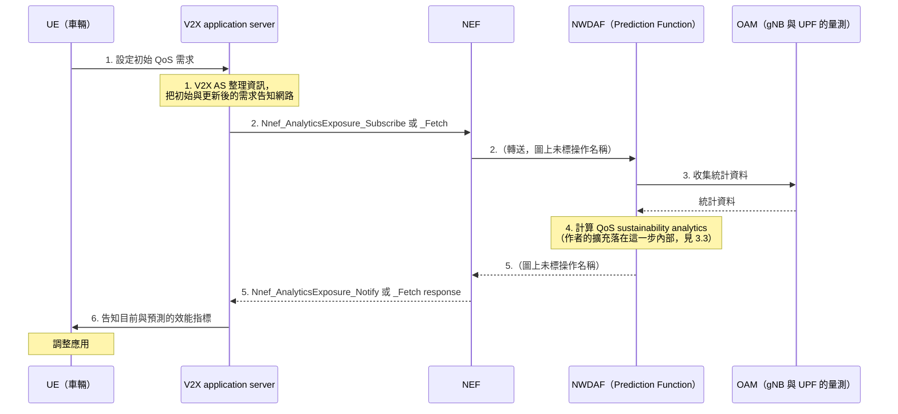
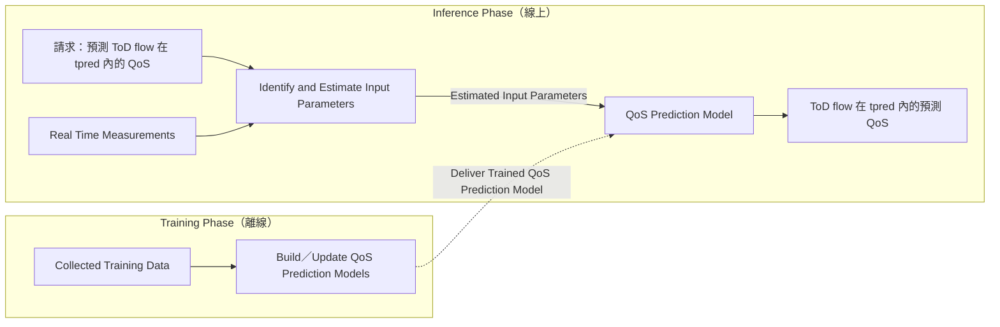

# 5G 連網自動駕駛的 QoS 預測（Kousaridas 等，2021）

| 項目 | 內容 |
| --- | --- |
| 標題 | QoS Prediction for 5G Connected and Automated Driving |
| 作者與單位 | A. Kousaridas、R. P. Manjunath、J. Perdomo、C. Zhou（Huawei Technologies Duesseldorf GmbH, German Research Center, Munich Office）；E. Zielinski、S. Schmitz（Volkswagen Infotainment GmbH）；A. Pfadler（Volkswagen AG, Autonomous Driving） |
| 出處 | IEEE Communications Magazine, vol. 59, no. 9, pp. 58–64, 2021。卷期頁碼來自文獻搜尋階段的書目資料；本次閱讀的 PDF 只印有「Manuscript received January 4 2021」 |
| DOI 或連結 | DOI 10.1109/MCOM.110.2100042；arXiv 2107.05000 |
| 本次閱讀的版本 | arXiv 版，共 7 頁（正文到第 7 頁左欄，其餘為參考文獻與作者簡介） |
| 類型 | 模擬（前半是標準機制的介紹，後半是系統層級模擬） |

沒有標示的段落是論文寫的內容。`**解讀：**` 開頭的段落是我們的整理或推論。`**未能確認：**` 開頭的段落是論文沒寫清楚、或無法從全文判斷的事。

## 一分鐘版本

車用應用可以用不同的組態運作，每種組態需要的 QoS 不同；只要網路在 QoS 變差「之前」通知，應用就能平順地切換組態，不必緊急煞停。論文先說明 3GPP Release 16 已有的路徑：V2X 應用伺服器經 NEF 向 NWDAF 訂閱 QoS Sustainability analytics，收到通知後告知車輛調整。接著作者主張現有機制主要依賴歷史統計，提出放在 NWDAF 內、使用即時量測、針對單一 service flow 的兩階段預測方法（離線訓練、線上推論），並以遠端駕駛的上行吞吐量做 ns-3 模擬。結果是：特徵齊全時模型誤差很小（MAPE 0.005），但輸入特徵的未來值要靠估計時，四秒之後誤差變大；遇到訓練資料沒涵蓋的負載情境時，即使輸入完全正確也會失準。對讀者的用處有兩個：它是「NWDAF 分析 → NEF → 應用伺服器 → 應用調整」這條路徑的簡明期刊引用來源；它的結論把 federated learning 列為處理未知情境的待研究方向。

## 1. 要解決的問題

車聯網（V2X, vehicle-to-everything，車輛與其他車輛、路側設施、網路之間的通訊）中，QoS 會因 UE 密度、干擾、移動、換手、漫遊而突然變化（§I）。對安全相關的服務，突然的 QoS 下降會造成服務中斷或交通效率下降（§II-A）。

許多 V2X 服務可以用多種組態運作，例如遠端駕駛可以改變車速或影像設定（§I）。因此問題不是「保證 QoS 永遠不變」，而是「在變化發生前告訴應用，讓它有時間切換」。

Release 16 有兩個相關機制（§I）：

- **Alternative QoS profile（AQP）**：應用事先告訴網路一串它能接受的替代服務需求，原本的 QoS 無法維持時，網路可以快速降到另一組 QoS，避免 session 中斷。但通知是在實際變化發生時才送出，應用沒有足夠時間平順調整。
- **QoS Sustainability analytics**：網路在 QoS 變化發生前，把預期或估計的變化通知 V2X 應用，讓應用主動決定是否調整（例如安全地停止服務、改變運作模式）。

論文要回答的是：這種預測在 5G 系統裡可以怎麼產生與傳遞，以及對單一 service flow 做即時預測是否可行（§I 末段、§V）。

## 2. 需要的背景

| 名詞 | 說明 | 出處 |
| --- | --- | --- |
| V2N 與 Uu | 車輛經基地台與網路通訊，走 Uu 介面。論文的預測只處理這一種 | §I |
| sidelink（PC5） | 車輛之間不經基地台的直接通訊。論文只在未來工作提到 | §I、§V |
| ToD（tele-operated driving） | 遠端駕駛。遠端駕駛員在指揮中心（CC, command center）控制車輛；車輛把感測資料經上行傳給 CC，CC 把控制命令經下行傳回車輛 | §III-A |
| AQoSA（agile QoS adaptation） | 作者使用的框架名稱：應用依照網路能提供的 QoS 修改自己的組態，例如從自動輔助駕駛改為手動、拉大車距、降低車速 | §II-A |
| QoS profile | 一組 QoS 參數（例如延遲、資料速率）及各自的值 | §I |
| prediction horizon（tpred） | 預測要涵蓋多遠的未來。論文以秒為單位 | §III-B |

論文對「QoS 預測」的定義是：一項預報，內容包含某個 QoS profile 參數的期望值與相關的變異數，並且隨預報的時間長度而不同（§II-A）。

## 3. 方法與架構

### 3.1. 資訊傳遞路徑（標準已有的部分）

V2X 應用伺服器（V2X AS）可以訂閱通知，也可以要求單次通知。AS 提供三項資訊：位置、通知適用的時間視窗、門檻值；預期的 QoS 越過門檻時就觸發通知（§II-B）。

依論文圖 1 重繪。編號與文字照原圖；括號內的註記是我們加的。

內文對這個程序的說明（§II-B）：NWDAF 向 OAM 收集統計資料，檢查觸發條件是否成立，產生關於預期 QoS 變化的分析或預測；分析可以針對指定的地理區域與時間區間；NWDAF 經 NEF 把回應或通知送給 V2X AS；應用據此調整。

論文把整張圖 1 稱為標準化程序，圖說註明依據 TS 23.288 與 TS 23.287。

**解讀：** 各步驟與本地規格的對照如下。

| 圖 1 步驟 | 性質 | 依據 |
| --- | --- | --- |
| 2、5（AS 與 NEF 之間） | 標準已有 | TS 23.288 Rel-18 [§6.1.1.2][ts23288-611]（訂閱）與 §6.1.2.2（單次請求）。NEF 與 NWDAF 之間分別使用 `Nnwdaf_AnalyticsSubscription_Subscribe`／`_Notify` 與 `Nnwdaf_AnalyticsInfo_Request` |
| 3、4（NWDAF 向 OAM 收資料並計算） | 標準已有 | TS 23.288 Rel-18 [§6.9.4.1][ts23288-69] 步驟 2、3 |
| 1、6（UE 與 V2X AS 之間） | 應用層互動，不在 TS 23.288 的範圍 | 論文內文沒有逐步說明這兩步 |
| 步驟 4 內部的訓練與推論方法 | 作者提出 | §III-C、圖 3 |

**未能確認：** 步驟 1 的「把需求告知網路」用哪一個標準程序（例如 AF 提出帶 QoS 的 session 請求時附上 AQP），論文沒有寫。步驟 1 與 6 是否出自 TS 23.287，本地沒有這份規格，無法核對。

通知的時機：依論文的描述是「預期的 QoS 越過 AS 給的門檻時」。通知裡有哪些欄位，論文沒有列出。

### 3.2. Alternative QoS profile 與預測通知的關係

論文的說法是兩者互補（§I）。AQP 讓網路在無法維持原 QoS 時有地方可降，避免中斷；預測通知讓應用提早知道。論文也把兩者連在一起：應用切換到的另一個組態，對應到一個 alternative QoS profile（§I）。

**解讀：** AQP 定義「可以降到哪幾級」，QoS 預測回答「什麼時候會降」。前者是事後通知，後者是事前通知。本地 TS 23.501 Rel-18 [§5.7.1.2a][ts23501-aqp] 的定義與論文一致：AQP 用於開啟 Notification control 的 GBR QoS Flow，NG-RAN 通知 SMF 無法滿足 QoS profile 時，會附上目前能滿足的是哪一個 AQP。

### 3.3. 作者擴充了什麼

§III-C 的原文是：所提的方法放在 NWDAF，能即時計算 QoS 預測，提供更精確的資訊；「因此我們擴充了 QoS Sustainability 服務目前的功能，後者主要依據歷史資訊」。

擴充的內容可從 §III-C 整理成三點：

- **輸入**：除了歷史資料，推論時還收集即時量測，包含該 service flow 自己的量測。
- **對象**：預測的是某一條特定 service flow 的 QoS。
- **時間**：預測的是應用指定的 prediction horizon 內的值。

方法分兩個階段（圖 3）：

依論文圖 3 重繪。

- **訓練（離線）**：用網路與應用的監測工具收集資料，訓練並定期更新模型。資料來源的例子是 OAM 與 RRC 量測。每個 QoS 參數、上行與下行可能各需要一個模型。這個階段不會為每個請求重做（§III-C）。
- **推論（線上）**：每個預測請求觸發一次。請求包含要預測的 QoS 參數、prediction horizon、位置資訊等。先判斷需要哪些輸入特徵，用即時量測估計這些特徵在 horizon 內的未來值，再把估計值餵給訓練好的模型，得到預測的 QoS（§III-C）。

**解讀：** 推論被拆成「估計未來的輸入特徵」與「由特徵算出 QoS」兩步，模型本身不直接做時間序列預測。這個拆法決定了第 4 節的實驗設計：誤差可以分成特徵估計造成的與模型造成的。

**未能確認：** 論文沒有定義這項擴充在介面上的樣子。請求如何指明某一條 service flow、prediction horizon 用哪個參數帶、輸出是預測值還是越過門檻的事件，都沒有說明；圖 1 的服務操作名稱沒有改變。

### 3.4. 應用收到預測後怎麼調整

遠端駕駛最重要的兩個 QoS 參數是下行延遲與上行資料速率（§III-A）。可調整的有三類（§III-B）：車速、感測資料的組態、遠端控制的設定。選哪一種取決於車輛環境、CC 的需求、QoS 變化的程度。

組態與 QoS 需求如下（§III-A，數字引自 5GCroCo 計畫的 Deliverable 2.1；5GCroCo 是歐盟的跨境車聯網試驗計畫）：

| 方向 | 組態 | 資料速率 | 延遲 |
| --- | --- | --- | --- |
| 上行 | Full video upstream（360°、8 台相機、30 fps） | 32 Mbps | 40 ms |
| 上行 | Limited video upstream（360°、5 台相機、30 fps） | 20 Mbps | 40 ms |
| 上行 | Reduced video upstream（<=360°、5-3 台相機、30-10 fps） | 3-20 Mbps | 40 ms |
| 上行 | Slim Uplink（物件資料加單張影格） | 1 Mbps | 40 ms |
| 下行 | Indirect control（下軌跡、路徑點或高階命令） | 500 Kbps | 80 ms |
| 下行 | Direct control（直接控制致動器） | 500 Kbps | 40 ms |

prediction horizon 要多長，以「降速或安全停車」為例推導（§III-B、圖 2）。通訊中斷時必須隨時能安全停車；10 m/s² 的緊急煞車會損害乘坐體驗，期望的減速度低於 4 m/s²。圖 2 的橫軸是減速度（m/s²），縱軸是 prediction horizon（秒，對數刻度），每條曲線對應一個車速，並以 4 m/s² 為界分成「期望」與「不期望」兩區。圖例給出各車速的 tpred：

| 車速（km/h） | 5 | 20 | 35 | 50 | 65 | 95 |
| --- | --- | --- | --- | --- | --- | --- |
| tpred（秒） | 0.4 | 1.4 | 2.4 | 3.5 | 4.5 | 6.6 |

論文據此說 ToD 服務最多需要七秒的 prediction horizon（§IV-B-3）。horizon 越長，車輛控制器越能規劃有效率的動作，避免頻繁加減速（§III-B）。

**解讀：** 圖例的六個數字都符合「車速 ÷ 4 m/s²」（例如 95 km/h = 26.4 m/s，除以 4 得 6.6 秒），也就是以 4 m/s² 等減速到停止所需的時間。論文沒有寫出這個公式。

## 4. 實驗與結果

實驗只評估預測方法本身，預測對象是 ToD flow 的上行吞吐量（§IV）。圖 1 的訊令路徑與應用端的調整都沒有出現在模擬裡。

### 4.1. 設定

| 項目 | 設定 | 出處 |
| --- | --- | --- |
| 工具 | 網路模擬 ns-3.33（開源的離散事件網路模擬器）；車流模擬 SUMO（開源的道路交通模擬器） | §IV-A |
| 評估方法 | 3GPP TR 37.885 的 urban grid 道路配置（Annex A、Table 6.1.1-1） | §IV-A |
| 網路 | 三個 macro site，各三個扇區；站間距 500 公尺；中心頻率 2160 MHz、系統頻寬 20 MHz、FDD | §IV-A |
| 車輛 | Type 2（passenger）車輛，單一等向性（isotropic）天線，平均車速 50 kmph | §IV-A |
| 傳播 | ITU-R P.1411 的建物感知路徑損耗模型（LOS 與 NLOS） | §IV-A |
| ToD 流量 | 一台 ToD 車輛經 Uu 與 ToD 應用伺服器（CC）互動，上行 20 Mbps 影像串流 | §IV-A |
| 背景流量 | 數台非 ToD（NToD）車輛送上行封包：封包間隔為平均一秒的指數分布，封包大小 1012 bytes | §IV-A |
| 核心網路 | 一個 packet gateway，連接基地台與兩種應用伺服器 | §IV-A |
| 排程與 bearer | 每扇區獨立的 round robin 排程；ToD 與 NToD 都用 best effort bearer，RAN 不做服務區分 | §IV-A |
| 負載變化 | NToD 車輛數為 0、5、15、30、40、50、70、80、100、130、160，各搭配不同的移動軌跡 | §IV-A |

背景流量對 ToD 上行吞吐量的影響（§IV-A）：無背景流量時維持 20 Mbps；低負載時偶爾降到 15 Mbps；中負載時在 20 到 10 Mbps 之間；高負載時在 20 到 5 Mbps 之間。

### 4.2. 預測是怎麼產生的

論文有實際的預測模型，不是假設預測已知。

- **由特徵算吞吐量**：random forest（RF，由多棵決策樹組成的集成模型）迴歸（§IV-B-1）。
- **估計特徵的未來值**：ARIMA（auto-regressive integrated moving average，一種時間序列模型），用來估計「車輛數」與「資料速率需求」在未來最多七秒內的值。ToD 車輛的未來位置與目前速度視為可由 ToD 應用直接提供（§IV-B-3）。
- **對照組**：perfect input estimates，假設特徵的未來值完全正確。

資料集有 1281228 筆樣本，輸入特徵如下（§IV-B-1）：

| 特徵 | 內容 |
| --- | --- |
| `Pos_X`、`Pos_Y` | ToD 車輛的位置（x、y 座標） |
| `ToD_Dist` | ToD 車輛到基地台的距離 |
| `V_C1`、`V_C2`、`V_C3` | 每個 cell 的車輛數 |
| `D_C1`、`D_C2`、`D_C3` | 每個 cell 內 NToD 車輛的資料速率需求 |
| `NToD_Dist` | 未連到 ToD 服務 cell 的 NToD 車輛，到該 cell 的距離總和的倒數 |

論文說考慮三個 cell（ToD 所在 cell 與兩個鄰 cell）、每站三個扇區，共二十二個特徵；輸出是 ToD 車輛的上行吞吐量（bps）。

**解讀：** 表列名稱只有十個。若 `V_C*` 與 `D_C*` 以扇區為單位各有九個，加上位置兩個、兩個距離特徵，剛好是二十二個。論文沒有這樣說明。

**未能確認：** RF 與 ARIMA 的超參數、樣本的時間間隔、`NToD_Dist` 的未來值如何估計，論文都沒有寫。

### 4.3. 訓練階段的準確度

隨機取三分之二的資料訓練、三分之一測試。指標是平均絕對誤差（MAE）、絕對誤差的標準差、平均絕對百分比誤差（MAPE）。結果照表 I 抄錄：

| 組態 | 輸入特徵 | MAE（kbps） | 絕對誤差標準差（kbps） | MAPE |
| --- | --- | --- | --- | --- |
| T1 | 全部特徵 | 45 | 241 | 0.005 |
| T2（ToD 所在 cell 的特徵） | `V_C1`、`D_C1`、`Pos_X`、`Pos_Y`、`ToD_Dist` | 95 | 452 | 0.010 |
| T3（只有 ToD 服務相關特徵） | `Pos_X`、`Pos_Y`、`ToD_Dist` | 1528 | 2053 | 0.140 |
| T4（只有網路相關特徵） | `V_C1`–`V_C3`、`D_C1`–`D_C3`、`NToD_Dist` | 607 | 1637 | 0.070 |
| T5（只有網路相關特徵） | `V_C1`–`V_C3`、`D_C1`–`D_C3` | 785 | 1873 | 0.093 |
| T6（只有 ToD 所在 cell 的網路特徵） | `V_C1`、`D_C1` | 1506 | 2581 | 0.220 |

論文的結論（§IV-B-2）：ToD 服務特徵與網路特徵合用才準（T1、T2）；只用 ToD 位置與距離不夠（T3）；只用 cell 層級特徵誤差明顯變大（T4、T5、T6）。作者也說明，因為模擬用 round-robin 排程，車輛數與需求量對預測上行吞吐量的影響很大。

**解讀：** 表 I 沒有標 MAPE 的單位。以 T1 為例，MAE 45 kbps 相對於約 20 Mbps 的吞吐量是 0.2% 左右，所以 0.005 應是比例（0.5%），不是 0.005%。

### 4.4. 推論階段：已知情境

「已知情境」指訓練資料包含與測試相同的情境（§IV-B-3）。圖 4 是一個例子：80 台 NToD 車輛的模擬、T1 組態的 RF 模型、七秒的 horizon。

- 輸入完全正確時，預測與真實吞吐量非常接近。
- 輸入用 ARIMA 估計時，論文說結果接近理想情況；前三秒準確度高，第四秒之後誤差增加，原因是特徵未來值的估計變差。

**解讀：** 以下數字是從圖 4 目測的，原文沒有給。真實吞吐量在第 2 到 4 秒由約 20.0 Mbps 降到約 18.2 Mbps，之後在 18.1 到 18.9 Mbps 之間。ARIMA 輸入的預測在第 3 到 6 秒維持在 19.7 到 20.3 Mbps，沒有跟上這次下降，到第 7 秒才掉到約 16.7 Mbps。第 7 秒時，輸入完全正確的預測（約 17.2 Mbps）也低於真實值（約 18.1 Mbps）。

### 4.5. 推論階段：未知情境

「未知情境」指 80 台 NToD 車輛的情境不在訓練資料內，其他設定與圖 4 相同（§IV-B-4）。圖 5 只畫了輸入完全正確的預測。論文的描述是：第四秒之後誤差增加，即使輸入完全正確；這種準確度對某些應用可能沒有用。

**解讀：** 從圖 5 目測，預測值在第 5 到 7 秒約為 16.6、15.5、15.3 Mbps，真實值約為 18.9、18.9、18.1 Mbps，差距約 2 到 3.5 Mbps。

### 4.6. 論文的建議與開放問題

整理自 §V：

- **可行性**：對單一 service flow 做準確的即時 QoS 預測是可行的。
- **特徵選擇是第一步**：車輛位置加上服務 cell 與鄰 cell 的負載需求，可得到高準確度（MAPE 0.005）。鄰 cell 資訊有助於反映干擾。通道變化等特徵可再考慮。
- **可接受的誤差**：每種應用能接受多大的預測誤差，需要研究。
- **horizon 的取捨**：horizon 越長，特徵未來值越難估計，不確定性會傳到 QoS 預測。時間序列方法在短期估計或許能維持可接受的誤差；結合道路拓撲等情境資訊能否降低不確定性，需要研究。
- **未知情境**：無法事先涵蓋所有情境，需要在未知情境表現夠好的演算法。作者點名 online learning 與 federated learning，理由是它們能在網路實體之間只分享有限資料的條件下應付網路的動態變化。
- **其他方向**：sidelink 的 QoS 預測，以及跨網域（例如多家電信業者）的 QoS 預測。

## 5. 限制

### 5.1. 文獻自己承認的

- 真實環境中 ToD 需要 guaranteed bearer。模擬刻意全部使用 best effort bearer，目的是讓流量更不穩定、資料變異更大（§IV-A）。
- 特徵分析不完整，通道變化等特徵沒有納入（§V）。
- 各應用可接受的誤差水準沒有研究（§V）。
- 未知情境下的準確度可能不敷使用（§IV-B-4）。
- 圖 4 與圖 5 在原文中都稱為「例子」（example）。

### 5.2. 我們看到的

**解讀：** 以下各點都是我們的評估。

- **訊令路徑沒有被評估。** 模擬的核心網路只有一個 packet gateway，沒有 NWDAF、NEF、應用伺服器之間的互動。資料收集、推論、經 NEF 通知、AS 再轉給車輛各要多久，論文沒有討論；這些時間會直接吃掉圖 2 推導出的 0.4 到 6.6 秒。
- **應用調整沒有被模擬。** ToD 流量固定在 20 Mbps，沒有依預測切換組態。「更安全、更有效率」是推論，沒有量測。
- **表 I 量到的不是對未來的預測。** 它是隨機切分同一批模擬資料後，由同一時刻的特徵推算吞吐量的誤差。時間上相鄰的樣本可能分別落在訓練集與測試集，數字會偏樂觀。
- **推論結果只有兩條曲線。** 圖 4、圖 5 各是單一情境的單一片段，沒有跨多次預測的誤差統計。依 4.4 的目測，ARIMA 輸入的預測錯過了該片段中唯一一次明顯下降，原文「接近理想情況」的描述偏寬鬆。
- **沒有輸出不確定性。** §II-A 把 QoS 預測定義為期望值加變異數，但實驗只給點估計。
- **只做了上行吞吐量。** §III-A 列為同等重要的下行延遲沒有實驗。
- **特徵的取得方式沒有交代。** 每個 cell 的車輛數、其他車輛的資料速率需求與位置，在真實網路中由誰提供、多久更新一次，論文只說 OAM 與 RRC 量測是資料來源的例子。
- **結論綁定排程器與規模。** 車輛數與需求量之所以重要，作者自己歸因於 round-robin 排程；網路只有三個站。換成 GBR bearer 加 AQP 的情境，吞吐量的行為會不同。
- **對標準的擴充停在概念。** 見 3.3 的「未能確認」。

**未能確認：** 論文沒有說明 ns-3 使用的是 LTE 還是 NR 模組。2160 MHz、FDD、packet gateway 這些設定看起來像 LTE 的模型，但無法從全文判斷。

## 6. 與 SEAL 的關係

論文沒有提到 SEAL、VAE、CAPIF 或 SA6。全文的應用側只有兩個實體：UE 上的 V2X 應用，以及直接面對 NEF 的 V2X application server。

**解讀：** 先說明幾個名詞。SEAL（Service Enabler Architecture Layer for Verticals，TS 23.434）是位於產業應用與 3GPP 網路之間的一組共用服務。VAL（Vertical Application Layer）指產業應用本身，分成 VAL client 與 VAL server。VAE（V2X application enabler，TS 23.286）是建立在 SEAL 之上、專供 V2X 使用的應用使能層。CAPIF（Common API Framework，TS 23.222）是 3GPP 對外提供 API 的共通框架。

若改由應用使能層代勞，位置會在圖 1 的 V2X AS 與 NEF 之間：

| 圖 1 的元素 | 論文的做法 | 放進應用使能層之後 |
| --- | --- | --- |
| V2X application server | 自己以 AF 身分呼叫 NEF | 成為 VAL server，改呼叫使能層 server 的 API（依 TS 23.434 §4.1.2-e 需符合 CAPIF） |
| 步驟 2、5（訂閱與通知） | V2X AS 與 NEF 之間 | 由使能層 server（VAE server 或 SEAL server）以 AF 身分向 NEF 或 NWDAF 訂閱，再把結果加工後通知 VAL server |
| 步驟 1、6（AS 與 UE 之間） | 應用自行處理，論文未說明 | 可走使能層 client 與 server 之間的介面（SEAL 是 SEAL-UU） |
| NWDAF、NEF、OAM | 不變 | 不變。NWDAF 只看到一個分析消費者 |

本地 TS 23.434 V20.1.0 [§14.3.5][ts23434-1435] 有一個相近的程序。網路資源管理（NRM）server 在協調兩個 UE 之間經網路轉送的端到端 QoS 時，收到 QoS 下降的觸發事件後，可以取得 QoS sustainability analytics 來輔助評估（§14.3.5.3.1 步驟 2），再以 AF 身分向 5GC 要求變更 QoS（步驟 3），並把應用 QoS 變更通知送給受影響的 NRM client（步驟 4）。

這個程序與論文有一個差別。§14.3.5 的 NRM server 拿到分析後是去調整網路側的 QoS；論文是把預測交給應用，由應用調整自己的行為。後者比較接近 V2X 專用的 VAE 要做的事。

**未能確認：** 本地沒有 TS 23.286，VAE server 是否、以及如何把 QoS 預測轉通知給 V2X 應用伺服器，無法在此核對。本系列另一篇筆記處理 5GAA 的 eNESQO 技術報告，主題就是這件事，請以那一篇為準。

## 7. 與 NWDAF 的關係

論文明確提到 NWDAF，位置有三處：§II-B 的程序說明、圖 1（標為「NWDAF（Prediction Function）」）、§III-C（所提方法放在 NWDAF）。使用的分析是 QoS Sustainability，引用 TS 23.288 v16.2.0。論文沒有提到 AnLF、MTLF、ADRF、DCCF；federated learning 只在 §V 以一個待研究方向出現一次。

**解讀：** 論文內容與本地 TS 23.288 V18.13.0 [§6.9][ts23288-69] 的對照如下。

| 論文的描述 | Rel-18 §6.9 的對應 | 差異 |
| --- | --- | --- |
| AS 提供位置、時間視窗、門檻 | Location information、Analytics target period、Reporting Threshold(s) | Rel-18 另把 QoS requirements（5QI 等）列為必要參數，論文沒有列 |
| 訂閱或單次請求 | Subscribe-Notify 或 Request-Response | 一致 |
| NWDAF 向 OAM 收集統計資料 | §6.9.2 表 6.9.2-1：RAN UE Throughput、QoS flow Retainability、Delay in RAN，按 cell、5QI、S-NSSAI 統計 | 一致 |
| 門檻被越過時通知 | §6.9.3：Applicable Area、Applicable Time Period、Crossed Reporting Threshold(s)；預測另有 Confidence | 論文沒有列出通知欄位 |
| 現有功能主要依據歷史資訊 | §6.9.1：期望的 KPI 值由 OAM 取得的 5QI 統計推導 | 一致 |
| 作者擴充：針對單一 service flow、使用即時量測 | Target of Analytics Reporting 是 any UE；輸出是區域層級的門檻事件 | 標準沒有以單一 flow 為對象、回傳預測值的形式 |

版本差異有四點：

- Rel-18 有細粒度區域的程序（§6.9.4.2），論文描述的 Release 16 程序沒有這一段；變更紀錄中標題含 fine granularity 的 CR（0631）列在 18.1.0。NWDAF 經 AMF 與 LCS 找出區域內的 UE，再向 SMF、UPF 收集各 UE 的 QoS 資訊（頻寬、封包延遲），最後對名單內所有 UE 取平均。這比論文描述的機制更接近它想要的 UE 層級輸入，但輸出仍是區域的平均。
- 本地 Rel-20 V20.2.0 §6.9.1 把 Target of Analytics Reporting 擴大為「any UE, a list of UEs」。
- 論文的訓練與推論兩階段，可對應到 Release 17 起的 MTLF 與 AnLF；圖 3 的「Deliver Trained QoS Prediction Model」可對應到 ML model provisioning（§6.2A）。論文寫作時這些名稱尚未出現在它引用的版本。
- Rel-18 §6.1.1.2 讓 AF 在訂閱時附上 Analytics Feedback Information，說明它是否依先前收到的分析採取了行動。論文的應用調整正是這種情況：應用降速或降畫質後，實際的 QoS 需求也變了。

**未能確認：** 我們沒有 v16.2.0 的全文，上表「差異」欄是拿論文的文字與 Rel-18 比，不是逐版比對。本地變更紀錄顯示 v16.2.0 的日期是 2019-12，而論文參考文獻 [4] 寫的是「v16.2.0, Release 16, Dec. 2020」，版本號與日期不一致，無法判斷作者實際依據哪一版。

## 8. 對你的研究可以怎麼用

**解讀：** 本節全部是我們的建議。

- **當引用來源。** 說明「NWDAF 的分析經 NEF 到應用伺服器，應用據以調整」這條路徑時，§II-B 與圖 1 是簡明的期刊出處，作者來自設備商與車廠。引用時應說明它描述的是 Release 16 的機制。
- **當 federated learning 的動機。** §IV-B-4 與 §V 提供一個具體論點：在某些負載情境訓練的 QoS 預測模型，遇到沒看過的情境會失準，作者把 federated learning 列為待研究方向。這可以接到 TS 23.288 §6.2C 的多 NWDAF federated learning：不同區域的 NWDAF 各自看到不同的負載情境。論文沒有做任何 federated learning 實驗，只能引用為動機。
- **當實驗設計的對照。** 兩個設計可以沿用。第一，已知與未知情境的對比（把某個負載情境整個排除在訓練之外），可用來比較單一 NWDAF 訓練與 federated learning。第二，perfect 與 imperfect input 的對比，可把誤差拆成特徵估計與模型兩個來源。
- **可重用的程式或資料：沒有。** 論文沒有提供程式碼或資料集的連結。特徵清單與表 I 可作為設計資料集的起點，但這些特徵是 RAN 層級的量測，free5GC 本身不產生，需要另外的 RAN 模擬或測試平台。
- **待填補的缺口。** 整條通知路徑的端到端時間；標準的輸出形式（區域門檻事件）與應用實際需要的資訊（某條 flow 在未來幾秒的預測值與不確定性）之間的落差；應用調整後如何回饋給 NWDAF。這三點論文都沒有處理，後兩點在 Rel-18 之後有相關機制可以探討。

## 9. 值得追的參考文獻

- [4] 3GPP TS 23.288, “Architecture enhancements for 5G System (5GS) to support network data analytics services (v16.2.0, Release 16)”, Dec. 2020. 論文的機制基礎；本地有 Rel-18 與 Rel-20 的 §6.9 可直接對照。
- [5] 3GPP TS 23.287, “Architecture enhancements for 5G System (5GS) to support Vehicle-to-Everything (V2X) services (v16.1.0, Release 16)”, Dec. 2020. 論文說 QoS Sustainability 用於 V2X 的方式在這份規格討論；圖 1 的 UE 側步驟需要靠它核對。本地沒有。
- [6] 5GCroCo, “Deliverable 2.1, Test Case Definition and Test Site Description”, January 2020. 遠端駕駛各組態的 QoS 數字與 Slim Uplink 的來源。
- [2] 5GAA, “White Paper C-V2X Use Cases: Methodology, Examples and Service Level Requirements,” Jun. 2019. V2X 使用案例與服務等級需求的整理，適合補產業背景。5GAA（5G Automotive Association）是車廠與電信業者組成的產業聯盟。
- [9] 3GPP TR 37.885, “Study on evaluation methodology of new Vehicle-to Everything (V2X) use cases for LTE and NR (v15.3.0, Release 15),” June 2019. 模擬的道路配置與車輛類型來源，要重現實驗時需要。

## 10. 閱讀建議

全文 7 頁，正文約 6 頁，沒有公式，約 30 到 40 分鐘可以讀完。

- **必看**：§II-B 與圖 1（訊令路徑）；§III-B 與圖 2（horizon 的推導）；§III-C 與圖 3（兩階段方法）；表 I、圖 4、圖 5；§V。
- **可略**：§I 的 V2X 一般背景；§II-A 的 AQoSA 說明（本文第 1、2 節已涵蓋）；最後一頁的作者簡介。
- **閱讀時注意**：§III-C 說請求內容「如 section II.A 所述」，實際上請求內容寫在 §II-B。圖 4 請自己看曲線，不要只讀內文的描述。

## 查證紀錄

- **閱讀方式**：以 `pdftotext -layout` 轉出全文閱讀；另以 Read 工具看過 PDF 全部 7 頁的頁面影像，並把圖 1（第 2 頁）、圖 2（第 3 頁）、圖 4 與圖 5（第 6 頁）裁切放大後逐一檢視。圖 3（第 4 頁）與表 I（第 5 頁）以頁面影像核對。
- **已對照原文的數字**：六種 ToD 組態的資料速率與延遲（§III-A）；10 m/s² 與 4 m/s²（§III-B）；圖 2 圖例的六組車速與 tpred；七秒 horizon（§IV-B-3）；ns-3.33、三個 macro site、ISD 500 公尺、2160 MHz、20 MHz、FDD、50 kmph、1012 bytes、平均一秒（§IV-A）；十一種 NToD 車輛數；四種背景負載下的吞吐量範圍；樣本數 1281228、二十二個特徵、三分之二與三分之一切分（§IV-B）；表 I 六列的全部數值；80 台 NToD 車輛、T1 組態（§IV-B-3、§IV-B-4）；MAPE 0.005（§V）。
- **已對照原文的主張**：AQP 與 QoS Sustainability 的關係（§I）；AS 提供的三項資訊與程序步驟（§II-B）；「擴充 QoS Sustainability 服務目前的功能」一句（§III-C）；federated learning 的出處（§V，全文僅此一處）。全文搜尋確認沒有出現 SEAL、VAE、SA6、CAPIF。
- **已對照本地規格**：TS 23.288 V18.13.0 §6.9、§6.1.1.2、§6.1.2.2 與 Annex B 變更紀錄；TS 23.288 V20.2.0 §6.9（與 Rel-18 做差異比對）；TS 23.501 V18.12.0 §5.7.1.2a；TS 23.434 V20.1.0 §14.3.5。
- **屬於目測或推算、不是原文數字**：4.4 與 4.5 節從圖 4、圖 5 讀出的吞吐量；3.4 節的「車速 ÷ 4 m/s²」；4.2 節二十二個特徵的組成；4.3 節 MAPE 為比例的判斷。這些都已標為解讀。
- **無法確認**：期刊卷期頁碼與 DOI（PDF 上沒有，採用搜尋階段的書目資料，未上網核對）；TS 23.287 與 TS 23.286 的內容（本地沒有）；TS 23.288 v16.2.0 當時的條文；ns-3 使用的無線模組；RF 與 ARIMA 的設定；作者擴充在介面上的具體形式。
- **網路請求**：沒有發出任何網路請求。

[ts23288-69]: ../../../../specs/Rel-18/TS%2023.288/6%20Procedures%20to%20Support%20Network%20Data%20Analytics/6.9%20QoS%20Sustainability%20Analytics.md
[ts23288-611]: ../../../../specs/Rel-18/TS%2023.288/6%20Procedures%20to%20Support%20Network%20Data%20Analytics/6.1%20Procedures%20for%20analytics%20exposure/6.1.1%20Analytics%20Subscribe%20and%20Unsubscribe.md
[ts23501-aqp]: ../../../../specs/Rel-18/TS%2023.501/5%20High%20level%20features/5.7%20QoS%20model/5.7.1%20General%20Overview/5.7.1.2a%20Alternative%20QoS%20Profile.md
[ts23434-1435]: ../../../../specs/Rel-20/TS%2023.434/14%20Network%20resource%20management/14.3%20Procedures%20and%20information%20flows%20for%20network%20resource%20management/14.3.5%20QoS%20and%20resource%20management%20for%20network-assisted%20UE-to-UE%20and%20VN%20group%20communications.md
