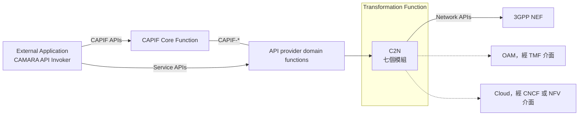
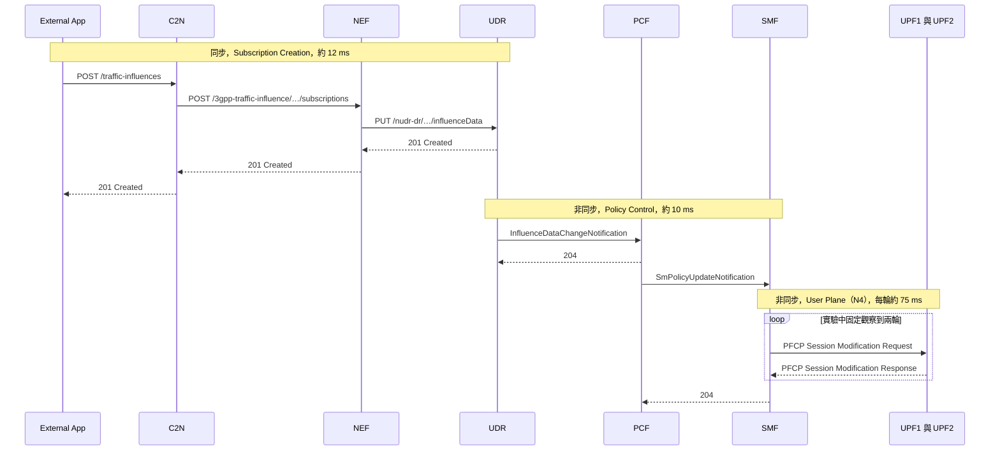

# C2N：把 CAMARA Traffic Influence API 轉成 NEF 呼叫（Silva 等，2026）

| 項目 | 內容 |
| --- | --- |
| 標題 | C2N: Bridging CAMARA Service APIs and 3GPP Core Network Exposure Function |
| 作者與單位 | Rafael Rodrigues Silva、João Paulo Esper、Kleber V. Cardoso（Instituto de Informática, Universidade Federal de Goiás, UFG）；Leandro C. de Almeida（Unidade Acadêmica de Informática, Instituto Federal da Paraíba, IFPB）；Fábio L. Verdi（Departamento de Computação, Universidade Federal de São Carlos, UFSCar） |
| 出處 | Anais do XLIV SBRC 2026，pp. 379-392。SBRC 是巴西的電腦網路與分散式系統研討會；PDF 頁首印的是「Anais do SBRC 2026: Artigos Completos」 |
| DOI 或連結 | DOI 10.5753/sbrc.2026.19273。屆次 XLIV、頁碼與 DOI 依任務指示抄錄；PDF 內頁只印 1 到 14，沒有印 DOI |
| 本次閱讀的版本 | 研討會論文集的開放取用版，共 14 頁，本地檔案 `local-references/papers/seal-application-enablement/c2n2026.pdf` |
| 類型 | 實作與實測 |

## 一分鐘版本

CAMARA 是給應用開發者用的電信 API 專案，它的 API 不出現 DNN、S-NSSAI、DNAI 這些 3GPP 參數，所以營運者必須在 CAMARA API 與 NEF 之間放一層轉換，稱為 Transformation Function。這一層目前沒有公開規格，各營運者自行實作。這篇論文提出 C2N，一個以 Go 撰寫並開源的 Transformation Function，只實作 CAMARA Traffic Influence API 一支，把它轉成 NEF 的 `3gpp-traffic-influence` 訂閱。作者在 free5GC v4.1.0 加 UERANSIM 的測試平台上驗證：轉換層耗時 3.22 ms，應用端等到 `201 Created` 約 12 ms，使用者面實際改道約需 172 ms，其中 150 ms 花在 SMF 與 UPF 之間的 PFCP 交換。對你有用的地方有兩個：它是 free5GC 上「AF 經 NEF 影響路由」整條鏈路的一組實測時間；它代表應用取得網路能力的另一條路線，可以和 SEAL 對照。論文沒有提到 SEAL，也沒有提到 NWDAF。

## 1. 要解決的問題

NEF 的北向 API 要求呼叫方懂 S-NSSAI、DNN、DNAI 與 3GPP 格式的 flow description，一般應用開發者難以使用（§1）。CAMARA 專案定義了開發者容易使用的 Service API 來解決這件事，但把這些 API 翻譯成網路原生介面的 Transformation Function 只有概念層級的描述，具體設計留給各營運者（論文用 Communication Service Provider，CSP 稱呼）。結果是每家都有自己的私有實作，外界無法重現、無法比較翻譯策略與效能（§1、§2）。

論文要補的缺口是：提供一個公開、可重現的 Transformation Function 參考實作，並說明欄位對應的方法（§1 的三項貢獻）。

## 2. 需要的背景

### 2.1. CAMARA、Service API 與 Network API

CAMARA 是 GSMA 與 Linux Foundation 合作的開源專案，在 GSMA Open Gateway 的框架下制定全球一致、對開發者友善的電信 API（§1、§2）。論文引用 CAMARA 的分類，把 API 分成兩種（§2）：

| 類別 | 定義 | 例子 |
| --- | --- | --- |
| Network API | 由標準組織定義、網路功能實作的介面，與底層技術緊密相關 | TS 29.522 的 NEF 北向 API |
| Service API | 給第三方開發者使用的介面，以直覺的參數隱藏網路細節 | CAMARA Traffic Influence API |

兩者的差別可以用同一件事說明：NEF 要求明確的 S-NSSAI、DNN、DNAI；CAMARA Traffic Influence API 讓開發者只填一個 `edgeCloudZoneId`，代表目標的邊緣位置（§2）。

### 2.2. Transformation Function

Transformation Function 是 CAMARA 架構中把 Service API 呼叫翻譯成 Network API 操作的元件。論文整理 CAMARA 文件對它的五項要求（§2）：

- 參數轉換：把高階識別碼轉成網路參數。
- 拓樸解析：把抽象位置（例如 edge zone）對應到 DNAI、DNN。
- 協定調適：處理請求與回覆格式的差異。
- 狀態管理：維護 Service API 資源識別碼與 Network API 資源識別碼的雙向對應。
- 一對多對應：一次 Service API 呼叫需要多個 Network API 操作的情況。

Transformation Function 的後端不限於 NEF，也包含經 TM Forum（電信管理論壇，TMF）Open API 連接的 OAM 系統，以及經 CNCF、NFV 介面連接的雲端基礎設施（§1、圖 1）。

### 2.3. CAPIF 在 CAMARA 架構中的位置

CAPIF（Common API Framework，TS 23.222）是 3GPP 為北向 API 定義的共用框架，處理 API 的發布、發現、認證與存取控制。論文說 CAMARA 架構用兩個元件連接 Service API 與 Network API：以 CAPIF 實現的 API Gateway，以及 Transformation Function。CAPIF 由 CAPIF Core Function（CCF）與 API Exposing Function（AEF）提供上述功能，Transformation Function 位於 AEF 之後，處理已通過驗證的請求（§2）。

## 3. 方法與架構

### 3.1. C2N 在整體架構中的位置

依論文圖 1 重繪。虛線是架構上預留、論文沒有實作的後端（§1、§6）。

### 3.2. 七個模組

C2N 由七個模組組成，分成四個處理層（§4、圖 2）。

| 處理層 | 模組 | 工作 | 是否與 API 無關 |
| --- | --- | --- | --- |
| Security and Ingress | Security Module | 驗證 token 簽章、取出 OAuth 2.0 claim、RBAC、限流、CORS、稽核紀錄 | 是 |
| Security and Ingress | Ingress Module | 依 OpenAPI 規格解析並檢查請求，錯誤時回覆相符的 HTTP 狀態碼 | 是 |
| Enrichment and Mapping | Topology Engine | 把 `edgeCloudZoneId` 解析成 DNAI、DNN、S-NSSAI；對應關係寫在 JSON 設定檔 | 否 |
| Enrichment and Mapping | Parameter Mapper | 執行三階段欄位對應 | 否 |
| Request Building and State | Request Builder | 組出符合 NEF 的 HTTP 請求（JSON、URL、標頭）；支援 CRUD、逾時設定、連線池 | 是 |
| Request Building and State | State Manager | 維護 CAMARA 資源識別碼與 NEF subscription 識別碼的雙向對應；執行緒安全的儲存、生命週期追蹤、產生 correlation ID、統計 | 是 |
| Response Translation | Response Module | 把 NEF 的回覆與錯誤轉成 CAMARA 格式 | 是 |

作者主張七個模組中有五個可以原樣用於其他 CAMARA API，約占 70%；實作新的 API 只需要重寫 Topology Engine 與 Parameter Mapper。作者同時說明這個主張來自架構分析，沒有以多支 API 實際驗證（§4 末段）。

模組名稱在原文有兩處不一致：圖 1 寫 Response Processor，正文與圖 2 寫 Response Module；摘要與結論稱七個「components」，§4 稱七個「modules」。

### 3.3. 欄位對照與對應規則

Parameter Mapper 把欄位對應分成三類（§4）：direct 是欄位一對一改名；logical 是需要 Topology Engine 補上網路資訊才能完成的轉換；structural 是資料結構不同的轉換。下表前三欄是論文表 1 的全部內容；最右欄是補充，除另外註明者外來自 §4 正文。

| CAMARA 欄位 | NEF 欄位 | 類型 | 說明 |
| --- | --- | --- | --- |
| `appId` | `afServiceId` | Direct | |
| `notificationUri` | `notifDestination` | Direct | §4 正文寫作 `notificationDestination` |
| `edgeCloudZoneId` | `dnn` | Logical | 由 Topology Engine 查 JSON 設定檔 |
| `edgeCloudZoneId` | `snssai.sst/sd` | Logical | 同上 |
| `edgeCloudZoneId` | `trafficRoutes[].dnai` | Logical | 同上 |
| `device`（未提供） | `anyUeInd: true` | Structural | 依表格字面：請求沒有 `device` 時填 `anyUeInd: true`；正文沒有另外說明 |
| `device.phoneNumber` | `gpsi` | Structural | |
| `device.ipv4Address` | `ipv4Addr` | Structural | |
| `trafficFilters` | `FlowInfo[]` | Structural | CAMARA 把來源與目的分成兩個物件；NEF 要求 `permit out <proto> from <src> to <dst>` 格式的 flow description |

作者選 Traffic Influence 當驗證案例的理由，是它同時用到三類轉換（§1）。

**解讀：** 論文在 §5.3 說 C2N 執行 TS 23.502 規定的對應，包含 AF-Service-Identifier 到 DNN 與 S-NSSAI、zone identifier 到 DNAI。在 3GPP 的設計裡，這些對應是 5GC 一側的工作：TS 23.501 §5.6.7.1 寫的是 AF 提供 AF-Service-Identifier 時由 5G Core 對應到 DNN 與 S-NSSAI，NEF 也可以把它對應到 DNAI 清單。C2N 的做法是在 NEF 之前就查表，把 `dnn`、`snssai`、`dnai` 明確填進請求。也就是說，C2N 承接了一部分標準上屬於 NEF 的對應工作，而拓樸知識放在 C2N 的 JSON 設定檔裡。

### 3.4. 操作對照與狀態管理

| CAMARA 一側 | NEF 一側 | 出處 |
| --- | --- | --- |
| `POST /traffic-influences` | `POST /3gpp-traffic-influence/v1/<afId>/subscriptions`，論文稱為 `Nnef_TrafficInfluence_Create` | 圖 3、圖 5、§5.3 |
| 成功回覆 `201 Created`（CAMARA 格式） | NEF 回覆 `201 Created` | 圖 2、圖 5 |
| 後續的 GET、PATCH、DELETE | 以 State Manager 保存的識別碼對應找到 NEF subscription | 圖 2 底部的說明 |

狀態管理的流程是：送出請求前由 State Manager 產生 correlation ID，NEF 回覆後再存入 CAMARA 資源識別碼與 NEF subscription 識別碼的對應（圖 2 步驟 14 與 16）。

**未能確認：** 論文只詳細描述建立訂閱這一個操作。查詢、修改、刪除的對應只有「支援所有 CRUD 操作」一句話（§4），沒有流程也沒有實驗。State Manager 的資料是存在記憶體或外部資料庫、重啟後是否保留，論文沒有說明；圖 2 寫的「persistent」是指對應關係建立後可供後續操作使用。NEF 發出通知時如何轉回 CAMARA 格式送到 `notificationUri`，論文也沒有描述。論文沒有寫出所用 CAMARA Traffic Influence API 的版本。

### 3.5. 一次請求在轉換前後的樣子

圖 3 附了兩段訊息。CAMARA 請求的本體是 205 bytes，內容為 `appId`（值 `af001`）、`edgeCloudZoneId`（值 `camara-mec-zone-1`）、`notificationUri` 與 `device.ipv4Address.publicAddress`。轉換後的 NEF 請求是 402 bytes，圖中可見的欄位有 `trafficFilters`（`flowId` 為 1，`flowDescriptions` 為 `permit out ip from <serverIp> to <ueIp>`）、`dnn`（`internet`）、`snssai`（`sst` 1、`sd` `010203`）與 `trafficRoutes`（`dnai` 為 `mec`），結尾以省略號截斷。作者用這個接近兩倍的差距說明轉換層替開發者省下的工作（§5.1）。

**未能確認：** 圖 3 的 CAMARA 請求沒有 `trafficFilters` 欄位，但 NEF 請求有 `trafficFilters`，其中的 server 位址從哪裡來，論文沒有說明。NEF 請求被截斷，看不到實際送出的是 `ipv4Addr` 還是 `anyUeInd`。

### 3.6. 用的是哪一個 NEF，核心網路內部走到哪裡

論文寫測試平台是「以 free5GC 為基礎的完整 5G Core，包含 NEF、UDR、PCF、SMF 與兩個 UPF」（§5.1），沒有提到自行撰寫的 NEF 或 NEF 模擬器。使用到的 NEF API 只有 Traffic Influence 一支。論文引用的 NEF 規格是 TS 29.522 Release 15，流程依據是 TS 23.502 Release 15（參考文獻）。

核心網路內部的路徑是 NEF、UDR、PCF、SMF、UPF（圖 5、§5.3）：NEF 把 AF 請求寫入 UDR（Data Set 為 Application Data，Data Subset 為 AF traffic influence request information）；已訂閱變更的 PCF 收到 UDR 的通知，產生 PCC rule 交給 SMF；SMF 經 N4 以 PFCP 修改兩個 UPF 的 session。細節與時間見第 4.3 節。

**解讀：** 依這段描述，C2N 對接的應是 free5GC 自帶的 NEF。工作區的參考副本 `resources/references/free5gc-main/NFs/nef`（NEF v1.2.5，比論文用的 free5GC v4.1.0 新）對 AF 提供的北向 API 只有 `3gpp-traffic-influence` 與 `3gpp-pfd-management` 兩支，與論文只用 Traffic Influence 相符。

### 3.7. CAPIF：架構圖中有，實驗中沒有

CAPIF 在論文中是架構的一部分，但沒有實際整合。圖 1 與圖 2 都畫了 CAPIF：外部應用先經 AEF 驗證 access token，再轉給 C2N（圖 2 步驟 1 到 3）。實驗中 CCF 與 AEF 都沒有啟動，外部應用直接把請求送給 C2N，C2N 用本地設定的金鑰驗證 token，用來模擬「已通過 AEF 驗證」的情境（§5.1）。作者在未來工作中寫明，完整符合 CAMARA 需要與 OpenCAPIF（ETSI 的 CAPIF 開源實作）或類似框架整合（§6）。

### 3.8. 實作與開源

C2N 以 Go 撰寫，使用 Gin web framework，JSON 處理與 HTTP client 用標準函式庫；部署參數用環境變數，拓樸對應用 JSON 檔（§5）。程式碼網址照論文註腳 1 抄錄：`https://github.com/LABORA-INF-UFG/C2N`。論文沒有寫授權條款。

## 4. 實驗與結果

### 4.1. 測試平台

| 項目 | 設定 | 出處 |
| --- | --- | --- |
| 5G Core | free5GC v4.1.0 | 表 2 |
| RAN 模擬 | UERANSIM v3.2.7，模擬 gNB 與 UE | 表 2、§5.1 |
| C2N Gateway | Go 1.21，以容器執行 | 表 2、§5.1 |
| UPF1 | PDU Session Anchor，預設路徑 Path 1 | §5.1 |
| UPF2 | 作為 branching point，把流量本地分流到 App Server，Path 2 | §5.1 |
| 基準延遲 | Path 1 以 Linux `tc` 加上約 10 ms | §5.1、表 2 |
| 額外延遲 | 再加 40 ms，代表壅塞事件 | §5.1、表 2 |
| 流量 | `fping`，100 pps，ICMP | 表 2、§5.2 |

### 4.2. 功能驗證：流量是否真的改道

實驗分成三段（§5.2）：先走 Path 1 量基準；再對 Path 1 加上額外延遲；最後呼叫 C2N 的 Traffic Influence API，把流量改到 Path 2。作者做了兩次：60 秒（6,000 個封包，每段 20 秒）與 6 秒（600 個封包，每段 2 秒）。

- 60 秒實驗（圖 4(a)）畫的是每 10 個封包滑動視窗的平均 RTT 與 95% 信賴區間。第三段的 RTT 回到與第一段幾乎相同的水準。正文沒有寫出 RTT 的數值；從圖上讀，第一段與第三段約 11 ms，第二段約 51 ms。
- 6 秒實驗（圖 4(b)）畫的是逐封包的 RTT。從第二段到第三段的轉換有約 200 ms 的延遲，作者說它對應控制面信令時間；之後有短暫時間兩條路徑同時有封包抵達，原因是舊路徑上的封包還在途中。

### 4.3. 控制面信令時間

作者從各 NF 的 log 取時間戳，把一次啟用拆成三個階段（§5.3、圖 5）。

依論文圖 5 重繪；兩個 UPF 合併成一條生命線。

| 階段 | 內容 | 時間 |
| --- | --- | --- |
| Phase 1，同步 | C2N 轉換、NEF 處理、寫入 UDR、回覆 `201 Created` | 約 12 ms |
| Phase 2，非同步 | UDR 通知 PCF，PCF 產生 PCC rule 並通知 SMF | 約 10 ms |
| Phase 3，非同步 | SMF 對兩個 UPF 送 PFCP Session Modification，兩輪 | 每輪約 75 ms，共 150 ms |
| 合計 | | 172 ms（§1、§5.4） |

同步階段的細分來自論文表 3：

| 組成 | 時間 | 比例 |
| --- | --- | --- |
| C2N ingress（認證加轉換） | 2.85 ms | 24.6% |
| 5G Core（NEF 加 UDR） | 8.36 ms | 72.2% |
| C2N egress（回覆處理） | 0.37 ms | 3.2% |
| C2N overhead 合計 | 3.22 ms | 27.8% |
| 同步延遲 | 12 ms | 100% |

作者的結論是轉換層的負擔不到同步階段的 28%、不到三階段總時間的 2%（§5.3）。

### 4.4. 作者的討論

- PFCP 交換重複兩輪，作者歸因於 PCF 處理 PCC rule 的方式：影響資料觸發多組 PCC rule 的修改時，PCF 對每一組各發一次通知。作者推測 free5GC 的 PCF 把規則分成兩組，並說商用核心網路的輪數可能不同（§5.4）。
- 因為啟用需要約 172 ms，作者建議對延遲敏感的應用提前啟用 Traffic Influence，例如在 session 建立或進入地理圍欄時，不要等到需要低延遲時才呼叫（§5.4）。

## 5. 限制

### 5.1. 文獻自己承認的

- 只實作 Traffic Influence 一支 API。五個模組可重用的主張是架構分析，沒有用第二支 API 驗證（§4）。
- CAPIF 的 CCF 與 AEF 沒有啟動，token 以本地金鑰驗證（§5.1）。
- 只用 ICMP 測試；測試平台的設定無法觀察 TCP、UDP 流量即時改道（§5.4）。
- 只有兩個 UPF 的最小拓樸。作者認為 C2N 只在控制面運作，UPF 變多只會拉長 PFCP 設定階段（§5.4）。
- 兩輪 PFCP 的現象是 free5GC 特有的（§5.4）。
- 沒有做多個 UE 同時請求的負載測試，其他後端（TMF、CNCF）也還沒實作，兩者都列為未來工作（§6）。

### 5.2. 我們看到的

**解讀：** 以下各點是閱讀時發現的問題，不是論文的陳述。

- **「87%」的分母與文字不符。** 論文兩次寫 N4 迴圈占「asynchronous latency」的 87%（§1、§5.4）。非同步階段是 10 ms 加 150 ms，共 160 ms，150 除以 160 是 93.75%；150 除以總時間 172 ms 才是 87.2%。這個數字應該是占端到端總時間的比例。
- **表 3 的比例不是以 12 ms 為分母。** 三項相加是 11.58 ms，各比例都是除以 11.58 算出的；表中的 12 ms 是四捨五入後的值。
- **時間數字沒有統計資訊。** 表 3 與三個階段的時間都是單一數值，論文沒有寫重複次數、平均或變異；只在 PFCP 輪數處說「所有測試執行」都觀察到兩輪，但沒有說執行了幾次。
- **沒有比較對象。** 論文沒有量測應用直接呼叫 NEF 的時間，3.22 ms 的負擔是從 log 拆出來的，不是對照實驗的差值。
- **圖與正文有幾處不一致。** 圖 2 的 NEF 路徑寫 `POST /nef/api/v1/…`，圖 3 與圖 5 寫 `/3gpp-traffic-influence/…`；表 1 的 `notifDestination` 與正文的 `notificationDestination` 不同，工作區 `resources/openapi/openapi/models/model_nef_traffic_influ_sub.go` 的欄位名是 `notificationDestination`；圖 5 把 `SmPolicyUpdateNotification` 畫在迴圈外，正文卻把它列為每一輪的第一步。
- **圖 4(b) 的約 200 ms 與 172 ms 之間的差距沒有解釋。** 作者只說前者對應後者。
- **Security Module 的功能大多沒有被實驗驗證。** RBAC、限流、稽核紀錄都只在 §4 描述；實驗只做了以本地金鑰驗證 token。
- **誰決定何時呼叫 API 沒有說明。** 圖 3 有一條從 UE 到 External Application 的「App Metrics」線，但實驗的三段是依時間切換，論文沒有說第三段的呼叫是由量測結果觸發還是由腳本定時發出。
- **「跨三個管理域」沒有列出是哪三個。** §5.3 這樣寫，圖 3 只畫了 CSP Domain 與 Vertical Domain 兩個。

**未能確認：** 實際量測到的流程走 UDR（圖 5），而圖 3 的 CAMARA 請求指定了單一裝置的 IP 位址。工作區參考副本的 free5GC NEF（v1.2.5，`internal/sbi/processor/ti.go`）的行為是：請求帶 `gpsi`、`ipv4Addr` 或 `ipv6Addr` 時直接呼叫 PCF 的 policy authorization，帶 `externalGroupId` 或 `anyUeInd` 時才寫入 UDR。論文使用的 free5GC v4.1.0 是否相同、C2N 實際送出的請求帶的是哪個欄位，無法從論文判斷。若要重現實驗，這是第一個要對照原始碼確認的地方。

## 6. 與 SEAL 的關係

論文全文沒有出現 SEAL、TS 23.434、VAL 或 SA6。相鄰的內容只有相關研究中的兩句（§3）：一句提到 Edge Enabler Layer 架構 [Kim et al. 2023]；一句提到「Vertical Application Enablers (VAEs)」[Fragkos et al. 2021]，並評論它偏重面向網路的元件而不是面向開發者的抽象。這裡的 VAE 是 Vertical Application Enablers 的縮寫，不是 TS 23.286 的 V2X application enabler。CAPIF 出現 15 次，角色見第 3.7 節。

**解讀：** SEAL 是 3GPP SA6 在產業應用與 3GPP 網路之間定義的一組共用服務（TS 23.434）。C2N 與 SEAL server 都是「站在 NEF 前面、替應用把需求翻譯成核心網路請求」的中介，對 NEF 而言都是 AF。SEAL 這一側的敘述依據[第 03 篇][seal-03]與[第 04 篇][seal-04]。

| 比較項目 | CAMARA 加 Transformation Function（以 C2N 為例） | SEAL server（以網路資源管理 server 為例） |
| --- | --- | --- |
| 面對應用開發者的是誰 | CAMARA Service API，由 CAMARA 專案定義；經 CAPIF 的 AEF 對外 | SEAL server 的 API（SEAL-S），由 3GPP 在 TS 29.549 定義 |
| 面對 NEF 的是誰 | Transformation Function，位於營運者的 API provider domain（圖 1、圖 3 的 CSP Domain） | SEAL server，以 AF 身分經 N33 呼叫 NEF；位於信任域內時可直接呼叫 PCF |
| 應用看到的抽象 | 單次意圖：一個 `edgeCloudZoneId` 加裝置的電話號碼或 IP | 垂直應用的概念：VAL UE ID、VAL group、QoS 服務類型，並有多步驟的程序 |
| 識別碼轉換 | `device.phoneNumber` 轉 `gpsi`；zone 轉 DNAI、DNN、S-NSSAI，靠本地 JSON 設定 | VAL UE ID 轉網路識別碼，由 SEAL server 負責；規格只明寫可用 GPSI 作為 VAL UE ID |
| 終端側元件 | 沒有。應用後端呼叫 API，UE 不需要安裝任何元件 | 有。SEAL client 在終端上，經 SEAL-UU 與 SEAL server 互動 |
| 目錄與授權 | 架構上由 CAPIF 的 CCF 與 AEF 負責，Transformation Function 假設請求已通過驗證；C2N 另外自行驗證 token 與 RBAC | 由 CAPIF core function 負責目錄與授權；SEAL server 擔任 API exposing、publishing、management 三個功能 |
| 中介層是否標準化 | Service API 有公開定義，轉換層沒有，各營運者自行實作；這正是論文的動機 | API 與程序都由 3GPP 定義，SEAL server 內部如何呼叫 NEF 也寫在程序中 |
| 後端 | NEF；架構上預留 OAM 與雲端 | NEF、PCF、SCEF、OAM 等，依服務而定 |

**解讀：** 以下三點補充同樣是我們的整理。

- **兩條路線的入口都指向 CAPIF。** 論文把 CAPIF 當作 CAMARA 的 API Gateway，SEAL 把 SEAL-S 定為 CAPIF-2 的實例。差別在 CAPIF 之後：CAMARA 接一層沒有標準的轉換，SEAL 接一個有標準程序的 server。
- **Traffic Influence 在 SEAL 裡沒有直接對應的服務。** 以關鍵字檢索本地 TS 23.434 V20.1.0，「influence」只出現在 §14.3.10 的 AF influence URSP、§14.3.12 與 §6.4，沒有「AF 影響流量路由」的程序。3GPP SA6 中較接近的是邊緣運算的 Edge Enabler Layer（TS 23.558），本地 Release 20 OpenAPI 附件有 `TS29558_Eees_TrafficInfluenceEAS.yaml`。這個結論來自關鍵字檢索，沒有逐節閱讀。
- **C2N 的工作量比 SEAL server 小得多。** C2N 做的是欄位翻譯加一張識別碼對照表；SEAL server 還要處理群組、終端側互動與多步驟程序。兩者可以疊加：SEAL server 也可以去呼叫 CAMARA API，但論文沒有討論這種組合。

## 7. 與 NWDAF 的關係

論文全文沒有出現 NWDAF、TS 23.288 或 analytics 作為功能。唯一沾邊的是相關研究中描述另一篇論文 [Fernandes et al. 2024] 的 NEF 實作時，提到它有「Analytics Exposure」的微服務（§3）。另有一句引述 6G 願景時提到 AI/ML（§3）。C2N 本身沒有使用任何分析資訊。

**解讀：** 以下三點是我們認為能與 NWDAF 接上的地方，論文都沒有討論。

- **NWDAF 可以放在「何時呼叫」這個空位。** 論文的實驗沒有說明由誰判斷路徑變差，作者只建議應用提前啟用。這個判斷可以由 NWDAF 的分析提供，例如 DN performance analytics 或 QoS sustainability analytics。這是我們的延伸，論文沒有這樣做。
- **Analytics Exposure 是另一支可以被轉換的 Network API。** 若要讓外部應用以開發者友善的方式取得 NWDAF 的分析，同樣需要一層轉換。CAMARA 是否已有對應分析的 Service API，論文沒有提，本次也沒有查證。
- **free5GC 的 NEF 是實作上的缺口。** 工作區參考副本的 free5GC NEF（v1.2.5）沒有 AnalyticsExposure 的路由。要在 free5GC 上讓信任域外的 AF 經 NEF 取得 NWDAF 分析，NEF 這一段需要自行補上。

## 8. 對你的研究可以怎麼用

本節全部屬於解讀。

- **當作 free5GC 上 Traffic Influence 的時間參考。** 12 ms、10 ms、每輪 75 ms 這組數字，可以在設計「NWDAF 分析觸發路由調整」的閉環實驗時，當作控制面反應時間的參考值。引用時要註明它沒有統計資訊，且版本是 free5GC v4.1.0。
- **當作實驗設計的對照。** 三段式實驗（基準、以 `tc` 注入延遲、呼叫 API 後恢復）與「從各 NF 的 log 取時間戳拆解階段」的方法都可以直接沿用。把第三段的觸發條件換成 NWDAF 的通知，就是一個最小的閉環展示。
- **當作 CAMARA 路線的引用來源。** 在說明「應用取得網路能力有哪些路線」時，可以引用這篇代表 CAMARA 加 Transformation Function，並引用第 6 節的對照說明它與 SEAL 的差別。
- **程式碼可以參考，不一定要重用。** C2N 是 Go 與 Gin，與工作區的 Go NWDAF 技術相同。Topology Engine 以 JSON 檔把抽象位置對應到 DNAI、DNN、S-NSSAI 的做法，可以參考來處理應用層識別碼與網路識別碼的對應。本次沒有閱讀它的程式碼，品質與完成度未知。
- **待填補的缺口。** 論文沒有 CAPIF 整合、沒有通知方向的轉換、沒有分析類 API、沒有多 UE 負載測試。其中「把 NWDAF 分析經 NEF 與轉換層提供給應用」是論文完全沒有碰的方向。

## 9. 值得追的參考文獻

以下照論文參考文獻抄錄。

1. Ordonez-Lucena, J. and Dsouza, F. (2022). Pathways towards network-as-a-service: The CAMARA project. In Proc. ACM SIGCOMM Workshop on Network-Application Integration (NAI), pages 53–59. 這是 CAMARA 架構與 Quality on Demand API 的原始說明，要了解 CAMARA 應從這篇開始。
2. Fernandes, J., Rosa, L., Gameiro, J., Valente, P., Ramos, E., Oliveira, J., Raposo, D., Ferrer, A. T., Portela, J. M., Rito, P., et al. (2024). Pushing the Boundaries of Scalable 5G Core Networks: Cloud-Native NEF and CAPIF Interplay. In Proc. 3rd International Conference on 6G Networking (6GNet), pages 201–205. 論文說它實作了含 Analytics Exposure 微服務的 NEF，並與 Open5GS、OpenCAPIF 整合；這是本文參考文獻中唯一與 NWDAF 對外開放有關的一篇。
3. Fragkos, D., Makropoulos, G., Sarantos, P., Koumaras, H., Charismiadis, A.-S., and Tsolkas, D. (2021). 5G Vertical Application Enablers Implementation Challenges and Perspectives. In IEEE Int. Mediterranean Conf. Communications and Networking (MeditCom), pages 117–122. 標題直接談 vertical application enabler 的實作挑戰，與 SEAL 這一側最接近；它是否討論 SEAL 需要讀原文確認。
4. Kim, H., Featherstone, W., Jeong, S., Lee, J., Pattan, B. J., Chitturi, S., Kim, D., and Han, J.-K. (2023). Mobile Edge Computing Enabler Layer: Edge-native APPLICATION Architecture For Mobile Networks. IEEE Communications Standards Magazine, 7(4):50–59. 介紹 Edge Enabler Layer，是 3GPP 應用層中與 Traffic Influence 最相關的架構。
5. Charpentier, V., Slamnik-Kriještorac, N., Akintola, A., Gasparroni, M., Obasola, B., Bruynseels, L., Gjorgjievski, B., Kia, G., Limani, X., Pinheiro, J. F. N., et al. (2024). Next-Gen Connectivity: Dynamic QoS Optimization for 5G Standalone and Vertical Integration. In IEEE INFOCOM Workshops. 在真實 5G SA 網路上用 CAMARA QoD API 的案例。它與本批文獻中的 `charpentier2024.pdf`（題目是 SEAL 作為邊緣應用）第一作者相同，但不是同一篇。

## 10. 閱讀建議

全文 14 頁，英文，約 40 分鐘可以讀完。

- 必看：§4 的表 1（欄位對照）、§5.1 與圖 3（測試平台與轉換前後的訊息）、§5.3 與圖 5（信令流程與時間）、表 3、§5.4（作者自己的限制說明）。
- 可以快速帶過：§1 與 §2 的動機與背景，本文件已涵蓋；§3 相關研究，除非要找 CAMARA 相關文獻。
- 可以略過：圖 2 的十九個步驟，內容與七個模組的文字描述重複。

## 補充：Piscione 等（2025）的 CAPIF 加 NEF 概念驗證

本節的內容全部出自另一篇短文，不是 C2N 論文：Pietro Piscione、Leonardo Lossi（Nextworks）、Maziar Nekovee、Chathura Galkandage（6G Lab, University of Sussex）、Phil O'Connor、Simon Davies（Honda R&D Europe (U.K.) Ltd），Enabling On-demand Guaranteed QoS for Real Time Video Streaming from Vehicles in 5G Advanced with CAPIF & NEF APIs。本地檔案是 `piscione2025-short.pdf`，共 2 頁。任務指示給的編號是 arXiv 2508.09150；PDF 內頁沒有印出編號、研討會名稱或年份。以下以「短文」稱呼它。

**它做了什麼。** 短文展示一個概念驗證：停放中的車輛以車上攝影機做即時串流，遠端使用者觀看；影片用戶端監看網路狀況，在壅塞時經 NEF API 要求提高上行的保證速率（短文摘要、§III）。

| 項目 | 短文的設定 | 出處 |
| --- | --- | --- |
| 核心網路 | Free5GC，含 I-UPF 支援邊緣應用；RAN 以 UERANSIM 模擬 | §III-A |
| NEF API | PDTQ Policy Negotiation、Application Server Session with QoS、Event Monitoring，以擴充過的 NEF Emulator 實作；Traffic Influence 用 Free5GC 內的實作 | §III-A |
| CAPIF | 以 ETSI OpenCAPIF 實作；上述 NEF API 全部經 CAPIF 對外 | §III-A |
| 應用 | 以 VLC 為基礎的影片用戶端，加上 CAPIF API invoker | §III-A |
| 部署 | OpenStack 上四個 VM：RAN、Telco Edge Cloud、Telco Cloud、Enhanced VLC；攝影機接在執行 UERANSIM UE 的 Raspberry Pi 4 | §III-A |
| 流程 | 先把 NEF API 發布到 CAPIF，再由用戶端的 API invoker 發現，之後才呼叫 | §III-B |
| 結果 | 影片最高 4.5 Mbps，Iperf 背景流量最高 10 Mbps；圖 II 畫上行速率隨同一 cell 內 UE 數增加而下降，降到門檻後觸發 QoS 提升並恢復 | §IV、圖 II |

**與 C2N 的差別。**

| 比較項目 | C2N 論文 | 短文 |
| --- | --- | --- |
| CAPIF | 只出現在架構圖，CCF 與 AEF 沒有啟動 | 實際部署 OpenCAPIF，並展示發布與發現 |
| 應用呼叫的 API | CAMARA Service API，經轉換層 | 直接呼叫 3GPP 的 NEF API，沒有 CAMARA，也沒有轉換層 |
| NEF | free5GC 核心網路中的 NEF，只用 Traffic Influence | NEF Emulator 加 Free5GC 的 Traffic Influence，共四類 API |
| 量化結果 | 控制面各階段的時間、轉換層負擔 | 一張上行速率曲線圖，正文沒有列出數值表 |
| 程式碼 | 開源，附網址 | 只引用所用的開源元件，沒有提供自己的程式碼網址 |

兩篇合起來看正好互補：C2N 做了轉換層但沒有 CAPIF，短文做了 CAPIF 但沒有轉換層。兩篇都使用 free5GC 與 UERANSIM。這句是解讀。

**未能確認：** 短文沒有說明 NEF Emulator 如何讓 Free5GC 實際執行 QoS 變更，也沒有說明圖 II 的速率是量測值還是由模擬器產生。摘要說流量會被導向邊緣以改善延遲，但結果一節沒有對應的數據。圖 II 的門檻從圖上讀約為 1.5 Mbps，正文沒有寫。圖 II 的圖說寫「scenarios 1 and 2」，正文寫的是 Scenario 1 與 Scenario 3，兩者不一致。短文把 CAPIF 的元件稱為 CCF、CAPF（CAPIF API Provider Functions）、CAIF（CAPIF API Invoker Functions），後兩個縮寫不是 TS 23.222 的用語。短文的 §I 標題還留著範本文字「(Heading 1)」，看起來是未經完整編修的稿件。

## 查證紀錄

- **閱讀範圍：** C2N 論文以 `pdftotext -layout` 轉出全文 882 行並全部讀完；短文轉出 118 行並全部讀完。
- **直接看過的 PDF 頁面：** C2N 第 6 到 12 頁（圖 1、表 1、圖 2、圖 3、表 2、圖 4、圖 5、表 3）；另把圖 3 的訊息片段、圖 4、圖 5 放大重看。短文第 1、2 頁（圖 I、圖 II），並放大重看兩張圖。
- **逐一對照原文的數字：** 3.2 ms、28%、約 12 ms、72%（§1）；表 3 的 2.85 ms、8.36 ms、0.37 ms、3.22 ms、24.6%、72.2%、3.2%、27.8%；172 ms、87%（§1、§5.4）；10 ms、每輪 75 ms、兩輪、150 ms（§5.3）；約 200 ms（§5.2）；205 bytes 與 402 bytes（§1、§5.1、圖 3）；五個模組、約 70%（§1、§4）；free5GC v4.1.0、UERANSIM v3.2.7、Go 1.21、10 ms、40 ms、100 pps（表 2）；6,000 與 600 個封包、每段 20 秒與 2 秒、10 個封包的視窗、95% 信賴區間（§5.2）。短文的 4.5 Mbps、10 Mbps、四個 VM（§III、§IV）。
- **自行計算的數字：** 11.58 ms、93.75%、87.2% 是本文件依論文數字算出的，已標在解讀段落中。
- **讀圖得到的數字：** 圖 4(a) 的約 11 ms 與約 51 ms、短文圖 II 的門檻約 1.5 Mbps，都是從圖上估讀，原文正文沒有這些數值。
- **關鍵字檢查：** C2N 全文中 SEAL 0 次、NWDAF 0 次、CAPIF 15 次、「Analytic」1 次、「VAE」1 次。短文中 SEAL 0 次、NWDAF 0 次、CAMARA 0 次。
- **對照過的本地資料：** TS 23.501（Release 18）§5.6.7.1 關於 AF-Service-Identifier 與 DNAI 對應的文字；TS 23.434 V20.1.0 以「influenc」檢索；工作區的 free5GC 參考副本 `resources/references/free5gc-main/NFs/nef`（NEF v1.2.5）的服務清單與 `internal/sbi/processor/ti.go`；`resources/openapi/openapi/models/model_nef_traffic_influ_sub.go` 的欄位名。本地沒有 TS 29.522，欄位名以 free5GC 的模型代替核對。
- **無法確認的事項：** 出處的頁碼 379-392 與 DOI 沒有印在 PDF 上，依任務指示抄錄；CAMARA Traffic Influence API 的版本；C2N 程式碼的實際內容與授權，本次沒有連線查看該 repository；論文所用 free5GC v4.1.0 的 NEF 分支行為；第 3.4、3.5、5.2 節與補充一節中標為「未能確認」的各項。
- **網路請求：** 本次沒有發出任何網路請求。

[seal-03]: ../../../specification-guides/nwdaf-vertical-application/Release%2020%20SEAL%2003%20與核心網路的互動.md
[seal-04]: ../../../specification-guides/nwdaf-vertical-application/Release%2020%20SEAL%2004%20服務%20API%20與%20CAPIF.md
