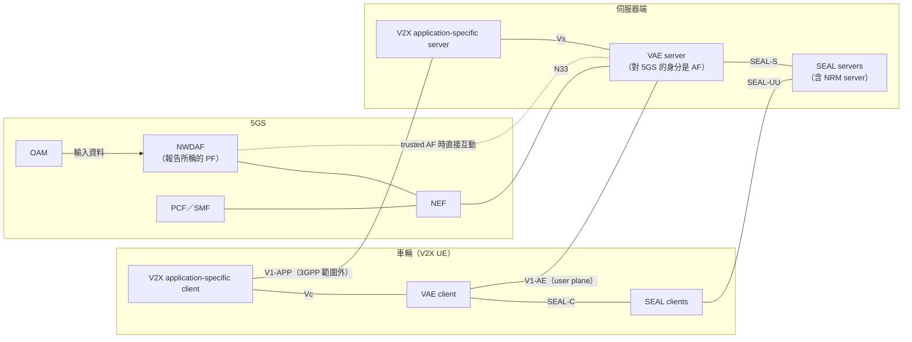
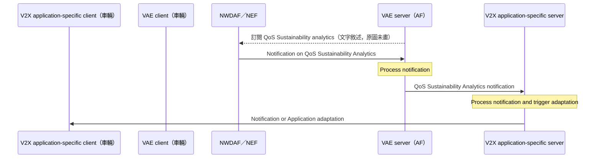
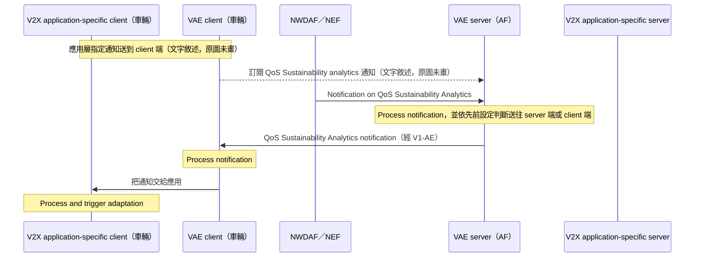

# 5GAA eNESQO 技術報告：5GS Enhancements for Providing Predictive QoS in C-V2X（5GAA WG2，2020）

| 項目 | 內容 |
| --- | --- |
| 標題 | 5G Automotive Association; Working Group System Architecture and Solution Development; 5GS Enhancements for Providing Predictive QoS in C-V2X（封面編號 TR-200055，頁首編號 5GAA A-200055） |
| 作者與單位 | 封面與前幾頁沒有列出作者或貢獻公司。Foreword 只寫 "produced by 5GAA"；Scope 說明這是 5GAA WG2 的 work item "Enhanced End-to-End Network Slicing and Predictive QoS"（簡稱 eNESQO）的產出 |
| 出處 | 5GAA Technical Report。封面沒有版本號與日期；Annex A 變更紀錄的最後一筆是 2020-02、CC#29、A-200055、"Including contributions approved at F2F#13" |
| DOI 或連結 | 無 DOI。<https://5gaa.org/content/uploads/2020/05/5GAA_A-200055_eNESQO_TR_final.pdf> |
| 本次閱讀的版本 | 5GAA 官網公開的 PDF，共 60 頁（PDF 檔案屬性的建立日期為 2020-06-23） |
| 類型 | 技術報告 |

## 一分鐘版本

這份文件不是同儕審查的論文，而是產業聯盟 5GAA（5G Automotive Association，車廠與電信業者組成的車聯網聯盟）的技術報告，沒有實驗。它要回答的問題是：網路預測到 QoS 即將變差時，怎麼在變差之前把通知送到車上的應用，讓應用提前調整（例如遠端駕駛先減速）。報告把 3GPP Rel-16 的做法（NWDAF 的 QoS Sustainability analytics 經 NEF 送到 V2X application server）當作基準，指出六個不足，並提出兩條把通知直接送到車輛的路徑：改用 NAS 信令，或經 V2X Application Enabler（VAE，3GPP TS 23.286 定義、建立在 SEAL 之上的車聯網應用使能層）的 VAE server 送到 VAE client。對讀者有用的地方有兩個：§5.4 是目前把「NWDAF 的預測 → 應用使能層 → 應用」這條鏈寫成流程圖的少數文件；§5.6 是車用產業對 QoS Sustainability analytics 的一份具體需求落差清單。報告的流程都停在高階示意，沒有訊息參數、沒有 API、沒有量測。

## 1. 要解決的問題

連網與自動駕駛依賴的 QoS 指標（throughput、latency、packet delivery ratio）無法隨時保證（Introduction）。報告主張的解法是 Predictive QoS：網路在 QoS 變化發生之前先通知應用，應用就能提前反應，而不是等到品質已經變差才處理（§6）。

這份報告是前一份 NESQO 技術報告（參考文獻 [5]，5GAA_A-190176）的延續。NESQO 在 2018 年進行，結束時認為還有題目沒有做完，於是有 eNESQO（Introduction、§1）。eNESQO 鎖定兩個方向（§6）：

1. 預測要怎麼做：網路層預測、應用層端到端預測、預測功能該放在哪裡。
2. 預測出來之後怎麼用：通知如何送到 V2X 應用，應用與網路收到後如何反應。

第二個方向裡，報告明確指出 3GPP Rel-16 的方案只能把預測送到伺服器端的 V2X application server，送不到車上的應用（§5.6.2）。這是全篇最核心的缺口。

## 2. 需要的背景

報告使用的名詞如下。前四個是 5GAA 自己的用語，在 3GPP 規格裡找不到。

| 名詞 | 一句話說明 | 出處 |
| --- | --- | --- |
| IQN（In-advance QoS Notification） | 網路發出的訊息，內容是 QoS 預測資訊 | §5.6 |
| PF（Prediction Function） | 產生預測的功能；報告說 Rel-16 中這個角色由 NWDAF 擔任 | §5.6、§5.6.1 |
| IQN Producer | 把 IQN 送到 IQN Consumer 的實體 | §5.6 |
| IQN Consumer | 收到 IQN 後執行或發起調整的實體，可以是 V2X 應用、V2X application server，也可以是網路功能 | §5.6、§6 |
| C-V2X | Cellular Vehicle-to-Everything，以行動網路技術實現的車聯網通訊 | §3.2 |
| OEM、MNO、OTT | OEM 指車廠；MNO 指電信營運者；OTT（Over-The-Top）指不整合進電信網路、架在網路之上的方案 | §5.3、註腳 2 |
| VAE layer | V2X application enabler 層，由 VAE server 與 VAE client 組成，以 API 的形式向 V2X 應用提供能力 | §5.4、Annex B |
| V2X application-specific server／client | VAE 之上的實際應用，分別在後端與車上；功能不在 3GPP 範圍內 | Annex B |
| QoS Sustainability analytics | NWDAF 的一種分析，告知某區域、某時段的 QoS 是否可能改變 | §5.1.1、§5.6 |
| Potential QoS change notification | TS 23.287 為 V2X 定義的程序，把 QoS Sustainability 的通知送給 V2X application server | §5.4、§5.6 |
| Extended NG-RAN notification | TS 23.501 §5.7.2.4 與 TS 23.287 §5.4.5.3 的機制：QoS 已經改變時，以 NAS 信令告知 UE 目前 NG-RAN 能滿足的 QoS 參數（5QI、GFBR、MFBR） | §5.4、Table 5.6-1 註 1 |
| SEAL | Service Enabler Architecture Layer for Verticals（TS 23.434），產業應用與 3GPP 網路之間的一組共用服務 | 參考文獻 [34]、Annex B |

**解讀：** 報告通篇用「accuracy」談預測的可信程度，全文沒有出現「confidence」這個字，也沒有出現 AnLF、MTLF、federated learning、CAPIF。報告引用的是 Rel-16 初期的規格，這些概念當時多數還不存在或還沒進入它的討論範圍。

## 3. 方法與架構

這份報告沒有單一方法，下面改寫成「報告的組織方式、它描述的架構與流程、它列出的缺口與建議」。

### 3.1. 報告的結構

| 章節（頁） | 內容 | 與「預測經使能層送到應用」的關係 |
| --- | --- | --- |
| §4（12–15） | 三個用例的事件流程：Tele-Operated Driving、HD Map Collecting and Sharing、In-Vehicle Entertainment | 低，提供數字範例 |
| §5.1（15–22） | 網路層預測：通知如何納入 accuracy、預測網路事件、門檻設計、UE 端預測 | 中，談通知內容 |
| §5.2（22–26） | 應用層端到端預測的 ML 框架 | 低 |
| §5.3（26–31） | PF 放在 OTT 還是 MNO | 低，但與資料歸屬有關 |
| §5.4（31–34） | 把預測通知送到 V2X 應用：經 VAE server 到 application server（§5.4.1）、經 VAE server 到 VAE client（§5.4.2） | 高，核心 |
| §5.5（34–43） | 應用與網路收到預測後的反應：以涵蓋模式切換為例，另談 FLUS 的 QoS 設定 | 低 |
| §5.6（43–53） | 3GPP Rel-16 方案的六個改進方向 | 高，核心 |
| §6（54–56） | 結論與建議 | 高 |
| Annex B（57–60） | VAE 框架說明，含 TS 23.286 的功能模型與 TR 23.764 的草案程序 | 高，核心 |

### 3.2. 三類內容的標示

本文用下列標籤區分報告內容的性質。標籤依報告自己的說法判定。

- 【已規範】：報告引用的、當時已寫進 3GPP TS 的功能。
- 【研究中】：報告引用的、當時還在 3GPP TR 草案裡的內容。這一類不能算已規範，所以另外標示。
- 【缺口】：報告指出 3GPP Rel-16 做不到的事。
- 【5GAA 提案】：5GAA 提出的新做法，或對 3GPP 的建議。

報告引用的 3GPP 規格與版本如下（§2 References）。

| 標籤 | 規格與版本 | 報告用它說明什麼 |
| --- | --- | --- |
| 【已規範】 | TS 23.288 V16.2.0 (2019-12) [10] | NWDAF 的 QoS Sustainability analytics |
| 【已規範】 | TS 23.287 v16.1.0 [18] | V2X 的 Potential QoS change 通知程序；§5.4.5.3 的 Extended NG-RAN notification |
| 【已規範】 | TS 23.501 V16.3.0 (2019-12) [27] | §5.7.2.4 的 Notification control；GFBR、MFBR 的定義 |
| 【已規範】 | TS 23.286 V16.2.0 (2019-12) [21] | VAE layer 的功能架構、程序與資訊流，報告說它是針對 4G 系統（EPS）定義的 |
| 【已規範】 | TS 23.434 V16.2.0 (2019-12) [34] | SEAL |
| 【已規範】 | TS 23.682 V16.5.0 (2019-12) [36] | SCEF（EPS 的能力開放功能） |
| 【已規範】 | TS 28.554 V16.2.0 (2019-09) [32] | QoS KPI 的定義，例如 RAN UE Throughput、QoS Flow Retainability |
| 【研究中】 | TR 23.764 V0.3.0 (2019-12) [22] | SA6 對 VAE layer 支援 5GS 的研究，含 "monitoring and control of QoS for eV2X communications" 程序 |

### 3.3. 報告描述的架構

報告沒有一張同時畫出核心網路功能與 VAE 的圖。下圖把 Annex B 的功能模型與 §5.4 的文字合在一起。

依報告圖 B-1、圖 5.4-1、圖 B-3，以及 §5.4.1、§5.6.4、Annex B 的文字整理，非報告原圖。圖 B-1 原圖畫的是 EPS（VAE server 經 V2、MB2、xMB、Rx、T8 與網路互動），這裡換成報告文字描述的 5GS 情形。

各實體與介面的說明：

- **NWDAF**：擔任 PF（§5.6.1）。輸入資料只來自 OAM（§5.6.4）。【已規範】
- **VAE server**：對 5GS 的身分是 AF。訂閱 QoS Sustainability analytics 時，trusted AF 直接找 NWDAF，untrusted AF 經 NEF（§5.4.1）。Annex B 另寫 TR 23.764 當時支援的是 N33，也就是往 NEF 的參考點。【研究中】
- **PCF／SMF**：Annex B 說 VAE server 訂閱的 QoS 監測服務來自 "PCF/NWDAF"；Extended NG-RAN notification 由 PCF 提供；監測回報可能來自 NWDAF，或來自 SMF 經 PCF／NEF。【研究中】
- **Vs**：VAE server 與 V2X application-specific server 之間。**Vc**：VAE client 與 V2X application-specific client 之間（Annex B）。【已規範】
- **V1-AE**：VAE client 與 VAE server 之間，以 user plane 連線實現（Annex B）。【已規範】
- **V1-APP**：兩端應用之間既有的 user plane 連線，不在 3GPP 範圍（Annex B 的 NOTE）。
- **SEAL**：V2X 應用層功能模型使用 SEAL 服務（Annex B）。圖 B-1 畫出 SEAL clients、SEAL servers 與 SEAL-C、SEAL-S、SEAL-UU、SEAL-PC5 四個參考點。

VAE server 可以由 MNO、網路設備商或任何第三方開發；VAE client 可以由車廠、車廠供應商、MNO、設備商或第三方開發（Annex B）。報告認為 VAE 的好處是讓車廠不必自己實作 SCS 或 AF 就能與 3GPP 網路互動（Annex B）。

### 3.4. §5.4.1：VAE server 把通知送到 V2X application server【研究中】

這個流程不是 5GAA 的提案。報告說它是 3GPP SA6 當時在 TR 23.764 設計中的 "procedure for monitoring and control of QoS for eV2X communications"，報告把它當作標準化傳遞的基準（§5.4.1）。

依報告圖 5.4-1 重繪。第一條虛線出自 §5.4.1 的文字，不在原圖中。

逐步說明：

1. **發起者是 VAE server。** 它以 AF 的身分向 NWDAF 訂閱 QoS Sustainability analytics；trusted AF 直接訂閱，untrusted AF 經 NEF。
2. NWDAF 有結果時通知 VAE server。
3. VAE server 處理這份通知。報告沒有說「處理」做了什麼。
4. VAE server 把 QoS 監測資訊提供給 V2X application-specific server。
5. V2X application-specific server 決定要不要觸發調整。
6. 最後一步有兩種走法（§5.4.1）：
   - Server-based reaction：伺服器決定反應方式，把決定送給車上的應用去執行。
   - Server-based delivery to vehicle：伺服器把通知轉給車上的應用，由車上的應用自己決定反應。

Annex B 的圖 B-3 給出 TR 23.764 這個程序的完整十步，包含調整 QoS 的後半段：

1. VAE server 向 5GS 訂閱 extended QoS monitoring（含 QoS analytics 與 extended QoS notifications），並接收監測報告。
2. VAE server 判定一個或多個 V2X UE 需要調整服務需求。
3. VAE server 向 V2X application-specific server 發出 service requirement adaptation request。
4. V2X application-specific server 做出決定。
5. 回覆 service requirement adaptation response。
6. V2X 應用層依服務需求調整。
7. VAE server 對受影響的 V2X UE 觸發 QoS adaptation。
8. Network Resource Adaptation，"as specified in TS 23.434"。圖中這一步橫跨 5GS、VAE server 與 NRM server（SEAL 的 network resource management server）。
9. VAE server 向 V2X application-specific server 發出 QoS change notification。
10. V2X 應用層依服務與 QoS 需求調整。

關於訊息內容，報告只有一句：回報「may be configured for a given area, time, periodicity etc.」（Annex B）。沒有參數表。

**未能確認：** §5.4.1 寫 trusted AF 直接對 NWDAF、untrusted AF 經 NEF；Annex B 描述同一個程序時寫的是 "towards NWDAF (via NEF)"，並說 TR 23.764 當時支援 N33。兩處不完全一致，報告沒有說明哪一個是 TR 23.764 V0.3.0 的實際內容。

### 3.5. §5.4.2：VAE server 把通知送到 VAE client【5GAA 提案】

【缺口】§5.4.1 的兩種走法都要先經過伺服器端。報告指出，VAE server 與 V2X application-specific server 之間的介面可能走公網，通知的路徑會離開 MNO 控制的網路；如果通知要以低延遲送到車上，多繞這一段沒有效率（§5.4.1 末段）。

【5GAA 提案】利用既有的 V1-AE 參考點，讓 VAE server 直接把通知送到車上的 VAE client（§5.4.2）。

依報告圖 5.4-2 重繪。兩個標示「原圖未畫」的步驟出自 §5.4.2 的文字。

逐步說明：

1. **發起者是 V2X 應用層。** 它指明通知要送到 V2X application-specific client。報告說這可以在註冊階段進行，由應用層告訴 VAE layer 通知該送到 server 端還是 client 端。理由是應用層才知道服務的需求。
2. 這個指示觸發 VAE client 向 VAE server 訂閱。
3. VAE server 從 5GS 收到通知後處理，並依先前的設定判斷該送到哪一端。
4. 該送到 client 端時，VAE server 經 V1-AE 送給對應的 VAE client。
5. VAE client 處理通知，再交給 V2X application-specific client。
6. 車上的應用處理通知並觸發調整。V2X application-specific server 完全不參與。

報告對這個提案的定位（§5.4.2 末段）：

- NWDAF 對 AF 開放 QoS Sustainability analytics 這件事沿用 SA2 已定義的程序，不必修改。
- V1-AE 是既有的參考點，所以不需要標準化新的介面或訊息。
- 仍然需要 3GPP SA6 做兩件事：在 VAE server 增加一個讓 VAE client 取得 QoS Sustainability analytics 通知的 API，以及延伸既有的 network monitoring notifications 程序。

後者指的是 TS 23.286 已有的程序（Annex B，圖 B-2）【已規範】：V2X UE 向 VAE server 訂閱 network monitoring information，VAE server 以 SCS/AS 的身分從 SCEF 取得資訊，處理後經 VAE client 通知訂閱的 UE。訂閱請求包含 V2X UE ID、subscription event、triggering criteria。可回報的資訊有 uplink quality level、congestion level、overload level、geographical area（cell area 或 TA）、time validity，以及 coverage level and bearer level events（原文註明 "optionally, for MBMS"）。這個程序回報的是 EPS 的監測結果，不是預測。

### 3.6. 預測資訊的內容

報告裡有兩套描述：5GAA 希望 IQN 帶什麼，以及報告所理解的 Rel-16 QoS Sustainability analytics 實際帶什麼。

| 面向 | 5GAA 對 IQN 的期望 | 報告描述的 Rel-16 QoS Sustainability analytics【已規範】 |
| --- | --- | --- |
| 預測的對象 | Latency、Packet Delivery Ratio、Uplink Throughput、Downlink Throughput、Coverage/Capability（Table 5.6-2） | 只支援 non-GBR QoS Flow 的 RAN UE Throughput（Table 5.6-2 註 1）與 GBR QoS Flow 的 QoS Flow Retainability（Area of Improvement 2 的說明） |
| 數值的形式 | KPI 的值：平均值、中位數、範圍，或 CDF（§5.6.4，引 [5] §6.3.1） | 不回報 KPI 的值。consumer 給一組門檻，NWDAF 回報哪些門檻預測會被跨越（§5.6.4） |
| 對象的粒度 | 對應特定 UE 的 PDU Session Id 或 QoS Flow Id，不是泛指某個區域（§5.6.4） | 以 5QI、位置、S-NSSAI 為粒度的群體平均（Area of improvement 5） |
| 空間 | 沿著車輛預定路線，或在車輛接近問題區域之前通知（§5.1.1） | area of interest，以 TAI 或 Cell ID 表示，因此只能做到 cell 層級（§5.6.4） |
| 時間 | 多久之後、持續多久。用例寫法如「in 30 s」「in 20 s」（Table 4.1-1 至 4.3-1）；§5.1.1 用時間區間 [t1-t2] 表示 | 報告只在 Annex B 提到回報可依 area、time、periodicity 設定 |
| 提前量 | IQN Notice Period：consumer 希望提前多久收到 IQN（§5.6.4，引 [5]） | 不支援（Area of improvement 6） |
| 可信程度 | 見下段 | 報告沒有描述 |

可信程度在報告中稱為 accuracy，討論集中在 §5.1.1 與圖 5.1-1。報告沒有定義它的數值格式，只描述兩種用法：

- 通知帶「預測值」加上 accuracy。預測值低於門檻才發通知。問題是 accuracy 低的時段，實際值可能在預測值仍高於門檻時就已經跌破，報告稱之為 false prediction。報告提出的緩解方式是通知另外註明「預測值高於門檻，但有一定機率跌破」，機率由 accuracy 推得。
- 通知帶「預測下界」。下界低於門檻就發通知。副作用是下界可能遠低於預測值，consumer 的反應會過於保守。

【5GAA 提案】報告的建議是通知同時帶預測值與臨界方向的預測下界（§6.1）。圖 5.1-2 另以 Low、Medium、High 三級標示 accuracy，但那是示意圖的標籤，不是格式定義。

### 3.7. §5.6：3GPP Rel-16 方案的六個改進方向

報告把 Rel-16 方案定位為「PF 位於 NWDAF 的網路層預測」（§5.6.1），並逐項對照 NESQO 的需求。先看傳遞路徑（Table 5.6-1）：

| 選項 | IQN Consumer | IQN Producer | 參考點／協定 | Rel-16 支援 |
| --- | --- | --- | --- | --- |
| 1 | V2X 應用（經 UE） | AMF／SMF／PCF | N1／NAS | 不支援 |
| 2 | V2X 應用（經 UE） | RAN | Uu／RRC | 不支援 |
| 3 | V2X 應用（經 VAE layer） | AMF／SMF／PCF／NWDAF | V1-AE、Vc／SBI/HTTP | 5GS 的 VAE layer 在 Rel-16 尚不可用 |
| 4 | V2X application server | NEF | N33 (Nnef)／SBI/HTTP | 支援 |
| 5 | V2X application server（經 VAE layer） | AMF／SMF／PCF／NWDAF | Vs／SBI/HTTP | 5GS 的 VAE layer 在 Rel-16 尚不可用 |

Table 5.6-1 註 2 補充：NESQO 原本還考慮由 PCF 經 N5 傳遞 IQN，因為預測功能已放進 NWDAF，這個選項被 3GPP 排除。選項 1 與 2 的說明欄寫到，在無線條件惡劣、PDU Session 的 user plane 資源已被移除時，IQN 仍可送達。

六個改進方向（Table 5.6-3）如下。每一項的前半是【缺口】，後半是【5GAA 提案】。

| 編號 | 【缺口】 | 【5GAA 提案】 |
| --- | --- | --- |
| 1 | 無法把 potential QoS change 通知送到車輛供 UE 端的應用調整。通知只能到 V2X AS，再由 V2X AS 經 user plane 轉給車上的應用，而這一段不是 3GPP 標準化的介面 | 兩個選項：修改 Extended NG-RAN notification，改由「預測」而非「已發生的 QoS 改變」觸發 NAS 通知（選項 1）；或用 VAE layer 送到 client 端（選項 3，即 §5.4.2） |
| 2 | 沒有規範下列端到端 KPI 的預測：Latency、Packet Delivery Ratio、GBR 與 non-GBR 的 Uplink／Downlink Throughput、Coverage and Capability | 優先做 GBR QoS Flow 的預測。只在預測 GBR 無法保證的時段才需要這些 KPI 的預測，用來讓 consumer 知道會是哪一種變化 |
| 3 | 通知只帶「依預設門檻劃分的範圍」，不帶 KPI 的實際值（平均值、中位數或 CDF） | 探討能否帶更多 KPI 資訊。報告同時承認門檻式通知能減少信令 |
| 4 | 預測只用 OAM 收集的資料 | 研究使用應用層（車輛、伺服器）、RAN、核心網路 NF 與第三方的資料 |
| 5 | 預測不能對應特定的 PDU Session Id 或 QoS Flow Id。5QI 這個粒度代表的是該位置上該 5QI 的平均值 | 在收集的資料中加入更多維度，可能也用額外的資料來源 |
| 6 | NF consumer 無法指定 Notice Period，也就是相對於預測事件發生時間、通知最晚何時必須送達 | 探討 "Time when analytics information is needed" 這個參數能否用於 QoS Sustainability，並取代 IQN Notice Period |

報告對幾項的補充論證：

- 第 2 項：Table 5.6-2 註 2 指出，TS 23.288 §6.9.1 允許在請求中放 PDB 與 PER 作為 QoS 需求，但無法對它們設 Reporting Threshold，也沒有對應的 OAM 輸入資料。註 1 指出 RAN UE Throughput 是 RLC 層的 cell 平均值，不是 NESQO 要的端到端 throughput。
- 第 5 項：OAM 資料以 TAI 或 Cell ID 收集，無法依 UE 特性、PDU Session 特性、簽約等級區分。同一個 cell 內、同一個 5QI 的 UE 只能得到平均預測（§5.6.4）。報告也提醒，粒度變細時，營運者要確保每一格的樣本數仍足以產生有意義的結果。
- 第 5 項的動機：IQN 會直接改變車輛行為，例如遠端駕駛的車輛收到後要減速、變換車道或停車。如果通知發給實際上不太會受影響的 UE，代價很高（§5.6.4）。
- 第 6 項：報告指出 "Time when analytics information is needed" 適用於 `Nnwdaf_AnalyticsInfo_Request`，當時不適用於 QoS Sustainability analytics（§5.6.4）。
- 六項之中，報告認為第 5 與第 6 項對車用產業最重要（§6.1）。

報告也給了一個時間尺度的判斷（§5.6.2）：經 V2X AS 傳遞，在預測的時間範圍是數分鐘或更長時可以接受；時間範圍只有幾秒時，可以評估選項 1（NAS），因為它在無線條件惡劣時可能表現較好。

### 3.8. 其餘章節的內容

- **§5.1.2 預測網路事件**【5GAA 提案】：PF 可以先預測網路事件（例如 handover），產生一份 event description，欄位包含 event type、event duration（tstart–tend）、事件特有資訊（例如預期 user plane 中斷 X ms）、prediction accuracy 或 event probability、事件期間的 KPI 行為。PF 用它改善 KPI 預測。是否把這份資訊放進通知交給 consumer，報告留待後續研究，並指出這牽涉營運者是否願意揭露網路內部資訊。
- **§5.1.3 門檻設計**：通知會因 KPI 在門檻附近振盪而大量產生。報告建議請求中除了門檻，再帶一個 threshold minimum delta（hysteresis），而且只用在非臨界方向，也就是 QoS 變好的方向。對週期性回報，報告提出 start-stop 條件，只在預測的 KPI 落在 consumer 關心的數值區間時才帶完整內容。
- **§5.1.4 UE 端預測**【5GAA 提案】：作為網路端預測的補充。UE 的長期預測依賴網路，短期預測可以自己做；在沒有網路涵蓋的 sidelink 情境也能獨立運作。細節留待後續研究。
- **§5.2 應用層預測框架**【5GAA 提案】：四個區塊（圖 5.2-1）。A 是位置預測；B.1 是位置情境預測，B.2 把情境對應到無線條件；C 是 RAN 狀態預測（時間序列模型）；D 把無線條件與 RAN 狀態對應到 QoS（監督式學習）。訓練資料有兩種來源：車上內嵌的量測工具（§5.2.3.1），或營運者的 NMS（Network Management System）加上類似 MDT（Minimisation of Drive Tests，由 UE 回報無線量測的 3GPP 功能）的機制與探針（§5.2.3.2）。這一節只有框圖，沒有模型細節。
- **§5.3 PF 的位置**：OTT 端只看得到車輛量測，看不到 cell 的容量與資源使用率、營運者的流量優先權設定、網路元件的動態變化（§5.3.1）。MNO 端看得到這些，但每個營運者都要部署，互通性是挑戰，報告認為可以靠 3GPP 標準化解決（§5.3.3）。報告的觀察是：以 NESQO 對 Tele-Operated Driving 的預測需求來看，OTT 部署不是可行的技術選項（§5.3.3）。§5.3.4 另外提出一個沒有答案的問題：第三方平台能不能拿某家車廠的量測資料去替另一家車廠做預測。
- **§5.5.1 收到預測後的反應**【5GAA 提案】：提出「狀態、觸發條件、反應」三元素的描述框架，並用一個例子示範：預測 UE 將離開一般涵蓋、但可以靠 LTE-M（針對機器型通訊的 LTE 變體）的 Coverage Enhancement 模式維持連線。例子分成應用主導（圖 5.5-3，應用要求 modem detach、改 UE capability、再 attach）與網路主導（圖 5.5-4，網路用 `RRCConnectionReconfiguration` 設定 CE-Mode）。
- **§5.5.2 應用調整與 QoS 框架**：以 FLUS（Framework for Live Uplink Streaming，3GPP 的上行直播框架，TR 26.939）為例，說明 GFBR 應設為可接受的最低位元率、MFBR 設在目標位元率附近。報告建議對車用應用做同類的品質分級分析。

### 3.9. 報告建議的後續

- 【5GAA 提案】請 3GPP SA2 與 SA6 研究 Extended NG-RAN notification 與 VAE layer 能否延伸或調整，用來傳遞 QoS 預測通知。報告自己承認 eNESQO 沒有完整研究這兩個機制該怎麼用（§5.4）。
- 【5GAA 提案】相關選項 "could be further evaluated during Rel-17 3GPP work"（§5.6.2）。
- 【5GAA 提案】建議 3GPP 在目前或之後的 release 考慮 §5.6 的六個改進方向（§6.1）。
- 報告提到的對應 3GPP 工作只有一項：TR 23.764 "Study on enhancements to application layer support for V2X services (Release 17)"（[22]）。
- 5GAA 內部的後續：建議 WG1 做更詳細的用例分析，並提到一個提案中的 work item PRESA（Predictive QoS and V2X Service Adaptation，[33]）（§6.2）。

**未能確認：** 報告發布之後 3GPP 實際做了什麼，無法從這份報告得知。TR 23.764 的最終結論、TS 23.286 後續版本是否加入 §5.4.1 的程序或 §5.4.2 的 client 端傳遞，都無法確認；本地沒有 TS 23.286 與 TR 23.764。

## 4. 實驗與結果

報告沒有實驗、沒有模擬、沒有原型。它用三種材料支持主張。

**用例的數字範例**（§4）。這些是說明用的例子，不是量測結果。

| 用例 | 原本的狀態 | PF 的預測 | 反應 |
| --- | --- | --- | --- |
| Tele-Operated Driving，遠端駕駛是機器（Table 4.1-1） | 指令訊息每 20 ms 一筆，Service Level Latency 小於 20 ms | latency 可能劣化到 20–30 ms，時間點是 30 s 後（原文 "in 30 s"） | 減速、請車內駕駛接手，或安全停車 |
| Tele-Operated Driving，遠端駕駛是人（Table 4.1-1） | 影像的 UL data rate 大於 120 Mbps，latency 小於 20 ms | UL data rate 可能降到 88–120 Mbps，20 s 後 | 減速 |
| HD Map Collecting and Sharing（Table 4.2-1） | 自動化等級 4 或 5，Service Level Latency 20 ms | latency 可能劣化到大於 100 ms，20 s 後 | 降低自動化等級或改回手動 |
| In-Vehicle Entertainment（Table 4.3-1） | 兩路 4k 串流，各約需 50 Mbps 與 150 ms latency；DL data rate 大於 100 Mbps | DL data rate 可能降到 40–50 Mbps，20 s 後 | 降低解析度到 2*20 Mbps |

Tele-Operated Driving 的前提是車上有四台 HD 攝影機，每台 15–29 Mbps，另加 4 Mbps 的物件資料；服務有四個 UL 調整狀態：小於 60 Mbps、60–88 Mbps、88–120 Mbps、大於 120 Mbps（Table 4.1-1）。

**引用他人的研究結果**（§5.3.1，圖 5.3-2，出自參考文獻 [14]）。這是全篇唯一的量化證據，內容是不同訓練資料組合對 LTE throughput 預測準確度的影響。表中的 B 是基準特徵（UE category 與 cell 頻段），R² 越接近 1 越好，Ē 是誤差比的中位數。

| 特徵組合 | R² | Ē |
| --- | --- | --- |
| B | 0.49 | 0.26 |
| B + Radio | 0.75 | 0.19 |
| B + RAN | 0.72 | 0.17 |
| B + Radio + RAN | 0.87 | 0.11 |
| B + Radio + RAN + Context | 0.89 | 0.10 |

依圖 5.3-1，Radio 與 Context 由終端收集，RAN info 來自營運者。報告據此主張：結合 UE 與 MNO 兩邊的資料準確度最高，只靠 UE 的預測可行但受限（§5.3.1）。

**需求與規格的逐項比對**（§5.6）。這是報告最紮實的部分，每一項都指到 TS 23.288 的具體條文或參數。

## 5. 限制

### 5.1. 文獻自己承認的

- eNESQO 沒有完整研究 Extended NG-RAN notification 與 VAE layer 該如何用於傳遞預測通知，只建議 3GPP 去做（§5.4）。
- 修改 Notification Control 程序對 NAS 信令的影響需要進一步研究（Table 5.6-1 註 1、§6.2）。
- 用例分析不完整，建議由 5GAA WG1 補做（§6.2）。
- §5.2 的預測框架目前偏重 RAN 層，其他選項留待後續（§5.2.2）。
- 預測網路事件的資訊要不要給 consumer、內容與格式為何、哪些事件值得通知，都留待後續研究（§5.1.2）。
- UE 端預測要分享什麼、怎麼分享，留待後續研究（§5.1.4）。
- 狀態與觸發條件的其他例子留待後續研究（§5.5.1 的兩處 NOTE）。
- OTT 端的預測只能保證「大量預測在統計上準確」，不保證任一次預測正確（§5.3.1）。

### 5.2. 我們看到的

**解讀：** 以下各點是我們閱讀後的判斷。

- **§5.4 的兩個流程沒有任何訊息定義。** 圖 5.4-1 與圖 5.4-2 只有箭頭名稱。VAE server 的 "Process notification" 做了什麼、轉給應用的內容是 NWDAF 的原始輸出還是加工後的結果、訂閱請求帶哪些參數，都沒有寫。要拿它當實作依據並不夠。
- **§5.4.2 聲稱的延遲改善沒有量化。** 「先經過 application server 會成為瓶頸」是定性的推論，依據是該介面「may go through public Internet」。報告沒有估算兩條路徑的延遲差。
- **§5.4.2 沒有處理「通知該送給哪一台車」。** 報告自己在 §5.6.4 指出 Rel-16 的預測是 cell 層級的群體平均。那麼 VAE server 收到一份區域層級的通知後，要怎麼判定哪些 VAE client 是 "relevant VAE client"，§5.4.2 沒有說。這需要 VAE server 知道車輛的位置或路線。
- **V1-AE 是 user plane。** Table 5.6-1 的說明欄指出 NAS 與 RRC 路徑的優點是 user plane 資源被移除後仍能送達。照這個邏輯，§5.4.2 的 VAE 路徑在無線條件最差的時候正好最不可靠。報告沒有把這一點寫成 §5.4.2 的限制。
- **基準是早期草案。** §5.4.1 與圖 B-3 依據的是 TR 23.764 V0.3.0，版本號顯示它還在研究初期，程序後來可能改變。
- **accuracy 沒有定義。** §5.1.1 的整套通知策略建立在 accuracy 上，但報告沒有說它是機率、信賴區間還是誤差指標，也沒有說明 PF 如何算出預測下界。
- **§5.6.2 的選項編號前後不一致。** Table 5.6-1 中，選項 3 是經 VAE 送到 client 端、選項 4 是 NEF 送到 V2X AS、選項 5 是經 VAE 送到 server 端。但表後的內文寫「Option 3 is implemented with PF located in the NWDAF ... delivered by NWDAF via NEF to AF」，描述的其實是選項 4；又寫選項 3 是送到 server 端、選項 5 是送到 client 端，與表相反；最後寫「options 4 and 5 could be further evaluated」。Area of improvement 1 的寫法（選項 3 是 client 端）與表一致。我們以表與 Area of improvement 1 為準。
- **立場。** 報告的結論偏向 PF 放在 MNO 端並由 3GPP 標準化。「OTT 部署對 Tele-Operated Driving 不可行」這個觀察的量化依據只有一份 LTE throughput 的研究（圖 5.3-2），而該用例關心的還有 latency。
- **其他筆誤。** "V2S AS" 應為 V2X AS（Area of improvement 1）；"VI-AE" 應為 V1-AE（§5.4.2）；§6.1 說 UE 端預測在 §5.1.3，實際在 §5.1.4；§5.6.1 把 NWDAF 展開成 "Network and Data Analytics Function"；Foreword 稱本文件為 "Technical Specification"；§1 的交付項目編號是 "WG2-00XX"。這些不影響理解，但顯示文件沒有經過嚴格的編輯。

## 6. 與 SEAL 的關係

報告提到 SEAL 的地方只有四處，都不在正文的論證裡。

1. 參考文獻 [34]：3GPP TS 23.434 V16.2.0 (2019-12)。
2. Annex B 第一段的一句話：「The V2X application layer functional model utilises the SEAL services as specified in 3GPP TS 23.434 [34]. In the remainder, the focus will be on the VAE layer.」
3. 圖 B-1（轉載自 TS 23.286）：VAE layer 下方畫了一層 SEAL，有 SEAL clients 與 SEAL servers，以及 SEAL-C、SEAL-S、SEAL-UU、SEAL-PC5 四個參考點。
4. 圖 B-3（轉載自 TR 23.764）的步驟 8：「Network Resource Adaptation, as specified in TS 23.434」，圖中另有一個 NRM server 的實體。

§5.4 的兩個通知流程完全沒有提到 SEAL。在報告描述的路徑中，訂閱 NWDAF 並轉送通知的是 VAE server 本身；SEAL 只在收到通知之後、要調整網路資源時才出現（圖 B-3 步驟 8）。報告沒有討論 SEAL 的任何服務是否該承擔預測通知的傳遞。

**解讀：** 依既有的 SEAL 解讀文件（`docs/specification-guides/nwdaf-vertical-application/` 下的會議筆記，引用外部的 TS 23.286 V18.7.0 §6.2），VAE server 與 VAE client 在與 SEAL 互動時扮演 VAL server 與 VAL client（VAL 即 Vertical Application Layer，SEAL 之上的產業應用層）的角色。所以這份報告的架構是三層：V2X application-specific 層、VAE 層、SEAL 層。報告把「預測通知的傳遞」放在中間的 VAE 層，把「資源調整的執行」留給 SEAL 的 NRM。

**解讀：** 本地 Rel-20 的 TS 23.434 V20.1.0 第 14 章有一個功能上相近的程序。§14.3.6 Event Monitoring 中，VAL server 向 NRM server 訂閱事件，NRM server 依 TS 23.288 訂閱 analytics 事件，再把結果通知 VAL server。另外 §14.3.5 寫到 NRM server 評估端到端 QoS 時可以使用 "QoS sustainability analytics as in 3GPP TS 23.288"。與這份報告比較：

- 相同：都是由使能層的 server 以 AF 的身分取得 NWDAF 的分析，再交給應用後端。這對應報告的 §5.4.1。
- 不同：在本地 §14.3.6 的程序裡，通知的對象只有 VAL server。報告 §5.4.2 想要的「直接送到 UE 端的 client」在 §14.3.6 看不到對應。
- 不同：報告的做法是 VAE server 自己當 AF；§14.3.6 是 SEAL 的 NRM server 當 AF，應用專屬的使能層不必自己接 NWDAF。

**未能確認：** 上述 TS 23.434 的程序是否源自這份報告或 TR 23.764，無法從本地資料判斷。

## 7. 與 NWDAF 的關係

報告直接討論 NWDAF。這個詞在轉出的全文中出現 26 次（含縮寫表 1 次），集中在 §5.4、§5.6 與 Annex B。它的說法可以歸成四點：

1. Rel-16 中 PF 的功能由 NWDAF 承擔（§5.6.1）。NESQO 原本考慮的 PCF 經 N5 傳遞 IQN，因此被 3GPP 排除（Table 5.6-1 註 2）。
2. QoS Sustainability analytics 是 QoS 預測的 3GPP 基準方案（§5.4、Annex B）。
3. VAE server 以 AF 的身分訂閱這項分析（§5.4.1）。
4. 這項分析有 §3.7 列出的六個不足。

報告沒有談 NWDAF 內部怎麼做預測。§5.2 的 ML 框架描述的是 "PF located in the MNO network"，沒有對應到 NWDAF 的任何程序。報告沒有提到 ML model 的訓練與推論分離、模型分享、資料收集的隱私限制，也沒有提到 federated learning。

**解讀：** 把報告的六個缺口對照本地 Rel-18 的 TS 23.288 V18.13.0 §6.9，可以看到部分項目在後來的版本已有對應的內容。這是我們的比對，不是報告的內容。

| 報告的缺口 | 本地 Rel-18 TS 23.288 §6.9 的現況 |
| --- | --- |
| 1. 無法送到車輛 | 不屬於 TS 23.288 的範圍，§6.9 沒有相關內容 |
| 2. 不預測 latency 等 KPI | non-GBR 的 Reporting Threshold 可以指向 RAN UE Throughput "and/or delay in RAN KPI"（§6.9.1）；輸入資料除了報告提到的兩項，還有 Delay in RAN 與 GTP 層級的延遲與容量（Table 6.9.2-1、6.9.2-3）。Packet Delivery Ratio 與 Coverage 仍沒有 |
| 3. 不回報 KPI 的值 | 沒有改變。輸出仍是 Applicable Area、Applicable Time Period、Crossed Reporting Threshold(s)，預測另有 Confidence（Table 6.9.3-2） |
| 4. 只用 OAM 資料 | 細粒度區域的程序會從 LCS、AMF、SMF、UPF、UDM 收集 UE 層級的資料（Table 6.9.2-2、§6.9.4.2）。應用層（車輛）的資料仍不在輸入之列 |
| 5. 粒度不夠細 | 位置可以是小於 cell 的地理區域，或由 waypoint 加半徑描述的 path of interest；可以用 speed range 與 equipment type 篩選（§6.9.1）。Target of Analytics Reporting 仍是 any UE，結果是區域內 UE 的平均，不對應特定 PDU Session 或 QoS Flow |
| 6. 沒有 Notice Period | §6.9 沒有這個參數 |

補充三點：

- 報告 §5.1.3.1 建議的 hysteresis，在本地 Rel-18 §6.9.1 有對應的參數：「An acceptable deviation from the threshold level in the non-critical direction (i.e. in which the QoS is improving) may be set to limit the amount of signalling」。
- 報告談的 accuracy，在本地 Rel-18 的輸出中是 Confidence 欄位，Table 6.9.3-2 的 NOTE 1 說明它的意義依 SLA 而定。報告 §5.1.1 想要的「預測值加下界」在 Rel-18 沒有對應，因為輸出根本不帶 KPI 的值。
- 本地 Rel-20 的 TS 23.288 V20.2.0 §6.9.1 把 Target of Analytics Reporting 擴充為 "any UE, a list of UEs"。

**未能確認：** 這些變更是否因 5GAA 的建議而來，無法從本地規格判斷。報告 §5.1.3.1 的 hysteresis 在它引用的 TS 23.288 V16.2.0 中是否已經存在，報告沒有說清楚：它一方面寫門檻「as defined in TS 23.288」，一方面寫請求「requires」加入 hysteresis。本地沒有 V16.2.0 可以查證。

## 8. 對你的研究可以怎麼用

**解讀：** 本節全部是我們的建議。

- **當作引用來源。** 要說明「NWDAF 的預測需要經由應用使能層送到應用」這個需求有產業依據時，可以引用 §5.4 與 Table 5.6-1。要說明 QoS Sustainability analytics 對車用情境的不足時，可以引用 Table 5.6-3 的六項。引用時要註明它是產業聯盟的技術報告，依據的是 Rel-16 初期的規格。
- **當作一份可以更新的落差清單。** §7 的對照表只做到本地 Rel-18 §6.9。把同一份清單拿去逐項對照 Rel-19 與 Rel-20，可以得到「車用產業 2020 年提出的六項需求，到 Rel-20 滿足了幾項」，這本身可以寫成一段相關工作的整理。目前看來第 3、5、6 項（KPI 值、per-flow 粒度、Notice Period）仍然值得追。
- **當作實驗設計的對照。** §5.4.2 主張直接送到 client 端比繞經 application server 快，但沒有量測。在 free5GC 加上自己的 NWDAF 之後，可以做一個小實驗：一個 AF 扮演 VAE server 或 NRM server，訂閱 QoS Sustainability analytics，分別經「server 端轉送」與「直接推到 UE 端 client」兩條路徑送達，量測端到端的通知延遲。這可以補上報告沒有的數字。
- **當作 federated learning 的動機，但要自己補論證。** 報告沒有提到 FL，可是 §5.3 描述的正是 FL 的典型前提：
  - 圖 5.3-2 顯示終端與營運者兩邊的特徵合起來最準（B + Radio + RAN + Context 的 R² 是 0.89）；只加一邊時，B + Radio 是 0.75，B + RAN 是 0.72。
  - §5.3.3 的假設是 MNO 的營運資料不會分享給外部。
  - §5.3.4 質疑第三方能否拿一家車廠的量測替另一家車廠做預測。

  第一、二點合起來是 vertical FL 的情境（特徵分屬 MNO 與車廠兩方）；第三點是跨車廠的 horizontal FL 情境。本地 Rel-20 的 TS 23.288 有 §6.2C（Horizontal Federated Learning among Multiple NWDAFs）與 §6.2H（Vertical Federated Learning among NWDAFs and AFs）。可以把這份報告當作「為什麼 QoS 預測需要 NWDAF 與 AF 之間的 VFL」的應用端動機。要留意圖 5.3-2 的數字來自 [14] 的 LTE 量測，引用數字時應該引 [14] 原文。
- **當作輸出設計的參考。** §5.1.1 關於「通知帶預測值還是帶下界」的討論，以及 §5.6.4 的 Notice Period，可以當作設計 AnLF 輸出與通知觸發條件時的需求來源。
- **沒有可重用的程式或資料。** 報告沒有附程式碼、資料集或訊息格式。

## 9. 值得追的參考文獻

- [5] 5GAA_A-190176: 'Architectural Enhancements for Providing QoS Predictability in C-V2X'。前一份 NESQO 技術報告，IQN、PF、Notice Period 與 KPI 需求都定義在那裡；這份報告大量引用它的 §6.2、§6.3.1、§6.4、§9.1。
- [22] 3GPP TR 23.764 V0.3.0 (2019-12): 'Study on enhancements to application layer support for V2X services (Release 17)'。圖 5.4-1 與圖 B-3 的來源。要知道 SA6 最後怎麼定案，應該讀它的最終版本。
- [21] 3GPP TS 23.286 V16.2.0 (2019-12): 'Application Layer Support for Vehicle-to-Everything (V2X) Services; Functional Architecture and Information Flows (Release 16)'。VAE 的規格本體。讀後續版本可以確認 §5.4.1 與 §5.4.2 是否成為規範；本地沒有這份規格。
- [18] 3GPP TS 23.287 v16.1.0: 'Architecture Enhancements for 5G System (5GS) to Support Vehicle-to-Everything (V2X) Services (Release 16)', 2019。Potential QoS change 通知給 V2X application server 的程序，以及 §5.4.5.3 的 Extended NG-RAN notification，是報告所稱 Rel-16 方案的另一半。
- [14] Samba, A., Busnel, Y., Blanc, A., Dooze, P., & Simon, G. (2018). 'Predicting File Downloading Time in Cellular Network: Large-Scale Analysis of Machine Learning Approaches'. Computer Networks, 145, 243-254。圖 5.3-2 的資料來源，是報告唯一引用的量化結果，也是 §8 的 FL 動機所依據的數字。
- [33] 5GAA T-190179 5GAA: 'Work Item Draft Description – Predictive QoS and V2X Service Adaptation (PRESA)'。報告建議的 5GAA 後續工作，可以用來追蹤 5GAA 之後在應用調整這一側做了什麼。

## 10. 閱讀建議

- **必看**（約 20 頁，一個半小時）：§5.4（31–34 頁）、§5.6（43–53 頁）、Annex B（57–60 頁）。圖 5.4-1、圖 5.4-2、圖 B-1、圖 B-3，以及 Table 5.6-1、Table 5.6-2、Table 5.6-3。建議先讀 Annex B 再讀 §5.4，因為 §5.4 假設讀者已經知道 VAE 的功能模型。
- **選看**：§5.1.1 與圖 5.1-1（15–17 頁），談通知如何處理預測的不確定性；§5.1.3（20–22 頁），談門檻與 hysteresis；§5.3（26–31 頁），談資料在 MNO 與車廠之間的分布；§6（54–56 頁），兩頁半的結論。
- **可以略過**：§4 的用例表格（看本文 §4 的摘要即可）；§5.2 的 ML 框架（只有框圖）；§5.5.1 的 LTE-M 涵蓋模式切換例子（細節是 LTE 的 attach 與 RRC 程序，與 5G 核心網路無關）；§5.5.2 的 FLUS 討論。
- 讀 §5.6.2 時留意選項編號的不一致，以 Table 5.6-1 為準。
- 全文通讀約需三到四小時。

## 查證紀錄

**讀取方式。** 以 `pdftotext -layout` 轉出全文 2855 行，從頭讀到尾。以下頁面另外直接看 PDF 影像：1–2（封面）、16–18（圖 5.1-1、圖 5.1-2）、20–28（圖 5.1-3 至 5.1-5、圖 5.2-1 至 5.2-4、圖 5.3-1、圖 5.3-2）、32–34（圖 5.4-1、圖 5.4-2）、37–41（圖 5.5-1 至 5.5-4）、44–46（Table 5.6-1 與其後內文）、58–60（圖 B-1 至 B-3）。

**已回頭核對的內容。**

- 封面文字、編號 TR-200055 與頁首 5GAA A-200055；Annex A 變更紀錄最後一筆；PDF 檔案屬性的建立日期（`pdfinfo`）。
- §2 中八份 3GPP 規格的編號與版本。
- §4 表格的所有數字，對照 Table 4.1-1、4.2-1、4.3-1 的文字。
- 圖 5.3-2 的五列 R² 與 Ē，對照第 28 頁影像。
- Table 5.6-1 五個選項的各欄，對照第 44–45 頁影像；§5.6.2 內文的選項編號不一致，對照第 45–46 頁影像確認是原文如此。
- Table 5.6-3 六個改進方向與 Table 5.6-2 的三個註。
- 圖 5.4-1 與圖 5.4-2 的參與者與箭頭名稱，對照第 32、34 頁影像。兩張重繪圖中標示「原圖未畫」的步驟確實只出現在文字。
- 圖 B-3 的十個步驟與參與者，對照第 60 頁影像。
- SEAL 的四處出現，以關鍵字搜尋全文確認沒有遺漏；「confidence」「federated」「CAPIF」「MTLF」「AnLF」以關鍵字搜尋確認全文沒有出現。
- 「解讀」段落引用的本地規格：Rel-18 TS 23.288 V18.13.0 §6.9 全文、Rel-20 TS 23.288 V20.2.0 §6.9.1 與 Rel-18 的差異、Rel-20 TS 23.434 第 14 章的 §14.3.5 與 §14.3.6、Rel-20 TS 23.288 的 §6.2C 與 §6.2H 標題。

**無法確認的內容。**

- 作者與貢獻公司：文件沒有列出。
- 正式發布日期：封面沒有日期。變更紀錄是 2020-02，檔案建立日期是 2020-06-23，來源網址的路徑是 2020/05，三者不同。
- 報告對 TS 23.288 V16.2.0、TS 23.287、TS 23.286、TR 23.764 V0.3.0 的描述是否正確：本地只有 Rel-18 與 Rel-20 的 TS 23.288，沒有這些版本，無法對照原文。
- 報告對 NESQO 技術報告 [5] 的引述（IQN 的內容、Notice Period 的定義）：沒有 [5] 的全文。
- 圖 5.3-2 的數字是否與 [14] 原文一致：只核對了報告中的圖，沒有 [14] 的全文。圖中欄位標題 "RF" 報告沒有解釋。
- 報告發布後 3GPP 的實際作為：見 §3.9 與 §7 的「未能確認」。
- §3.4 提到的 trusted／untrusted AF 與 "via NEF" 兩種寫法何者符合 TR 23.764。

**網路請求。** 本次閱讀沒有發出任何網路請求。
