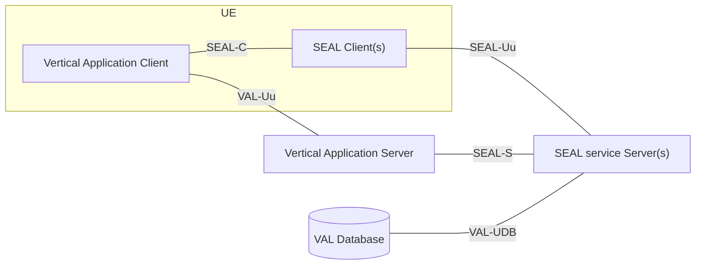

# SEAL 概觀（Shah 等，2020）

| 項目 | 內容 |
| --- | --- |
| 標題 | Service Enabler Layer for 5G Verticals |
| 作者與單位 | Sapan Pramodkumar Shah、Basavaraj Jayawant Pattan、Nishant Gupta、Narendranath Durga Tangudu、Suresh Chitturi；五位都標示 Samsung R&D Institute India – Bangalore |
| 出處 | 2020 IEEE 3rd 5G World Forum (5GWF)，pp. 269–274，2020 |
| DOI 或連結 | 10.1109/5GWF49715.2020.9221425（取自任務指示，PDF 內沒有印 DOI） |
| 本次閱讀的版本 | 出版社正式版（IEEE Xplore 下載），共 6 頁 |
| 類型 | 綜述（單一標準的概觀；沒有實作、模擬或實驗） |

## 一分鐘版本

這是一篇六頁的標準概觀，介紹 Release 16 的 SEAL（Service Enabler Architecture Layer，3GPP TS 23.434 定義的產業應用共用服務層）。作者的論點是：3GPP 為公共安全做 MCPTT 時，連同群組、身分、配置、金鑰等輔助服務一起標準化，花了好幾個 release；之後每個產業若都重做一套，既慢又重複，所以把這些輔助服務抽成共用的一層。論文依序說明通用架構、六項服務、API 的共通設計，再用車聯網的 VAE 說明產業應用怎麼使用 SEAL。全文沒有實作、實驗或效能數字，也沒有出現 NWDAF、analytics、AI/ML。對你的用處有三點：它補上規格沒寫的動機與沿革；它有幾句規格裡不容易讀到的設計意圖（SEAL 服務全部是選用、SEAL client 通常不自行發起程序）；它是 2020 年的基準點，對照 Release 20 可以看出分析與 AI/ML 是後來才加進 SEAL 的。

## 1. 要解決的問題

論文要回答的是「為什麼需要一層共用的應用支援服務」。動機分成商業與標準化兩條線。

**商業面（Abstract、§I）。** 電信商（論文稱 MNO）為 5G 投入大量資金，只靠一般消費者可能回收不了，需要來自產業客戶的新收入。論文引用參考文獻 [3] 的說法：5G 的使用情境讓電信商從 B2C 轉向 B2B。論文說要加快產業服務的部署，需要在應用層推動創新，電信商因此開始在 3GPP 推動產業應用的標準。

**標準化面（§I、§II）。** 論文用 MCPTT 的經驗當作論據：

- Release 13 制定 MCPTT 時，除了核心服務（TS 24.379、TS 24.380），還另外定義了一批輔助服務：群組管理（TS 24.481）、身分管理（TS 24.482）、配置管理（TS 24.484）、金鑰管理與安全（TS 33.180）（§I）。
- 論文說公共安全「可以視為 3GPP 的第一個垂直產業」，而 MCPTT 的標準化「花了極大的心力與時間（跨好幾個 release）」（§I）。
- 之後 3GPP 又做了 MCData、MCVideo、V2X，並正在研究 UAS、FFAPP、5GMARCH（§II）。這些產業應用都需要和 MCPTT 類似的輔助服務。
- 若每個產業各自制定並部署一套輔助服務，心力與時間都很大，而且許多服務是重複的（§II）。

**沒有 SEAL 時的樣子（圖 1）。** 圖 1 畫了 MCPTT 與 V2X 兩個產業，各有自己的 App. Server，底下各有一組「Vertical Specific Auxiliary Services」，裡面都是 GM、CM 等方塊，兩邊重複。

**有 SEAL 時的樣子（圖 2）。** 圖 2 把兩組輔助服務合成一個「SEAL – Common Auxiliary Services」，兩個產業的 App. Server 與終端都接到同一組。

論文把目標講成一句話：讓產業應用的開發只專注在自己的核心功能，輔助服務交給 SEAL；輔助服務只需要開發與部署一次，所以部署產業應用的時間、制定產業應用標準的時間都會大幅縮短（§II-A）。

**解讀：** 論文談的重複，指的是「每個產業各自標準化、各自部署群組、配置、身分、金鑰這類輔助服務」。它沒有把「每個應用各自對接核心網路」當成動機；全文沒有出現 NEF、SCEF、PCF 或 AF。這一點與我們平常從核心網路角度理解 SEAL 的方式不同，第 8 節會再談。

## 2. 需要的背景

論文假設讀者知道下列名詞。表後說明哪些是論文的定義、哪些是我們補充的。

| 名詞 | 說明 |
| --- | --- |
| Vertical domain | 論文的定義：開發、生產、提供相似產品或服務的一個產業或一群企業（§I）。Vertical application 是服務這種產業的應用 |
| MCPTT | Mission Critical Push-to-Talk，公共安全用的群組對講服務。MCData、MCVideo 是同一系列的資料與影像服務 |
| V2X | Vehicle-to-Everything，車聯網通訊 |
| VAE | V2X Application Enabler，TS 23.286 定義的車聯網專用支援層，位在 V2X 應用與 SEAL 之間 |
| UAS、FFAPP、5GMARCH | 論文列為 2020 年時研究中的項目：無人機系統、未來工廠的應用層支援、5G 訊息服務架構（§II） |
| CAPIF | Common API Framework，3GPP 為北向 API 定義的共用框架，處理 API 的發布、發現與授權。論文引用的是 TS 29.222 |
| MBMS | Multimedia Broadcast Multicast Service，LTE 的廣播與多播傳輸。論文的網路資源管理大量使用 MBMS bearer |
| Uu、PC5 | Uu 是 UE 與網路之間的介面；PC5 是 UE 與 UE 直接通訊的介面 |
| PLMN | Public Land Mobile Network，指一家電信商的網路 |

**解讀：** 表中來自論文的只有這幾項：vertical domain 的定義（§I）、UAS、FFAPP、5GMARCH 當時仍在研究中（§II）、VAE 位在 V2X 應用與 SEAL 之間並定義於 TS 23.286（§III）、CAPIF 涵蓋北向 API 的共通面向並引用 TS 29.222（§II-C）、Uu 與 PC5 的用途（§II-A）。其餘的白話說明是我們補充的一般知識，論文只寫出全名。

SEAL 的四個方塊（VAL client、VAL server、SEAL client、SEAL server）你已經在《Release 20 SEAL 01 定位與通用模型》讀過，這裡不重複。

## 3. 方法與架構

這篇是概觀，沒有提出新方法。本節改為整理它涵蓋了哪些內容，以及作者對各項設計說了什麼。

### 3.1. 通用架構（§II-A、圖 3）

SEAL 架構支援兩種模型：on-network 是 UE 經 Uu 連上網路，off-network 是 UE 之間經 PC5 互連（§II-A）。論文只畫了 on-network（圖 3），off-network 只有這一句。

依論文圖 3 重繪。原圖中 VAL-Uu 與 SEAL-Uu 兩條線穿過一個標示「3GPP Network (5G)」的長條。原圖沒有畫 SEAL server 連到 3GPP 網路的介面。

四個實體的職責與論文給的例子如下（§II-A）：

| 實體 | 職責 | 論文的例子 |
| --- | --- | --- |
| VAL client | 產業應用的客戶端功能；與 VAL server、SEAL client 互動 | UE 上的 MCPTT client、V2X client |
| VAL server | 產業應用的伺服器端功能；與 VAL client、SEAL server 互動 | MCPTT application server、V2X application server |
| SEAL client | 某項 SEAL 服務的客戶端功能；與 VAL client、SEAL server 互動 | Group management client、configuration management client |
| SEAL server | 某項 SEAL 服務的伺服器端功能；與 SEAL client、VAL server 互動 | Group management server、configuration management server |

論文列出七種介面（§II-A）：

| 介面 | 兩端 | 論文的說明 |
| --- | --- | --- |
| SEAL-C | VAL client ↔ SEAL client | UE 內有一個或多個 VAL client，每項 SEAL 服務各有一個 SEAL client。通稱，每項服務各有一個 |
| VAL-Uu | VAL client ↔ VAL server | 經 3GPP 網路（5G），承載產業應用自己的功能 |
| SEAL-Uu | SEAL client ↔ SEAL server | 通稱，每項服務各有一個 |
| SEAL-S | VAL server ↔ SEAL server | VAL server 用它取得 SEAL 服務。通稱，每項服務各有一個 |
| SEAL-X | SEAL server ↔ SEAL server | SEAL server 之間互相溝通 |
| VAL-UDB | SEAL server ↔ VAL user database | SEAL server 從 VAL 取得 user profile |
| SEAL-E | 同一種服務的 SEAL server 之間 | 用於分散式部署 |

關於 API，論文在 §II-A 說了四件事：SEAL 服務以 3GPP 北向 API 的形式提供給產業應用；這些 API 是 RESTful，稱為 SEAL API；依 3GPP 標準，所有 SEAL API 都符合 OpenAPI 3.0.0；架構也支援 SEAL server 對 SEAL client 的通知。

另外兩句是設計意圖：

- 「VAL server 使用哪些 SEAL 服務都是選用的，產業應用可以只用其中幾項。」論文用「It is important to note」強調這一點（§II）。
- 架構要同時支援多個產業的應用，以及同一產業的多個應用（§II-A）。

### 3.2. 部署與商業關係（§II-A、圖 4）

論文對部署說了三點：SEAL 服務可以部署在 PLMN 內、PLMN 外，或兩者並存；產業應用可以集中或分散部署；每家電信商可以依需求與業務選擇合適的模型。

圖 4 只畫了「許多可能模型中的一種」：VAL server 在 VAL service provider 網域；兩個電信商網域各有一組 SEAL server，各自以「Network Interface」接到自己的 3GPP Network (5G)；VAL server 經 SEAL-S 連到兩邊；兩邊的 SEAL server 之間以 SEAL-E 互連。

商業關係涉及 VAL user、VAL service provider、SEAL provider、PLMN operator 四種角色。論文列出的組合如下（§II-A）：

- VAL user 依服務協議歸屬於 VAL service provider 的網域。
- VAL service provider 與 home PLMN operator 可以是同一個組織；不是時，兩者之間可以有服務協議。
- VAL service provider 可以和 SEAL service provider 有服務協議。
- VAL service provider、SEAL service provider、home PLMN operator 三者也可以是同一個組織。
- SEAL service provider 可以和多個 PLMN operator 有服務協議。

### 3.3. 六項服務（§II-B）

論文為每項服務說明「為什麼許多產業都需要它」、提供什麼能力、經哪些介面。下表整理前兩者與 API。

| 服務 | 論文說的共同需求 | 主要能力 | SEAL-S 上的 API |
| --- | --- | --- | --- |
| Location Management（LM） | 管理 VAL user 的位置是許多產業應用都需要的 | client 與 server 之間分享位置；on-demand 回報；依可設定的觸發條件回報；VAL server 查詢任一使用者位置；把從 3GPP 網路取得的網路位置資訊分享給產業應用 | Location Reporting Trigger API、Location Info Subscription API、Obtain Location Info API |
| Group Management（GM） | 群組通訊是任何產業應用的基本功能，需要建立並管理群組、群組政策與成員 | 群組的建立、讀取、更新、刪除與通知；合併多個群組；以位置建立群組（群組管理 server 向位置管理 server 查詢某地理區域內的使用者）；公告與加入、離開 | Group Management API、Group Management Event API |
| Configuration Management（CM） | 多數產業應用需要建立並維護配置，提供初始配置並在變更時通知 | 管理 UE configuration 與 user profile configuration；訂閱配置變更 | User Profile Retrieval API、User Profile Event |
| Identity Management（IM） | 論文沒有寫共同需求，直接描述功能 | 認證與授權框架：使用者經身分管理 client 認證後取得 access token；token 對 VAL client 不透明，內含 VAL user 的身分；VAL server 驗證 token 後授權 | 論文沒有列 |
| Key Management（KM） | 敏感資料與使用者資訊的安全對每個產業應用都重要 | 產生加密金鑰並安全地分送給 VAL user | 論文沒有列 |
| Network Resource Management（NRM） | 許多產業應用需要管理不同的 radio bearer 並在其間切換 | 建立與修改 unicast、multicast bearer；multicast bearer 的 announcement；unicast 與 multicast 之間切換 | Network Resource Adaptation API |

每項服務的介面都依同一個規則命名：LM-C、LM-Uu、LM-S 分別是 SEAL-C、SEAL-Uu、SEAL-S 在位置管理的實例，其他服務依此類推（§II-B）。論文也為每項服務的 client 與 server 取了縮寫，例如 SLM-C、SLM-S（位置）、SGM-C、SGM-S（群組）、SCM-C、SCM-S（配置）、SIM-C、SIM-S（身分）、SNRM-C、SNRM-S（網路資源）。

NRM 列了十項程序。其中六項明寫 MBMS：預先建立 MBMS bearer、群組通訊進行中建立 MBMS bearer、MBMS bearer announcement、MBMS listening status report、MBMS 情境的 service continuity、unicast 與 MBMS bearer 之間切換。其餘四項是 unicast 資源的請求與修改、network resource adaptation，以及從 3GPP 網路接收 bearer 事件通知（§II-B-6）。

### 3.4. API 的共通設計（§II-C）

**Events API。** 所有屬於事件型（subscribe 與 notify）的 SEAL API 操作都定義在同一支 Events API。VAL server 經 LM-S、GM-S、CM-S 訂閱、取消訂閱，並分別接收位置管理、群組管理、配置管理 server 的通知。論文給的理由是：一支 API 處理所有事件型服務，不必每項 SEAL 服務各做一支，可以減少開發工作（§II-C-1）。

**CAPIF。** 論文的寫法是條件式的：「當 CAPIF 與 SEAL 服務一起使用時」，SEAL server 要把北向 API 的所有 feature 註冊到 CAPIF core function；SEAL server 支援 API exposing function、API publishing function、API management function；至少支援一種認證與授權的安全方法（§II-C-2）。

### 3.5. 產業應用怎麼用 SEAL：V2X 的例子（§III、圖 5）

§III 開頭有一句關於使用方式的說明：SEAL 有多項服務，每項有多個程序，但在大多數情境下，SEAL client 不會自行發起程序；SEAL client 要開始執行某個程序，需要產業應用提供觸發與相關參數。

VAE 層把車聯網專用的能力提供給上面的 V2X 應用，自己則使用 SEAL。VAE client 對 SEAL client 而言扮演 VAL client；VAE server 對 SEAL server 而言扮演 VAL server（§III）。

| SEAL 服務 | VAE 用它做什麼（§III） |
| --- | --- |
| 群組管理 | 執行群組管理操作。群組的 join policy 與 group leader 由 V2X 應用層提供；何時建立、修改、刪除群組也由 V2X 應用層決定 |
| 配置管理 | V2X UE 開始接收 V2X 服務前提供配置；服務進行中提供配置更新 |
| 位置管理 | 管理 V2X UE 的位置資訊，並把位置更新給 V2X 應用層 |
| 身分管理 | 認證並授權 V2X UE 使用 V2X application server |
| 網路資源管理 | 建立、修改、切換 unicast 與 MBMS bearer |

論文舉了一個 API 層級的例子：VAE server 要為 V2X 應用建立群組時，在 GM-S 上呼叫 Group Management API 的 create 操作；群組管理 server 建立 group document，並把新群組的資訊回給 VAE server（§III）。

圖 5 畫的是「最簡單的情境」：V2X AS 與 MCPTT AS 同時使用同一組 SEAL server。圖中 SEAL 方框內有五個 server（SLM-S、SGM-S、SCM-S、SIM-S、SNRM-S），兩個 AS 各以 LM-S、GM-S、CM-S、IM-S、NRM-S 五條線接上；兩台 UE 內各有一個 VAL client 與五個 SEAL client，各以五條 -Uu 線穿過 3GPP Network (5G) 接到對應的 server。

### 3.6. 作者對各項設計選擇解釋了多少

下表只整理論文有寫的內容。「沒有給理由」表示論文只陳述了這個設計，沒有說明為什麼。

| 設計選擇 | 論文怎麼說 | 是否給了理由 |
| --- | --- | --- |
| 抽出共用層 | 輔助服務在各產業重複，各做一次太慢（§I、§II） | 有，這是全文的主軸 |
| 服務全部選用 | 產業應用可以只用部分服務（§II） | 沒有給理由 |
| 分成 client 與 server | 只描述兩者的職責與互動對象（§II-A），以及 SEAL client 通常由產業應用觸發（§III） | 沒有給理由 |
| 以北向 API 提供服務 | 「SEAL 既然是產業應用的支援層，就必須讓服務能經 3GPP 北向介面使用」（§II-A） | 只有這句必要性的陳述 |
| 事件型操作合成一支 Events API | 減少開發工作（§II-C-1） | 有 |
| 採用 CAPIF | CAPIF 涵蓋任何北向服務 API 的共通面向；使用時 SEAL server 要支援哪些功能（§II-C-2） | 沒有說明為什麼選 CAPIF，也沒有說是否必須使用 |
| SEAL 與 VAE 的分工 | VAE 使用 SEAL；群組的政策、leader 與建立時機由 V2X 應用層決定，操作交給 SEAL（§III） | 以例子說明，沒有歸納成原則 |
| 部署模型 | 列出 PLMN 內外、集中與分散，由電信商自選（§II-A） | 沒有比較各模型的取捨 |
| 與 mission critical 的關係 | SEAL 的輔助服務來自 MCPTT 的經驗；MCPTT client 與 application server 是 VAL client、VAL server 的例子；圖 5 讓 MCPTT 與 V2X 共用 SEAL（§I、§II、§III） | 有說明沿革，沒有說明 MCPTT 規格是否已改為使用 SEAL |

**解讀：** VAE 那一列可以歸納成「決策在產業層，機制在 SEAL」。這是我們的說法，論文只給了群組管理這一個例子。

## 4. 實驗與結果

論文沒有實作、模擬、實驗，也沒有任何效能數字。

它支持主張的方式只有三種：轉述 3GPP 規格的內容（參考文獻 [5]、[6]、[7]）、兩張概念對比圖（圖 1 與圖 2）、一個產業例子（§III 的 V2X）。

「大幅縮短部署時間」「大幅縮短制定標準的時間」（§II-A）與「節省可觀的上市時間與成本」（§IV）都沒有數字，也沒有實際案例佐證。MCPTT 的標準化「跨好幾個 release」是論文唯一的經驗性論據，同樣沒有量化。

論文對各方好處的說法整理如下：

| 對象 | 論文說的好處 | 出處 |
| --- | --- | --- |
| 電信商 | 來自產業客戶的新收入；能快速開發並部署產業應用 | Abstract、§I |
| 電信商 | 可依自己的需求與業務選擇部署模型 | §II-A |
| 電信商 | 論文把 SEAL 列為「降低網路部署成本、加快產業服務部署」的創新之一 | §IV |
| 產業應用與設備商 | 只專注核心功能；輔助服務只開發與部署一次；既有或新的產業服務可以直接沿用 SEAL 的能力，再往上加產業專屬需求 | §I、§II-A、§IV |
| 3GPP 標準制定 | 縮短制定產業應用標準的時間 | §II-A |

具體的使用情境只有 §III 的 V2X，以及圖 5 的 V2X 與 MCPTT 並存。論文沒有提到任何電信商、產品或部署案例。

## 5. 限制

### 5.1. 文獻自己承認的

論文沒有限制一節，也沒有討論 SEAL 的缺點。接近的只有三處：

- 圖 4 是「許多可能部署模型中的一種」（§II-A）。
- 圖 5 是「最簡單的情境」（§III）。
- §V 說隨著 Release 17 為 UAS、未來工廠、5G IoT messaging 等新產業加強應用支援層，SEAL 會更有用，未來的 release 需要更多 SEAL 服務。

**解讀：** 第三點可以讀成作者認為六項服務還不夠，但論文是把它寫成展望，不是限制。

### 5.2. 我們看到的

- **主張沒有證據。** 節省時間與成本是全文的核心主張，但沒有數字、沒有案例、沒有與不使用 SEAL 的比較。
- **沒有交代 SEAL server 怎麼使用核心網路。** 全文沒有 NEF、SCEF、PCF、AF。圖 4 有一條標示「Network Interface」的線，正文沒有解釋。位置管理提到「從 3GPP 網路取得的網路位置資訊」（§II-B-1），網路資源管理提到「從 3GPP 網路接收 bearer 事件通知」（§II-B-6），都沒有說經過哪個介面。
- **off-network 只有一句。** 論文說架構支援 PC5 的 off-network 模型，之後沒有再提。
- **金鑰管理在例子中消失。** 金鑰管理列在六項服務與結論中，但圖 5 的 SEAL 方框只有五個 server，沒有金鑰管理；§III 說明 VAE 的用法時也沒有提到金鑰管理。論文沒有解釋。
- **身分管理與金鑰管理的描述很薄。** 兩者都沒有列程序清單，也沒有列 API。金鑰管理只有一句功能描述。
- **介面與程序的歸屬寫得不精確。** 位置管理的程序清單標為「over the LM-Uu interface」，但其中有 VAL server 向位置管理 server 訂閱與查詢的項目；網路資源管理的清單標為「over NRM-Uu interface」，但十項中有五項是由 VAL server 向 SNRM-S 請求或觸發的。這些互動依論文自己的定義應屬於 -S 介面。
- **MCPTT 是否真的使用 SEAL 沒有交代。** 論文把 MCPTT 當作 VAL 的例子，圖 5 也畫了 MCPTT AS 使用 SEAL。但 MCPTT 的輔助服務在 SEAL 之前就已存在（§I 自己列了規格編號），論文沒有說 MCPTT 的規格是否已改為建立在 SEAL 之上。
- **標題是 5G，網路資源管理卻以 MBMS 為主。** NRM 的十項程序中六項明寫 MBMS，這是 LTE 的廣播多播技術。論文沒有說明 5G 的對應做法。
- **文字上的小問題。** SEAL-X 與 SEAL-E 的說明寫「not shown in Fig. 1」，依上下文應為圖 3。§II-B-1 有一處用「LM-C」指位置管理 client，與同一節把 LM-C 定義為介面不一致。§III 把 identity management 寫成「identify management」。參考文獻 [4] 沒有日期與連結。
- **作者立場。** 五位作者同屬一家設備商。論文以介紹與推廣為主，沒有引用任何對 SEAL 的批評或替代方案。

**未能確認：** 文獻調查把作者群描述為 3GPP SA6 中負責 SEAL 的標準代表。論文本身沒有寫作者在 3GPP 的角色，本次也沒有另外查證。

## 6. 與 SEAL 的關係

SEAL 是這篇論文的唯一主題。它引用的是 TS 23.434 Release 16（參考文獻 [5]，沒有寫版本號），以及 TS 29.222 與 TS 23.286 的 Release 16 版本。以下各段都是我們拿本地 TS 23.434 V20.1.0 與 TS 29.549 V20.1.0 做的對照，不是論文的內容。加入時間取自 TS 23.434 V20.1.0 Annex F 的變更紀錄。

### 6.1. 論文之後才加入的服務

**解讀：** 論文列六項服務。Release 20 的 §6.1、表 15.3-1 與第 16 到 24 章多出下列項目：

| 服務 | Release 20 的位置 | Annex F 的紀錄 |
| --- | --- | --- |
| 網路切片能力支援（NSCE） | 第 16 章，細節在 TS 23.435 | 最早的相關條目是 CR 0032「Network slice adaptation for VAL applications」，V17.0.0，2020-12；之後有 CR 0037「Network Slice Capability Management functional model」，V17.2.0，2021-06 |
| 通知管理 | 第 17 章 | CR 0104、CR 0105，V18.2.0，2022-09 |
| 資料傳遞（SEALDD） | 第 18 章，細節在 TS 23.433 | CR 0129，V18.3.0，2022-12 |
| 應用資料分析支援（ADAE） | 第 19 章，細節在 TS 23.436 | CR 0138，V18.3.0，2022-12 |
| AI/ML 支援（AIMLE） | 第 20 章，細節在 TS 23.482 | CR 0312，V19.3.0，2024-09 |
| 衛星接取下的 SEAL 服務 | 第 21 章 | CR 0330 到 CR 0332，V19.4.0，2024-12；CR 0422，V20.1.0，2026-07 |
| 空間錨點、空間地圖 | 第 22、23 章，細節在 TS 23.437 | 沒有逐筆確認是哪一筆 CR 加入 |
| 數位資產 | 第 24 章 | CR 0357，V19.4.0，2024-12 |

**解讀：** 論文 §V 預期「未來的 release 需要更多 SEAL 服務」。從上表看，這個預期成立；最早的一筆（網路切片）在論文發表的同一年年底就進了規格。

### 6.2. 到 Release 20 仍然成立的描述

**解讀：** 下列內容在本地 Release 20 都找得到對應條文，論文的描述仍然可用。

| 論文的描述 | Release 20 的對應 |
| --- | --- |
| 四個實體與各自的職責 | §6.4.2.2 到 §6.4.2.5 |
| SEAL-UU（論文寫 SEAL-Uu）、SEAL-C、SEAL-S、SEAL-E、SEAL-X、VAL-UDB，以及每項服務各有一組實例 | §6.5.2.4 到 §6.5.2.10 |
| on-network 與 off-network 兩種模型 | §6.2、§6.3 |
| 支援多個產業、同一產業多個應用；以 API 提供服務；支援事件通知 | §4.1.2-a 到 §4.1.2-d |
| 部署在 PLMN 內、外或並存；集中與分散 | §4.2.2-a 到 §4.2.2-e |
| 圖 4：多個電信商網域各有 SEAL server，以 SEAL-E 互連 | §8.2.1 圖 8.2.1-3 |
| 商業關係的各種組合 | §5.1 |
| 群組合併、以位置建立群組（群組管理 server 向位置管理 server 查詢） | §4.4.2-c；§6.5.2.9.3 把這條線命名為 SEAL-X2 |
| SEAL server 是 CAPIF 的 API exposing function | §6.4.2.5 |
| 產業 enabler 位在 VAL 之內，再使用 SEAL | §6.2 NOTE 3 |
| SEAL 的共通能力考慮了 mission critical 與其他產業應用 | Introduction |

### 6.3. 已經改變或擴充的地方

**解讀：** 以下差異依重要性排列。

- **命名。** 論文寫 SEAL-Uu、VAL-Uu、LM-Uu；Release 20 寫 SEAL-UU、VAL-UU、LM-UU，並在 §3.2 把 SEAL-UU 列為縮寫。論文用的 SLM-S、SGM-C 這類 client 與 server 縮寫，在 TS 23.434 V20.1.0 全文搜尋不到。論文稱這些線為 interface，規格稱為 reference point。
- **網路資源管理的範圍。** 論文的 NRM 只有 unicast 與 MBMS bearer，API 只有一支。Release 20 的 §14.4 有五支 API（SS_NetworkResourceAdaptation、SS_EventsMonitoring、SS_NetworkResourceMonitoring、SS_MMetaServiceRequirements、SS_ValUeConfiguration），§14.3 另外有 5GS 的多播資源管理（§14.3.4A）、事件監測、QoS 監測、TSC 與 TSN、background data transfer、device triggering 等程序。Annex F 顯示 5G MBS 的支援是 V18.2.0（2022-09，CR 0116 到 CR 0124）才加入。
- **位置管理的 API 數量。** 論文列三支。Release 20 的表 9.4.1-1 有十一支，新增的包含位置監測與區域監測、位置歷史、側鏈路定位等。
- **身分管理與金鑰管理的 API。** 論文沒有列。Release 20 在 Stage 2 各有一支供 VAL server 佈建參數的 API（§12.4.3 的 SS_IdmParameterProvisioning、§13.4.1 的 SS_KmParameterProvisioning）。
- **Events API 涵蓋的服務。** 論文說經 LM-S、GM-S、CM-S 三條線。TS 29.549 V20.1.0 §5.6.1.1.1 的 SS_Events 多了 NRM-S。TS 23.434 V20.1.0 本文搜尋不到通用的 Events API 或 SS_Events，Stage 2 以各服務自己的事件 API 呈現（例如 SS_LocationInfoEvent）。
- **CAPIF 的強制程度。** 論文用條件式的「當 CAPIF 被使用時」。這段的內容與 TS 29.549 V20.1.0 §8.1 相同，其中「註冊所有 feature」那一句逐字相同；論文引用的卻是 TS 29.222。TS 23.434 V20.1.0 的 §4.1.2-e 與 §4.1.2-f 則用 shall 要求符合 CAPIF。既有的《Release 20 SEAL 04 服務 API 與 CAPIF》第 4 節已記錄這個落差。
- **服務消費者。** 論文只把 VAL server 當作 SEAL-S 的呼叫者。Release 20 的 §6.2 NOTE 4 說 VAL server 只是消費者的一個例子。
- **部署。** Release 20 多了 SEAL server 放在獨立 SEAL provider 網域的模型（§8.2.3）、SEAL client 的部署選項（§8.3，CR 0408，V20.0.0）、把 SEAL client 提供者獨立出來的商業關係（§5.3，CR 0409，V20.0.0）。
- **終端側協定。** 論文說 SEAL API 是 RESTful。Release 20 另外定義了給受限裝置使用的 light-weight protocol（§6.4.3.4），Annex F 的對應紀錄是 CR 0051「SEAL support for CoAP」，V17.2.0。

**解讀：** 論文把 NRM 寫成以 MBMS 為主，與 Release 16 的狀態相符。Annex F 有一筆 2019-12 的 CR 0012，標題是「No multicast resource management in 5GS」（V16.2.0）。我們只看了標題，沒有看這筆 CR 的內容。

**未能確認：** 本地沒有 Release 16 的 TS 23.434。上面「後來才加入」的判斷來自兩個來源的交叉：論文沒有寫，以及 Release 20 的變更紀錄。若 Release 16 規格其實已有某項內容而論文省略了，我們無法分辨。§8.2.3、§6.2 NOTE 4 是哪個版本加入的也沒有查。

## 7. 與 NWDAF 的關係

論文沒有提到 NWDAF。全文也沒有出現 analytics、AI、ML、machine learning、NEF、AF 這些字串。「network slicing」與「edge computing」各出現一次，都在 Abstract 中當作 5G 的內建特性舉例，與 SEAL 的服務無關。

論文中與「從網路取得資訊」最接近的只有兩句：位置管理把「從 3GPP 網路取得的網路位置資訊」分享給產業應用（§II-B-1）；網路資源管理 server 可以「從 3GPP 網路接收 bearer 事件通知」（§II-B-6）。兩句都沒有說資訊來自哪個網路功能。

**解讀：** 2020 年的 SEAL 沒有分析的角色，SEAL 與 NWDAF 的接點都是之後才出現的。依既有的《Release 20 SEAL 03 與核心網路的互動》第 4 節，TS 23.434 V20.1.0 中的接點如下，我們以關鍵字搜尋確認這些小節確實提到 NWDAF 或 TS 23.288：

| SEAL 服務 | 章節 | 用到的分析 |
| --- | --- | --- |
| 位置管理 | §9.3.5、§9.3.7、§9.3.8、§9.3.24 | UE mobility analytics 與位置相關預測 |
| 網路資源管理 | §14.3.3、§14.3.5、§14.3.6 | UE communication analytics、DN performance analytics、QoS sustainability analytics |
| 衛星接取下的配置 | §21.2 | UE mobility analytics |
| 網路切片能力支援 | §16.1 | 文字提到 NWDAF API |
| ADAE、AIMLE | 第 19、20 章，細節在 TS 23.436、TS 23.482 | 見既有的《Release 20 SEAL 06 ADAE、AIMLE 與 NWDAF 的對應》 |

**解讀：** 這些接點都落在論文已經介紹過的兩項服務（位置管理、網路資源管理）與論文之後才加入的服務上。也就是說，NWDAF 是從「SEAL server 使用網路能力」這條線接進來的，而這條線正是論文完全沒有展開的部分（見第 5.2 節第二點）。

## 8. 對你的研究可以怎麼用

本節全部是解讀。

**當作引用來源。** 論文適合用在論文或報告的背景段落，支持兩個說法：SEAL 的動機是避免各產業重複制定輔助服務（§I、§II）；依這篇論文的描述，Release 16 的 SEAL 是六項服務，不含分析與 AI/ML（§II-B、§IV）。它不適合用來支持任何效能、成本或採用程度的說法，因為它沒有數據。

**當作時間基準。** 你的研究關心 NWDAF 與應用層的接點。這篇可以用來說明這個接點是近年才形成的：2020 年的概觀完全沒有分析，ADAE 在 2022 年底、AIMLE 在 2024 年進入 TS 23.434（第 6.1 節的表）。

**沒有可重用的程式、資料或實驗設計。** 論文沒有實作。

**可以補進《Release 20 SEAL 01 定位與通用模型》的內容：**

| 該文件的位置 | 建議 | 論文出處 |
| --- | --- | --- |
| 第 2 節「為什麼存在」的解讀段 | 目前的解讀是「每種應用都得各自在終端寫回報邏輯、各自對接核心網路」。可以改引這篇論文的說法：重複的是各產業各自標準化並部署的輔助服務。同時註明論文沒有把對接核心網路當成動機 | §I、§II、圖 1、圖 2 |
| 第 2 節最後一段「兩者的制定沿革本文未查證」 | 可以補上論文的說法：SEAL 的輔助服務取自 MCPTT 在 Release 13 定義的輔助服務（TS 24.481、TS 24.482、TS 24.484、TS 33.180）。論文沒有提到 CFA、TS 23.280 或 SIP，所以「為什麼通用模型裡有 SIP 實體」仍然只是推論 | §I、§II |
| 第 3 節或第 4 節 | 補一句產業 enabler 的位置：VAE client 對 SEAL 而言就是 VAL client，VAE server 就是 VAL server。可同時引 Release 20 的 §6.2 NOTE 3 | §III |
| 第 4 節 SEAL-C 一列 | 補一句使用方式：SEAL client 在大多數情境不自行發起程序，由產業應用提供觸發與參數 | §III |
| 第 6 節服務清單 | 加一欄或一句說明哪些是 Release 16 的原始六項，其餘是後來加入的，並引 Annex F | §II-B、§IV |

**與該文件相互印證的地方：**

- 第 7 節「SEAL 不是一個元件」：論文說每項 SEAL 服務在 UE 內各有一個 SEAL client（§II-A），圖 5 也把五個 server 與五個 client 分開畫。
- 第 7 節「應用的流量不經過 SEAL」：圖 3 與圖 5 的 VAL-Uu 都是 VAL client 直接連到 VAL server。
- 《Release 20 SEAL 05 提供者、部署與識別碼》第 6 節「應用可以只用其中幾項」：論文明說所有 SEAL 服務的使用都是選用的（§II）。這句可以當作該節的直接引用來源。

**有出入或需要留意的地方：**

- 命名：該文件依 Release 20 寫 SEAL-UU、VAL-UU；論文寫 SEAL-Uu、VAL-Uu。引用論文時要說明是同一條線。
- 圖：該文件的四方塊圖畫了「網路介面」，並把 VAL-UDB 放在「沒畫在上圖的線」。論文圖 3 相反，畫了 VAL-UDB，沒有畫網路介面。兩者不衝突，但顯示論文的重心不在 SEAL 與核心網路的互動。
- CAPIF：論文用條件式寫法。這屬於《Release 20 SEAL 04 服務 API 與 CAPIF》第 4 節的議題，可以在那裡加註「2020 年的這篇概觀也採用條件式寫法」。這不能當作 CAPIF 非強制的規範性依據，只是旁證。

**待填補的缺口。** 論文沒有回答、而你的研究會碰到的問題：SEAL server 以什麼身分、經哪個介面使用核心網路；部署在不同網域時這條線有什麼差別；MCPTT 這類既有產業是否真的改用 SEAL。前兩項要回到規格（既有的第 03、05 篇），第三項需要另外查 mission critical 的規格。

## 9. 值得追的參考文獻

論文只有七筆參考文獻。以下照原文抄錄其中五筆。

1. [5] 3GPP TS 23.434: "Service Enabler Architecture Layer for Verticals (SEAL); Functional architecture and information flows". Release-16. 若要嚴謹地比較 Release 16 與 Release 20，需要這個版本；本地目前沒有。
2. [7] 3GPP TS 23.286: "Application layer support for Vehicle-to-Everything (V2X) services; Functional architecture and information flows" Release 16. 論文唯一的產業 enabler 例子，可以看 VAE 實際上怎麼引用 SEAL 的程序。
3. [6] 3GPP TS 29.222: "Common API Framework for 3GPP Northbound APIs" Release-16. 論文談 CAPIF 的依據。本地有 Release 20 版本。
4. [3] A. Banchs, D. M. Gutierrez-Estevez, M. Fuentes, M. Boldi and S. Provvedi, "A 5G Mobile Network Architecture to Support Vertical Industries," in IEEE Communications Magazine, vol. 57, no. 12, pp. 38-44, December 2019. 論文「B2C 轉 B2B」說法的來源，從網路架構的角度談產業支援。
5. [4] Overview of 3GPP SA WG6: Global 5G – Verticals workshop, Page 29. SA6 自己對產業應用標準需求的說明；書目不完整，沒有日期與連結，需要另外找。

## 10. 閱讀建議

全文六頁，沒有數學與實驗，大約 20 分鐘可以讀完。

- 必看：§I 後半與 §II 開頭（動機與 MCPTT 的沿革）、圖 1 與圖 2、§II-A 的前兩段、§II-C（Events API 與 CAPIF）、§III 與圖 5。
- 可以略過：Abstract 與 §I 前半的市場敘述；§II-B 各服務的程序清單。你已有的 SEAL 解讀文件依據的是 Release 20，比這份清單完整，而且論文的介面歸屬寫得不精確（見第 5.2 節）。
- 讀 §II-B-6 時要記得那是 Release 16 的網路資源管理，以 MBMS 為主，與 Release 20 差距最大。

## 查證紀錄

**逐項核對過的內容**

- 以 `pdftotext -layout` 轉出全文並讀完；用 Read 工具直接看了 PDF 第 1 到 6 頁。圖 3、圖 4、圖 5 另外放大成影像，逐一確認方塊名稱、連線與標籤。圖 5 的 SEAL 方框確認只有 SLM-S、SGM-S、SCM-S、SIM-S、SNRM-S 五個，沒有金鑰管理。圖 3 確認 VAL Database 只以 VAL-UDB 接到 SEAL server，圖中沒有 SEAL server 到網路的介面。
- 論文中的規格編號與年份：TS 24.379、TS 24.380、TS 24.481、TS 24.482、TS 24.484、TS 33.180、Release 13 與「2012 ~ 2016」、OpenAPI 3.0.0、三筆 Release 16 引用、§V 的 Release 17，都對照過原文。
- 計數：論文列七種介面、六項服務、八支服務 API 加一支 Events API；NRM 十項程序中六項明寫 MBMS、五項由 VAL server 請求或觸發；參考文獻七筆。都回頭數過。
- 頁碼 269 到 274 取自 PDF 各頁頁尾；研討會名稱取自 PDF 的 metadata（Subject 欄）；首頁頁尾有「978-1-7281-7299-6/20/$31.00 ©2020 IEEE」。
- 以關鍵字搜尋（區分大小寫）確認全文沒有 NWDAF、analytic、machine learning、AI、ML、NEF、SCEF、PCF、CFA、23.280、23.222、29.549、SIP、CoAP、HTTP；slic 與 edge 各出現一次，都在 Abstract。
- 規格對照使用本地 `specs/Rel-20/`：TS 23.434 V20.1.0 的 Introduction、§1、§3.2、§4.1 到 §4.4、§5、§6.1 到 §6.5、§8、表 9.4.1-1、§10.4、§11.4、§12.4、§13.4、§14.1、§14.2、§14.3 與 §14.4 的小節清單、第 15 章、第 16 到 20 章各章的開頭與小節標題、Annex A、Annex B、Annex F 全表（其中 §10.4、§11.4、§12.4 只看了 API 與操作的標題）；TS 29.549 V20.1.0 的 §5.6.1.1.1 與 §8.1。第 6 節引用的每一筆 CR 編號、版本與日期都對照過 Annex F。
- 第 7 節的 NWDAF 接點清單取自既有的《Release 20 SEAL 03 與核心網路的互動》第 4 節，並以搜尋「NWDAF」「23.288」確認表中九個小節都有命中。各小節使用哪一種分析，沿用該文件的整理，沒有逐一重讀條文。

**無法確認的內容**

- DOI 取自任務指示，PDF 內沒有印。
- 作者在 3GPP SA6 的角色，論文沒有寫，本次沒有查證。
- 本地沒有 Release 16 的 TS 23.434、TS 23.286、TS 29.549，所以論文對 Release 16 的轉述是否完整、是否有遺漏，無法核對。第 6 節「後來才加入」的判斷依據是論文內容與 Release 20 的變更紀錄。
- 空間錨點與空間地圖是哪一筆 CR 加入、§8.2.3 與 §6.2 NOTE 4 是哪個版本加入，沒有查。
- CR 0012「No multicast resource management in 5GS」只看了標題。
- MCPTT 等 mission critical 規格是否引用 SEAL，本地沒有相關規格，沒有查證。
- 參考文獻 [1] 到 [4] 的原文都沒有讀；[4] 的書目不完整。
- 論文說「所有 SEAL API 都符合 OpenAPI 3.0.0」指的是 Release 16。本地 Release 20 的 OpenAPI 檔與 TS 29.549 中，`openapi:` 欄位只出現 3.0.0 一種值，但這不能反推 Release 16 的狀態。
- 這次閱讀沒有發出任何網路請求。
