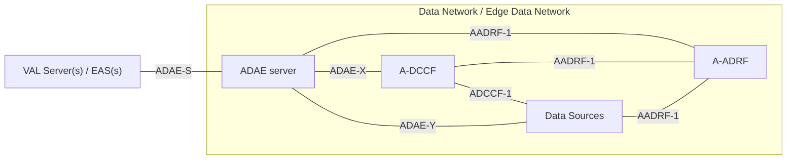
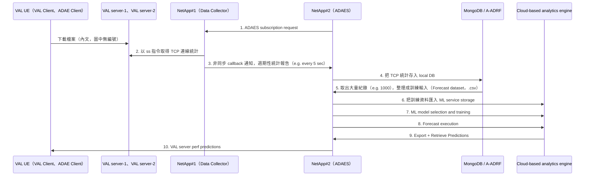

# ADAES 與 NetApps（Pateromichelakis 等，2022）

| 項目 | 內容 |
| --- | --- |
| 標題 | NetApps Enabling Application-Layer Analytics for Vertical IoT Industry |
| 作者與單位 | Emmanouil Pateromichelakis、Dimitrios Dimopoulos、Apostolis Salkintzis；三人皆為 Lenovo, Germany（首頁註腳） |
| 出處 | IEEE Internet of Things Magazine, vol. 5, no. 4, pp. 130–135, December 2022。經費來自 H2020/5G-PPP 計畫 EVOLVED-5G（GA Number 101016608） |
| DOI 或連結 | 10.1109/IOTM.001.2200212 |
| 本次閱讀的版本 | 出版社正式版，共 6 頁 |
| 類型 | 架構提案與標準介紹（附一個原型的設計說明，沒有量測結果） |

論文的標題沒有節號，但 §I 結尾自己把全文稱為 Section II 到 V。本文沿用這個編號：§I Introduction、§II Service Enablement Framework、§III Application Data Analytics Enablement (ADAE)、§IV Design of NetApps Development and Evaluation Environments、§V Conclusion & Outlook。子節以原文的小標稱呼。

## 一分鐘版本

這是一篇 6 頁的雜誌文章，第一作者在作者簡介中自述正在 3GPP SA6 主持 application data analytics enablement 這個議題（p. 135）。文章做三件事。第一，用 NetApps（Network Applications）這個詞，把 3GPP SA6、ETSI MEC、O-RAN 各自定義的應用使能服務歸成 Cloud NetApps 與 Edge NetApps 兩類。第二，介紹 ADAES（Application Data Analytics Enablement Service），依據是研究報告 TR 23.700-36 V18.0.0（2022 年 9 月）；當時的架構已經有 ADAE client、ADAE server、A-DCCF、A-ADRF，並列出六類分析。第三，描述一個原型：五台 Ubuntu VM，一個資料收集 NetApp 用 Linux 的 `ss` 指令取得 TCP 統計，一個 ADAES NetApp 把資料交給雲端的預測服務訓練並產生預測，再把各 VAL server 的預期 RTT 交給 UE 端挑選伺服器。全文沒有任何實驗結果的數字。對讀者的用處是：它是目前找到唯一以 ADAES 為主題的同儕審查論文，由標準的主導者撰寫，可以當作 ADAE 設計動機的引用來源；但它對 NWDAF 只提到三次，而且沒有把 NWDAF 點名為 ADAES 的資料來源。

## 1. 要解決的問題

論文沒有用一句話定義研究問題，它的動機分散在三處。

- **不同背景的參與者需要一層轉譯。** 5G 之後的網路除了接取、核心與管理網域，還包含邊緣與雲端的應用網域。參與者來自 IT 業者、網路營運商與垂直產業，因此需要一層 middleware 把服務需求轉成網路需求，反向亦然（§I）。
- **NetApp 的部署有三項需求。** 論文把它們列為 NetApp 部署可能要滿足的要求（§I 的三個小標）：應用在不同邊緣或雲端平台之間的可攜性；把網路暴露的參數（尤其是無線側的複雜參數）轉譯成應用看得懂的形式；與 MEC、O-RAN 等其他系統的互通。
- **應用層缺少自己的分析服務。** 摘要說，電信雲平台上的資料管理（特別是資料收集與分析使能）很重要，因此需要一類新的 NetApp 來支援「cross-domain integrated analytics」，以最佳化端到端的應用效能。§III 的寫法是先介紹 NWDAF 服務核心網路、MDAS 服務管理面，再引出 ADAES 作為應用使能層的新服務。

**解讀：** 論文沒有寫「NWDAF 做不到什麼」這類缺口陳述，只是把三者並排。讀者若要引用它說明 ADAE 存在的理由，能引用的是摘要與 §III 的定位句，而不是一段論證。

## 2. 需要的背景

### 2.1. NetApps 是什麼

論文對 NetApps 的定義是：向垂直應用提供 middleware 服務的應用，讓垂直應用能方便地使用底層網路暴露的控制與管理服務。它的主要好處是把「使用行動網路 northbound 服務所需的複雜程序」從垂直 IoT 應用身上移走，讓應用只處理產業邏輯（§I）。摘要的說法是：vertical application enablement 是一組加值服務的工具箱，「透過所謂的 NetApps 實現」，形成一個最佳化與轉譯層。

圖 1 是商業模型。四個角色是 Vertical or ASP（應用服務提供者）、End User、Network Operator、Edge / Cloud Provider。圖中 Edge / Cloud Provider 方塊另以紅字標註「NetApp Service Provider」，也就是論文設想 NetApp 由邊緣或雲端業者提供（§I、圖 1）。

圖 2 把 NetApps 分成兩層，夾在垂直應用與電信網路之間：

| 層 | 圖 2 列出的內容 | 論文的說明 |
| --- | --- | --- |
| Vertical APP | Automotive、Factory of the Future、UAS、mIOT、eHealth | 由 VAL server 承載的垂直應用。VAL（Vertical Application Layer）是 3GPP 對產業應用本身的稱呼（§II） |
| Cloud NetApps | API Enablement / CAPIF；Vertical-agnostic / SEAL（Location、NRM、Config、Slicing、Analytics 等）；V2X Enabler、Future Factory Enabler、UAS Enabler、mIOT Enabler | 「等同於應用使能框架的服務」，可以是通用的，也可以是特定產業的（§II「Cloud NetApps」） |
| Edge NetApps | MEC（Location、VIS、RNIS 等）；EDGEAPP（AF Influencing、Application Mobility、QoS、EAS Discovery、Federation 等）；RIC；UPF / GW | 為邊緣應用量身提供的能力（§II「Edge NetApps」） |
| Telco Network | 4G、5G | 底層網路 |

**解讀：** 依論文的用法，NetApp 不是一種新的標準實體，而是「把既有的使能服務實作成可部署的應用」的稱呼：SEAL server、VAE server、EES、MEC 服務、RIC 上的 xApp 都被算進去。論文在 §II 直接寫 Cloud NetApps「等同於」application enablement framework services，所以它與 3GPP 應用使能層的關係是「同一批服務的另一個名字，再加上非 3GPP 的邊緣服務」。

**解讀：** NetApp 一詞的來源論文沒有交代。我們的理解是它出自歐盟 5G-PPP（歐盟執委會與產業合辦的 5G 研究計畫群）的社群，EVOLVED-5G 是其中以 NetApp 為主題的 H2020 計畫。這項背景不是論文寫的，本次也沒有上網查證；論文內能確認的只有致謝中的計畫名稱與編號。3GPP 規格不使用 NetApp 這個詞，本地 TS 23.436 全文檢索為零。

### 2.2. 論文介紹的使能框架

以下是 §II 的整理。

| 名稱 | 論文的說明 | 論文引用 |
| --- | --- | --- |
| CAPIF（Common API Framework） | 電信業者提供的 API 使能方式，協助第三方應用存取 3GPP 功能。由 CAPIF Core Function、API Exposing Function（AEF）、API Management Function、API Publishing Function 組成；提供 API 的儲存庫與探索、對 API invoker 的認證與授權、呼叫的記錄與計費。4G 與 5G 都可用它暴露 northbound API | [5] TS 23.222 V17.6.0 |
| VAE（V2X Application Enabler） | 為 V2X 應用（車隊、遠端駕駛、進階駕駛）提供傳遞、配置與資源管理的應用層支援 | [6] TS 23.286 V17.4.0 |
| FAE（Factory of the Future Application Enabler） | 主要支援有確定性流量需求的時間敏感通訊 | [7] TS 23.545 V0.6.0 |
| UAE（UAS Application Enabler） | 支援無人機與控制器之間經行動網路的 C2（Command and Control）通訊，含應用層的 QoS 監測與控制 | [9] TS 23.255 V17.3.0 |
| SEAL（Service Enabler Architecture Layer） | 許多垂直產業需要相近的核心能力，因此引入 SEAL 作為「umbrella」框架，由一組共用服務組成：Group Management、Location Management、Identity Management、Key Management、Network Resource Management、Configuration Management、Slice Capability Enablement。SEAL 服務同時支援 on-network 與 off-network 的 UE，採 B2B 模式 | 無（內文未附引用） |
| EES（Edge Enabler Server） | 向邊緣 client 提供邊緣應用的可用性與配置資訊，並向 EAS（Edge Application Server）暴露 3GPP 網路能力；支援服務連續性、context 轉移、邊緣伺服器探索 | [10] TS 23.558 V18.0.0 |
| ETSI MEC 的服務 | Radio Network Information、Location、Bandwidth 等服務，以及 V2X Information Service（VIS）這類產業服務，經 MEC 專屬 API 提供。MEC（Multi-access Edge Computing）是 ETSI 定義的邊緣運算框架 | [11] ETSI GS MEC 003 V3.1.1 |
| Near-Real Time RIC 的服務 | O-RAN 定義的 RAN Intelligent Controller 上的服務（xApps），以 AI/ML 與巨量資料分析支援 SON 與 RRM | 內文寫 [7][8] |

### 2.3. 論文對 NWDAF 與 MDAS 的描述

§III 開頭用兩段介紹既有的分析功能：

- NWDAF [13] 在 5G 核心網路提供網路資料分析服務。它可以從其他 NF、AF 或 OAM 收集資料，並可暴露給第三方或 AF，提供的統計與預測包含 slice Load level、observed Service experience、NF Load、Network Performance、UE 相關分析（mobility、communication）、User data congestion、QoS sustainability、DN performance 等。
- MDAS（Management Data Analytics Service）[14] 從網路管理的角度提供分析。它可以部署在網域層級（RAN、CN、切片子網）或集中部署，目的是最佳化管理面；可以暴露給第三方，提供效能與故障分析、切片與切片子網分析，並可選擇性地建議管理動作，例如資源擴縮、允入控制、流量負載平衡。

## 3. 方法與架構

### 3.1. 論文依據的文件

ADAES 的唯一引用是 [15]：TR 23.700-36 V18.0.0（2022 年 9 月），也就是 SA6 的研究報告。論文沒有引用 TS 23.436，全文也沒有出現這個編號。它對成熟度的用語是：ADAES「討論新的潛在應用資料分析服務」、架構與功能模型「正在 3GPP 制定中」（§I 結尾）、能力是「proposed」（§III「ADAE Capabilities」）、整個框架「under standardization and development」（§V）。

論文把 ADAES 展開為 Application Data Analytics Enablement Service（摘要用複數 Services），但在圖 5 與原型中把 ADAES 當成一個實體來畫，等同於 ADAE server。本文照論文的寫法使用。

### 3.2. 功能模型

圖 3 是 reference point 形式的功能模型，分成 VAL 與 SEAL 兩列，ADAE client 與 ADAE server 都畫在 SEAL 這一列（圖 3）。論文說架構另有 service-based 的表示法，但沒有畫出（§III「ADAE functional Architecture」）。

| 參考點 | 連接的兩端 | 論文的說明 |
| --- | --- | --- |
| ADAE-UU | ADAE client 與 ADAE server | client 與 server 之間的互動 |
| ADAE-C | VAL client 與 ADAE client | ADAE client 向 VAL client 提供分析使能功能。內文一處誤寫成「ADAEC reference point」 |
| ADAE-S | VAL server 與 ADAE server | VAL server 使用 ADAE server 的服務 |
| N33 | ADAE server 與 NEF | ADAE server「acting as AF」與 5G 核心網路功能通訊 |
| N6 | ADAE server 與 UPF | 同上，使用者面 |
| ADAE-OAM | ADAE server 與 OAM | 圖 3 有標示；內文那一句的括號沒有閉合，只寫到「and OAM」 |
| VAL-PC5、ADAE-PC5 | 兩個 UE 的 VAL client 之間、ADAE client 之間 | off-network 的情況。UE1 若經 Uu 連網，可以當 UE-to-network relay，讓 UE2 經 VAL-UU 連到 VAL server |

論文補充：VAL server 可以是任何垂直產業的伺服器（例如 V2X server 或 IIoT server），VAL client 是它在 UE 側的對應端。

### 3.3. 內部架構

論文說 ADAE server 在某些部署中可以「重用既有的 3GPP 資料分析框架」來協調資料收集、遞送與儲存，圖 4 的圖說是「Generic functional model based on network data analytics model」。

依論文圖 4 重繪。原圖中三條連到 A-ADRF 的線共用一個 AADRF-1 標籤。

| 實體 | 論文的說明（§III「ADAE functional Architecture」） |
| --- | --- |
| A-DCCF（Application layer - Data Collection and Coordination Function） | 用來向應用層實體（例如 A-ADRF、Data Source）取資料或放資料；協調 ADAE server 所要求資料的收集與分發（經 ADCCF-1、ADAE-X） |
| A-ADRF（Application layer – Analytics and Data Repository Function） | 儲存歷史資料與分析，這些資料或分析是「ADAE server（經 AADRF-1）或其他 NF／NWDAF」取得的 |
| Data Sources | 四類：5GS 的資料來源（core network、OAM）；使能層的資料來源（SEAL、Edge NetApps）；DN 側的外部來源（VAL server、EAS）；VAL UE |
| ADAE server | 也可以不經 A-DCCF，直接與 Data Sources 互動 |

論文另外說明：A-DCCF 與 A-ADRF 可以依配置只用於與部分資料來源（例如 CN、OAM）互動，而且可以對 VAL 層隱藏。

### 3.4. 六類分析

§III「ADAE Capabilities」列出六類能力。

| 分析 | 內容 | 給誰、用來做什麼 |
| --- | --- | --- |
| Application Server or Session Performance Analytics | 應用伺服器或應用 session 的效能與負載的統計或預測。參數舉例：某時間與區域內 VAL server 的連線數、連線請求速率、連線失敗機率、VAL server 或 VAL UE session 的 RTT 與其偏差、封包遺失率 | 應用層，用來提前調整應用服務並觸發通訊層的調整 |
| Edge Load Analytics | EDN（Edge Data Network）的運作與效能，尤其是一個或多個 EAS／EES 的負載，或邊緣運算資源的負載 | 邊緣應用，用來決定 scale-in、scale-out、從邊緣遷到雲端或反向；也可支援邊緣平台之間的應用遷移 |
| UE-to-UE Session Performance Analytics | 同一服務或群組內兩個以上 VAL UE 之間應用 session 的效能預測，內容是給定時間範圍與區域的應用 QoS 屬性 | VAL server 可在 session 進行中請求，或訂閱「預測的應用 QoS 下降」通知 |
| Slice-Related App Performance Analytics | VAL 應用使用某個網路切片（VAL 客戶已訂閱的切片之一）時的效能。論文說這項能力也可以提供 prescriptive analytics：依收集到的切片效能分析、歷史切片狀態與網路效能，建議切片的配置 | VAL server（協助選切片），或其他消費者，例如 SEAL 的 NSCE（Network Slice Capability Enablement）服務 |
| Location Accuracy Analytics | 把每個 UE 回報的定位準確度，轉成應用層級的預期準確度，特別是某個 VAL 應用（例如一組現場裝置）的垂直與水平準確度能否維持 | 應用側，用來判斷是否調整行為，例如讓 IIoT 裝置保持較大的間距 |
| Service API Analytics | 服務 API 的統計與預測，例如成功與失敗的呼叫次數、預測的 API 可用性 | API 提供者（ASP、邊緣雲業者、營運商），用來觸發 API mashup、速率限制等動作；API invoker 可藉此得知 API 將不可用，選擇較好的呼叫時機 |

### 3.5. 圖 5：分析的資料從哪裡來、送到哪裡

圖 5 以第一類分析為例。圖中 Data Network 內有三個 VAL Server（各用一個 port）、Networking stack（TCP／QUIC／IP）、DN database 與 ADAES；下方是 5GS（UPF、CN-CP、OAM）與 UE（VAL Client 與 ADAEC，ADAEC 即 ADAE client）。

- **資料收集。** ADAES 呼叫 Data Collection API，資料來自 networking stack（UPF，或 DN 側的 TCP 端點），或其他來源，包含 UE 側的應用（經 ADAE client）。
- **使用網路側的量測與分析。** ADAES 也可以經 northbound API 使用 OAM 與 5G 核心網路控制面（CN-CP）的服務，取得網路控制面與管理面的量測與分析。圖中這兩條線分別標為「NEF APIs / CAPIF APIs」與「OAM APIs」。
- **分析輸出。** 經 Analytics API 提供給分析的消費者，也就是 VAL server 或 UE 上的 VAL client。
- **儲存與協調。** 圖中的 DN database 就是 A-ADRF；ADAES 也可以經 A-DCCF 收集資料，但圖中沒有畫出 A-DCCF。

### 3.6. 「cross-domain integrated analytics」指什麼

這個片語只出現在摘要一次，內文沒有定義。內文與它相關的陳述有三處：

- 資料來源橫跨四類：5GS（core network、OAM）、使能層（SEAL、Edge NetApps）、DN 側（VAL server、EAS）、VAL UE（§III）。
- ADAES 經 NEF／CAPIF API 與 OAM API 取得控制面與管理面的量測與分析（§III、圖 5）。
- §V 把「跨不同網域的 AI-enabled analytics」列為後續需要的強化，括號內列出的網域是 CN、OAM、ADAES。

**解讀：** 綜合起來，論文說的網域是核心網路、管理面、應用與邊緣（含 UE 側的應用）。整合的方式是「由 ADAES 單方面向各網域收集資料與既有的分析結果，在應用層合併後產生新的分析」。論文沒有描述各網域的分析功能彼此協同、共同訓練或交換模型；§V 把這件事明列為未來工作。原型也沒有做到跨網域，見第 4 節。

## 4. 實驗與結果

論文沒有實驗結果：沒有預測準確度、沒有延遲或 RTT 的量測值、沒有與其他選擇策略的比較、沒有圖表呈現數據。§IV 的標題是原型的「設計」，內容是系統組成與流程的描述。全文中的數字只有設定值，以下逐項列出。

### 4.1. 系統組成

原型的目的是從多個 VAL server 收集效能資料，預測哪一個伺服器在某個時段與位置對 VAL client 的效能最好（§IV）。

| 元件 | 做什麼 | 論文說它對應到 |
| --- | --- | --- |
| Data Collection NetApp（NetApp#1） | 週期性收集 TCP 效能統計；資料來自 VAL server 或 DN 的 networking stack | 「similar to」A-DCCF |
| Application Analytics Enablement NetApp（NetApp#2） | 產生每個 VAL server 的應用延遲統計或預測，並提供給 UE 側 | 「similar to」ADAES |
| Analytics Database（MongoDB） | 儲存 TCP 統計與預測結果 | 「similar to」A-ADRF |
| Cloud-based analytics engine | 含 ML Forecast service 與 Forecast storage service；負責模型訓練與預測（圖 6） | 無 |
| VAL server-1、VAL server-2 | 各跑一個 Apache HTTP server，放一個大檔案供下載 | VAL server |
| VAL UE | 含 VAL Client 與 ADAE Client；下載檔案，並依預測選擇伺服器 | VAL UE |

| 環境項目 | 內容（§IV） |
| --- | --- |
| 機器 | 五台 Ubuntu VM：VAL server-1、VAL server-2、Data Collector NetApp、ADAES、VAL UE |
| 作業系統與主機 | Ubuntu 22.04 LTS VM，跑在一台 Windows 10 主機上 |
| 程式語言 | 應用邏輯與元件之間的互動以 Python 實作 |
| NetApp 之間的介面 | 兩個 NetApp 都是 HTTP web server。論文說它們「實作 5G service-based architecture」，同時是服務的提供者與消費者 |
| 部署位置 | 兩個 NetApp 都在 DN 側。論文提到另一種選擇：資料收集 NetApp 放邊緣，分析 NetApp 放中央或區域的電信雲 |
| 預測的指標 | 只有延遲（RTT） |

### 4.2. 流程

依論文圖 6 重繪。編號與文字照圖 6；「下載檔案」一步來自 §IV 內文。圖 6 另有 NetApp#1 與 MongoDB 之間的雙向箭頭，沒有編號。

內文補充的細節（§IV）：

- NetApp#1 收到訂閱後才開始輪詢。VAL client 連上某個 VAL server 並開始下載後，輪詢才會產生效能資料。
- NetApp#1 也把收集到的統計寫入資料庫；ADAES 則儲存 NetApp#1 轉來的統計以及算出的預測。
- ADAES 可以直接使用統計資料，也可以經預測服務產生預測。預測在 ADAE client 請求時提供，或週期性提供。
- 決定權在 UE 側：VAL UE 經 ADAE client 選出 RTT 最低的 VAL server，條件是「desired date, time and UE location」。論文說這個決定屬於應用 client 的邏輯（例如依 VAL server 預先配置的政策），可以考慮某區域內可用的 VAL server、預測的 RTT，以及沿路線的可能偏差。

### 4.3. 分析是模型還是規則

論文說有模型：以 TCP 統計訓練「an appropriate Machine Learning model」，預測由 Cloud-based analytics engine 產生（§IV）。§V 承認目前用的是「a pre-defined ML model」，可調整的空間有限。選伺服器的那一步則是規則：取預測 RTT 最低者。

**未能確認：** 模型的類型、輸入特徵、預測的時間範圍、訓練資料量（圖 6 的 1000 筆與 5 秒都標為「e.g.」）、準確度，論文都沒有寫。雲端分析引擎是哪一家的哪一項服務也沒有寫。圖 6 的步驟（把 .csv 資料集匯入儲存服務、選擇並訓練模型、執行 forecast、匯出預測）看起來像商用雲端的受管時間序列預測服務，例如 Amazon Forecast 的工作流程，但這是我們的猜測，論文沒有提供任何可以確認的資訊。

**未能確認：** `ss` 取了哪些欄位、RTT 是怎麼從中得到的，論文沒有寫。`ss` 是 Linux 用來列出 socket 狀態的工具，可顯示核心為每條 TCP 連線維護的內部資訊。

## 5. 限制

### 5.1. 文獻自己承認的

§V 列出原型的三項限制：

- 目前使用預先定義的 ML 模型，實驗空間有限；希望改用可調整參數的自訂模型。
- 應用邏輯跑在 VM 上，預計改為容器化，以取得 cloud native 的好處。
- 預測的參數只有延遲，之後要擴充到封包遺失率、速率限制等會影響選伺服器的參數。

§V 另外列出框架層面的待研究事項：分析與資料處理相關的安全與隱私、資料的所有權；跨網域（CN、OAM、ADAES）AI-enabled analytics 需要的強化；因應新垂直情境與 6G 的更多分析能力。

### 5.2. 我們看到的

**解讀：** 以下都是我們的評估。

- **沒有任何評估。** 摘要稱原型為「innovative implementation」，但全文沒有一個量測值。「選到效能最好的伺服器」這個主張沒有證據支持，也沒有與隨機選擇、輪流選擇、選最近一次量測最低者等基準比較。
- **原型沒有行動網路。** 論文列出的五台 VM 在同一台 Windows 主機上，其中沒有 5GC、RAN、NEF 或 CAPIF，VAL UE 是一台 VM。摘要的「cross-domain integrated analytics」在原型的描述中不存在：資料只來自 DN 側伺服器的 TCP 統計。圖 5 畫的 NEF API、OAM API、UE 側回報，在 §IV 都沒有出現。
- **「位置」在這個環境中沒有意義。** 論文說預測依時段與 UE 位置而定，但所有 VM 在同一台主機，兩個伺服器的 RTT 差異只能來自虛擬網路與負載。論文沒有說明是否刻意在兩個伺服器之間製造延遲差異。
- **資料只在有連線時產生。** 統計來自既有的 TCP 連線，所以 client 沒有連過的伺服器沒有資料。只有一個 VAL UE 時，如何同時取得兩個伺服器的統計，論文沒有交代。
- **ADAE client 是否有實作不清楚。** 論文寫 NetApp#2「is assumed to have a client counterpart」在 UE 側，圖 6 畫了 ADAE Client 方塊，但沒有說它是一支獨立的程式或只是 VAL UE 上的一段邏輯。
- **與標準的對應只到「similar to」。** NetApp#1 被說成類似 A-DCCF，但它自己執行 `ss` 取資料，同時也是資料來源。兩個 NetApp 之間的 HTTP 介面沒有說明是否依照任何 3GPP API。
- **訓練資料離開了本地環境。** 雲端分析引擎不在五台 VM 之內，伺服器的 TCP 統計被上傳到外部服務訓練。§V 把資料所有權與隱私列為待研究，原型本身沒有處理。
- **標題的 IoT 沒有對應內容。** 原型是 HTTP 檔案下載，沒有 IoT 裝置或 IoT 協定。
- **原文有幾處編校問題：** RIC 的引用寫成 [7][8]，但 [7] 是 FAE 的 TS 23.545，而 [12]（O-RAN Architecture Description）全文沒有被引用，應是 [8][12] 之誤；[14] 寫成 TS 23.533，標題「Management and Orchestration; Architecture Framework」對應的是 TS 28.533；[15] 把 TR 23.700-36 寫成 TS；ADAE-C 一處寫成 ADAEC，而 ADAEC 在後文又被當成 ADAE client 的縮寫；N33／N6／OAM 那一句的括號沒有閉合。

**未能確認：** [15] 的標題在論文中是「Study on Analytics Enablement Service」。本地沒有 TR 23.700-36，無法核對這是不是完整標題。

## 6. 與 SEAL 的關係

### 6.1. 論文提到多少

「SEAL」這個字串在全文出現 8 次（含圖中的標籤），分成六個位置：

| 位置 | 內容 |
| --- | --- |
| 圖 2 | Cloud NetApps 層有一個「Vertical-agnostic / SEAL」方塊，裡面的小方塊是 Location、NRM、Config、Slicing、Analytics 與一個省略號 |
| §II「Cloud NetApps」（3 次） | SEAL 的定義段：umbrella 框架、七項共用服務、on-network 與 off-network、B2B。見 2.2 |
| 圖 3 | 功能模型以虛線分成 VAL 與 SEAL 兩列，ADAE client 與 ADAE server 在 SEAL 列 |
| §III 開頭 | ADAES「is a new enablement service (which can be part of SEAL)」 |
| §III「ADAE functional Architecture」 | SEAL 是 ADAES 的資料來源之一：「enablement layer data sources (SEAL, Edge NetApps)」 |
| §III「ADAE Capabilities」 | SEAL 的 NSCE 服務是切片相關分析的消費者之一 |

所以論文有把 ADAES 放進 SEAL，但用語保留：內文寫的是「can be part of SEAL」，圖 2 與圖 3 則直接把分析畫在 SEAL 之內。§II 列舉 SEAL 的七項服務時沒有把分析列進去。論文的參考文獻沒有 TS 23.434，SEAL 的定義段也沒有附任何引用。

CAPIF 出現 7 次：5 次在 §II 的定義段與小標，1 次在圖 2，1 次在圖 5。圖 5 的那一次是「NEF APIs / CAPIF APIs」，標在 ADAES 連往核心網路控制面的線上，也就是把 CAPIF 當成 ADAES 取得網路服務的途徑。論文沒有寫 ADAE server 是 CAPIF 的 API exposing function，也沒有寫 ADAE-S 與 CAPIF 的關係。

### 6.2. 與 Release 20 TS 23.436 的對照

以下全部是**解讀**，依據是論文與本地 TS 23.436 V20.2.0。差異來自版本演進，不是論文的錯誤。

**架構幾乎沒有變。** 論文 §III「ADAE functional Architecture」的文字，與 TS 23.436 §5.2.2、§5.2.3、§5.3 的對應段落幾乎逐句相同；圖 3 等於規格圖 5.2.2-1 與圖 5.2.3-1 的合併，圖 4 等於規格圖 5.3-1。A-DCCF 與 A-ADRF 在 2022 年的論文中就已經存在，不是後來才加入的。合理的解釋是兩者都源自 TR 23.700-36 的文字，但本地沒有這份 TR，無法直接核對。

| 面向 | 論文（2022，依 TR 23.700-36） | TS 23.436 V20.2.0 |
| --- | --- | --- |
| ADAE client、ADAE server、A-DCCF、A-ADRF、Data Sources | 都有（圖 3、圖 4） | 都有（§5.2、§5.3） |
| ADAE-UU、ADAE-C、ADAE-S、ADAE-PC5、N33、N6、ADAE-OAM、ADAE-X、ADAE-Y、ADCCF-1、AADRF-1 | 都有 | 都有（§5.2.2、§5.5） |
| 使能層資料來源的寫法 | 「SEAL, Edge NetApps」 | 「SEAL, EEL」（§5.3）。規格不使用 NetApp 一詞 |
| 內部架構圖左側的方塊（論文圖 4、規格圖 5.3-1） | VAL Server(s) / EAS(s) | Consumer (VAL Server) |
| Service-based 表示法 | 提到存在，沒有畫 | SAdae 介面（圖 5.2.2-2） |
| CAPIF 的角色 | 只在圖 5 作為 ADAES 取得網路 API 的途徑 | ADAE server 是 CAPIF 的 API exposing function，ADAE-S 是 CAPIF-2 的實例（§5.4.3、§5.5.5）；服務 API 分析中 ADAES 擔任 CAPIF 的 API management function（§8.6） |
| 與其他 SEAL server 的互動 | 只說 SEAL 是資料來源、NSCE 是消費者 | SEAL-X 參考點（§5.2.2 圖 5.2.2-4） |
| AI/ML | 架構中沒有；原型用外部雲端服務訓練 | ADAES 可使用 AIMLE（SEAL 的 AI/ML 支援服務，TS 23.482）訓練模型，經 AIML-X；另有 ML repository（§5.2.4） |
| A-DCCF 的職責 | 取放資料、協調收集與分發 | 另加資料處理、抽象化與準備（§5.3）；有獨立的程序與 API（§8.12、§9.4） |
| UE 作為資料來源 | 經 ADAE client | 另加 NOTE：UE 的資料收集重用 TS 26.531 的機制（§5.3） |
| 部署模型 | 只在原型提到邊緣與中央兩種放法 | 三種：雲端、邊緣、協同部署（Annex A） |

**分析類型從六類擴充到二十一項。** 論文的六類都留在規格中，名稱略有不同。

| 論文的六類 | TS 23.436 V20.2.0 的對應 |
| --- | --- |
| Application Server or Session Performance Analytics | §6.1 application performance analytics（參數舉例的文字相同） |
| Edge Load Analytics | §6.7 edge load analytics |
| UE-to-UE Session Performance Analytics | §6.3 UE-to-UE application performance analytics（文字幾乎相同） |
| Slice-Related App Performance Analytics | §6.2 slice-specific application performance analytics。論文提到的 prescriptive 切片配置建議，其輸入（切片效能分析、歷史切片狀態、網路效能）與 §6.6 slice usage pattern analytics 的輸入相同；§6.6 的文字是協助消費者管理切片，沒有出現「建議」一詞 |
| Location Accuracy Analytics | §6.4 location accuracy analytics |
| Service API Analytics | §6.5 service API analytics |

規格在論文之後新增的項目：§6.8 edge computing preparation、§6.9 server-to-server performance、§6.10 collision detection、§6.11 location-related UE group、§6.12 Application Layer AI/ML Member Capability、§6.13 tethered UE 的 VAL performance、§6.14 DN Energy、§6.15 ML Model Performance Degradation Detection、§6.16 ML-enabled analytics correctness 的監測、§6.17 定位服務的 Energy information、§6.18 AI/ML energy consumption、§6.19 AIMLE client energy sustainability，以及第 10 章與衛星接取相關的兩項（§10.2 UE RAT connectivity、§10.4 衛星服務的 QoS）。新增項目中有五項與應用層的 AI/ML 有關（§6.12、§6.15、§6.16、§6.18、§6.19），其中 §6.12 明寫用於 FL 成員的選擇與重選，§6.19 用於判斷 UE 上的 client 能否成為訓練、推論或 FL 的候選者。這是論文完全沒有的方向。

**原型與規格程序的對照。** 論文的原型對應到 TS 23.436 §8.2.2（VAL server performance analytics）。規格的程序以 analytics event ID 訂閱，ADAES 把它對應到 data collection event 與 data producer，資料可同時來自 DN 側與 UE 側（經 ADAE client），輸出含 confidence level。論文對原型的描述只涵蓋 DN 側收集與輸出預測兩段；event ID、data producer profile、UE 側回報與 confidence level 都沒有被提到。

**時間順序。** TS 23.436 的 skeleton 建立於 2022 年 10 月（SA6#51-e），V18.0.0 於 2023 年 6 月發布（TS 23.436 Annex B）；「ADAE functional model in SEAL architecture」這份 CR 於 2022 年 12 月進入 TS 23.434 V18.3.0（TS 23.434 Annex F）。論文刊於 2022 年 12 月號，引用的 TR 是 2022 年 9 月版。所以論文的「can be part of SEAL」寫在 ADAE 正式成為 SEAL 服務的同一段時間；本地 TS 23.434 V20.1.0 §19.1 已直接寫「is a SEAL service」。

### 6.3. 與 2019 年論文的關係

這一小節回答前一份介紹（04 Pateromichelakis 2019 端到端資料分析框架）留下的問題：2019 年論文的應用層分析實體 AF-DAF 與後來的 ADAE 有沒有傳承關係。

**論文有引用 2019 年那篇，但沒有說明兩者的關係。** 參考文獻 [4] 就是 2019 年的 End-to-End Data Analytics Framework for 5G Architecture。它在全文只被引用一次，位置是 §III 的第一句：「Data analytics [4] is a useful tool for the operator which helps optimizing the service offering by predicting events related to the network or slice or UE conditions.」這是把 [4] 當成「資料分析對營運商有用」的一般性出處。論文沒有提到 AF-DAF、DN-DAF、RAN-DAF、message bus，也沒有任何一句話說 ADAES 源自、延伸或取代 2019 年的框架。

**論文提供的是人的連續性，不是架構的連續性。** 作者簡介（p. 135）寫明：第一作者 2015 到 2020 年在 Huawei Technologies 擔任 Senior Research and Standards Engineer（2019 年論文即以 Huawei 的單位發表），2020 年起在 Lenovo Germany；他從 SA6 擴展到「application enablement」領域起就積極參與 SA6，是垂直產業 enabler 與共用服務多個議題的主要貢獻者，並且「is also leading a topic on application data analytics enablement」。前一份介紹把「第一作者後來在 SA6 參與 ADAE」列為未查證的印象；這段作者簡介是他本人在同儕審查刊物上的自述，可以直接引用。第一作者的簡介沒有使用 rapporteur 一詞；這個詞只出現在第三作者 Salkintzis 的簡介，他自述參與 3GPP SA2 與 CT1 超過 20 年並擔任過多個議題的 editor 與 rapporteur。

**解讀：** 把兩篇放在一起，可以確認的是：同一位作者在 2019 年提出應用側的分析實體並指向 SA6 的 application enabler server，之後在 SA6 主持 ADAE 議題，並在 2022 年的 ADAES 論文中引用了 2019 年那篇。不能確認的是 ADAE 的設計「來自」AF-DAF：2022 年的論文沒有這樣說，兩者的架構也不同（前一份介紹 6.2 的比較仍然成立）。兩篇之間看得到的共同點只有三個，都屬於用語與想法的層次：2019 年稱應用與網路之間的實體為 middleware，2022 年稱使能層為 middleware／enablement layer；2019 年的分析類型分類中有 prescriptive，2022 年用同一個詞描述切片配置建議；2019 年的案例是預告 QoS 下降讓 V2X 應用調整，2022 年的 UE-to-UE 分析有「預測的應用 QoS 下降」通知。寫相關研究時，適合的說法是「同一位作者的早期提案與後續標準工作」，不適合寫成「ADAE 源自 AF-DAF」。

## 7. 與 NWDAF 的關係

### 7.1. 論文點名 NWDAF 的三處

「NWDAF」在全文出現 3 次，都在 §III。

1. **背景。** 3GPP 已規範 NWDAF [13] 在 5G 核心網路提供網路資料分析服務，另有 MDAS 提供 OAM 可用的分析。引用的是 TS 23.288 V17.5.0（2022 年 6 月）。
2. **能力的描述。** NWDAF 可以從其他 NF、AF 或 OAM 收集資料，並可暴露給第三方或 AF，提供 2.3 所列的各項統計與預測。
3. **A-ADRF 的說明。** A-ADRF 可以儲存歷史資料與分析，這些是「obtained by the ADAE server (via AADRF-1) or other NFs/NWDAF」。

前兩處把 NWDAF 當成既有的、與 MDAS 並列的分析功能來介紹。第三處是唯一把 NWDAF 與 ADAE 的實體寫在同一句的地方。

**未能確認：** 第三處的句子有兩種讀法：A-ADRF 儲存「ADAE server 從其他 NF 或 NWDAF 取得的」資料，或 A-ADRF 也儲存「其他 NF 或 NWDAF 自己取得的」資料。論文沒有進一步說明。同一句話原封不動留在 TS 23.436 V20.2.0 §5.3，規格也沒有解釋。

### 7.2. 沒有點名 NWDAF 但相關的陳述

- **沿用 NWDAF 體系的設計。** ADAE server 可以「重用既有的 3GPP 資料分析框架」來協調資料收集、遞送與儲存；A-DCCF 與 A-ADRF 是這個做法的產物（§III、圖 4 圖說）。
- **使用核心網路的分析。** ADAES 經 northbound API 從 CN-CP 與 OAM 取得「measurements and analytics」（§III、圖 5）。5GS 的 core network 與 OAM 被列為資料來源。
- **結果也可能通知網路。** ADAES 把預期的應用服務參數變化通知應用層，「and potentially the 5G System (5GS)」（§III 開頭）。接收的 NF 沒有寫。
- **未來的跨網域分析。** §V 把 CN、OAM、ADAES 三個網域之間的 AI-enabled analytics 列為需要強化的方向。

**解讀：** 照論文的內容，ADAES 與 NWDAF 的關係可以分成三層。第一層是並列：NWDAF 管核心網路、MDAS 管管理面、ADAES 管應用層。第二層是仿照：應用層複製一套 DCCF 與 ADRF。第三層是使用：ADAES 以 AF 的身分經 NEF 取得核心網路的分析，但論文只寫到 CN-CP，沒有寫出 NWDAF。反方向（ADAES 把應用資料或分析提供給 NWDAF）論文只有「potentially the 5GS」一句。論文沒有提到 federated learning、模型分享、AnLF 或 MTLF；「AI/ML」只出現在 RIC 的說明與參考文獻 [8] 的標題。

### 7.3. 與 Release 20 規格的對照

**解讀：** 論文中沒有點名的地方，Release 20 的 TS 23.436 都明寫了 NWDAF。

| 互動 | 論文 | TS 23.436 V20.2.0 |
| --- | --- | --- |
| ADAES 以 AF 身分訂閱網路側 | 只說經 N33 到 NEF、經 NEF／CAPIF API 取得 CN-CP 的量測與分析 | §8.2.2 的 NOTE：ADAES acting as AF 可訂閱 NEF／SMF／PCF／NWDAF |
| 切片相關分析的輸入 | 沒有寫來源 | §8.3：向 NWDAF 訂閱切片負載與服務體驗分析（TS 23.288 §6.3.3A、§6.4.3）；§8.7：Observed Service experience 與切片 Load level |
| 定位準確度分析的輸入 | 只說依各 UE 回報的定位準確度 | §8.5：訂閱 NWDAF 的 UE mobility analytics（TS 23.288 §6.7.2） |
| 邊緣負載分析的輸入 | 沒有寫來源 | §8.8：向 NWDAF 訂閱 DN performance analytics |
| NWDAF 作為 Data Producer | 沒有 | §8.14、§8.15 把 NWDAF 與 GMLC 並列為 5GC 的 Data Producer |
| NWDAF 作為 ADAE 分析的消費者 | 只有「potentially the 5GS」 | Annex A.4 舉例：PLMN 側的 NWDAF 可使用 service experience analytics |
| 模型訓練 | 外部雲端服務 | 交給 AIMLE（§5.2.4）；Annex A.4 提到中央 ADAES 訓練、邊緣 ADAES 推論 |

## 8. 對你的研究可以怎麼用

以下全部屬於解讀。

- **當作 ADAE 的引用來源。** 這是 ADAES 的同儕審查出處，作者是 SA6 這個議題的主持人。寫相關研究時，可以引用它說明 ADAE 的定位（NWDAF、MDAS 之外的應用層分析）與六類初始分析。引用時要寫明它依據的是 TR 23.700-36，規範內容以 TS 23.436 為準。
- **回答 AF-DAF 與 ADAE 的關係。** 6.3 的結論可以直接用：有引用、有同一位作者的連續性、沒有架構傳承的陳述。
- **當作實驗的起點，把它沒做的部分補上。** 原型的四件式結構（資料收集、分析、儲存、UE 側決策）很容易在 free5GC 環境重現。它缺的正是你熟悉的那一半：讓 NetApp#2 以 AF 身分經 NEF 訂閱 NWDAF 的分析（例如 DN performance、observed service experience），再與 DN 側的 TCP 統計合併。這樣才是論文摘要所說、但沒有做的跨網域分析。
- **把雲端預測服務換成 NWDAF 的訓練架構。** 原型把訓練資料上傳到外部雲端，§V 又把資料所有權與隱私列為待研究。應用側的特徵（各伺服器的 RTT、連線數）與網路側的特徵（NWDAF 的負載與效能分析）分屬不同擁有者，這個設定符合 vertical federated learning 的前提；TS 23.288 §6.2H 定義了 NWDAF 與 AF 之間的 VFL。SEAL server 能不能擔任該程序中的 AF，要看能力與契約，不能直接假設；這是可以探討的題目。
- **實驗設計的對照與待填補的缺口。** 論文沒有任何評估，所以「ADAES 的 VAL server performance analytics 準不準、比簡單基準好多少、加入 NWDAF 分析後改善多少」都還沒有人回答。若你做這個實驗，基準至少要有隨機選擇與選最近一次量測最低者；論文的 5 秒輪詢與 1000 筆只是舉例，不能當成對照條件。
- **可重用的程式或資料：沒有。** 論文沒有公開程式、資料集或儲存庫連結。EVOLVED-5G 計畫是否另有公開的軟體，論文沒有寫，本次也沒有查證。

## 9. 值得追的參考文獻

- [15] 3GPP TS 23.700-36, “Study on Analytics Enablement Service,” v18.0.0, Sept. 2022. 論文中 ADAES 的唯一依據，實際是研究報告 TR；要追 ADAE 各項分析的原始提案與取捨時看它。本地規格庫沒有這份文件。
- [4] E. Pateromichelakis et al., “End-to-End Data Analytics Framework for 5G Architecture,” IEEE Access, vol. 7, 2019, pp. 40,295–40,312. DOI: 10.1109/ACCESS.2019.2902984. 同一位第一作者的早期提案，已有精讀介紹（04）。
- [13] 3GPP TS 23.288, “Architecture Enhancements for 5G System (5GS) to Support Network Data Analytics Services,” v17.5.0, June 2022. 論文描述 NWDAF 時依據的版本；A-DCCF 與 A-ADRF 仿照的 DCCF、ADRF 即出自這份規格。
- [10] 3GPP TS 23.558, “Architecture for Enabling Edge Applications,” v18.0.0, Sept. 2022. EES、EAS 與 EDGEAPP 的出處；邊緣負載分析與 EAS 遷移的背景。本地有 Release 20 版。
- [5] 3GPP TS 23.222, “Common API Framework for 3GPP Northbound APIs,” v17.6.0, June 2022. CAPIF 的出處；服務 API 分析的對象。本地有 Release 20 版。
- [14] 3GPP TS 23.533, “Management and Orchestration; Architecture Framework,” v17.2.0, Mar. 2022. 論文描述 MDAS 的依據；編號應為 TS 28.533。TS 23.436 V20.2.0 引用 MDAS 時改用 TS 28.104。

## 10. 閱讀建議

- **必看：** §III 全部（p. 132 到 p. 133），含圖 3、圖 4、圖 5。這是 ADAES 的架構與六類分析，約兩頁。若已讀過 TS 23.436 §5 與 §6.1 到 §6.7，這一段可以快速掃過，只看圖 5 與 NWDAF、MDAS 的兩段背景。
- **要了解原型時看：** §IV 與圖 6（p. 133 右欄下半到 p. 134）。圖 6 的十個步驟比內文清楚。
- **要了解 NetApp 用語時看：** §I 與圖 2。
- **可以略過：** §II 對 CAPIF、VAE、FAE、UAE、SEAL、MEC、RIC 的逐項介紹，內容是各規格的一句話摘要；圖 1 的商業模型。
- **一定要看的一小段：** p. 135 第一作者的簡介，它是 6.3 的依據。
- **時間：** 全文約 30 到 40 分鐘。

## 查證紀錄

- **全文：** 以 `pdftotext -layout` 轉出全文並讀完 6 頁，含致謝、15 筆參考文獻與三位作者的簡介。
- **直接看過的 PDF 頁面與圖：** 6 頁都以頁面影像看過一次。圖 1 到圖 6 另外放大裁切核對：圖 2 的三層與每個小方塊；圖 3 的參考點標籤與 VAL／SEAL 分列；圖 4 的五個方塊與四種參考點；圖 5 的 API 標籤、DN database、UPF／CN-CP／OAM 與 UE；圖 6 的十個編號步驟與所有方塊。論文沒有表格。
- **數字：** 全文的數字只有設定值，逐一與原文核對：五台 Ubuntu VM、Ubuntu 22.04 LTS、Windows 10、兩個 VAL server、圖 6 的「e.g. every 5 sec」與「e.g. 1000」、GA Number 101016608、頁碼 130–135、各參考文獻的版本與日期。論文沒有任何結果數字，本文也沒有寫出任何結果數字。
- **關鍵字次數：** 以轉出的文字（含圖中文字）計數：NWDAF 3 次；SEAL 8 次；CAPIF 7 次；ADAE、ADAES、ADAEC 合計 70 次；NetApp 與 NetApps 合計 56 次；A-DCCF 6 次；A-ADRF 6 次；MDAS 5 次；AI/ML 2 次。federated、AnLF、MTLF、23.436 為 0 次。
- **引用的核對：** [4] 在內文只出現一次（§III 第一句）；[12] 在內文沒有出現；[7] 出現兩次（FAE 與 RIC）。
- **本地規格：** 讀了 TS 23.436 V20.2.0 的 Introduction、第 1、2、4、5、6 章、§8.2.2、§8.3 步驟 1 到 7、§8.12.2.1 步驟 1 到 5、第 10 章的目錄、Annex A，並以全文檢索列出所有出現 NWDAF 的段落；看了圖 5.2.2-1、圖 5.2.3-1、圖 5.3-1 的影像；從 Annex B 取得 change history 的日期。TS 23.434 V20.1.0 讀了 §19.1，並從 Annex F 取得 ADAE 功能模型 CR 的日期與版本。TS 23.288 只核對 §6.2H、§6.4、§6.14 的章節標題存在；§7.3 表中的 TS 23.288 §6.3.3A、§6.4.3、§6.7.2 是照 TS 23.436 的引用抄錄，沒有回到 TS 23.288 核對內容。
- **「幾乎逐句相同」的依據：** 把論文 §III 的架構段落與 TS 23.436 §5.2.2、§5.2.3、§5.3 逐句對讀；把六類分析的說明與 §6.1 到 §6.7 對讀。第 10 章的目錄只有 10.1、10.2、10.4 三個條文，本文照錄為兩項分析。
- **2019 年論文：** 6.3 中關於 2019 年論文的內容（middleware、prescriptive 分類、QoS 下降預告、AF-DAF 的架構）取自前一份介紹（04），本次沒有重讀 2019 年的 PDF。2022 年論文這一側的引用位置與作者簡介則直接核對了原文。
- **無法確認的事項：** NetApp 一詞的來源與 EVOLVED-5G 的公開成果（未查證）；TR 23.700-36 的內容與完整標題（本地沒有）；雲端分析引擎的廠商與模型類型；`ss` 取用的欄位；ADAE client 是否為獨立實作；一個 VAL UE 如何取得兩個伺服器的統計；A-ADRF 那一句中「other NFs/NWDAF」的確切意思。
- **網路請求：** 本次沒有發出任何網路請求。
