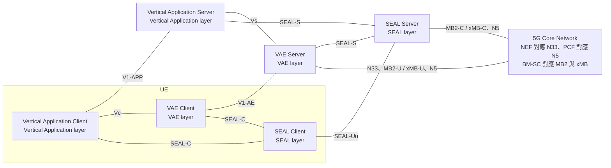
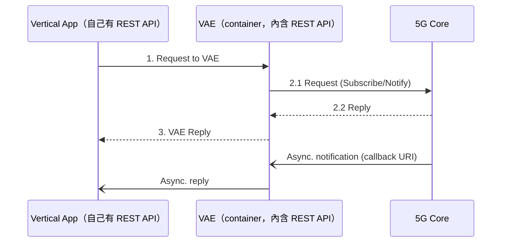

# VAE 的 cloud native 實作方案（Fragkos 等，2021）

| 項目 | 內容 |
| --- | --- |
| 標題 | 5G Vertical Application Enablers Implementation Challenges and Perspectives |
| 作者與單位 | Dimitrios Fragkos、George Makropoulos、Panteleimon Sarantos、Harilaos Koumaras（Institute of Informatics and telecommunications, NCSR Demokritos, Athens, Greece）；Anastasios-Stavros Charismiadis、Dimitris Tsolkas（Fogus Innovations & Services P.C., Athens, Greece） |
| 出處 | 2021 IEEE International Mediterranean Conference on Communications and Networking (MeditCom)，pp. 117-122，2021 |
| DOI 或連結 | DOI 10.1109/MeditCom49071.2021.9647460（印在 PDF 首頁側邊） |
| 本次閱讀的版本 | 出版社正式版（IEEE Xplore），共 6 頁，本地檔案 `local-references/papers/seal-application-enablement/fragkos2021.pdf` |
| 類型 | 架構提案。前半是規格整理，後半是三種部署形式的定性比較；沒有實作與量測 |

## 一分鐘版本

這篇論文問的是：位在產業應用與 5G 核心網路之間的應用使能層軟體，應該用哪一種 cloud native 形式來部署。它先用約兩頁半整理 CAPIF、SEAL 與 VAE 層的規格內容，再用不到兩頁提出三種部署形式（container、FaaS、container 加 message bus），最後用一張星等表做定性比較，結論是單純的 container 最合適（76%，16/21）。全文沒有實作、原型或任何量測數字，星等也沒有說明如何給定。論文把 VAE 當成泛稱的 Vertical Application Enabler，這與 3GPP 把 VAE 專指 V2X Application Enabler 的用法不同。對你有用的地方有兩個：圖 2 把垂直應用、VAE、SEAL 與核心網路畫成三層，補上 SEAL 四方塊圖沒有畫出的中間那一層；圖 3 到圖 5 點出一件實作上的事實，只要向核心網路訂閱事件，自己就必須有一個收 callback 的 HTTP 端點。論文沒有提到 NWDAF。

## 1. 要解決的問題

論文的出發點是 5G 核心網路以標準 API 對第三方開放能力，第三方可以取得網路統計資料，也可以向網路下達政策與命令（§I）。3GPP 為此定義了 CAPIF 與 SEAL，垂直應用的開發者則經由 NEF 使用這些服務（摘要）。

論文認為，隨著更多第三方加入，垂直應用必須 scalable、robust、more secure，而 cloud native 做法是滿足這些需求的關鍵（摘要）。它要回答兩件事（摘要、§I 末段）：

- 5G 架構如何支援 Vertical Application Enablers（§II）。
- VAE 可以用哪些 cloud native 形式實作，哪一種最合適（§III、§IV）。

標題有「Implementation Challenges」，但全文沒有專門列出挑戰的章節；「challenge」一詞只出現在標題。論文談到的實作難處散在 §III 與 §IV 的敘述中，本文件整理在第 3.4 節。

## 2. 需要的背景

以下是論文 §II 對三個概念的整理。你已有的 SEAL 解讀文件比這一節完整，這裡只記錄論文怎麼說，以及它和本地規格不一致的地方。

### 2.1. CAPIF

CAPIF（Common API Framework，TS 23.222）是 3GPP 為北向 API 定義的共用框架。論文說它在 Release 15 引入，目的是把認證、服務發現、計費政策等共用能力標準化（§II-A-1）。

論文列出的功能實體（§II-A-1、圖 1）：

| 實體 | 論文的說明 |
| --- | --- |
| CAPIF Core Function（CCF） | 管理服務消費者（垂直應用）與服務提供者（例如 NEF、SEAL）之間的互動；認證與授權 API invoker，監看 API 呼叫 |
| API Invoker | 代表使用 service API 的垂直應用 |
| API Exposing Function（AEF） | 提供 service API 的進入點，驗證 invoker 的授權，可記錄呼叫 |
| API Publishing Function（APF） | 把 service API 發布到 CCF |
| API Management Function（AMF） | 管理功能，例如稽核呼叫紀錄、登錄 invoker、監看 API 狀態。這個縮寫與 5GC 的 AMF 無關 |

圖 1 把 API Invoker 1 畫在 3rd Party Trust Domain，經 CAPIF-1e、CAPIF-2e 連入；API Invoker 2 在 PLMN Trust Domain 內，走 CAPIF-1、CAPIF-2。CCF 與 AEF、APF、AMF 之間是 CAPIF-3、CAPIF-4、CAPIF-5。圖中在 AEF 旁以雲狀標出「NEF, SEAL」，表示這兩者是 service API 的提供方。論文另外說明：與 PLMN 有商業關係的第三方可以經 CAPIF-3e、4e、5e 把自己的 service API 提供給 CCF，但必須具備 API provider domain 的功能；NEF 與 SEAL server 支援 CAPIF 的 API provider domain 功能（§II-A-1）。

論文把 CAPIF 的服務分成四類（§II-A-2）：

| 類別 | 服務 | 論文寫的 API 名稱 |
| --- | --- | --- |
| Common | Discover | `CAPIF_Discover_Service_API` |
| | Publish/Unpublish/Update、Retrieve | `CAPIF_Publish_Service_API` |
| Management | Logging | `CAPIF_Logging_API_Invocation` |
| | Auditing | `CAPIF_Auditing` |
| | Charging | 沒有寫 API 名稱 |
| | Monitoring events | `CAPIF_Monitoring` |
| Security | Authentication、Authorization | `CAPIF_Security`、`AEF_Security_API` |
| | Access control policy | `CAPIF_Access_Control_Policy` |
| | Registration of provider domain | 沒有寫 API 名稱 |
| | On/off boarding | `CAPIF_API_invoker_management` |
| Internal connectivity | CCF interconnection | `CAPIF_Discover_Service_API`、`CAPIF_Publish_Service_API` |
| | Topology hiding | `CAPIF_Routing_Info` |

**解讀：** 對照本地 TS 23.222 V20.1.0，這張清單有三處要小心。論文引用的是 V17.4.0，本地沒有那個版本，以下只代表與 Release 20 的差異。

- 論文說 AEF 用 Logging 服務「存取 CCF 中的 log」。Release 20 §10.8 的定義是 AEF 把呼叫紀錄寫入 CCF（`Log_API_Invocation`）；讀取紀錄是 API management function 經 `CAPIF_Auditing` 做的事（§10.9）。
- 論文說 AEF 用 Charging 服務向 CCF 取得計費資訊。Release 20 §8.20 只寫計費架構與流程定義在 TS 32.254，沒有對應的 CAPIF API。
- Release 20 表 10.1-1 共有 14 支 CCF API。論文沒有列的有 `CAPIF_Open_Discover_Service_API`、`CAPIF_Events`、`CAPIF_API_Invocation_Error_Reporting`、`CAPIF_AEF_Exposure_Policy`；論文描述但沒有命名的「Registration of provider domain」對應 `CAPIF_API_provider_management`。

### 2.2. SEAL

SEAL（Service Enabler Architecture Layer for Verticals，TS 23.434）是多種產業應用共用的一組支援服務。論文說它在 Release 16 引入，並以符合 CAPIF 的北向 API 提供服務（§II-B-1）。論文只討論 on-network 模型（經 SEAL-Uu），不討論 UE 之間直接互連的 off-network 模型（SEAL-PC5）。

論文列出四個實體：VAL client、VAL server、SEAL client、SEAL server（§II-B-1）。VAL 是 Vertical Application Layer，指產業應用本身。論文寫 SEAL server 可以作為 CAPIF 的 API exposing function；對 VAL server 的描述則是「支援 CAPIF 時，VAL server 作為 AEF，把 service API 提供給 Vertical Application Server（VAS）或另一個 VAE server；它也可以作為 API Invoker，使用另一個 VAL server 提供的 service API」。

論文列出六項 SEAL 服務：Location Management、Group Management、Configuration Management、Identity Management、Key Management、Network Resource Management（§II-B-2）。SEAL server 的部署位置有四種寫法：單一 PLMN 營運者網域、多個 PLMN 營運者網域（互連或不互連）、VAL service provider 網域、獨立的 SEAL provider 網域（§II-B-1）。

### 2.3. VAE 層

論文把 VAE 層定義為 SEAL 與特定垂直應用層之間的支援層。它使用 SEAL 與 NEF 的 API，把底層網路的資料轉成該垂直應用專用的形式（§II-C）。細節見第 3.1 與 3.2 節。

## 3. 方法與架構

### 3.1. 論文怎麼定義 VAE

論文把 VAE 展開為 Vertical Application Enablers，當成各產業通用的概念：

- §I：3GPP 在 Release 16 引入 VAE 的概念；VAE 的重點是提供 message distribution、service continuity、application resource management、dynamic group management、vertical app server API 等能力，出處是參考文獻 [1]。
- §II-C：VAE 層是 SEAL 與「特定垂直應用層（例如 V2X application client and server）」之間的支援層。3GPP 已為 V2X 服務制定 VAE 架構 [1]；Factories of the Future 與 Unmanned Aerial Systems 的工作正在進行，分別在 TR 23.745 與 TS 23.255。
- 摘要：VAE 是「目前在 3GPP Release 17 研究中」的對象。

參考文獻 [1] 是 TS 23.286，標題為「Application layer support for Vehicle-to-Everything (V2X) services」。也就是說，論文用來定義通用 VAE 的能力清單，來源是 V2X 的規格。圖 2 沒有標出處；從正文的 V2X 例子與圖上的參考點名稱看，應該也出自同一份規格，但本地沒有 TS 23.286，未查證。

**解讀：** 這個用法與 3GPP 不同，引用時要分清楚。

- 3GPP 的 VAE 是 V2X Application Enabler，專指 V2X。論文自己的參考文獻 [7]（Shah 等，2020，本地有全文）在 §III 就寫「The V2X Application Enabler (VAE) layer」。你既有的《2026-10-01 會議議題與後續探索》第 1 節也依 TS 23.286 V18.7.0 §6.2 記錄了同一個展開方式。
- 論文全文沒有出現 UAE、FAE 這些各產業 enabler 的縮寫，也沒有出現「V2X Application Enabler」這個寫法。它把 V2X、工廠、無人機的 enabler 都稱為 VAE。
- 通用的概念在規格中是有的，但沒有縮寫。本地 TS 23.434 V20.1.0 §6.2 NOTE 3 寫的是小寫的「vertical application enabler layer functionalities (specified by 3GPP)」，並說明它屬於 vertical application layer、不在該規格範圍內。
- 所以本文件之後寫「VAE」時，指的是論文的泛稱。要談 3GPP 的規格時，應該寫 V2X 的 VAE（TS 23.286）或 UAS 的 UAE（TS 23.255）。

### 3.2. 層次關係

依論文圖 2（VAE-SEAL Functional Model）重繪。各方塊所屬的層寫在方塊內；核心網路方塊內的對應關係來自原圖上方的圖例「5GC Reference Points」。

圖 2 的重點有三個：

- 中間多了一層。Vertical Application Server 可以經 Vs 使用 VAE Server，也可以經 SEAL-S 直接使用 SEAL Server；VAE Server 自己也經 SEAL-S 使用 SEAL Server。終端側相同，Vertical Application Client 與 VAE Client 各有一條 SEAL-C 連到 SEAL Client。
- VAE Server 與 SEAL Server 各自有連到核心網路的線。VAE Server 有 N33（對 NEF）、N5（對 PCF）與 MB2-U、xMB-U；SEAL Server 有 N5 與 MB2-C、xMB-C。圖中 SEAL Server 沒有畫 N33。
- 圖 2 沒有畫 CAPIF。

CAPIF 的角色出現在圖 1 與 §II 的文字。論文沒有一張圖同時畫出 CAPIF 與 VAE，以下是依文字整理的對照：

| 實體 | 論文寫的 CAPIF 角色 | 出處 |
| --- | --- | --- |
| Vertical application specific server | API invoker（採用 CAPIF 時） | §II-C |
| VAL server | AEF；也可以是 API invoker | §II-B-1 |
| SEAL server | 可以作為 API exposing function | §II-B-1 |
| NEF、SEAL server | 支援 API provider domain 的功能 | §II-A-1、圖 1 |
| CCF | 管理 invoker 與提供者之間的互動。論文另寫 CAPIF 位於 PLMN 營運者網路內 | §II-A-1 |

論文對 VAE Server 的功能描述是：與底層網路通訊、提供服務發現、支援資源調整等（§II-C）。VAE Server 的部署依 [1] 有集中式（一個 VAE server 支援一個或多個 vertical application specific server）與分散式（一個或多個 VAE server 支援一個 vertical application specific server，彼此可互連或不互連），位置可以在 PLMN 營運者網域或 vertical service provider 網域（§II-C）。

**未能確認：** §II-C 寫「VAE Client 與 VAE Server 分別和 VAL Client (SEAL)、VAL Server (SEAL) 是 mutually-exclusive」。這句話的字面意思是兩者互斥，論文沒有解釋。Shah 等（2020）§III 的寫法，意思是 VAE client 在與 SEAL client 互動時擔任 VAL client，VAE server 在與 SEAL server 互動時擔任 VAL server。我們推測論文想表達的是同一件事，也就是從 SEAL 看，VAE 就坐在 VAL 的位置上，但無法從論文文字確定。

**未能確認：** §II-B-1 說 VAL server 作為 AEF。本地 TS 23.434 V20.1.0 §6.4.2.3 只寫 VAL server 是 API invoker。論文這句同時提到「另一個 VAE server」，可能是把 TS 23.286 對 VAE server 的描述寫進了 VAL server 的條目。本地沒有 TS 23.286，無法確認。

### 3.3. 三種 cloud native 部署形式

§III 假設 VAE 以可以獨立運作的 microservice 建構，提出三種部署形式。三張圖（圖 3、4、5）的角色都只有三個：Vertical App、VAE、5G Core。圖中沒有 NEF、CAPIF 或 SEAL 的方塊。

以 container 形式（圖 3）為例，訊息順序如下：

依論文圖 3 重繪。圖 4 與圖 5 的同步、非同步兩條路徑相同，差別在 Vertical App 與 VAE 之間的那一段。

| 項目 | Container-based（§III-A、圖 3） | FaaS（§III-B、圖 4） | Container 加 Message Bus（§III-C、圖 5） |
| --- | --- | --- | --- |
| 論文說的適用情況 | VAE 使用多個 process | VAE 作為 micro service | VAE 作為 micro-services，並在 VAE 與垂直應用之間加一個通訊框架 |
| Vertical App 如何呼叫 VAE | VAE 內建的 REST API | FaaS 平台的 REST API 端點；VAE 不能有內建的 API backend。平台把參數轉給 VAE，再把輸出轉回 | 兩邊各有 MQ client，經 MQTT broker 以 publish/subscribe 交換訊息 |
| 5G Core 的非同步通知進到哪裡 | VAE 內建的 REST API | VAE 在 FaaS 平台的 API 上動態設定的端點 | VAE 仍然需要一個 REST API backend |
| 狀態與附屬元件 | 可以把 database 等次要應用一起納入 | 可選用 database 來支援 stateful 做法 | 可以加入 database 等服務 |
| 論文說的優點 | 相依套件都打包進 image，簡單有效；元件相依可以隔離；需要的程式技能較少（§IV-A-1） | 水平擴展自動且獨立；可依請求數量動態增減 replica；有效利用系統資源（§III-B、§IV-A-2） | 前端介面簡化；非同步通訊改善資料流與效能；queue 降低元件相依，程式較簡單（§IV-A-3） |
| 論文說的缺點 | container 平台帶來明顯的效能 overhead；擴展時 VAE 與 database 都要能水平擴展，可能還要加 load balancer（§IV-A-1） | 要依平台的方式開發，有學習曲線；管理取決於平台的成熟度；底層是 container 平台，同樣有 overhead；cold start 影響延遲敏感的應用；可能造成 technology lock-in（§IV-A-2、§IV-B） | 論文沒有寫缺點 |

名詞說明：FaaS（Function as a Service）是把程式以函式為單位交給平台執行、由平台負責啟動與擴展的 serverless 做法；cold start 指函式久未被呼叫後第一次啟動的額外延遲。MQTT（Message Queuing Telemetry Transport）是輕量的 publish/subscribe 訊息協定，由 broker 居中轉送。

圖 4 的平台方塊上標著「OpenFaaS」（一個開源的 FaaS 平台），但正文沒有提到這個名稱，只在 §IV-A-2 提到 Docker Engine。

### 3.4. 論文提到的實作難處

以下各項的內容都是論文寫的；把它們歸成一張清單是我們做的。每一項的依據都是文字論述，沒有數據。唯一的外部引用是 FaaS 的參考文獻 [8]。

| # | 難處 | 論文怎麼說 | 出處 |
| --- | --- | --- | --- |
| 1 | 要接收 5G Core 的非同步通知，就必須有一個 REST 端點 | container 形式「必須」實作收 callback 的 REST API；FaaS 不能內建 API backend，只能用平台的端點；加了 message bus 之後，面向 5G Core 的 REST API backend 仍然需要 | §III-A、§III-B、§III-C，圖 3 到圖 5 的「Async. notification (callback URI)」 |
| 2 | 擴展牽涉 VAE 以外的元件 | VAE 與 database 等附屬應用都要符合水平擴展；可能要額外的 load balancer，影響管理與效能 | §IV-A-1 |
| 3 | 平台本身的效能成本 | container 平台有明顯的 overhead，但論文認為相對於管理上的好處可以接受；FaaS 底層使用 container 平台，同樣因 Docker Engine 而有 overhead | §IV-A-1、§IV-A-2 |
| 4 | FaaS 的 cold start | 多數 FaaS 實作有 cold start 問題，影響延遲敏感的應用 | §IV-A-2 |
| 5 | 對平台的依賴 | FaaS 有學習曲線；管理取決於平台的成熟度與抽象程度；production 環境建議選社群廣泛支持的平台；平台若停止發展會造成 lock-in | §IV-A-2、§IV-B |
| 6 | 元件之間的耦合 | publish/subscribe 是傳統 client-server 端點模式之外的另一種做法；queue 可以降低元件之間的相依 | §III-C、§IV-A-3 |
| 7 | 技術成熟度 | 在營運者的 5G 網路這類 production 環境中，技術成熟度很重要 | §IV-B |

## 4. 實驗與結果

**沒有實驗。** 全文沒有實作、原型、測試平台或任何量測數字。論文支持結論的方式是 §IV-A 的三段文字評估，以及 §IV-B 的表 I。

表 I 用一到三顆星為三種形式在七項指標上評分（§IV-B）。論文沒有說明星等的給定標準，也沒有說明各指標是否等權重；SCORE 列的算法從數字看是星數相加除以 21。

| Criterion/KPI | Isolated Container | Container with FaaS platform | Containers with Message Bus |
| --- | --- | --- | --- |
| Vertical Scaling | 1 | 3 | 2 |
| Horizontal Scaling | 3 | 2 | 2 |
| Technology Maturity | 3 | 1 | 2 |
| Orchestration Options | 3 | 1 | 2 |
| Code management | 3 | 2 | 2 |
| Performance | 1 | 2 | 2 |
| Data and control decoupling | 2 | 2 | 3 |
| SCORE | 76% (16/21) | 62% (13/21) | 71% (15/21) |

表中數字是原表的星數。

論文的結論（§IV-B）：

- 三種形式都得到令人滿意的分數。
- Isolated container 最合適，理由是簡單，因此在程式管理、擴展與 orchestration 上都容易；技術成熟度對營運者的 production 環境也重要。
- 加上 Message Bus 也是很好的選擇，理由是它把 control plane 與 data plane 解耦，可以在訊息管理與函式執行上套用政策與優先順序。
- FaaS 排最後，理由是它引入額外的複雜度，影響效能、擴展與 orchestration，還可能造成 lock-in。

§V 只有一段，重述論文做了什麼，沒有新的內容。

## 5. 限制

### 5.1. 文獻自己承認的

論文幾乎沒有討論自己的限制。可以算得上的只有三處：

- 比較是定性的（qualitative），這是 §IV 的標題與用詞。
- SEAL 只討論 on-network 模型，理由是簡化（§II-B-1）。
- CAPIF 服務的說明假設 AEF、APF、AMF 與 API invoker 都已經通過 CCF 的授權（§II-A-2）。

§I 末段預告 §V 會提出 future work，但 §V 沒有任何 future work 的內容。

### 5.2. 我們看到的

- **沒有任何驗證。** 表 I 的星等沒有定義、沒有來源，也沒有說明誰評的。76%、62%、71% 只是星數的比例，不是量測結果。
- **正文與表 I 互相矛盾。** 第一，§III-B 與 §IV-A-2 說 FaaS 的水平擴展自動又直接，§IV-A-1 說 container 的水平擴展需要連 database 一起處理、可能還要 load balancer；表 I 卻給 container 三顆星、FaaS 兩顆星。第二，正文說 FaaS 底層也是 container 平台、同樣有 overhead，另外還有 cold start；表 I 的 Performance 卻是 FaaS 兩顆星、container 一顆星，而 §IV-B 的結論又說 FaaS 的複雜度影響效能。第三，Vertical Scaling 在表中是 container 一顆星、FaaS 三顆星，但正文完全沒有討論垂直擴展。
- **指標前後不一致。** §IV 開頭說指標是 coding 效率、scalability、agility、communication and function decoupling；表 I 用的是另外七項，其中 Technology Maturity 與 Orchestration Options 在 §IV-A 的三段評估中只有零星提到，沒有對三種形式逐一說明。
- **§II 與 §III 沒有接起來。** §II 花了兩頁半介紹 CAPIF 與 SEAL，但圖 3 到圖 5 的 VAE 直接對「5G Core」，沒有 NEF、CAPIF、SEAL。三種形式下如何完成 CAPIF 的 onboarding、發現、發布與授權，VAE 如何使用 SEAL server，論文都沒有說。§III 實際討論的是「一個向核心網路訂閱事件、再轉給應用的中介軟體該怎麼包裝」，這與 VAE 的規格內容關係不大。
- **Message Bus 與 CAPIF 的關係沒有處理。** §II 說 SEAL 的 API 是符合 CAPIF 的北向 API，§III-C 卻提議垂直應用與 VAE 之間改用 MQTT。這條路徑如何套用 CAPIF 的認證與授權，論文沒有討論。
- **摘要提出的需求沒有全部評估。** 摘要說垂直應用要 scalable、robust、more secure。表 I 沒有任何安全性或可靠性的指標。
- **只談伺服器端。** VAE client 與 SEAL client 在終端上如何實作，論文沒有討論。
- **三種形式不是互斥的選項。** FaaS 的底層是 container（§IV-A-2 自己這樣寫），Message Bus 是 container 再加一個 broker。把它們當成三選一來評分，實際上是在比較要不要多加一層平台或 broker。
- **對規格的描述有幾處不精確。** 摘要把 SEAL 寫成「Service Enabler Layer Architecture」，§II 才是正確的 Service Enabler Architecture Layer；VAL server 作為 AEF 的說法與 mutually-exclusive 的說法見第 3.2 節；CAPIF Logging 與 Charging 的說法見第 2.1 節。
- **標題與內容有落差。** 標題的 Implementation Challenges 沒有對應的章節，也沒有任何來自實際開發經驗的觀察。

## 6. 與 SEAL 的關係

SEAL 是論文 §II-B 的主題，篇幅約四分之三頁，加上圖 2。內容是 TS 23.434 V17.1.0（參考文獻 [5]）與 Shah 等 2020（參考文獻 [7]）的摘要：兩種功能模型、四個實體、四種部署位置、六項服務。論文對 SEAL 沒有提出新的設計，也沒有實作任何 SEAL 服務。§III 的三種部署形式談的是 VAE，沒有說 SEAL server 是否也適用。

**解讀：** 把論文的描述與本地 Release 20 對照，可以看出哪些部分後來有了更多規格。本地沒有論文引用的 V17.1.0，所以下表只說明 Release 20 的現況，不判斷差異是在哪一版出現的。

| 論文的描述（2021） | 本地 Release 20 的現況 | 依據 |
| --- | --- | --- |
| 六項 SEAL 服務 | TS 23.434 內完整定義的有七項，多了通知管理；另有 NSCE、SEALDD、ADAE、AIMLE、空間錨點、空間地圖、Digital Asset 定義在其他規格 | TS 23.434 第 16 到 24 章，見《Release 20 SEAL 01》第 6 節 |
| SEAL server 四種部署位置 | 內容一致。Release 20 §8.2 分成三個小節，論文的前兩種都屬於 §8.2.1 | TS 23.434 §8.2 |
| 圖 2 的 SEAL Server 以 N5 與 MB2-C、xMB-C 連到核心網路 | 網路資源管理 server 另外使用 N33（NEF）、Rx、T8、Nmb13、Nmb10；位置管理 server 使用 T8、N33、Le | TS 23.434 §14.2、§9.2 |
| Network Resource Management 管理 unicast 與 multicast bearer | 範圍擴大為 unicast 與 multicast 網路資源加上監測能力，並包含擔任 TSN AF | TS 23.434 §14.1、§14.2 |
| VAE 層介於 SEAL 與特定垂直應用之間 | 以 NOTE 承認這一層存在，但明寫不在 TS 23.434 的範圍 | TS 23.434 §6.2 NOTE 3 |
| VAL server 作為 AEF，也可以是 API invoker | 只寫 VAL server 是 API invoker | TS 23.434 §6.4.2.3 |
| CAPIF 的服務清單 | 多出 open discover、錯誤回報、AEF exposure policy 等 API；另有 CAPIF-6、CAPIF-7、CAPIF-8 與 resource owner 相關程序 | TS 23.222 表 10.1-1、§8.31 到 §8.42 |
| container、FaaS、message bus 三種部署形式 | 兩份規格都不處理軟體的包裝形式。以 container、cloud native、microservice、serverless、message bus、MQTT 搜尋 TS 23.434 與 TS 23.222 都沒有結果 | 全文搜尋 |

**解讀：** 圖 2 的圖例把 BM-SC 與 MB2、xMB 列在「5GC Reference Points」之下。依 TS 23.434 V20.1.0 §14.2，MB2-C 與 xMB-C 是面向 LTE eMBMS 的 BM-SC 的參考點，面向 5GS 的是 Nmb13、Nmb10 或 N33。圖 2 把 EPS 的介面畫在 5G Core Network 上，讀圖時要留意。

**解讀：** 論文與 Release 20 最大的距離在最後一列。論文的「實作」談的是軟體如何包裝與部署，這不是 3GPP Stage 2 的範圍，所以 Release 20 仍然沒有對應的內容。與擴展最接近的規格文字是 TS 23.222 Annex H（informative）：API management function 監看 CCF 回報的事件，可以用來觸發管理系統新增 AEF 的 instance。

## 7. 與 NWDAF 的關係

論文沒有提到 NWDAF，全文搜尋 NWDAF 與 analytics 都沒有結果。與資料相關的字句只有兩處，都在 §I：第三方可以向 5GC「retrieving network statistics」；NEF 讓網路資源安全地對第三方開放，例子包含 network slicing、edge computing、machine learning。論文沒有說這些統計資料來自哪個 NF，也沒有提到 federated learning。

**解讀：** 論文與 NWDAF 的接點是間接的，有三個。

- **訊息模式相同。** 圖 3 的「2.1 Request (Subscribe/Notify)」加上「Async. notification (callback URI)」，就是 AF 訂閱 NWDAF 分析的模式。依 TS 23.288 V20.2.0 §6.1.1.2，AF 經 NEF 訂閱分析時使用 `Nnef_AnalyticsExposure_Subscribe`，結果以 `Nnef_AnalyticsExposure_Notify` 送回。第 3.4 節第 1 項因此直接適用：任何要長期接收 NWDAF 分析的應用側元件，不管是 AF、SEAL server 還是 ADAE server，都必須有一個常駐的通知端點。
- **圖 2 上的位置。** 若把 NWDAF 的分析放進圖 2，它會經由 VAE Server 的 N33 那條線進來（經 NEF）。論文沒有說 N33 上取得的是什麼資料。
- **CAPIF 這一側後來有了分析功能，但走的是 ADAE。** TS 23.222 V20.1.0 §8.41 說 CCF 可以實作 ADAE server 的 service API analytics；TS 23.436 V20.2.0 §8.6 的程序是 ADAE server 以 API management function 的身分，經 `CAPIF_Auditing` 向 CCF 取得 API 呼叫紀錄來產生分析。ADAE（Application Data Analytics Enablement）是 SEAL 的應用層資料分析服務。§8.6 的程序沒有出現 NWDAF。

## 8. 對你的研究可以怎麼用

以下全部是解讀。

**可以拿來當什麼**

- **引用來源，但要選對用途。** 適合用來支持「應用使能層的軟體部署形式有 container、FaaS、message bus 幾種選擇，文獻有定性的比較」這類背景敘述。不適合用來支持任何效能或擴展性的主張，因為它沒有數據，而且正文與表 I 互相矛盾（第 5.2 節）。
- **圖 2 可以當作說明「SEAL 之上還有一層」的圖。** 引用時建議註明：圖中的 VAE 是論文的泛稱，參考點名稱應該出自 V2X 的規格（TS 23.286，本地沒有，未查證）。
- **第 3.4 節第 1 項是實驗設計上的提醒。** 你在 free5GC 上寫測試用的 AF 或應用側元件去訂閱 NWDAF 時，需要先決定通知端點放在哪裡。論文的三種形式給了三個選項：元件自己帶 HTTP server、由平台代收、或者收進來後轉到 message bus 再分送。
- **可重用的程式或資料：** 沒有。論文沒有提供程式碼、資料集或設定檔。
- **與 federated learning 的關係：** 沒有。
- **待填補的缺口：** 論文留下的空白是「這三種形式實際量起來差多少」。這是軟體工程的題目，與 NWDAF 的研究距離遠，我們不認為值得你去補。

**與 EVOLVED-5G、NetApp 的關係**

論文只在 Acknowledgment 寫到經費來自 H2020/5G-PPP 的 EVOLVED-5G（Grant Agreement no. 101016608）與 5G!Drones（Grant Agreement no. 857031）。正文沒有出現 NetApp 或 Network App 這個詞，也沒有說明論文與這兩個計畫的工作項目有什麼對應。任務背景提到這個作者群後來做了 CAPIF 的開源實作與 NEF 模擬器；這些都不在論文內，本次也沒有查證。

**對兩份 SEAL 解讀文件的建議**

以下只是建議，沒有修改任何檔案。

| 解讀文件的位置 | 論文能補充或有出入的地方 | 建議 |
| --- | --- | --- |
| 《Release 20 SEAL 04》第 2 節的角色對照表 | 有出入。論文說 VAL server 作為 AEF，解讀文件依 §6.4.2.3 寫 VAL server 是 API invoker | 不需要改。Release 20 的條文支持解讀文件。若日後看到其他論文重複「VAL server 是 AEF」的說法（《01 Charpentier 2024》也有），可以在這一節加一句說明這個說法在文獻中流傳，但與 TS 23.434 不符 |
| 《Release 20 SEAL 04》第 3.1 節「SEAL server 可以同時擔任兩種 CAPIF 角色」 | 可補充。圖 2 顯示中間還有一層：產業 enabler 的 server 對應用後端提供 API，對 SEAL server 是呼叫方，自己也直接接 N33 與 N5 | 可以加一段說明 TS 23.434 §6.2 NOTE 3：VAL 這個方塊內部可以再分成 3GPP 定義的 enabler 層與應用專用的部分。enabler 層 server 的 CAPIF 角色要查 TS 23.286，本地沒有 |
| 《Release 20 SEAL 04》第 3.2 節「NEF 是否會把 API 發布到 CAPIF」 | 有出入，但解讀文件較精確。論文把「NEF 與 SEAL server 支援 API provider domain 功能」寫成既定事實；解讀文件指出 TS 23.501 的用詞是 `may be supported` | 不需要改 |
| 《Release 20 SEAL 04》第 3 節以參考點分組的表 | 可補充。論文 §II-A-2 改用服務類別（common、management、security、internal connectivity）整理 CAPIF 的 API | 若要加一張「依功能查 API」的索引，分類方式可以參考論文，但 API 名稱與消費者要以 TS 23.222 表 10.1-1 為準，不要照抄論文（第 2.1 節列了三處差異） |
| 《Release 20 SEAL 04》第 5 節的 API 例子 | 可補充。論文圖 3 顯示訂閱類的 API 需要兩邊都有 HTTP server：提供方收訂閱，呼叫方收通知 | 可以在位置訂閱的例子旁加一句：VAL server 要提供通知用的端點，這是實作時最容易漏掉的部分 |
| 《Release 20 SEAL 04》第 4 節「CAPIF 是否必須」 | 有關聯。論文 §III-C 提議應用與 enabler 之間改用 MQTT，沒有處理 CAPIF 的要求 | 可以當成一個例子：實作者傾向自選傳輸方式，與 §4.1.2-e 的 `shall conform to CAPIF` 有張力。這是我們的觀察，論文沒有這樣寫 |
| 《Release 20 SEAL 04》第 7.1 節「SEAL-C 只有名稱」 | 沒有補充。圖 2 畫了兩條 SEAL-C，但論文沒有討論終端側的任何實作 | 無 |
| 《Release 20 SEAL 05》第 2 節「SEAL server 放在哪裡」 | 一致，並可補充。論文另外轉述了 enabler 層 server 的部署方式：集中式與分散式，位置在營運者網域或 vertical service provider 網域 | 若要延伸到產業 enabler 的部署，可以把這段當線索，內容要回 TS 23.286 查證 |
| 《Release 20 SEAL 05》第 4 節「部署位置與信任域」 | 可補充。這一節目前只談南向（直接或經 NEF）。論文圖 1 與 §II-A-1 談的是北向：提供方在第三方信任域時，經 CAPIF-3e、4e、5e 連到營運者的 CCF | 可以加一列說明 SEAL server 在第三方信任域時，北向對 CCF 走帶 `e` 的參考點，並連到《Release 20 SEAL 04》第 3 節的表。同一節已提醒部署網域不等於信任域，這裡同樣適用 |
| 《Release 20 SEAL 05》整體 | 可補充。這一篇的「部署」指的是網域。論文的「部署」指的是軟體的包裝形式，兩者是不同層次 | 若將來要寫實作筆記，可以明確區分這兩種「部署」，並引用這篇作為軟體形式的討論來源，同時註明它只有定性比較 |

## 9. 值得追的參考文獻

論文只有八筆參考文獻，以下四筆值得追。

- [7] S. P. Shah, B. J. Pattan, N. Gupta, N. D. Tangudu and S. Chitturi, "Service Enabler Layer for 5G Verticals," 2020 IEEE 3rd 5G World Forum (5GWF), Bangalore, India, 2020, pp. 269-274, doi: 10.1109/5GWF49715.2020.9221425。Samsung 的作者群寫的 SEAL 介紹，§III 以 V2X 為例說明 enabler 層如何使用 SEAL 的各項服務，比本篇的 §II-B 具體。本地有全文 `shah2020.pdf`。
- [2] N. D. Tangudu, N. Gupta, S. P. Shah, B. J. Pattan and S. Chitturi, "Common Framework for 5G Northbound APIs," 2020 IEEE 3rd 5G World Forum (5GWF), Bangalore, India, 2020, pp. 275-280, doi: 10.1109/5GWF49715.2020.9221161。與 [7] 同一作者群寫的 CAPIF 介紹，本篇在 §II-A-1 說明 CAPIF 的由來時引用它。
- [1] 3GPP TS 23.286, "Application layer support for Vehicle-to-Everything (V2X) services", Release 17, V17.1.0, April 2021。VAE 能力清單的來源，圖 2 應該也出自這裡。要確認第 3.2 節兩個「未能確認」的項目必須查這份規格。
- [8] E. V. Eyk, A. Iosup, S. Seif and M. Thömmes, "The SPEC cloud group's research vision on FaaS and serverless architectures", Proceedings of the 2nd International Workshop on Serverless Computing (WoSC '17), New York, USA, December 2017, pp. 1-4, doi: 10.1145/3154847.31548。FaaS 一節唯一的外部引用。論文印出的 DOI 看起來不完整，使用前要另外查。

[3] TS 23.222 V17.4.0 與 [5] TS 23.434 V17.1.0 不需要另外找，本地已有 Release 20 的版本。

## 10. 閱讀建議

全文 6 頁，15 到 20 分鐘可以讀完。我們的建議是選讀，而且只讀後半。

- 必看：圖 2（三層的功能模型）、§II-C（VAE 層的定義）、§III 連同圖 3 到圖 5、表 I。
- 可以略過：§I 前半關於智慧型手機與 app store 的鋪陳；§II-A-2 的 CAPIF 服務清單（TS 23.222 表 10.1-1 與《Release 20 SEAL 04》更準確）；§II-B（你的 SEAL 解讀文件更完整）；§V。
- 讀 §IV 時請對照本文件第 5.2 節，留意正文與表 I 不一致的地方。

## 查證紀錄

**逐項核對過的內容**

- 以 `pdftotext -layout` 轉出全文並讀完；用 Read 工具看了 PDF 第 1 到 6 頁。五張圖都是點陣圖，文字無法擷取，另外把每張圖從 PDF 裁出放大，逐一確認方塊名稱、參考點標籤與箭頭方向。圖 4 的「OpenFaaS」與圖 2 的參考點名稱只存在於圖中。
- 表 I 的 21 個星等與三個 SCORE 逐格對照原表。重算：16/21 為 76.2%，13/21 為 61.9%，15/21 為 71.4%，與表中的 76%、62%、71% 一致；三欄的星數相加分別是 16、13、15。
- 作者、單位、會議名稱、頁碼 117 到 122、DOI、兩個 Grant Agreement 編號、八筆參考文獻的版本號與 DOI，都對照過原文。
- 以關鍵字搜尋確認：全文沒有 NWDAF、analytics、NetApp、Network App、UAE、FAE、prototype、testbed；EVOLVED 只出現在 Acknowledgment；challenge 只出現在標題；future work 只出現在 §I 的章節預告；vertical scaling 只出現在表 I。
- 第 5.2 節指出的矛盾，回頭對照了 §III-B、§IV-A-1、§IV-A-2、§IV-B 的原句與表 I。
- 規格查證使用本地 `specs/Rel-20/`：TS 23.222 V20.1.0 的 §3（縮寫）、§7.2 與 §7.3、§8.20、§8.41、表 10.1-1、§10.8、§10.9、表 11.1-1、Annex H；TS 23.434 V20.1.0 的 §6.2（含 NOTE 3）、§6.4.2.3、§6.4.2.5、§8.2、§9.2、§14.1、§14.2；TS 23.436 V20.2.0 的 §8.6；TS 23.288 V20.2.0 的 §6.1.1.2。
- 讀了論文的參考文獻 [7]（本地 `shah2020.pdf`）中關於 CAPIF 與 VAE 的段落，用來確認 VAE 的展開方式與「VAE server 擔任 VAL server」的說法。
- 讀了《Release 20 SEAL 01》《Release 20 SEAL 04》《Release 20 SEAL 05》全文，以及《Release 20 SEAL 03》與《2026-10-01 會議議題與後續探索》的相關段落。

**無法確認的內容**

- 本地沒有 TS 23.286、TS 23.255、TS 23.545 與 TR 23.745。圖 2 的參考點名稱（V1-APP、V1-AE、Vs、Vc）是否與 TS 23.286 一致、VAE server 的 CAPIF 角色、VAE server 的部署方式，都只依論文的轉述。
- 本地沒有論文引用的 TS 23.222 V17.4.0 與 TS 23.434 V17.1.0。第 2.1 節與第 6 節的對照只說明與 Release 20 的差異，無法判斷論文是否忠實反映當時的版本。
- 「mutually-exclusive」一句的原意、VAL server 作為 AEF 的說法從何而來，見第 3.2 節。
- 表 I 的星等由誰、依什麼標準給定，論文沒有說明。
- 參考文獻 [8] 的 DOI 是否完整，沒有上網查證。
- 作者群後來的 CAPIF 開源實作與 NEF 模擬器，以及 EVOLVED-5G 的 NetApp 概念，都不在論文內，本次沒有查證。

本次閱讀沒有發出任何網路請求。
