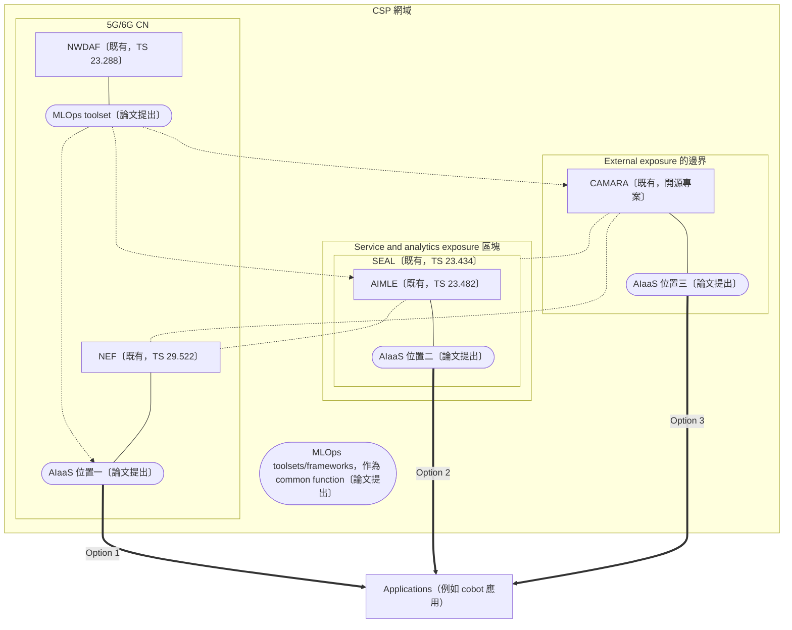
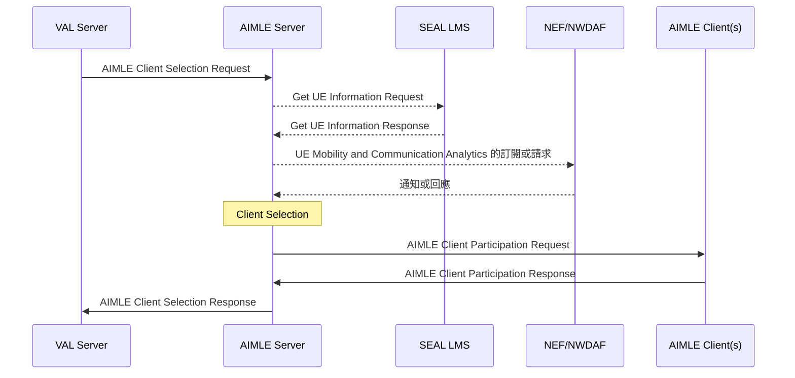

# AI as a Service：AIaaS 該從 NEF、SEAL 還是 CAMARA 開放（Saimler 等，2025）

| 項目 | 內容 |
| --- | --- |
| 標題 | AI as a Service: Exposing the Functionalities of AI-Native 6G Networks |
| 作者與單位 | Merve Saimler、Mustafa Riza Akdeniz、Sultan Ertas、Mehmet Yunus Donmez（Ericsson Research, Türkiye）；Dinand Roeland、Mirko D'Angelo、Jing Yue、Arif Ahmed（Ericsson Research, Sweden）；Ajay Kattepur（Ericsson Research India）；Mukesh Thakur、Igor Pastushok（Ericsson Research Finland）。共十一人，全部來自 Ericsson Research |
| 出處 | 2025 IEEE 36th Annual International Symposium on Personal, Indoor and Mobile Radio Communications (PIMRC)，Track 4: Emerging Technologies, Applications and Platforms。PDF 內頁沒有印頁碼 |
| DOI 或連結 | DOI 10.1109/PIMRC62392.2025.11275367 |
| 本次閱讀的版本 | 出版社正式版（IEEE Xplore），共 6 頁，本地檔案 `local-references/papers/seal-application-enablement/saimler2025.pdf` |
| 類型 | 架構提案。內容是概念層級的立場論文，沒有實作、模擬或量測 |

## 一分鐘版本

這篇論文問一個問題：電信商（論文稱 Communication Service Provider，CSP）若要把 AI 能力當成服務賣給外部應用，這組 API 應該放在 3GPP 架構的哪裡。論文把這種服務稱為 AI as a Service（AIaaS），提出三個放置位置：核心網路的 NEF、應用支援層的 SEAL（用其中的 AIMLE 服務）、以及開源的 CAMARA API，並以工廠協作機器人（cobot）為情境，逐一列出優點與缺點。全文沒有實作、沒有量測、沒有任何數字結果，三個選項的優缺點都是定性敘述，論文也沒有選出一個答案。對讀者的用處有兩點：它是少數把 AIMLE（TS 23.482）與 NWDAF 寫在同一段的學術論文，其中一張圖重畫了 AIMLE client selection 取用 NWDAF 分析的流程；它也明寫 NWDAF 未來可能成為 MLOps 框架的一部分並經 NEF 對外開放。這兩點可以當動機與相關工作引用，但不能當成技術依據。

## 1. 要解決的問題

論文的出發點是 AI-native 的 6G 網路會在各個網路功能內嵌 AI，CSP 因此有機會把這些 AI 能力經標準化 API 開放給外部應用（摘要、§I）。論文主張把 MLOps 當成服務提供，能讓 CSP 做出 over-the-top（OTT）業者難以複製的產品，特別是需要嚴格 QoS 保證與即時取得行動網路專屬資料的那一類（§I）。

要回答的具體問題寫在 §III-C：在 3GPP 標準化的行動網路功能架構中，AIaaS 到底應該放在哪裡。論文調查三個開放 AIaaS API 的選項，分別經 NEF、經 SEAL、經 CAMARA，並說明三者之間的關係，以及各自在 cobot 情境下的優缺點（§III-C）。

## 2. 需要的背景

### 2.1. 論文對 AI-native 的定義

AI-native 指網路具有內生的 AI 能力，AI 在設計、部署、運作與維護上都是功能的自然組成，而不是外加的輔助元件（§II，引用 Ericsson 白皮書 [2]）。論文列出 AI-native 架構的四個面向：intelligence everywhere、分散式資料基礎設施、zero-touch 管理能力，以及 AIaaS；AIaaS 是這篇論文的主題（§II）。

### 2.2. MLOps、MLOps-aaS、AIaaS 三層概念

MLOps（Machine Learning Operations）是管理模型從建立到監控整個生命週期的一套流程與工具。論文把三個概念寫成一層疊一層的關係：

| 概念 | 論文的說法 | 出處 |
| --- | --- | --- |
| MLOps | CSP 內部用的工具組，支援自動化的資料匯入、訓練與重新訓練、驗證、部署、監控。論文預期 RAN 與核心網路的生命週期需求相近，這些工具組會被標準化 | §II-A |
| MLOps-as-a-Service（MLOps-aaS） | 把 MLOps 工具組經標準化 API 開放給外部開發者，以 API 驅動的方式涵蓋資料匯入、模型選擇、訓練、調校、部署、監控。可以把運算服務與 network slice 結合來滿足延遲或頻寬需求 | §I、§II-B |
| AIaaS | 建立在 MLOps-aaS 之上，再加入管理應用專屬模型與資料存取的 API，提供的範圍更廣 | §I、§II-B |

### 2.3. 對外提供的「AI 能力」具體是什麼

論文沒有給一份正式的能力清單，下表是把散在各節的敘述依類別整理的結果。

| 類別 | 論文提到的內容 | 出處 |
| --- | --- | --- |
| 模型 | pre-trained models；為 cobot 服務準備的預訓練模型可以放在 CSP 網路內 | §I、§III-A、圖 2 |
| 訓練 | 把 AI 訓練交給網路執行；用網路資料加應用資料訓練應用自己的模型 | §III、§III-B |
| 推論 | 把推論交給網路執行；提供模型推論的 API | §III、§III-B |
| 模型生命週期管理 | 訓練、部署、監控的整套管理 | §II、§III-B |
| 資料 | configurable datasets；電信專屬資料，包含定位、訊號品質、流量統計與預測；mobility events、網路負載、效能、能耗 | §I、§III、§III-B |
| 運算資源與執行環境 | execution environment access；model execution environment；computational offloading | §II、§III-B、圖 2 |
| 演算法框架 | algorithmic frameworks | §I |
| 連線品質 | 以 QoS API 指定延遲等需求，可能觸發新 bearer 的建立或 RAN、核心網路資源的配置 | §III-A、§III-B |
| 感測 | integrated communication and sensing | §III-B |

### 2.4. 其他第一次出現的名詞

- **SEAL**：3GPP SA6 的 Service Enabler Architecture Layer for Verticals（TS 23.434），位在產業應用與 3GPP 網路之間的一組共用服務。
- **AIMLE**：AI/ML Enablement，SEAL 的一項服務（TS 23.482），協助應用層做 AI/ML，例如管理參與訓練的終端。
- **VAL**：Vertical Application Layer，指產業應用本身。VAL server 是應用的後端，VAL client 是終端上的應用；論文只在圖 5 用到 VAL Server 一詞。
- **CAMARA**：Linux Foundation 之下的開源專案，目標是把常見網路服務的對外開放方式標準化並使各家一致（§III-C-3）。
- **cobot**：interacting and collaborating robot，在工廠內彼此協作或與人協作的機器人（§III-A）。
- **Hexa-X 與 Hexa-X-II**：歐盟的 6G 旗艦研究計畫，論文的 cobot 情境取自它們的交付文件 [10]、[11]（§III-A）。
- **Hyperscale Cloud Provider（HCP）**：大型公有雲業者，論文舉 Amazon Web Services、Microsoft Azure、Google Cloud Platform（§III-A）。
- **TM Forum**：電信管理論壇，制定電信營運與管理用的 Open API（§III-C-3、§IV）。

## 3. 方法與架構

這篇論文沒有提出可實作的系統。它的「方法」是一張分層的網路架構圖，加上對三個放置位置的定性比較。

### 3.1. 分層架構（圖 1）

圖 1 把 CSP 網域由上而下畫成三個區塊：最上面是 Service and analytics exposure 與 End-to-end management；中間是網路本體，包含 6G UE、5G RAN、6G RAN、5G/6G CN 與其中的 NF；最下面是 common functions，包含 cloud infrastructure、transport、data infrastructure。區塊之間有三條虛線，分別標為 External exposure、Network management、Supporting functions。Applications 在 CSP 網域之上，Data networks 在右側的 Internet 網域。

圖中各區塊與每個 NF 都標了 ML 方塊，MLOps toolsets/frameworks 畫在最底層，並以箭頭指向各處的 ML 方塊與上方的 AIaaS。AIaaS 畫在 Service and analytics exposure 區塊的右上角，向上連到 Applications。這張圖要表達的是 AI 部署在網路各處，而 AIaaS 是對外的出口（§II、圖 1）。

### 3.2. AIaaS 的五個 API family（§III-B、圖 3）

| API family | 內容 |
| --- | --- |
| MLOps-aaS | 管理模型完整生命週期的工具與服務，包含訓練、部署、監控所需的環境 |
| Exposure of Network Services | 運算卸載（computational offloading）、通訊與感測整合 |
| Network Data Exposure | 網路資料與分析：mobility events、網路負載、效能資訊、能耗 |
| Customer Model Management | 用網路資料加應用資料訓練應用自己的模型，並提供推論 API |
| Network QoS | 與其他 family 搭配，確保效能需求 |

論文舉的組合例子：一個有時效要求的應用需要推論服務時，可以把模型包成 container，經 network service family 要求運算資源，再經 QoS API 指定最大延遲（§III-B）。論文沒有給這些 API 的名稱、參數或資料模型。

**未能確認：** 圖 3 的圓環上還有「Intent management」與「Novel API creation」兩塊，§III-B 的文字沒有解釋它們。圖 3 的左下角印了一行「aspects.png」，是排版時留下的檔名，不是內容。

### 3.3. 三個放置位置（§III-C、圖 4）

依論文圖 4 重繪。方框是既有的標準或專案，圓角框是論文提出的概念；區塊的名稱是論文自己的畫法，不是 3GPP 的參考架構。原圖把 CAMARA 畫在 Service and analytics exposure 區塊的上緣，正好壓在標為 External exposure 的虛線上。粗箭頭對應原圖的紅色箭頭，表示 AIaaS API 從該位置開放給應用。不帶箭頭的虛線對應原圖的黑色點線，帶箭頭的虛線對應原圖的紫色點劃線。原圖還畫了 6G UE、RAN、End-to-end management、Data networks，這裡省略。

**未能確認：** 原圖沒有圖例，兩種虛線的語意論文沒有說明。對照 §III-C 的文字，黑色點線可能表示「選項之間的依賴」（CAMARA 可以建立在 SEAL 或 NEF 之上，AIMLE 取用 NEF 的資料），紫色點劃線可能表示「MLOps 工具的取用路徑」，這只是我們的推測。原圖把 MLOps toolset 畫成緊貼 NWDAF 的方塊，圖上的 `NWDAF --- MT` 是依這個相鄰關係與 §III-C-1「MLOps tools made available through the NWDAF」畫的。

三個選項的做法與優缺點如下，全部是論文的定性敘述，沒有數據支持。

| | Option 1：經 NEF | Option 2：經 SEAL | Option 3：經 CAMARA |
| --- | --- | --- | --- |
| 做法 | AIaaS API 由核心網路的 NEF 開放，MLOps 工具經 NWDAF 提供。NEF 取用核心網路可得的原始資料（NF 負載、UE mobility）來訓練或執行模型 | AIaaS API 由 SEAL 開放，使用 AIMLE server，經 NWDAF 取用 MLOps 工具，並由 NEF 提供核心網路與 RAN 的資料 | AIaaS API 由 CAMARA 開放。論文說 CAMARA 經 NWDAF 整合 MLOps 工具，並使用來自 NEF 的核心網路與 RAN 資料 |
| 優點 | 可對原始網路資料做推論；NEF 的安全與合規機制讓模型在受控環境運作；NWDAF 讓 cobot 依網路狀況調整；NEF 是 3GPP 標準功能，電信網路內互通；用核心網路資料訓練的模型可改善 mobility management、load balancing、network slicing | 開放範圍廣；模型生命週期管理支援 transfer learning 與 federated learning，兼顧資料隱私；容易與外部應用及第三方 AI 服務互通；標準化 API 降低 vendor lock-in；服務層可取得位置與 communication analytics，協助挑選最適合的一組 cobot；OAuth 2.0 存取控制與集中式 API 管理 | 開源，彈性高，可客製模型並縮短上市時間；社群貢獻使成本較低；促進產業合作 |
| 缺點 | 範圍限於核心網路功能，需要 RAN 或邊緣資源的情境受限；與非核心服務或第三方 AI 應用整合時有資料模型與營運政策的差異；推論繞經核心網路會增加延遲，不適合即時的 cobot 應用；NWDAF 在 MLOps 中的角色仍在演變，長期的模型更新與重新訓練令人擔憂；資料隱私與治理的法規限制 | 部署在核心網路網域之外時，經 API 間接取得網路資料會增加延遲；設計廣泛，未必針對網路專屬的 AI 應用最佳化；安全模型主要處理外部威脅，可能忽略內部弱點；嚴格的標準化限制高度客製的方案；與既有 NF 整合可能需要額外調適；需要 UE 提供者實作 AIMLE client（§IV） | 沒有專責 AIaaS 的工作組；AI 服務仍在發展；即時網路資料要靠外部整合取得；安全機制仍在改進；目前以電信專屬功能為主，AI 整合有限（§IV） |
| 出處 | §III-C-1 | §III-C-2、§IV | §III-C-3、§IV |

論文沒有在三者之間選出一個。結論段只說 CAMARA 是跨 CSP 協調 AIaaS API 的 aggregator 的可能人選（§IV）。

Option 3 的小節另外引用 TM Forum 與 CAMARA 的聯合白皮書 [21]，說 CAMARA 在三類 API 之間做轉換：CAMARA APIs、Operate APIs、Technology-Specific APIs；其中 CAMARA APIs 再分成 Service APIs 與 Service Management APIs 兩種（§III-C-3）。

**未能確認：** 下表「論文說它與 ML 的關係」一欄的句子夾在引用 [21] 的清單裡，無法從論文判斷它們出自白皮書，還是作者自己的延伸。

| API 類別 | 給誰用 | 論文說它與 ML 的關係 |
| --- | --- | --- |
| CAMARA Service APIs | 客戶，直接使用或經 aggregator；例子是 Quality on Demand、Device Location、Edge Discovery and Selection | 可以觸發為 ML 訓練做的資料收集，並儲存訓練用的資料集 |
| CAMARA Service Management APIs | 應用開發者，用於啟用功能、監控、資格與用量檢查 | 確保訓練資料的合規與儲存，並協調通訊與運算資源 |
| Operate APIs | 電信商提供給通路夥伴，用於服務履行與保證 | 設定資料收集流程的來源、頻率、格式，並提供監控資訊 |
| Technology-Specific APIs | 營運者內部，存取可程式化的網路、雲端與 IT 系統 | 論文沒有說 |

### 3.4. 論文對 AIMLE 的每一項敘述

全文的文字層中 AIMLE 出現 13 次：Index Terms 1 次、圖 5 的標籤 5 次、圖 5 圖說 1 次、§III-C-2 內文 4 次、§IV 2 次。另外圖 4 內有一個 AIMLE 方塊，屬於圖片。論文引用的 AIMLE 規格是 [19] TS 23.482 V19.0.0（2024 年 12 月），SEAL 是 [18] TS 23.434 V19.2.0（2024 年 6 月）。

| # | 論文的敘述 | 位置 | 行內引用 |
| --- | --- | --- | --- |
| 1 | AIMLE 列為關鍵字 | Index Terms | 無 |
| 2 | AIMLE 是畫在 SEAL 方塊內的元件，Option 2 的 AIaaS 貼在它上面 | 圖 4 | 無 |
| 3 | Option 2 是經 SEAL 開放 AIaaS API，使用 AIMLE server，經 NWDAF 取用 MLOps 工具，並由 NEF 提供核心網路與 RAN 資料 | §III-C-2 第 1 段 | [18]、[19] |
| 4 | AIMLE 架構經 API 讓 vertical application 取得 AI/ML 能力，支援自訂資料，這一點使 AIaaS 有別於 MLOps-aaS | §III-C-2 第 2 段 | 段末 [19] |
| 5 | AIMLE 支援動態發現資料提供者；client 可以依時間、位置、服務或資源使用量決定是否參與，藉此保護隱私 | 同上 | 段末 [19] |
| 6 | AIMLE 提供 registration、discovery、training 的 API，支援 horizontal 與 vertical federated learning，並引入與 NWDAF 這類核心網路功能之間的 task offloading | 同上 | 段末 [19] |
| 7 | AIMLE 可以請其他 SEAL server 協助，例如向 Location Management Server（LMS）取得某個位置上的 UE 資訊 | 同上 | 段末 [19] |
| 8 | AIMLE 可以取用 NWDAF（不在同一個網域時經 NEF），訂閱 mobility analytics 或 communication analytics，例如流量的統計與預測 | 同上 | [19] |
| 9 | 這些服務協助 AIMLE server 追蹤預測的變化，並在 client selection 時回應服務需求 | 同上 | 無 |
| 10 | AIMLE client selection 的流程（見下圖） | 圖 5 與圖說 | 無 |
| 11 | SEAL 經 AIMLE 支援 AIaaS，但需要 UE 提供者實作 AIMLE client 才能服務它的使用者 | §IV | 無 |

§III-C-2 第 3 段另有兩句以 SEAL 為主詞、實際上在講 AIMLE 能力的敘述：「模型生命週期管理支援 transfer learning 與 federated learning」以及「SEAL 的 AI/ML lifecycle management 簡化部署、加快 AI 服務交付、最佳化資源使用」。

圖 5 是全文唯一的流程圖，內容是 AIMLE client selection：

依論文圖 5 重繪。原圖把 SEAL LMS 與 NEF/NWDAF 兩段互動畫成虛線；NEF/NWDAF 那一段的原標籤是「UE Mobility & Communication Analytics Subscribe&Notify / Request&Response」。圖說寫的是：在這個程序中，AIMLE 可以從其他 SEAL LMS，或經 NEF 從 NWDAF，取得位置與 communication analytics。

論文把 AIMLE 定位成「Option 2 的實現方式」：SEAL 之所以能當 AIaaS 的出口，是因為有 AIMLE（§III-C-2、§IV）。論文沒有說 AIMLE 的功能不夠。它列的缺點都落在 SEAL 這一層（延遲、設計太廣、安全模型、標準太嚴、與既有 NF 的整合），針對 AIMLE 本身只有一項：UE 端必須實作 AIMLE client（§IV）。

**解讀：** 論文沒有逐項檢查 AIMLE 的 API 是否覆蓋 §III-B 的五個 API family，也沒有提到 AIMLE 的 ML repository（保存模型資訊並登錄參與者的實體）、AIML-S 或 AIML-UU 參考點、CAPIF（3GPP 的 Common API Framework，TS 23.222）、ADAE（SEAL 的應用資料分析服務，TS 23.436），全文沒有出現這些詞。因此它無法回答「AIMLE 缺哪些功能」，只做了位置層級的比較。

### 3.5. 論文對 NWDAF 的每一項敘述

全文的文字層中 NWDAF 出現 12 次，另外圖 4 內有一個 NWDAF 方塊。論文引用的是 [17] TS 23.288 V18.6.0（2024 年 6 月）。

| # | 論文的敘述 | 位置 |
| --- | --- | --- |
| 1 | Option 1 中，MLOps 工具經 NWDAF 提供 | §III-C-1 第 1 段 |
| 2 | NWDAF 是標準化的 3GPP 網路功能，收集並分析大量網路資料，支援 CSP 的資料驅動決策 | §III-C-1 第 2 段 |
| 3 | NWDAF 用 AI/ML 模型做資料處理與分析，所以與 MLOps 框架相符 | 同上 |
| 4 | 未來 NWDAF 可能演變為 MLOps 框架的一個元件，它的 analytics 與 MLOps 服務經 NEF 開放；另一個可能是 MLOps 框架成為跨網域的 common function，由 NEF 開放 | 同上 |
| 5 | 經 NWDAF 最佳化的決策讓 cobot 能依網路狀況調整 | §III-C-1 第 3 段 |
| 6 | NWDAF 在 MLOps 中的角色仍在演變，對長期的模型生命週期管理（持續更新與重新訓練）造成疑慮 | §III-C-1 第 4 段 |
| 7 | 圖 5 的參與者之一是「NEF/NWDAF」，提供 UE mobility 與 communication analytics | 圖 5 |
| 8 | AIMLE 可以經 NEF 從 NWDAF 取得 communication analytics | 圖 5 圖說 |
| 9 | Option 2 中，經 NWDAF 取用 MLOps 工具 | §III-C-2 第 1 段 |
| 10 | AIMLE 引入與 NWDAF 這類核心網路功能之間的 task offloading | §III-C-2 第 2 段 |
| 11 | AIMLE 取用 NWDAF（不同網域時經 NEF），訂閱 mobility analytics 或 communication analytics | 同上 |
| 12 | CAMARA 經 NWDAF 整合 MLOps 工具 | §III-C-3 第 1 段 |

NWDAF 在論文裡有兩個角色。第一，它是三個選項共用的「MLOps 工具的來源」（第 1、9、12 項），也是論文預期未來會併入 MLOps 框架的功能（第 4 項）。第二，它是 AIMLE client selection 的分析來源（第 7、8、11 項）。論文沒有把 NWDAF 描述成對外直接提供 AI 能力的角色，對外的出口一律是 NEF、SEAL 或 CAMARA。

NWDAF 與 AIMLE 有被放在一起討論，集中在 §III-C-2 第 2 段與圖 5。論文寫的關係是：AIMLE server 是 NWDAF 分析的使用者，用 mobility 與 communication analytics 來挑選參與的 client。另有一句「task offloading with CN functions like NWDAF」（第 10 項），論文沒有展開；它在規格中可能的對應見 5.3 節 A4。

全文沒有出現 MTLF、AnLF、DCCF、ADRF，也沒有提到 NWDAF 自己的 federated learning。

### 3.6. federated learning 出現的兩處

| 位置 | 原文的意思 |
| --- | --- |
| §III-C-2 第 2 段 | AIMLE 提供 registration、discovery、training 的 API，支援 horizontal 與 vertical federated learning |
| §III-C-2 第 3 段 | SEAL 的重要特性之一，是在模型生命週期管理中支援 transfer learning 與 federated learning，讓 cobot 能動態調整模型並確保資料隱私 |

兩處的 federated learning 都歸在 SEAL 與 AIMLE 這一側。論文沒有說明 FL 的 server 與 client 由誰擔任、模型怎麼聚合，也沒有把 FL 與 NWDAF 連在一起。

### 3.7. 協作機器人的使用情境

論文描述的情境是工廠內的 cobot 協作完成 smart picking and packing，AI 讓 cobot 感知環境、從人的回饋學習，並用感測資料做 predictive maintenance（§III-A）。Hexa-X 與 Hexa-X-II 提出的其他情境（digital twins、自動駕駛、XR）有共同的挑戰：differentiated connectivity、模型訓練的協調、生命週期管理；論文認為 cobot 情境與工業自動化的 AIaaS 最相關（§III-A）。

圖 2 畫的是這個情境下 AIaaS 連到哪些功能：AIaaS 向上以 AIaaS APIs 接到 Applications，向下以紅線連到 Service and analytics exposure 層的 offload 與 sensing、End-to-end management 的 orchestrator，以及 common platform functions 內的 Model Execution Environment 與 Cobot application AIML model；最底層另有 Data infrastructure。文字說明是：cobot 不在本地執行運算量大的 AI 工作，改為呼叫 AIaaS API；模型執行環境與預訓練模型可以放在 CSP 網路；QoS 保證可能觸發新 bearer 的建立或 RAN、核心網路資源的配置（§III-A）。

這個情境沒有流程。論文沒有給出 cobot 呼叫 AIaaS 的訊息順序，沒有指名任何一支 API，沒有實作，也沒有量測。全文唯一的流程圖是圖 5 的 AIMLE client selection，它是 3GPP 的既有程序；§III-C-2 用一句話把它接到情境上：服務層的位置與 communication analytics 有助於為特定 AI/ML 任務挑選最適合的一組 cobot。

**解讀：** 這句話隱含 cobot 是被挑選的 AIMLE client，由 VAL server 發起選擇。論文沒有明寫這個對應，也沒有說 cobot 上的資料是什麼、訓練什麼模型。

### 3.8. MLOps 與模型生命週期管理怎麼對應到 3GPP 的功能

論文沒有做逐階段的對應表。它只在各處點名了相關的 3GPP 功能或規格：

| 論文點名的對象 | 論文給它的角色 | 出處 |
| --- | --- | --- |
| TR 28.908 V18.1.0 [6]、TS 28.105 V19.1.0 [7]（SA5 的 AI/ML management） | 「MLOps frameworks」的引用來源，稱它們是 AIaaS 的基礎 | §II-A |
| NWDAF（TS 23.288） | 與 MLOps 框架相符；MLOps 工具經它提供；未來可能成為 MLOps 框架的元件 | §III-C-1 |
| NEF（TS 29.522） | 把 analytics 與 MLOps 服務開放出去的出口 | §III-C-1 |
| SEAL 的 AIMLE（TS 23.482） | 應用層的 AI/ML 生命週期管理，含 transfer learning 與 federated learning | §III-C-2 |
| Edge Enabler Layer（TS 23.558 V19.4.0 [22]） | 支援依任務類型與基礎設施做動態、隨需的 ML 訓練，並定義延遲、可擴展性、成本等指標 | §IV |
| CAMARA 與 TM Forum | CAMARA 的 AI/ML 生命週期管理功能仍在發展；建議把 TM Forum 的 AI 與模型管理 API 整合進 CAMARA | §III-C-3、§IV |

### 3.9. 論文指出的缺口與對標準化的建議（§IV）

- 未來研究應把 AIaaS 與 network exposure aggregation platform 整合，讓各 CSP 的 AIaaS API 一致；CAMARA 是實作這種 aggregator 的可能人選。
- Compute Continuum 仍待探索，特別是 AIaaS 的任務要怎麼執行，因為整體的管理框架還不完整。
- 要改進邊緣的 AIaaS 運算資源供應；可以利用 Edge Enabler Layer 支援隨需的 ML 訓練，並定義延遲、可擴展性、成本等效能指標。
- SEAL 經 AIMLE 支援 AIaaS，但需要 UE 提供者實作 AIMLE client。
- CAMARA 目前以電信專屬功能為主，AI 整合有限；未來工作應探索把 TM Forum 的 AI 與模型管理 API 整合進 CAMARA。

## 4. 實驗與結果

沒有實驗。全文沒有實作、模擬、測試平台或量測，也沒有任何數值結果；文字層中找不到百分比或以毫秒表示的數字。

論文用三種材料支持主張：引用 Ericsson 自己的白皮書與部落格文章 [1]、[2]、[5]；引用 3GPP 規格 [16] 到 [19]、[22] 與 TM Forum 的報告 [21]；以及作者對三個選項的定性推論。摘要的動詞是 investigates 與 discuss，全文確實只有概念討論。

## 5. 限制

### 5.1. 文獻自己承認的

- Compute Continuum 的整體管理框架還不完整，AIaaS 任務怎麼執行仍待探索（§IV）。
- CAMARA 沒有專責 AIaaS 的工作組，AI 服務與安全機制都還在發展（§III-C-3）。
- NWDAF 在 MLOps 中的角色仍在演變（§III-C-1）。
- 論文自己說對三個選項只是「briefly explore」（§III-C）。

### 5.2. 我們看到的

- **優缺點沒有證據。** 三個選項的延遲、安全、互通性比較都是斷言。例如「推論繞經核心網路會增加延遲」與「SEAL 部署在核心網路網域外會增加延遲」兩句，論文沒有估算也沒有量測，讀者無法判斷哪一個比較嚴重。
- **三個選項不在同一個層次。** NEF 是網路功能，SEAL 是應用支援層，CAMARA 是 API 專案。圖 4 自己畫了 CAMARA 連到 SEAL 與 NEF 的線，表示它們可以疊在一起，但表列優缺點時卻當成互斥的選項比較。
- **現況與提案沒有分開。** 「NEF 取用原始資料來訓練或執行模型」「CAMARA 經 NWDAF 整合 MLOps 工具」這類句子用現在式書寫，後者沒有附任何引用。讀者無法從文字判斷哪些是標準已有的、哪些是作者的設想。
- **AIMLE 的描述很薄。** 對 AIMLE 的實質敘述集中在一段文字與一張圖，沒有檢查 AIMLE 的 API 是否足以實現 §III-B 的五個 API family。
- **cobot 情境只是敘事背景。** 沒有任務定義、資料、模型或流程，三個選項的「對 cobot 的好處」可以原封不動換成任何其他應用。
- **HCP 的比較依據薄弱。** 用來支持「CSP 優於 HCP」的參考文獻 [12] 到 [15] 是新聞網站、部落格與一個維基百科網址，沒有技術比較。
- **作者全部來自同一家設備商。** AIaaS 與 MLOps-aaS 的定義出自 Ericsson 自己的部落格文章 [5]，論文反映的是單一廠商的觀點。

### 5.3. 對照本地規格的抽查

對照的本地版本是 TS 23.482 V20.3.0、TS 23.434 V20.1.0、TS 23.288 V20.2.0 與 V18.13.0、TS 33.434 V19.0.0。論文引用的是 TS 23.482 V19.0.0、TS 23.434 V19.2.0、TS 23.288 V18.6.0，都早於本地版本；本地沒有 TS 23.482 V19.0.0，所以「當時的版本是否已有某項內容」一律無法確認。

| # | 論文的敘述 | 規格的條文位置 | 是否相符 |
| --- | --- | --- | --- |
| A1 | AIMLE 是 SEAL 之下的服務，由 SA6 定義，以 AIMLE server 經 API 提供 AI/ML 能力給 vertical application | [TS 23.482 §1、§5.1、§5.2.1][aimle5]；[TS 23.434 §20.1][seal20] | 相符 |
| A2 | client 可以依時間、位置、服務或資源使用量決定是否參與 | [TS 23.482 §8.7.3.2][aimle87] 表 8.7.3.2-2 的 AIMLE client time schedule configurations、location configurations、service permission level；[§8.10.2.1][aimle810] 由 client 回覆是否願意加入 | 相符 |
| A3 | 提供 registration、discovery、training 的 API，支援 horizontal 與 vertical FL | [TS 23.482 §8.7][aimle87]、[§8.8][aimle88]、[§8.3][aimle83]、[§8.12 HFL training][aimle812]、[§8.18 Support Vertical FL][aimle818] | 相符（V20.3.0）。**未能確認：** V19.0.0 是否已包含 §8.18 |
| A4 | AIMLE 引入與 NWDAF 這類核心網路功能之間的 task offloading | 最接近的是 split AI/ML operation。[TS 23.482 §6.13][aimle6] 說它的用意是把運算與耗能密集的階段卸載到網路端；[§8.14.2.2][aimle8142] 步驟 2 在判斷可用的 processing node 時舉了「VAL server(s), NWDAF(s), etc.」。名稱相近的 [§8.6 AI/ML task transfer][aimle86] 則是在 AIMLE client、VAL client 之間轉移任務，不涉及 NWDAF | 部分相符。規格確實把 NWDAF 列為可能的 processing node，但只出現在一個「e.g.」裡；規格定義了 VAL server 怎麼登記為 processing node（§8.14.2.4），沒有定義 NWDAF 怎麼登記或怎麼被呼叫。論文用的「task offloading」不是規格的用語。**未能確認：** 論文指的是否就是這一條 |
| A5 | AIMLE 可以向 SEAL LMS 取得某個位置上的 UE 資訊 | [TS 23.482 §8.9.2.1][aimle89] 步驟 3 指向 TS 23.434 §9.3.9 或 §9.3.10（Obtaining UE(s) information at a location） | 相符 |
| A6 | AIMLE 取用 NWDAF 的 mobility analytics 或 communication analytics 輔助 client selection，不同網域時經 NEF | [TS 23.482 §8.9.2.1][aimle89] 步驟 3：可使用 SEAL（LM service）、NEF（例如 MonitoringEvent API）與 NWDAF（例如 TS 23.288 §6.7.2 的 UE mobility analytics） | 部分相符。UE mobility analytics 有條文；communication analytics 沒有被點名，條文用的是「e.g.」所以也沒有排除。「不同網域時經 NEF」不在 §8.9，屬於 AF 經 NEF 取得分析的一般機制（[TS 23.288 §6.1.1.2][nwdaf611]） |
| A7 | 圖 5 的訊息順序 | [TS 23.482 §8.9.2.1][aimle89] 的五個步驟：選擇請求、認證與授權檢查、選擇、參與程序（§8.10）、選擇回應 | 相符，圖 5 是簡化版。它省略了授權檢查與查詢 ML repository；V20.3.0 另有設定 QoS 與能耗條件的內容，其中能耗條件是 V20.2.0 才加入的，屬於版本演進 |
| A8 | SEAL 以 OAuth 2.0 做存取控制 | TS 33.434 V19.0.0 §5.1.1.8：SEAL-S 在不使用 CAPIF 時應支援 TLS 與 OAuth 2.0，使用 CAPIF 時依 TS 33.122；§5.2.3：IM-UU 支援 OpenID Connect 1.0 與 OAuth 2.0 | 相符。論文這一句沒有附引用 |
| A9 | 經 AIMLE 支援 AIaaS 需要 UE 端實作 AIMLE client | [TS 23.482 §5.2.1][aimle5]：AIMLE client 位於 UE，可以是獨立軟體或 VAL client 的一部分；[§8.9.2.1][aimle89] 前提 1：client 已向 AIMLE server 註冊 | 部分相符。牽涉 UE 參與訓練的程序確實需要；但 [§8.2 ML model retrieval][aimle82]、[§8.3 ML model training][aimle83] 可由 VAL server 發起，V20.3.0 的 [§8.36 ML model inference][aimle836] 也允許 VAL server 當 consumer |
| N1 | NWDAF 是標準化的 NF，收集並分析網路資料 | [TS 23.288 §4.1][nwdaf4] | 相符 |
| N2 | MLOps 工具經 NWDAF 提供；未來 NWDAF 的 analytics 與 MLOps 服務可能經 NEF 開放 | [TS 23.288 V18.13.0 表 7.1-1][nwdaf71r18]：Nnwdaf_MLModelProvision、MLModelInfo、MLModelMonitor、MLModelTraining、MLModelTrainingInfo 的 example consumer 只有 NWDAF；分析可經 NEF 開放給 AF（§6.1.1.2） | 論文寫的是未來的可能，不算錯。在它引用的 Release 18，模型相關服務沒有對 NWDAF 以外開放，只有分析可以經 NEF 開放。本地 V20.2.0 的 [表 7.1-1][nwdaf71] 新增 Nnwdaf_VFLTraining 與 Nnwdaf_VFLInference，consumer 含 AF 與 NEF，[§12.1][nwdaf12] 也有對應的 NEF 服務，但範圍限於 vertical FL |
| N3 | UE mobility analytics 與 communication analytics，後者含流量的統計與預測 | [TS 23.288 §6.7.2][nwdaf672]、[§6.7.3][nwdaf673]：表 6.7.3.3-1（statistics）與表 6.7.3.3-2（predictions）都有 Traffic volume，內容是 UL/DL 的平均與變異數 | 相符 |
| N4 | NEF 取用核心網路的原始資料來訓練或執行 AI/ML 模型；NEF 提供核心網路與 RAN 的資料 | TS 23.288 中訓練模型的是含 MTLF 的 NWDAF；V20.2.0 [§12.1][nwdaf12] 的 NEF 服務是在 NWDAF 與 AF 之間轉送 VFL 的訓練與推論 | 不是規格的現況。這一句應視為論文對 Option 1 的設想，但論文用現在式書寫，沒有區分 |

## 6. 與 SEAL 的關係

論文直接討論 SEAL。文字層中 SEAL 出現 16 次，分布在摘要、Index Terms、§III-C 的導言、§III-C-2 全節、圖 5、§IV，以及參考文獻 [18]；圖 4 另有 SEAL 方塊。SEAL 是三個選項之一，論文給它一整個小節。

論文用到的 SEAL 內容只有兩項服務：AIMLE，以及 location management（論文稱 LMS）。它說 SEAL 由 SA6 定義，能讓 CSP 安全地把服務分享給第三方（§III-C-2）。它沒有介紹 SEAL 的通用模型：全文沒有 VAL client、SEAL client、SEAL-S、SEAL-UU、CAPIF；「VAL Server」只在圖 5 的標籤出現一次，沒有解釋。ADAE、network resource management、SEALDD 都沒有提到。

**解讀：** 圖 5 正好是 [SEAL 06][seal-06] 第 4 節接點表中「AIMLE server 使用 UE mobility analytics 輔助選擇參與端（TS 23.482 §8.9.2.1）」那一列。用該文件的說法，就是 AIMLE server 以 AF 的身分消費 NWDAF 的分析，結構與位置管理使用 UE mobility analytics 相同。論文圖 4 把 SEAL 畫在 CSP 網域內的 Service and analytics exposure 層，這是 SEAL server 由營運者部署的情形；SEAL server 也可以由營運者以外的提供者部署（見 [SEAL 05][seal-05]），論文在缺點中寫的「部署在核心網路網域之外時」對應的是後者。

**解讀：** 論文說 SEAL 的缺點之一是「需要 UE 提供者實作 AIMLE client」。這其實是 SEAL 通用模型的共同特徵（終端側有 SEAL client），不是 AIMLE 獨有的問題；TS 23.434 也把提供 SEAL client 的一方與提供 SEAL server 的一方分開看待（見 [SEAL 05][seal-05]）。而且如 5.3 節 A9 所示，只由 VAL server 發起的 AIMLE 服務不一定需要它。

## 7. 與 NWDAF 的關係

論文直接提到 NWDAF，共 12 次，集中在 §III-C-1（6 次）與 §III-C-2 加圖 5（5 次），逐項內容見 3.5 節。NWDAF 不是論文的主角，它在三個選項裡都是背景中的同一個元件：MLOps 工具的來源，加上分析的來源。

論文對 NWDAF 的了解停在 TS 23.288 的最外層。它沒有區分 AnLF 與 MTLF，沒有提 ML model provisioning、模型訓練服務、accuracy monitoring，也沒有提 Release 18 的 NWDAF 之間 federated learning 或 Release 19 起的 vertical FL。它點名的分析只有 mobility analytics 與 communication analytics 兩種。

**解讀：** 論文說的「MLOps tools made available through the NWDAF」若對應到規格，最接近的是含 MTLF 的 NWDAF 提供的模型訓練與模型供應服務。如 5.3 節 N2 所示，Release 18 這些服務的使用者只有 NWDAF；所以論文三個選項共同依賴的那條「應用經某個出口取用 NWDAF 的 MLOps 工具」的路徑，在它引用的版本裡不存在。論文自己用「In the future … may evolve」表達了這一點，但在 Option 2 與 Option 3 的敘述中又寫成現在式。

**解讀：** 論文第 10 項敘述的「task offloading」若對應到 TS 23.482 的 split AI/ML operation（5.3 節 A4），NWDAF 在那裡的角色是執行某一段模型運算的 processing node，與「分析來源」是不同的關係。規格對這個角色只有一個「e.g.」，沒有程序；論文也只有一句話。這一點目前沒有足夠的內容可以引用，只能當成一個線索。

**解讀：** 論文的第 6 項敘述（NWDAF 的長期模型更新與重新訓練令人擔憂）沒有對照 TS 23.288 已有的機制。Release 18 已經有 MTLF 的模型準確度監控與重新訓練相關的程序（§6.2E），以及維護 FL 流程的程序（§6.2C.2.3）；論文是否認為這些不夠，文字看不出來。

## 8. 對你的研究可以怎麼用

以下全部是解讀。先說結論：這篇論文只有概念討論，能當動機與相關工作引用，不能當設計依據或比較基準。它沒有可重用的程式、資料或實驗設定。

**解讀：可以當動機引用的內容。**

- 產業界（設備商研究單位）公開主張「CSP 應把模型訓練、推論、生命週期管理當成服務對外開放」，並把 NWDAF 視為核心網路中承載這些 MLOps 能力的功能（§III-C-1）。若你的論文要說明「NWDAF 的模型訓練能力為什麼重要，不只是內部分析用」，可以引用這一段。
- 「未來 NWDAF 可能成為 MLOps 框架的元件，analytics 與 MLOps 服務經 NEF 開放」（§III-C-1）這一句，可以用來支持「NWDAF 的訓練能力有對外開放的需求」。引用時要注意：論文沒有提到 MTLF，也沒有提到 NWDAF 的 FL，不能寫成「該文主張開放 NWDAF 的 federated learning」。

**解讀：可以放進相關工作的內容。**

- 文獻調查沒有找到以 AIMLE 為主題的學術論文，這篇是少數實際描述 AIMLE 程序的一篇。若相關工作要交代「應用層的 FL 支援（AIMLE）」與「核心網路內的 FL（NWDAF 之間）」兩條線，這篇可以當前者在學術文獻中的代表，並指出它只把 FL 放在應用層這一側。
- 它也可以當「AI 能力開放」這個方向的定位文獻，與本系列的 [09 Silva 2026][note-09]（CAMARA 對接 NEF 的實作）互相對照：一篇有實作但只做一支 API，這一篇涵蓋面廣但沒有實作。

**解讀：可以拿來對照的設計。** 論文圖 5 與 TS 23.482 §8.9 描述的是應用層挑選 FL 參與端的方式，可以和你實作的 Release 18 NWDAF horizontal FL 的 client 選擇對照。下表的右欄依 TS 23.288 V18.13.0 §6.2C.2.1 整理，不是論文的內容。

| 比較項目 | AIMLE client selection（論文圖 5、TS 23.482 §8.9） | NWDAF horizontal FL（TS 23.288 §6.2C.2.1） |
| --- | --- | --- |
| 參與端是誰 | UE 上的 AIMLE client | 含 MTLF 的 NWDAF（FL client NWDAF） |
| 誰發起、誰選 | VAL server 請求；名單可由 VAL server 指定，或由 AIMLE server 依條件挑選 | FL server NWDAF 自己選 |
| 參與端登記在哪裡 | ML repository | NRF 的 NF profile（FL capability type、Time interval supporting FL、Service Area、Analytics ID） |
| 選擇時參考的資訊 | client profile，加上 SEAL LMS 的位置資訊與 NWDAF 的 UE mobility analytics | NRF 的查詢條件，加上 preparation 階段 client 回報能否滿足訓練需求 |
| 參與端能否拒絕 | 可以，經 AIMLE client participation 程序 | 可以，FL client NWDAF 依政策與資料、時間、運算能力決定是否加入 |

這張表顯示兩邊的程序骨架相同（登記、查詢、徵詢意願、決定），差別在應用層多了一步「用網路分析輔助選擇」。

**解讀：論文留下、可以接著做的問題。**

- 論文說 NWDAF 的 MLOps 服務經 NEF 開放是「未來」。Release 18 的 horizontal FL 只在 NWDAF 之間進行，Release 19 起的 vertical FL 才讓 AF 加入（TS 23.288 §6.2H）。「應用側的實體（例如 AIMLE server 以 AF 的身分）要怎麼與 NWDAF 的 FL 接上、缺哪些契約」是論文沒有處理的規格分析題，可以參考 [NWDAF 與應用支援服務的關聯與互動][nwdaf-doc]已有的整理繼續做。
- AIMLE 用 NWDAF 的分析輔助挑選 FL 參與端；反過來，FL server NWDAF 挑選 FL client NWDAF 時是否也能用分析（例如 NF load analytics）輔助，Release 18 的條文沒有規定。這是可以在 free5GC 實作上設計實驗的題目，但這個想法是我們從對照表推出來的，論文沒有提出，也沒有提供任何基準。
- 論文對延遲的說法（推論繞經核心網路、SEAL 經 API 間接取得資料）完全沒有量測。若你的測試平台能量到「AF 經 NEF 取得 NWDAF 分析」的端到端時間，就能補上一個具體數字；這與 FL 本身的關係較遠。

## 9. 值得追的參考文獻

- [5] M. Saimler et al., "AI as a service: How AI applications can benefit from the network," Ericsson, Blogpost, 2023. [Online]. Available: https://www.ericsson.com/en/blog/2023/12/ai-as-a-service 。AIaaS 與 MLOps-aaS 的定義出自這篇，同一位第一作者，可用來確認論文沒寫清楚的概念。
- [2] M. Iovene et al., "Defining AI native: A key enabler for advanced intelligent telecom networks," Ericsson, Whitepaper, 2022. [Online]. Available: https://www.ericsson.com/en/reports-and-papers/white-papers/ai-native 。AI-native 定義與四個面向的來源。
- [19] "Technical specification group services and system aspects; functional architecture and information flows for AIML enablement service," 3rd Generation Partnership Project, Tech. Spec. TS 23.482 V19.0.0, Dec 2024。AIMLE 的規格本身；本地有 V20.3.0，比論文引用的版本新。
- [21] "Ig1318 TM Forum and CAMARA APIs for telco standardized service exposure v1.1.0," TM Forum, Tech. Rep. IG1318 V1.1.0, Aug 2023。論文 CAMARA 三類 API 分類的來源，若要了解 CAMARA 與 TM Forum Open API 的分工可讀。
- [7] "Technical specification group services and system aspects; management and orchestration; artificial intelligence / machine learning (AI/ML) management (release 19)," 3rd Generation Partnership Project;, Tech. Spec. TS 28.105 V19.1.0, Jan 2025。SA5 的 AI/ML 管理規格，論文把它當成 MLOps 框架的標準依據；TS 23.482 的模型生命週期定義也引用它。
- [9] C. Natalino, A. Panahi, N. Mohammadiha, and P. Monti, "AI/ML-as-a-service for optical network automation: use cases and challenges [invited]," Journal of Optical Communications and Networking, vol. 16, no. 2, pp. A169–A179, 2024。論文 §II-B 對 MLOps-aaS 的多數敘述引用這一篇。

## 10. 閱讀建議

全文 6 頁，沒有數學與實驗，完整讀完約 30 分鐘。

- 必看：§III-C-2（經 SEAL 開放，全文與 AIMLE、NWDAF 最相關的三段）、圖 4（三個位置）、圖 5（AIMLE client selection）、§IV（缺口與建議）。只讀這些約 10 到 15 分鐘。
- 可以快速看：§III-C-1（NEF 與 NWDAF 的定位）、§III-B 與圖 3（五個 API family）。
- 可以略過：§I 與 §II 的 AI-native、MLOps 背景，內容是願景敘述；§III-C-3 的 CAMARA API 分類，若已讀過 [09 Silva 2026][note-09] 則重複。

本文件的 3.4、3.5 兩節已列出論文對 AIMLE 與 NWDAF 的全部敘述。若只是要引用，不必再讀原文；若要引用原句，直接翻 §III-C-2 第 2 段。

## 查證紀錄

- **讀取方式：** 以 `pdftotext` 取得全文文字並通讀；以 Read 工具看過 PDF 全部 6 頁；另把第 2、3、4、5 頁的圖 1 到圖 5 以 300 dpi 裁切放大後逐一檢視。兩張 mermaid 圖依放大後的圖 4、圖 5 重繪。
- **出現次數：** 在文字層逐行核對。AIMLE 13 次（Index Terms 1、圖 5 標籤 5、圖 5 圖說 1、§III-C-2 內文 4、§IV 2）；NWDAF 12 次（§III-C-1 6、圖 5 標籤與圖說 2、§III-C-2 內文 3、§III-C-3 1）；federated 2 次；SEAL 16 次。圖 4 內的 AIMLE、NWDAF、SEAL 是圖片，不在文字層。CAPIF、ADAE、MTLF、AnLF、DCCF、ADRF、ML repository 在文字層皆為 0 次。
- **逐項核對的主張：** 3.3 節兩張表格的每一格（三個選項的優缺點、CAMARA 的三類 API）、3.4 節與 3.5 節兩張表的每一列、3.6 節的兩處 federated learning、3.9 節的五項建議，都回頭對照了 §III-C-1、§III-C-2、§III-C-3、§IV 的原文。2.2、2.3 節的每一格都對照了 §I、§II、§III、§III-B。
- **數字：** 論文沒有任何實驗數字。本文件中出現的數字只有規格版本號、參考文獻編號與出現次數；規格版本號（TS 23.482 V19.0.0、TS 23.434 V19.2.0、TS 23.288 V18.6.0、TS 29.522 V19.0.0、TS 23.558 V19.4.0、TS 28.105 V19.1.0、TR 28.908 V18.1.0）逐一對照了參考文獻列表。
- **作者與單位：** 照首頁的星號、劍號等記號對應。首頁印的研討會名稱在頁首是「36th Annual International Symposium」，側邊浮水印是「36th International Symposium」，本文件採頁首的寫法。
- **規格抽查：** 5.3 節的 13 項（AIMLE 9 項、NWDAF 4 項）都開啟了本地規格的對應條文確認，條文位置見該表的連結。TS 23.482 的版本演進依本地 V20.3.0 的 Annex D change history 判斷：V19.0.0 於 2024 年 12 月發布，ML model inference 與能耗條件是 V20.2.0 加入的。
- **NWDAF 在 TS 23.482 的出現位置：** 以關鍵字搜尋本地 V20.3.0 全部條文，NWDAF 出現在 Introduction、§3 縮寫表、§8.9.2.1、§8.14.2.2、§8.14.2.5 與 §8.14.3.12。5.3 節 A4 的判斷依據是這次搜尋。
- **無法確認的內容：** 本地沒有 TS 23.482 V19.0.0，無法確認論文寫作時的版本是否已包含 vertical FL（§8.18），也無法確認論文的「task offloading with CN functions like NWDAF」指的是不是 split AI/ML operation。圖 4 兩種虛線的語意、圖 3 的「Intent management」與「Novel API creation」，論文都沒有說明。論文說「CAMARA 經 NWDAF 整合 MLOps 工具」沒有附引用，我們沒有另外查 CAMARA 的文件。
- **網路請求：** 沒有發出任何網路請求。參考文獻的網址是照論文抄錄，沒有開啟。

[seal-05]: ../../../specification-guides/nwdaf-vertical-application/Release%2020%20SEAL%2005%20提供者、部署與識別碼.md
[seal-06]: ../../../specification-guides/nwdaf-vertical-application/Release%2020%20SEAL%2006%20ADAE、AIMLE%20與%20NWDAF%20的對應.md
[nwdaf-doc]: ../../../specification-guides/nwdaf-vertical-application/Release%2020%20NWDAF%20與應用支援服務的關聯與互動.md
[note-09]: 09%20Silva%202026%20C2N%20CAMARA%20對接%20NEF.md
[seal20]: ../../../../specs/Rel-20/TS%2023.434/20%20AIML%20Enablement.md
[aimle5]: ../../../../specs/Rel-20/TS%2023.482/5%20Application%20architecture%20for%20enabling%20AI%20and%20ML%20services.md
[aimle6]: ../../../../specs/Rel-20/TS%2023.482/6%20AIMLE%20Functional%20Description.md
[aimle8142]: ../../../../specs/Rel-20/TS%2023.482/8%20Procedures%20and%20information%20flows/8.14%20Support%20for%20Split%20AI%20and%20ML%20Operation/8.14.2%20Procedure/8.14.2.2%20Split%20operation%20pipeline%20discovery.md
[aimle82]: ../../../../specs/Rel-20/TS%2023.482/8%20Procedures%20and%20information%20flows/8.2%20ML%20model%20retrieval.md
[aimle83]: ../../../../specs/Rel-20/TS%2023.482/8%20Procedures%20and%20information%20flows/8.3%20ML%20model%20training.md
[aimle86]: ../../../../specs/Rel-20/TS%2023.482/8%20Procedures%20and%20information%20flows/8.6%20Support%20AI%20and%20ML%20Task%20Transfer.md
[aimle87]: ../../../../specs/Rel-20/TS%2023.482/8%20Procedures%20and%20information%20flows/8.7%20AIMLE%20client%20registration.md
[aimle88]: ../../../../specs/Rel-20/TS%2023.482/8%20Procedures%20and%20information%20flows/8.8%20AIMLE%20client%20discovery.md
[aimle89]: ../../../../specs/Rel-20/TS%2023.482/8%20Procedures%20and%20information%20flows/8.9%20AIMLE%20client%20selection.md
[aimle810]: ../../../../specs/Rel-20/TS%2023.482/8%20Procedures%20and%20information%20flows/8.10%20AIMLE%20client%20participation.md
[aimle812]: ../../../../specs/Rel-20/TS%2023.482/8%20Procedures%20and%20information%20flows/8.12%20HFL%20training.md
[aimle818]: ../../../../specs/Rel-20/TS%2023.482/8%20Procedures%20and%20information%20flows/8.18%20Support%20Vertical%20FL.md
[aimle836]: ../../../../specs/Rel-20/TS%2023.482/8%20Procedures%20and%20information%20flows/8.36%20ML%20model%20inference.md
[nwdaf4]: ../../../../specs/Rel-20/TS%2023.288/4%20Reference%20Architecture%20for%20Data%20Analytics.md
[nwdaf611]: ../../../../specs/Rel-20/TS%2023.288/6%20Procedures%20to%20Support%20Network%20Data%20Analytics/6.1%20Procedures%20for%20analytics%20exposure/6.1.1%20Analytics%20Subscribe%20and%20Unsubscribe.md
[nwdaf672]: ../../../../specs/Rel-20/TS%2023.288/6%20Procedures%20to%20Support%20Network%20Data%20Analytics/6.7%20UE%20related%20analytics/6.7.2%20UE%20mobility%20analytics.md
[nwdaf673]: ../../../../specs/Rel-20/TS%2023.288/6%20Procedures%20to%20Support%20Network%20Data%20Analytics/6.7%20UE%20related%20analytics/6.7.3%20UE%20Communication%20Analytics.md
[nwdaf71]: ../../../../specs/Rel-20/TS%2023.288/7%20Nnwdaf%20Services%20Description/7.1%20General.md
[nwdaf71r18]: ../../../../specs/Rel-18/TS%2023.288/7%20Nnwdaf%20Services%20Description/7.1%20General.md
[nwdaf12]: ../../../../specs/Rel-20/TS%2023.288/12%20NEF%20Services%20to%20support%20network%20data%20analytics.md
