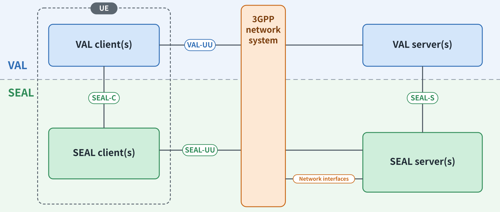
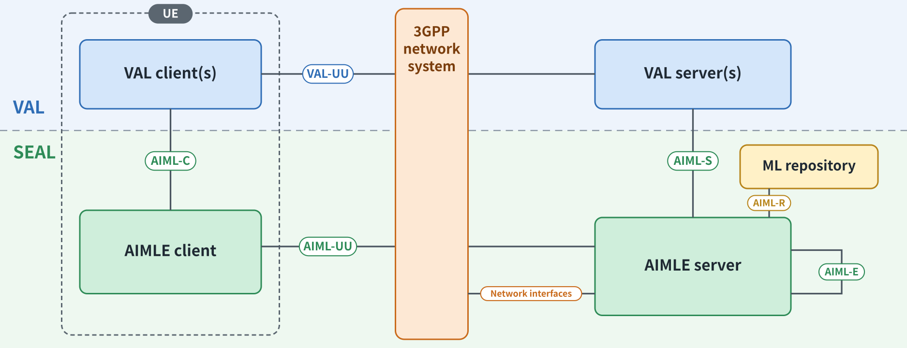
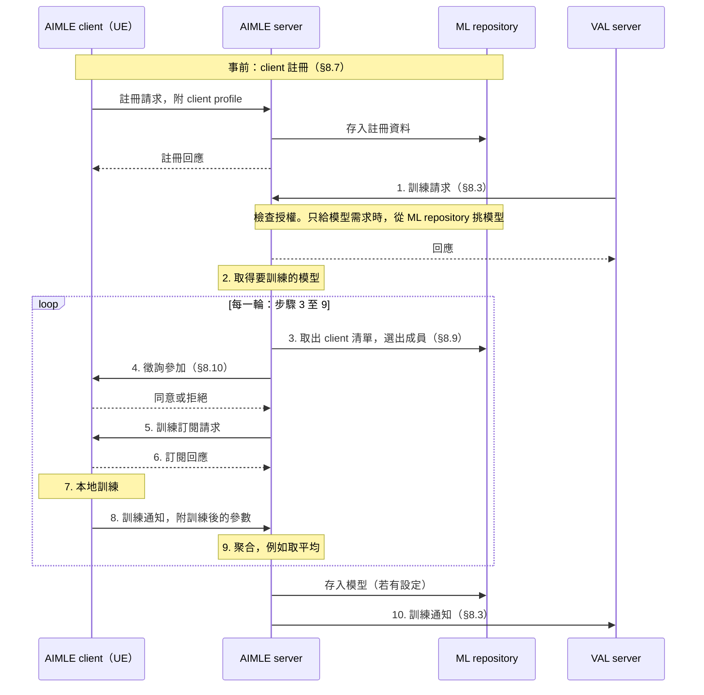

# AIMLE 運作機制與 SEAL 基本概念

本筆記說明 SEAL 是什麼、其中的 AIMLE 怎麼運作，以及一次聯邦學習（FL）在 AIMLE 裡從頭到尾的流程。依序讀完約 30 分鐘，主軸是第 5 節的流程。

文中也會對照實驗室的 FL 框架 Daisy，回答一個先前提出的假設：Daisy 是不是 AIMLE 的一種變體。

依據：AIMLE 的流程規格 TS 23.482 V20.3.0，SEAL 的架構規格 TS 23.434 V20.1.0。另外引用 AIMLE 的介面規格 TS 29.482、TS 24.560 與 SEAL 的 API 規格 TS 29.549（皆 V20.1.0）、NWDAF 的 TS 23.288 V20.2.0、TS 23.501 V18.12.0、TS 22.104 V19.2.0。Daisy 依 `open-source` 分支（commit `ce4f3763`，2025-03-19）。標示「解讀」的段落是整理後的理解，不是規格原文。

## 摘要

- **SEAL 是給各產業應用共用的一組能力。** AIMLE 是其中一項，專門協助應用做 AI/ML。
- **AIMLE 管的是「找誰來訓練、怎麼協調」，不管「怎麼訓練」。** 它詳細規定了成員的註冊、篩選、徵詢同意，以及每輪的下發與回收。聚合方法、成員中途消失、模型參數怎麼傳，規格都沒有寫。
- **FL 在 AIMLE 裡有兩種組法。** 一種是 AIMLE 自己當聚合者，另一種是 AIMLE 只當名冊，由應用自己聚合。
- **Daisy 不是 AIMLE 的變體。** 兩者的角色對得上，但處理的是不同層的事：AIMLE 規定的管理流程 Daisy 大多沒有，Daisy 的強項則都在 AIMLE 沒寫的地方。
- **Daisy 要滿足 AIMLE，有兩條路。** 對應上面的兩種組法：補上管理層，讓 Daisy 本身成為 AIMLE；或讓 Daisy 繼續負責訓練，成員管理交給 AIMLE。

## 1. SEAL 基本概念

SEAL 的全名是 Service Enabler Architecture Layer for Verticals（TS 23.434）。

- **Vertical 指的是某個產業。** 3GPP 的定義是「an industry or group of enterprises in which similar products or services are developed, produced, and provided」（TS 22.104 §3.1），例如工廠、電網、醫院、車聯網。為某個產業服務的應用，就是 vertical application，所在的那一層稱為 VAL（Vertical Application Layer）。定義不以「在 3GPP 網路之外」為條件，提供應用服務的一方和電信營運者也可以是同一個組織（TS 23.434 §5.1）。
- **SEAL service 是多個垂直應用共用的服務。** 定義是「a common service … that can be utilized by multiple vertical applications」（TS 23.434 §3.1），例如位置管理、群組管理、組態管理、身分管理、網路資源管理、資料分析（ADAE），以及 AI/ML 協助（AIMLE）。
- **每項服務各自獨立。** 每項服務有自己的 server 和 client（TS 23.434 §6.2）。**解讀：** 所以應用可以只用其中幾項，提供者也可以只提供其中幾項。
- **VAL 沒有嚴格的門檻。** 規格不規定 VAL 內部要有什麼（TS 23.434 §6.2 NOTE 2）。VAL server 也只是 SEAL 使用者的一個例子，其他類型的使用者經 SEAL 提供者的政策允許，也能呼叫 SEAL（§6.2 NOTE 4）。
- **使用 SEAL 要經過授權。** 可以透過 CAPIF（3GPP 的共通 API 框架，負責註冊、查詢 API、發授權），也可以用 TLS 加 OAuth 2.0（TS 29.549 §8、§9）。

圖 1：SEAL 的通用功能模型，依 TS 23.434 Figure 6.2-1 重繪，元件與參考點名稱照原圖。原圖是黑白的，顏色是本筆記所加：藍色是 VAL 層，綠色是 SEAL 層，橘色是 3GPP 網路系統，虛線框是 UE。

圖的讀法：

- **虛線分兩層。** 虛線以上是 VAL（應用自己），以下是 SEAL。UE 和伺服器端都各有這兩層。
- **中間的 3GPP network system 是整個 3GPP 網路，不只是核心網路。** 規格沒有另外定義這個詞，條文都寫成「underlying 3GPP network system」，指的是底下的 EPS 或 5GS，包括接取網路與核心網路。它在圖上有兩個角色：承載 UE 和伺服器之間的通訊，以及提供服務給 SEAL server，見下面「橫向」與「Network interfaces」兩點。
- **橫向是 UE 到伺服器。** 應用自己的通訊是 VAL-UU，SEAL 的通訊是 SEAL-UU。這兩條參考點的兩端是 UE 上的 client 和伺服器端的 server，中間的 3GPP 網路系統只負責承載，不是參考點的一端。線在網路那一欄兩側斷開只是畫法，原圖也是這樣畫，意思是通訊經過網路，不是終止在網路。
- **縱向是同一側的兩層之間。** UE 內是 SEAL-C，伺服器端是 SEAL-S。應用透過這兩條使用 SEAL。
- **SEAL server 另外直接和 3GPP 網路互動。** 也就是右下角的 Network interfaces，這條線才真的以網路為一端，也是圖上唯一「和核心網路的功能互動」的地方。依 §6.2 的文字，這包括直接使用 5GS 的網路服務、使用 OAM 的管理服務，或在第三方部署時經 NEF、SCEF 等對外開放的 API。實際用哪些介面由各項服務自己定義，例如位置管理經 N33 向 NEF、經 T8 向 SCEF 取位置，網路資源管理經 N5 向 PCF 要資源。UE 這一側沒有這條線：UE 和網路之間是接取的關係，不是呼叫網路 API 的關係。

圖中的 SEAL client 與 SEAL server 是統稱，代表各項服務自己的 client 與 server。例如 AIMLE 就是 AIMLE client 與 AIMLE server（見圖 2）。

**VAL server 和 SEAL server 是兩個不同的角色。** VAL server 是應用自己的後端，負責應用的業務；SEAL server 是某一項共用服務（例如 AIMLE）的伺服器，替應用處理一項支援工作。兩者在規格裡是分開的功能實體，但實際部署可以放在同一台機器上，例如 AIMLE server 可以和 VAL server 合設（TS 23.482 Annex A.5）。

**SEAL 不是應用的下層通訊協定。** 它不像 TCP/IP 之於瀏覽器那樣，是應用一定要經過的底層。從圖上看，應用自己的通訊（VAL-UU）和 SEAL 的通訊（SEAL-UU）是並列的兩條線，VAL-UU 不經過 SEAL。VAL-UU 怎麼建立，規格明寫不在範圍內（TS 23.434 §6.2 NOTE 1）。SEAL 和應用的關係是「旁邊提供服務」：應用需要某項支援工作時，透過 SEAL-C、SEAL-S 去使用它。

**圖上沒有畫，但要注意的一點：應用不一定要經過 SEAL 才能使用核心網路。** 圖中只有 SEAL server 有線接到網路，但這張圖畫的是 SEAL 的模型，不是唯一的路徑：

- VAL server 也可以直接使用 NEF。原文是「The Network resource management server and VAL server act as authorized API invoker to consume services from the Core Network northbound API entities like NEF」（TS 23.434 §14.2.2.1）。
- 對外部應用做認證、授權，是 NEF（TS 23.501 §6.2.5）與 CAPIF 的功能。TS 23.434 沒有任何一句說 SEAL 是用來把應用和核心網路隔開的。

**解讀：** SEAL 的價值在於共用，讓應用少做一些事，而不是擔任安全上的閘道。SEAL server 面對核心網路時，自己也是一個要經過 NEF 或 CAPIF 授權的應用功能（AF）。

## 2. AIMLE 的組成

| 元件 | 是什麼 | 規格 |
| --- | --- | --- |
| AIMLE server | 收請求、選成員、協調訓練的伺服器 | TS 23.482 §5.2.3.3 |
| AIMLE client | UE 上替應用參加訓練或推論的程式，可以獨立存在，也可以併入應用 | §5.2.3.2 |
| ML repository | 兩本帳：誰能參加訓練（成員名冊），以及有哪些模型（模型資訊庫） | §5.2.3.4 |

圖 2：AIMLE 的功能模型，依 TS 23.482 Figure 5.2.1-1 重繪，元件與參考點名稱照原圖。顏色的意思同圖 1，ML repository 另用黃色標出。

圖 2 就是把圖 1 的 SEAL client／server 換成 AIMLE client／server，再加上 ML repository 和 server 之間的互連。各參考點（§5.2.4）：

| 參考點 | 兩端 |
| --- | --- |
| AIML-C | VAL client ↔ AIMLE client，在同一台 UE 內 |
| AIML-UU | AIMLE client ↔ AIMLE server，由 3GPP 網路系統承載 |
| AIML-S | VAL server ↔ AIMLE server |
| AIML-R | AIMLE server ↔ ML repository |
| AIML-E | AIMLE server ↔ 另一個 AIMLE server，例如中央與邊緣 |

另外，沒有網路時 UE 之間可以直接經 AIML-PC5 互連，那是另一張圖（Figure 5.2.2-1），本筆記不談。

**client 怎麼找到 server：**

- client 註冊的前提是「has been pre-configured or has discovered the address (e.g., URI) of the AIMLE server」（§8.7.2.2）。也就是事先設定好，或已經用某種方式找到。後者用什麼方式，這一節沒有規定。
- 要換到更合適的 server 時，可以向已知的 server 查詢，條件包括位置、任務類型、支援的模型、算力等（§8.34）。
- 部署有使用 CAPIF 時，client 也可以先在 CAPIF 註冊，再透過 CAPIF 查到 AIMLE server 的 API 位址（TS 24.560 §7）。這時要事先知道的就變成 CAPIF 的位址。

**對照 Daisy：** 角色對得上。Daisy 的 Master、Zone、Client 分別對應中央 AIMLE server、邊緣 AIMLE server、AIMLE client，發布任務的一方對應 VAL server。但 Daisy 沒有 ML repository 的對應：模型只是 Master 本機的一個檔案，成員也沒有名冊（見第 5 節）。發布任務的一方和 Master 放在同一台機器也沒問題，規格允許 AIMLE server 和 VAL server 合設在同一個實體（Annex A.5）。

## 3. AIMLE 能做什麼

規格第 6 章列出 36 項能力，每項一段話，沒有分類。**解讀：** 依照處理的對象，可以分成五類：

| 類別 | 項數 | 內容 |
| --- | --- | --- |
| 成員管理 | 9 | 成員註冊、查詢、依條件篩選、徵詢同意、持續監看並換人、分組、訓練能力評估 |
| 模型管理 | 9 | 取得模型、儲存與查詢模型資訊、協助挑選模型、更新、效能監看與評估、維護 |
| 訓練 | 8 | 一般訓練、HFL、VFL、切分式訓練、訓練資料的處理協助、任務轉移 |
| 推論 | 3 | 推論、找推論服務、推論效能回饋 |
| 跨部署 | 7 | 邊緣之間的轉移、中央與邊緣的階層式部署、漫遊、跨網域找成員、跨提供者合作、找其他 AIMLE server |

成員管理的項數最多，而且第 5 節的流程大半在處理成員。這反映了 AIMLE 的重心：協調，而不是訓練本身。

註：規格中名稱帶 federated 的能力不一定是聯邦學習。例如 §6.32 的 federated AIML service，指的是多個提供者共同完成的 AI/ML 服務。

## 4. FL 的兩種組法

規格裡能參加 FL 的成員有兩種：

- **AIMLE client**：UE 上的程式，用 client 註冊（§8.7）登記。
- **FL member**：可以是 VAL server、邊緣應用（EAS）、AIMLE server 或 AIMLE client，登記時標明自己能當 FL server（聚合者）或 FL client（§8.4）。

這兩種成員對應兩種組法：

| | 組法 A：AIMLE 當聚合者 | 組法 B：AIMLE 當名冊與配對 |
| --- | --- | --- |
| 誰聚合 | AIMLE server | 擔任 FL server 的 VAL server |
| 成員 | UE 上的 AIMLE client | 登記為 FL client 的實體 |
| AIMLE 做什麼 | 選成員、徵詢、下發模型、收結果、聚合 | 登記成員、通知成員狀態變化、分組 |
| 訓練在哪裡進行 | AIMLE 的流程內 | AIMLE 之外，由應用自己進行 |
| 主要程序 | §8.3、§8.9、§8.10、§8.12 | §8.4、§8.5、§8.17 |

組法 B 的通知事件有五種：成員可用性變化、FL 模型資訊（準確度、時程、延遲）、負載、開始使用再生能源、能耗額度（§8.5）。

**對照 Daisy：兩種組法剛好是 Daisy 的兩條路。**

- **路一，Daisy 本身成為 AIMLE（組法 A）。** Master 擔任 AIMLE server，發布任務的一方擔任 VAL server，經 AIML-S 向 Master 提出訓練請求。Daisy 要補上 AIMLE 要求的管理流程：成員名冊、查詢介面、依條件篩選、徵詢同意（缺什麼見第 5 節）。上次提出的「Daisy 以 AIMLE 的形態出現」，走的就是這條路。
- **路二，Daisy 負責訓練，AIMLE 管成員（組法 B）。** **解讀：** Daisy 的 Master 以 FL server 的身分登記，成員資訊與狀態變化向 AIMLE 取得。訓練、聚合、傳輸照 Daisy 原本的做法。要改動的比路一少，但 Daisy 就是使用 AIMLE 的應用，不是 AIMLE 本身。規格的 Annex C 也描述了這種分工：訓練流程由應用提供，AIMLE 當平台。

## 5. 一次 HFL 從頭到尾（組法 A）

HFL（horizontal FL）是每個成員持有同樣特徵、不同樣本的資料，各自在本地訓練同一個模型，再把參數交給聚合者合併。

規格把 HFL 的主流程寫在 §8.12，步驟 1 到 10。下圖照這個編號畫，再補上事前的 client 註冊（§8.7），以及步驟 1 背後的訓練請求程序（§8.3）。

圖 3：一次 HFL 訓練。步驟編號照 TS 23.482 §8.12.2.1，事前註冊取自 §8.7，步驟 1 的請求與回應取自 §8.3。為了閱讀，各程序內部的授權檢查與失敗分支省略。

| 步驟 | 規格的內容 | 規格 |
| --- | --- | --- |
| 事前註冊 | client 交出 profile，包括支援的操作（訓練、推論等）、算力與任務能力、能耗。AIMLE server 檢查授權後，把註冊資料存進 ML repository。註冊可以有到期時間 | §8.7 |
| 1. 請求 | VAL server 指定 HFL 或 VFL、成員（直接給名單，或給條件與人數）、模型（指定，或只給需求）、資料集識別碼、每輪樣本數、排程、訓練目標。只給模型需求時，AIMLE server 先挑模型再回應 | §8.3 |
| 2. 取得模型 | 取得請求指定的模型。**未能確認：** 從哪裡取得。條文寫「using the ML model retrieval procedure as described in clause 8.1」，但 §8.1 是概述；名為 ML model retrieval 的 §8.2 是 client 或 VAL server 向 AIMLE server 取模型，方向不同。所以圖上只標註，不畫箭頭 | §8.12 |
| 3. 選成員 | 給名單就照名單；給條件就從 ML repository 取出 client 清單，依 profile 篩選，並持續監看、替換不再符合的成員。條件包括位置、速度、連線品質、資料集、算力、能耗 | §8.9、§8.13 |
| 4. 徵詢參加 | 逐一徵詢，client 可以拒絕。同意的 client 組成一組。設有最少人數而人數不足時，整個選擇失敗 | §8.10、§8.9 |
| 5–6. 訂閱 | AIMLE server 替每個 client 排好時程，送出模型、參數、輪次、資料集識別碼、樣本數。client 無法訓練時回覆失敗 | §8.12 |
| 7–8. 訓練與回報 | client 用本地資料訓練，完成或出錯時回報訓練後的參數 | §8.12 |
| 9. 聚合 | 「aggregates (e.g. averages)」。排程還沒用完，就排下一輪，重複步驟 3 到 8。用完後，若有設定就把模型存進 ML repository | §8.12 |
| 10. 結束 | 通知 VAL server 訓練輸出、完成度、成員變動。訓練中途也可以用這個通知回報進度 | §8.3 |

**每一輪都可以重新選人。** 步驟 9 寫明下一輪重複的是步驟 3 到 8，其中步驟 3 是選成員、步驟 4 是徵詢。所以規格允許每輪換一組成員，不是整個訓練固定同一組。

**對照 Daisy：這張流程圖上，Daisy 缺的大多是管理的步驟。**

| 步驟 | AIMLE 要求 | Daisy 現況 |
| --- | --- | --- |
| 事前註冊 | 交 profile，存進 ML repository | 只帶一個自己取的識別碼，名單只有此刻連著的 client |
| 1. 請求 | 帶模型、資料集識別碼、每輪樣本數、排程 | 任務設定只有輪數、演算法模組、模型檔路徑，資料集寫死在 client 程式裡 |
| 3. 選成員 | 依條件篩選，可對外查詢 | 內建做法每輪隨機抽 2 個，改不了，也沒有對外查詢的介面 |
| 4. 徵詢參加 | 逐一徵詢，client 可拒絕 | 沒有徵詢，client 不能拒絕 |
| 5–9. 下發、訓練、回報、聚合 | 有 | 有，這是 Daisy 原本就在做的事 |

另外，兩者的連線方向相反。AIMLE 的徵詢與每輪下發都是 server 主動連 client，所以 client 要能被連到。Daisy 一律由 client 連上去。走路一時，Daisy 的 client 要多開一個服務端，這是兩者唯一真正衝突的地方。

## 6. 規格沒寫的部分

**HFL 的流程沒有寫：**

- **怎麼聚合。** 只寫「aggregates (e.g. averages)」。
- **成員中途消失怎麼辦。** 每一輪的程序沒有逾時或缺席的處理。持續監看可以換人，但沒說明正在進行的那一輪怎麼收尾。
- **模型參數實際怎麼傳。** 流程規格要求雙向都帶參數，但介面規格（TS 24.560、TS 29.482）不是這樣：server 下發時只帶模型的識別碼與位址，client 回報時只有六個效能數值（準確率、precision、recall、F1、MSE、MAE），沒有放模型參數的欄位。**未能確認：** 這是刻意讓模型走另一條通道，還是介面規格尚未寫完。規格沒有任何說明。
- **訓練資料怎麼來。** 規格的前提是各 client 的資料集已經備妥並有識別碼。識別碼由誰配發、資料怎麼收集，沒有寫。
- **UE 內部怎麼交接。** 應用（VAL client）和 AIMLE client 之間的 AIML-C 只有一句定義，沒有 API。應用怎麼把資料交給 AIMLE client、怎麼拿到模型，沒有寫。
- **隱私保護。** TS 23.482 全文沒有 secure aggregation、differential privacy 這類字。

**模型怎麼送到設備：規格沒有「推送並回報交付狀態」的程序。** 上次討論舉的例子是：後台指定設備，由 SEAL 把新模型送過去，再回報哪些設備已經收到、已經更新。TS 23.482 裡，模型到達設備只有三種方式：

- 設備自己來取，或訂閱後在有新模型時被通知（§8.2）。
- 在訓練設定中被告知模型的識別碼與位址（§8.12）。
- 最接近的是服務操作控制（§8.20）：VAL server 可以指定一批 client，請求中可以帶取得模型的位址。但它的語意是啟動或停止一項 AI/ML 操作，回報的是操作狀態，不是「已收到」「已更新」。

**AIMLE 也是標準，互通的範圍是介面。** AIMLE 和 NWDAF 一樣有規定訊息格式的 Stage 3 規格：多數程序都有 HTTP API（TS 29.482、TS 24.560），註冊、查詢、選擇、徵詢、訓練請求、HFL 訓練都有。所以不同廠商做的 AIMLE server 與 client，在這些介面上是可以互通的。不規定的是介面後面的事，也就是上面列的聚合方法、訓練程式、資料來源等。要注意的是，34 個 OpenAPI 檔中有 17 個的版本仍是 alpha，HFL 訓練就是其中之一。

**VFL 只寫到準備階段。** VFL（vertical FL）的成員持有同一批樣本的不同特徵，所以要先對齊樣本。規格寫了特徵怎麼選、樣本怎麼對齊、成員怎麼決定。在應用之間的 VFL 裡，AIMLE 還會透過 NEF 把各方的使用者識別碼對起來，只發給各方一個 correlation ID，不交出真實身分（§8.18.2b）。訓練本身怎麼進行，兩個 VFL 程序都寫明不在本版範圍（§8.18）。

**對照 Daisy：Daisy 的強項正好落在這些空白處。**

- 演算法可抽換：選成員、等待條件、聚合都是外掛模組。
- 非同步訓練、安全聚合：換一組模組即可，協定不變。
- 階層式：Zone 自己和 client 跑幾輪、自己聚合，再交給 Master。
- 模型傳輸：Daisy 的訊息本來就帶模型參數，可以補上介面規格的缺口。

這些特色走哪一條路都不會遺失，但在 AIMLE 的介面上也看不出來，符合 AIMLE 並不會讓它們變成對外可宣告的能力。另外，Daisy 處理「成員中途消失」也有缺口：client 能自己重連，但 client 在訓練途中消失時，同步的 FedAvg 沒有逾時，會一直等下去。

## 7. 核心網路在哪裡出現

| 用途 | 用到什麼 | 規格 |
| --- | --- | --- |
| 選成員時查位置與移動 | SEAL 位置管理、NEF、GMLC、NWDAF 的 UE mobility 分析 | §8.9、§8.13 |
| 替選上的成員設定連線品質 | SEAL 的資料傳遞服務，或 NEF 的 QoS 設定 | §8.9、§8.13 |
| VFL 對齊樣本時轉換使用者識別碼 | NEF | §8.18.2b |
| 成員的再生能源狀態 | SEAL 的能源服務或網路的能源資訊 | §8.5 |

NWDAF 只在第一列出現一次，原文用「may」，也沒有對應的程序或訊息內容：「The AIMLE server may use SEAL (LM service), NEF (e.g. MonitoringEvent API), and NWDAF (e.g. UE mobility analytics as defined in clause 6.7.2 of 3GPP TS 23.288) capabilities to assist the AIMLE client selection.」

**解讀：** 核心網路在 AIMLE 裡的角色是「幫忙挑人、幫忙接線」，不參與訓練本身。

**AIMLE 的 FL 和 NWDAF 的 FL 是兩套程序。** AIMLE 取得 NWDAF 的分析，只是拿來當選人的參考，訓練仍由 AIMLE client 執行、AIMLE server 聚合。NWDAF 自己也有聯邦學習（TS 23.288），但兩者沒有接在一起：

| | AIMLE 的 HFL | NWDAF 之間的 HFL | NWDAF 與 AF 的 VFL |
| --- | --- | --- | --- |
| 誰主導 | AIMLE server，受 VAL server 請求 | 擔任 FL server、含 MTLF 的 NWDAF | 擔任 VFL server 的 AF 或 NWDAF |
| 誰訓練 | UE 上的 AIMLE client | 含 MTLF 的 NWDAF | AF 與 NWDAF 各自訓練自己的部分 |
| 應用能不能參與 | 能，本來就是給應用用的 | 不能，服務的提供者與使用者都限於含 MTLF 的 NWDAF（TS 23.288 §7.10.1、§7.11.1） | 能，AF 可以當參與方，也可以當主導方（TS 23.288 §5.4、§6.2H） |

TS 23.288 全文沒有提到 SEAL 或 AIMLE，TS 23.482 也沒有說 AIMLE server 可以擔任上表最右欄的 AF。

**對照 Daisy：** Daisy 支援 client 換 Zone，但範例裡誰要換是亂數決定，換去哪裡是寫死的位址，沒有任何位置輸入。這裡正是第一列可以接上的地方。
