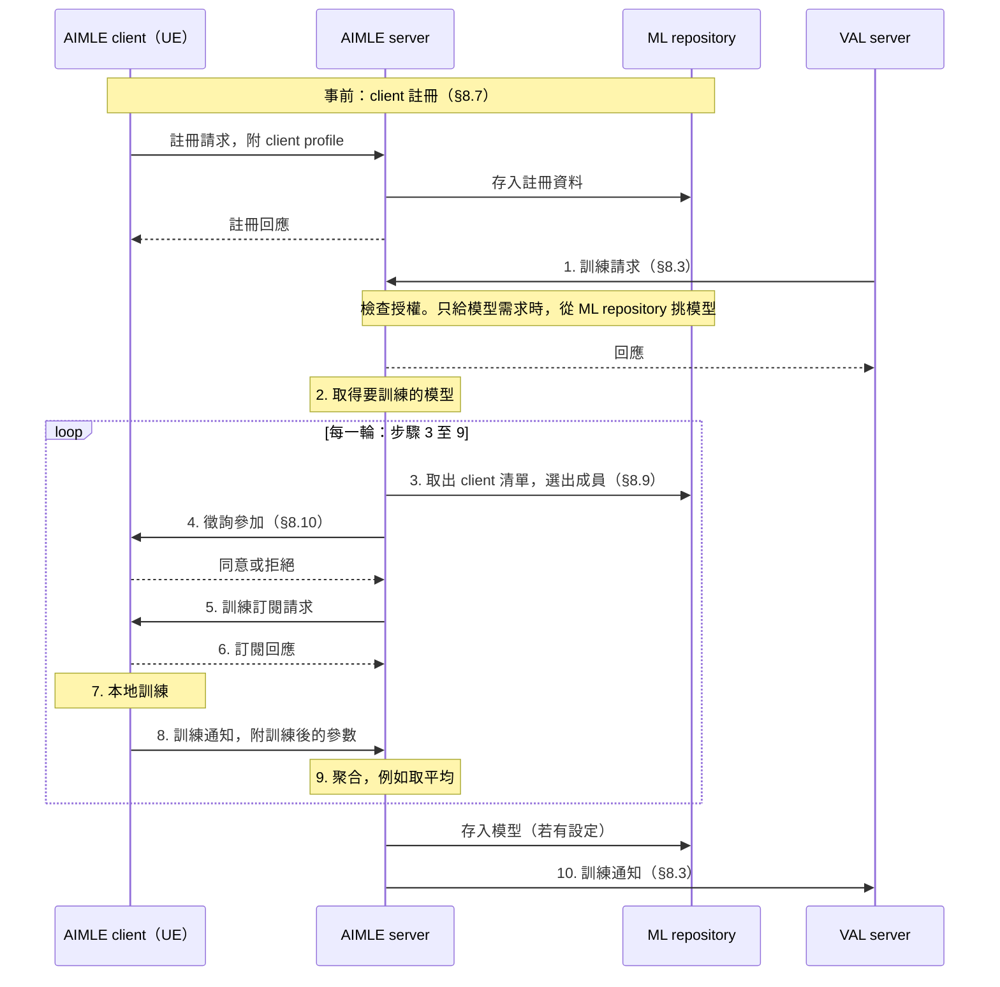

# 應用層 AI/ML 與 NWDAF 的結合方式

3GPP 除了在核心網路定義 NWDAF，也在應用層定義了一套協助應用做 AI/ML 的服務，也就是 SEAL 裡的 AIMLE。這兩週查的是：這兩邊能不能結合，以及可以怎麼結合。本筆記依序介紹 SEAL、AIMLE、NWDAF 的 VFL，最後整理三種結合方式和各自的限制。依序讀完約 30 分鐘。

依據：SEAL 的架構規格 TS 23.434 V20.1.0，AIMLE 的流程規格 TS 23.482 V20.3.0 與 API 規格 TS 24.560 V20.1.0，ADAE 的流程規格 TS 23.436 V20.2.0，NWDAF 的 TS 23.288 V20.2.0，以及 Release 19 的研究報告 TR 23.700-84 V19.0.0。標示「解讀」的段落是整理後的理解，不是規格原文。

## 1. 兩邊各是什麼

| | NWDAF | AIMLE |
| --- | --- | --- |
| 位置 | 5G 核心網路裡的一個 NF | 應用層，SEAL 的其中一項服務 |
| 服務的對象 | 核心網路的其他 NF，以及經 NEF 的 AF | 應用的後端（VAL server），以及 UE 上的應用 |
| 提供什麼 | 網路的分析結果，以 Analytics ID 區分 | 管理模型訓練與推論的流程，本身沒有分析類型 |
| 聯邦學習 | NWDAF 之間的 HFL；NWDAF 與 AF 之間的 VFL | AIMLE client 之間的 HFL 與 VFL；也能替應用之間的 FL 登記成員 |
| 規格 | TS 23.288 | TS 23.482（流程）、TS 29.482 與 TS 24.560（API） |

接下來第 2、3 節介紹應用層這一側，第 4 節介紹 NWDAF 這一側和應用最直接的接點：VFL。

## 2. SEAL 是什麼

SEAL 的全名是 Service Enabler Architecture Layer for Verticals（TS 23.434）。

**SEAL 的目的是把各產業應用都需要的能力做成共用服務，讓應用不必各自重做，就能有效率地使用 3GPP 網路。** 規格的說法是「A set of common services (e.g. group management, configuration management, location management) specified in this document can be shared across vertical applications」（Introduction），以及「To ensure efficient use and deployment of vertical applications over 3GPP systems」（§1）。

- **Vertical 指的是某個產業**，例如工廠、電網、車聯網。為產業服務的應用稱為 vertical application，所在的那一層稱為 VAL（Vertical Application Layer）。
- **SEAL service 是多個垂直應用共用的服務。** 例如位置管理、群組管理、組態管理、網路資源管理、資料分析（ADAE），以及 AI/ML 協助（AIMLE）。哪些服務算 SEAL service，由規格列舉，不是任何共用服務都能這樣稱呼。
- **每項服務各自有 server 和 client。** client 在 UE 上；server 可以由電信業者、應用業者或第三方經營，部署在雲端或邊緣都可以（TS 23.434 §8.2）。應用可以只用其中幾項。

圖 1：SEAL 的通用功能模型，依 TS 23.434 Figure 6.2-1 重繪，元件與參考點名稱照原圖。顏色是本筆記所加：藍色是 VAL 層，綠色是 SEAL 層，橘色是 3GPP 網路系統，虛線框是 UE。

圖的讀法：

- **虛線以上是應用自己，以下是 SEAL。** UE 和伺服器端都各有這兩層。應用透過 SEAL-C、SEAL-S 使用 SEAL 的服務。
- **橫向是 UE 到伺服器的通訊。** VAL-UU 是應用自己的通訊，SEAL-UU 是 SEAL 的通訊，3GPP 網路系統只負責承載。
- **只有 SEAL server 直接和網路互動。** 也就是右下角的 Network interfaces，例如經 NEF 取得網路的能力。從核心網路看，SEAL server 就是一個 AF。

**VAL server 和 SEAL server 是兩個不同的角色。** VAL server 是應用自己的後端，SEAL server 是某一項共用服務的伺服器。實際部署可以放在同一台機器上。

**應用不一定要經過 SEAL 才能使用核心網路。** VAL server 也可以直接以 AF 的身分使用 NEF：「The Network resource management server and VAL server act as authorized API invoker to consume services from the Core Network northbound API entities like NEF」（TS 23.434 §14.2.2.1）。這一點在第 5 節會用到。

## 3. AIMLE 做什麼

AIMLE 有三個元件（TS 23.482 §5.2）：

| 元件 | 是什麼 |
| --- | --- |
| AIMLE server | 收應用的請求、選成員、協調訓練 |
| AIMLE client | UE 上替應用參加訓練或推論的程式 |
| ML repository | 存成員的註冊資料與模型資訊 |

圖 2：AIMLE 的功能模型，依 TS 23.482 Figure 5.2.1-1 重繪，元件與參考點名稱照原圖。就是把圖 1 的 SEAL client／server 換成 AIMLE client／server，再加上 ML repository（黃色）和 server 之間的互連。

**AIMLE 的規格寫得最細的是「找誰來訓練、怎麼協調」。** 規格列出的能力裡，數量最多的是成員管理：client 註冊、查詢、依條件篩選、徵詢同意、持續監看並換人。

HFL（horizontal FL）是每個成員持有同樣特徵、不同樣本的資料，各自在本地訓練同一個模型，再把參數交給聚合者合併。規格把 HFL 的主流程寫在 §8.12，步驟 1 到 10。下圖照這個編號畫，再補上事前的 client 註冊（§8.7），以及步驟 1 背後的訓練請求程序（§8.3）。

圖 3：一次 HFL 訓練。步驟編號照 TS 23.482 §8.12.2.1，事前註冊取自 §8.7，步驟 1 的請求與回應取自 §8.3。為了閱讀，各程序內部的授權檢查與失敗分支省略。

| 步驟 | 規格的內容 | 規格 |
| --- | --- | --- |
| 事前註冊 | client 交出 profile，包括支援的操作（訓練、推論等）、算力與任務能力、能耗。AIMLE server 檢查授權後，把註冊資料存進 ML repository | §8.7 |
| 1. 請求 | VAL server 指定 HFL 或 VFL、成員（直接給名單，或給條件與人數）、模型（指定，或只給需求）、資料集識別碼、每輪樣本數、排程、訓練目標 | §8.3 |
| 2. 取得模型 | 模型來自步驟 1 的請求，兩種給法至少一種：直接指定模型的識別碼與位置（模型檔的 URL 或 FQDN，或存放模型的 repository 位址）；或只給需求條件，由 AIMLE server 向 ML repository 查詢、挑出符合的模型。知道位置後實際怎麼取回，條文引用的 §8.1 沒有內容 | §8.3、§8.11.3、§8.12 |
| 3. 選成員 | 給名單就照名單；給條件就從 ML repository 取出 client 清單，依 profile 篩選，並持續監看、替換不再符合的成員。條件包括位置、速度、連線品質、資料集、算力、能耗 | §8.9、§8.13 |
| 4. 徵詢參加 | 逐一徵詢，client 可以拒絕。設有最少人數而人數不足時，整個選擇失敗 | §8.10、§8.9 |
| 5–6. 訂閱 | AIMLE server 替每個 client 排好時程，送出模型、參數、輪次、資料集識別碼、樣本數。模型以識別碼加位置的方式給，client 依位置下載，也就是在這一步拿到模型。client 無法訓練時回覆失敗 | §8.12 |
| 7–8. 訓練與回報 | client 用本地資料訓練，完成或出錯時回報訓練後的參數 | §8.12 |
| 9. 聚合 | 「aggregates (e.g. averages)」。排程還沒用完，就排下一輪，重複步驟 3 到 8。用完後，若有設定就把模型存進 ML repository | §8.12 |
| 10. 結束 | 通知 VAL server 訓練輸出、完成度、成員變動 | §8.3 |

**每一輪都可以重新選人。** 步驟 9 寫明下一輪重複的是步驟 3 到 8，其中包含選成員和徵詢。所以規格允許每輪換一組成員，不是整個訓練固定同一組。

**server 和 client 之間的每一步都有 API。** 徵詢是 `Aimlec_AIMLEClientParticipation`，訂閱與回報是 `Aimlec_HFLTraining` 的 Subscribe 與 Notify（TS 24.560）。徵詢和訂閱都由 AIMLE server 呼叫 client，所以 client 要能被連到。

**AIMLE 的規格沒有定義訓練本身怎麼做。** 訓練確實在 AIMLE 裡進行：client 在本地訓練，AIMLE server 聚合。但聚合只寫「aggregates (e.g. averages)」，訓練資料怎麼來也沒有規定。模型參數怎麼傳同樣沒有接起來：TS 24.560 的訂閱只帶模型的識別碼和存放位置，回報的欄位只有準確度、誤差等評估指標，沒有放模型參數的欄位。這些都留給實作決定。

## 4. NWDAF 的 VFL

我們熟悉的是 NWDAF 之間的 HFL（TS 23.288 §6.2C），Release 18 已有。VFL（§5.4、§6.2H）是 Release 19 加入的另一種切法：各方持有同一群 UE 的不同特徵，不交換本地資料，只交換中間結果（例如 activations、gradients），一起訓練一個模型。

- **NWDAF 可以和 AF 一起做。** VFL server 只有一個，可以是 NWDAF 或 AF。原文是「there may be one NWDAF or one AF acting as a VFL server and one or multiple NWDAF(s) and/or one or multiple AF(s) acting as VFL Client(s)」。AF 當 server 時，client 只能是 NWDAF（§5.4）。
- **VFL server 持有 label。** 它結合各 client 的中間結果與 label，算出 gradient、loss 等再發回給各 client。
- **AF 分成 trusted 與 untrusted 兩種。** trusted AF 向 NRF 註冊，untrusted AF 的訊息經 NEF 轉送（§6.2H.2.1）。
- **規格舉的情境是 Observed Service Experience**（TR 23.700-84 §5.1.5）。網路側的特徵（access speed、network access delay）在 NWDAF，應用側的特徵（stall time、frame rate）和使用者體驗的分數在 AF，隱私政策不允許兩邊直接交換原始資料。

規格把 VFL 分成註冊與發現、準備（包含樣本對齊）、訓練、推論四個程序（§6.2H.2.1 至 §6.2H.2.4），都有對應的服務，例如 `Nnwdaf_VFLTraining`、`Naf_VFLTraining`。只有中間結果的格式寫明「not standardized in this Release」（§6.2H.3）。

## 5. 三種結合方式和各自的限制

### 5.1 NWDAF 的 VFL，由 AIMLE 擔任 AF

**能帶來的：** NWDAF 真正參與訓練，應用層的資料也進得來。從核心網路看，AIMLE server 本來就是一個 AF。

**限制：兩邊的規格都沒有這條路。**

- TS 23.288 全文沒有出現 SEAL、AIMLE、ADAE。VFL 裡的 AF 就是一般的 AF。
- AIMLE 也有 VFL，但成員只有 UE 上的 AIMLE client 和 VAL server（TS 23.482 §8.18），NWDAF 不在其中。AIMLE 的 API 也沒有任何和 NWDAF 一起做 VFL 的介面。
- AIMLE 自己的 VFL 只寫到選成員和對齊樣本，訓練過程寫明不在範圍內：「How AIMLE Server coordinates the selected VFL members to perform VFL training is out of scope for this release」（§8.18.2 NOTE）。

**解讀：** 應用側的特徵不在 AIMLE server 身上，而在 UE 上的 AIMLE client 或 VAL server。要讓 AIMLE server 以 AF 的身分參加 NWDAF 的 VFL，它得在中間轉接：對 NWDAF 扮演一個 VFL client，對自己的成員再組一層 VFL。這一層兩邊的規格都沒有寫，要自己定義，最後很可能變成硬做。10/01 討論時也得到類似的結論：在這個情境裡，AIMLE server「就是一個 AF 而已」。

### 5.2 NWDAF 的 VFL，用一般的 AF

**能帶來的：** 規格最完整，註冊、發現、準備、訓練、推論都有程序和 API，也延續我們在 NWDAF 聯邦學習上的經驗。

**限制：SEAL 用不到。**

- 任何應用後端都能直接當 AF。trusted AF 經 NRF，untrusted AF 經 NEF。
- 第 2 節提過，VAL server 本來就可以不經過 SEAL 直接使用 NEF。
- 題目回到只有 NWDAF 的 VFL，應用層的那一套標準沒有角色。

另外，VFL 是 Release 19 才加入的，我們的實作基準是 Release 18。走這條路要先補上 VFL 相關的服務，包括 NWDAF、AF、NEF 三方。

### 5.3 應用層把 NWDAF 當 data source

**能帶來的：** 這是規格寫得最多的路。

- AIMLE 選成員時可以參考 NWDAF 的分析，例如 UE mobility（TS 23.482 §8.9，原文用「may」）。模型切成幾段分給不同節點執行時，AIMLE server 可以向 NWDAF 取得 E2E data volume transfer time、DN performance、Network performance、UE mobility 四種分析，決定何時傳送任務或資料（§8.14.2.5）。
- ADAE 的多個分析程序都以 NWDAF 的分析為輸入，例如 slice 相關的應用效能分析（TS 23.436 §8.3）、位置相關的 UE 群組分析（§8.15）。一般的應用效能分析也寫了「The ADAES acting as AF may also subscribe to NEF/SMF/PCF/NWDAF」（§8.2）。

**限制一：既有成果能重用的部分很少。** NWDAF 在這條路上只負責提供分析。我們在 NWDAF 之間 HFL 的協定擴充、free5GC 上的實作、MTLF 的訓練，在這個架構裡都用不上。

**限制二：要在核心網路外另外搭一套框架。** 研究的主體落在應用層，SEAL server（AIMLE 或 ADAE）、VAL server、UE 上的 client，都要在核心網路外面另外建起來。

### 5.4 對照

| | 5.1 VFL，AIMLE 當 AF | 5.2 VFL，一般 AF | 5.3 NWDAF 當 data source |
| --- | --- | --- | --- |
| NWDAF 的角色 | 一起訓練 | 一起訓練 | 提供分析 |
| SEAL 的角色 | 轉接應用側的資料 | 沒有 | 主體 |
| 規格依據 | NWDAF 側完整，AIMLE 側沒有 | 完整 | 有，但多是「may」 |
| 既有成果重用 | NWDAF 側可以 | NWDAF 側可以 | 很少 |
| 要自己做的 | 應用層的整套框架，加上 AIMLE 與 NWDAF VFL 之間的轉接層，以及 Release 19 的 VFL | 一個持有應用資料的 AF，以及 Release 19 的 VFL | 應用層的整套框架 |
