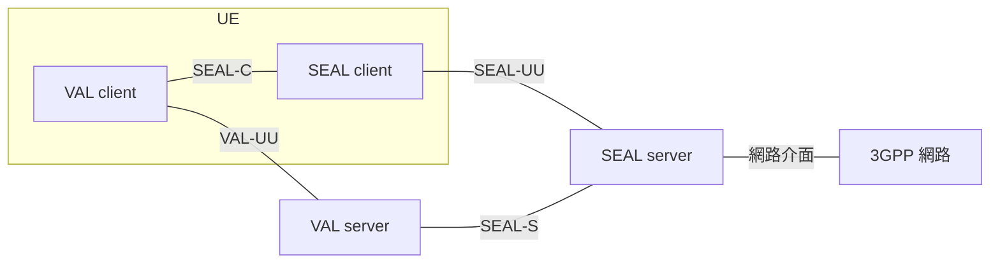

# Release 20 SEAL 01 定位與通用模型

本篇回答一個問題：**SEAL 是什麼，為什麼存在。** 讀完應該能看懂 SEAL 的四方塊圖，並知道後面每一篇在講圖上的哪一條線。

本文依據本地 TS 23.434 V20.1.0。標示「解讀」的段落是為了幫助理解所做的整理，不是規格原文。

## 1. 一句話

SEAL（Service Enabler Architecture Layer for Verticals）是介於產業應用和 3GPP 網路之間的一組共用服務。很多應用都要做的事，例如知道終端在哪、管理群組、下發配置、認證使用者、向網路要資源，各自被做成一項服務，應用透過 API 使用。

### 1.1. 名稱裡的 Enabler 與 Enablement

Enable 是「使某件事能夠做到」。Enabler 是做這件事的東西，Enablement 是這件事本身。放在這裡的意思是：**它自己不是應用，而是讓應用更容易做出來的支援能力。**

規格沒有為 enabler 或 enablement 單獨下定義。最接近的一句是 TS 23.482 §3.1 對 AIMLE service 的定義：一項 AIMLE capability，目的是協助執行或促成（enabling）一個或多個 AIML operation。

這個字在本系列會以幾種形式出現，意思相同：

| 名稱 | 全名 | 支援的對象 |
| --- | --- | --- |
| SEAL | Service Enabler Architecture Layer | 產業應用的共用需求 |
| ADAE | Application Data Analytics Enablement | 應用層的資料分析 |
| AIMLE | AI/ML Enablement | 應用層的 AI/ML |
| NSCE | Network Slice Capability Enablement | 應用使用網路切片 |
| EEL | Edge Enabler Layer | 邊緣運算上的應用 |

Enabler 與 Enablement 在規格中是混用的。例如 ADAES 在 TS 23.436 §3.2 展開為 Application Data Analytics **Enabler** Server，在 TS 23.482 §3.3 則展開為 Application Data Analytics **Enablement** Server。兩者指同一個實體，不需要區分。

## 2. 為什麼存在

規格的說法有三點：

- SEAL service 的定義是「可被多個 vertical application 使用的共用服務」，例子是群組管理、配置管理、位置管理（§3.1）。
- SEAL 要支援來自一個或多個產業的應用，也要支援同一產業的多個應用（§4.1.2-a、§4.1.2-b）。
- SEAL 以 API 的形式把服務提供給應用（§4.1.2-c）。

規格沒有說明這樣設計的原因。一篇由 Samsung 印度研究院作者撰寫的 SEAL 概觀論文（Shah 等，2020）提供了動機，內容如下，[精讀介紹][lit-11]有完整整理：

- 3GPP 在 Release 13 制定任務關鍵通訊 MCPTT 時，除了核心服務，還為它定義了一組輔助服務：群組管理、身分管理、配置管理、金鑰管理與安全（論文 §I）。
- 之後 3GPP 陸續制定其他產業的應用標準，發現它們也需要同樣的輔助服務。為每個產業各自制定一套既費時又重複，所以需要一個多個產業應用都能使用的 enabler layer，用來加快標準制定與部署（論文 §I、§II）。
- SEAL 的服務全部是選用的，產業應用可以只使用其中幾項（論文 §II）。

**解讀：** 論文的動機只談「輔助服務在各產業之間重複」，沒有提到核心網路。本文先前把「每種應用各自對接核心網路」也列為動機，那是從 SEAL server 代替應用使用網路能力這件事反推的，不是規格或論文的說法。比較準確的說法是：SEAL 把各產業都需要的輔助服務抽出來做成共用的一層；讓應用不必自己面對核心網路，是這一層帶來的效果之一，見[第 03 篇][seal-03]。

Annex B 另外提供 SEAL 與任務關鍵通訊共用功能架構（CFA，TS 23.280）的對照表，位置、群組、配置、身分、金鑰、網路資源管理都能在 CFA 找到對應的實體與參考點。這與上述論文的說法一致，也可以解釋為什麼 SEAL 的通用模型裡有 SIP 相關實體。

**修正紀錄（2026-10-13）：** 本節原本只有規格的三點與一段解讀，並註明 SEAL 與 CFA 的制定沿革未查證。取得 Shah 等（2020）全文後補上動機的出處，並修正解讀中「各自對接核心網路」的說法。

## 3. 通用模型只有四個方塊

下圖依 §6.2 圖 6.2-1 重畫，上排是應用本身（VAL），下排是共用支援（SEAL）。

VAL-UU 和 SEAL-UU 兩條線實際上都經由 3GPP 網路傳輸；圖中另外畫出的「網路介面」是 SEAL server 把網路當成服務提供者來使用的那一條。

| 方塊 | 規格定義（§3.1） | 白話 |
| --- | --- | --- |
| VAL client | 提供 vertical application 客戶端功能的實體 | 終端上的應用本身 |
| VAL server | 特定 VAL service 伺服器端應用功能的通稱 | 應用後端 |
| SEAL client | 提供特定 SEAL service 客戶端功能的實體 | 終端上協助應用使用某項共用服務的模組 |
| SEAL server | 提供特定 SEAL service 伺服器端功能的實體 | 提供某項共用服務的後端 |

VAL 是 Vertical Application Layer 的縮寫。VAL client 和 VAL server 的內部細節依產業而定，不在 TS 23.434 的範圍內（§6.4.2.2、§6.4.2.3）。

## 4. 圖上的每一條線

圖上的每一條線都是一個**參考點（reference point）**：規格為「某兩個功能實體之間的互動關係」取的名字。它的名字同時指定了兩端是誰，例如 5GC 的 N11 固定是 AMF 與 SMF 之間、N33 固定是 NEF 與 AF 之間（TS 23.501 §4.2.7）。

參考點只說明「誰和誰之間有互動、互動的目的是什麼」，不規定用什麼協定，也不代表一條實體連線。同一個參考點上可以有很多種訊息；兩個實體做在同一個程式裡時，參考點仍然存在，只是不需要對外實作。

與它相對的是**服務化介面（service-based interface）**，名字只綁定提供服務的一方，例如 Nnwdaf 是 NWDAF 對外提供的介面，任何獲得授權的消費者都能使用（TS 23.501 §4.2.6）。5GC 的架構圖有這兩種畫法（TS 23.501 §4.2.1），SEAL 也是：本篇到第 03 篇使用參考點，[第 04 篇][seal-04]改用服務化介面。

| 參考點 | 兩端 | 用途 | 規格 |
| --- | --- | --- | --- |
| VAL-UU | VAL client ↔ VAL server | 應用自己的通訊 | §6.5.2.2，細節不在本規格範圍 |
| SEAL-C | VAL client ↔ SEAL client | 同一台 UE 內，應用使用端側支援功能 | §6.5.2.6 |
| SEAL-UU | SEAL client ↔ SEAL server | 共用服務的端側與伺服器側互動 | §6.5.2.4 |
| SEAL-S | VAL server ↔ SEAL server | 應用後端呼叫共用服務 | §6.5.2.7 |
| 網路介面 | SEAL server ↔ 3GPP 網路 | 使用 3GPP 既有介面取得資訊或提出要求 | §6.2 |

通用模型還有四條沒畫在上圖的線：

| 參考點 | 兩端 | 用途 | 規格 |
| --- | --- | --- | --- |
| SEAL-E | 同一種服務的兩個 SEAL server | 支援分散式部署 | §6.5.2.8 |
| SEAL-X | 不同種服務的兩個 SEAL server | 服務之間互相使用，例如金鑰管理提供金鑰給群組管理（SEAL-X1） | §6.5.2.9 |
| SEAL-PC5 | 兩台 UE 的 SEAL client | 沒有網路時的 UE 對 UE 互動（off-network） | §6.3、§6.5.2.5 |
| VAL-UDB | SEAL server ↔ VAL user database | 存取使用者設定檔，細節不在本規格範圍 | §6.5.2.10 |

這些名稱都是通稱。每項服務會把它們換成自己的名字，例如位置管理的 LM-UU、LM-C、LM-S，這是[第 02 篇][seal-02]的主題。

## 5. SEAL server 的三個面向

**解讀：** 以下三個面向是本系列用來安排後續文件的框架，不是規格用語。

| 面向 | 對象 | 走哪條線 | 在哪一篇 |
| --- | --- | --- | --- |
| 對終端 | SEAL client，再到 VAL client | SEAL-UU、SEAL-C | [02 服務模板與位置管理][seal-02] |
| 對網路 | 5GC 或 EPC 的網路功能 | 網路介面 | [03 與核心網路的互動][seal-03] |
| 對應用後端 | VAL server | SEAL-S | [04 服務 API 與 CAPIF][seal-04] |

## 6. SEAL 有哪些服務

依規格定義的位置分成兩類：

| 類別 | 服務 | 定義位置 | 本地是否有規格 |
| --- | --- | --- | --- |
| 在 TS 23.434 內完整定義 | 位置管理（LM） | 第 9 章 | 有 |
| | 群組管理（GM） | 第 10 章 | 有 |
| | 配置管理（CM） | 第 11 章 | 有 |
| | 身分管理（IM） | 第 12 章 | 有 |
| | 金鑰管理（KM） | 第 13 章 | 有 |
| | 網路資源管理（NRM） | 第 14 章 | 有 |
| | 通知管理（NM） | 第 17 章 | 有 |
| TS 23.434 只留一段說明，細節在另一份規格 | 網路切片能力支援（NSCE） | TS 23.435 | 無 |
| | 資料傳遞（SEALDD） | TS 23.433 | 無 |
| | 應用資料分析支援（ADAE） | TS 23.436 | 有 |
| | AI/ML 支援（AIMLE） | TS 23.482 | 有 |
| | 空間錨點、空間地圖（SAn、SM） | TS 23.437 | 無 |
| | 數位資產（Digital Asset） | TS 23.438 | 無 |

§6.1 的服務清單只列到 ADAE 共十項；AIMLE、SAn、SM、Digital Asset 出現在 §15.3 的介面表與第 20、22、23、24 章。這是規格文字本身的落差，以較完整的後者為準。

## 7. 三個容易誤會的地方

**SEAL 不是一個元件。** 「SEAL server」是通稱，實際存在的是位置管理 server、群組管理 server 等，每項服務各有自己的 client 和 server（§6.2）。

**應用的流量不經過 SEAL。** 通用模型中，VAL client 和 VAL server 之間直接走 VAL-UU。SEAL 是應用旁邊可以呼叫的服務，不是像 TCP/IP 那樣必經的下層。資料傳遞服務（SEALDD）可能是例外，它的規格不在本地，尚未查證。

**方塊是功能，不是機器。** §6.4.1 明說功能實體不代表實體設備。例如 §14.2.4.3 允許 VAL server 在某些部署中自己兼任 NRM server 的角色。

另外，VAL server 只是 SEAL 服務消費者的一個例子。§6.2 NOTE 4 說明，在 SEAL 提供者政策允許時，其他類型的消費者也可以呼叫 SEAL-S 上的 API。

## 規格來源

TS 23.434 V20.1.0：[§1][s1]、[§3.1 與 §3.2][s3]、[§4.1.2][s4]、[§6.1][s61]、[§6.2][s62]、[§6.3][s63]、[§6.4][s64]、[§6.5][s65]、[§14.2.4.3][s142]、[§15.3][s15]、[Annex B][sB]。TS 23.436 V20.2.0：[§3][a3]。TS 23.482 V20.3.0：[§3][m3]。TS 23.501（Release 18）：[§4.2.1][t421]、[§4.2.6][t426]、[§4.2.7][t427]。

[seal-02]: Release%2020%20SEAL%2002%20服務模板與位置管理.md
[seal-03]: Release%2020%20SEAL%2003%20與核心網路的互動.md
[seal-04]: Release%2020%20SEAL%2004%20服務%20API%20與%20CAPIF.md
[s1]: ../../../specs/Rel-20/TS%2023.434/1%20Scope.md
[s3]: ../../../specs/Rel-20/TS%2023.434/3%20Definitions,%20symbols%20and%20abbreviations.md
[s4]: ../../../specs/Rel-20/TS%2023.434/4%20Architectural%20requirements.md
[s61]: ../../../specs/Rel-20/TS%2023.434/6%20Generic%20functional%20model%20for%20SEAL%20services/6.1%20General.md
[s62]: ../../../specs/Rel-20/TS%2023.434/6%20Generic%20functional%20model%20for%20SEAL%20services/6.2%20On-network%20functional%20model%20description.md
[s63]: ../../../specs/Rel-20/TS%2023.434/6%20Generic%20functional%20model%20for%20SEAL%20services/6.3%20Off-network%20functional%20model%20description.md
[s64]: ../../../specs/Rel-20/TS%2023.434/6%20Generic%20functional%20model%20for%20SEAL%20services/6.4%20Functional%20entities%20description.md
[s65]: ../../../specs/Rel-20/TS%2023.434/6%20Generic%20functional%20model%20for%20SEAL%20services/6.5%20Reference%20points%20description.md
[s142]: ../../../specs/Rel-20/TS%2023.434/14%20Network%20resource%20management/14.2%20Functional%20model%20for%20network%20resource%20management.md
[s15]: ../../../specs/Rel-20/TS%2023.434/15%20Service-based%20interface%20representation%20of%20the%20functional%20model%20for%20SEAL%20services.md
[sB]: ../../../specs/Rel-20/TS%2023.434/Annex%20B%20%28informative%29%20SEAL%20functional%20model%20mapping%20with%20Common%20functional%20architecture%20%28CFA%29.md
[t421]: ../../../specs/Rel-18/TS%2023.501/4%20Architecture%20model%20and%20concepts/4.2%20Architecture%20reference%20model/4.2.1%20General.md
[t426]: ../../../specs/Rel-18/TS%2023.501/4%20Architecture%20model%20and%20concepts/4.2%20Architecture%20reference%20model/4.2.6%20Service-based%20interfaces.md
[t427]: ../../../specs/Rel-18/TS%2023.501/4%20Architecture%20model%20and%20concepts/4.2%20Architecture%20reference%20model/4.2.7%20Reference%20points.md
[a3]: ../../../specs/Rel-20/TS%2023.436/3%20Definitions%20of%20terms%20and%20abbreviations.md
[m3]: ../../../specs/Rel-20/TS%2023.482/3%20Definitions%20of%20terms,%20symbols%20and%20abbreviations.md
[lit-11]: ../../notes/literature/seal-application-enablement/11%20Shah%202020%20SEAL%20概觀.md
