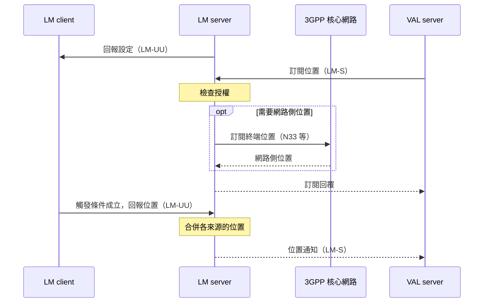

# Release 20 SEAL 02 服務模板與位置管理

本篇回答一個問題：**一項 SEAL 服務由哪些部分組成。** 先說明所有服務共用的模板，再用位置管理把模板完整走一遍。看懂一項之後，其他服務只需要換名字。

本文依據本地 TS 23.434 V20.1.0。前置閱讀是[第 01 篇][seal-01]的四方塊圖。

## 1. 每項服務都套同一個模板

§6.1 說明 SEAL 的功能模型分成通用模型和各服務的專屬模型，通用模型是各服務模型的參考。實際對照各章後，可以看到固定的命名規則：把通用名稱裡的「SEAL」換成服務的縮寫。

| 通用名稱 | 位置管理 | 群組管理 | 配置管理 | 身分管理 | 金鑰管理 | 網路資源管理 | 通知管理 |
| --- | --- | --- | --- | --- | --- | --- | --- |
| SEAL client | LM client | GM client | CM client | IM client | KM client | NRM client | NM client |
| SEAL server | LM server | GM server | CM server | IM server | KM server | NRM server | NM server |
| SEAL-UU | LM-UU | GM-UU | CM-UU | IM-UU | KM-UU | NRM-UU | NM-UU |
| SEAL-C | LM-C | GM-C | CM-C | IM-C | KM-C | NRM-C | NM-C |
| SEAL-S | LM-S | GM-S | CM-S | IM-S | KM-S | NRM-S | NM-S |
| SEAL-E | LM-E | GM-E | CM-E | IM-E | KM-E | NRM-E | 無 |
| SEAL-PC5 | LM-PC5 | GM-PC5 | CM-PC5 | IM-PC5 | KM-PC5 | NRM-PC5 | 無 |
| 對網路的介面 | T8、N33、Le | N33 | 未列 | 未列 | 未列 | Rx、N5、N33 等 | 未列 |

通知管理只定義了有網路時的模型（§17.2.1），所以沒有 NM-E 和 NM-PC5。「未列」表示該服務的參考點小節沒有列出對網路的介面，不代表該服務完全不使用網路資訊。

各服務的章節結構也相同，都是四個小節：

1. General：這項服務提供什麼。
2. Functional model：有哪些實體和參考點。
3. Procedures and information flows：實際的互動步驟。
4. SEAL APIs：提供給 VAL server 的 API 清單。

通知管理是例外：TS 23.434 V20.1.0 的第 17 章只有前三個小節，沒有 API 清單小節。

## 2. 位置管理提供什麼

位置管理（Location Management，LM）讓應用後端知道終端在哪裡。規格對它的要求包括：隨選回報、依觸發條件回報、取得網路側的位置資訊、地理圍欄、位置歷史紀錄（§4.3.2）。

兩個實體的分工如下（§9.2.4）：

| 實體 | 做什麼 |
| --- | --- |
| LM client | 在終端上與 LM server 互動，可以提供終端自己測得的位置 |
| LM server | 接收並保存位置，提供給應用後端；也可以向 PLMN 取得網路側的位置，並把多個來源合併成更準確的位置 |

## 3. 三個面向各走一遍

### 3.1. 對終端：設定回報條件並接收回報

1. LM server 把回報設定交給 LM client，內容是「要回報什麼」和「什麼事件觸發回報」，例如最短回報間隔、基地台變更（§9.3.3.2）。
2. 觸發條件成立時，LM client 把位置資訊回報給 LM server，LM server 更新該終端的位置（§9.3.3.3）。

這兩步都走 LM-UU。

### 3.2. 對應用後端：接受訂閱並通知

1. VAL server 向 LM server 訂閱一個或多個使用者或終端的位置（§9.3.7 步驟 1）。
2. LM server 檢查 VAL server 是否有權提出這項訂閱（§9.3.7 步驟 2）。
3. LM server 取得最新位置後，把位置通知 VAL server（§9.3.8）。

這三步都走 LM-S。

### 3.3. 對網路：補充終端沒有回報的資訊

LM server 可以選擇向 3GPP 核心網路訂閱該終端的位置（§9.3.7 步驟 3）。規格列出三條路（§9.2.2）：

| 介面 | 對象 | 適用系統 |
| --- | --- | --- |
| T8 | SCEF | EPS |
| N33 | NEF | 5GS |
| Le | GMLC | 定位服務 |

另外還有一條到第三方位置伺服器的 LM-3P，細節不在規格範圍內。

### 3.4. 合起來看

下圖把 §9.3.3、§9.3.7、§9.3.8 的步驟組合在一起，不是規格中的單一原圖。虛線框內是可選步驟。

## 4. 為什麼三邊都需要

**解讀：** 以下是從規格內容歸納的理由。

- **需要 client**，因為有些位置資訊只有終端自己知道，例如衛星定位座標。
- **需要對網路的介面**，因為網路知道終端連在哪個基地台，而且在終端沒有回報時仍可提供資訊。規格也註明經 T8 從 4G 取得的位置精度不會高於基地台層級（§9.2.4.3 NOTE）。
- **需要 server**，因為要有一處保存位置、合併多個來源、判斷地理圍欄等加值事件，再統一提供給應用後端。

應用後端只面對 LM-S 上的一組 API，不需要知道位置實際來自終端、NEF 還是 GMLC。

## 5. 提供給應用後端的 API

§9.4 定義了十一個位置管理 API，下表列出前七個基本的 API。表 9.4.1-1 標示的已知消費者幾乎都是 VAL server，只有服務區域變更事件的訂閱者標為 SEAL server。其餘四個是位置歷史（SS_LocationHistoryInfoEvent）、側鏈路定位（SS_SLPositioningManagement）、短距離定位（SS_SRPositioningInformation）與位置確認（SS_ConfirmLocation）。

| API | 用途 | 互動方式 |
| --- | --- | --- |
| SS_LocationReporting | 建立、更新、取消回報觸發條件 | Subscribe/Notify |
| SS_LocationInfoEvent | 訂閱並接收位置資訊 | Subscribe/Notify |
| SS_LocationInfoRetrieval | 一次性取得位置 | Request/Response |
| SS_LocationAreaInfoRetrieval | 取得某個位置附近的終端清單 | Request/Response |
| SS_LocationMonitoring | 監測位置是否偏離預期 | Subscribe/Notify |
| SS_LocationAreaMonitoring | 監測進出某個區域的終端 | Subscribe/Notify |
| SS_VALServiceAreaConfiguration | 設定應用的服務區域 | Request/Response 與 Subscribe/Notify |

這些是 Stage 2 的操作名稱。實際的 HTTP 路徑與資料結構見[第 04 篇][seal-04]。

## 6. 位置管理已經會使用 NWDAF

位置管理是 TS 23.434 內定義的傳統服務，但它的程序已經明確使用 NWDAF 的 UE mobility analytics（TS 23.288 §6.7.2）：

| 程序 | 用 NWDAF 做什麼 |
| --- | --- |
| §9.3.5 步驟 b | 應用要求自適應回報時，取得終端的移動統計與預測 |
| §9.3.7 步驟 7a | 終端位置只有最後已知值時，推估目前位置 |
| §9.3.8 步驟 3 | 在週期回報的間隔內，取得終端的預測位置回報給應用後端 |

所以「SEAL 服務使用 NWDAF 分析」不是 ADAE 和 AIMLE 才有的事。SEAL server 用什麼身分向 NWDAF 取得分析，是[第 03 篇][seal-03]的主題。

## 7. 其他注意事項

- 沒有網路時，兩台終端的 LM client 可以經 LM-PC5 直接互動（§9.2.3）。
- 位置管理的安全與隱私面向，例如 VAL server 取得終端位置的授權，不在 TS 23.434 的範圍內（§9.3.1 NOTE）。

## 規格來源

TS 23.434 V20.1.0：[§4.3][s4]、[§6.1][s61]、[§9.2][s92]、[§9.3.1][s931]、[§9.3.3][s933]、[§9.3.5][s935]、[§9.3.7][s937]、[§9.3.8][s938]、[§9.4][s94]、[§10.2][s102]、[§11.2][s112]、[§12.2][s12]、[§13.2][s13]、[§14.2][s142]、[§17.2][s17]。

[seal-01]: Release%2020%20SEAL%2001%20定位與通用模型.md
[seal-03]: Release%2020%20SEAL%2003%20與核心網路的互動.md
[seal-04]: Release%2020%20SEAL%2004%20服務%20API%20與%20CAPIF.md
[s4]: ../../../specs/Rel-20/TS%2023.434/4%20Architectural%20requirements.md
[s61]: ../../../specs/Rel-20/TS%2023.434/6%20Generic%20functional%20model%20for%20SEAL%20services/6.1%20General.md
[s92]: ../../../specs/Rel-20/TS%2023.434/9%20Location%20management/9.2%20Functional%20model%20for%20location%20management.md
[s931]: ../../../specs/Rel-20/TS%2023.434/9%20Location%20management/9.3%20Procedures%20and%20information%20flows%20for%20Location%20management%20%28on-network%29/9.3.1%20General.md
[s933]: ../../../specs/Rel-20/TS%2023.434/9%20Location%20management/9.3%20Procedures%20and%20information%20flows%20for%20Location%20management%20%28on-network%29/9.3.3%20Event-triggered%20location%20reporting%20procedure.md
[s935]: ../../../specs/Rel-20/TS%2023.434/9%20Location%20management/9.3%20Procedures%20and%20information%20flows%20for%20Location%20management%20%28on-network%29/9.3.5%20Client-triggered%20or%20VAL%20server-triggered%20location%20reporting%20procedure.md
[s937]: ../../../specs/Rel-20/TS%2023.434/9%20Location%20management/9.3%20Procedures%20and%20information%20flows%20for%20Location%20management%20%28on-network%29/9.3.7%20Location%20information%20subscription%20procedure.md
[s938]: ../../../specs/Rel-20/TS%2023.434/9%20Location%20management/9.3%20Procedures%20and%20information%20flows%20for%20Location%20management%20%28on-network%29/9.3.8%20Event-trigger%20location%20information%20notification%20procedure.md
[s94]: ../../../specs/Rel-20/TS%2023.434/9%20Location%20management/9.4%20SEAL%20APIs%20for%20location%20management.md
[s102]: ../../../specs/Rel-20/TS%2023.434/10%20Group%20management/10.2%20Functional%20model%20for%20group%20management.md
[s112]: ../../../specs/Rel-20/TS%2023.434/11%20Configuration%20management/11.2%20Functional%20model%20for%20configuration%20management.md
[s12]: ../../../specs/Rel-20/TS%2023.434/12%20Identity%20management.md
[s13]: ../../../specs/Rel-20/TS%2023.434/13%20Key%20management.md
[s142]: ../../../specs/Rel-20/TS%2023.434/14%20Network%20resource%20management/14.2%20Functional%20model%20for%20network%20resource%20management.md
[s17]: ../../../specs/Rel-20/TS%2023.434/17%20Notification%20Management.md
