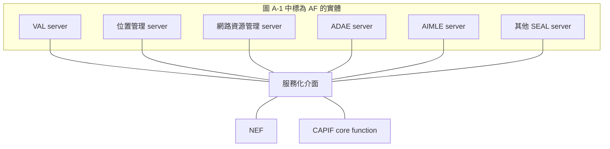
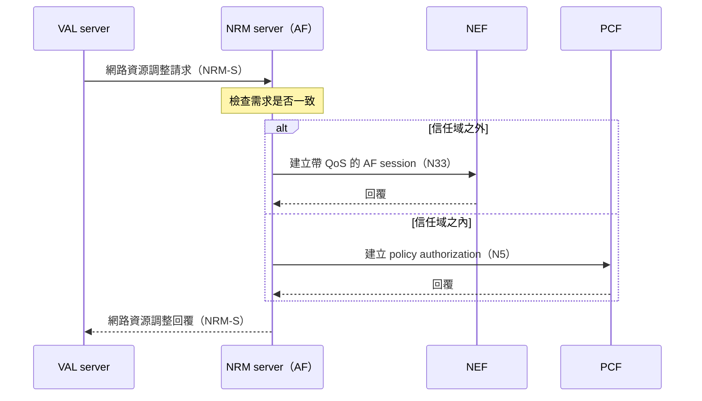

# Release 20 SEAL 03 與核心網路的互動

本篇回答一個問題：**SEAL server 怎麼向核心網路取得資訊或提出要求，它在核心網路眼中是什麼。** 這是四方塊圖上「網路介面」那一條線，也是 SEAL 與 NWDAF 接上的地方。

本文依據本地 TS 23.434 V20.1.0，例子使用網路資源管理（NRM）。前置閱讀是[第 01 篇][seal-01]與[第 02 篇][seal-02]。

## 1. 在核心網路眼中，SEAL server 是 AF

§6.2 對這條線的描述有兩部分：

- SEAL server 可以使用 3GPP 網路系統定義的介面，包括 5GS 服務化架構（SBA）的網路服務，以及 OAM 的管理服務。
- SEAL server 也可以使用核心網路北向 API 實體的服務，例如 SCEF、NEF。

Annex A 圖 A-1 把這件事畫得更直接：每一種 SEAL server 都被標成 Application Function（AF），VAL server 也是 AF，它們與 NEF 掛在同一條服務化匯流排上。

Annex A 是 informative，而且註明沒有畫出所有可能的整合方式。它說明的是角色定位：**核心網路不認識「SEAL」這個名稱，只看到一個 AF。**

## 2. 兩條路：直接互動或經 NEF

AF 與核心網路互動有兩種方式，取決於 SEAL server 是否在營運者的信任域內。NRM 的程序把這個分支寫得很清楚。

**情境：** 應用後端希望為某些終端調整網路資源，例如要求高資料速率與低延遲。

依 §14.3.3.3.1.2，步驟如下：

1. VAL server 向 NRM server 發出網路資源調整請求，指明對象與需求。
2. NRM server 處理請求。若請求附帶的 QoS 服務類型與實際 QoS 需求互相衝突，NRM server 拒絕請求，程序結束。
3. NRM server 對每個終端啟動政策與計費控制（PCC）程序，分成兩種情況：
   - NRM server 屬於第三方、位於營運者信任域之外：呼叫 NEF 的服務（規格寫作 `Nef_AFsessionwithQoS_create`）。
   - NRM server 位於營運者信任域之內：直接呼叫 PCF 的服務（規格寫作 `Npcf_PolicyAuthorization_create`）。
4. NRM server 把調整結果回覆 VAL server；需求無法滿足時可以附上失敗原因。

這個程序的前提是應用服務提供者與營運者已就 QoS 服務類型簽訂 SLA。步驟 3 中若請求沒有提供終端的 IP 位址，NRM server 會先用事件監測能力查出來。

**應用後端只說「我要什麼」，NRM server 負責把它翻譯成核心網路聽得懂的請求，並選擇正確的入口。** 這就是 SEAL 在這條線上替應用承接的工作。

## 3. 各服務用到哪些網路介面

| SEAL server | 介面 | 對象 | 用途 | 規格 |
| --- | --- | --- | --- | --- |
| 位置管理 | N33 | NEF | 取得 5GS 的位置資訊 | §9.2.2 |
| | T8 | SCEF | 取得 EPS 的位置資訊 | §9.2.2 |
| | Le | GMLC | 取得定位服務的位置資訊 | §9.2.2 |
| 群組管理 | N33 | NEF | 管理 5G 虛擬網路（5GVN）群組 | §10.2.2 |
| 網路資源管理 | N5 | PCF | 控制 5GS 的單播資源 | §14.2.2.1 |
| | Rx | PCRF | 控制 EPS 的單播資源 | §14.2.2.1 |
| | N33、T8 | NEF、SCEF | 事件監測；經 N33 取得 QoS 監測資訊 | §14.2.2.1 |
| | Nmb13、Nmb10、N33 | 5G MBS 控制面功能 | 控制 5GS 的多播與廣播資源 | §14.2.2.1 |
| | MB2-C、xMB-C | BM-SC | 控制 LTE eMBMS 的多播資源 | §14.2.2.1 |
| ADAE | N33、N6 | NEF、UPF | 以 AF 身分與 5GC 互動 | TS 23.436 §5.2.2 |
| | ADAE-OAM | OAM | 取得管理資料 | TS 23.436 §5.2.2 |

NRM server 在特定情境還會承擔更具體的網路角色：與 TSN 整合時作為 TSN AF（§14.2.2.2）；在 5G 時間敏感通訊中兼具 TSCTSF 的角色，經 N84 與 PCF 互動（§14.2.2.3）。

## 4. SEAL 在哪些地方使用 NWDAF

以下是 TS 23.434 本文中明確提到 NWDAF 或 TS 23.288 的地方：

| SEAL 服務 | 位置 | 使用的分析 | 用途 |
| --- | --- | --- | --- |
| 位置管理 | §9.3.5、§9.3.7、§9.3.8 | UE mobility analytics（TS 23.288 §6.7.2） | 自適應回報、推估位置、預測位置 |
| 位置管理 | §9.3.24 | 位置相關預測 | 側鏈路定位時尋找參考終端 |
| 網路資源管理 | §14.3.5 | QoS sustainability analytics | 評估端到端 QoS 是否能滿足 |
| 網路資源管理 | §14.3.3 | UE communication analytics（§6.7.3）、DN performance analytics（§6.14） | 回應 QoS 監測資料查詢，經 NEF 的 AnalyticsExposure 取得 |
| 網路資源管理 | §14.3.6 | 與終端相關的分析事件 | 事件監測 |
| 配置管理 | §21.2 | UE mobility analytics | 提供衛星覆蓋可用性資訊時推估終端位置 |
| 網路切片能力支援 | §16.1 | 文字提到 NWDAF API | 細節在 TS 23.435，本地無此規格 |

ADAE 與 AIMLE 使用 NWDAF 的方式見[第 06 篇][seal-06]。

## 5. 從 NWDAF 的角度看

**解讀：** 把前面幾節合起來，可以得到三個結論。

- **NWDAF 不需要認識 SEAL。** 對 NWDAF 而言，請求來自一個分析消費者：信任域內的 AF 直接使用 NWDAF 的服務，信任域外的 AF 則由 NEF 代為請求。這兩條路徑的程序定義在 TS 23.288 §6.1.1，詳見[NWDAF 與應用支援服務的關聯與互動][nwdaf-doc]第 5 節。
- **「應用使用 NWDAF」在 SEAL 架構下通常是間接的。** 應用後端呼叫 SEAL API，SEAL server 再以 AF 身分取得網路分析，加工後回給應用。
- **SEAL server 走哪條路由部署決定。** 同一種 SEAL server 放在營運者網域內或外，會走不同入口。部署方式見[第 05 篇][seal-05]。

## 6. 尚未確認

- §14.3.3 的程序文字只說明信任域內外的分支，沒有說明如何判定某個 SEAL server 屬於信任域內。
- 各 SEAL server 使用 NWDAF 時，VAL UE ID 如何對應到網路識別碼，需要逐一核對程序；識別碼的定義見[第 05 篇][seal-05]。

## 規格來源

TS 23.434 V20.1.0：[§6.2][s62]、[§9.2][s92]、[§9.3.5][s935]、[§9.3.7][s937]、[§9.3.8][s938]、[§9.3.24][s9324]、[§10.2][s102]、[§14.2][s142]、[§14.3.3][s1433]、[§14.3.5][s1435]、[§14.3.6][s1436]、[§16.1][s16]、[§21.2][s212]、[Annex A][sA]。TS 23.436 V20.2.0：[§5.2.2][adae5]。

[seal-01]: Release%2020%20SEAL%2001%20定位與通用模型.md
[seal-02]: Release%2020%20SEAL%2002%20服務模板與位置管理.md
[seal-05]: Release%2020%20SEAL%2005%20提供者、部署與識別碼.md
[seal-06]: Release%2020%20SEAL%2006%20ADAE、AIMLE%20與%20NWDAF%20的對應.md
[nwdaf-doc]: Release%2020%20NWDAF%20與應用支援服務的關聯與互動.md
[s62]: ../../../specs/Rel-20/TS%2023.434/6%20Generic%20functional%20model%20for%20SEAL%20services/6.2%20On-network%20functional%20model%20description.md
[s92]: ../../../specs/Rel-20/TS%2023.434/9%20Location%20management/9.2%20Functional%20model%20for%20location%20management.md
[s935]: ../../../specs/Rel-20/TS%2023.434/9%20Location%20management/9.3%20Procedures%20and%20information%20flows%20for%20Location%20management%20%28on-network%29/9.3.5%20Client-triggered%20or%20VAL%20server-triggered%20location%20reporting%20procedure.md
[s937]: ../../../specs/Rel-20/TS%2023.434/9%20Location%20management/9.3%20Procedures%20and%20information%20flows%20for%20Location%20management%20%28on-network%29/9.3.7%20Location%20information%20subscription%20procedure.md
[s938]: ../../../specs/Rel-20/TS%2023.434/9%20Location%20management/9.3%20Procedures%20and%20information%20flows%20for%20Location%20management%20%28on-network%29/9.3.8%20Event-trigger%20location%20information%20notification%20procedure.md
[s9324]: ../../../specs/Rel-20/TS%2023.434/9%20Location%20management/9.3%20Procedures%20and%20information%20flows%20for%20Location%20management%20%28on-network%29/9.3.24%20Support%20for%20sidelink%20positioning%20and%20ranging%20management.md
[s102]: ../../../specs/Rel-20/TS%2023.434/10%20Group%20management/10.2%20Functional%20model%20for%20group%20management.md
[s142]: ../../../specs/Rel-20/TS%2023.434/14%20Network%20resource%20management/14.2%20Functional%20model%20for%20network%20resource%20management.md
[s1433]: ../../../specs/Rel-20/TS%2023.434/14%20Network%20resource%20management/14.3%20Procedures%20and%20information%20flows%20for%20network%20resource%20management/14.3.3%20Unicast%20resource%20management.md
[s1435]: ../../../specs/Rel-20/TS%2023.434/14%20Network%20resource%20management/14.3%20Procedures%20and%20information%20flows%20for%20network%20resource%20management/14.3.5%20QoS%20and%20resource%20management%20for%20network-assisted%20UE-to-UE%20and%20VN%20group%20communications.md
[s1436]: ../../../specs/Rel-20/TS%2023.434/14%20Network%20resource%20management/14.3%20Procedures%20and%20information%20flows%20for%20network%20resource%20management/14.3.6%20Event%20Monitoring.md
[s16]: ../../../specs/Rel-20/TS%2023.434/16%20Network%20slice%20capability%20enablement.md
[s212]: ../../../specs/Rel-20/TS%2023.434/21%20SEAL%20services%20over%20Satellite%20Access/21.2%20Application%20satellite%20coverage%20availability%20information%20%28ASCAI%29%20configuration.md
[sA]: ../../../specs/Rel-20/TS%2023.434/Annex%20A%20%28informative%29%20SEAL%20integration%20with%203GPP%20network%20exposure%20systems.md
[adae5]: ../../../specs/Rel-20/TS%2023.436/5%20Application%20architecture%20for%20ADAES.md
