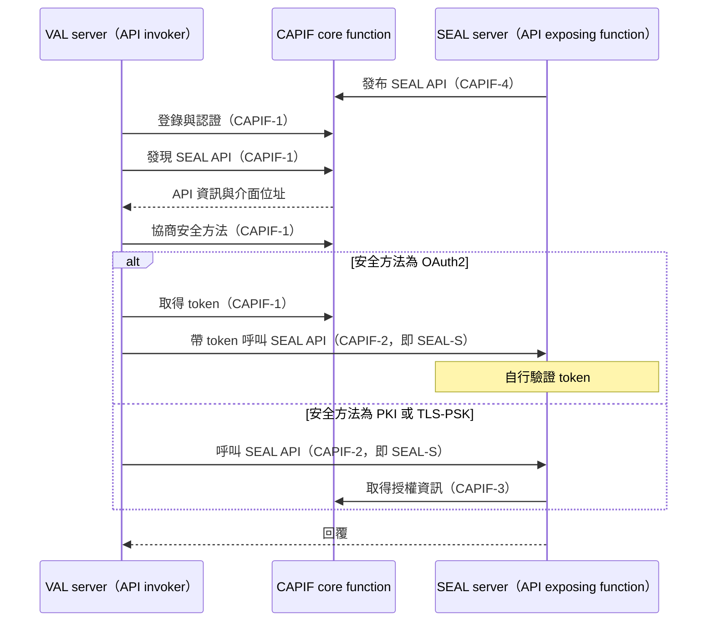
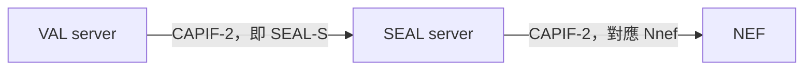

# Release 20 SEAL 04 服務 API 與 CAPIF

本篇回答一個問題：**應用後端怎麼找到並呼叫 SEAL 的 API。** 這是四方塊圖上的 SEAL-S，也是 SEAL 對外最具體的樣子。

本文依據本地 TS 23.434 V20.1.0、TS 23.222 V20.1.0、TS 29.549 V20.1.0 與 Release 20 OpenAPI 附件。前置閱讀是[第 01 篇][seal-01]與[第 02 篇][seal-02]。

## 1. SEAL 以 API 的形式提供服務

§15.1 說明：功能模型以實體和參考點描述，而應用實際上是以 API 的形式使用 SEAL 服務；每項服務在一個服務化介面上提供這些 API。

§15.3 表 15.3-1 列出各服務的介面名稱：

| 介面 | 提供者 | API 定義位置 |
| --- | --- | --- |
| Slm | 位置管理 server | TS 23.434 §9.4 |
| Sgm | 群組管理 server | TS 23.434 §10.4 |
| Scm | 配置管理 server | TS 23.434 §11.4 |
| Sim | 身分管理 server | TS 23.434 §12.4 |
| Skm | 金鑰管理 server | TS 23.434 §13.4 |
| Snrm | 網路資源管理 server | TS 23.434 §14.4 |
| Snm | 通知管理 server | 表中寫 TS 23.434 §17.4，但該小節不存在，見表後說明 |
| Snsce | 網路切片能力支援 server | TS 23.435 |
| Sdd | 資料傳遞 server | TS 23.433 |
| Sadae | ADAE server | TS 23.436 |
| Saiml | AIMLE server | TS 23.482 |
| SAn、SM | 空間錨點、空間地圖 server | TS 23.437 |
| Cccf | CAPIF core function | TS 23.222 第 10 章 |

VAL server 自己的介面 Sval 不在規格範圍內（§15.2 NOTE）。

**規格內部的落差（2026-10-13 查證）：** 表 15.3-1 把 Snm 的 API 指向 §17.4，但 TS 23.434 V20.1.0 的第 17 章只到 §17.3.5，原始目錄中也沒有 §17.4。通知管理在 Stage 2 只有程序與 information flow，沒有 API 清單小節。

## 2. CAPIF 是 SEAL API 的目錄與門禁

CAPIF（Common API Framework）是 3GPP 為北向 API 定義的共用框架，處理 API 的發布、發現、認證與授權。SEAL 沒有自己另做一套，而是直接套用 CAPIF。

TS 23.434 把 SEAL 的角色對應到 CAPIF 的角色：

| SEAL 的角色 | CAPIF 的角色 | 規格 |
| --- | --- | --- |
| VAL server | API invoker（呼叫方） | §6.4.2.3 |
| SEAL server | API exposing function（提供 API 的一方） | §6.4.2.5 |
| 各服務的 -S 參考點，例如 LM-S、NRM-S | CAPIF-2 的實例 | §9.2.5.5、§14.2.5.5 |
| SEAL API 的發布與發現 | 在 CAPIF core function 上進行 | §15.2 |

TS 29.549 §8.1 進一步規定，使用 CAPIF 時 SEAL server 除了 API exposing function，還要支援 API publishing function 與 API management function。

**注意縮寫：** TS 23.222 §3 把 API management function 縮寫為 AMF，與 5GC 的 AMF（Access and Mobility Management Function）無關。本系列一律寫全名。

## 3. 一次呼叫的完整過程

CAPIF 的參考點以編號命名，每個編號固定對應一組兩端（TS 23.222 §6.4）。理解 SEAL 需要的是下面五個，可以分成三組來記：

| 分組 | 參考點 | 兩端 | 用途 | 套到 SEAL 上 |
| --- | --- | --- | --- | --- |
| 呼叫方找目錄 | CAPIF-1 | API invoker ↔ CAPIF core function | 呼叫方登錄（onboarding）、認證、取得授權、發現 API | VAL server 查詢有哪些 SEAL API |
| 呼叫方找提供方 | CAPIF-2 | API invoker ↔ API exposing function | 驗證呼叫方身分與授權，實際呼叫 API | 就是 SEAL-S，例如 LM-S、NRM-S |
| 提供方找目錄 | CAPIF-3 | API exposing function ↔ CAPIF core function | 存取控制：確認呼叫方的授權、套用營運者政策、記錄呼叫 | SEAL server 向目錄確認 VAL server 能否呼叫 |
| 提供方找目錄 | CAPIF-4 | API publishing function ↔ CAPIF core function | 發布 API 資訊 | SEAL server 把自己的 API 登記到目錄 |
| 提供方找目錄 | CAPIF-5 | API management function ↔ CAPIF core function | 管理：查詢呼叫紀錄、監看事件、設定節流等政策、登記提供方的各項功能 | SEAL server 的管理面 |

CAPIF-2 只規定認證、授權檢查與「可以呼叫」這件事；每支 API 的內容由提供方自己的規格定義（TS 23.222 §6.4.4 NOTE 1）。所以 CAPIF 本身不知道位置管理的 API 長什麼樣，那是 TS 29.549 的範圍。

提供方那一側其實是三個功能：API exposing function 提供 API、API publishing function 發布、API management function 管理。TS 29.549 §8.1 要求使用 CAPIF 的 SEAL server 三個都要支援，因此 CAPIF-3、CAPIF-4、CAPIF-5 的提供方那一端都是 SEAL server。同一節也說明，CAPIF core function 與提供方的功能部署在一起時，兩者之間可以不經由這三個參考點互動。

**帶 `e` 的版本**表示該參考點跨越信任域，功能與不帶 `e` 的相同：

| 參考點 | 跨越的邊界 | 規格 |
| --- | --- | --- |
| CAPIF-1e | 呼叫方在 PLMN 信任域之外 | TS 23.222 §6.4.3 |
| CAPIF-2e | 呼叫方與 API exposing function 屬於不同信任域 | TS 23.222 §6.4.5 |
| CAPIF-3e、CAPIF-4e、CAPIF-5e | 提供方的功能在第三方信任域，CAPIF core function 在 PLMN 信任域 | TS 23.222 §6.4.9 至 §6.4.11 |

**修正紀錄（2026-10-13）：** 本節原本只列 CAPIF-1、CAPIF-2、CAPIF-4，並把所有帶 `e` 的版本都寫成「呼叫方在營運者信任域之外」。依 TS 23.222 §6.4 逐條核對後，這個說法只適用於 CAPIF-1e；其餘各有不同的邊界，已改為上表。另依 TS 29.549 §8.1 補上 SEAL server 也要支援的 CAPIF-3 與 CAPIF-5。

TS 23.222 另外定義了 CAPIF-6（兩個 CAPIF core function 之間）、CAPIF-7（兩個 API exposing function 之間轉送呼叫）與 CAPIF-8（與 resource owner function 之間，功能留待後續版本）。本系列不展開這三個。

把這些套到 SEAL 上：

此圖依 TS 23.222 §6.4 的參考點用途與 TS 29.549 §8 組合。兩種安全方法的差別來自 TS 29.549 §8.2：使用 OAuth2 時，CAPIF core function 擔任授權伺服器，VAL server 先取得 token，SEAL server 自行檢查 token；使用 PKI 或 TLS-PSK 時，SEAL server 在收到呼叫後向 CAPIF core function 取得授權資訊。

**類比：** CAPIF core function 保存 API 目錄並負責授權，在這一點上類似 5GC 的 NRF。這只是幫助理解的類比，兩者不是同一種網元，程序也不同。

### 3.1. CAPIF-2 不是 SEAL 專用的

CAPIF-2 是「任何呼叫方與任何 API 提供方」之間的通用關係，VAL server 呼叫 SEAL server 只是其中一種用法。兩個方向都要注意：

| 說法 | 是否正確 | 依據 |
| --- | --- | --- |
| VAL server 與 SEAL server 的互動（SEAL-S）是 CAPIF-2 | 正確，規格稱為 CAPIF-2 的實例 | TS 23.434 §9.2.5.5 |
| VAL 與 SEAL 的所有互動都是 CAPIF-2 | 不正確。終端側的 SEAL-C 與 SEAL-UU 不屬於 CAPIF | 見第 7 節 |
| CAPIF-2 只出現在 VAL server 與 SEAL server 之間 | 不正確。SEAL server 使用核心網路的北向 API 時，自己是 API invoker，SCEF、NEF 是 API exposing function | TS 23.434 §9.2.2 圖 9.2.2-4 |

也就是說，同一個 SEAL server 可以同時擔任兩種 CAPIF 角色：對 VAL server 是提供方，對 NEF 是呼叫方。TS 23.222 Annex B 也把 5GC 的對外開放對應到 CAPIF：NEF 相當於 API exposing function，AF 相當於 API invoker，Nnef 承載 CAPIF-2 中與個別服務有關的部分。

此圖是把上述兩處規格文字畫在一起，表示角色關係；SEAL server 是否經由 CAPIF 使用 NEF 的 API 取決於部署。

### 3.2. NEF 是否會把 API 發布到 CAPIF

可以，但不是必須。TS 23.501 §6.2.5.1 的文字是：NEF 用於對外開放時，CAPIF `may be supported`；支援 CAPIF 時，NEF 支援 CAPIF 的 API provider domain functions，也就是提供、發布、管理三個功能。

是否支援 CAPIF，對 AF 的差別在於如何找到 API。這件事分成兩層：

| 層次 | 不支援 CAPIF | 支援 CAPIF | 依據 |
| --- | --- | --- | --- |
| 找到 NEF 在哪裡 | 三種方式擇一：在 AF 上本地設定；AF 以 DNS 查詢；AF 受營運者信任時向 NRF 查詢 | 可以不必另外查：CAPIF 的發現結果可包含介面資訊，例如 IP 位址、埠號、URI | TS 23.501 §6.3.14、TS 23.222 §8.7 |
| 知道各服務的 API 端點 | 在 AF 上以本地設定寫入 | AF 向 CAPIF core function 查詢，或接收 API 可用性的事件通知 | TS 23.501 §5.17.5 |

所以沒有 CAPIF 不等於一切都要寫死：NEF 的位址仍可以動態取得，只是 NRF 這條路限於受信任的 AF。§5.17.5 的那句話出現在 SCEF 與 NEF 合併節點的段落，講的是各服務的 API 端點。

**修正紀錄（2026-10-13）：** 本節原本只引用 §5.17.5，寫成「不支援 CAPIF 時在 AF 上以本地設定寫入」。補查 §6.3.14 後，改為區分上表的兩個層次。

TS 23.222 Annex B.2.2（informative）列出 NEF 配合 CAPIF 的三種部署：

| 部署 | CAPIF core function 在哪裡 | NEF 做什麼 |
| --- | --- | --- |
| NEF 實作整個 CAPIF 架構（B.2.2.2） | 在 NEF 內 | 同時擔任目錄與提供方，另外對 AF 提供 CAPIF-1 |
| NEF 只實作服務相關的部分（B.2.2.3） | 獨立部署，與 NEF 並存 | 擔任提供方，經 CAPIF-3 連到 CAPIF core function |
| 分散式部署（B.2.2.4） | 獨立部署 | 拆成兩個 NEF，其中一個作為對外的閘道 |

只有後兩種是「NEF 向另一個實體發布 API」。第一種的目錄就在 NEF 內部，Annex B 的對照表把 CAPIF-3、CAPIF-4、CAPIF-5 標為 `Internal to NEF`。

**用詞：** CAPIF 把「登記提供方的功能」（registration，經 CAPIF-5）和「發布 API 資訊」（publish，經 CAPIF-4）分成兩件事。口語說的「註冊到 CAPIF」通常兩者都包含。

## 4. CAPIF 是否必須

Stage 2 與 Stage 3 的文字有落差，需要分開看：

| 來源 | 文字 |
| --- | --- |
| TS 23.434 §4.1.2-e | VAL server 與 SEAL server 之間的 API 互動 `shall conform to CAPIF` |
| TS 23.434 §4.1.2-f | SEAL server `shall provide a service API compliant with CAPIF` |
| TS 29.549 §8.1 | `When CAPIF is used with a SEAL service` 時，SEAL server 應支援的功能 |
| TS 29.549 §9.2 | `When CAPIF is not used` 時，應支援 TLS 與 OAuth 2.0 |

Stage 2 把符合 CAPIF 列為架構需求；Stage 3 則同時定義了使用與不使用 CAPIF 兩種情況下的安全機制。本文只記錄這個落差，未進一步判定何者優先。

## 5. 實際的 API 長什麼樣

以下例子取自本地 Release 20 的 TS 29.549、TS 29.482 與 OpenAPI 附件：

| Stage 2 操作 | HTTP 操作 | 來源 |
| --- | --- | --- |
| NRM 的 `Reserve_Network_Resource` | `POST {apiRoot}/ss-nra/v1/unicast-subscriptions`，請求與成功回覆（`201`）都使用 `UnicastSubscription` | TS 29.549 §5.5.1.2.3、`TS29549_SS_NetworkResourceAdaptation.yaml` |
| 位置管理的回報觸發條件 | `{apiRoot}/ss-lr/v1/trigger-configurations` | `TS29549_SS_LocationReporting.yaml` |
| 位置管理的位置訂閱 | `{apiRoot}/ss-events/v1/subscriptions`，事件為 `LM_LOCATION_INFO_CHANGE` | TS 29.549 §5.2.2、`TS29549_SS_Events.yaml` |
| ADAE 的切片應用效能分析訂閱 | `{apiRoot}/ss-adae-sspa/v1/slice-specific-application-performance` | `TS29549_SS_ADAE_SlicePerformanceAnalytics.yaml` |
| AIMLE 的模型訓練請求 | `{apiRoot}/aimles-trn/v1/request-train` | `TS29482_AIMLES_MLModelTraining.yaml` |

位置訂閱的例子值得注意：Stage 2 有一個獨立的 `SS_LocationInfoEvent` API，Stage 3 則把它實作成共用的 `SS_Events` API 中的一種事件。**Stage 2 的 API 名稱與 Stage 3 的資源路徑不一定一對一對應。**

## 6. 哪一份規格定義哪一段

| 範圍 | 規格 | 本地版本 |
| --- | --- | --- |
| 架構、程序、API 清單（Stage 2） | TS 23.434 | Release 20 V20.1.0 |
| SEAL server 提供的 API（Stage 3），包含 ADAE | TS 29.549 | Release 20 V20.1.0 |
| AIMLE server 與 ML repository 的 API（Stage 3） | TS 29.482 | Release 20 V20.1.0 |
| AIMLE 的 client 側協定 | TS 24.560 | Release 20 V20.1.0 |
| ADAE 的協定 | TS 24.559 | Release 19 V19.4.1 |
| 配置管理、身分管理的協定 | TS 24.546、TS 24.547 | Release 19 V19.5.0、V19.0.0 |
| SEAL 的安全機制 | TS 33.434 | Release 19 V19.0.0 |
| CAPIF 架構與 API | TS 23.222、TS 29.222 | Release 20 V20.1.0 |

TS 29.549 §4 另外指出，SEALDD、NSCE、空間錨點與空間地圖的 API 分別定義在 TS 29.548、TS 29.435、TS 29.437，本地沒有這些規格。

## 7. 終端那一側

SEAL-UU 是 SEAL client 與 SEAL server 之間的互動，不屬於 CAPIF 的範圍。TS 23.434 用信令控制面的實體描述它的傳輸方式：

- **HTTP**：SEAL client 作為 HTTP client，經 HTTP proxy 連到 SEAL server（§6.4.3.3）。
- **SIP**：部分服務的訂閱與通知使用 SIP，例如 LM-UU（§9.2.5.2）。
- **LWP**：資源受限的終端使用輕量協定，Annex C 定義以 CoAP 實現（§6.4.3.5）。

### 7.1. SEAL-C 只有名稱，沒有 API 定義

SEAL-C 是同一台終端內 VAL client 與 SEAL client 的互動。查證本地規格後的結論是：**規格為它命名，並在程序中用文字描述它的行為，但沒有為它定義 information flow、API 或協定。**

| 查證的範圍 | 找到的內容 |
| --- | --- |
| 通用模型（TS 23.434 §6.5.2.6） | 一句話：VAL client 與 SEAL client 在 VAL UE 內的互動統稱 SEAL-C，各服務對應的參考點由各服務的功能模型規定 |
| 七項服務的 -C 小節（LM-C、GM-C、CM-C、IM-C、KM-C、NRM-C、NM-C） | 各只有一句話，句型相同：該服務的 VAL client 與 client 之間的互動由這個參考點支援 |
| ADAE-C（TS 23.436 §5.5.4）、AIML-C（TS 23.482 §5.2.4.4） | 同樣各只有一句話 |
| 各服務的 API 小節 | 沒有以 VAL client 為消費者的 API |
| 安全（TS 33.434 §5.1.1.7，Release 19） | 這個參考點完全位於 UE 內，安全交由製造商決定，不在規格範圍 |
| Stage 3（TS 24.546、TS 24.547、TS 24.559、TS 24.560、TS 29.549、TS 29.482） | 全文沒有出現任何 -C 參考點的名稱 |

程序裡仍然看得到這條線在做什麼，只是以文字帶過。以通知管理為例（TS 23.434 §17.3.3）：VAL client 請 NM client 代為訂閱通知，NM client 回覆結果並附上 callback URL，之後再把收到的通知交給對應的 VAL client。但同一章列出的八個 information flow 都是 NM client、NM server、VAL server 之間的訊息，沒有 VAL client 與 NM client 之間的。

兩個容易誤判的地方：

- **TS 23.482 §9.4 的「AIMLE client APIs」不是 AIML-C。** 這一節共九個小節，表中列出的消費者只有 AIMLE server 與 AIMLE client，沒有 VAL client。也就是說，它們是 AIMLE client 提供給 AIMLE server 或另一個 AIMLE client 的 API。
- **3GPP 應用層不是一律不定義終端內部的介面。** 邊緣運算的 EDGE-5 是 AC 與 EEC 之間、同樣位於終端內的參考點，TS 23.558 §8.14 就為它定義了程序、information flow 與 API。SEAL 沒有對 SEAL-C 做同樣的事。

**解讀：** SEAL-C 實際上是 SEAL client 提供者自訂的本地介面。這與[第 05 篇][seal-05]提到的部署方式相符：SEAL client 可以做成 UE SDK，此時 SEAL-C 就是 SDK 的函式呼叫。TS 23.482 §5.2.1 的 NOTE 也說，AIMLE client 可以是獨立的軟體並經 AIML-C 提供 API 給 VAL client，也可以直接做成 VAL client 的一部分；後者連這條線都不存在於實作中。

**查證範圍的限制：** 上表核對的是各服務的參考點小節、API 小節與本地 Stage 3 規格的全文搜尋；各服務的每一個程序沒有逐一閱讀。本地沒有的 TS 23.433、TS 23.435、TS 23.437 也不在範圍內。

**修正紀錄（2026-10-13）：** 本節原本寫「未查證各服務是否為 SEAL-C 定義了具體的 API」，已依上述查證補上結論。

## 規格來源

TS 23.434 V20.1.0：[§4.1.2][s4]、[§6.4][s64]、[§9.2][s92]、[§14.2][s142]、[§15][s15]、[Annex C][sC]。TS 23.222 V20.1.0：[§6.2][c62]、[§6.4][c64]、[§8.7][c87]、[Annex B][cB]。TS 29.549 V20.1.0：[§4][p4]、[§5.2.2][p522]、[§5.5.1.2.3][p5513]、[§8][p8]、[§9][p9]。TS 23.434 V20.1.0 另見 [§6.5][s65]、[§17][s17]。TS 23.436 V20.2.0：[§5][adae5]。TS 23.482 V20.3.0：[§5][aimle5]、[§9.4][aimle94]。TS 23.558 V20.3.0：[§8.14][edge5]。TS 33.434（Release 19）：[§5.1][sec51]。TS 23.501（Release 18）：[§5.17.5][t5175]、[§6.2.5.1][t625]、[§6.3.14][t6314]。OpenAPI：[Release 20 附件索引][openapi]。版本索引：[Release 20][rel20]、[Release 19][rel19]。

[seal-01]: Release%2020%20SEAL%2001%20定位與通用模型.md
[seal-02]: Release%2020%20SEAL%2002%20服務模板與位置管理.md
[s4]: ../../../specs/Rel-20/TS%2023.434/4%20Architectural%20requirements.md
[s64]: ../../../specs/Rel-20/TS%2023.434/6%20Generic%20functional%20model%20for%20SEAL%20services/6.4%20Functional%20entities%20description.md
[s92]: ../../../specs/Rel-20/TS%2023.434/9%20Location%20management/9.2%20Functional%20model%20for%20location%20management.md
[s142]: ../../../specs/Rel-20/TS%2023.434/14%20Network%20resource%20management/14.2%20Functional%20model%20for%20network%20resource%20management.md
[s15]: ../../../specs/Rel-20/TS%2023.434/15%20Service-based%20interface%20representation%20of%20the%20functional%20model%20for%20SEAL%20services.md
[sC]: ../../../specs/Rel-20/TS%2023.434/Annex%20C%20%28normative%29%20Protocol%20realizations%20of%20LWP%20in%20the%20signalling%20control%20plane.md
[c62]: ../../../specs/Rel-20/TS%2023.222/6%20Functional%20model/6.2%20Functional%20model%20description.md
[c64]: ../../../specs/Rel-20/TS%2023.222/6%20Functional%20model/6.4%20Reference%20points.md
[cB]: ../../../specs/Rel-20/TS%2023.222/Annex%20B%20%28informative%29%20CAPIF%20relationship%20with%20network%20exposure%20aspects%20of%203GPP%20systems.md
[p4]: ../../../specs/Rel-20/TS%2029.549/4%20Overview.md
[p522]: ../../../specs/Rel-20/TS%2029.549/5%20Services%20offered%20by%20the%20SEAL%20servers/5.2%20Location%20management%20APIs/5.2.2%20SS_LocationInfoEvent%20API.md
[p5513]: ../../../specs/Rel-20/TS%2029.549/5%20Services%20offered%20by%20the%20SEAL%20servers/5.5%20Network%20resource%20management%20APIs/5.5.1%20SS_NetworkResourceAdaptation%20API/5.5.1.2%20Service%20Operations/5.5.1.2.3%20Reserve_Network_Resource.md
[p8]: ../../../specs/Rel-20/TS%2029.549/8%20Using%20Common%20API%20Framework.md
[p9]: ../../../specs/Rel-20/TS%2029.549/9%20Security.md
[openapi]: ../../../specs/Rel-20/openapi/README.md
[rel20]: ../../../specs/Rel-20/README.md
[rel19]: ../../../specs/Rel-19/README.md
[t5175]: ../../../specs/Rel-18/TS%2023.501/5%20High%20level%20features/5.17%20Interworking%20and%20Migration/5.17.5%20Service%20Exposure%20in%20Interworking%20Scenarios.md
[t625]: ../../../specs/Rel-18/TS%2023.501/6%20Network%20Functions/6.2%20Network%20Function%20Functional%20description/6.2.5%20NEF.md
[t6314]: ../../../specs/Rel-18/TS%2023.501/6%20Network%20Functions/6.3%20Principles%20for%20Network%20Function%20and%20Network%20Function%20Service%20discovery%20and%20selection/6.3.14%20NEF%20Discovery.md
[c87]: ../../../specs/Rel-20/TS%2023.222/8%20Procedures%20and%20information%20flows/8.7%20Discover%20service%20APIs.md
[seal-05]: Release%2020%20SEAL%2005%20提供者、部署與識別碼.md
[s65]: ../../../specs/Rel-20/TS%2023.434/6%20Generic%20functional%20model%20for%20SEAL%20services/6.5%20Reference%20points%20description.md
[s17]: ../../../specs/Rel-20/TS%2023.434/17%20Notification%20Management.md
[adae5]: ../../../specs/Rel-20/TS%2023.436/5%20Application%20architecture%20for%20ADAES.md
[aimle5]: ../../../specs/Rel-20/TS%2023.482/5%20Application%20architecture%20for%20enabling%20AI%20and%20ML%20services.md
[aimle94]: ../../../specs/Rel-20/TS%2023.482/9%20AIMLE%20APIs/9.4%20AIMLE%20client%20APIs.md
[edge5]: ../../../specs/Rel-20/TS%2023.558/8%20Procedures%20and%20information%20flows/8.14%20EDGE-5%20APIs/README.md
[sec51]: ../../../specs/Rel-19/TS%2033.434/5%20Procedures/5.1%20Security%20for%20the%20SEAL%20interfaces.md
