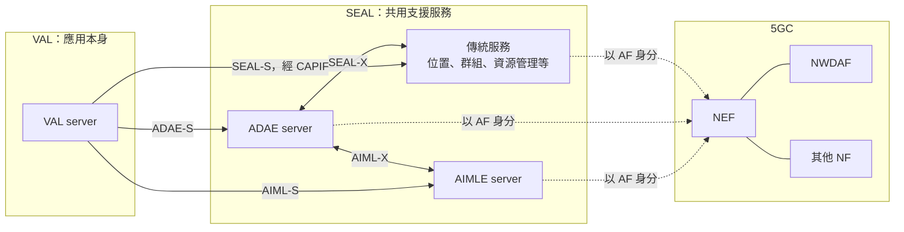

# Release 20 SEAL 06 ADAE、AIMLE 與 NWDAF 的對應

本篇回答一個問題：**ADAE、AIMLE 和 NWDAF 各自對應到 SEAL 架構的哪個位置。** 前五篇已經建立了 SEAL 的模板，本篇把 ADAE 與 AIMLE 套進去，再整理它們與核心網路分析體系的對應。

本文依據本地 TS 23.434 V20.1.0、TS 23.436 V20.2.0、TS 23.482 V20.3.0。本篇只做定位；各服務的內容與程序細節在文末列出的輔助文件。

## 1. ADAE 與 AIMLE 是另外兩項 SEAL 服務

TS 23.434 第 19、20 章各用一段文字把 ADAE 與 AIMLE 列為 SEAL service，並把細節交給 TS 23.436 與 TS 23.482。這兩份規格的架構章都說明自己以 TS 23.434 §6.2 的通用模型為基礎（TS 23.436 §5.2.1、TS 23.482 §5.1）。TS 23.482 §5.2.1.1 更直接寫明：AIMLE server 和 ADAES 一樣，是以 SEAL server 的身分部署。

所以[第 02 篇][seal-02]的模板可以直接套用：

| 通用名稱 | 位置管理 | ADAE | AIMLE |
| --- | --- | --- | --- |
| SEAL client | LM client | ADAE client（ADAEC） | AIMLE client |
| SEAL server | LM server | ADAE server（ADAES） | AIMLE server |
| SEAL-UU | LM-UU | ADAE-UU | AIML-UU |
| SEAL-C | LM-C | ADAE-C | AIML-C |
| SEAL-S | LM-S | ADAE-S | AIML-S |
| SEAL-E | LM-E | 參考點小節未列 | AIML-E |
| SEAL-PC5 | LM-PC5 | ADAE-PC5 | AIML-PC5 |
| 服務化介面 | Slm | Sadae | Saiml |
| Stage 2 規格 | TS 23.434 第 9 章 | TS 23.436 | TS 23.482 |
| server API（Stage 3） | TS 29.549 | TS 29.549 | TS 29.482 |

ADAE-S 和其他服務的 -S 參考點一樣，是 CAPIF-2 的實例；ADAE server 也同樣作為 CAPIF 的 API exposing function（TS 23.436 §5.4.3、§5.5.5）。

## 2. 和傳統服務不同的地方

### 2.1. 它們有模板以外的內部實體

| 服務 | 額外的實體 | 做什麼 | 額外的參考點 |
| --- | --- | --- | --- |
| ADAE | A-DCCF | 協調資料的收集與分發；ADAE server 可以向它要資料，不必直接面對各資料來源 | ADAE-X、ADCCF-1 |
| ADAE | A-ADRF | 保存歷史資料與分析結果 | AADRF-1 |
| ADAE | 資料來源 | ADAE server 不經 A-DCCF 時直接收集資料 | ADAE-Y |
| AIMLE | ML repository | 保存模型相關資訊，登錄 ML／FL 參與者 | AIML-R |

TS 23.436 §5.3 列出 ADAE 的資料來源類型：5GS（5GC、OAM）、支援層（SEAL、EEL）、資料網路側的外部來源（VAL server、EAS）以及 VAL UE。

### 2.2. 它們會使用其他 SEAL 服務

ADAE server 經 SEAL-X 與其他 SEAL server 互動（TS 23.436 §5.2.2 圖 5.2.2-4）。ADAES 使用 AIMLE 服務的那條線稱為 AIML-X，規格明說它是 SEAL-X 的一個實例（TS 23.436 §5.5.9）。

這與[第 01 篇][seal-01]提到的 SEAL-X1（金鑰管理提供金鑰給群組管理）是同一種關係：一項 SEAL 服務作為另一項的消費者。

### 2.3. 它們提供的是分析與 AI/ML，而不是網路能力的包裝

**解讀：** 位置管理、網路資源管理主要把網路已有的能力整理成應用好用的形式。ADAE 與 AIMLE 則各自產生新的結果，規格對它們的描述是：

- **ADAE** 提供涵蓋端到端應用服務的統計與預測，並以統一的方式向應用暴露來自不同 3GPP 網域的資料分析（TS 23.434 §19.1）。
- **AIMLE** 提供協助應用層進行 AI/ML 的能力（TS 23.434 §20.1），例如模型訓練、推論、參與端管理。

## 3. 與核心網路分析體系的對應

TS 23.436 §5.1 說明 ADAE 的內部架構「對齊 3GPP 資料分析框架（TS 23.288）」，並引入 A-DCCF、A-ADRF 等新的邏輯實體。這是規格明示的設計取向，名稱上的對應也很直接。

下表的「關係」欄是**解讀**，用來幫助從 NWDAF 的背景理解應用側。

| 應用側（SEAL） | 核心網路側 | 關係 |
| --- | --- | --- |
| ADAE server | NWDAF 的 AnLF | 都產生分析；服務對象、分析項目與程序不同，不是一對一 |
| AIMLE server | NWDAF 的 MTLF | 都涉及模型訓練；AIMLE 還包含推論與參與端管理，服務契約不同 |
| A-DCCF | DCCF | 名稱與職責相仿，都是資料收集的協調者 |
| A-ADRF | ADRF | 名稱與職責相仿，都保存歷史資料與分析 |
| ML repository | 模型儲存 | 職責相仿；核心網路側由哪個功能保存模型本文未核對 |
| CAPIF core function | NRF | 都提供服務目錄與授權，不是同一種網元 |
| SEAL server | AF | 同一個實體在核心網路眼中的角色，見[第 03 篇][seal-03] |
| VAL UE ID | GPSI 等 | 依服務協議對應，見[第 05 篇][seal-05] |

**相似的是工作內容，標準沒有把它們定義成同一套服務。** 例如 NWDAF 的聯邦學習訓練服務只開放給含 MTLF 的 NWDAF 之間使用，應用側不能直接呼叫；這一點的依據見[2026-10-01 會議議題與後續探索][meeting]第 3 節。

## 4. SEAL 與 NWDAF 的接點一覽

把[第 03 篇][seal-03]的傳統服務和本篇的兩項服務合在一起：

| 方向 | 誰與 NWDAF 互動 | 內容 | 依據 | 細節在哪裡 |
| --- | --- | --- | --- | --- |
| SEAL 使用網路分析 | 位置管理、網路資源管理、配置管理 server | UE mobility、QoS sustainability 等分析 | TS 23.434 §9.3、§14.3、§21.2 | [第 03 篇][seal-03]第 4 節 |
| SEAL 使用網路分析 | ADAE server | 切片負載、服務體驗、UE mobility、DN performance、Relative Proximity 等分析，用來產生各項應用層分析 | TS 23.436 §8.3 為一例；另有 §8.5、§8.7、§8.8、§8.14、§8.15、§8.17、§10.2 至 §10.4 | [NWDAF 文件][nwdaf-doc]第 3 節、[ML 01][ml-01]第 6 節 |
| SEAL 使用網路分析 | AIMLE server | UE mobility analytics，用來輔助選擇參與端；另有四種分析作為切分式操作的輔助資訊 | TS 23.482 §8.9.2.1、§8.14.2.5.2 | [NWDAF 文件][nwdaf-doc]第 4 節、[ML 01][ml-01]第 5 節 |
| 應用資料進入 NWDAF | AF | UE application 的資料收集 | TS 23.288 §6.2.8.2 | [NWDAF 文件][nwdaf-doc]第 6 節 |
| 共同訓練與推論 | AF | NWDAF 與 AF 的垂直聯邦學習 | TS 23.288 §6.2H | [NWDAF 文件][nwdaf-doc]第 7 節 |

前三列都是 SEAL server 消費 NWDAF 的分析，結構與位置管理使用 UE mobility analytics 相同。後兩列的主角是 AF；SEAL server 能否承擔這些程序中的 AF 角色，要看它是否具備對應的能力與契約，不能只因為它是 AF 就成立。

**規格對「以什麼身分、經什麼路徑」寫得很少。** ADAE 與 AIMLE 兩份規格大多只寫「使用 NWDAF 的某項分析」：

- TS 23.436 寫明 ADAE server「acting as AF」訂閱 NWDAF 的只有 §8.2.2 的一則 NOTE；寫明「經 NEF」的只有 §8.7 與 §10.4。全文沒有出現 `Nnwdaf` 或 `Nnef_` 的服務名稱。
- TS 23.482 寫明 AIMLE server「acting as AF」的只有 §8.14.2.5.2 與 §8.5.3a，對象是 NEF 與 EIF，不是 NWDAF。使用 NWDAF 分析的句子沒有寫身分與路徑。

所以「SEAL server 以 AF 身分、經 NEF 取得 NWDAF 分析」是依架構章（TS 23.436 §5.2.2、TS 23.482 圖 5.2.1.1-2）所做的**解讀**，不是每個程序的明文。

**修正紀錄（2026-10-13）：** 本節原本寫「前三列都是 SEAL server 以 AF 身分消費 NWDAF 分析」，並且只列 TS 23.436 §8.3 與 TS 23.482 §8.9.2.1 兩處。全文比對後確認：使用 NWDAF 分析的程序不只這兩處，而「以 AF 身分」在多數程序中沒有明文。依據見[應用層與核心網路的 ML 01][ml-01]第 5、6 節。

## 5. 一張圖總結

此圖只畫伺服器側，並選用經 NEF 的路徑（這是解讀，見第 4 節的說明）；信任域內的 SEAL server 可以直接與核心網路功能互動。圖中的線表示可能的互動關係，不是每個請求都要走過的順序。

## 6. 接下來讀什麼

AIMLE 內部怎麼運作，包括一次聯邦學習從頭到尾的流程，見[第 07 篇][seal-07]。以下輔助文件保留了各服務的內容與程序細節：

- [ADAE 與 AIMLE 的角色與例子][roles-doc]：用巡檢 App 的情境說明 ADAE、AIMLE 各自的 client 與 server 做什麼。
- [ADAES 與 AIMLE 的關係][relation-doc]：兩者的服務契約差異與雙向協作。
- [NWDAF 與應用支援服務的關聯與互動][nwdaf-doc]：四種互動的程序、前提與限制。

以機器學習為主題的後續整理，從[應用層與核心網路的 ML 01 機制總覽][ml-01]開始。

## 規格來源

TS 23.434 V20.1.0：[§19][s19]、[§20][s20]。TS 23.436 V20.2.0：[§5][adae5]。TS 23.482 V20.3.0：[§5][aimle5]。

[seal-01]: Release%2020%20SEAL%2001%20定位與通用模型.md
[seal-02]: Release%2020%20SEAL%2002%20服務模板與位置管理.md
[seal-03]: Release%2020%20SEAL%2003%20與核心網路的互動.md
[seal-05]: Release%2020%20SEAL%2005%20提供者、部署與識別碼.md
[seal-07]: Release%2020%20SEAL%2007%20AIMLE%20怎麼運作.md
[roles-doc]: Release%2020%20ADAE%20與%20AIMLE%20的角色與例子.md
[relation-doc]: Release%2020%20ADAES%20與%20AIMLE%20的關係.md
[nwdaf-doc]: Release%2020%20NWDAF%20與應用支援服務的關聯與互動.md
[meeting]: 2026-10-01%20會議議題與後續探索.md
[ml-01]: 應用層與核心網路的%20ML%2001%20機制總覽.md
[s19]: ../../../specs/Rel-20/TS%2023.434/19%20Application%20Data%20Analytics%20Enablement.md
[s20]: ../../../specs/Rel-20/TS%2023.434/20%20AIML%20Enablement.md
[adae5]: ../../../specs/Rel-20/TS%2023.436/5%20Application%20architecture%20for%20ADAES.md
[aimle5]: ../../../specs/Rel-20/TS%2023.482/5%20Application%20architecture%20for%20enabling%20AI%20and%20ML%20services.md
