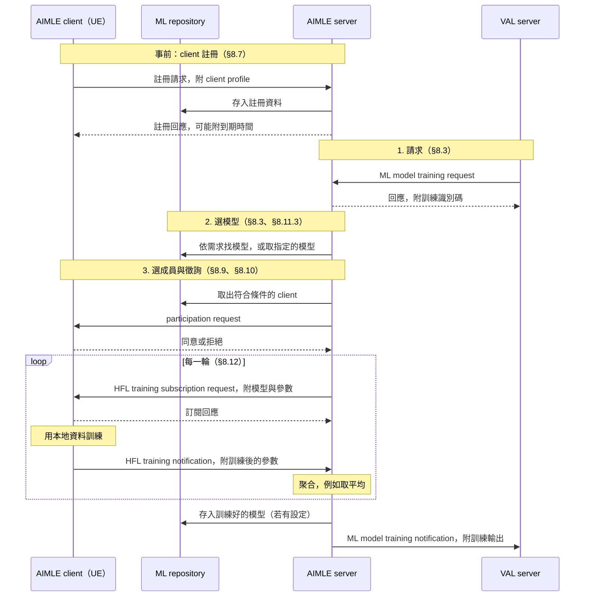

# Release 20 SEAL 07 AIMLE 怎麼運作

本篇回答一個問題：**AIMLE 實際怎麼運作，一次聯邦學習（FL）從頭到尾經過哪些步驟，每一步由誰做什麼。**

[第 06 篇][seal-06]只把 AIMLE 放到 SEAL 架構裡的位置。本篇往裡面看：有哪些元件、能力怎麼分類、FL 的程序怎麼串起來，以及規格寫到哪裡為止。

**本篇的定位：要讀的文件。** 主軸是第 4 節的 HFL 流程。其他小節是為了看懂這條流程，或說明它的變化。

本文依據本地 TS 23.482 V20.3.0，也就是 AIMLE 的流程規格（Stage 2）。介面規格（Stage 3）和流程規格不一致的地方，見[應用層與核心網路的 ML 03][ml-03] 第 5 節與附錄 A。標示「解讀」的段落是為了幫助理解所做的整理，不是規格原文。

先講結論：

- **AIMLE 有三個元件。** AIMLE server、在 UE 上的 AIMLE client，以及 ML repository（成員名冊兼模型資訊庫）。VAL server 是使用 AIMLE 的一方。
- **FL 在 AIMLE 裡有兩種組法。** 一種是 AIMLE server 自己當聚合者，成員是 UE 上的 AIMLE client。另一種是 VAL server 當聚合者，AIMLE 只負責名冊與配對。
- **HFL 的流程寫得最完整。** 依序是收到請求、選模型、選成員、徵詢同意、每輪下發與回收、聚合、存模型、通知請求方。
- **VFL 只寫到準備階段。** 規格寫了特徵怎麼選、樣本怎麼對齊、成員怎麼決定。訓練時怎麼交換中間結果，兩種 VFL 程序都寫明不在本版範圍。
- **核心網路只出現在選成員與監看。** 用途是查位置、設定連線品質、轉換 UE 識別碼。NWDAF 只在選成員時被點名一次。

## 1. 三個元件與它們之間的線

| 元件 | 規格的描述 | 白話 |
| --- | --- | --- |
| AIMLE server | 「provides AIMLE services supported within the vertical application layer」，與 AIMLE client、3GPP 網路、其他 SEAL 服務、VAL server 互動（§5.2.3.3） | 收請求、選成員、協調訓練的伺服器 |
| AIMLE client | 「acts as the application client supporting AIMLE services」（§5.2.3.2） | UE 上替應用參加訓練或推論的程式。可以是獨立軟體，也可以併入 VAL client（§5.2.1 NOTE） |
| ML repository | 「serves both as a registry for ML/FL members and as a repository for application layer ML model related information」（§5.2.3.4） | 兩本帳：誰能參加，以及有哪些模型 |

元件之間的參考點（§5.2.4）：

| 名稱 | 兩端 |
| --- | --- |
| AIML-UU | AIMLE client ↔ AIMLE server |
| AIML-S | VAL server ↔ AIMLE server |
| AIML-C | VAL client ↔ AIMLE client（同一台 UE 內） |
| AIML-R | AIMLE server ↔ ML repository |
| AIML-E | AIMLE server ↔ AIMLE server（例如中央與邊緣，或不同業者之間） |
| AIML-PC5 | AIMLE client ↔ AIMLE client（沒有網路時） |

名稱是 AIML 開頭，不是 AIMLE。Annex A.5 有一處寫成「AIMLE-S」，以 §5.2.4.3 的「AIML-S」為準。

依據：[TS 23.482 §5][a5]。

## 2. 能力怎麼分類

第 6 章列出 36 項能力（§6.1 至 §6.36），每項一段話。規格沒有替它們分類。**解讀：** 依照它們處理的對象，可以分成五類：

| 類別 | 能力 | 數量 |
| --- | --- | --- |
| 成員管理 | client 註冊（§6.6）、FL 成員註冊（§6.3）、FL 事件訂閱（§6.4）、client 探索（§6.7）、client 選擇（§6.8）、client 參與徵詢（§6.9）、選擇的持續監看（§6.12）、FL 成員分組（§6.16）、訓練能力評估（§6.18） | 9 |
| 模型管理 | 模型取得（§6.1）、模型資訊的儲存與探索（§6.10）、遷移學習的基礎模型挑選（§6.15）、模型更新（§6.20）、效能監看（§6.21）、協助挑選模型（§6.22）、評估資訊管理（§6.25）、模型維護（§6.29）、依使用者回饋評估效能（§6.30） | 9 |
| 訓練 | 模型訓練（§6.2）、HFL（§6.11）、VFL（§6.17）、切分式（§6.13）、經中繼的切分式（§6.28）、資料管理協助（§6.14）、任務轉移（§6.5）、服務操作的啟動與停止（§6.19） | 8 |
| 推論 | 推論（§6.34）、推論服務探索（§6.35）、推論效能回饋（§6.36） | 3 |
| 跨部署 | 邊緣之間的 context transfer（§6.23）、協助階層式運算（§6.24）、階層式部署的 server 註冊（§6.26）與訓練（§6.27）、漫遊時的服務遷移（§6.31）、跨提供者的 AI/ML 服務（§6.32）、AIMLE server 探索（§6.33） | 7 |

「federated」這個字在規格裡有三種意思，閱讀時要分開：

- **federated learning**：聯邦學習，也就是本篇的主題。
- **federated discovery／selection**：透過另一個網域的夥伴 AIMLE server，跨網域找成員或選成員（§8.8、§8.9）。
- **federated AIML service**：需要多個提供者（電信業者、邊緣業者、雲端業者、裝置擁有者等）共同完成的 AI/ML 服務（§6.32）。

後兩者和聯邦學習沒有直接關係。

依據：[TS 23.482 §6][a6]。

## 3. FL 在 AIMLE 裡的兩種組法

規格裡的「成員」有兩種：

- **AIMLE client**：UE 上的程式。用 client 註冊（§8.7）登記能力與資料集。
- **FL member**：可以是 VAL server、EAS、AIMLE server 或 AIMLE client，登記時標明自己能當 FL server 或 FL client（§8.4.4.2）。用 FL 成員註冊（§8.4）登記，登記資料存在 ML repository。

這兩種成員對應兩種組法：

| | 組法 A：AIMLE 當聚合者 | 組法 B：AIMLE 當名冊與配對 |
| --- | --- | --- |
| 聚合者 | AIMLE server | VAL server（擔任 FL server） |
| 成員 | UE 上的 AIMLE client | 登記為 FL client 的 VAL server、EAS 等，也可以是 AIMLE client |
| AIMLE 做的事 | 選成員、下發模型、收結果、聚合 | 登記成員、通知成員可用性的變化、分組、VFL 的樣本對齊 |
| 主要程序 | §8.3、§8.9、§8.10、§8.12、§8.18.2 | §8.4、§8.5、§8.17、§8.18.2b |
| 對應 Annex C 的角色（解讀） | Role#2：訓練交給 AIMLE | Role#3：流程由 VAL 提供，AIMLE 當平台 |

**解讀：** 組法 A 是一般說的「跨裝置 FL 平台」。組法 B 比較像「FL 的媒合服務」：訓練本身在 AIMLE 之外進行。

依據：[TS 23.482 §8.4][a84]、[§8.7][a87]、[Annex C][aC]。

## 4. 組法 A：一次 HFL 從頭到尾

HFL（horizontal FL）是每個成員持有同樣特徵、不同樣本的資料，在本地訓練同一個模型，再把參數交給聚合者合併。下圖把五個程序串成一條流程：

### 4.1 事前：client 註冊

UE 上的 AIMLE client 先向 AIMLE server 註冊，交出 client profile（§8.7）。profile 的必填與選填欄位：

- **必填**：支援的 AI/ML 操作（訓練、推論、模型切分等），以及 client 的能力（例如 ML 應用類型、允許的資源使用等級）。
- **選填**：可參加的時段、可參加的地點、資料集（大小、新舊、特徵、識別碼）、運算能力、能耗預算。

AIMLE server 把註冊資料存進 ML repository，回應中可以附到期時間：到期前要更新註冊，否則失效。

### 4.2 請求：VAL server 要訓練一個模型

VAL server 送出 ML model training request（§8.3）。主要欄位：

| 欄位 | 內容 |
| --- | --- |
| 訓練型態 | HFL 或 VFL |
| 成員 | 直接給 client 名單，或給選擇條件與人數 |
| 模型 | 指定模型（識別碼與位址），或只給需求，由 AIMLE server 挑 |
| 資料集識別碼（必填） | 每個 client 用哪一份資料訓練 |
| 每輪樣本數、排程 | 每輪用多少筆資料，什麼時候訓練 |
| 訓練目標 | 要優化的指標、目標值、提前停止條件、最多幾個 epoch 等 |
| 成員變動通知 | 是否要在成員被換掉時通知 VAL server |

AIMLE server 檢查授權後回應一個訓練識別碼。之後的進度都用通知送回 VAL server。

### 4.3 選模型

如果請求只給了模型需求，AIMLE server 用模型資訊探索（§8.11.3）到 ML repository 挑一個合適的模型（§8.3 步驟 2）。如果請求已指定模型，就直接取用。

### 4.4 選成員

選擇有兩種模式（§8.9）：

- **VAL server 選擇**：VAL server 給名單，AIMLE server 照單收下。
- **AIMLE server 選擇**：VAL server 給條件，AIMLE server 從 ML repository 篩選。可用的條件包括位置、速度、連線品質、資料集、運算能力、能耗等（§8.8 的探索條件表）。

篩選時，AIMLE server 可以向外取得資訊或設定網路，這部分見第 7 節。人數不夠時，可以透過 AIML-E 向其他 AIMLE server 找人。

如果請求給的是條件而不是名單，AIMLE server 會**持續監看**：有成員不再符合條件，就換掉它，並通知 VAL server（§8.12 步驟 3、§8.13）。

### 4.5 徵詢同意

選出的候選 client 不會直接被拉進訓練。AIMLE server 逐一送出 participation request（§8.10），內容包括要做的操作、模型識別碼、資料集需求、排程、預估能耗。client 回覆是否願意加入。

同意的 client 組成一個 client set，並分到一個識別碼。如果請求設了最少人數，同意的人數不足時整個選擇失敗（§8.9 NOTE 4）。

另外可以先做訓練能力評估（§8.19）：AIMLE server 送一個測試任務給 client，client 跑完回報能否加入。規格在這裡加了一句 NOTE：「The procedures for data collection from UE need to take user consent into account.」

### 4.6 每一輪的訓練

規格的前提是選擇與徵詢已經完成，各 client 的資料集也準備好並有識別碼（§8.12.2.1）。每一輪的步驟：

1. AIMLE server 替每個 client 排好訓練時程，送出 HFL training subscription request。內容是模型與參數、目前是第幾輪、效能追蹤、資料集識別碼、樣本數（都是必填）。
2. client 回覆是否接受。無法訓練時回覆失敗。
3. client 用本地資料訓練。
4. client 訓練完成或出錯時送出 HFL training notification。內容是訓練後的模型參數（必填），以及用聚合後的全域模型在本地資料上的評估結果（選填）。
5. AIMLE server 聚合各 client 的參數，規格的寫法是「aggregates (e.g. averages)」。
6. 時程還沒用完，就排下一輪時程，重複 §8.12 的步驟 3 到 8。

**解讀：** 步驟 3 是選成員，步驟 4 是徵詢，所以規格允許每一輪重新選人、重新徵詢，而不是整個訓練固定同一組成員。

### 4.7 結束

時程用完後，如果有設定，AIMLE server 把模型存進 ML repository（§8.11.2）。最後送 ML model training notification 給 VAL server，內容可以是訓練輸出（例如模型參數）、完成百分比、被選上或被換掉的 client、錯誤清單（§8.3.3.3）。

訓練中途，AIMLE server 也可以用這個通知回報進度與成員變動。

### 4.8 這條流程沒有寫的事

- **怎麼聚合。** 只寫「例如取平均」。
- **成員中途消失怎麼辦。** 每輪的程序沒有逾時或缺席的處理。持續監看（§8.13）可以換人，但沒有說明正在進行的那一輪怎麼收尾。
- **模型參數實際怎麼傳。** 流程規格要求雙向都帶參數，介面規格卻沒有放參數的欄位。見 [ML 03][ml-03] 第 5 節。

依據：[TS 23.482 §8.3][a83]、[§8.7][a87]、[§8.8][a88]、[§8.9][a89]、[§8.10][a810]、[§8.11][a811]、[§8.12][a812]、[§8.13][a813]、[§8.19][a819]。

## 5. VFL：規格只寫到準備階段

VFL（vertical FL）的成員持有同一批樣本的不同特徵。例如同一群使用者，一方有網路資料，另一方有應用資料。所以要先確認「大家講的是同一批樣本」，才能一起訓練。

AIMLE 有兩個 VFL 程序，分屬第 3 節的兩種組法。

### 5.1 UE 之間的 VFL（組法 A，§8.18.2）

成員是 UE 上的 AIMLE client，各自的資料屬於不同的資料領域。步驟：

1. client 註冊時，額外登記能收集哪些特徵、屬於哪些資料領域。
2. VAL server 送出訓練請求，附上樣本池（這次要訓練的樣本範圍）和樣本綁定條件。
3. AIMLE server 選出候選 client，可以要求它們啟用或停用某些特徵，並找出各方共有的特徵。
4. AIMLE server 送出樣本綁定請求。client 檢查自己的資料能不能對應到樣本池裡的至少一個樣本。
5. 做訓練能力評估（§8.19）。
6. AIMLE server 依資料量、特徵對齊、可用時間、能力，替每個資料領域決定成員。
7. 訓練時，成員把中間結果送給 AIMLE server，AIMLE server 回傳更新資訊，例如梯度。

第 7 步只有一句描述，後面緊接著 NOTE：「How AIMLE Server coordinates the selected VFL members to perform VFL training is out of scope for this release.」樣本綁定條件的細節也只標了「Editor's Note: Details about sample binding criteria is FFS.」，意思是待後續研究。

### 5.2 VAL server 之間的樣本對齊（組法 B，§8.18.2b）

成員是登記為 FL member 的 VAL server。其中一個擔任 VFL server，負責協調。步驟：

1. VFL server 向 AIMLE server 送出 VFL 任務請求，列出每個資料領域需要的特徵，以及它這邊的樣本（用它自己的 UE 識別碼表示）。
2. AIMLE server 從 ML repository 的登記資料中挑出 VFL client，並決定每個 client 提供哪些特徵。
3. AIMLE server 透過 NEF 的 UE 識別碼查詢（TS 23.502 §4.15.10），把各方自己的 UE 識別碼轉成統一的識別碼（例如 MSISDN 形式的 GPSI），找出各方共有的樣本。
4. 每個共有樣本分到一個 correlation ID。AIMLE server 只把 correlation ID 告訴各方；統一識別碼「shall not be shared with VFL client(s) and VFL server」。
5. 各方之後用 correlation ID 對齊樣本，自行訓練或推論。

這個程序同樣寫明之後的訓練「outside the scope of this procedure」。

**解讀：** 在 5.2 裡，AIMLE 的角色是受信任的第三方：它能透過核心網路把各方的使用者對起來，但不把真實身分交給任何一方。這和 [ML 01][ml-01] 機制三（NWDAF 與 AF 的 VFL）一樣，標準只規定「誰和誰一起訓練、用哪些樣本」，不規定訓練本身。

依據：[TS 23.482 §8.18][a818]、[§8.19][a819]。

## 6. 組法 B：AIMLE 當名冊與配對

這種組法下，AIMLE 不碰訓練，提供四種協助：

| 協助 | 內容 | 程序 |
| --- | --- | --- |
| 登記 | VAL server 等候選成員向 AIMLE server 登記能力、能當 FL server 或 FL client、可用時段、適用的模型、服務區域。登記資料存在 ML repository | §8.4 |
| 查詢 | 擔任聚合者的 VAL server 查詢某個成員的登記資料 | §8.4.3e |
| 事件通知 | 成員可用性改變、負載、能耗、再生能源比例變化時，通知訂閱者 | §8.5 |
| 分組 | 依某個訓練任務建立、查詢、修改、刪除成員群組。聚合者「may be the VAL Server or the AIMLE Server」，群組識別碼可以借用 SEAL 的群組管理產生 | §8.17 |

§8.5 定義的事件有五種：成員可用性變化、FL 模型資訊（準確度、時程、延遲）、成員負載、成員開始使用再生能源、成員的能耗額度。

**解讀：** 這一組正好是一個自己做訓練的 FL 框架最常缺的管理面。把 Daisy 看成使用 AIMLE 的應用時，用到的就是這一組，見 [ML 03][ml-03] 1.1。

依據：[TS 23.482 §8.4][a84]、[§8.5][a85]、[§8.17][a817]。

## 7. 核心網路在哪裡出現

| 用途 | 用到什麼 | 程序 | 規格的用字 |
| --- | --- | --- | --- |
| 選成員時查位置與移動 | SEAL 位置管理、NEF 的 MonitoringEvent、GMLC、**NWDAF 的 UE mobility 分析** | §8.9、§8.13 | may |
| 替選上的成員設定連線品質 | SEALDD，或 NEF 的 AfSessionWithQoS | §8.9、§8.13 | may |
| VFL 樣本對齊時轉換 UE 識別碼 | NEF 的 UE 識別碼查詢 | §8.4.2、§8.18.2b | 程序步驟 |
| 再生能源的狀態 | SEAL 的能源服務，或經 N110 的 EIF 回報 | §8.5 | 程序步驟 |

NWDAF 只在第一列出現，原文是：「The AIMLE server may use SEAL (LM service), NEF (e.g. MonitoringEvent API), and NWDAF (e.g. UE mobility analytics as defined in clause 6.7.2 of 3GPP TS 23.288 [2]) capabilities to assist the AIMLE client selection.」沒有對應的程序或資訊流。

**解讀：** 核心網路在 AIMLE 裡的角色是「幫忙挑人、幫忙接線」，不參與訓練。這和 [ML 03][ml-03] 第 7 節從 Daisy 那一側得到的結論相同。

依據：[TS 23.482 §8.4][a84]、[§8.5][a85]、[§8.9][a89]、[§8.13][a813]、[§8.18][a818]。

## 8. 讀完本篇之後

- 本篇沒有展開的能力：推論、切分式、遷移學習、階層式部署、漫遊。需要時直接查第 6 章對應的段落與第 8 章的程序。
- AIMLE 與 ADAE 的分工，見[ADAES 與 AIMLE 的關係][relation-doc]。
- 實驗室的 Daisy 與 AIMLE 的逐項對照，見 [ML 03][ml-03]。

## 規格來源

TS 23.482 V20.3.0：[§5][a5]、[§6][a6]、[§8.3][a83]、[§8.4][a84]、[§8.5][a85]、[§8.7][a87]、[§8.8][a88]、[§8.9][a89]、[§8.10][a810]、[§8.11][a811]、[§8.12][a812]、[§8.13][a813]、[§8.17][a817]、[§8.18][a818]、[§8.19][a819]、[Annex C][aC]。

本篇的步驟與欄位直接讀自上列條文。第 2 節的分類、第 3 節的兩種組法，都是本篇為了閱讀所做的整理。

[seal-06]: Release%2020%20SEAL%2006%20ADAE、AIMLE%20與%20NWDAF%20的對應.md
[relation-doc]: Release%2020%20ADAES%20與%20AIMLE%20的關係.md
[ml-01]: 應用層與核心網路的%20ML%2001%20機制總覽.md
[ml-03]: 應用層與核心網路的%20ML%2003%20Daisy%20與%20AIMLE%20的對照.md
[a5]: ../../../specs/Rel-20/TS%2023.482/5%20Application%20architecture%20for%20enabling%20AI%20and%20ML%20services.md
[a6]: ../../../specs/Rel-20/TS%2023.482/6%20AIMLE%20Functional%20Description.md
[a83]: ../../../specs/Rel-20/TS%2023.482/8%20Procedures%20and%20information%20flows/8.3%20ML%20model%20training.md
[a84]: ../../../specs/Rel-20/TS%2023.482/8%20Procedures%20and%20information%20flows/8.4%20Support%20for%20FL%20member%20registration/README.md
[a85]: ../../../specs/Rel-20/TS%2023.482/8%20Procedures%20and%20information%20flows/8.5%20Support%20for%20FL%20events%20subscription%20and%20notification.md
[a87]: ../../../specs/Rel-20/TS%2023.482/8%20Procedures%20and%20information%20flows/8.7%20AIMLE%20client%20registration.md
[a88]: ../../../specs/Rel-20/TS%2023.482/8%20Procedures%20and%20information%20flows/8.8%20AIMLE%20client%20discovery.md
[a89]: ../../../specs/Rel-20/TS%2023.482/8%20Procedures%20and%20information%20flows/8.9%20AIMLE%20client%20selection.md
[a810]: ../../../specs/Rel-20/TS%2023.482/8%20Procedures%20and%20information%20flows/8.10%20AIMLE%20client%20participation.md
[a811]: ../../../specs/Rel-20/TS%2023.482/8%20Procedures%20and%20information%20flows/8.11%20ML%20model%20management.md
[a812]: ../../../specs/Rel-20/TS%2023.482/8%20Procedures%20and%20information%20flows/8.12%20HFL%20training.md
[a813]: ../../../specs/Rel-20/TS%2023.482/8%20Procedures%20and%20information%20flows/8.13%20AIMLE%20client%20selection%20subscription%20and%20notification.md
[a817]: ../../../specs/Rel-20/TS%2023.482/8%20Procedures%20and%20information%20flows/8.17%20Support%20for%20FL%20member%20grouping.md
[a818]: ../../../specs/Rel-20/TS%2023.482/8%20Procedures%20and%20information%20flows/8.18%20Support%20Vertical%20FL.md
[a819]: ../../../specs/Rel-20/TS%2023.482/8%20Procedures%20and%20information%20flows/8.19%20ML%20Model%20Training%20Capability%20Evaluation.md
[aC]: ../../../specs/Rel-20/TS%2023.482/Annex%20C%20%28informative%29%20Role%20of%20AIMLE%20in%20ML%20Model%20Lifecycle.md
