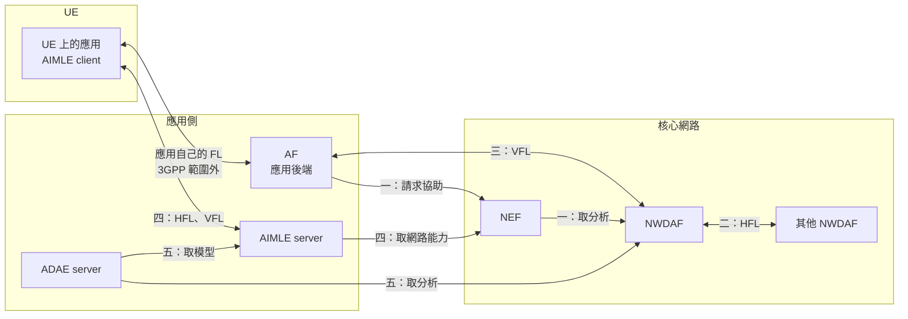

# 應用層與核心網路的 ML 01 機制總覽

本篇回答一個問題：**當機器學習的參與者一部分在應用側、一部分在核心網路時，3GPP 標準提供了哪些機制，各自由誰持有模型、誰訓練、核心網路做什麼。**

「應用側」指 AF、應用伺服器、UE 上的應用，以及 SEAL 的 AIMLE 與 ADAE。「核心網路」指 NWDAF 與 NEF。讀本篇之前，建議先讀過 [SEAL 系列][series]，至少是第 01、03、06 篇。

先講結論：

- 標準裡有五個相關機制。三個由核心網路的工作組（SA2）定義，兩個由應用層的工作組（SA6）定義。
- 只有一個機制讓應用側與核心網路**共同持有一個模型**：NWDAF 與 AF 的垂直式聯邦學習（VFL）。其餘四個，模型不是完全在應用側，就是完全在核心網路。
- 兩邊的規格沒有互相對齊。核心網路的規格只認得「AF」，全文沒有出現 SEAL、AIMLE、ADAE。應用層的規格單方面引用核心網路，而且多半只有一句話。
- 核心網路與應用層各自定義了一套 VFL，兩者在文字上沒有任何關聯。

本篇是地圖，每個機制只講到能互相比較的程度。本文依據的規格與版本列在文末；第 1 節的機制一來自 Release 18，其餘來自 Release 20，引用時都標明版本。

## 1. 五個機制一覽

| | 機制 | 定義在哪裡 | 模型在誰手上 | 誰訓練、誰聚合 | 核心網路做什麼 |
| --- | --- | --- | --- | --- | --- |
| 一 | 5GC 協助應用層的 AI/ML | TS 23.501 §5.46、TS 23.502 §4.15.13（Release 18） | 應用側 | 應用側。規格明說不在 3GPP 範圍 | 提供資訊與資源：事件、分析、成員篩選、時間窗、QoS |
| 二 | NWDAF 之間的水平式 FL（HFL） | TS 23.288 §5.3、§6.2C | 核心網路 | NWDAF 訓練，NWDAF 聚合 | 全部 |
| 三 | NWDAF 與 AF 的 VFL | TS 23.288 §5.4、§5.5、§6.2H | **兩邊各持有一部分** | 兩邊各自訓練本地模型，VFL server 合併中間結果 | 是參與者，也可以是協調者 |
| 四 | AIMLE（應用層的 AI/ML 使能服務） | TS 23.482 | 應用側 | AIMLE client 在 UE 上訓練，AIMLE server 聚合 | 被 AIMLE server 當作資訊來源 |
| 五 | ADAE（應用層的資料分析使能服務） | TS 23.436 | 應用側，模型來自 AIMLE | ADAE 本身不定義訓練 | 被 ADAE server 當作分析來源 |

機制二沒有應用側的角色。把它列進來，是因為它是機制三的對照組，也是 NWDAF 既有 FL 研究的起點。

依本文各節引用的條文整理，非規格原圖。圖中省略了幾件事：untrusted AF 與 NWDAF 的 VFL 訊息要經過 NEF；AIMLE server 也可以使用 NWDAF 的分析，但規格沒有寫路徑；VAL server 沒有畫出。

## 2. 機制一：5GC 協助應用層的 AI/ML

**應用自己做 AI/ML，核心網路只提供協助。** TS 23.501 §5.46.1 列的對象是應用層的三種操作：端點之間的操作切分、模型與資料的分發共享、分散式或聯邦學習。

模型與訓練邏輯不在 3GPP 範圍。原文是「Application AI/ML decisions and their internal operation logic reside at the AF and UE application client and is out of scope of 3GPP.」

§5.46.1 列出六種協助。其中只有成員篩選是為此新增的功能，其餘是既有的能力被點名可以用於 AI/ML。

| 協助 | AF 面對的 NF | 服務 |
| --- | --- | --- |
| 監看事件，例如 session 不活動時間、UE 與伺服器之間的流量 | NEF | `Nnef_EventExposure` |
| **成員篩選**（Member UE selection assistance） | NEF | `Nnef_MemberUESelectionAssistance` |
| 建議的執行時間窗（PDTQ） | NEF，背後是 PCF | `Nnef_PDTQPolicyNegotiation` |
| 為一批 UE 請求 QoS，並監看 QoS | NEF，背後是各 UE 的 PCF | `Nnef_AFsessionWithQoS` |
| 網路分析 | NWDAF | §5.46.1 沒有指名 |
| 佈建預期的 UE 行為參數 | NEF，存入 UDM | `Nnef_ParameterProvision` |

「服務」一欄取自 §5.46.1 所指的 TS 23.502 條文，§5.46.1 本身多半只給條文號。

### 2.1. 成員篩選是這個機制與 NWDAF 最具體的接點

AF 把一份候選 UE 清單與篩選條件交給 NEF，NEF 去問各個 NF，回給 AF 一份符合條件的子集合。最後用哪些 UE 仍由 AF 決定。

TS 23.502 表 4.15.13.2-1 列了九種篩選條件，其中五種要靠 NWDAF 的分析：

| 篩選條件 | NEF 去問誰 | 使用的事件或分析 |
| --- | --- | --- |
| QoS | SMF 或 UDM | QoS Monitoring |
| PDU session 的接取類型與 RAT 類型 | SMF | Change of Access Type、Change of RAT Type |
| **端到端資料量傳輸時間** | NWDAF | E2E data volume transfer time |
| UE 目前位置 | AMF | Location Report |
| **UE 過去位置** | NWDAF | UE mobility |
| **UE 移動方向** | NWDAF | UE mobility |
| **UE 彼此的間隔距離** | NWDAF | Relative Proximity |
| **服務體驗** | NWDAF | Service Experience |
| DNN | SMF | QFI allocation |

呼叫 NWDAF 的是 NEF，不是 AF。AF 給的 UE 清單是 GPSI 或 UE IP 位址，NEF 負責轉成 SUPI（§4.15.13.4 步驟 2）。

AF 也可以不用這項功能，自己向各 NF 收集資訊來選成員。TS 23.502 Annex I 給了一個例子，屬於參考性質。

### 2.2. 限制

- 不支援漫遊中的 UE（§5.46.1 NOTE 2）。
- 只在單一切片內進行（§5.46.1）。
- AF 的授權沿用既有機制（§5.46.1）。
- 這項功能是「may support」，不是必備（§5.46.2）。

**解讀：** 這個機制裡出現的「Federated Learning」，都是指應用自己的 FL，參與者是 UE。它和 NWDAF 之間的 FL（機制二）沒有關係，條文也沒有提到 MTLF、模型訓練服務或 VFL。

依據：[TS 23.501 §5.46][t546]、[TS 23.502 §4.15.13][p41513]、[§5.2.6.32][p52632]、[Annex I][pAnnexI]（皆為 Release 18）。

## 3. 機制二：NWDAF 之間的 HFL（對照組）

HFL 的參與者全部是 NWDAF。一個含 MTLF 的 NWDAF 當 FL server，負責選成員、下發初始模型、聚合；其他含 MTLF 的 NWDAF 當 FL client，用本地資料訓練後回報。各 client 的資料有相同的特徵、不同的樣本。

**AF 不能參與。** 規格沒有寫一句「AF 不得參與」，依據是服務的限制：`Nnwdaf_MLModelTraining` 與 `Nnwdaf_MLModelTrainingInfo` 的提供者與消費者都限於含 MTLF 的 NWDAF（TS 23.288 §7.10.1、§7.11.1 的 NOTE）。§5.3 與 §6.2C 全文沒有出現 AF、NEF 或 application。

要不要用 FL 由 MTLF 決定，請求模型的 AnLF 不會知道（§5.3）。所以應用側即使是分析的消費者，也看不到背後是否用了 FL。

Release 18 到 Release 20，這個程序實質上沒有改變。§6.2C 的文字差異只有三處：標題加上 Horizontal、指標的例子加上 loss、新增一則 NOTE。其餘的變動是為了與新加入的 VFL 區分而改名。

依據：[TS 23.288 §5.3][n53]、[§6.2C][n62C]、[§7.10][n710]（Release 20 V20.2.0），並與本地 Release 18 V18.13.0 的 §6.2C 比對。

## 4. 機制三：NWDAF 與 AF 的 VFL

**這是五個機制中，唯一讓應用側與核心網路共同訓練一個模型的。** VFL 的各方對相同的樣本持有不同的特徵。例如 NWDAF 持有網路側的量測，AF 持有應用側的量測，樣本是同一批 UE。

### 4.1. 誰可以當什麼

| VFL server | 可以當 VFL client 的 |
| --- | --- |
| NWDAF | NWDAF、trusted AF、untrusted AF（經 NEF） |
| trusted AF | 只有 NWDAF |
| untrusted AF | 只有 NWDAF，全程經 NEF |

- 任何一場 VFL 至少有一個 NWDAF。AF 對 AF 的 VFL 不在這個機制內。
- 限於單一 PLMN（§5.4）。
- 訓練時的 server 與 client，推論時必須是同一批 NF（§5.4）。

### 4.2. 流程分四段

| 階段 | 做什麼 | 規格定義到哪裡 |
| --- | --- | --- |
| 註冊與發現 | NWDAF 與 AF 把 VFL 能力註冊到 NRF，依 Analytics ID 分別註冊。untrusted AF 由 NEF 代為註冊 | 定義了要註冊的欄位。其中 VFL interoperability indicator 表示「標記相同的各方可以一起做 VFL」，但值由誰分配沒有寫 |
| 準備 | 樣本對齊、特徵協商、互通性協商 | 樣本對齊是交換 sample ID 清單（例如 SUPI、GPSI），由 server 取共同的部分。沒有指定對齊演算法，也沒有指定隱私保護方法 |
| 訓練 | 每一輪 client 回報中間結果，server 用中間結果與標籤算出更新資訊，送回各 client | 中間結果與更新資訊的內容「not standardized in this Release」（§6.2H.3） |
| 推論 | 各 client 用本地模型產生中間結果，server 合併成最終結果 | 以 VFL correlation ID 關聯訓練時的模型與成員 |

untrusted AF 參與時，NEF 做三件事：轉送訊息、把 NWDAF 的識別碼換成暫時性的外部識別碼、把 SUPI 換成 GPSI（§5.4 NOTE 3、§6.2H.2.1.2、§6.2H.2.2.1）。

### 4.3. 這個機制仍以分析框架為外殼

- VFL 一定綁一個 Analytics ID。註冊、發現、訓練、推論的服務操作都以它為參數。
- AF 當 server 時可以使用非標準的 Analytics ID，條件是當 client 的 NWDAF 支援，而且營運者確保它在 PLMN 內唯一（§6.2H.2.1.2 NOTE 2）。
- AF 當 server 時，推論可以由 AF 的內部邏輯觸發。這時程序略過「把結果交給 AnLF 再交給消費者」的步驟（§6.2H.2.4.1），結果留在 AF。

**解讀：** 最後一點是 NWDAF 替應用側的任務出力的路徑：NWDAF 用網路資料算出中間結果，交給 AF 合併，AF 拿去做自己的事。規格沒有再描述 AF 如何使用結果。

### 4.4. 規格沒有規定的事

| 沒有規定的事 | 依據 |
| --- | --- |
| 中間結果、更新資訊、互通性資訊的內容 | §6.2H.3 明寫不標準化 |
| feature ID 的值 | §6.2H.3 明寫不標準化 |
| 模型結構、損失函數、初始模型如何提供 | 條文沒有任何規定。對照之下，HFL 的程序有下發初始模型的步驟 |
| 樣本對齊的演算法與隱私保護 | 條文只定義訊息流程。sample ID 清單在 server 與 client 之間直接交換 |
| 標籤由誰提供 | 條文只寫 server 使用標籤來計算（§5.4、§6.2H.2.3.1 步驟 6），沒有寫標籤怎麼取得 |
| 安全與授權 | VFL 的條文沒有引用 TS 33.501，也沒有提到 user consent。HFL 的 §5.3 NOTE 2 則引用了 TS 33.501 Annex X |

**解讀：** 互通完全依賴共享同一個 VFL interoperability indicator 的各方事先約定。規格定義的是信令的外框，框裡的內容留給廠商與應用提供者。

依據：[TS 23.288 §5.4][n54]、[§5.5][n55]、[§6.2H.1][n62H1]、[§6.2H.2.1][n62H21]、[§6.2H.2.2][n62H22]、[§6.2H.2.3][n62H23]、[§6.2H.2.4][n62H24]、[§6.2H.3][n62H3]（Release 20 V20.2.0）。程序細節見[既有的關聯文件][rel-doc]第 7 節。

### 4.5. 修正紀錄（2026-10-13）

先前在對話中曾判斷 `Nnef_VFLTraining`、`Nnef_VFLInference`、`Nnef_VFLNFDiscovery` 定義在 TS 23.502，而本地只有 Release 18 的 TS 23.502，所以是缺少的引用。這個判斷是錯的。這些服務定義在 TS 23.288 V20.2.0 自己的[第 12 章][n12]，對應的 `Naf_*` 服務在[第 11 章][n11]，本地都有。本地 Release 18 的 TS 23.502 §5.2.6 確實沒有它們；Release 20 的 TS 23.502 是否也列出這些服務，本地沒有該版本，無法確認。

## 5. 機制四：AIMLE

AIMLE 是一項 SEAL 服務，定位見 [SEAL 06][seal-06]。這裡只講它在機器學習中做什麼。

### 5.1. 誰訓練

| 學習方式 | 條文 | 誰做本地訓練 | AIMLE server 做什麼 |
| --- | --- | --- | --- |
| HFL | §8.12 | UE 上的 AIMLE client | 選擇成員、設定排程、聚合（例子是取平均）、把模型存入 ML repository |
| VFL，成員是 UE | §8.18.2 | UE 上的 AIMLE client | 特徵對齊、樣本綁定、接收中間結果並回傳更新資訊 |
| VFL，成員是應用後端 | §8.18.2b | 各個 VAL server | 選成員、選特徵、樣本對齊、啟動。之後的訓練不經過 AIMLE server |
| 遷移式學習 | §8.16 | 不在程序內 | 協助尋找與挑選預訓練模型 |

§8.3 的「ML model training」是 VAL server 提出請求的入口，只有請求、回應、通知幾個步驟。實際的訓練步驟寫在 §8.12 與 §8.18。

FL 的成員只有應用層的實體：VAL server、AIMLE server、EAS、AIMLE client（§8.4.1、表 8.4.4.2-1）。規格沒有把 NWDAF 或任何核心網路的 NF 列為成員。

### 5.2. AIMLE 用到核心網路的地方

TS 23.482 提到 AIMLE server 使用核心網路能力的地方，全部如下：

| 用途 | 使用的能力 | 條文 |
| --- | --- | --- |
| 協助選擇參與的 client | NEF 的 MonitoringEvent、NWDAF 的 UE mobility 分析 | §8.9.2.1 步驟 3 |
| 判斷 UE 位置 | GMLC、NEF | §8.9.2.1 步驟 3 |
| 設定 AI/ML 流量的 QoS | NEF 的 AfSessionWithQoS | §8.9.2.1 步驟 3、§8.13 |
| 切分式操作的輔助資訊 | NEF 的 PDTQ 與 QoS 監看；NWDAF 的四種分析 | §8.14.2.5.2 |
| VFL 樣本對齊時轉換 UE 識別碼 | NEF 的 UE ID retrieval | §8.4.2、§8.18.2b 步驟 4 |
| 確認 UE 的 serving PLMN 與漫遊狀態 | NEF 的 monitoring event | §8.7.2.2 |
| 取得再生能源資訊 | EIF | §8.5.3a |

- 條文明寫「AIMLE server acting as AF」的只有兩處：§8.14.2.5.2 與 §8.5.3a。另外，架構圖 5.2.1.1-2 把 AIMLE server 畫成 AF，經 Nnef 接到 NEF。
- 用到 NWDAF 的句子都是「may」，沒有寫用什麼身分、經什麼路徑、用哪個服務操作，也沒有寫怎麼把 AIMLE client 對應到 UE 的網路識別碼。TS 23.482 全文沒有出現 `Nnwdaf`、`Nnef`、`N33`、`MTLF`。

### 5.3. AIMLE 的 VFL 是另一套

§8.18 裡有兩個不同的程序。

**§8.18.2：成員是 UE 上的 AIMLE client。** AIMLE server 接收中間結果並回傳更新資訊。標籤可以由 VAL server 提供（§8.18.2 步驟 10a）。這個程序完全沒有提到核心網路。規格在步驟 10a 之後的 NOTE 明寫：AIMLE server 如何協調成員執行 VFL 訓練，不在這個 Release 的範圍。樣本綁定條件的細節標為 FFS（表 8.18.3.7-1 之後的 Editor's Note）。

**§8.18.2b：成員是應用後端（VAL server）。** 樣本就是 UE。AIMLE server 經 NEF 把各個 VAL server 自己的 UE 識別碼換成 GPSI，找出共同的樣本，再為每個共同樣本發一個 correlation ID。規格要求 GPSI「shall not be shared with VFL client(s) and VFL server」。之後的訓練與推論由 VAL server 之間自行進行，不在這個程序的範圍。

**解讀：** 在 §8.18.2b 裡，AIMLE server 是持有識別碼對應表的中介者，不參與訓練。

依據：[TS 23.482 §3.1][a3]、[§5.2][a5]、[§6][a6]、[§8.3][a83]、[§8.4][a84]、[§8.9][a89]、[§8.12][a812]、[§8.14.2.5][a8145]、[§8.18][a818]（Release 20 V20.3.0）。圖 5.2.1.1-2 的內容是看圖檔讀出的，無法用文字比對。

## 6. 機制五：ADAE

ADAE 提供應用層的資料分析，定位見 [SEAL 06][seal-06]。它和機器學習的關係有三面。

**它是 NWDAF 分析的消費者。** TS 23.436 第 8 章與第 10 章有十幾個程序用到 NWDAF 的分析，包含切片負載、服務體驗、UE mobility、DN performance、Relative Proximity 等。但寫明路徑的很少：

- 寫明「經 NEF」的只有 §8.7 與 §10.4。
- 寫明「ADAES acting as AF」訂閱 NWDAF 的只有 §8.2.2 的一則 NOTE。
- TS 23.436 全文沒有出現 `Nnwdaf` 或 `Nnef_` 的服務名稱。

**它使用的模型來自 AIMLE。** ADAE 沒有對應 MTLF 的角色。正文中明寫 ADAE server 使用 ML 模型的地方，模型都指向 AIMLE 的訓練程序或 ML repository（§5.2.4、§8.18 步驟 5、§8.23 步驟 8）。「ADAE server 自己訓練」只出現在參考性質的 Annex A.4。

**它為 AIMLE 提供分析。** 有四項分析的消費者包含 AIMLE server，用途是協助選擇或更換 FL 成員：成員能力（§8.16）、ML 分析的正確性監看（§8.20）、AI/ML 能耗（§8.22）、AIMLE client 的能源永續（§8.23）。

**反方向幾乎沒有依據。** NWDAF 使用 ADAE 的資料或分析，在 TS 23.436 只有三處文字：§5.3 一句架構描述、Annex A.4 的一個例子、§8.2.4 資訊流表頭把 NF 列為消費者的例子。沒有程序，沒有 API，第 9 章的 API 表也沒有把 NWDAF 或 NF 列為消費者。NWDAF 這一側的 TS 23.288 完全沒有提到 ADAE。

依據：[TS 23.436 §5][d5]、[§8.2][d82]、[§8.7][d87]、[§8.16][d816]、[§8.18][d818]、[§8.20][d820]、[§8.23][d823]、[§10.4][d104]、[Annex A][dA]（Release 20 V20.2.0）。

## 7. 機制之間有沒有明文連結

把五個機制兩兩對照，問一個問題：一邊的規格有沒有提到另一邊。

| 這份規格 | 有沒有提到 | 結果 |
| --- | --- | --- |
| TS 23.288（機制二、三） | SEAL、AIMLE、ADAE、TS 23.482、TS 23.436、TS 23.434 | 全文零筆 |
| TS 23.288（機制二、三） | TS 23.501 §5.46 | 沒有引用 §5.46。只有兩項分析的條文提到結果可用於成員篩選（§6.4.4、§6.11） |
| TS 23.501 §5.46、TS 23.502 §4.15.13、§5.2.6.32、Annex I（機制一） | MTLF、VFL、模型訓練服務、SEAL、AIMLE | 全部零筆。NWDAF 在這裡只是分析的提供者；條文中的 Federated Learning 指應用自己的 FL |
| TS 23.482（機制四） | TS 23.501 §5.46、Member UE selection | 零筆 |
| TS 23.482（機制四） | TS 23.288 §6.2C、§6.2H、MTLF | 零筆。`23.288` 只出現三次，都是使用 NWDAF 的分析 |
| TS 23.436（機制五） | NWDAF 的 FL、MTLF、TS 23.501 §5.46 | 零筆 |
| TS 23.482 與 TS 23.436 之間 | 彼此 | 互相引用，而且有具體的程序 |

搜尋方式是對本地規格的 Markdown 全文做字串比對。圖片內的文字不在比對範圍。

三個觀察：

1. **核心網路的規格只認得「AF」。** AF 背後是一般的應用後端、AIMLE server 還是 ADAE server，核心網路的規格不區分。
2. **應用層的規格單方面引用核心網路。** 引用停在「可以使用 NWDAF 的某某分析」，沒有路徑、服務操作與識別碼對應。
3. **應用層的兩項服務彼此接得很緊。** ADAE 用 AIMLE 的模型，AIMLE 用 ADAE 的分析。這層連結沒有延伸到核心網路。

研究報告這一側有連結。SA6 的 TR 23.700-82 §4.2.1.1 回顧了 NWDAF 的 FL 與 TS 23.501 §5.46，§4.2.2 列出這些既有方案沒有涵蓋的情況，其中一條是「VAL UE 可以被選為 FL client，其他工作組沒有考慮」。這是 AIMLE 存在的理由，但沒有變成 TS 23.482 的條文引用。

依據：[TR 23.700-82 §4][r82-4]（Release 19 V19.1.0）。

## 8. 重疊與分工

### 8.1. 兩套 VFL

| | NWDAF 與 AF 的 VFL（機制三） | AIMLE 的 VFL，成員是應用後端（§8.18.2b） |
| --- | --- | --- |
| 參與者 | NWDAF 與 AF，至少一個 NWDAF | 多個 VAL server |
| 樣本 | UE | UE |
| 對齊的識別碼 | SUPI 或 GPSI | 各方自己的 UE 識別碼，由 AIMLE server 換成 GPSI |
| 誰做對齊 | VFL server。各方把 sample ID 清單交給它 | AIMLE server。它不是訓練的參與者 |
| 參與者看得到彼此的網路識別碼嗎 | sample ID 清單在 server 與 client 之間交換 | 看不到。各方只拿到 correlation ID |
| NEF 的角色 | 轉送訊息、轉換識別碼（untrusted AF） | 提供 UE 識別碼的查詢 |
| 訓練過程 | 定義了訊息流程，內容不標準化 | 不在程序範圍 |
| 標籤 | 由 VFL server 使用，來源沒有規定 | 這個程序沒有提到 |

**解讀：** 兩套機制處理同一個問題（用 UE 當樣本，對齊不同資料域），做法不同。AIMLE 用一個不參與訓練的中介者來隱藏識別碼；核心網路的 VFL 沒有這一層。兩份規格互不引用，所以也沒有說明能不能一起用。

### 8.2. AIMLE server 能不能作為 AF 加入機制三

規格兩邊都沒有寫。可以確定的是：

- AIMLE server 作為 AF 使用 NEF，是 TS 23.482 的明文，但用途限於 PDTQ、QoS 監看與能源資訊。
- TS 23.288 的 VFL 只要求參與者是 AF，並支援 `Naf_VFLTraining` 等服務。
- TS 23.482 沒有任何一處提到 TS 23.288 的 VFL。

**解讀：** 同一個後端同時實作 AIMLE server 與具備 VFL 能力的 AF，在規格上沒有被禁止，也沒有被描述。要這樣做，兩套識別碼（AIMLE 的 correlation ID、ML task identity，與 TS 23.288 的 VFL correlation ID）怎麼對應，要自己定義。

## 9. 應用側的資料如何進入 NWDAF 的訓練

機制三之外，應用側的資料也可以直接作為 NWDAF 的輸入。這是資料路徑，不是協同學習。

- **通用的路徑：** AF 把從 UE 應用收集到的資料提供給 NWDAF（TS 23.288 §6.2.8）。程序見[既有的關聯文件][rel-doc]第 6 節。
- **一個明寫用於訓練的例子：** 異常流量分析（TS 23.288 §6.24）中，AF 提供正常流量的特徵。表 6.24.2-1 的 NOTE 1 寫明這些參數「are for normal traffic, used to train a traffic classifier」。這項分析來自 Release 20 的研究，見下一節。

依據：[TS 23.288 §6.24][n624]（Release 20 V20.2.0）。

## 10. 研究報告

研究報告記錄每個議題的候選方案、評估與結論，是規格條文背後的理由。它們不是規範，條文以 TS 為準。

### 10.1. TR 23.700-04（Release 20，SA2）

這份報告有兩個議題，和本篇主題的關係有限：

- **議題一沒有結論。** 它研究 UE 側模型訓練所需的資料，如何經 user plane 從 UE 送到核心網路，再轉給應用側的訓練伺服器。報告稱這個伺服器為 UMTES，說明是「AF/OTT server for UE-side model training」。§8.1 的結論是「No agreement on this KI was reached and no work is proposed for normative phase」。
- **議題二已經寫進規格。** 兩項新的 user plane 分析已在 TS 23.288 V20.2.0 的 §6.24 與 §6.25。

依據：[TR 23.700-04 §7][r04-7]、[§8][r04-8]（V20.0.0）。

### 10.2. 2026-10-13 匯入的四份

| 研究報告 | 版本 | 內容 | 對應的機制 |
| --- | --- | --- | --- |
| [TR 23.700-80][r80] | V18.0.0 | 5G 系統支援 AI/ML 服務的研究 | 機制一 |
| [TR 23.700-36][r36] | V18.1.0 | 應用資料分析使能服務的研究 | 機制五 |
| [TR 23.700-84][r84] | V19.0.0 | 核心網路強化支援 AI/ML 的研究，議題二是 VFL | 機制三 |
| [TR 23.700-82][r82] | V19.1.0 | 應用層支援 AI/ML 服務的研究 | 機制四 |

其中 TR 23.700-84 的 VFL 議題與 TR 23.700-82 的 VFL 議題已在[第 02 篇][ml-02]精讀；其餘部分還沒有讀。寫本篇時先看到的兩個線索如下，細節以第 02 篇為準：

- **TR 23.700-84 §8.2 的 VFL 結論，有幾條和規格條文不一樣。** P#2.4.2 寫「When the NWDAF acts as VFL Server, the NWDAF can receive labels from an AF」，NOTE 6 把怎麼提供留到規範階段；NOTE 8 把初始模型如何提供給 client 也留到規範階段。TS 23.288 V20.2.0 所有提到 label 的句子，都沒有規定標籤由誰提供；VFL 的程序也沒有下發初始模型的步驟。P#2.1.4 寫 AF 當 server 時，VFL 關聯到「internal AF process」；規格條文則一律以 Analytics ID 為參數，另以 NOTE 允許非標準的值。
- **TR 23.700-84 §5.1.5 的使用情境五，是用 VFL 做服務體驗分析。** NWDAF 持有網路側的量測（例子是 access speed、network access delay），AF 持有應用側的量測（例子是 stall time、frame rate）。這和[文獻筆記第 06 篇][lit-06]的資料切分是同一件事。

依據：[TR 23.700-84 §5][r84-5]、[§8][r84-8]。

## 11. 還缺的規格

以下是本篇引用的條文所指向、而本地沒有的規格。

| 缺什麼 | 為什麼需要 |
| --- | --- |
| TS 22.261 §6.40、§7.10 | 機制一的需求來源（TS 23.501 §5.46.1 NOTE 1） |
| TS 23.501 的 Release 19 或 20 | §5.46 之後有沒有增修；§6.3.25 的 AF 發現是 TS 23.288 §5.5 的基礎，本地 Release 18 的版本沒有 VFL |
| TS 23.502 的 Release 20 | NRF 的 NF profile 是否為 VFL 新增欄位；§5.2.28（EIF）本地 Release 18 沒有 |
| TS 33.501 | HFL 的授權在 Annex X；VFL 有沒有對應的條文，要看了才知道 |
| TS 23.288 的 Release 19 | 判斷 VFL 是 Release 19 還是 Release 20 引入。本地 V20.2.0 的 Annex B 顯示 VFL 的變更請求從 V19.0.0 起出現 |
| VFL 服務的 Stage 3 | TS 23.288 只寫細節「up to Stage 3」，沒有指名規格編號。本地的 OpenAPI 沒有 `Nnwdaf_VFL*`、`Naf_VFL*`、`Nnef_VFL*` |

## 12. 可以追的問題

以下全部是**解讀**，是從上面的留白整理出來的問題，不是規格的內容，也不是已選定的研究方向。

1. **機制三要能跑起來，要自己補哪些東西。** 中間結果的格式、模型怎麼切、標籤從哪裡來、樣本對齊要不要保護識別碼，規格都沒有規定。
2. **兩套 VFL 的樣本對齊可以互相借用嗎。** AIMLE 用中介者隱藏識別碼的做法，能不能用在 NWDAF 與 AF 之間。
3. **AIMLE server 兼任 AF 參與機制三，識別碼與任務怎麼對應。**
4. **應用側的分析能不能成為 NWDAF 的輸入。** 規格幾乎沒有定義這個方向。
5. **研究報告的結論為什麼沒有進到規格。** 例如 AF 提供標籤給 NWDAF。[第 02 篇][ml-02]整理了哪些做法沒有進規格；但 TR 23.700-84 沒有任何評估文字，理由要從會議文件找。

## 13. 接下來讀什麼

- 兩套 VFL 在研究階段考慮過什麼、哪些沒有進規格：[第 02 篇][ml-02]。
- VFL 的程序細節、非標準 Analytics ID 的條件：[NWDAF 與應用支援服務的關聯與互動][rel-doc]第 7 節。
- ADAE 與 AIMLE 在 SEAL 架構中的位置：[SEAL 06][seal-06]。
- 學術界做了什麼：[SEAL 與應用層使能的相關文獻][lit]。

## 規格來源

| 規格 | 本地版本 | 本篇用到的部分 |
| --- | --- | --- |
| TS 23.501 | V18.12.0（Release 18） | §5.46 |
| TS 23.502 | V18.14.0（Release 18） | §4.15.13、§5.2.6.32、Annex I |
| TS 23.288 | V20.2.0（Release 20）；V18.13.0 用於比較 | §5.2 至 §5.5、§6.2C、§6.2H、§6.24、§7.10 至 §7.13、第 11、12 章 |
| TS 23.482 | V20.3.0（Release 20） | 第 3、5、6 章，§8.3 至 §8.19 中與訓練、成員有關的條文 |
| TS 23.436 | V20.2.0（Release 20） | 第 5、8、10 章，Annex A |
| TR 23.700-04 | V20.0.0 | 第 4、5、7、8 章 |
| TR 23.700-82、TR 23.700-84 | V19.1.0、V19.0.0 | 只讀了 TR 23.700-82 §4 與 TR 23.700-84 §5.1.5、§8.2 |

查證方式：2026-10-13 先整理成三份附原文引句的事實表（共 797 句引句），每一句都以字串比對確認出現在本地規格中；第 7 節的「零筆」另外重新搜尋確認。圖片內的文字、以及引用到本地沒有的規格的部分，無法以這個方式確認，文中已個別註明。

本篇沒有使用 Stage 3 與 OpenAPI。本篇的機制一依據 Release 18，其餘依據 Release 20；兩者不是同一個 Release 的設計，引用時不可混用。這些內容是研究用的解讀，不構成目前 Release 18 實作的需求。

[series]: README.md
[ml-02]: 應用層與核心網路的%20ML%2002%20兩份研究報告在說什麼.md
[seal-06]: Release%2020%20SEAL%2006%20ADAE、AIMLE%20與%20NWDAF%20的對應.md
[rel-doc]: Release%2020%20NWDAF%20與應用支援服務的關聯與互動.md
[lit]: ../../notes/literature/seal-application-enablement/README.md
[lit-06]: ../../notes/literature/seal-application-enablement/06%20Schwarzmann%202022%20以%20AF%20資料估計%20QoE.md
[t546]: ../../../specs/Rel-18/TS%2023.501/5%20High%20level%20features/5.46%20Assistance%20to%20AI%20ML%20Operations%20in%20the%20Application%20Layer.md
[p41513]: ../../../specs/Rel-18/TS%2023.502/4%20System%20procedures/4.15%20Network%20Exposure/4.15.13%20Assistance%20for%20Member%20UE%20selection.md
[p52632]: ../../../specs/Rel-18/TS%2023.502/5%20Network%20Function%20Service%20procedures/5.2%20Network%20Function%20services/5.2.6%20NEF%20Services/5.2.6.32%20Nnef_MemberUESelectionAssistance%20service.md
[pAnnexI]: ../../../specs/Rel-18/TS%2023.502/Annex%20I%20%28informative%29%20Member%20UE%20selection%20without%20the%20NEF%20assistance%20at%20the%20AF.md
[n53]: ../../../specs/Rel-20/TS%2023.288/5%20Network%20Data%20Analytics%20Functional%20Description/5.3%20Horizontal%20Federated%20Learning%20%28FL%29%20among%20multiple%20NWDAFs.md
[n54]: ../../../specs/Rel-20/TS%2023.288/5%20Network%20Data%20Analytics%20Functional%20Description/5.4%20Vertical%20Federated%20Learning%20%28VFL%29.md
[n55]: ../../../specs/Rel-20/TS%2023.288/5%20Network%20Data%20Analytics%20Functional%20Description/5.5%20AF%20Discovery%20and%20Selection%20for%20VFL.md
[n62C]: ../../../specs/Rel-20/TS%2023.288/6%20Procedures%20to%20Support%20Network%20Data%20Analytics/6.2C%20Horizontal%20Federated%20Learning%20among%20Multiple%20NWDAFs.md
[n62H1]: ../../../specs/Rel-20/TS%2023.288/6%20Procedures%20to%20Support%20Network%20Data%20Analytics/6.2H%20Vertical%20Federated%20Learning%20among%20NWDAFs%20and%20AFs/6.2H.1%20General.md
[n62H21]: ../../../specs/Rel-20/TS%2023.288/6%20Procedures%20to%20Support%20Network%20Data%20Analytics/6.2H%20Vertical%20Federated%20Learning%20among%20NWDAFs%20and%20AFs/6.2H.2%20Procedures/6.2H.2.1%20Registration%20and%20Discovery%20procedure%20for%20Vertical%20Federated%20Learning.md
[n62H22]: ../../../specs/Rel-20/TS%2023.288/6%20Procedures%20to%20Support%20Network%20Data%20Analytics/6.2H%20Vertical%20Federated%20Learning%20among%20NWDAFs%20and%20AFs/6.2H.2%20Procedures/6.2H.2.2%20Preparation%20procedure%20for%20Vertical%20Federated%20Learning.md
[n62H23]: ../../../specs/Rel-20/TS%2023.288/6%20Procedures%20to%20Support%20Network%20Data%20Analytics/6.2H%20Vertical%20Federated%20Learning%20among%20NWDAFs%20and%20AFs/6.2H.2%20Procedures/6.2H.2.3%20Training%20Procedure%20for%20Vertical%20Federated%20Learning.md
[n62H24]: ../../../specs/Rel-20/TS%2023.288/6%20Procedures%20to%20Support%20Network%20Data%20Analytics/6.2H%20Vertical%20Federated%20Learning%20among%20NWDAFs%20and%20AFs/6.2H.2%20Procedures/6.2H.2.4%20Inference%20procedure%20for%20vertical%20federated%20learning.md
[n62H3]: ../../../specs/Rel-20/TS%2023.288/6%20Procedures%20to%20Support%20Network%20Data%20Analytics/6.2H%20Vertical%20Federated%20Learning%20among%20NWDAFs%20and%20AFs/6.2H.3%20Contents%20of%20ML%20Model%20VFL%20Training%20services%20for%20Vertical%20Federated%20Learning.md
[n624]: ../../../specs/Rel-20/TS%2023.288/6%20Procedures%20to%20Support%20Network%20Data%20Analytics/6.24%20Abnormal%20User%20Plane%20Traffic%20Analytics.md
[n710]: ../../../specs/Rel-20/TS%2023.288/7%20Nnwdaf%20Services%20Description/7.10%20Nnwdaf_MLModelTraining%20Service.md
[n11]: ../../../specs/Rel-20/TS%2023.288/11%20AF%20Services%20to%20support%20network%20data%20analytics.md
[n12]: ../../../specs/Rel-20/TS%2023.288/12%20NEF%20Services%20to%20support%20network%20data%20analytics.md
[a3]: ../../../specs/Rel-20/TS%2023.482/3%20Definitions%20of%20terms,%20symbols%20and%20abbreviations.md
[a5]: ../../../specs/Rel-20/TS%2023.482/5%20Application%20architecture%20for%20enabling%20AI%20and%20ML%20services.md
[a6]: ../../../specs/Rel-20/TS%2023.482/6%20AIMLE%20Functional%20Description.md
[a83]: ../../../specs/Rel-20/TS%2023.482/8%20Procedures%20and%20information%20flows/8.3%20ML%20model%20training.md
[a84]: ../../../specs/Rel-20/TS%2023.482/8%20Procedures%20and%20information%20flows/8.4%20Support%20for%20FL%20member%20registration/README.md
[a89]: ../../../specs/Rel-20/TS%2023.482/8%20Procedures%20and%20information%20flows/8.9%20AIMLE%20client%20selection.md
[a812]: ../../../specs/Rel-20/TS%2023.482/8%20Procedures%20and%20information%20flows/8.12%20HFL%20training.md
[a8145]: ../../../specs/Rel-20/TS%2023.482/8%20Procedures%20and%20information%20flows/8.14%20Support%20for%20Split%20AI%20and%20ML%20Operation/8.14.2%20Procedure/8.14.2.5%20Split%20operation%20event%20subscription.md
[a818]: ../../../specs/Rel-20/TS%2023.482/8%20Procedures%20and%20information%20flows/8.18%20Support%20Vertical%20FL.md
[d5]: ../../../specs/Rel-20/TS%2023.436/5%20Application%20architecture%20for%20ADAES.md
[d82]: ../../../specs/Rel-20/TS%2023.436/8%20Procedures%20and%20information%20flows/8.2%20Procedure%20on%20support%20for%20application%20performance%20analytics.md
[d87]: ../../../specs/Rel-20/TS%2023.436/8%20Procedures%20and%20information%20flows/8.7%20Slice%20usage%20pattern%20analytics.md
[d816]: ../../../specs/Rel-20/TS%2023.436/8%20Procedures%20and%20information%20flows/8.16%20Procedure%20for%20Application%20Layer%20AI%20and%20ML%20Member%20Capability%20Analytics.md
[d818]: ../../../specs/Rel-20/TS%2023.436/8%20Procedures%20and%20information%20flows/8.18%20Procedure%20for%20supporting%20DN%20Energy%20Efficiency%20analytics.md
[d820]: ../../../specs/Rel-20/TS%2023.436/8%20Procedures%20and%20information%20flows/8.20%20Procedure%20for%20monitoring%20ML-enabled%20analytics%20correctness.md
[d823]: ../../../specs/Rel-20/TS%2023.436/8%20Procedures%20and%20information%20flows/8.23%20ADAES%20Support%20for%20AIMLE%20client%20energy%20sustainability%20analytics.md
[d104]: ../../../specs/Rel-20/TS%2023.436/10%20Analytics%20related%20to%20satellite%20access/10.4%20Support%20for%20QoS%20analytics%20for%20services%20over%20satellite%20access.md
[dA]: ../../../specs/Rel-20/TS%2023.436/Annex%20A%20%28informative%29%20Deployment%20scenarios.md
[r04-7]: ../../../specs/Rel-20/TR%2023.700-04/7%20Interim%20agreements.md
[r04-8]: ../../../specs/Rel-20/TR%2023.700-04/8%20Conclusions.md
[r80]: ../../../specs/Rel-18/TR%2023.700-80/README.md
[r36]: ../../../specs/Rel-18/TR%2023.700-36/README.md
[r82]: ../../../specs/Rel-19/TR%2023.700-82/README.md
[r84]: ../../../specs/Rel-19/TR%2023.700-84/README.md
[r82-4]: ../../../specs/Rel-19/TR%2023.700-82/4%20Analysis%20of%20AI%20and%20ML%20support%20in%203GPP.md
[r84-5]: ../../../specs/Rel-19/TR%2023.700-84/5%20Use%20Cases,%20Motivations%20and%20Key%20Issues.md
[r84-8]: ../../../specs/Rel-19/TR%2023.700-84/8%20Conclusions.md
