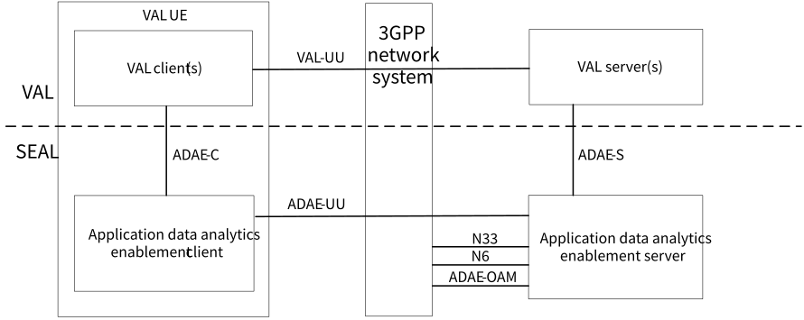
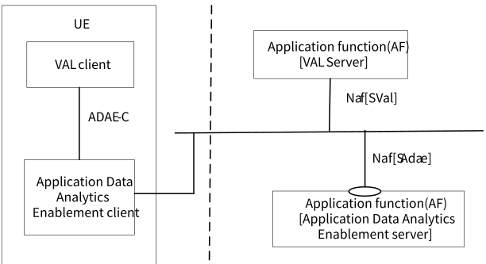
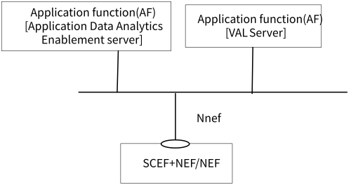
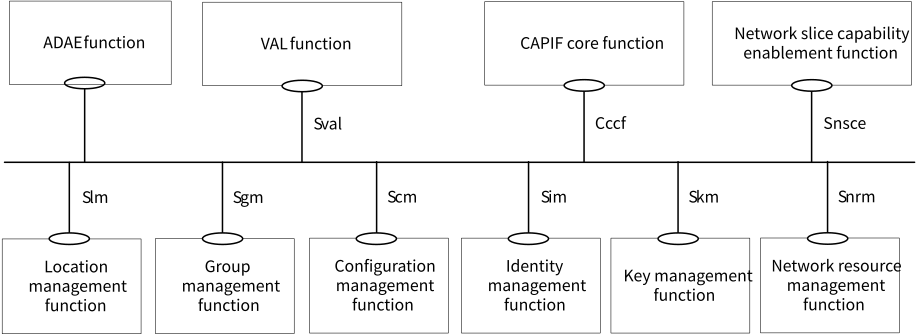
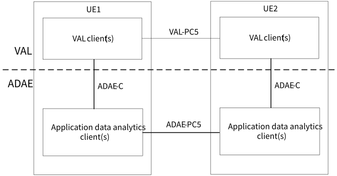
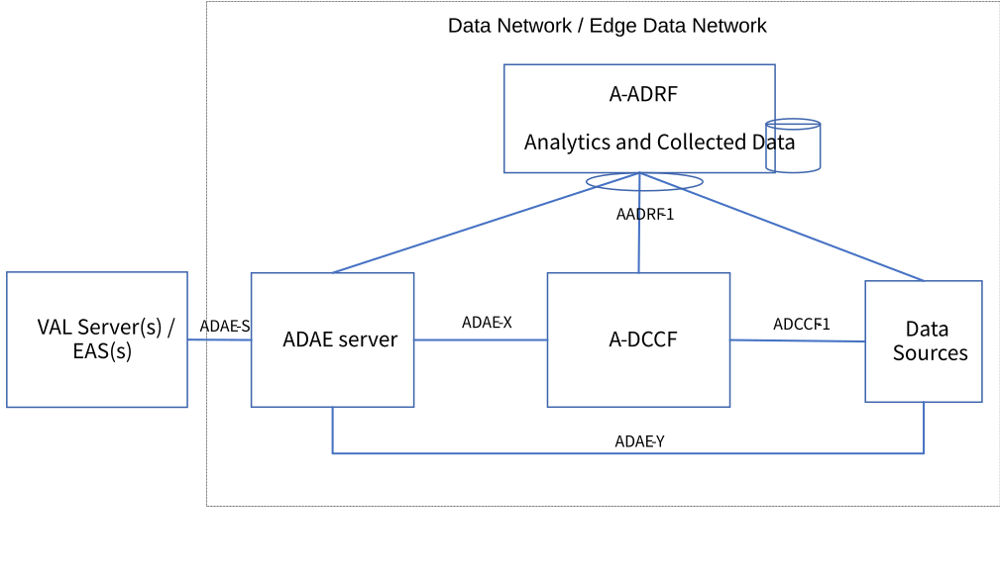

# 5 Architecture aspects

## 5.1 Architecture related requirements

### 5.1.1 Description

This subclause specifies the general and ADAE internal requirements for application data analytics enablement layer functional architecture.

### 5.1.2 General Requirements

\[AR-5.1.2-a\] The ADAE client and the ADAE server shall support one or more VAL applications.

\[AR-5.1.2-b\] Supported ADAE capabilities may be offered as APIs to the VAL applications.

\[AR-5.1.2-c\] The ADAE shall support interaction with 3GPP network system to consume network data analytics services.

\[AR-5.1.2-d\] The ADAE client shall be capable to communicate with one or more ADAE servers of the same ADAE service provider.

### 5.1.3 ADAE internal architecture requirements

\[AR-5.1.3-a\] The ADAE layer shall be able to provide a data collection coordination functionality to enable the collection from diverse data sources (OAM, 5GC, UE) per application data analytics event type.

\[AR-5.1.3-b\] The ADAE layer shall include a data analytics repository function to store application data analytics.

\[AR-5.1.3-c\] The data collection coordination and repository capabilities may be offered as APIs to ADAE server.

## 5.2 ADAE capability related requirements

### 5.2.1 Application performance analytics requirements

#### 5.2.1.1 Description

This subclause specifies the requirements for application performance analytics capability.

#### 5.2.1.2 Requirements

\[AR-5.2.1.2-a\] The ADAE server shall be capable of providing data analytics for the VAL server performance.

\[AR-5.2.1.2-b\] The ADAE server shall be capable of providing data analytics for the VAL application sessions (for both Uu-based and PC5-based sessions).

\[AR-5.2.1.2-c\] The ADAE server shall be able to collect application performance measurements and analytics from one or more ADAE clients.

### 5.2.2 Edge load analytics requirements

#### 5.2.2.1 Description

This subclause specifies the requirements for edge load analytics capability.

#### 5.2.2.2 Requirements

\[AR-5.2.2.2-a\] The ADAE server shall be capable of collecting edge data from one or more edge platforms

\[AR-5.2.2.2-b\] The ADAE server shall enable the exposure of edge data analytics to the VAL applications

### 5.2.3 Slice related application data analytics requirements

#### 5.2.3.1 Description

This subclause specifies the requirements for slice related application data analytics capability.

#### 5.2.3.2 Requirements

\[AR-5.2.3.2-a\] The ADAE server shall be capable of providing data analytics for the VAL server or VAL session performance for a requested slice or slice instance.

\[AR-5.2.3.2-b\] The ADAE server shall be able to collect slice related measurements and analytics from one or more 3GPP network system domains (OAM, 5GC).

## 5.3 Functional Architecture

### 5.3.1 General

This clause provides the overall functional architecture description, which includes the on-network and off-network functional models.

### 5.3.2 On-network Functional Architecture

For the on-network functional architecture, both service-based representation and reference point representation are provided.

Figure 5.3.2-1 depicts the application data analytics enablement architecture in the non-roaming case, using the reference point representation showing how various entities interact with each other.

Figure 5.3.2-1: Architecture for application data analytics enablement – reference points representation

The application data analytics enablement client communicates with the application data analytics enablement server over the ADAE-UU reference point. The application data analytics enablement client provides the support for application data analytics enablement functions to the VAL client(s) over ADAE‑C reference point. The VAL server(s) communicates with the application data analytics enablement server over the ADAE-S reference point. The application data analytics enablement server, acting as AF, may communicate with the 5G Core Network functions (over N33 reference point to NEF and N6 reference point to UPF) and OAM (over ADAE-OAM interface).

Figure 5.3.2-2 exhibits the service-based interfaces for providing and consuming application data analytics enablement services. The application data analytics enablement server could provide service to VAL server and ADAE client through interface SAdaee.

Figure 5.3.2-2: Architecture for application data analytics enablement – Service based representation

Figure 5.3.2-3 illustrates the service-based representation for utilization of the 5GS network services based on the 5GS SBA specified in 3GPP TS 23.501 \[4\].

Figure 5.3.2-3: Architecture for application data analytics enablement utilizing the 5GS network services based on the 5GS SBA – Service based representation

The application data analytics enablement server can be deployed as a SEAL server; hence enhancements to SEAL architecture (as specified in TS 23.434 \[5\]) are needed to incorporate the ADAE service. Figure 5.3.2-4 illustrates the service-based representation including ADAE server as part of the SEAL framework.

Figure 5.3.2-4: SEAL functional model representation using service-based interfaces and including ADAE function

### 5.3.3 Off-network Functional Architecture

Figure 5.3.3-1 illustrates the generic off-network functional model for ADAE.

Figure 5.3.3-1: Generic off-network functional model

In the vertical application layer, the VAL client of UE1 communicates with VAL client of UE2 over VAL-PC5 reference point. An application data analytics enablement client of UE1 interacts with the corresponding application data analytics enablement client of UE2 over ADAE-PC5 reference points. The UE1, if connected to the network via Uu reference point, can also act as a UE-to-network relay, to enable UE2 to access the VAL server(s) over the VAL-UU reference point.

If the ADAE server is deployed as SEAL server, the off network functional architecture is similar to SEAL off-network architecture (as specified in TS 23.434 \[5\]).

### 5.3.4 ADAE internal architecture based on 3GPP data analytics framework

In 3GPP SA2 (TS 23.288 \[2\]), the following entities have been defined as part of the data analytics framework:

\- NWDAF provides network data analytics services at the 5GC

\- DCCF coordinates the collection and distribution of data requested by NF/AF consumers. Data Collection Coordination is supported by a DCCF. Data Consumers can send requests for data to the DCCF rather than directly to the NF/AF Data Source.

\- ADRF stores historical data and/or analytics, i.e., data and/or analytics related to past time period that has been obtained by the consumer. After the consumer obtains data and/or analytics, consumer may store historical data and/or analytics in an ADRF. Whether the consumer directly contacts the ADRF or goes via the DCCF or via the Messaging Framework is based on configuration.

ADAE server can reuse the existing 3GPP data analytics framework for the data collection coordination, delivery and storage as provided by DCCF and ADRF functionalities. As illustrated in Figure 5.3.4-1, A-DCCF and A-ADRF can be defined as functionalities within the internal ADAE architecture and can offer similar functionality as proposed in 5GC but at application layer.

Figure 5.3.4-1 illustrates the generic functional model for ADAE when re-using the existing data analytics model.

Figure 5.3.4-1: Generic functional model based on network data analytics model

In this model, an Application layer - Data Collection and Coordination Function (A-DCCF) is used to fetch data or put data into an Application level entity (e.g. A-ADRF, Data Source). Such A-DCCF coordinates the collection and distribution of data requested by ADAE server (over ADCCF-1, ADAE-X). ADAE server can also directly interact with the Data Sources via ADAE-Y.

Also, Application layer – Analytics and Data Repository Function (A-ADRF) can be used to store historical data and/or analytics, i.e. data and/or analytics related to past time period that has been obtained by the ADAE server (via AADRF-1) or other NFs/NWDAF. ADAE server can also fetch historical data from ADRF. Whether the ADAE server directly contacts the ADRF or goes via the A-DCCF is based on configuration.

Data Sources can be 5GS data sources (5GC, OAM) or enablement layer data sources (SEAL, EEL) or external data sources at the DN side (VAL server/EAS) and VAL UEs. A-DCCF and A-ADRF can be used only for interacting with certain data sources (e.g. 5GC, OAM) based on configuration, and can be hidden from the VAL layer.

NOTE: If the Data Source is the VAL UE, then the data collection mechanism shall reuse the SA4 mechanism based on EVEX study (TS 26.531 \[7\]).
