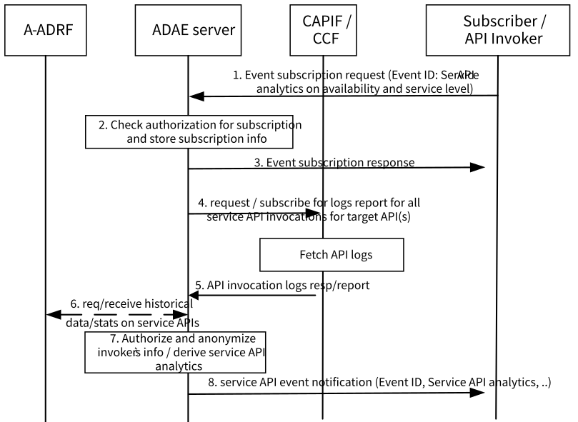

# 6.10 Solution \#9: support for service API analytics

## 6.10.1 Solution description

This solution addresses Key Issue \#8.

This solution introduces service API analytics to allow a VAL server or any other consumer (e.g. API provider) to be notified on the predicted /statistic availability and service level for the requested service API analytics. Such analytics may allow the API provider to perform actions to avoid service API invocation failures or other actions like throttling/rate limitations. Also, such analytics will support the VAL server to identify if/when to perform an API invocation request based on the API expected status at the given area and time horizon.

Figure 6.10.1-1 illustrates the procedure for service API analytics enablement solution.

Pre-conditions:

1\. ADAES is registered to CCF

Figure 6.10.1 -1: Service API analytics procedure

1\. The subscribing entity (CAPIF entity, VAL server / API invoker, API provider) sends an event subscription request to the ADAE server to receive analytics for one or more service APIs. The event subscription request includes the information elements as specified in Table 6.10.1-1

Table 6.10.1-1: Event subscription request

|                                    |        |                                                                                                                                                                                                                                                 |
|------------------------------------|--------|-------------------------------------------------------------------------------------------------------------------------------------------------------------------------------------------------------------------------------------------------|
| Information element                | Status | Description                                                                                                                                                                                                                                     |
| Identity information               | M      | The information to determine the identity of the subscribing entity                                                                                                                                                                             |
| Service API information            | M      | The service API name or type                                                                                                                                                                                                                    |
| Analytics event ID and criteria    | M      | The event criteria include event type information relevant to the prediction or stats on the number of failure API invocations, API availability, frequency and occurrence of API version changes, API location changes for the target API, etc |
| Time Validity and horizon          | O      | Time validity of the request and time horizon for the predictions                                                                                                                                                                               |
| Area of interest                   | O      | Geographical or topological area for which the subscription applies                                                                                                                                                                             |
| Notification reception information | O      | The information of the subscribing entity for receiving the notifications for the event.                                                                                                                                                        |

2\. Upon receiving the event subscription request from the subscribing entity, the ADAE server checks for the relevant authorization for the event subscription. If the authorization is successful, the ADAE server stores the subscription information.

3\. The ADAE server sends an event subscription response indicating successful subscription

4\. Upon sending the subscription response, the ADAE server requests to collect API logs to be used to derive analytics and triggers API invocation log pull request towards the CAPIF core function. The API invocation log fetch request indicates the API (or list of APIs) for which logs are required. Based on the ADAE server deployment, this can be performed via CAPIF_Logging_API_Invocation API as specified in 3GPP TS 23.222 \[9\]. The message may include the IEs as specified in Table 6.10.1-2.

Table 6.10.1-2: API invocation log fetch request

|                                                  |        |                                                                                                                                  |
|--------------------------------------------------|--------|----------------------------------------------------------------------------------------------------------------------------------|
| Information element                              | Status | Description                                                                                                                      |
| Service API log requestor information            | M      | Identity information of the originated application querying service API log request                                              |
| ADAES ID / Security credentials                  | M      | Identity information of the ADAES                                                                                                |
| Service ID or UE ID                              | M      | Identity of the application service or UE for which the API invocations apply                                                    |
| Target API information / List of API information | M      | Information on target API or list of target APIs                                                                                 |
| \>Query information                              | O      | List of query filters such as invoker's ID and IP address, service API name and version, input parameters, and invocation result |
| \> API aggregation abstraction flag              | O      | What type of aggregation or abstraction/filtering needs to be applied                                                            |
| Reporting format configuration                   | O      | The logs reporting configuration (frequency, periodicity etc)                                                                    |
| Area of validity                                 | O      | The geographical area for which the request applies                                                                              |
| Time or validity                                 | O      | The time of validity for the request                                                                                             |
| Exposure level requirement                       | O      | The level of exposure requirement (e.g. permissions on the logs like read/write/delete..) for the logs to be exposed             |

5\. The CCF authorizes the request and fetches the API logs from the storage unit. CCF then sends the requested information to the ADAE server via a API invocation log fetch response message. The message may include the IEs as specified in Table 6.10.1.-3.

Table 6.10.1-3: API invocation log fetch response

|                                                  |        |                                                                                                                                                                                                                                                                                                           |
|--------------------------------------------------|--------|-----------------------------------------------------------------------------------------------------------------------------------------------------------------------------------------------------------------------------------------------------------------------------------------------------------|
| Information element                              | Status | Description                                                                                                                                                                                                                                                                                               |
| Result                                           | M      | Identity information of the originated application querying service API log request                                                                                                                                                                                                                       |
| Service ID or UE ID                              | M      | Identity of the application service or UE for which the API invocations apply                                                                                                                                                                                                                             |
| Target API information / List of API information | M      | Information on target API or list of target APIs                                                                                                                                                                                                                                                          |
| \>API Logs Collection Event                      | O      | The API logs based on the subscription event. This includes for example the number of failure API invocations, API availability, frequency and occurrence of API version changes, API location changes for the target API, API throttling events, number of API invocations for a given area and time etc |
| \> reporting info                                | O      | The time and area for which the reporting applies                                                                                                                                                                                                                                                         |

6\. The ADAES may also request and receive service API historical analytics /data from A-ADRF for the corresponding service APIs.

7\. The ADAE servers authorizes and anonymizes the API logs (if not performed by CCF) and abstracts based on exposure level. The exposure level can be known based on pre-configuration by the OAM or based on the subscription and type of invoker. The ADAE server then derives analytics on the target service API(s) based on the logs received from the CCF. Such analytics are predictions/stats for the API status based on the analytics event.

8\. The ADAE server sends the analytics as event notifications to all the subscribing entities that have subscribed for the event matching the criteria. If a notification reception information is available as part of the subscribing entity event subscription, then the notification reception information is used by the ADAE server to send event notifications to the subscribing entity.

The notification includes the following parameters: the analytics event ID, the service API name and/or type, stats or predictions based on abstracted or anonymized API logs (for example number of failure API invocations, API availability, frequency and occurrence of API version changes, API location changes for the target API, API throttling events, number of API invocations for a given area and time, API load statistics for a given edge network, etc), the time and area where the reporting occurs and is valid.

## 6.10.2 Corresponding Analytics API

This subclause provides a summary on the corresponding Analytics API for solution \#9.

\- Inputs: service API logs

\- List of Data Sources:

\- Data Source \#1 information: CAPIF CCF (via CAPIF_Logging_API_Invocation API)

\- Data required from Data Source \#1: Service API logs for requested APIs

\- Data Source \#2 information: A-ADRF

\- Data required from Data Source \#2: historical data / statistics on service API availability and service level

\- Output: stats or predictions for service API(s). For example, the failure rate of API invocations, API predicted availability, frequency and occurrence of API version changes, API location changes for the target API, API throttling events, number of API invocations for a given area and time, API load statistics for a given edge data network (for edge provided service APIs).

## 6.10.3 Solution evaluation

This solution addresses Key Issue \#8 and introduces service API analytics to provide stats or predict possible downgrade of performance and availability of a service API. This solution is technically viable and doesn't introduce any impact on 5GS.
