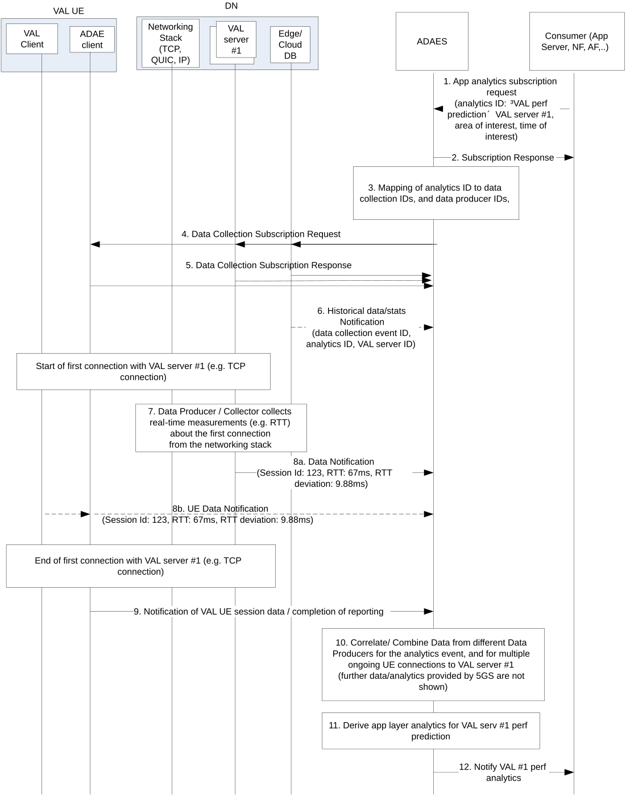
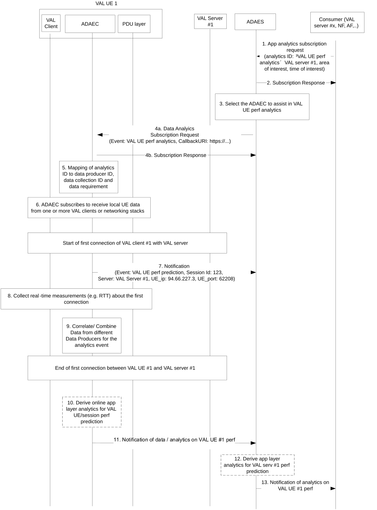

# 6.2 Solution \#1: Support for application performance analytics

## 6.2.1 Solution description

This solution addresses Key Issue \#1.

This solution introduces application layer analytics to provide insight on the operation and performance of an application (VAL server or EAS, application session) and in particular statistics or prediction on parameters related to e.g. VAL server number of connections for a given time and area, VAL server rate of connection requests, connection probability failure rates, RTT and deviations for a VAL server or VAL UE session, packet loss rates etc.

In this solution, two procedures are described in more detail:

\- one procedure for VAL server related analytics where an example in provided for VAL server performance,

\- one procedure for VAL session/UE related analytics.

### 6.2.1.1 Procedure on VAL server performance analytics

Figure 6.2.1.1-1 illustrates the procedure where the VAL server performance analytics are performed based on data collected from the ongoing VAL sessions as well as data from the DN (VAL server, DN database or networking stack at DN).

Pre-conditions:

1\. ADAEC is connected to ADAES

Figure 6.2.1.1-1: ADAES support for VAL server performance analytics

1\. The consumer of the ADAES analytics service sends a subscription request to ADAES and provides the analytics event ID e.g. "VAL perf prediction", the target VAL server ID, the time validity and area of the request, the required confidence level, whether offline and/or online analytics are needed etc.

2\. The ADAES sends a subscription response as an ACK to the consumer.

3\. The ADAES maps the analytics event ID to a list of data collection event identifiers, and optionally a list of data producer IDs. Such mapping may be preconfigured by OAM or may be configured at ADAES based on the analytics event type / vertical type.

4\. The ADAES sends a subscription request to the Data Producers (at the DN side or UE side) with the respective Data Collection Event ID and the requirement for data collection. This message includes the Data Collection event ID and/or the analytics event ID, the target VAL server ID, the ADAES ID, the time validity and area of interest, the required confidence level etc.

5\. The Data Producer(s) sends a subscription response as an ACK to the ADAES.

NOTE: The ADAES acting as AF may also subscribe to NEF/SMF/PCF/NWDAF to monitor network/UE situation or network data analytics required for the application data analytics event.

6\. The ADAES based on subscription, may receive offline stats/data on the VAL server performance based on the analytics/data collection event ID. Such offline data can be average/peak throughput, average/maximum e2e delay, jitter, av. PER, availability, VAL server load, number of failed transactions, and can be for a given area and time of the day (based on the time/area of the request). Th edge / cloud DB depending on the deployment can be also part of ADRF (for MNO-deployed ADAES).

A session starts between the VAL server \#1 and a UE (this could happen for more than one UEs)

7\. The Data Producer starts collecting/listening to real-time networking or application data (from networking start at DN or VAL server itself). Such data can be the RTT, the PER, throughput etc.

8a. The Data Producer sends the real-time data to the ADAES, where the data correspond to the data collection ID or the analytics event ID for which the ADAES subscribed.

8b. The ADAES may receive also data (periodically or if a threshold is reached based on configuration) from the application of the UE within the ongoing session (via ADAEC). Such data can be about the RTT, average/peak throughput, jitter, QoE measurements (MOS, stalling events, stalling ratios, etc), QoS profile load, VAL server load, etc.

9\. When the VAL UE session with VAL server finishes, the ADAEC notifies the ADAEC of the completion of the reporting.

10\. The ADAES abstracts or correlates the data based on the analytics event and the data collection configuration. Such correlation can be filtering of data for the same metrics but with different granularities or be combining/aggregating the data of segments of the end-to-end path (end to end is between VAL client and server). The outcome is an abstracted/correlated/filtered set of data.

11\. The ADAES derives application layer analytics on VAL server \#1 performance, based on the analytics ID and type of request. Such analytics can be stats or prediction for a given area/time and based on the event type for a given network configuration.

12**.** The ADAES sends the analytics to the consumer, where these analytics include the VAL server 1 predicted or statistic performance for a given area and time horizon, including also the confidence level, whether offline/online analytics were used.

### 6.2.1.2 Procedure on VAL UE / session performance analytics

Figure 6.2.1.2-1 illustrates the procedure where the VAL session performance analytics are performed based on data collected from the ongoing VAL sessions.

Pre-conditions:

1\. ADAEC is connected to ADAES

Figure 6.2.1.2-1: ADAES support for VAL session performance analytics

1\. The consumer of the ADAES analytics service sends a subscription request to ADAES and provides the analytics event ID e.g. "VAL UE perf prediction", the target VAL UE ID, VAL server ID/VAL application ID, the time validity and area of the request, the required confidence level, exposure level for providing UE analytics. If the consumer is the VAL server, the VAL server can provide to ADAEC application data related to the UE expected route/trajectory and VAL application traffic schedule / expected session time.

2\. The ADAES sends a subscription response as an ACK to the consumer.

3\. The ADAES selects the corresponding ADAEC of the VAL UE for which the local analytics need to be performed.

4a. The ADAES sends a subscription request to the ADAEC with the analytics event ID and the configuration of the reporting required (e.g. periodic, based on threshold or event)

4b. The ADAEC sends a subscription response to ADAES

5\. The ADAEC maps the analytics event ID to a list of data collection event identifiers or data collected IDs at the VAL UE or other UEs within the service and in proximity (in group-based communications)

6\. The ADAEC subscribes to the VAL clients and/or requests UE local data based on the respective Data Collection Event ID (or the analytics event ID if they already know the mapping). This data may come from the PDU layer of the UE (via listening the traffic), or via VAL client of one or more UEs (if an application consists of a group of UEs).

A session starts between the VAL UE \#1 and a VAL server.

7\. The ADAEC (after being aware from the VAL client that the session started) sends a notification to ADAES that a session started, and it could be possible to provide real-time data analytics for VAL UE performance in the target area.

8\. The ADAEC starts collecting data from the corresponding VAL UE(s) based on subscription. Such data can be about the RTT, throughput, jitter, QoE measurements, QoS profile load, etc. It can be also possible that VAL client provides to ADAEC application data related to the UE expected route/trajectory and VAL application traffic schedule / expected session time.

9\. The ADAEC filters or correlates the data based on the analytics event and the data collection configuration.

10\. When the VAL UE session finishes, the ADAEC (optionally) derives VAL session analytics to ADAES on VAL UE \#1 performance, based on the analytics ID and type of request. Such analytics (if performed at the ADAEC can be stats or predictions on the RTT or RTT deviation, average/peak throughput, av. jitter, QoE measurements (MOS, stalling events, buffer related events), QoS profile load, VAL application traffic load etc. In case of prediction, a confidence level shall be also present and a time horizon for the predicted parameters.

11\. The ADAEC sends the data of step 8 or the analytics of step 9 (if ADAEC performs analytics) to the ADAES.

12\. The ADAES derives application layer analytics on VAL session performance (based on the data or analytics received by the ADAEC), based on the analytics ID and type of request. Such analytics can be stats or prediction for a given area/time and based on the event type for a given network configuration. Such analytics (if no analytics is performed at ADAEC) at ADAES can be stats or predictions on the RTT or RTT deviation, average/peak throughput, av. jitter, QoE measurements, QoS profile load, VAL application traffic load etc. In case of prediction, a confidence level shall be also present and a time horizon for the predicted parameters.

13**.** The ADAES sends the analytics to the consumer, where these analytics include the VAL UE 1 session predicted performance for a given area and time horizon, including also the confidence level, whether offline/online analytics were used.

## 6.2.2 Corresponding Analytics API

This subclause provides a summary on the corresponding Analytics API for solution \#1.

For VAL server performance analytics, this includes:

\- Inputs: per VAL server performance measurements (application QoS measurements such as latency, channel losses, data rate, jitter), historical data/stats for VAL server performance, network/KPI monitoring from 5GS

\- List of Data Sources

\- Data Source \#1 information: VAL UE \#1 (or more VAL UEs having a session with VAL server \#1), VAL Server \#1

\- Data required from Data Source \#1: application QoS measurements

\- Data Source \#2 information: OAM

\- Data required from Data Source \#1: PM data

\- Data Source \#3 information: 5GC

\- Data required from Data Source \#3: service experience analytics, network and QoS monitoring

\- Output: Predicted application QoS metrics per VAL server, Statistics on VAL server application QoS/performance metrics

For VAL session performance analytics, this includes:

\- Inputs: per VAL session performance measurements (application QoS measurements such as latency, channel losses, data rate, jitter)

\- List of Data Sources:

\- Data Source information: VAL UE \#1, VAL Server \#1

\- Data required from Data Source: application QoS measurements

\- Output: Predicted application QoS metrics per VAL session

## 6.2.3 Solution evaluation

This solution addresses Key Issue \#1 and introduces application layer analytics to predict the performance of a VAL server or an application session between a VAL UE and a VAL server. Such solution enables the VAL layer to get statistics or predictions for expected deviations of application performance metrics (e.g. RTT) based on data collected from the ADAE clients, as well as from 5GS. This solution is complementary to Solution \#4 which covers only the VAL UE-to-UE sessions. Also, this Solution doesn't overlap with Solution \#2 which provides a generic mechanism for data analytics enablement (and could be re-used).

This solution is technically viable and doesn't introduce any impact on 5GS.
