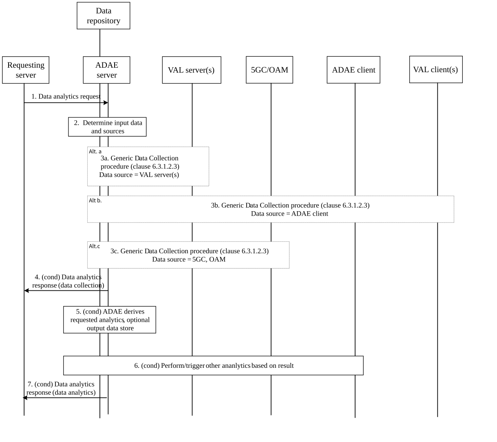
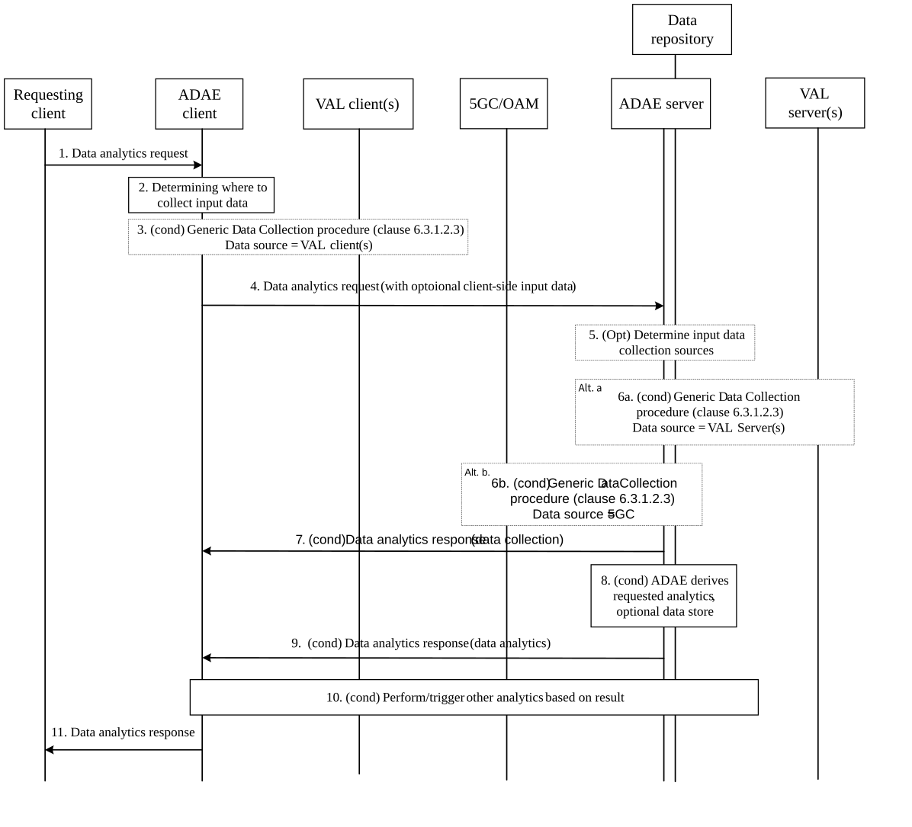
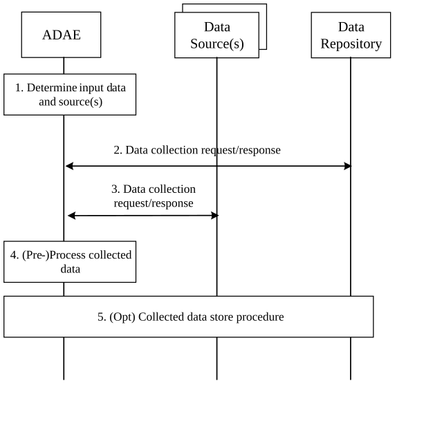

# 6.3 Solution \#2: Data Analytics Enablement

## 6.3.1 Solution description

### 6.3.1.1 General

The following solution corresponds to the key issue \#1, 2, 3, 4 on support for application performance analytics, data collection, edge analytics enablement, and interaction with SEAL service.

ADAE supporting application and service enablement layer analytics collects application or service enablement layer related information from the vertical application layer, service enablement layer, 5GC, and/or OAM to perform data analytics and to provide statistics or predictions.

The solution addresses the following aspects:

\- Enablement of data analytics services by the ADAES layer, by addressing the types of interactions possible between ADAES and other service layer entities.

\- Description of how higher-level data analytic requests can be provided to the ADAES layer, and on how analytics requests are translated into generic data collection tasks.

\- Description of the information flows for generic data analytics and data collection.

A data source profile is proposed for a data source which describes capabilities related to data generation, data availability and pre-processing, as shown in table 6.3.1.3-1.

A data analytics request from a requesting server/client to ADAE provides criteria for the data source profile elements to indicate the applicable data sources. The data analytics request also includes criteria for determining the information applicable for collection via the data collection procedure. The data analytics request also includes task processing requirements and operations used to determine the necessary level of processing by the ADAE, as shown in table 6.3.1.3-2

A data collection request from ADAE to a source provides information about the original data source and the data required, as shown in table 6.3.1.3-4.

NOTE 1: Data collection tasks may be performed by ADAE using available dedicated functionality, e.g. Application Data Collection and Coordination Function deployed by MNO at the service layer.

NOTE 2: Further definition of the data processing operations will be provided in the normative phase, including stage 3.

Interaction between ADAE and the vertical application layer can be done over ADAE-S or ADAE-C reference points.

If ADAE is implemented in the SEAL layer, then:

\- interaction between ADAE server and application enabler servers can be done over SEAL-S (e.g. for EES see TS 23.558 Figure A.4.1-1, for VAE Server see TS 23.286 Figure 6.2-2). Interactions between ADAE client and the corresponding application enabler client can be done over SEAL-C.

\- interaction between ADAE server and SEAL server could be done over SEAL-X (TS 23.434 Figure 6.2-3),

### 6.3.1.2 Procedures

#### 6.3.1.2.1 Generic server-side initiated data analytics

Pre-conditions:

1\. ADAE is provisioned with data source profiles (Table 6.3.1.3-1) for data sources in the vertical application layer, application/service enablement layer (e.g., SEAL server/client, EES/EEC, CAPIF entities), core network (e.g., OAM, DCCF, NWDAF), etc. Alternatively, ADAE may perform a discovery for the data source profiles of data sources of interest.

Figure 6.3.1.2.1-1: Server-side initiated generic data analytics request

1\. The requesting server sends a data analytics request to the serving ADAE server to initiate data analytics, using either a one-time request or a subscription request. The request may specify the type of data analytics and the requirements/ preferences of the required analytics as defined in Table 6.3.1.3-2.

2\. If the request is authorized, the ADAE server may determine which input data should be collected and the input data sources based on the request and local policies.

> 3\. Based on the determination in step 2, the ADAE server may collect input data from various sources by performing data collection procedure, as described in clause 6.3.1.2.3.

NOTE 1: A data repository may be assumed to be available to the ADAE server for corresponding data storage tasks, as described in clause 6.3.1.2.3. The repository functionality may be provided e.g. by a SEALDD storage server, or an Application – Analytics and Data Repository Function deployed by MNO at the service enablement layer.

Depending on the type of data source, this step can be performed with several alternatives as follows:

\(a\) from other servers:

3a. If the requested analytics requires server-side input data, the ADAE server may collect input data from the server-side entities such as vertical application servers (and EAS, if the target application is an edge application) via ADAE-S reference point.

NOTE 2: In this alternative, the ADAE server may also collect input data from SEAL server(s)and application/service enabler server(s) (e.g. EES, VAE-S).

\(b\) from ADAE clients:

3b1. If the requested analytics requires client-side input data, the ADAE server performs the data collection procedure with the corresponding ADAE client as source. The request specifies what input data is required from the client-side.

NOTE 3: In this alternative, the ADAE client may also collect input data from SEAL client and application/service enabler clients(s) (e.g. EEC, VAE-C) , or other ADAE clients (via ADAE-PC5).

\(c\) from other functions external to the service enablement layer (e.g. NWDAF, OAM):

3c. The ADAE server performs the data collection procedure with other analytics functions in the system, such as NWDAF or OAM, as sources. For example, the ADAE server may collect input data from 5GC via monitoring events or via interactions with NWDAF, receive input data from OAM system, receive analytics result from NWDAF by subscription, etc.

4\. If the step 1 request requires data collection without higher-level analytics, ADAE sends a data analytics response (collected data) to the requester with the collected data or the location where the collected data is stored, as defined in Table 6.3.1.3-5.

5\. If the step 1 request includes analytics tasks to be performed, and based on the collected input data, the ADAE server derives the analytics result. The ADAE server performs the analytics operations provided in the data analytics request in step 1. The result of the analytics task on the collected data can be optionally stored in the repositories available, such as a SEALDD storage server, Application-ADRF, etc.

6\. Following an analytics task, the ADAE server may perform or trigger other analytics actions (using requests to the corresponding entities) based on the analytics result, before providing a final response to the requestor.

7\. The ADAE server provides the requested data analytics task outputs to the requestor, using either a response or a notification message, depending on the service used in step 1.

#### 6.3.1.2.2 Generic client-side initiated data analytics

Pre-conditions:

> 1\. ADAE is provisioned with data source profiles (Table 6.3.1.3-1) for data sources in the vertical application layer, service enablement layer (e.g., SEAL server/client, EES/EEC, CAPIF entities), core network (e.g., OAM, DCCF, NWDAF), etc. Alternatively, ADAE may perform a discovery for the data source profiles of data sources of interest.

Figure 6.3.1.2.2-1: Client-side initiated generic data analytics procedure

1\. The requesting client sends a data analytics request to the serving ADAE client to initiate data analytics, using either a one-time request or a subscription request. The request may specify the type of data analytics and the requirements/ preferences of the required analytics, as defined in Table 6.3.1.3-2.

2\. If the request is authorized, the ADAE client determines which input data should be collected and where to collect the input data based on the request.

3\. Based on the determination in step 2, if client-side input data is required, the ADAE client may collect input data from the client-side entities such as vertical application clients (via ADAE-C) and other ADAE clients (via ADAE-PC5) by performing data collection procedure, as described in clause 6.3.1.2.3.

NOTE 1: In this step, the ADAE client may also collect input data from SEAL client and application/service enabler clients(s) (e.g. EEC, VAE-C).

4\. The ADAE client sends the data analytics request to the ADAE server, as defined in Table 6.3.1.3-2. If client-side input data has been collected by the ADAE client, the collected client-side input data or the location of the data will also be sent to the ADAE server.

5\. The ADAE server may determine which input data should be collected and the input data sources, based on the request from the ADAE client and/or local policies

6\. Based on the request in step 4 and/or the determination in step 5, the ADAE server may collect input data from various sources by performing data collection procedure, as described in clause 6.3.1.2.3.

NOTE 2: A data repository may be assumed to be available to the ADAE server for corresponding data storage tasks, as described in clause 6.3.1.2.3. The repository functionality may be provided e.g. by a SEALDD storage server, or an Application – Analytics and Data Repository Function deployed by MNO at the service enablement layer.

Depending on the type of data source, this step can be performed with several alternatives as follows:

\(a\) from other servers:

6a. The ADAE server collects input data from server-side entities such as vertical application servers (and EAS, if the target application is an edge application) via ADAE-S reference point.

NOTE 3: In this alternative, the ADAE server may also collect input data from SEAL server(s) and application/service enabler server(s) (e.g. EES, VAE-S).

\(b\) from other functions external to the service enablement layer (e.g. NWDAF, OAM):

6b. The ADAE server may collect input data and/or request for analytics service from other analytics functions in the system.

> 7\. If the step 1 request requires data collection without higher-level analytics, ADAE server sends a data analytics response (collected data) to the requester with the collected data or the location where the collected data is stored, as defined in Table 6.3.1.3-3.

8\. If the step 1 request includes analytics tasks to be performed, and based on the collected input data, the ADAE server derives the analytics result. The ADAE server performs the analytics operations provided in the data analytics request in step 4. The result of the analytics task on the collected data can be optionally stored in the repositories available, such as a SEALDD storage server, Application-ADRF, etc.

9\. Following an analytics task, the ADAE server sends a data analytics response (or a notification) to the ADAE client with the analytics result or the location where the resulting data is stored, as defined in Table 6.3.1.3-3.

10\. Following an analytics task, the ADAE server or client may perform or trigger other analytics actions (using requests to the corresponding entities) based on the result, before providing a final response to the requestor.

11\. The ADAE client provides the requested data analytics task outputs to the requestor, using either a response or a notification message, depending on the service used in step 1.

#### 6.3.1.2.3 Generic data collection procedure

Figure 6.3.1.2.3-1 describes a generic data collection procedure, i.e,. using abstract data sources.

> Precondition: ADAE is provisioned with data source profiles (Table 6.3.1.3-1) for data sources in the vertical application layer, service enablement layer (e.g., SEAL server/client, EES/EEC, CAPIF entities), core network (e.g., OAM, DCCF, NWDAF), etc. Alternatively, ADAE may perform a discovery for the data source profiles of data sources of interest.

Figure 6.3.1.2.3-1: Generic data collection procedure

1\. ADAE determines data collection sources and processing operations based on the requirements in the data analytics request. For example, ADAE may determine whether data should be collected from the application layer, the service enablement layer, the core network, or whether a data processing task should be performed using data from multiple layers/sources.

2\. ADAE may collect existing data that can meet or partially meet the requirements of the data analytics request from sources with the "Data source role" IE set as "repository" in the data source profile (e.g., SEALDD storage server, Application-ADRF). The request and response for data collection are defined in 6.3.1.3-4 and 6.3.1.3-5.

NOTE 1: ADAE data collection requests/responses may be realized via subscriptions/notifications.

3\. ADAE collects data from other identified data sources. The request and response for data collection from a data source are defined in 6.3.1.3-4 and 6.3.1.3-5.

4\. ADAE performs data processing operations as determined in step 1 and/or required by policies. For example, data samples that target the same performance metrics but originate from different sources may be normalized and validated. Such processing may remove samples that are inconsistent across different sources and keep samples that achieve consensus across all sources.

5\. The collected (and optionally processed) data can be optionally stored in available repositories, such as a SEALDD storage server, Application-ADRF, etc.

### 6.3.1.3 Information Flows

The data source profile includes information about the data generation/production capability of the data source to support data collection for data analytics service and the availability/accessibility of the generated/produced data, as defined in Table 6.3.1.3-1.

Table 6.3.1.3-1: Data source profile

<table>
<colgroup>
<col style="width: 33%" />
<col style="width: 16%" />
<col style="width: 50%" />
</colgroup>
<tbody>
<tr class="odd">
<td>Information element</td>
<td>Status</td>
<td>Description</td>
</tr>
<tr class="even">
<td>Source ID</td>
<td>M</td>
<td>ID of the source</td>
</tr>
<tr class="odd">
<td>Data source entity</td>
<td>M</td>
<td>Specifies the type of the entity, such as a vertical application server, a SEAL server/client, EES/EEC, EAS, etc.(NOTE 1)</td>
</tr>
<tr class="even">
<td>Information type</td>
<td>M</td>
<td>Type of information can be provided by the data source, e.g., performance indicators, resource usage data, server load data, etc. The information types may also include those obtained from NWDAF or OAM events, or from service layer original sources such as application performance (solution #1), edge load (solution #3), (NOTE 2)</td>
</tr>
<tr class="odd">
<td>Data generation schedule</td>
<td>O</td>
<td>The schedule of data generation, e.g. when the data source is active to produce data.</td>
</tr>
<tr class="even">
<td>Data source role</td>
<td>O</td>
<td>Role of the data source, e.g., original source, repository, logging server, etc.</td>
</tr>
<tr class="odd">
<td>Original source</td>
<td>O</td>
<td>If the data source role is not original source, specifies the original data source of the data provided by this data source.</td>
</tr>
<tr class="even">
<td>Data freshness</td>
<td>O</td>
<td>If the data source role is not original source, length of time elapsed after the data is generated until is available at the data source. Alternatively, the data collection rate supported by the source is provided</td>
</tr>
<tr class="odd">
<td>Data storage capability</td>
<td>O</td>
<td>Indicates data storage capabilities, e.g. how long the data can be stored.</td>
</tr>
<tr class="even">
<td>Anonymization capability</td>
<td>O</td>
<td>Indicates whether the data available at this data source can be anonymized before collection.</td>
</tr>
<tr class="odd">
<td>Pre-processing capabilities</td>
<td>O</td>
<td>Indicates capabilities of the data source to provide pre-processing functionality, such as aggregation, validation, etc.</td>
</tr>
<tr class="even">
<td>Original source communication constraints</td>
<td>O</td>
<td>Constraints of the original source such as geographic constraints, access technology associated with the original data source, etc.</td>
</tr>
<tr class="odd">
<td colspan="3">
NOTE 1: The list of possible choices may be determined in the specification phase, based on ADAES capabilities to interact with other service layer entities

NOTE 2: The values available for "information type" may be determined in the specification phase.
</td>
</tr>
</tbody>
</table>

Table 6.3.1.3-2 describes information elements in the data analytics task request from the requester to ADAE or from ADAE client to ADAE server.

Table 6.3.1.3-2: Data analytics request

<table>
<colgroup>
<col style="width: 33%" />
<col style="width: 16%" />
<col style="width: 50%" />
</colgroup>
<tbody>
<tr class="odd">
<td>Information element</td>
<td>Status</td>
<td>Description</td>
</tr>
<tr class="even">
<td>Requester ID</td>
<td>M</td>
<td>ID of the requesting server/client making the request</td>
</tr>
<tr class="odd">
<td>Data source profile criteria</td>
<td>M</td>
<td>List of criteria for determining the data sources, based on the IEs present in the Data source profile table 6.3.1.3-1.</td>
</tr>
<tr class="even">
<td>Information filter</td>
<td>O</td>
<td>Parameters and constraints of the information collected for the task. For example, the filter may specify a PLMN, a service provider, area of interest, time window of interest, reporting threshold (for NWDAF subscriptions), etc….</td>
</tr>
<tr class="odd">
<td>Task processing operation</td>
<td>O</td>
<td>
Specifies data processing operations that need to be performed on the collected data to produce the analytics results, such as normalization, rounding, clean-up, etc. to generate the task results.

When the task requires data to be collected from multiple sources, this parameter may specify operations to combine/merge the data from different sources such as aggregation, validation, data alignment, etc.
</td>
</tr>
<tr class="even">
<td>Task requirements</td>
<td>O</td>
<td>Specifies requirements on the data analytics task or the resulting data, e.g., when the task results are needed, where the resulting data should be stored, required data sampling/updating rate, required number of data samples, required amount (size) of collected data (dataset), required data granularity/accuracy, required level of confidence, etc.</td>
</tr>
<tr class="odd">
<td>Existing input data</td>
<td>O</td>
<td>Specifies input data that may already be available.</td>
</tr>
</tbody>
</table>

Table 6.3.1.3-3 describes information elements in the data analytics response from ADAE to the requester.

Table 6.3.1.3-3: Data analytics response

|                     |        |                                    |
|---------------------|--------|------------------------------------|
| Information element | Status | Description                        |
| ADAES ID            | M      | ID of the ADAES                    |
| Task results        | O      | Output of the data analytics task. |

Table 6.3.1.3-4 describes information elements in the data collection request from ADAE to a data source.

Table 6.3.1.3-4: Data collection request

|                      |        |                                           |
|----------------------|--------|-------------------------------------------|
| Information element  | Status | Description                               |
| ADAES ID             | M      | ID of the ADAES                           |
| Original data source | M      | Identifies all the original data sources. |
| Data required        | M      | Identifies the data to be collected.      |

Table 6.3.1.3-5 describes information elements in the data collection response from the data source to ADAE.

Table 6.3.1.3-5: Data collection response

|                        |        |                                        |
|------------------------|--------|----------------------------------------|
| Information element    | Status | Description                            |
| ADAES ID               | M      | ID of the ADAES                        |
| Data collection output | O      | Output of the data collection request. |

## 6.3.2 Evaluation

The solution addresses Key Issue \#1, 2, 3, 4 on support for data collection for application and provides generic procedures and APIs to support different types of data analytics (e.g., application performance analytics, edge analytics, etc.).

The solution defines generic procedures for application data analytics enablement service enablement, including interactions with other service enablement layer entities (e.g., SEAL, EEL) or the core network. The solution also enables ADAES to select data sources and to collect data for the analytics services provided. The solution specifies the API for requesting application data analytics enablement service and for enabling the collection and preparation of data that are originated from different sources.
