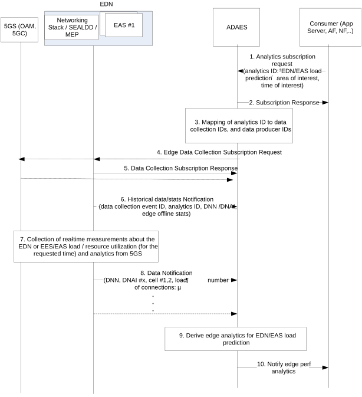

# 6.4 Solution \#3: Support for edge load analytics

## 6.4.1 Solution description

This solution addresses Key Issue \#2.

This solution introduces edge load analytics to provide insight on the operation and performance of an EDN and in particular statistics or prediction on parameters related to:

\- the EAS / EES load for one or more EAS/EES

\- edge platform load parameters, which include the aggregated load per EDN or per DNAI due to the edge support services and e.g., load level of edge computational resources.

Such analytics can improve edge support services by allowing the pro-active edge service operation changes to deal with possible edge overload scenarios. For example, this can trigger EAS migration to a different EDN / central DN, or pro-active EAS reselection for a target UE or group of UEs.

Figure 6.4.1-1 illustrates the procedure where the edge analytics are performed based on data collected from the EDN (EAS and/or EES, edge database or networking stack at EDN side).

Pre-conditions:

1\. ADAES has discovered the APIs to access the edge services at EDN.

Figure 6.4.1-1: ADAES support for edge analytics

1\. The consumer of the ADAES analytics service sends a subscription request to ADAES and provides the analytics event ID e.g. edge performance prediction or stats, the DNN / DNAI, the time validity and area of the request, the required confidence level, whether offline and/or online analytics are needed etc.

2\. The ADAES sends a subscription response as an ACK to the consumer.

3\. The ADAES maps the analytics event ID to a list of data collection event identifiers, and optionally a list of data producer IDs. Such mapping may be preconfigured by OAM or may be configured at ADAES based on the analytics event ID. Such Data Producers can be EASs onboarded to EDN, EESs, SEALDD server, MEP services (e.g. RNIS).

4\. The ADAES sends a subscription request to the Data Producers (EASs onboarded to EDN, EESs, SEALDD server, RNIS, N6 endpoint at EDN, NWDAF, OAM) with the respective Data Collection Event ID and the requirement for data collection. This message includes the Data Collection event ID and/or the analytics event ID, the ADAES ID, the time validity and area of the request, the required confidence level etc.

5\. The Data Producer(s) sends a subscription response as an ACK to the ADAES.

6\. The ADAES based on subscription, may receive offline stats/data on the edge DN load based on the analytics/data collection event ID from the data producer or from A-ADRF (see clause 5.3.4). Such offline data can be per EDN or per DNAI or per EAS/EES load statistics and edge computational resource utilization stats for a given time and area of interest. One example can be the load in terms of number of EAS or EES connections for a given area or time window, or the average edge computational resource usage or usage ratio based on the EDN total resource availability, EDN overload/high load indication events, probability of EAS/EES unavailability due to high load, etc.

7\. The Data Producers at the edge start collecting data. Such data can be measurements or analytics based on the data source/producer, as follows:

\- from OAM or EAS/ASP (for EAS load info): Per EAS/EES computational resource load, number of connections per EES/EAS

\- from SEALDD server / N6 endpoint: N6 load / SEALDD server load

\- from 5GC / NWDAF: DN performance analytics

\- from OAM / MDAS: UPF load analytics (per DNAI)

\- from MEC platform services (e.g., RNIS): per cell radio conditions / load for all cells within EDN coverage

NOTE: How the ADAES obtains the EAS load information from EAS/ASP is up to implementation.

8\. The Data Producer send the data to the ADAES (based on step 7 measurements or analytics), where the data correspond to the data collection ID or the analytics event ID for which the ADAES subscribed. Such data can be provided one time or periodically or based on a threshold (e.g., load \>X%).

9\. The ADAES derives edge analytics on EDN / DNAI load or per EES/EAS load, based on the analytics ID and type of request. The analytics are derived based on the performance analytics received per DN or load analytics per DNAI/UPF; as well as considering measurements on the computational or RAN resource load or number of connections for the EES/EASs which are active at the EDN. Such analytics can be stats or prediction for a given area/time and based on the event type for a given network configuration. Such analytics can be for example a predicted load indication for the EDN or for an EES or EAS (e.g. 50% load or medium /high load), a predictive load in terms of number of EAS or EES connections for a given area or time window, or the predicted computational resource usage or usage ratio based on the EDN total resource availability, EDN overload/high load indication events, probability of EAS/EES unavailability due to high load.

10**.** The ADAES sends the edge analytics to the consumer, based on the request and the derived analytics in step 9. Such analytics indicate a prediction of the EDN load considering inputs from both 5GS as well as from edge platform services. Such prediction can also be in form of a recommendation for triggering an EAS relocation to a different platform.

## 6.4.2 Corresponding Analytics API

This subclause provides a summary on the corresponding Analytics API for solution \#3.

\- Inputs: edge platform load data, EAS/EES load data, DN performance data, UPF load analytics.

\- List of Data Sources

\- Data Source \#1 information: OAM / MDAS

\- Data required from Data Source \#1: UPF load analytics

\- Data Source \#2 information: 5GC / NWDAF

\- Data required from Data Source \#2: DN performance analytics

\- Data Source \#3 information: SEALDD server

\- Data required from Data Source \#3: N6 load measurements, SEALDD computational resource load

\- Data Source \#4 information: EES

\- Data required from Data Source \#4: EES computational resource load or number of connections of EES

\- Data Source \#5 information: EAS

\- Data required from Data Source \#5: EAS computational resource load or number of connections of EAS

\- Data Source \#6 information: RNIS

\- Data required from Data Source \#6: per cell average radio conditions and resource utilization (for all cells within edge coverage)

\- Output: stats or predictions on the EDN load conditions, EES or EAS load stats/predictions, recommendation for EAS relocation trigger (due to expected high load or edge resources).

## 6.4.3 Solution evaluation

This solution addresses Key Issue \#2 and introduces edge data analytics to predict the load of an edge platform or an edge service. Such analytics can improve edge support services by allowing the pro-active edge service operation changes to deal with possible edge overload scenarios.

This solution is feasible and doesn't introduce any dependency to 3GPP network systems. For the interaction to 5GC, ADAE server acts as AF, whereas for the interaction to OAM, ADAE server can be seen as a trusted 3rd party MDA service consumer (for consuming UPF load analytics). For the data collection related to ETSI MEC service like RNIS, this is only possible if the EDN has deployed such service, and any interaction between ADAE server and RNIS can be either up to ECSP implementation or by re-using EDGE-3 interface (RNIS acting as EAS).
