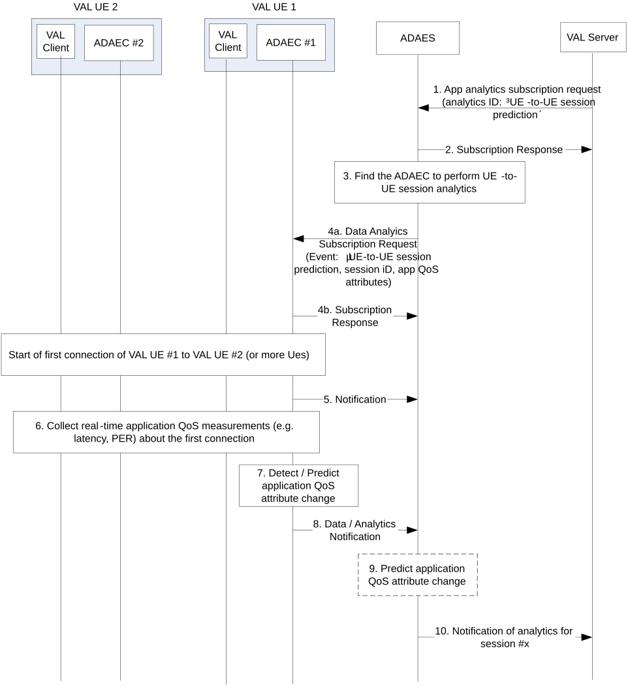

# 6.5 Solution \#4: Support for performance analytics for UE-to-UE sessions

## 6.5.1 Solution description

This solution addresses Key Issue \#1.

This solution introduces application layer analytics to predict the performance of an application session among two or more VAL UEs within a service or group. Such prediction relates to application QoS attributes prediction for a given time horizon and area. This can be requested by the VAL server during the session, or the VAL server can subscribe to receive predicted application QoS downgrade indication for an ongoing session. Such analytics will help improving the application service experience and allow the VAL layer to pro-actively adapt to predicted application QoS changes.

Figure 6.5.1-1 illustrates the procedure where the VAL session performance analytics are performed based on data collected from the ongoing VAL sessions.

Pre-conditions:

1\. ADAECs are connected to ADAES

Figure 6.5.1-1: ADAES support for VAL session performance analytics

> 1\. The consumer of the ADAES analytics service sends a subscription request to ADAES and provides the analytics event ID e.g. "VAL UE to UE session prediction", the target VAL UE ID or group of UE IDs, the VAL session / service ID, the time validity and area of the request, the required confidence level, exposure level for providing UE to UE analytics. Such request can also include whether the analytics notification shall be periodic or based on an expected application QoS change (in that case also the thresholds can be provided at the request)
>
> 2\. The ADAES sends a subscription response as an ACK to the consumer.
>
> 3\. The ADAES selects the corresponding ADAEC \#1 of the VAL UE 1 where the session performance analytics need to be performed. Such UE can be for example a capable and authorized UE from the involved VAL UEs within the service or group, e.g. a group lead.
>
> 4a. The ADAES sends a subscription request to the ADAEC \#1 with the analytics event ID and the configuration of the reporting required (e.g., periodic, based on threshold or event). Such request also includes the application QoS attributes to be analyzed (latency, jitter, PER,..)
>
> 4b. The ADAEC \#1 sends a subscription response to ADAES
>
> A session starts between the VAL UE \#1 and a VAL UE \#2 (or more VAL UEs).
>
> 5\. The ADAEC \#1 (after being aware from the VAL client that the session started) sends a notification to ADAES that a session started, and it could be possible to provide real-time data analytics for VAL UE to UE session performance in the target area.
>
> 6\. The ADAEC \#1 starts collecting data from the corresponding VAL UE(s) based on subscription. Such data can be about the latency, throughput, jitter, QoE measurements, PQI load, etc. The data can be collected by ADAEC \#1 from other ADAECs via ADAE-C interface, or from the VAL clients (VAL client to VAL client interaction is out of scope).
>
> 7\. The ADAEC either detects or predicts an application QoS change (depending on the authorization of ADAEC to perform analytics). Such change can be for example an application QoS downgrade related to the UE-to-UE session latency, or the PER/channel losses higher than a predefined threshold, for a given time horizon with a certain confidence level.
>
> 8\. The ADAEC sends the data or the analytics (depending on whether ADAEC provides a prediction) to the ADAES.
>
> 9\. The ADAES based on the received notification, confirms/verifies the analytics received or provides analytics (in case that data were reported) for the UE-to-UE session. Such analytics can be about predicting the application QoS change for the UE-to-UE session.
>
> 13**.** The ADAES sends the analytics to the consumer.

## 6.5.2 Corresponding Analytics API

This subclause provides a summary on the corresponding Analytics API for solution \#x

\- Inputs: per UE-to-UE session performance measurements (application QoS measurements such as latency, channel losses, data rate, jitter)

\- List of Data Sources

\- Data Source information: VAL UE \#1, VAL UE \#2

\- Data required from Data Source: application QoS measurements

\- Output: Predicted application QoS metric change (downgrade or upgrade)

## 6.5.3 Solution evaluation

This solution addresses Key Issue \#1 and introduces application layer analytics to predict the performance of an application session among two or more VAL UEs. Such solution enables the VAL layer to pro-actively adapt to predicted application QoS changes for VAL UE-to-UE sessions.

This solution is technically viable and doesn't introduce any impact on 5GS.
