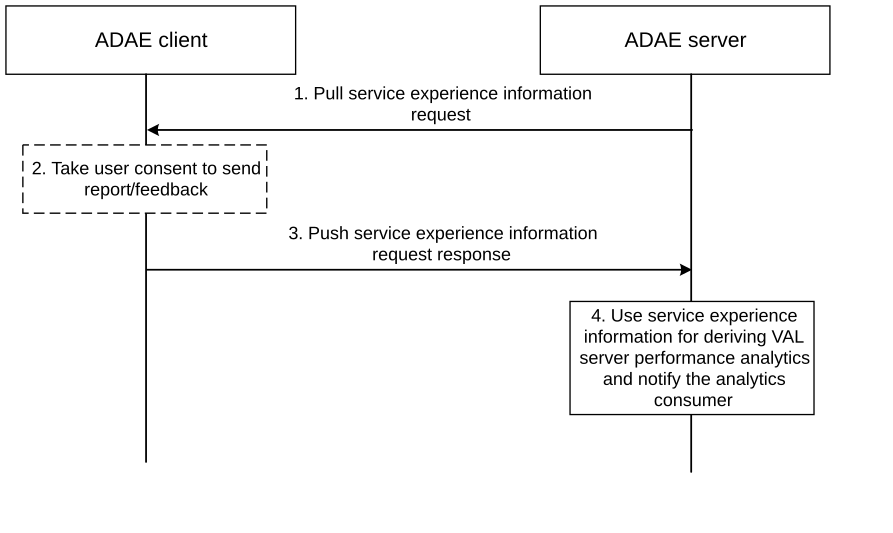
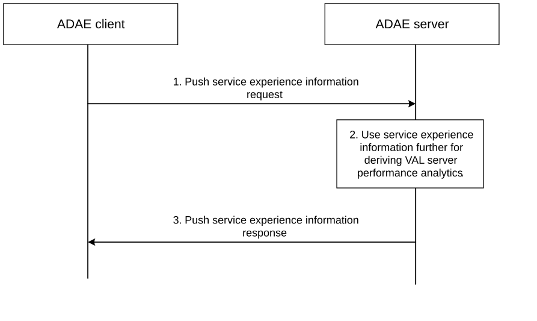
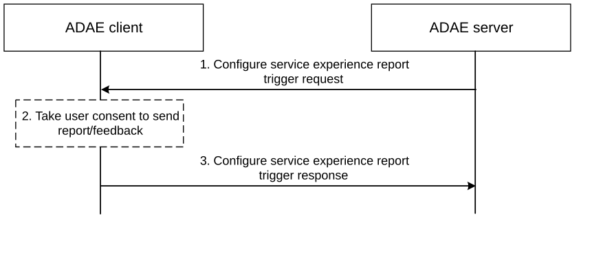

# 6.6 Solution \#5: Service experience to support application performance analytics

## 6.6.1 Solution description

This solution addresses the open issues stated in Key Issue \#1, specifically on what data to be collected. This solution supplements the existing solution \#1 in clause 6.2 with service experience information.

In some scenarios, where data from Application servers (like VAL server) is not available (overload or any other reasons) or doesn't show the quality of service experience at the UE side, the ADAE server may need to rely on alternate information sources like the application clients (like VAL clients) that provide the visibility on application service status. ADAE server can use this information from the clients alone, for the predictions and share with the consumer of the analytics. This solution supports a mechanism for the ADAE client to send service experience report to the ADAE server. ADAE server upon receiving the service experience information from the UE side entities can use it for predictions of application performance analytics. The service experience information from VAL client may include end-to-end response time, connection bandwidth, request rate, VAL server availability, etc.

This solution describes three procedures in more detail:

\- Pull service experience information

\- Push service experience information

\- Service experience information based on triggers configured by ADAE server at ADAE client.

### 6.6.1.1 Pull service experience information

Figure 6.6.1.1-1 illustrates the procedure where the ADAE server pulls the service experience information from the ADAE client.

Figure 6.6.1.1-1: Pull service experience informtion from UE

The procedure can be initiated by the ADAE server upon receiving a service experience from an ADAE client, to fetch service experience information other ADAE clients or upon receiving VAL server performance analytics request from application service provider (application server) or any other event that requires the ADAE server to determine the service experience data.

1\. The ADAE server sends Pull service experience request to the ADAE client. The request contains identity of the specific VAL server and VAL service ID, for which the service experience report is required, as mentioned in Table 6.6.1.1-1.

Table 6.6.1.1-1: Pull service experience information request

|                     |        |                                                                                       |
|---------------------|--------|---------------------------------------------------------------------------------------|
| Information element | Status | Description                                                                           |
| VAL server Identity | M      | Identity of the VAL server for which the service experience information is requested. |
| VAL service ID      | O      | Identity of the VAL service.                                                          |

2\. Upon receiving the Pull service experience request from the ADAE server, the ADAE client may take user consent to send the report if the user consent is not available already.

3\. The ADAE client sends the Pull service experience response to the ADAE server. The response contains service experience report, as specified in Table 6.6.1.1-2. The ADAE client receives the service experience related information from the VAL client.

Table 6.6.1.1-2: Pull service experience information request response

|                                                             |        |                                                                                                                                                           |
|-------------------------------------------------------------|--------|-----------------------------------------------------------------------------------------------------------------------------------------------------------|
| Information element                                         | Status | Description                                                                                                                                               |
| Result                                                      | M      | Indicates whether the report is available or not                                                                                                          |
| VAL UE ID                                                   | M      | Identity of the VAL UE                                                                                                                                    |
| VAL service ID (NOTE)                                       | O      | Identity of the VAL service.                                                                                                                              |
| VAL Server Id                                               | M      | Identify the VAL server for which the service experience report is sent                                                                                   |
| Timestamp (NOTE)                                            | O      | Time stamp of the collected report                                                                                                                        |
| VAL service experience report (NOTE)                        | O      | Information related to VAL service experience. It may include end-to-end response time, connection bandwidth, request rate, VAL server availability, etc. |
| NOTE: These IEs are included only if the result is success. |        |                                                                                                                                                           |

4\. The ADAE server uses the service experience report for derivation of VAL server performance analytics.

### 6.6.1.2 Push service experience information

Figure 6.6.1.2-1 illustrates the procedure where the ADAE client pushes the service experience information to the ADAE server.

Figure 6.6.1.2-1: Push service experience informtion from UE

The ADAE client determines the service experience information based on information received from the VAL client. The service experience information includes application specific performance measurements like end-to-end response time, connection bandwidth, request rate, server availability time, etc. On request VAL client or any other trigger conditions, the ADAE client sends the service experience report about a VAL server to the ADAE server.

1\. The ADAE client sends Push service experience request to the ADAE server. The request contains service experience report about a VAL server and includes the information elements as specified in Table 6.6.1.2-1.

Table 6.6.1.2-1: Push service experience information request

|                               |        |                                                                                                                                                           |
|-------------------------------|--------|-----------------------------------------------------------------------------------------------------------------------------------------------------------|
| Information element           | Status | Description                                                                                                                                               |
| VAL UE ID                     | M      | Identity of the VAL UE                                                                                                                                    |
| VAL service ID                | O      | Identity of the VAL service.                                                                                                                              |
| VAL Server Id                 | M      | Identify the VAL server for which the service experience report is sent                                                                                   |
| Timestamp                     | O      | Time stamp of the collected report                                                                                                                        |
| VAL service experience report | O      | Information related to VAL service experience. It may include end-to-end response time, connection bandwidth, request rate, VAL server availability, etc. |

2\. Upon receiving the Push service experience request from the ADAE client, the ADAE server uses the service experience report for derivation of VAL server performance analytics.

3\. The ADAE server sends Push service experience response to the ADAE client.

The ADAE server may take further actions based on the analysis of the report as shared by the ADAE client. A service experience information from certain UEs, can trigger the ADAE server to fetch further service experience information other UEs. Use the service experience information report from other UEs, to determine/predict analytics.

\- If most of the UE side entities report a similar service experience, then it could be the application server problem across globally.

\- If only some UEs report a bad service experience, the problem could be localized among a group of UEs.

\- If the bad service experience from only a UE, the problem is localized to the UE.

### 6.6.1.3 Service experience information based on triggers

Figure 6.6.1.3-1 illustrates procedure for the ADAE server to configure triggers to the ADAE client to send the service experience report. The procedure can be initiated by the ADAE server upon receiving VAL server performance analytics request from application service provider (application server).

Figure 6.6.1.3-1: Configure service experience report trigger

1\. The ADAE server sends Configure service experience report trigger request to the ADAE client. The request contains identity of the specific VAL server(s) for which the service experience report is required. The request includes the information elements as specified in Table 6.6.1.3-1.

Table 6.6.1.3-1: Configure service experience report trigger request

<table>
<colgroup>
<col style="width: 33%" />
<col style="width: 16%" />
<col style="width: 50%" />
</colgroup>
<tbody>
<tr class="odd">
<td>Information element</td>
<td>Status</td>
<td>Description</td>
</tr>
<tr class="even">
<td>VAL Server specific criteria</td>
<td>M</td>
<td>
Identify the list of VAL servers for which the service experience report is requested

List of VAL server specific criteria
</td>
</tr>
<tr class="odd">
<td>&gt; VAL Server Id</td>
<td>M</td>
<td>Identity of the VAL server</td>
</tr>
<tr class="even">
<td>&gt; Triggering Criteria</td>
<td>M</td>
<td>Information about the triggers on which the service experience is to be reported for the VAL server</td>
</tr>
<tr class="odd">
<td>Common Triggering criteria</td>
<td>O</td>
<td>Information about the triggers (applicable to all VAL servers) on which the service experience is fetched</td>
</tr>
<tr class="even">
<td>Service experience measurement to monitor</td>
<td>O</td>
<td>Information about the service experience measurements which needs to be fetched and included in the report. If not present, by default end-to-end response time is measured.</td>
</tr>
<tr class="odd">
<td>Notification Target Address</td>
<td>O</td>
<td>The Notification target address (e.g. URL) where the notifications destined for the ASM Server should be sent to.</td>
</tr>
</tbody>
</table>

2\. Upon receiving the Configure service experience report trigger request from the ADAE server, the ADAE client stores the triggering criteria for sending service experience report and may take user consent to send the report if the user consent is not available already.

3\. The ADAE client sends the Configure service experience report trigger response to the ASM server, indicating the result of the request.

## 6.6.2 Solution evaluation

This solution addresses Key Issue \#1 and the introduces a mechanism for the ADAE server to use the service experience information from the UE side entities via ADAE clients to determine the application performance analytics. The solution proposes three mechanisms, ADAE server pulls the service experience information from the ADAE, ADAE server pulls the service experience information from ADAE client based on certain triggers configured on the ADAE client by the ADAE server, and ADAE client pushes to ADAE server.
