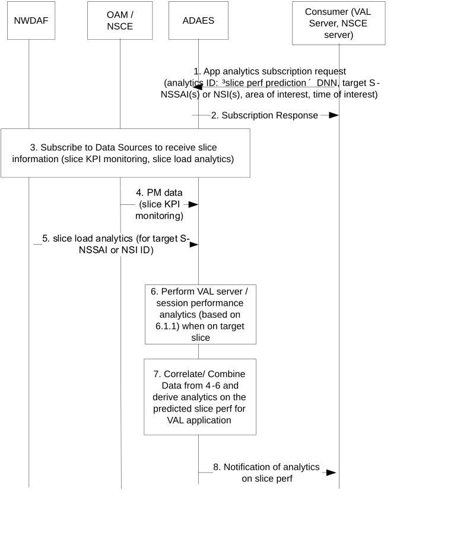

# 6.7 Solution \#6: Support for slice related application data analytics

## 6.7.1 Solution description

This solution addresses Key Issue \#5.

This solution introduces application layer analytics to provide insight on the performance of the VAL applications when using a given network slice (from a list of subscribed slices for the VAL customer). Such solution provides an analytics service to a consumer who can be either the VAL server (for helping to identify what slice it will use for its applications) or for other consumers such as SEAL NSCE to support on providing analytics (since NSCE doesn't contain an analytics engine for providing analytics on top of NWDAF/MDAS).

Figure 6.7.1-1 illustrates the procedure where the VAL server performance analytics are performed based on data collected from the ongoing VAL sessions as well as data from the DN (VAL server, DN database or networking stack at DN).

Pre-conditions:

1\. ADAEC is connected to ADAES

Figure 6.7.1-1: ADAES support for slice-related performance analytics

1\. The consumer of the ADAES analytics service sends a subscription request to ADAES and provides the analytics event ID e.g. "slice perf prediction", the target S-NSSAI, DNN, NSI ID, the time validity and area of the request, the required confidence level, whether offline and/or online analytics are needed etc.

2\. The ADAES sends a subscription response as an ACK to the consumer.

3\. The ADAES subscribes to the Data Sources with the respective Data Collection Event ID and the requirement for data collection related to the request slice(s). Such requests can be towards:

\- OAM for providing PM data related to the requested slice / NSI. Alternatively, if the interaction to OAM happens via NSCE layer, such subscription can be performed to NSCE (where ADAES is acting as VAL server).

\- NWDAF for providing slice related analytics for the given area and time horizon (indicated in step 1). Such analytics can be the slice load level related network data analytics, or the service experience related network data analytics for a given slice

4\. The ADAES based on subscription, receives PM data notification from OAM or from NSCE (via OAM APIs or NSCE-S APIs)

5\. The ADAES based on subscription, receives the requested NWDAF analytics outputs. Such analytics can be:

\- network slice or NSI statistics or predictions (clause 6.3.3 of TS 23.288)

\- per slice instance service experience stats or predictions (clause 6.4.3 of TS 23.288)

6\. The ADAES can also provide analytics on the VAL session performance based on Solution \#1 procedure 6.1.2 and filters the analytics only for the sessions which are connected to that requested slice for the area of interest.

7\. The ADAES abstracts or correlates the data/analytics from steps 4-6 and provides analytics on the slice or NSI performance for the the target VAL application/server. For example, such analytics can be about the min/average/max predicted RTT / end to end latency for the VAL application/server if this server uses a given slice/NSI (or for a list of given slices) within an area of interest.

8**.** The ADAES sends the analytics to the consumer.

## 6.7.2 Corresponding Analytics API

This subclause provides a summary on the corresponding Analytics API for solution \#x

\- Inputs: per slice measurements and analytics, application session performance analytics, historical data on slice information

\- List of Data Sources:

\- Data Source \#1 information: OAM or NSCE

\- Data required from Data Source \#1: PM data for a given NSI

\- Data Source \#2 information: NWDAF

\- Data required from Data Source \#2: slice load analytics for NSI/S-NSSAI, service experience for NSI/S-NSSAI

\- Data Source \#3 information: VAL UEs (based on Solution \#1)

\- Data required from Data Source \#3: application QoS measurements for an application session connected to requested slice

\- Output: Statistics or prediction for the VAL application QoS for one or more requested S-NSSAIs/NSIs

## 6.7.3 Solution evaluation

This solution introduces application layer analytics to provide insight on the performance of the VAL applications when using a given network slice (from a list of subscribed slices for the VAL customer). This solution is technically viable and does not have any dependency to other slice related analytics since it targets the application performance for a target slice or NSI and not the network slice related performance.
