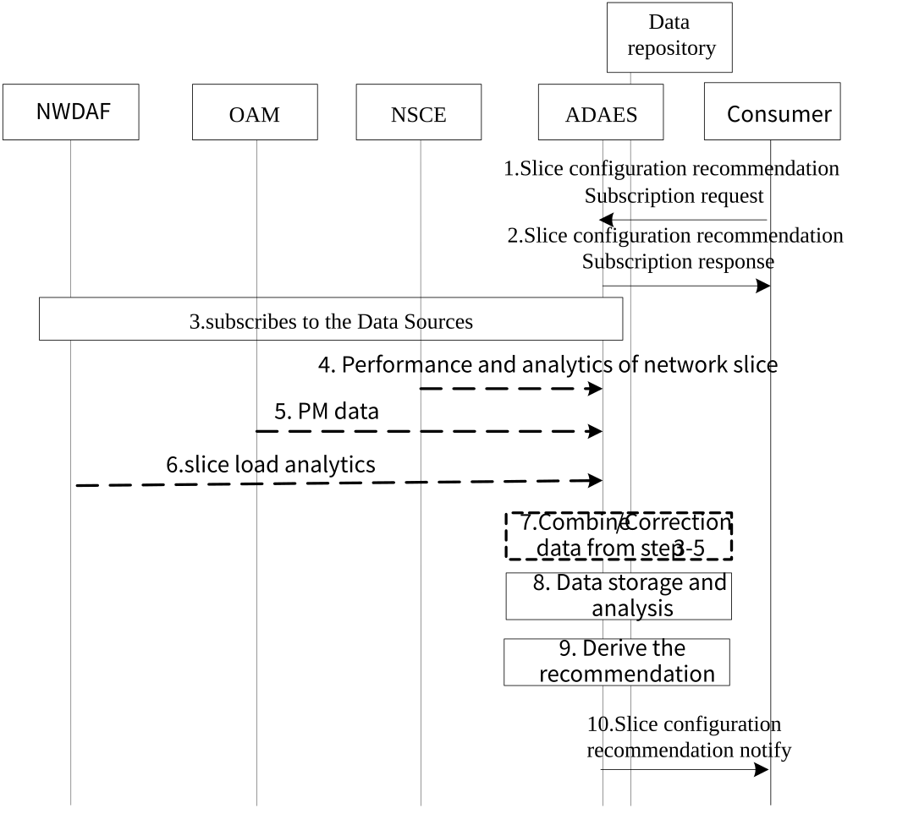

# 6.8 Solution \#7: Slice configuration recommendation

## 6.8.1 Solution description

This solution addresses Key Issue \#6.

This solution provides a procedure for network slice configuration recommendation based on collected network slice performance and analytics and historical network slice status and network performance. The consumer can be either the VAL server or other consumers such as SEAL NSCE.

Figure 6.8.1-1 illustrates the procedure for network slice configuration recommendation.

Pre-conditions:

1\. The ADAES is registered and capable of interacting with 5GS to collected network slice data.

2\. The ADAES is registered and capable of interacting with NSCE to collected network slice performance and analytic.

Figure 6.8.1-1: ADAES support for network slice configuration recommendation

> 1\. The consumer of the ADAES sends a subscription request to ADAES and provides the target S-NSSAI, DNN, slice requirement, area of the interest, interest time period of the historical data (e.g. last year), the required confidence level, whether offline and/or online analytic are needed etc.
>
> 2\. The ADAES sends a subscription response to the consumer.
>
> 3\. The ADAES subscribes to the Data Sources with the respective Data Collection Event ID and the requirement for data collection related to the request slice(s). Such requests can be sent to SEAL NSCE, OAM, NWDAF or the combination of them.
>
> 4\. Based on subscription, the ADAES (acting as VAL server) may receive performance and analytics data from SEAL NSCE (e.g. QoE metrics, as defined in the TS 23.435 clause 9.4.2).
>
> 5\. Based on subscription, the ADAES may receive Network slice / NSI related performance data from OAM as defined in TS 28.552 \[12\].
>
> 6\. Based on subscription, the ADAES may receives Network slice related Observed Service experience statistics, Load level information of a Network Slice defined from NWDAF as defined in TS 23.288\[18\]
>
> 7\. If the data is collected from multiple sources, the ADAES combines or correlates the data/analytics from steps 3-5, and stores the data into data repository if needed.
>
> 8\. Collect the historical data from data repository and analyze the network slice usage pattern. When the amount of stored historical data does not cover the required interest time period of the historical data, ADAES analyze the slice usage pattern based on the existing stored historical data.
>
> 9\. The ADAES provides network slice configuration recommendation based on the slice requirement, slice performance and derived slice usage pattern from step 8.
>
> 8**.** The ADAES sends the network slice configuration recommendation to the consumer. The recommendation may be related to parameters in the slice serviceProfile if the consumer is the SEAL NSCE. Or the recommendation may be related to slice resource /functional configuration (e.g. slice capacity, coverage) if the consumer is the management system.

## 6.8.2 Corresponding Analytics API

This subclause provides a summary on the corresponding Analytics API for solution \#7

\- Inputs: per slice measurements and analytics, historical data on slice information

\- List of Data Sources:

\- Data Source \#1 information: SEAL NSCE

\- Data required from Data Source \#1: performance and analytics data for a given S-NSSAI

\- Data Source \#2 information: OAM

\- Data required from Data Source \#2: PM data for a given S-NSSAI

\- Data Source \#3 information: NWDAF

\- Data required from Data Source \#3: slice load analytics for S-NSSAI, service experience for S-NSSAI

\- Data Source \#4 information: A-ADRF

\- Data required from Data Source \#4: historical slice load analytics and service experience for S-NSSAI.

\- Output: Statistics for the network slice configuration recommendation for one or more requested S-NSSAIs. The recommendation may be related to parameters in the slice serviceProfile per S-NSSAI if the consumer is the SEAL NSCE. Or the recommendation may be related to slice resource /functional configuration per S-NSSAI / NSI (e.g. slice capacity, coverage) if the consumer is the management system.

## 6.8.3 Solution evaluation

This solution is technically viable and does not have any dependency to other slice related analytics since it targets the slice configuration recommendation for a target S-NSSAI.
