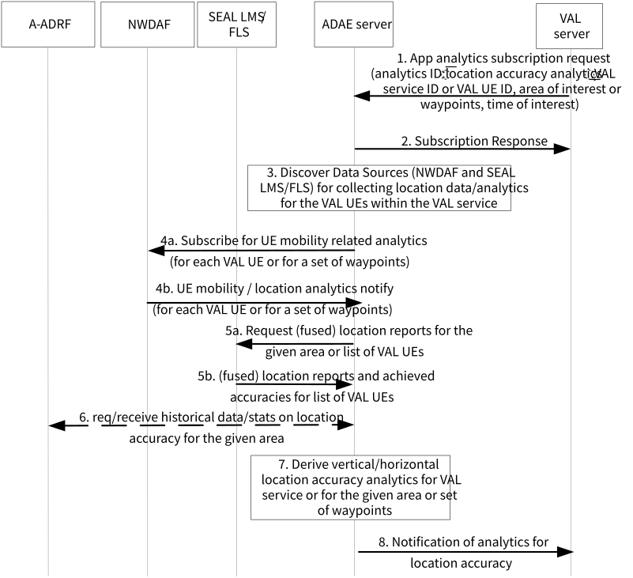

# 6.9 Solution \#8: support for location accuracy analytics

## 6.9.1 Solution description

This solution addresses Key Issue \#7.

This solution introduces application layer analytics to allow a VAL server to be notified based on analytics whether the accuracy of a location can be met for a given application and optionally for a given UE/group route. For example, a VAL server may request the ADAE server to provide analytics whether the accuracy of a location for the UEs within a VAL application is predicted to be sustainable or is expected to downgrade in a specific area or for an expected route from location A to location B.

Figure 6.9.1-1 illustrates the procedure for location accuracy analytics enablement solution.

Pre-conditions:

1\. ADAES is connected to A-ADRF

2\. ADAES has discovered SEAL LMS or FLS

Figure 6.9.1 -1: Location accuracy analytics procedure

1\. The VAL server makes a request to ADAE server for location accuracy prediction/stats, including an analytics event ID (e.g. "location accuracy prediction" or "location accuracy sustainability"), an analytics request type (if not identified specifically at the event ID) which can be the location accuracy prediction for a given location X and/or for a given UE/app. The request may include also the target area, a target VAL application, or a VAL UE, group of UEs or the VAL service, time of day, accuracy threshold and requirements. If the VAL UEs are provided by the VAL server, this request may also include the expected route or a set of waypoints for the UEs of the VAL application.

2\. The ADAE server sends a subscription response as an ACK to the VAL server.

3\. The ADAE server discovers and maps the Data Sources with the respective analytics event ID for collecting location data for the corresponding VAL UEs or VAL service or area.

4a/4b. The ADAE server subscribes for NWDAF UE mobility analytics per VAL UE (for all the VAL UEs) and gets notification on the per UE location/mobility analytics based on TS 23.288 clause 6.7.2. Such analytics may be requested for a list of waypoints per UE route (if indicated at step 1).

5a/5b. The ADAE server requests and receives from SEAL LMS location reports for the respective VAL UEs or location reports from all VAL UEs within the requested area. Such request may also indicate the required location accuracy (requires enhancements to SEAL LMS procedures). In case where FLS is deployed, it can be also possible to request and receive fused location reports (combined location reports from 3gpp/n3gpp sources) if the ADAE server identifies that higher location accuracy is required.

6\. The ADAE server may also request and receive location accuracy historical analytics /data from A-ADRF for the corresponding VAL UEs or VAL service area.

7\. The ADAE server abstracts or correlates the data/analytics from steps 4-6 and provides analytics on the location accuracy for the the target VAL application. Depending on the event ID in step 1, the ADAE server can indicate whether the location accuracy is sustainable or is predicted to be downgraded or can be upgraded and become more granular (e.g. from meter to decimetre).

8\. The ADAE server sends the analytics to the consumer.

## 6.9.2 Corresponding Analytics API

This subclause provides a summary on the corresponding Analytics API for solution \#8

\- Inputs: per VAL UE or area location reports and UE mobility analytics

\- List of Data Sources:

\- Data Source \#1 information: NWDAF (Nnwdaf_AnalyticsInfo service via N33, as specified in TS 23.288 \[2\])

\- Data required from Data Source \#1: UE mobility analytics

\- Data Source \#2 information: SEAL LMS (SS_LocationMonitoring API, SS_LocationAreaMonitoring API as specified in TS 23.434 \[5\])

\- Data required from Data Source \#2: UE location reports and achieved accuracy, Location reports from all UEs within a given area

\- Data Source \#3 information: FLF

\- Data required from Data Source \#3: fused location reports per VAL UE (via FLS-2 as discussed in TR 23.700-96 \[8\])

\- Data Source \#4 information: A-ADRF

\- Data required from Data Source \#4: historical location accuracy statistics for target VAL service area or VAL UE

\- Output: a predictive location accuracy sustainability or change indication, a predictive location accuracy sustainability or change indication for a route of the UE with the application.

## 6.9.3 Solution evaluation

This solution addresses Key Issue \#7 and introduces location accuracy analytics to predict possible downgrade of location accuracy for a given VAL application. Such solution enables the VAL layer to pro-actively adapt to predicted location accuracy changes for the VAL service (e.g. to change the distance between VAL UEs or trigger the change of VAL UE speed if location accuracy is changed).

This solution is technically viable and doesn't introduce any impact on 5GS. This solution requires enhancements to SEAL LMS and to FLS for reporting the accuracy as part of the location reporting.
