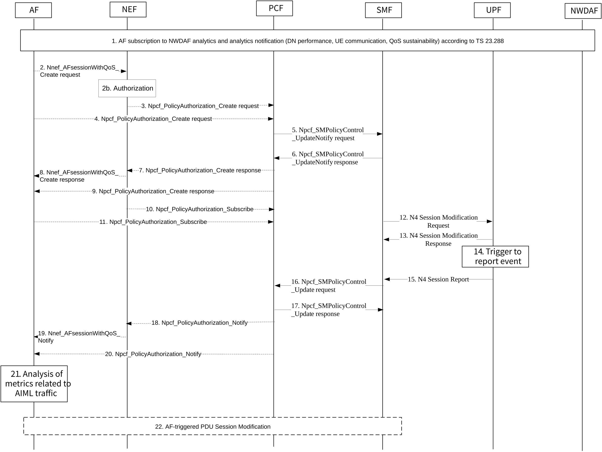
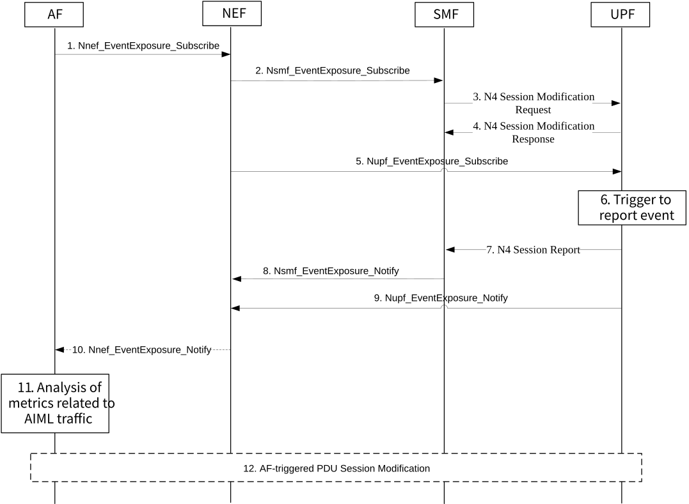

# 6.1 Solution \#1: 5GS Monitoring Capabilities for AI/ML-based Services

## 6.1.1 Description

This solution proposes 5GS monitoring capabilities to support AI/ML-based services as well as AI/ML operations (i.e. model splitting, model sharing, and distributed/federated learning, as described in TS 22.261 \[2\]) over the 5GS. The solution i) leverages aspects of the QoS monitoring capabilities for URLLC services relevant to AI/ML-based services, and ii) proposes additional monitoring features.

It is proposed that the AF hosting the AI/ML application server monitors packet delay related to the application AI/ML operation via NEF by making use of the 5GS network exposure feature described in clause 4.15.6.6 of TS 23.502 \[4\] where QoS monitoring capabilities can be requested by the AF for URLLC services via a procedure for an AF session with specific QoS parameters. The procedure involves PCF, which updates the SM policy and notifies SMF, which in turn requests a modification of the N4 session to collect reporting events from UPF. In addition, the solution proposes to extend the event exposure of NEF to provide support for monitoring of traffic volume and session inactivity time. Finally, the solution proposes NWDAF analytics potentially relevant to the application AI/ML operation to be collected by the AF.

Below follows the list and description of the specific capabilities and features enabling monitoring of relevant AI/ML-based services and operations that are proposed as part of this solution:

\- AF monitoring of UL, DL or round trip packet delay measurement: the three application AI/ML operations defined in TS 22.261 \[2\] (model split, model distribution, FL) may benefit from AF packet delay monitoring as the AI/ML application server may schedule training operation at UEs according to application needs, and delay measurements can assist the server in determining what the best strategy for such scheduling is. For example, delay measurements of the UE members of a FL group may assist the application server decide which UEs need to provide model updates in each iteration. Delay information is also critical for model split during joint inference, when sharing of inference results may be critical for the application performance. Current specifications already detail how the AF monitors this parameter for URLLC services.

\- AF monitoring of traffic/data volume: AF knowledge on the traffic volume helps the application server decide on the AI/ML operations that would be suitable for the application. For example, it may not be convenient to share or distribute very large models frequently, but smaller size models could be shared frequently. Similarly, there are important implications for model splitting depending on the traffic volume that needs to be exchanged between UE and application server, and the application server may need to monitor information on traffic/data volume to decide models' optimal splitting points.

\- AF monitoring of session inactivity time: when a training operation is to be scheduled by an AI/ML application server either for a single UE or a group of UEs engaged in FL, awareness of session inactivity time as reported by UPF to SMF turns out to be very helpful as it aids the server to determine when a UE or a group of UEs is sharing specific types of AI/ML traffic such as trained models. In particular, the dynamicity of FL groups greatly benefits from this parameter as UE's may dynamically join or leave the group in a pre-scheduled way (therefore optimizing performance) with assistance of this parameter. In current specifications UPF is already capable of monitoring this parameter and reporting it to SMF, so this solution enables the AF to trigger the monitoring procedure and SMF to deliver the report to AF via NEF.

NOTE: If the application has monitoring capabilities to accurately determine traffic volume and session inactivity, then it may not require 5GS monitoring capabilities for traffic/data volume and session inactivity time.

\- AF subscription to NWDAF analytics (DN performance, UE communication, QoS sustainability) , which may assist the AI/ML application operation and is already supported. Current specifications already detail how the AF subscribes to these analytics.

## 6.1.2 Procedures

### 6.1.2.1 Procedure for QoS monitoring

Figure 6.1.2.1-1: Procedure for QoS monitoring capabilities for AI/ML-based services

The procedure in Figure 6.1.2.1-1 combines the procedures in clauses 4.15.6.6, 4.16.5 and 4.4.2.2 of TS 23.502 \[4\]. The required updates needed are described in the step-by-step description below.

1\. AF subscribes to NWDAF analytics relevant to the performance of the UE(s) using the AI/ML application (e.g. DN performance, UE communication, QoS sustainability).

2\. The AF uses the Nnef_AFsessionWithQoS service to indicate a subscription to notifications of QoS monitoring for delay measurements of UE traffic related to AI/ML-based services. Hence, the AF request may indicate packet delay measurement parameter (UL, DL, or round trip) as described in clause 5.33.3 of TS 23.501 \[3\] and 5.2.6.9 of TS 23.502 \[4\] for the case of URLLC services. Other requested monitored resources may include usage report and inactivity timer.

2b-3. Steps 2b and 3 are performed according to Figure 4.15.6.6-1 in TS 23.502 \[4\] when NEF determines to contact PCF directly. The NEF interacts with the PCF by triggering a Npcf_PolicyAuthorization_Create request for session management policy control to authorize the AF request and optionally subscribe to PCF events for measurement of packet delay.

4\. Step 4 is performed instead of steps 1-3 when the AF is trusted by the operator to interact directly with PCF to request monitoring capabilities for an AF session related to AI/ML-based services.

5-6. If the PCF determines that the SMF needs updated policy information (as is the case for the proposed monitoring parameters in this solution), the PCF issues a Npcf_SMPolicyControl_UpdateNotify request with updated policy information as described in the PCF initiated SM Policy Association Modification procedure in clause 4.16.5.2 of TS 23.502 \[4\]. The SMF then acknowledges the PCF request with a Npcf_SMPolicyControl_UpdateNotify response.

7-9. The PCF determines whether the request is authorized and notifies the AF if the request is not authorized via NEF or directly by issuing a Npcf_PolicyAuthorization_Create response message.

10-11. The NEF or AF may send a Npcf_PolicyAuthorization_Subscribe message to the PCF to subscribe to the notification of PCF events for measurement of packet delay measurement if not done so previously in step 3.

12-15. After receiving the event subscription notification from PCF, the SMF issues an N4 Session Modification Request as described in clause 4.4.1.3 of TS 23.502 \[4\] configuring the triggers for event reporting in UPF. The reporting triggers configured by SMF may entail session reports for packet delay measurement. The UPF may report on these events according to clause 4.4.2.2 of TS 23.502 \[4\].

16-17. Steps 16-17 are performed according to clause 4.16.5.1 of TS 23.502 \[4\], with the SMF providing the event condition(s) that have been met to PCF.

18-20. Steps 18-19 are performed as steps 7-8 in Figure 4.15.6.6-1 of TS 23.502 \[4\] with the event information reported by PCF to AF via NEF in case of untrusted AF. Step 20 is performed instead when the AF is trusted by the operator.

21\. The AF analyses the monitored information exposed by the 5GS related to the AI/ML traffic.

22\. If needed, the AF may trigger a modification of the PDU Session after having analysed the monitored data (see also clause 4.15.6.6a of TS 23.502 \[4\], without the need for TSCTSF involvement).

NOTE: Any security and privacy aspects of the network and UE information exposure need to be studied by SA WG3.

### 6.1.2.2 Procedure for monitoring of session inactivity time and traffic volume events

 Figure 6.1.2.2-1: Procedure for session inactivity time and traffic volume monitoring capabilities for AI/ML-based services

1\. The AF uses the Nnef_EventExposure_Subscribe service operation to indicate a subscription to new NEF monitoring events for traffic volume and/or session inactivity time.

2\. The NEF subscribes to the user plane status information SMF event described in clause 5.2.8.3.1 of TS 23.502 \[4\], providing the (AI/ML) application ID and the SUPI(s) of the UE(s) being monitored as event filters as described in Table 5.2.8.3.1-1 of TS 23.502 \[4\].

3-4. After receiving the event subscription notification from NEF, the SMF issues an N4 Session Modification Request as described in clause 4.4.1.3 of TS 23.502 \[4\] configuring the trigger for event reporting in UPF of PDU session inactivity.

5\. The NEF may subscribe to event exposure directly from UPF to obtain information on data usage of a PDU session.

NOTE 1: Whether and how an event ID is used by AF/NEF for retrieval of data usage information from UPF depends on FS_UPEAS and will be determined when FS_UPEAS reaches conclusions.

NOTE 2: The procedure in Figure 6.1.2.2-1 does not involve NWDAF.

6\. A trigger happens to report events on session inactivity and/or traffic usage by UPF.

7\. When a PDU session inactivity event is detected, UPF reports it to SMF according to clause 4.4.2.2 of TS 23.502 \[4\].

8\. SMF reports the detection of a user plane status information event to NEF with information on session inactivity time.

9\. UPF reports to the NEF the detection of the event in step 5 with information on data usage of a PDU session.

10\. NEF reports the monitored session inactivity time and/or traffic volume to AF via Nnef_EventExposure_Notify service operation.

11\. The AF analyses the monitored information exposed by the 5GS related to the AI/ML traffic.

12\. If needed, the AF may trigger a modification of the PDU Session after having analysed the monitored data.

## 6.1.3 Impacts on services, entities and interfaces

AF:

\- Request monitoring of parameters described in clause 6.1.1 related to AI/ML-related traffic via Nnef_AFsessionWithQoS for QoS monitoring and Nnef_EventExposure_Subscribe for traffic usage and session inactivity time.

NEF:

\- Support the request for monitoring of parameters described in clause 6.1.1 related to AI/ML-related traffic.

\- New monitoring events required for traffic usage and session inactivity time.

SMF/UPF:

\- Provide the monitored parameters described in clause 6.1.1 related to AI/ML-related traffic.
