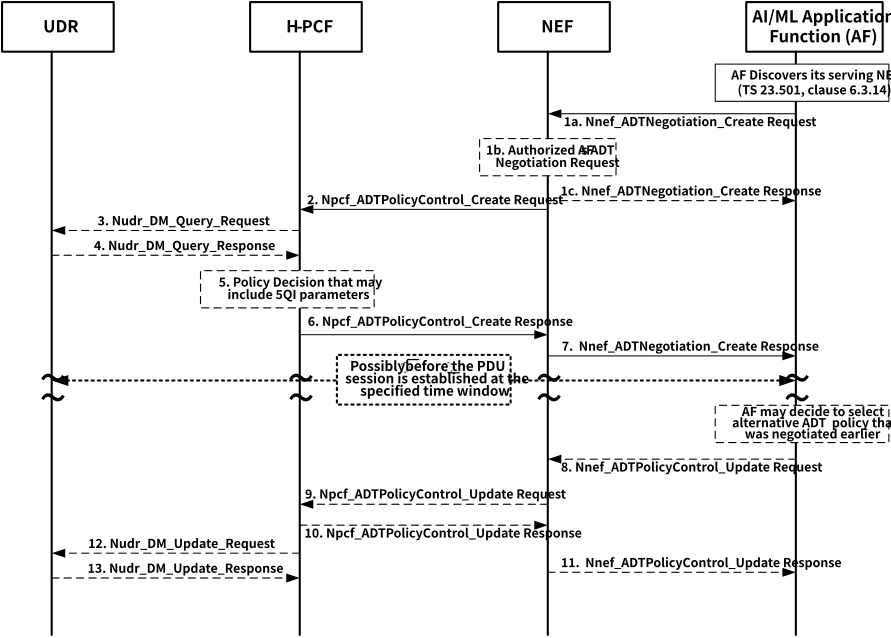
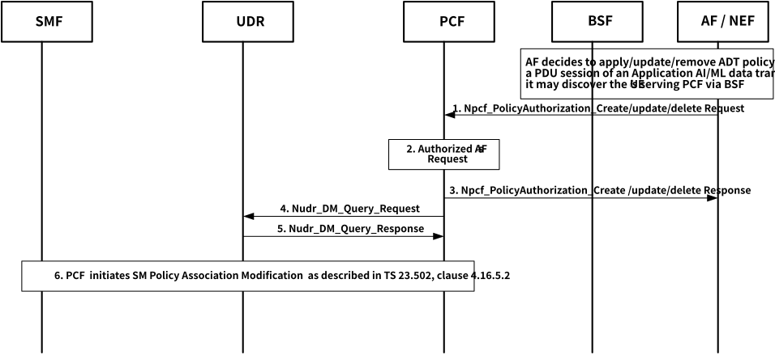

# 6.10.2 Solutions

The intent of this solution is to define the ADT data transfer mechanism to support the Application AI/ML data transfer.

The solution defines the ADT transfer policy which includes a list of QoS profiles corresponding to their respective Desired Time Window. The solution includes the ability to negotiate a list of time windows between the AF and the 5GC. The solution includes also the support for individual QoS as defined in clause 5.7 of TS 23.501, specifically the average and maximum Packet Delay for UL/DL, average and maximum Packet Loss Rate for UL/DL and guaranteed and maximum Traffic Rate for UL/DL corresponding to a particular Desired Time Window.

This solution also proposes to enhance the Network Performance analytics or DN Performance analytics for NWDAF as described in TS 23.288 \[6\] to support the additional QoS performance analytics for the new QoS parameters (i.e. PDB, PLR and traffic rate) as described earlier in clause 6.10.1 above. More specifically, the additional QoS parameters are average and maximum Packet Delay for UL/DL, average and maximum Packet Loss Rate for UL/DL and average, minimum and maximum Traffic Rate for UL/DL per UE per Time Window. PCF may subscribe to such analytics to assist its decision to derive the AAMDT Transfer policy for the selected time window(s).

This solution also defines the ADT negotiation procedures similar to the procedures as defined in clause 4.16.7.2 of TS 23.502 \[4\] to support the ability of the AF to request a list of ADT time windows and the associated QoS support. In addition, it describes the procedure on how AIML AF discovers its serving NEF as well as the need for the NEF to authenticate/authorize the AIML AF. Finally, this solution clarifies the procedures on how ADT can be applied to the existing or future PDU session.

As described in clause 6.1.2.4 of TS 23.503, one or more negotiated BDT policies could be provided by PCF to AF via NEF. The AF will then select one of them and inform the PCF about the selected ADT Transfer policy together with the ADT Transfer Reference ID. Prior to the desired time window started for the Application AI/ML data transfer, the AF will then initiate the AF request towards PCF to apply the selected ADT Transfer policy to the selected target UEs' PDU sessions. The PCF will then determine the appropriate PCC rules according to the negotiated ADT Transfer policy for each these PDU sessions.

In addition, this solution also proposes to merge with Solution#14 which addresses minimum guarantee of the QoS performance among the selected FL members when they are participating in the FL operation.

## 6.10.2.1 ADT Mechanism to support Application AI/ML data transfer

In this clause, the solution borrows the descriptions of the BDT service in order to describe the AF to request a list of Desired time windows for ADT similar to the input parameter for the Nnef_BDTPNegotiation_Create as described in clause 5.2.6.6.2, but with the additional primary and alternative QoS profiles (e.g. PDB, PLR etc.) corresponding to the list of Desired time windows proposed by this solution for the specific Application AI/ML data transfer requested by the AF.

In order to support the KPIs that have been defined in TS 22.261 \[2\], clause 7.10 to support the QoS performance for the data transfer for various Application AI/ML traffic, this solution proposed the ADT Transfer policy with the following QoS parameters which apply to the primary and alternative QoS profiles requested by the given AF:

\- Packet Delay for UL/DL per UE per Time Window

\- Maximum Packet Loss Rate for UL/DL per UE per Time Window;

\- Guaranteed and Maximum Bitrate for UL/DL per UE per Time Window;

During the ADT Transfer policy negotiation and before the activation procedures , the PCF may subscribe to NWDAF for the Network Performance Analytics and/or DN Performance Analytics as described in clauses 6.6 and 6.14 of TS 23.288 \[6\]. to collect the performance statistic and to derive the performance prediction on those QoS parameters for the given time window. Based on the analytics report, the PCF may propose to re-negotiate the ADT Transfer policy prior to the activation of the corresponding BDT time window.

In order to enhance the Network Performance or DN Performance analytics to report the prediction of the QoS performance, this solution proposes to add the following input parameters to the Network Performance Analytics as described in clauses 6.6 and 6.14 of TS 23.288 \[6\] together with the UE's performance data collected from the AF as shown in Table 6.10.2.1-1 below to enable the NWDAF to derive the extended Network Performance or DN Performance analytics for the set of the QoS performance statistic and predictions corresponding to the specified time window: i.e.:

\- The identification of the target application(s) for the analytics information, i.e. Application ID(s), and the corresponding IP address/FQDN

Table 6.10.2.1-1: Performance Data from AF

|                                     |        |                                                                                                                                                                                                               |
|-------------------------------------|--------|---------------------------------------------------------------------------------------------------------------------------------------------------------------------------------------------------------------|
| Information                         | Source | Description                                                                                                                                                                                                   |
| UE identifier                       | AF     | IP address of the UE at the time the measurements was made.                                                                                                                                                   |
| UE location                         | AF     | The location of the UE when the performance measurement was made.                                                                                                                                             |
| Application ID                      | AF     | To identify the service and support analytics per type of service (the desired level of service).                                                                                                             |
| IP filter information               | AF     | Identify a service flow of the UE for the application.                                                                                                                                                        |
| Locations of Application            | AF/NEF | Locations of application represented by a list of DNAI(s). The NEF may map the AF-Service-Identifier information to a list of DNAI(s) when the DNAI(s) being used by the application are statically defined.  |
| Application Server Instance address | AF/NEF | The IP address/FQDN of the Application Server that the UE had a communication session when the measurement was made.                                                                                          |
| Performance Data                    | AF     | The performance associated with the communication session of the UE with an Application Server that includes: Average/Maximum Packet Delay, Average/Maximum Loss Rate and Average/Minimum/Maximum Throughput. |
| Timestamp                           | AF     | A time stamp associated to the Performance Data provided by the AF.                                                                                                                                           |

Based on the input parameters above, the NWDAF will then subscribe to the "Performance Data from AF" similar to clause 6.4.2 or clause 6.14.2 in TS 23.288 \[6\] either directly for trusted AFs by invoking Naf_EventExposure_Subscribe service (Event ID = Performance Data, Event Filter information = Area of Interest, Application ID) as defined in TS 23.502 \[4\], or indirectly for untrusted AFs via NEF by invoking Nnef_EventExposure_Subscribe service (Event ID = Performance Data, Event Filter information = Area of Interest, Application ID) where NEF translates the Area of Interest into geographic zone identifier(s) in order to derive the performance statistic and prediction indicators for the following new QoS parameters corresponding to the specific time window:

\- Maximum/Average Packet Delay for UL/DL per UE per Time Window

\- Maximum/Average Packet Loss Rate for UL/DL per UE per Time Window

\- Maximum/Minimum/Average Traffic Rate for UL/DL per UE per Time Window

## 6.10.2.2 ADT Negotiation for future PDU session to support Application AI/ML data transfer

This clause presents further clarifications on how to leverage the ADT procedures for negotiation of future background data transfer to support the Application AI/ML data transfer.

Prior to the establishment of PDU session to support the ADT within a specified time-window, AF initiates requests to its serving NEF to (re)negotiate ADT Transfer policy that might have been pre-provisioned or earlier negotiated and stored in the UDR.

Figure 6.10.2.2-1: ADT Transfer Policy Negotiation for future PDU session to support Application AI/ML data transfer

The procedures as shown in Figure 6.10.2.2-1 above borrows the descriptions of the BDT procedures specified in TS 23.502 \[4\], clause 4.16.7.2 to support negotiation for future background data transfer. The following descriptions focus on the changes to the existing procedures:

Prior to the transport of the Application AI/ML data within the specified time-window, the AF negotiates with the 5G Core for the ADT policies that apply to its given Application AI/ML data transfer corresponding to the authorized 3rd party (i.e. AF), the AF is required to discover its serving NEF, if it has not done so, using the mechanism as described in clause 6.3.14 of TS 23.501 \[3\].

In step 1a, to the list of parameters for Nnef_ADTNegotiation_Create Request from AF similar to the procedure as described in clause 4.16.7.2 of TS 23.502 \[4\] now includes the list of Desired time windows with their associated primary or alternative QoS profile, the AI/ML AF may include also the latency and reliability requirements for the specific Application AI/ML operation as described in clause 6.10.2.1.

Furthermore, if "flock" scenario applies to the group of selected FL UEs who are to be participated in this BDT session, the ADT Transfer policy automatically takes into account the Flock QoS policy into consideration by specifying the minimum guaranteed QoS requirements, via proper QoS attributes, e.g. Packet Delay Budget.

NOTE 1: Flock QoS is determined by an AF based on AF's internal logic (policy). For example, the AF can determine the flock QoS based on the UEs and the network input data and the FL trigger conditions.

In step 1b, the NEF may authenticate the AF and authorize the ADT request from the AF. If the given AF is not authenticated and authorized, the NEF will reject AF's request through the Nnef_ADTNegotiation_Create Response, and the following steps are skipped.

In step 2, the list of parameters for Npcf_ADTPolicyControl_Create Request from AF as described in clause 4.16.7.2 of TS 23.502 \[4\] now includes the list of Desired time windows, the NEF should include the added latency and reliability requirements for the specific Application AI/ML operation if they have been received from the AF.

In step 4, PDB and PLR etc. QoS parameters may also be provided by UDR as part of the ADT policies to the PCF. This may happen if the PCF (or another PCF) had received from the AF/NEF in a previous ADT negotiation regarding the latency and reliability requirements which are described in the form of PDB and PLR etc. QoS parameters, and are stored in the UDR.

In Steps 5, 6 the PCF refers to the requested QoS requirements specified by the AF. As described in current step 5, the PCF subscribe to with the NWDAF as defined in clause 6.6 of TS 23.288 \[6\] to request the Network Performance analytics and/or DN Performance for the set of QoS parameters' performance for each Desired time window from the list and the Network Area Information. The PCF will then determine the PDB, PLR etc. QoS parameters based on the QoS requirements from the AF for the corresponding Desired time window(s) which may be based on the reports of the Network Performance and/or DN Performance analytics to be included in the set of ADT Transfer policies The PCF may also invalidate some of the old ADT Transfer policies. The PCF sends the final set of ADT Transfer policies to the AF via NEF together with the ADT Transfer Reference ID.

After the ADT Transfer policy negotiation, if the AF decides to select an alternative ADT Transfer policy (e.g. data rate reduction, relaxing delay constraints of planned and event driven traffic etc.) which may include the Flock QoS policy consideration with the minimum guaranteed QoS requirements as the result of certain AI/ML operation decision, the AF may trigger step 8 to update the corresponding PCF via the support of NEF for the new selected ADT Transfer policy.

NOTE 2: It is not in the scope of this solution to specify the event or consideration that triggers the AF decision to update the ADT Transfer policy.

In step 12, the additional QoS parameters may be added to the UDR by the PCF as part of the updated ADT Transfer policies.

## 6.10.2.3 Activation or Updating/Removing ADT Transfer to a PDU Session

This clause describes two ways to apply the negotiated ADT Transfer policy for a given Application AI/ML data transfer to the PDU Session(s) for given UE(s) - i.e. (a) activating the ADT Transfer policy as described in clause 6.10.2.2 above to a PDU session; and (b) adding PDU session of the target UE to the ADT Desired time window by applying the ADT Transfer policy.

For the activation of the previously negotiated ADT Transfer policy to a PDU session to support the Application AI/ML data transfer, before the start of the ADT Transfer transfer Desired time window, the AF triggers Npcf_PolicyAuthorization_Create/Update via NEF or directly to PCF. The AF discover the PCF (may be via NEF) via BSF by invoking Nbsf_Management_Discovery. In both cases, the PCF will then leverage the negotiated ADT Transfer policy to generate the PCC rules to support the establishment of the future PDU session(s). For further details on how to apply the previously negotiated ADT Transfer policy can be referred to clause 6.1.2.4 of TS 23.503 \[5\] and clause 4.15.6.8 of TS 23.502 \[4\].

If the PDU session has been established and the AF would like to apply/update/delete the ADT Transfer policy to such existing PDU session for individual UE to support the Application AI/ML data transfer, then the AF invokes the Npcf_PolicyAuthorization_Create/Update service directly to PCF (via the N5 interface). The AF may discover the PCF via BSF by invoking Nbsf_Management_Discovery. The AF also provides the ADT Reference ID together with the AF session information to the PCF that serves the PDU session. The PCF authorizes the AF request. If the PCF determines that the AF can't be authorized, it rejects the AF request. Once the PCF authorizes the AF request and if the AF request is to apply or to update the PDU session with the ADT Transfer policy,, the PCF retrieves the corresponding ADT Transfer policy from UDR to derives the PCC rule for the BDT according to the transfer policy which may include the Flock QoS policy consideration with the minimum guaranteed QoS requirements. In addition, the AF may specify the individual QoS parameters as described in clause 6.1.3.22 of TS 23.503 \[5\] different than the ADT Transfer policy. The PCF then updates the SMF with corresponding new PCC rule(s) with PCF initiated SM Policy Association Modification procedures as described in TS 23.502 \[4\], clause 4.16.5.2. Further details on how AF applies the ADT Transfer Policy to an existing session are provided in clause 6.1.2.4 of TS 23.503 \[5\].

If the AF would like to remove the ADT Transfer policy for a PDU session of a given UE, AF invokes the Npcf_PolicyAuthorization_Delete service directly to PCF. The AF also provides the ADT Reference ID together with the AF session information to the PCF that serves the PDU session. The PCF authorizes the AF request as described above before removing the PDU session from the ADT.

Figure 6.10.2.3-1: Applying/Updating/Removing ADT Transfer Policy to a PDU session to support Application AI/ML data transfer

1\. AF decides to apply/update/delete the ADT Transfer policy of a given application AI/ML data transfer for PDU session, then the AF will, at the time the data transfer is about to start, provide, for the target UE, the ADT Reference ID together with the AF session information to the PCF that serves the PDU session (via the N5 interface). Note that AF may need to discover the UE's serving PCF via NEF with the support of BSF. This Npcf_PolicyAuthorization_Create/Update/Delete service as described in clause 5.2.5.3.2 of TS 23.502 \[4\] is to authorise an AF request and to create policies as requested by the authorized AF for the PDU Session to which the AF session is bound. More specifically, the added latency and reliability requirements as described in clause 6.10.2.1 should be included in the AI/ML AF request.

NOTE: It is not the scope of this solution to specify the event(s) or consideration(s) that triggers the AF decision to apply the ADT Transfer policy to an existing PDU session.

2\. The PCF authorizes the AF request.

3\. If the PCF determines that the AF can't be authorized, it rejects the AF request by including the rejection in Npcf_PolicyAuthorization_Create/Update/Delete response. All the subsequent steps below are skipped.

4-5. Once the PCF authorizes the AF request, if the AF request is to create or to update the ADT Transfer policy for the given PDU session, the PCF retrieves the corresponding ADT Transfer policy from UDR to derives the PCC rule(s) for the ADT according to the transfer policy that has been pre-provisioned which may include the Flock QoS policy consideration with the minimum QoS requirements. In addition, the AF may specify an individual QoS parameters as described in clause 6.1.3.22 of TS 23.503 \[5\] to replace the BDT policy for the given PDU session.

6\. The PCF updates the SMF with corresponding new PCC rule(s) with PCF initiated SM Policy Association Modification procedures as described in clause 4.16.5.2 of TS 23.502 \[4\].

Further details on how PCC rules are applied to either future or an existing PDU session are provided in clause 6.1.2.4 of TS 23.503 \[5\].

## 6.10.2.4 NWDAF Analytics support for ADT warning notification

In order to ensure that sufficient network resources are available to support the ADT when transfer window is approaching, this solution proposes the Procedure for ADT warning notification similar to the concept of the BDT warning notification as described in clause 4.16.7.3 of TS 23.502 \[4\] to leverage several QoS related Analytic as described in TS 23.288 \[6\] to assess the likelihood of a QoS change for an Analytics target period in the future in a certain area. This solution borrows the descriptions of the BDT procedures to clause 4.16.7.3 of TS 23.502 \[4\] with the modifications are shown in "***bold italic***" below.

<table>
<colgroup>
<col style="width: 100%" />
</colgroup>
<thead>
<tr class="header">
<th>
<em>Proposed changes to clause 4.16.7.3 of TS 23.502 [4].</em>

<em>1. The negotiation for Application Data Transfer (ADT) is completed. In addition, <strong>dependent on</strong> the PCF<strong>'s logic and local policy, the PCF</strong> has subscribed to <strong>any of the NWDAF</strong> analytics, <strong>such as the</strong> "Network Performance"<strong>, "DN Performance" etc.</strong> from NWDAF for the area of interest and the list of time window of a background data transfer policy following the procedure and services described in TS 23.288 [6], including a Reporting Threshold in the Analytics Reporting information. The value for Reporting Threshold is set by the PCF based on operator configuration.</em>

<em>2. The PCF is notified with the network performance, analytics in the area of interest from the NWDAF when the NWDAF determines that the network performance goes below the threshold as described for the <strong>subscribed NWDAF analytics such as the</strong> Network Performance, etc. analytics in TS 23.288 [50].</em>
</th>
</tr>
</thead>
<tbody>
</tbody>
</table>
