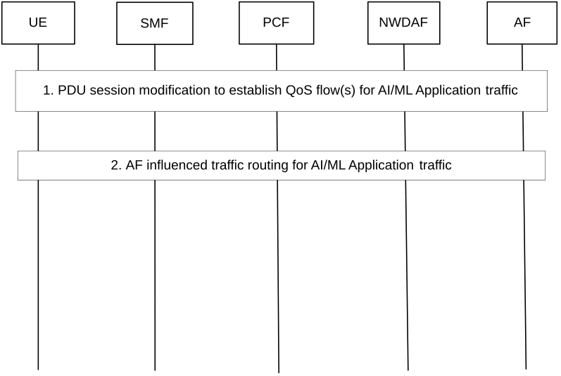

# 6.11 Solution \#11: Traffic routing enhancements for Application AIML Traffic Transport

## 6.11.1 Description

This solution addresses key issue \#5: "5GC Enhancements to enable Application AI/ML Traffic Transport" and KI#1 "Monitoring of network resource utilization for support of Application AI/ML operations".

The Application AI/ML traffic, i.e. data or ML model for AI/ML operations in application layer, can be transmitted as specific QoS flow(s) which is/are different from the QoS flows used for common application data (i.e. non-AI/ML related data over the application layer). In this solution, the NWDAF collects data and derives analytics information on the QoS flow(s) for Application AI/ML traffic transmission, and based on the analytics information the SMF performs traffic routing optimization for the Application AI/ML traffic.

## 6.11.2 Procedures

Figure 6.11.2-1 shows the procedure that the SMF performs traffic routing for Application AI/ML traffic based on analytics information from the NWDAF.

Figure 6.11.2-1: Procedure of traffic routing enhancements for Application AIML Traffic

1\. Based on the trigger from the application layer, the UE initiates the PDU Session modification procedure, or, based on the AF request, the network initiates the PDU Session modification procedure, as specified in TS 23.502 \[4\], to establish the QoS flow(s) for transmission of the Application AI/ML traffic between the UE and AF.

2\. The AF of the AI/ML application may trigger the procedure of AF influence on traffic routing for the AI/ML application traffic, i.e. data or ML model for AI/ML operations in application layer.

Step 1-7 as described in clause 4.3.6.2 in TS 23.502 \[4\] is performed with the following enhancements:

\- in step 1, the AF provides the Application AI/ML traffic related parameters (e.g. DNAI) in the AF request.

\- in step 5, the PCF may use service experience analytics per UP path as defined in clause 6.4.3, TS 23.288 \[6\], to provide an updated list of DNAI(s) for the Application AI/ML traffic, to the SMF.

\- in step 6, the SMF may subscribe to service experience analytics and/or DN Performance analytics per UP path, as defined in clause 6.4.3, TS 23.288 \[6\], for analytics of the Application AI/ML traffic transmission status, possibly with the following enhancements:

\- the QFI(s) of the QoS flow(s) carrying the Application AI/ML traffic are included in the Analytics Filter Information.

\- the output analytics contains the QoS flow level data (e.g. QFI, QoS flow Bit Rate, QoS flow Packet Delay) of the QoS flow(s) carrying the Application AI/ML traffic.

The SMF then determines whether the PSA UPF needs to be changed or additional PSA UPF needs to be added for transmission of the Application AI/ML traffic in the QoS flow(s) of the PDU Session, based on the analytics information of Application AI/ML traffic transmission status. If so, the SMF may take the actions as described in step 6 of clause 4.3.6.2 of TS 23.502 \[4\].

## 6.11.3 Impacts on services, entities and interfaces

The mechanisms defined in the current specifications (i.e. clauses 4.3.5 and 4.3.6 of TS 23.502 \[4\], TS 23.288 \[6\]) for traffic routing and network analytics are reused, with the following enhancements:

\- SMF: subscribes to analytics information of Application AI/ML traffic transmission status from the NWDAF, and change or add additional PSA UPF for the PDU Session for Application AI/ML traffic transmission.

\- NWDAF: provides analytics information of Application AI/ML traffic transmission status to the SMF. The analytics request and output analytics for Service Experience (or DN Performance) analytics needs to be enhanced.
