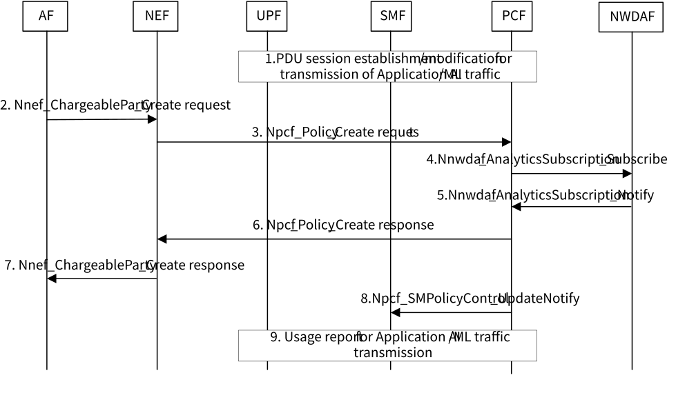

# 6.12 Solution \#12: Enhanced charging for Application AIML traffic transport

## 6.12.1 Description

This solution addresses the following aspect of key issue \#5 "5GC Enhancements to enable Application AI/ML Traffic Transport":

\- Whether new 3GPP charging mechanisms are required for identification and charging of Application AI/ML traffic over the user plane that cannot be attributed or charged to the end user?

The Application AI/ML traffic, i.e. data or ML model for AI operations in application layer, can be transmitted as specific QoS flow(s) which is/are different from the QoS flow(s) used for common application data (i.e. non-AI/ML related data over the application layer). In this solution, the NWDAF collects data and derives analytics information on the QoS flow(s) for Application AI/ML traffic transmission, and the PCF may set charging rules for the chargeable party, configures PCC rules and updates SM policy for the Application AI/ML traffic based on the analysis information, so as to perform the enhanced charging for Application AI/ML traffic transmission.

NOTE: Charging aspects will be done in collaboration with SA WG5.

## 6.12.2 Procedures

Figure 6.12.2-1 shows the procedure that the PCF performs enhanced charging for Application AI/ML traffic.

Figure 6.12.2-1: Procedure of enhanced charging for Application AI/ML traffic

1\. An PDU Session is established/modified as specified in TS 23.501 \[3\]. The Application AI/ML traffic, i.e. data or ML model for AI operations in application layer, can be transmitted as specific QoS flow(s) in the PDU Session.

2\. The AF sends a Nnef_ChargeableParty_Create request message (AF Identifier, UE address, Flow description(s) or External Application Identifier, Sponsor Information, Sponsoring Status, DNN, S-NSSAI, volume of ML model to be transferred per UE, ML Model transmission time window, network area information, maximum aggregated bitrate) to the NEF, to request to become the chargeable party for transmission of Application AI/ML traffic. Step 1in the procedure of setting a chargeable party at AF session setup (if setted, change of the chargeable party during the session) as specified in clause 4.15.6.4 of TS 23.502 \[4\] is performed, with the following enhancements:

\- parameters that specify the requested Application AI/ML traffic transmission are included, i.e. volume of ML model to be transferred per UE, ML Model transmission time window, network area information, maximum aggregated bitrate, etc.

If the application AI/ML traffic has similar characteristics as the background data transfer, the background data transfer policy negotiation as specified in clause 4.16.7 of TS 23.502 \[4\] can be performed before this procedure; and then a Background Data Transfer Reference ID, instead of the parameters that specify the requested Application AI/ML traffic transmission, is included in the Nnef_ChargeableParty_Create request message.

3\. The NEF may authorize the AF request based on operator configuration and sends a Npcf_Policy_Create request message to the PCF, which contains IP filter information, sponsored data connectivity information and Sponsoring Status (if received from the AF), as specified in step 2-3 of clause 4.15.6.4 of TS 23.502 \[4\].

4-5. \[Optional\] The PCF subscribes to the analytics information of the Application AI/ML traffic transmission status from the NWDAF. The PCF invokes a Nnwdaf_AnalyticsSubscription_Subscribe (Analytics ID = Service Experience (or DN Performance), Target of Analytics Reporting = a UE or a group of UEs, Analytics Filter Information = (Application ID, S-NSSAI, DNN, Area of Interest, anchor UPF ID, DNAI, Application Server Address(es), QFI(s)), Analytics Reporting Information = Analytics target period) towards the NWDAF, and receives the Nnwdaf_AnalyticsSubscription_Notify containing the analytics information, as described in clause 6.4 (or clause 6.14) of TS 23.288 \[6\].

The PCF determines and/or updates the charging rules of Application AI/ML traffic transmission in PCC rules according to the analysis information of Application AI/ML traffic transmission and the request in step 3. Specifically, the charging models and corresponding charging rates can be set based on the analytics of (possibly) offered service experience or performance for Application AI/ML traffic transmission.

The charging rules may include one or more of the following information, as enhancements to PCC charging specified in clause 4.3.2.2 of TS 23.503 \[5\]:

\- Volume based charging.

The existing mechanism is used where different rates are applied according to the volume of ML Model of Application AI/ML traffic.

\- Time based charging.

The existing mechanism is used where different rates are applied according to the ML Model transmission time window of Application AI/ML traffic.

\- Volume and time based charging.

The existing mechanism is used where different rates are applied according to the weighted value of ML Model volume, ML Model transmission time window and network area information.

\- No charging.

6\. The PCF sends a Npcf_Policy_Create response message to the NEF. The message contains the result indicating whether the request to become the chargeable party for Application AI/ML traffic transmission in the PDU Session is granted, and the granted charging rules.

7\. The NEF sends a Nnef_ChargeableParty_Create response message to the AF.

8\. The PCF sends an Npcf_SMPolicyControl_UpdateNotify to the SMF as specified in clause 4.16.5 of TS 23.502 \[4\], with the following enhancements:

\- The PCF includes the latest SM policy information which contains the PCC rules and usage report trigger about Application AI/ML traffic transmission in the Npcf_SMPolicyControl_UpdateNotify. The PCF may determine and/or modify the authorized QoS parameters of Application AI/ML traffic transmission in PCC rules based on the analysis information of Application AI/ML traffic transmission.

NOTE: If it is detected that the data rate of Application AI/ML traffic transmission is too low, the PCF adjusts the 5QI, GFBR, MFBR, etc. in authorized QoS parameters.

9\. According to the received usage report trigger from the PCF, the SMF determines the Usage Reporting Rule (URR) for transmitting the Application AI/ML traffic. The SMF triggers the procedures as described in TS 23.502 \[4\] to:

\- send the URR to the UPF for reporting the relevant usage information of Application AI/ML traffic. According to the reporting rule, the UPF collects the usage information of Application AI/ML traffic and reports it to the SMF.

\- send the information reported by the UPF with session and subscriber related information to the PCF and other charging function entities to perform enhanced charging for Application AI/ML traffic.

## 6.12.3 Impacts on services, entities and interfaces

The mechanisms defined in the current specifications in TS 23.502 \[4\] and TS 23.503 \[5\] of charging for sponsored data connectivity with a chargeable party are reused for charging on Application AI/ML traffic, with the following enhancements:

\- The PCF determines and/or updates PCC rules for charging enhancement for Application AI/ML Traffic transmission, which may done based on analytics information of Application AI/ML traffic transmission status from the NWDAF.

\- The SMF provides Usage Reporting Rule (URR) for Application AI/ML traffic transmission to the UPF, and sends the usage information reported by UPF with session and subscriber related information to the PCF and other charging function entities for performing enhanced charging for Application AI/ML traffic.

\- The UPF collects the usage information of Application AI/ML traffic and reports it to the SMF.
