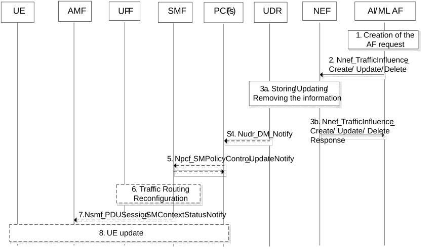

# 6.13 Solution \#13: Support Application AI/ML Traffic Transport

## 6.13.1 Description

In this solution, it is assumed that the UE (or the AI/ML Application client on the UE) establishes a connection to the AI/ML AF in the MNO domain or external to MNO domain over user plane via a PDU session. The AI/ML AF exchanges the AI/ML traffic(s) with the UE (or the AI/ML Application client on the UE) over the established PDU session. This is similar to existing procedure as defined by clause 6.2.8.1 of TS 23.288 \[6\] with below enhancements and clarifications:

For both an AI/ML AF in trusted domain and an AI/ML AF in untrusted domain, the SLA between the MNO and the AI/ML Application Service Provider (e.g. an ASP) determines the AI/ML transport configuration information (per AI/ML Application ID) with any combinations of:

\- The AI/ML AF address: This can be FQDN(s) and/or IP address(es) and or non-IP address(es) that the UE or the AI/ML application client on the UE can communicate to the AI/ML AF or any associated AI/ML applications server(s).

\- The AI/ML DNS server address: This can be optionally used by the UE or the AI/ML Application client on the UE to resolve the AI/ML AF address from a FQDN to the IP address of the AI/ML AF or any associated AI/ML application server(s).

\- The authentication information that enable the AI/ML AF (or any associated AI/ML applications servers) and the UE (or the AI/ML Application client on the UE) to verify the authenticity the AI/ML traffic exchanged.

NOTE 1: The authentication, authorization and user consent info is out of SA WG2 scope.

The AI/ML transport configuration information can be (pre)-configured by the AI/ML Application Service Provider on the AI/ML AF and/ or the AI/ML Application client on the UE.

The UE may indicate the possibility and capability to receive the AI/ML transport configuration information as part of PCO during PDU Session establishment and/or PDU session modification procedures. This capability reflects that the UE (or application client on the UE) can translate the FQDN(s) of the AI/ML AF or any associated AI/ML applications server(s) to the IP addresses of the AI/ML AF or any associated AI/ML applications server(s). If so, the UE can receive part of AI/ML transport configuration information via the SMF, namely the AI/ML AF address, AI/ML DNS server address, and the authentication information.

The AI/ML Service Provider may use the AF requests to influence the traffic routing as defined by clause 4.3.6 of TS 23.502 \[4\], with enhancements described below, either directly (for AI/ML AF in trusted domain) or indirectly via NEF (AI/ML AF in untrusted domain) as part of PDU session establishment and/ or modification procedure to update AI/ML transport configuration information and/ or associated validity parameters.

The AI/ML AF request includes as Traffic Description any combinations of DNN, S-NSSAI, Application Identifier, Application ID or traffic filtering information that addresses the AI/ML AF or any associated AI/ML applications server(s). If the request is via NEF, the AF request may use an AF service Identifier as Traffic Description and then NEF translates that to any combinations of DNN, S-NSSAI, Application Identifier, Application ID or traffic filtering information. The request may also include several other parameters in addition to AI/ML transport configuration information enabling the 5GC (e.g. PCF and SMF) to compile/ generate the transport policy and associated validity parameters. The AF request may include, for example:

\- Potential location information of AI/ML applications that could be in form of DNAI(s) (e.g. for AI/ML AF in trusted domain),

\- Target UE Identifier(s) if transport configuration information is applicable to an individual UE (e.g. for AI/ML operation splitting or AI/ML model distribution), group of UEs (e.g. for AL/ML model distribution or federated learning) or any UE (to support any types of AI/ML operation),

NOTE 2: For AI/ML AF in trusted domain, this can be as SUPI(s), internal UE identifier(s) or internal group ID(s). For AI/ML AF in untrusted domain, this can be as GPSI(s), external UE identifier(s) or external group ID(s) to be translated to SUPI(s), internal UE identifier(s) or internal group ID(s) by the NEF.

\- Spatial validity information if there is any geographic boundaries for transport configuration information.

NOTE 3: For AI/ML AF in trusted domain, this can be TAI. For AI/ML AF in untrusted domain, this can be as geographic zones to be translated to TAI by the NEF.

\- Time validity information if there is any expiry time for transport configuration information.

\- User Plane Latency Requirements if the AI/ML traffic type(s) are associated with certain latency requirements to support AI/ML operation.

\- Indication(s) associated with certain AI/ML traffic type(s).

## 6.13.2 Procedures

Figure 6.13.2-1: AI/ML AF influence over Traffic routing/ reconfiguration for AI/ML Traffic

In this procedure, it is assumed that UE has indicated the possibility and capability to receive part of the AI/ML transport configuration information as part of PCO during PDU Session establishment and/or PDU session modification procedures.

1-2. The AI/ML AF (or NEF) may create, update (or delete from) the UDR the AI/ML transport configuration information and other related parameters (e.g. via UDM services).

3\. The UDR may store and update the AI/ML transport configuration information and other related parameters (or remove the old parameters if any).

4\. The UDR may notify the PCF. This is based on an earlier subscription of the PCF to modifications of AF requests. Any combinations of DNN, S-NSSAI, AI/ML Application Identifier, SUPI, Internal Group Identifier can be used as the data key to address the PCF.

5\. The PCF determines if the AI/ML PDU session(s) or transport policy are impacted and may update SM polices and may notify the SMF based on SM Policy Control Update.

6\. The SMF may take appropriate actions to reconfigure the User plane of the PDU Session(s) transporting the AI/ML traffic(s). An example action includes but not limited to:

\- Allocate a new Prefix to the UE.

\- Updating the UPF (in a target DNAI) with new traffic steering rules.

\- Determining whether to relocate the UPF (e.g. in coordination with AI/ML Application server) considering requirements provided by the AI/ML AF, e.g. on location information, target UE IDs, spatial validity, time validity, UP latency or service requirements or other indication associated with the AI/ML operation.

7\. The SMF may send the target DNAI to the AMF for triggering SMF/I-SMF (re)selection and then inform the target DNAI information for the current PDU session or for the next PDU session to AMF via Nsmf_PDUSession_SMContextStatusNotify service operation.

8\. SMF may also update the UE on part of the AI/ML transport configuration information together with other Session Management (SM) subscription information. An example action includes:

\- Updating AI/ML AF address.

\- Updating AI/ML DNS server address.

\- Updating AI/ML authentication information.

NOTE 1: The UE or the AI/ML application client on the UE can correctly translate the FQDN(s) of the AI/ML AF or any associated AI/ML applications server(s) to the IP addresses of the AI/ML AF or any associated AI/ML applications server(s). This is done by accessing a local, private or global DNS server. As outlined above, the DNS server address or related configurations for the UE can also be optionally shared as part of transport configuration information if needed (e.g. for a private DNS).

NOTE 2: The AI/ML AF (or NEF) finds the PDU session(s) serving the SUPI, DNN, S-NSSAI from UDM and the allocated IPv4 address or IPv6 prefix or both from the SMF. The AI/ML AF (or NEF) stores the UE IP address or any other external UE IDs during the PDU session establishment to the UE (or AI/ML application client on the UE). The AI/ML AF (or NEF) may correlate and store a mapping of the UE IP address (or any other external UE ID) and the SUPI retrieved (e.g. via UDM/SMF), using the IPv4 address or IPv6 prefix allocated by the SMF.

## 6.13.3 Impacts on services, entities and interfaces

AI/ML AF:

\- To create AI/ML transport configuration information.

UDR:

\- To maintain AI/ML Application Data in clause AI/ML transport configuration information.

PCF:

\- To interpret AI/ML request to generate the AI/ML transport policy.

SMF:

\- To reconfigure Traffic routing rules on UPF based on AI/ML transport policy from the PCF.

\- To update UE on (part of) transport configuration information in addition to other SM subscription information.

UE (or AI/ML Application Client on the UE):

\- To indicate capability to receive part of AIML transport configuration Information via PCO.

\- To interpret AI/ML transport configuration information.

\- To interact with the AI/ML Application layer on the UE if any part of AIML transport configuration (received via SMF) to be shared.
