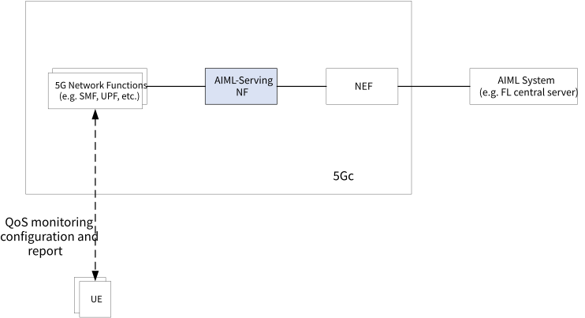
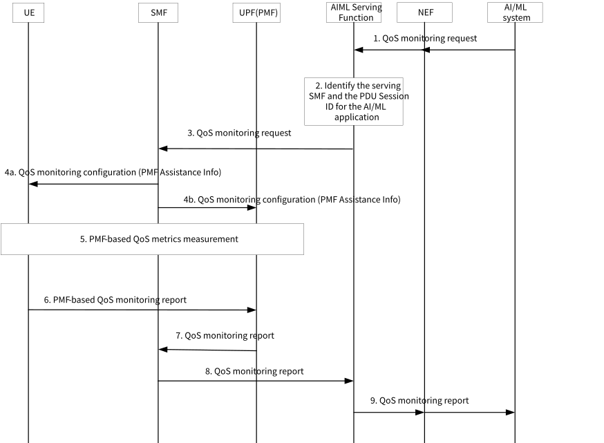

# 6.15 Solution \#15: QoS monitoring for AIML application

## 6.15.1 Description

This solution mainly addresses Key Issue \#6. The QoS performance of the participating UEs for an AIML application (e.g. Federated Learning) is critical to the outcome. It's desired that the AIML application server may receive real-time QoS performance information or prediction from the 5GC for UEs participating a training session either before or during the session. Application AIML operations, e.g. Federating Learning may require knowing planned change of bitrate, latency, or reliability for a QoS flow to determine whether a training session can be completed within the required window.

This solution proposes to extend Performance Measurement Functionality, which was introduced in R16 for ATSSS, to support the real-time QoS measurement in 5GC. The external AIML application server requests and obtains the QoS monitoring/prediction information from the 5GC via network exposure function. The proposal uses the PMF capabilities, and it is independent from ATSSS.

When there are various applications that require PMF measurements and use the same UPF/PMF, the PMF may create different PMF instances for these various applications and each PMF instance operates independently, e.g. using different PMF address and port. For example, one PMF instance may be operating for a MA-PDU Session for ATSSS and another PMF instance may be operating for a single-access PDU Session for AIML application.

When MA PDU Session is used for AIML applications, PMF configuration may accommodate both the ATSSS operation and QoS monitoring needs for AIML application. ATSSS operation uses the PMF measurements that apply to the steering mode, and QoS monitoring for AIML application may share the same measurements used by ATSSS and may benefit from additional new measurements.

Editor's note: Whether and how to support new UE measurement should coordinate with RAN group.

PMF needs to be extended in the following aspects:

\- PMF applies to not only MA PDU but also normal single access PDU Sessions.

\- In addition to RTT and PLR that PMF currently supports, more QoS metric measurements may need to be supported.

\- Support QoS metrics report from UE to UPF.

A new network function, e.g. AIML Serving Function, or new functionality included in existing NF, such as the PCF, may be introduced in 5GC to handle the QoS monitoring request from the AIML application server. The AIML Serving Function interacts with other 5GC NFs (e.g. SMF) to configure and collect the QoS monitoring report from UEs or UPFs. The AIML Serving Function not only translates AIML specific request (e.g. QoS or performance prediction for a group of UEs) to QoS monitoring requests that can be executed in 5GC, but also can make further intelligent analysis, based on QoS reports collected, and return the analysis/report to AIML system, as illustrated in Figure 6.15.1-1.

Figure 6.15.1-1: Illustration of QoS monitoring for AIML application

## 6.15.2 Procedures

Figure 6.15.2-1: PMF-based QoS monitoring and reporting

1\. The external AIML system requests the QoS monitoring information from 5GC. For example, the AIML system may request the real-time QoS performance information, or future QoS performance prediction, for a group of UEs. The request is sent via NEF to the AIML Serving Function. The AIML system provides service requirements, e.g. planned change of bitrate, latency, or reliability for a QoS flow to an authorized 3rd party and it may provide S-NSSA/DNN. The NEF maps external identifiers to internal identifiers, e.g. GPSI into SUPI

2\. The AIML Serving Function identifies the serving SMF and PDU Session IDs used for AIML application for the target UEs, using the existing UDM services (Not shown in the figure).

3\. The AIML Serving Function, request the serving SMF to initiate QoS monitoring for related QoS flows.

4a/4b. The SMF configures the UE and UPF for PMF-based QoS measurements using the Measurement Assistance Information.

NOTE: The existing Measurement Assistance Information may be enhanced with additional information related to UE QoS report, such as start/end time or frequency of the report.

5\. The UE and the UPF performs PMF-based QoS measurements.

6\. The UE sends its QoS measurement report in PMF message to the UPF using PMF message over UP

7\. The UPF combines the UE's and its own QoS report and sends it to the SMF.

8\. The SMF forwards the QoS report to the AIML Serving Function.

9\. The AIML Serving Function may analyse the received QoS report of multiple UEs and may derive more information (e.g. QoS prediction), and return the QoS monitoring report to the AIML system.

## 6.15.3 Impacts on services, entities and interfaces

UE:

\- Extend support for PMF functionality to single PDU Session, in addition to MA PDU.

UPF:

\- Extend support for PMF functionality to single PDU Session, in addition to MA PDU. New NF or existing.

NF (e.g. PCF):

\- Handle the QoS monitoring request from the AIML application server. It also interacts with other 5GC NFs (e.g. SMF) to configure and collect the QoS monitoring report.

\- Define new SBI interfaces to NEF.

SMF:

\- Configure PMF functionality to be used for ATSSS and/or application AIML measurements.
