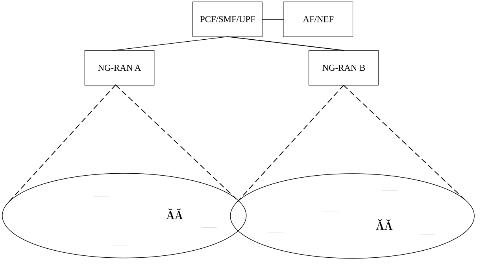
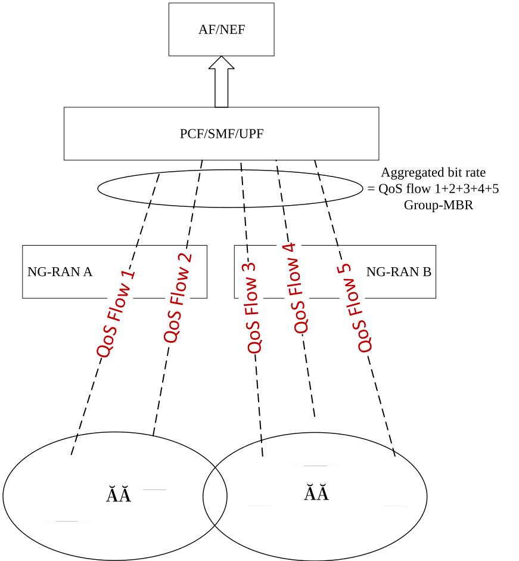
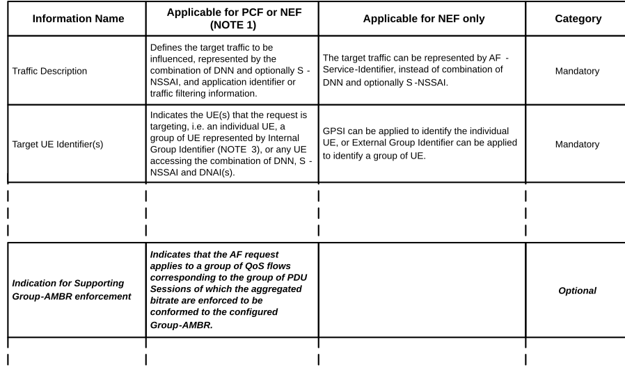
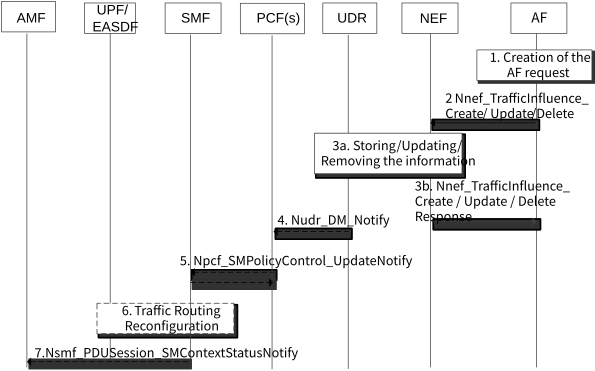
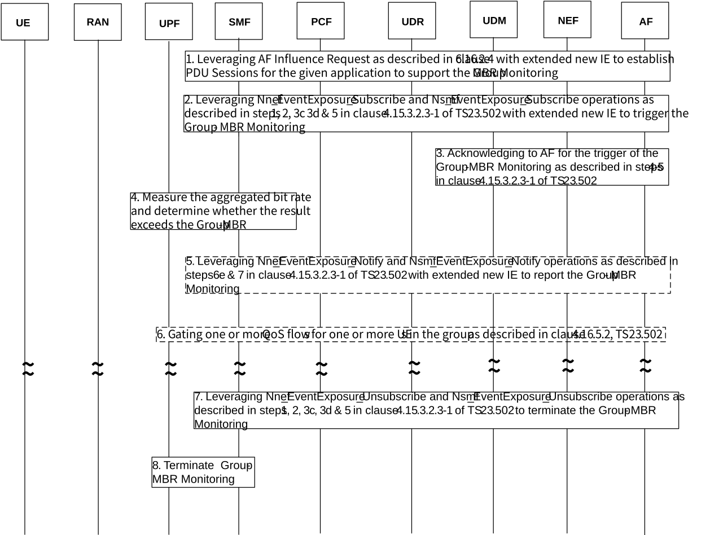
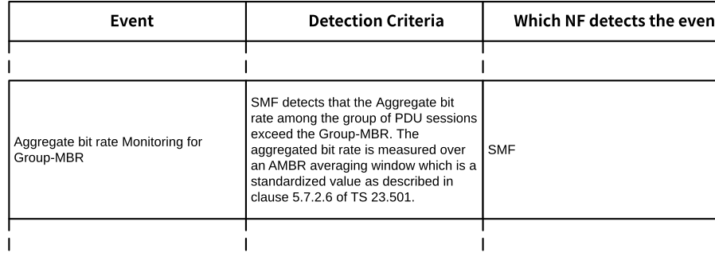

# 6.16 Solution \#16: Solution for supporting the aggregated QoS parameters based on the Group-MBR

## 6.16.1 Description

This solution touches on KI \#1, \#5, \#6 and \#7. Federated learning (FL) is a group-based learning method and there will be many files and multiple rounds of interactions between the UEs and the FL server over 5GS during the FL process. Just like any other services, there should be SLA between the MNO and ASP to agree on the allowance of the maximum throughput that can be consumed between the end points (i.e. the group of UEs and the AS) of the given FL operation. Therefore, it is necessary to introduce a system monitoring parameter to assist the 5GS to keep track of the aggregated status of the total throughput usage for the given federated learning operation.

During the FL operation, the application server can be connected to one or more NG-RAN nodes through a single UPF, and each NG-RAN node could be serving multiple UEs participating in FL operation. Figure 6.16.1-1 below, illustrates an example of 10 UEs in total within the service area of a UPF that could be selected to participate in the given FL operation. In a certain round, AS selects 5 of them to be participated in the FL training. In order to ensure that the resources consumed by the 5 UEs are within the specified throughput limit, the UPF keeps track of aggregate bit rate against the Group-MBR among the set of QoS flows of the UEs who participate in the given FL operation. The aggregate bit rate shall not exceed the pre-determined Group-MBR for that specific FL operation. The following summarizes how the aggregated bit rate among the set of QoS flows of the UEs is monitored against Group-MBR:

\- 10 UEs respectively establish individual PDU sessions with the core network, and can transmit application data through GBR and/or non-GBR QoS flows.

\- As shown in the figure 6.16.1-2, Group-MBR is defined as the upper bound of the aggregate bit rate across all GBR and Non-GBR QoS Flows corresponding to the group of PDU Sessions of the UEs who participate in a group of transmissions concurrently (e.g. Federated Learning (FL) operation) with active user planes. The anchor UPF of the group of transmissions (e.g. FL operation) measures the aggregated bit rate across all GBR and Non-GBR QoS Flows against the Group-MBR provided by associated anchor SMF of the corresponding group of PDU sessions that support the group of transmissions. The aggregated bit rate is measured over an AMBR averaging window which is a standardized value as described in clause 5.7.2.6 of TS 23.501 \[3\]. The Group-MBR is a monitoring parameter which is provided by the AF to activate the Group-MBR monitoring operation.

\- In the following figures, the UEs participating in a given Federated Learning training session may consume different aggregate bit rate during each round of the FL operation, however, the aggregate bit rate among the corresponding set of QoS flows for each round of the FL operation should not exceed the contracted Group-MBR that was agreed between the ASP and the serving MNO. For example, the value of the contracted Group-MBR is 20 Mbps, the aggregated bit rate across the set of QoS flows for the participating UEs in each round of the FL operation can not exceed the Group-MBR i.e. 20 Mbps.

\- The UPF continues to monitor and measure the aggregate bit rate to assist the AF to ensure that the measured aggregate bit rate of the UEs in the given group should not be greater than the Group-MBR.

\- When the measured aggregate bit rate value exceeds the Group-MBR, the anchor UPF may perform gating of one or more QoS flows for the given group of UEs based on the policy provided by the AF (to the anchor UPF via the SMF via the PCF) in order to mediate the aggregate bit rate not to exceed the Group-MBR that has been contracted.

Editor's note: What and how to apply the gating policy for Group-MBR is FFS.

Figure 6.16.1-1: Federated learning scenarios with a single UPF

Figure 6.16.1-2: The definition of the aggregated bit rate and the Group-MBR

In order to support the Group-MBR monitoring as described above, this solution proposes to extend the Application Function (AF) Influence on traffic routing functionality to enable the Group-MBR monitoring for the FL operation when such operation is activated by the Application AI/ML AF.

It is beneficial to leverage existing AF Influence for Traffic Routing to support Group-MBR monitoring, because it is likely that MEC services will be applied to FL operation.

Meaning, the AF Influence procedure can be used in the context of AI/ML FL to accomplish two goals:

1\. Adjust the original anchor UPF to a local PSA by applying any of the Edge Computing methods described in TS 23.548 \[10\] and in clause 4.3.5 of TS 23.502 \[4\] as/if needed.

2\. Pass on the Group-MBR monitoring information to the proper anchor UPF/local PSA.

The existing group policy management and group traffic routing procedures can be easily extended to support Group-MBR monitoring.

This solution proposes to introduce a new information element, i.e. information supporting the Group-MBR monitoring, (see 6,16.2.2 below) to be included in the AF request to initiate the Group-MBR monitoring for a set of QoS flows of a group of PDU sessions supporting the FL operation for the given AF. The existing Traffic Description and Target UE Identifier(s) IEs defined in clause 5.6.7-1 of TS 23.501 \[3\] are used as is for traffic and group identification.

This solution assumes that the MNO, which supports the Group-MBR monitoring, is able to provision the subscription information for the group of UEs, associated with FL operation, in a new entry of the Group Data table in the Subscription Data part of the UDR (consumed by the UDM) with the following configurations for the corresponding S-NSSAI and DNN:

\- Same SMF is to be selected for all PDU sessions established by any subscriber in the group as currently supported in clause 6.3.2 of TS 23.501 \[3\] for SMF discovery and selection.

\- Same PCF is to be selected for the group of SM Policy Association corresponding to a given S-NSSAI and DNN to provide the SM Policy Control as currently supported in clause 6.3.7.1 of TS 23.501 \[3\] for PCF discovery and selection, and

\- Same PSA UPF is to be selected for UEs that are served by the same S-NSSAI and DNN combination in order to perform the Group-MBR related measurement and to support Group-MBR monitoring.

During PDU Session Establishment procedure of any of the UEs in the above Group to the combination of S-NSSAI/DNN, the AMF will use the above subscription information to discover and/or select the same anchor SMF across all of the PDU Sessions.

Consequently, that anchor SMF will use the above subscription information to discover and/or select the same anchor PCF and the same anchor UPF across all of the PDU Sessions.

NOTE: It is implicitly assumed here that a combination of Group-ID/S-NSSAI/DNN can be dedicated for the use of AI/ML FL.

Editor's note: How to decide which UPF is the anchor UPF (and which are the corresponding anchor SMF and anchor PCF) is FFS.

Editor's note: How to extend this solution to support multiple UPFs is FFS.

The descriptions of this solution are organized as follows:

\- Clauses 6.16.2.1 - 6.16.2.4 describe how to extend existing AF Influence Routing feature to enable the AF request for Group-MBR monitoring.

\- Clauses 6.16.2.5 - 6.16.2.6 describe how the Group-MBR is monitored.

## 6.16.2 Procedures

### 6.16.2.1 Defining Group-MBR Traffic Monitoring Parameter

This solution defines Group-MBR as follows:

Group Maximum Bit Rate (Group-MBR):

\- The Group-MBR provides the upper bound of the aggregate bit rate across all GBR and Non-GBR QoS Flows corresponding to the group of PDU Sessions of the UEs who participate in a group of transmissions concurrently (e.g. Federated Learning (FL) operation) with active user planes. The anchor UPF of the group of transmissions (e.g. FL operation) measures the aggregated bit rate across all GBR and Non-GBR QoS Flows against the Group-MBR provided by the associated anchor SMF of the corresponding group of PDU sessions that support the group of transmissions. The aggregated bit rate is measured over an AMBR averaging window which is a standardized value as described in clause 5.7.2.6 of TS 23.501 \[3\]. The Group-MBR is provided by the AF to initiate the Group-MBR monitoring for a set of QoS flows of a group of PDU sessions supporting a group of concurrent transmissions.

### 6.16.2.2 Extensions to AF Influence Information Element in AF request to monitor and report aggregate bit rate among the specific group of PDU sessions

This solution proposes to update TS 23.501 \[3\], Table 5.6.7-1: Information element contained in AF request, with a new optional AF Influence information element in AF request to support aggregate bit rate monitoring against Group-MBR. The changes to Table 5.6.7-1 are in "bold italic" as shown below.

<table>
<colgroup>
<col style="width: 100%" />
</colgroup>
<thead>
<tr class="header">
<th>
Proposed example changes to Table 5.6.7-1 of TS 23.501 [3]:

Table 5.6.7-1: Information element contained in AF request

</th>
</tr>
</thead>
<tbody>
</tbody>
</table>

### 6.16.2.3 Extensions to AF Influence Network Function Service Procedure to enable the support for Group-MBR monitoring

This solution proposes to extend the AF traffic influence for traffic routing service procedure as defined in clause 5.2.6.7.2 of TS 23.502 \[4\] to include the new optional information element, Information for Supporting Group-MBR monitoring, to enable the support for Group-MBR monitoring that was described in clause 6.16.2.2 above for Table 5.6.7-1: Information element contained in AF request, in TS 23.501 \[3\]. The changes are shown below in "***bold italic***".

<table>
<colgroup>
<col style="width: 100%" />
</colgroup>
<thead>
<tr class="header">
<th>
Proposed example changes to clause 5.2.6.7.2 of TS 23.502 [4]:

<strong>5.2.6.7.2 Nnef_TrafficInfluence_Create operation</strong>

<strong>Service operation name:</strong> Nnef_TrafficInfluence_Create

<strong>Description:</strong> Authorize the request and forward the request for traffic influence.

<strong>Inputs, Required:</strong> AF Transaction Id, AF Identifier.

The AF Transaction Id refers to the request.

<strong>Inputs, Optional:</strong> The address (IP or Ethernet) of the UE if available, GPSI if available, DNN if available, S-NSSAI if available, External Group Identifier if available, External Application Identifier or traffic filtering information, AF-Service-Identifier, a list of DNAI(s) and corresponding routing profile ID(s) or N6 traffic routing information, Indication of traffic correlation, Indication of application relocation possibility, Indication of UE IP address preservation, Early and/or late notifications about UP path management events, Notification Target Address, Temporal validity condition, Spatial validity condition, User Plane Latency Requirements, Information for EAS IP Replacement in 5GC<em><strong>,</strong></em> AF indication for simultaneous connectivity over source and target PSA at edge relocation <em><strong>and Information for Supporting Group-MBR</strong></em> <em><strong>Monitoring</strong></em> as described in clause 5.6.7 of TS 23.501 [3].

<strong>Outputs, Required:</strong> Operation execution result indication.

<strong>Outputs, Optional:</strong> None.
</th>
</tr>
</thead>
<tbody>
</tbody>
</table>

### 6.16.2.4 Extensions to AF Influence on traffic routing procedure for Session not identified by an UE address to enable the support for Group-MBR monitoring

This solution proposes to extend the procedure "Processing AF requests to influence routing for Session not identified by a UE address" as defined in clause 4.3.6.2 of TS 23.502 \[4\] to enable the support for Group-MBR monitoring. The following descriptions focus on the changes to the procedure as described in clause 4.3.6.2 of TS 23.502 \[4\].

<table>
<colgroup>
<col style="width: 100%" />
</colgroup>
<thead>
<tr class="header">
<th>
<em><strong>Reference to clause 4.3.6.2 of TS 23.502 [4]</strong></em>

Figure 4.3.6.2-1: Processing AF requests to influence traffic routing for Sessions not identified by an UE address
</th>
</tr>
</thead>
<tbody>
</tbody>
</table>

1\. Application AI/ML AF includes the new information element, ***Information for Supporting Group-MBR Monitoring***, as described in 6.16.2.2 for Table 5.6.7-1 of TS 23.501 \[3\] in the AF request to NEF. The above information element includes also the Group-MBR monitoring parameter which has/have bit rate monitoring value(s) for uplink and downlink traffic flows.

Editor's note: Whether the Group-MBR monitoring parameter should be pre-configured in the UDM/UDR or dynamically provided by the AF is FFS.

2\. The AF includes the new information element provided in Step-1 to NEF in case of Nnef_TrafficInfluence_Create or Update.

3\. In case of Nnef_TrafficInfluence_Create or Update, the NEF stores the AF request together with the new information element provided in Step-1 by the AF in the UDR which indicates all the future and the existing PDU sessions for the specified group (i.e. per (S-NSSAI, subscribed DNN)) are required to be served by the same PSA UPF and such UPF is required to be able to support the monitoring of the Group-MBR for the specified set of QoS flows among the group of PDU sessions for the specific group operation.

NOTE: The selection of the same PSA UPF by the SMF is feasible as described in clauses 6.3.3.1 and 6.3.3.2 of TS 23.501 \[3\] by leveraging the procedures as defined in clauses 4.4.1 and 4.4.3 of TS 23.502 \[4\].

6\. This solution applies the same design consideration as the current procedure defined in clause 4.3.6.2 of TS 23.502 \[4\] to the existing PDU session. Based on the updated policy information about the PDU session from PCF, the SMF may take the new action proposed by this solution, when applicable, to reconfigure the UPF of the existing PDU session by recognizing for the need of the UPF to support the monitoring the Group-MBR among the group of PDU session.

### 6.16.2.5 The procedure of Group-MBR monitoring

After the PDU sessions and the corresponding QOS flows are established between the UEs and the AF, the PSA UPF is activated by the SMF to monitor the aggregate bit rate among the active QoS flows for the given DNN and S-NSSAI to ensure that the measured aggregated bit rate does not exceed the Group-MBR.

Figure 6.16.2.5-1: Group-MBR Monitoring via AF request

1\. Several PDU sessions are established between the group of UEs and their serving AF for the given application by leveraging the AF Influence Routing procedures with the new IE introduced by this solution as described in clause 6.16.2.4 to support the Group-MBR monitoring.

2\. AF invokes the Nnef_EventExposure_Subscribe and Nsmf_EventExposure_Subscribe services operation as described in steps 1, 2, 3c, 3d and 5 in clause 4.15.3.2.3 of TS 23.502 \[4\] to subscribe the event for the monitoring the Group-MBR for its FL operation.

3\. Sending the acknowledgement to the AF of step 2 above for initiating the Group-MBR monitoring.

4\. With the support from PSA UPF, SMF initiates the Group-MBR monitoring for specific QoS flow for specific PDU session within the group of PDU sessions via N4 signalling. SMF considers this as an active and ongoing operation initiated by the AF without the constant or repeated requests from AF.

Editor's note: Whether to extend PSA UPF or SMF to measure the aggregate bit rate among the target QoS flows and/or compare it against Group-MBR and notify it to the proper NF (e.g. SMF or NEF) is FFS.

5\. If the measured aggregated bit rate exceeds the Group-MBR, SMF sends the Nsmf_EventExposure_Notify and Nnef_EventExposure_Notify in steps 6e and 7 as described in clause 4.15.3.2.3 in TS 23.502 \[4\] to AF via NEF for the Group-MBR monitoring result with the event as described in clause 6.16.2.6 below.

6\. AF may provide policy to SMF via PCF as described in step 1a in clause 4.16.5.2 of TS 23.502 \[4\] to apply gating towards one or more QoS flows in respond to the overflow of the Group-MBR.

NOTE: The decision on how AF determines for which the QoS flow(s) to apply the gating policy is beyond this specification.

7\. AF unsubscribes to the Group-MBR monitoring event by invoking Nnef_EventExposure_Unsubscribe and Nsmf_EventExposure_Unsubscribe services in steps 1, 2, 3c, 3d and 5 as described in clause 4.15.3.2.3 of TS 23.502 \[4\].

8\. SMF/UPF stop(s) the Group-MBR Monitoring.

### 6.16.2.6 Extension to Nnef_EventExposure Services for Event Monitoring to support Group-MBR monitoring

This solution extends the existing Monitoring Events leveraging NEF event exposure as defined in clause 4.15.3 of TS 23.502 \[4\] to support Group-MBR monitoring event for a set of QoS flows of a group of PDU sessions for a given AF operation (e.g. Application FL operation). The following focus on the changes to Nnef_EventExposure Service as defined in clause 4.15.3 of TS 23.502 \[4\].

This solution proposes to add a new event to Table 4.15.3.1-1 in TS 23.502 \[4\] for "Aggregate bit rate Monitoring for Group-MBR" and the SMF is responsible for the event detection. For this new event, if the monitored aggregated bit rate of the group of PDU sessions corresponding to the specified S-NSSAI, DNN and 5 tuple traffic filter exceeds the Group-MBR value, the SMF will notify the AF which may apply the gating policy for one or more QoS flows. When the monitored aggregate bit rate of the group of PDU sessions fall below the Group-MBR, the AF will also be notified and it may restore the bitrate allowance on those QoS flows. The aggregated bit rate is measured over an AMBR averaging window which is a standardized value as described in clause 5.7.2.6 of TS 23.501 \[3\].

NOTE: The decision on how AF determines for which the QoS flow(s) to apply the gating policy is beyond this specification.

The description of the new NEF monitoring event as introduced by this solution is to be captured in Table 4.15.3.1-1 of TS 23.502 \[4\] as shown below.

<table>
<colgroup>
<col style="width: 100%" />
</colgroup>
<thead>
<tr class="header">
<th>
Example of New event to Table 4.15.3.1-1 of TS 23.502 [4].

Table 4.15.3.1-1: List of events for monitoring capability

</th>
</tr>
</thead>
<tbody>
</tbody>
</table>

## 6.16.3 Impacts on services, entities and interfaces

**- TBD.**
