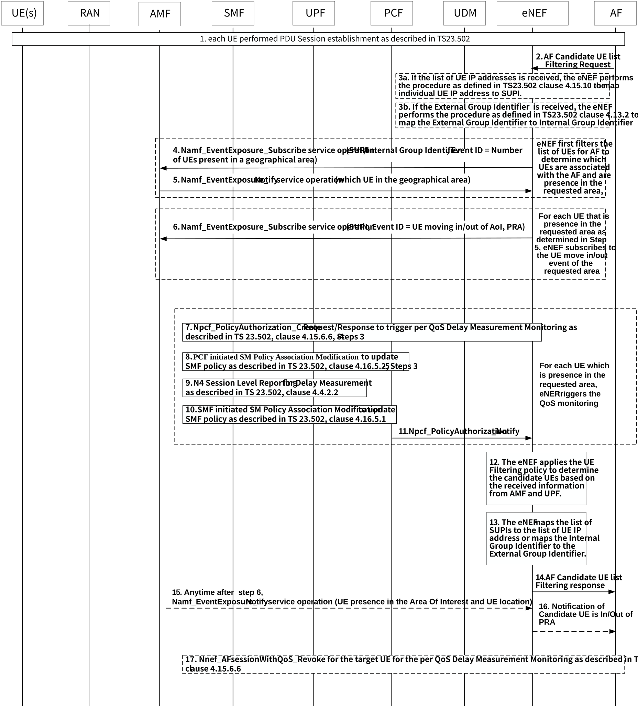

# 6.17 Solution \#17: 5GS assistance for FL member selection using QoS monitoring

## 6.17.1 Description

The basic principle for this solution, is for the AF to provide the enhanced NEF (eNEF) the candidate UE selection request which includes the UE filtering policy (e.g. target location). and eNEF activates the QoS monitoring on a group of UEs at a specific target location. The set of candidates UEs requested by the AF will then be identified based on their respective delay performance and the UE filtering policy. The UEs which have the best monitoring results (i.e. low latency) and comply to the UE filtering policy will be considered as the candidate UEs to be provided to the AF via eNEF.

Prior to the AF to select a group of UEs to participate in its FL operation, the following events happen:

1\) The AF provides UE filtering policy to enhanced NEF (eNEF). The UE Filtering policy includes:

\- One or more UE address(es) (IP address or MAC address) and AF Identifier(s) together with the protocol port info: This parameter is used to identify an initial group of UEs for the specific application to be further filtered.

\- Monitoring area (i.e. AOI): the 5GC considers the UE as a candidate UE only when the UE is in the monitoring area (i.e. Area of Interest - AOI)

\- The number of candidates UEs for reporting e.g. select 6 candidate UEs with lowest measurement delay among the group of UEs being monitored for FL operation;

\- The minimum local training data acquisition time interval: select UEs with different data acquisition time(e.g. sensors waking up at different time may gather different data in the same AOI)

\- The minimum separation distance between candidate UEs based on locations: select those UEs that are geographically separated with sufficient distance(e.g. two vehicles close by may overlap in their Field of View and have same or similar data)

\- Data sources of the local training data for the set of distributed nodes: defined by whom the data are generated, e.g. two BMW vehicle may have similar data and less preference than one BMW and one Toyota.

2\) Based on UE filtering policy, the eNEF triggers the QoS monitoring per UE per QoS flow:

eNEF triggers the QoS monitoring per UE per QoS flow reusing the QoS monitoring mechanism. According to the UE Filtering policy and the monitoring results, the eNEF applies UE filtering policy in order to determine the set of candidate UEs. The eNEF reports the list of candidate UEs to the AF.

3\) Based on the candidate UEs provided by the eNEF, The AF make the final decision on the set of target UEs to be participated in its FL operation.

## 6.17.2 Procedures

Figure 6.17.2-1: 5GS assistance for QoS monitoring support for FL member selection

1\. UE establishes PDU session as described in clause 4.3.2.2.1 of TS 23.502 \[4\].

2\. AF sends Candidate-UE List Filtering request with Candidate-UE filtering policy (e.g. Area of Interest (AOI) for QoS monitoring) to request the eNEF to provide the list of UEs that match the Candidate-UE filtering policy. In order to do so, the eNEF may need a new service operation to enable the AF to request 5GS assistance to support the Candidate UE selection. The AF may provide a list of IP addresses or an External Group Identifier to eNEF.

3\. If the list of UE IP addresses is received, the eNEF triggers the procedure as defined in TS 23.502 \[4\], Clause 4.15.10 in order to obtain the corresponding list of SUPIs.

If the External Group Identifier is received, the eNEF triggers the procedure as defined in TS 23.502 \[4\], Clause 4.13.2 in order to translate the External Group Identifier to Internal Group Identifier.

4-5. If the monitoring area is received, the eNEF needs to identify the set of Candidate UEs which are located at the monitoring area. In order to achieve it, the eNEF is subscribed to Namf_EventExposure_Subscribe service with Internal Group Identifier (i.e. S-NSSAI, DNN) and event ID = Number of Ues present in a geographical area. If AF provided a specific list of UEs in step 1, eNEF matches the UE list from the AF against the Candidate-UE list from the Namf_EventExposure_Notify in order to determine the list of Candidate UEs which are associated with the AF in the monitoring area. Otherwise, all UEs in the Candidate-UE list from the Namf_EventExposure_Notify are considered as the list of candidate UEs.

6\. The eNEF also needs to keep track of whether any of the Candidate UEs identified from Steps 4-5 above will move in or out of the monitoring area, hence, the eNEF invokes the Namf_EventExposure_Subscribe service for each UE from candidate list by providing the corresponding SUPI and specifies the event ID=UE moving in/out of AoI(PRA) to monitor the each candidate UE moving in/out of the monitoring area.

7-11. The eNEF triggers the PDU session modification to activate the QoS monitoring. Based on the received UE filtering policy, it may request the SMF/UPF to trigger the monitoring periodically per UE per QoS flow, so that the UPF can provide the measurement delay to eNEF periodically.

In order to do so, the Npcf_PolicyAuthorization_Create request procedures as described in clause 4.15.6.6 of TS 23.502 \[4\] as well as other QoS monitoring related procedures to trigger the per UE per QoS flow delay monitoring for each UE which is present in the monitoring area can be used.

12-14. Based on the Candidate-UE filtering policy, the location related event notification from AMF and the measurement result from UPF, the eNEF applies the Candidate-UE filtering policy to determine the set of Candidate UEs. The eNEF will map the list of SUPI to the list of UE IP address or map the Internal Group Identifier to External Group Identifier. The UEs which have the best monitoring results (i.e. low latency) and within the monitoring area will be considered as the candidate UEs to be provided to the AF via eNEF.

The eNEF may need a new service operation to send the Candidate UE list to AF to reply the request from step 2.

15-16. If a given UE moves out of the monitoring area because of steps 6 above, the eNEF will be notified by the AMF via Namf_EventExposure_Notify service. In such case, the eNEF relays such notification to the AF.

17\. When AF completes the QoS monitoring operation or a specific UE has moved out of the monitoring area (as described in Steps 14-15 above), the AF triggers the Nnef_AFsessionWithQoS_Revoke to terminate all QoS monitoring operation for all UEs or for specific UE, respectively.

## 6.17.3 Impacts on services, entities and interfaces

eNEF:

A new service to enable the AF to request 5GS assistance to support the candidate UE selection and send the Candidate-UE list to AF.

Based on the Candidate-UE List filtering request from the AF, eNEF subscribes the event to AMF.

Based on the event notify from AMF, eNEF trigger the QoS monitoring.

Apply Candidate-UE filtering policy to filter the Candidate-UE list based on the information provided by the AMF and UPF and provide the Candidate-UE list to the AF.

AF:

Send the Candidate-UE-List filtering request to eNEF.
