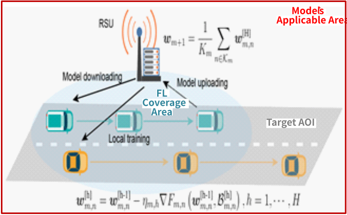
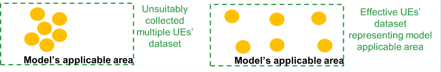
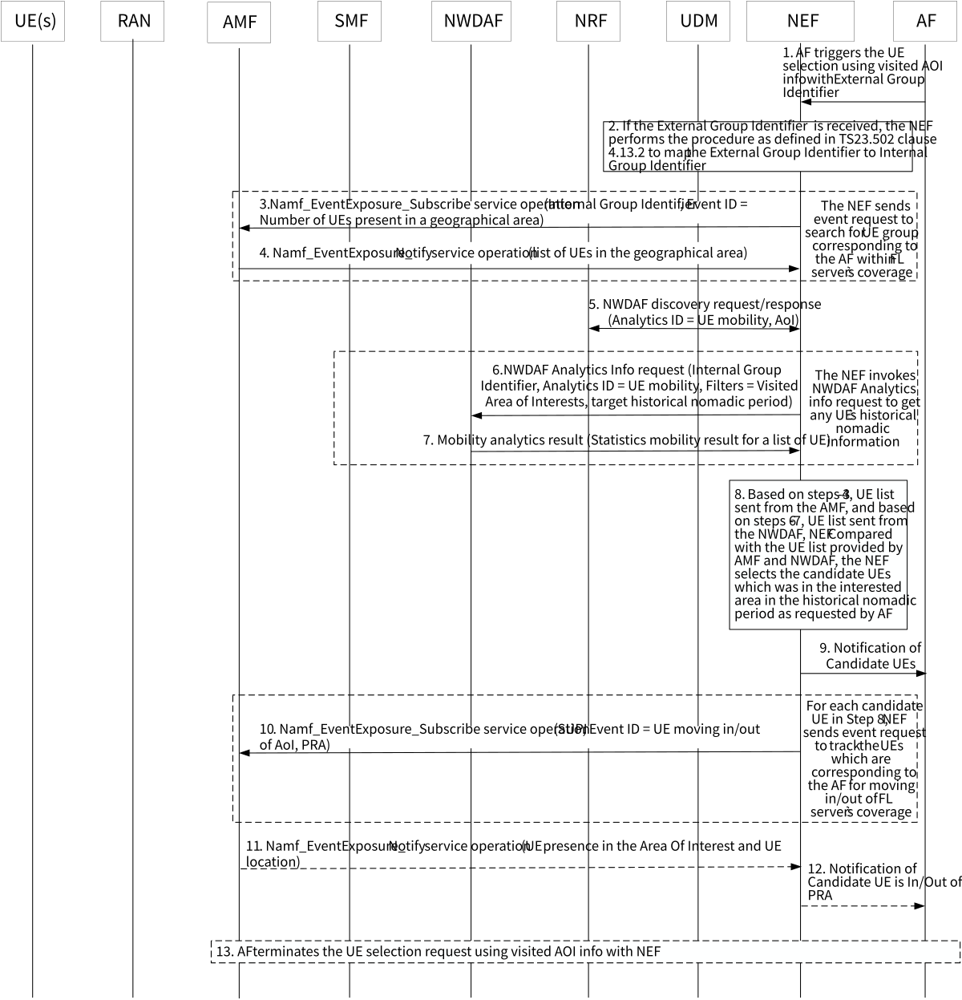

# 6.18 Solution \#18: 5GS assistance for FL member selection based on UE's visited AOI information

This contribution addresses KI#7 on "5GS Assistance to Federated Learning Operation" by providing 5GS assistance for FL member selection based on UE visited AOI information.

## 6.18.1 Description

Federated Learning (FL) is a good method to use multiple UEs' local dataset and computation while preventing the sensitive information exposed from being exposed. To perform FL operation, it is possible for a centralized FL operation to involve several EC servers, for example, better proximity with the target FL clients to perform distributed FL training operation. A typical scenario is shown in Figure 6.18.1-1 below, where an EC server is organizing UEs for FL training within its coverage area, meanwhile the training model applies to a larger area which is beyond the EC server's coverage.

Figure 6.18.1-1: A EC server determines the target UEs within its coverage to perform the FL training, where the training model's applicable area can be larger than its coverage area

As shown in Figure 6.18.1-2, in order to train a model of trajectory prediction applying to the model's applicable area, the application server (EC server) needs to find the UEs which are currently under its coverage but they were moved from a different Area Of Interests (AOIs) within the model's applicable area. Those UEs are expected to be able to provide a more diverse dataset that offers broader representation of the whole model's applicable area.

Figure 6.18.1-2: The left picture shows all UEs' data set are in a subset of the whole district which cannot represent the model's applicable area, so an FL EC server should select the UEs that each of them respectively has a dataset in different AOIs as the right picture shows

With the motivation described above, this solution is to enable the 5G assistance to the AF to select the UEs which are within the FL server coverage, however, were moved from the AOI that is outside of the FL server coverage but within the model's applicable area. This approach allows the FL server to select the member UEs which have the dataset history of other AOI(s) so that they can provide broader representations of a model applicable area. To achieve it, the following concepts are defined in order to describe this solution:

\- FL Coverage Area - the coverage area that the specific FL server applies the training.

\- Model's Applicable Area - the area that the FL trained model can apply.

\- Historical Nomadic Period - The "historical nomadic period" is referred to the minimum duration that the UE was roving within the visited AOI as defined in TS 23.288 \[6\] in order to consider the UE's dataset to be beneficial for the FL training operation. Note that, the determination of the duration for the historical nomadic period is application implementation decision which is beyond the scope of this solution.

\- Target Area Of Interest (AOI) - the target AOI which is beyond the FL coverage area but is within the model's applicable area. Target AOI has the same concept as the visited AOI as defined in TS 23.288 \[6\].

This solution proposes the following information exchanges between the AF and the 5GC in order to support the Application FL member selection based on visited AOI considerations:

\- From the AF to 5GC:

\- Target AOI;

\- FL Coverage Area; and

\- Historical nomadic period for the given target AOI.

\- From 5GC to AF:

\- the 5GC selects the in-coverage UEs coming from the target AOI and have been roving there over historical nomadic period.

## 6.18.2 Procedures

Figure 6.18.2-1: 5GS assistance for FL member selection based on UE's visited AOI

NOTE: The functionality of the NEF has been extended in this solution in order to support the assistance of the FL member selection for the given FL operation.

1\. In order to select the UEs with broader dataset which are within the model's applicable area, the AF requests 5GS assistance to support the UE selection by considering the UE's visited AOI info. AF includes the External Group Identifier and the following filtering info as part of the FL UE selection request:

\- Target AOI and historical nomadic period:

\- The Target AOI where the UEs have been roving over the historical nomadic period before moving into the FL coverage area.

\- FL Coverage Area:

\- The FL training server's coverage area, i.e. the coverage area of the FL training server where the selected UEs participate in the FL operation

2\. NEF translates the External Group Identifier to Internal Group Identifier.

3-4. In order to locate the group of UEs which are associated with the AF and are within the FL training server coverage (i.e. FL coverage area), the NEF invokes Namf_EventExposure_Subscribe service operation with the Internal Group Identifier, event ID = Number of UEs present in a geographical area. AMF will provide a list of UEs that are within the FL coverage area to the NEF using the Namf_EventExposure_Notify service operation. The NEF obtains the list of possible target UEs from AMF within the FL training server's coverage.

5\. In order to identify the appropriate NWDAF which can provide analytic output to derive the visited AOI info for the possible target UEs above, the NEF needs to select the suitable NWDAF by initiating the NWDAF discovery request (Analytics ID = UE mobility, AOI = Target AOI) with Internal Group Identifier.

6-7. The NEF invokes NWDAF Analytics Info request (Internal Group Identifier, Analytics ID = UE mobility, Filters include "Visited AoI = Target AOI" and "target period = historical nomadic period"). NWDAF will then provide a list of UEs that were ever roving within the target AOI, at the minimum, over the historical nomadic period. Then the NEF gets the corresponding statistics of UE mobility (as defined in TS 23.288 \[6\], clause 6.3.2)

8-9. The NEF compares the UE list provided by the AMF in steps 3-4 against the UE list provided by the NWDAF in steps 6-7. The NEF will then determine the FL candidate UEs which are now within the FL coverage area but were roving within the target AOI over the historical nomadic period as requested by AF. The NEF notifies AF for such UE candidate list.

10\. The NEF also needs to consider the list of UEs which are now within the FL coverage area, but may move out of the FL coverage area. Therefore, for each UE in the candidate list in steps 8-9, the NEF invokes the Namf_EventExposure_Notify service with UE ID = SUPI, Event ID=UE moving in/out of AOI (PRA) to keep track the movement of the UE(s) in/out of the AOI.

11-12. If step 10 identifies any UE which is moving out of the FL coverage area, the NEF may further notify AF of the given UE which is moving out the coverage.

13\. When AF completes the FL operation, it terminates the 5GS assistance support for the UE selection based on the UE's visited AOI info.

## 6.18.3 Impacts on services, entities and interfaces

NEF:

\- New service operation to provide the candidate UE selection function.

\- Select the candidate UE list based on the Interested area information and historical period and the coverage information provided by AF.

AF:

\- Request NEF to provide the candidate UE list based on the Target AOI information and historical period and the coverage information.
