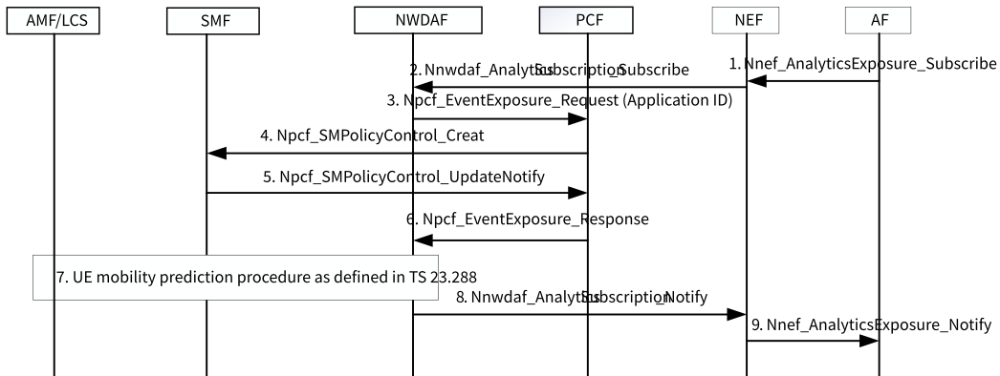

# 6.19 Solution \#19: 5G assisted FL member selection

## 6.19.1 Description

This solution is applied to KI#7: 5GS Assistance to Federated Learning Operation.

One aspect in KI#7 is about 5GS assist to selection of UEs for application layer FL operation. The AF may select a list of UEs in different location for FL, for example, different UEs in different registration areas, different cells and maybe in different geographic area. Since the application does not know the UE location information and the operator may not want to expose the UE location information to the AF, the AF may request the 5GC to provide assistance information to AF to determine the final list of UEs for FL.

## 6.19.2 Procedures

AF sends an analytics request to NWDAF to provide a list of UEs that in different location in specific duration time according to the UE mobility prediction. The procedure is described in Figure 6.19.2-1.

Figure 6.19.2-1: 5G assisted FL member selection procedure

1\. AF sends Nnef_AnalyticsExposure_Subscribe to NEF with the Analytics ID is "UE mobility", event type set as location requirement. The location requirements includes a list of location information and the required number of UEs that in these areas. If the AF is configured with the registration / cell information of the network, The location information in the location requirement may include a list of registration area, list of different cell ID and list of different geographic area. Otherwise, if the AF is not configured with the registration / cell information of the network, the AF provides the required geographic area in this message.

The Application ID is included in this message.

AF may provide a list of UE Identity in this message or AF indicates "any UE" in this message.

2\. NEF forwards the requested to NWDAF via Nnwdaf_AnalyticsSubscription_Subscribe message.

Step 3 to step 6 are only performed if "any UE" is included in step 1. If the UE Identity is provided by AF, NWDAF will perform step 7 directly.

3\. If "any UE" is requested by AF in step 1, the NWDAF will determine a UE list that activate the application.

NWDAF sends Npcf_EventExposure_request message to PCF with the Application ID to ask PCF detection the start or stop of application traffic.

4\. PCF install a PCC Rule and activate start and stop of application detection in the SMF(s).

5\. SMF instructs the UPF to detect the Start and Stop of the application traffic for the PCC rules used for application detection for the Application ID and report the result to PCF.

6\. PCF reports the UE list that start the application traffic for the specific Application ID to NWDAF. The received UE list are the UEs that activate the application for the Application ID.

7\. If "UE Identity" is provided by AF in step 1, the NWDAF will initiate UE mobility analytics for each UEs that requested by AF.

If "Any UE" is requested by AF in step 1, the NWDAF will initiate UE mobility analytics for each UEs that received in step 6.

The UE mobility prediction procedure is described in TS 23.288 \[6\], the enhancement with more accurate UE location statistics and UE location predictions that are considered in eNA_Ph3.

8\. NWDAF further determine a UE list based on the location requirement that received in step 2, e.g. selects different UEs that located in different location area and reports the list of UE Identity to NEF via Nnwdaf_AnalyticsSubscription_Notify message.

9\. NEF sends the list of UE Identity to AF via Nnef_AnalyticsExposure_Notify. AF will further determine the FL members, for example, AF may consider the the received UE list, local configuration and UE client FL capability that negotiated between UE client and Application server. How does AF determine the FL members is out of 3GPP scope.

## 6.19.3 Impacts on services, entities and interfaces

NWDAF:

\- Requests the application detection for the Application ID from PCF and determines a list of UE that activate the Application traffic.

\- Initiates the UE mobility analytics for the determined list of UE and further determines a group of UE based on the location requirement provided by AF.
