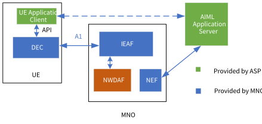
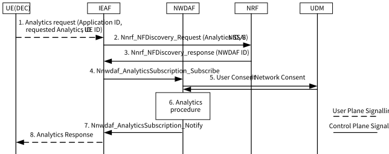
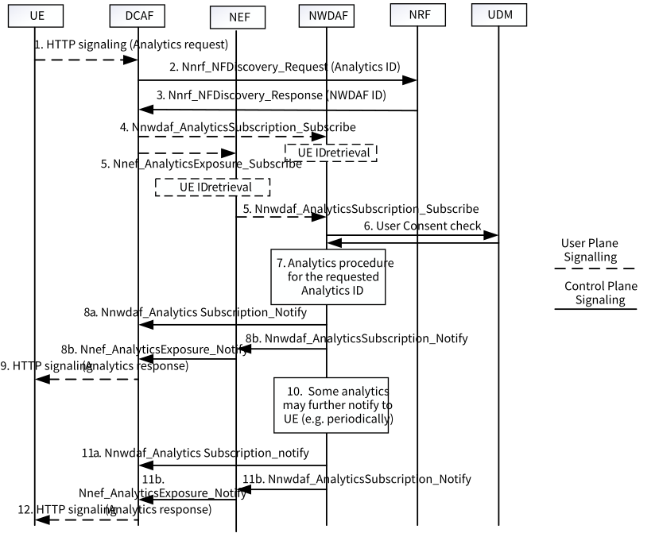
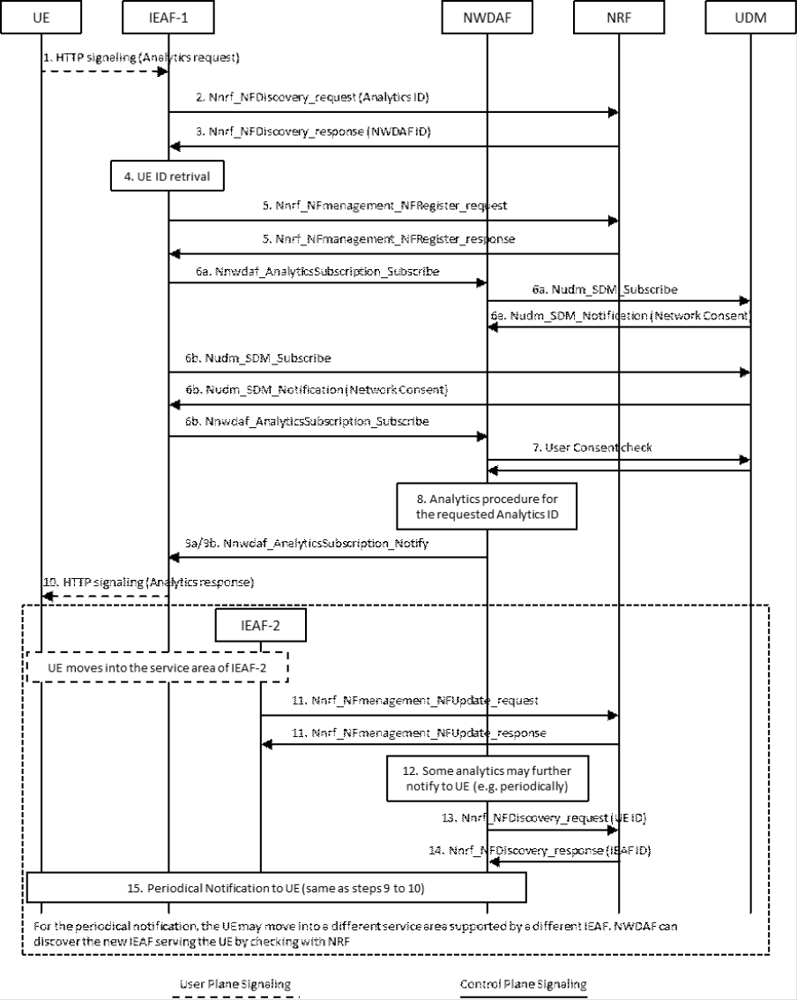
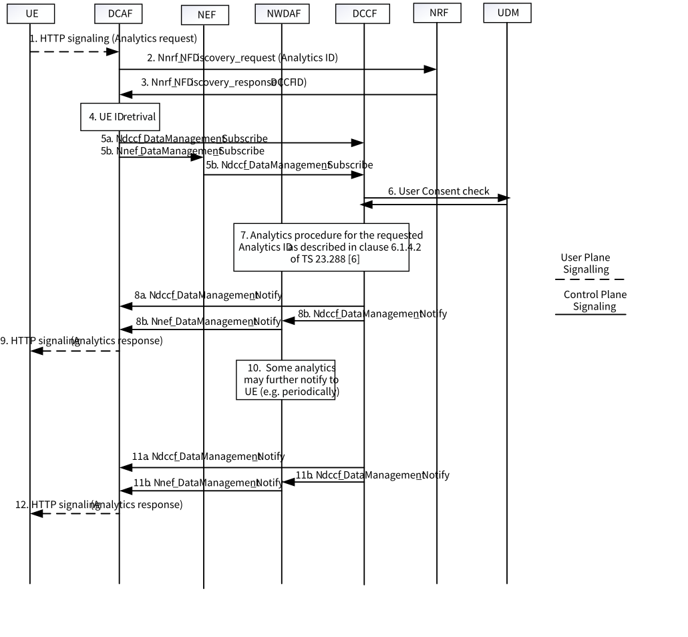

# 6.2.2 Procedures

## 6.2.2.1 General

A user plane data collection from UE application client was approved in clause 6.2.8 of TS 23.288 \[6\] in Rel-17. A UE Application is configured the address of DCAF by the Application server. The UE Application client establishes a connection to the DCAF over user plane via a PDU session. The DCAF communicates with the UE Application Client and collects data from UE Application to NWDAF.

The same user plane connection between UE application and DCAF is used by the UE Application Client to request data exposure from NWDAF.

Based on the justification above, the following information can be exposed to the UE via the support of the DCAF based on network consent acquired by UE:

\- QoS Sustainability Analytics.

\- Network Slice load predictions information.

\- NF load analytics.

\- User Data Congestion Analytics.

\- Network Performance Analytics.

Editor's note: How to extend the interaction between UE and DCAF as defined in TS 26.531 \[7\] to enable UE to subscribe/request information to/from 5GC NF (e.g. NWDAF) via DCAF is in SA WG4 scope.

The SLA between the operator and the Application Service Provider further include the Supported Analytics ID list.

The Supported Analytics ID indicates the Analytics outputs that allowed by the operator to expose to the UE application Client and AF. The Supported Analytics ID list will be stored in DCAF.

The Application Service Provider will provision the Supported Analytics IDs to UE when UE performs application layer registration.

## 6.2.2.2 UE ID retrieval

### 6.2.2.2.1 IEAF based solution

Based on the justification in clause 6.2.1, the following information may be requested by UE application Client from 5GC to assist the Application layer AIML operation:

\- QoS Sustainability Analytics.

\- User Data Congestion Analytics.

Editor's note: Whether and how the UE can use 5GC information (e.g. as above) for AI/ML operations is FFS and needs to be described with valid justification before solution can be adopted, considering also that the same information will be used by the AI/ML application server as well.

NOTE x: Support for analytics IDs that only support any UE as the target of analytics reporting is subject to SA WG3 evaluation on how to address security and privacy concerns when sharing analytics generated from other UEs to an individual UE.

The UE Data Exposure Client (DEC) is responsible for sending data request to the Data Information AF (IEAF) to collect data from NWDAF as an input for application layer AIML operation. The IEAF is always in the MNO domain and the DEC is based on 3GPP defined procedures and security and therefore is also under the control of MNO. The data collection request from UE application may trigger the IEAF to collect data from NWDAF. Figure 6.2.2.2.1-1 shows the deployment of IEAF.

NOTE 1: Both IEAF and DEC are controlled and managed by the MNO e.g. with 3GPP defined procedures.

Figure 6.2.2.2.1-1: IEAF deployment

The DEC communicates to the IEAF over user plane via a PDU session established by the UE.

NOTE 2: The DEC is deployed per application in this Release.

The SLA between the operator and the AIML Application Service Provider determines per Application ID in use by the ASP:

\- The Analytics ID(s) that the 5GC is allowed to expose , subject to user consent and network consent.

\- The S-NSSAI for the AIML Application Service Provider.

\- The authentication information that enable the IEAF to verify the authenticity of the DEC that collects data.

NOTE 3: The mutual authentication info that is used by the DEC and the IEAF is out of SA WG2 scope.

The IEAF is configured based on the SLA above for each AIML application. NWDAF follows existing service user consent checks as specified in TS 23.288 \[6\] and network consent checks for the IEAF (as a NWDAF service consumer).

The IEAF may be also configured by the operator to do some data processing before sending the exposure data to DEC.

The following information are pre-configured in the UE by MNO or provisioned (via PCF) to the UE as part of AIML policy by using the procedure as defined in clause 4.2.4.3 in TS 23.502 \[4\] and used in the communication with IEAF:

\- The address of the IEAF to contact.

Based on the AIML policy and the URSP rules, the UE establishes a PDU session using the RSD from the matched rule and it connects to the relevant IEAF as per details of this solution described below.

The following information are provisioned by IEAF to DEC once the UP connection is securely established.

\- The Analytics ID(s) that is authorized to collect from 5GC subject to user consent and network consent.

\- The authentication information to enable the DEC to verify the authenticity of the IEAF that provides data.

NOTE 4: The authentication and authorization info that is used by the DEC and the IEAF is out of SA WG2 scope.

NOTE 5: Any configuration procedure from the ASP to the UE's Application is out of SA WG2 scope.

NOTE 6: The authentication and security aspects of data leakage and protection in the UE and UE application client and DEC will be studied in SA WG3.

NOTE 7: No assumption is taken on where and how DEC is deployed in this Release.

In either case, UE (at NAS) establishes the PDU session securely based on the existing 3GPP procedures and DEC only communicates over this UP connection with IEAF.

The communication between UE Application client and AIML ASP is out of 3GPP scope. Also, communication between UE application client and DEC is out of this study scope.

UE establishes a user plane connection to the IEAF based on the relevant configuration information received from MNO. The UE Application Client sends request to DEC, DEC communicates with the IEAF over the A1 interface.

NOTE 8: How to realise A1 interface between IEAF and DEC is to be determined in coordination with SA WG3 and CT WGs.

The UE requested data exposure is described in Figure 6.2.2.2.1-2.

Figure 6.2.2.2.1-2: UE requested data exposure procedure

0\. The MNO configures IEAF for data exposure to the UE taking into account the SLA. Accordingly, MNO pre-configures or provisions the UE with AIML policy.

1\. UE Application triggers the DEC to send the Analytics Request to IEAF. DEC triggers the UE to establish the PDU session to IEAF. IEAF provisions DEC with other configuration parameters (e.g. the authorized analytics IDs) once the UP connection is securely established. Subsequently, DEC initiates the analytics request.

2\. IEAF determines the S-NSSAI for the AIML Application Service Provider according to the Application ID based on the configuration by MNO.

IEAF also determines if the requested Analytics ID is allowed or not based on the SLA and the configuration by MNO. If the requested Analytics ID from DEC is not allowed, IEAF may update the authorized analytics IDs on DEC.

IEAF discovers the NWDAF that supports the Analytics ID received in step 1 and the S-NSSAI for the Application ID from NRF.

3\. NRF sends the Nnrf_NFDiscovery_response with the discovered NWDAF identity.

IEAF may discover the NWDAF from UDM, in this case, step 2 and step 3 are not performed, IEAF make a query to UDM as described in clause 5.2 in TS 23.288 \[6\].

4\. IEAF subscribes to NWDAF for the analytics request with Analytics ID(s), S-NSSAI and UE ID and other input parameters for analytics request as described in clause 6.1.3 of TS 23.288 \[6\].

5\. NWDAF performs user consent check and operator consent check.

NOTE: The user consent and operator consent check for application layer AI/ML is a general issue for all the KIs, the details of the user consent check and operator consent check procedure should align with the conclusion and described during normative work.

6\. If NWDAF does not have available analytics result for the requested analytics ID, the NWDAF will trigger the analytics procedures for the analytics ID(s).

Analytics procedure is performed as described in TS 23.288 \[6\].

7\. NWDAF sends analytics result to IEAF.

8\. IEAF sends the exposed data to DEC over A1 and DEC forwards the data to UE Application Client over API. IEAF may do some data processing for the received analytics result from NWDAF based on MNO's configuration and IEAF sends the exposed data after the data processing to the DEC.

NOTE 9: The security aspects of exposure of network in steps 7 and 8 must be evaluated by SA WG3.

If a Subscribe/Notify service operation is invoked in step 4, the NWDAF may further notify the analytics to UE e.g. periodically). Step 7 and step 8 may be performed periodically.

### 6.2.2.2.2 NEF/NWDAF based solution

In current solution 2, when DCAF subscribes to/requests the NWDAF for analytics on behalf of the UE, since the DCAF only knows the UE IP address from the source IP address of the received packet, then the DCAF needs to retrieve UE Identity based on UE IP address in step 4 referring to clause 4.15.10 of TS 23.502 \[4\].

However, this UE ID retrieving operation by DCAF is not very efficient. For when we reuse the procedure like following extracted from the clause 4.15.10 of TS 23.502 \[4\], upon UE ID request from the AF, the NEF retrieves the SUPI for the UE from the BSF, and then the NEF translates SUPI to AF specific UE ID (GPSI or other forms) with the help of UDM.

Even if a GPSI (not other form of AF specific UE ID) is provided by the NEF to the AF without considering security issues, then in this solution, when the AF on behalf of UE requests analytics from network, it will provide the GPSI to the NEF, then the NEF needs to map the GPSI to the SUPI inversely and provides the SUPI to the NWDAF.

There are some redundant mapping operations during the above UE ID retrieving procedure, it actually can be avoided by some enhancements, for example, the UE ID retrieving can be performed instead by the NEF or by the NWDAF when receiving analytics request meanwhile.

Figure 6.2.2.2.2-1: UE requested data exposure procedure

1\. UE sends the Analytics Request to DCAF via an application layer signalling. The DCAF address is provided by application server to UE application client and UE establishes the PDU session to DCAF are described in clause 6.2.8 of TS 23.288 \[6\]. The requested Analytics ID(s) are included in the application layer request message to DCAF. UE may also provide the S-NSSAI to DCAF.

Editor's note: If the UE application client can always provide S-NSSAI and which S-NSSAI that UE application client is provided is FFS.

DCAF can retrieve the UE IP address from the source IP address of the received packet.

Since the supported pairs of S-NSSAI+DNN for the PDU session established for UE to DCAF are configured in the DCAF, DCAF may also retrieve the S-NSSAI+DNN for the PDU sessions that used by the UE sent the Analytics request.

2\. DCAF sends Nnrf_NFdiscovery_request to NRF to discover the NWDAF that supports the UE requested Analytics ID(s). DCAF may also provide the S-NSSAI for NWDAF selection.

Editor's note: For DCAF in untrusted domain, if UE does not provide S-NSSAI in step 1, how to discover the NWDAF that serves the specific S-NSSAI is FFS.

3\. NRF sends the Nnrf_NFdiscovery_response with the discovered NWDAF identity.

DCAF subscribes to NWDAF for the analytics request with UE IP address and Analytics ID(s). Step 4 is for DCAF in trusted domain and step 5 is for DCAF in untrusted domain.

4\. If DCAF is in trusted domain, DCAF subscribes to NWDAF for the analytics by invoking Nnwdaf_AnalyticsSubscription_Subscribe with UE IP address and Analytics ID(s). Then the NWDAF retrieves UE Identity (i.e. SUPI) by using the Nbsf_Management_Discovery service operation with UE IP address and /or DNN and/or S-NSSAI.

5\. If DCAF is in untrusted domain, DCAF subscribes to NEF for the analytics by invoking Nnef_AnalyticsExposure_Subscribe with UE IP address and Analytics ID(s). The NEF retrieves UE Identity (i.e. SUPI) by using the Nbsf_Management_Discovery service operation with UE IP address. Then the NEF subscribes to NWDAF on behalf of the DCAF for the analytics by invoking Nnwdaf_AnalyticsSubscription_Subscribe with UE Identity (i.e. SUPI) and Analytics ID(s).

Before step 5, the DCAF asks the NEF for authorization information to check if the UE is allowed to obtain analytics ID from the network. The NEF determines the authorization information for the UE based on local policy and the UE subscription data from the UDM about whether the UE has subscribed to the service that obtaining some specific analytics ID from network. Then the NEF sends the authorization information to the AF.

6\. If NWDAF does not have available analytics result for the requested analytics ID, the NWDAF will trigger the analytics procedures for the analytics ID(s). NWDAF performs user consent check to UDM to determine if the analytics procedure is allowed or not.

7\. Analytics procedure is performed as described in TS 23.288 \[6\].

8\. NWDAF sends analytics result to DCAF. Step 8a is for DCAF in trusted domain and step 8b is for DCAF in untrusted domain.

NOTE: The security aspects of exposure of network data must be evaluated by SA WG3.

9\. DCAF sends the analytics result to UE application client via application layer signalling.

10-11. If a Subscribe/Notify service operation is invoked in step 5, the NWDAF may further notify the analytics to UE e.g. periodically). NWDAF notifies the analytics result to DCAF. Step 11a is for DCAF in trusted domain and step 11b is for DCAF in untrusted domain.

12\. DCAF exposes the requested analytics to UE.

## 6.2.2.3 Network consent and Multiple IEAF

Figure 6.2.2.3-1: UE requested data exposure procedure

1\. UE sends the Analytics Request to IEAFvia an application layer signalling as defined in clause 6.2.2.2.1.

2\. IEAFsends Nnrf_NFDiscovery \_request to NRF to discover the NWDAF that supports the UE requested Analytics ID(s). IEAF-1 may also provide the S-NSSAI for NWDAF selection.

3\. NRF sends the Nnrf_NFDiscovery_response with the discovered NWDAF identity.

4\. The UE ID retrieval procedure is captured in clause 6.2.2.2.

5\. IEAF-1 informs the NRF of its profile including the UE ID by invoking the Nnrf_NFManagement_NFRegister or Nnrf_NFManagement_NFUpdate service.

6\. DCAF-1 subscribes to NWDAF for the analytics request with UE Identity, app ID, Analytics ID(s) and an optional list of analytics subsets that are requested. Step 6a/6b is for IEAF-1 in trusted domain.

When performing step 6a, the IEAF asks the NWDAF to check if the UE is allowed to obtain analytics ID from the network. The NWDAF determines the authorization information for the UE based on the indication or local policy and the network consent as a UE subscription data from the UDM about whether the UE has subscribed to the service that obtaining some specific analytics ID or specific analytics subset of the Analytics ID from network. NWDAF will invoke the *Nudm_SDM_Subscribe* to communicate with UDM to verify the network consent based on the UE ID.

When performing step 6b, the IEAF itself check if the UE is allowed to obtain analytics ID by subscribing directly to the UDM. The IEAF determines the authorization information for the UE based on local policy and the network consent as a UE subscription data from the UDM about whether the UE has subscribed to the service that obtaining some specific analytics ID or specific analytics subset of the Analytics ID from network. AF will invoke the *Nudm_SDM_Subscribe* to communicate with UDM to verify the network consent based on the UE ID. Then the IEAF subscribes to the authorized Analytics ID from the NWDAF.

The IEAF-1 can store the analytics results provided by the NWDAF, if a new UE or a new application request from the UE wants to request the same analytics, the IEAF-1 will ask NWDAF or directly ask the UDM for authorization information to check if the UE is allowed to obtain analytics ID from the network. Then the IEAF-1 will provide the analytics results to the UE directly.

Editor's note: Is FFS for which common network function to be responsible for handing the network consent verification.

Editor's note: SA WG3 coordination is required for authorization.

7\. If NWDAF does not have available analytics result for the requested analytics ID, the NWDAF will trigger the analytics procedures for the analytics ID(s). NWDAF performs user consent check to UDM to determine if the analytics procedure is allowed or not.

8\. Analytics procedure is performed as described in TS 23.288 \[6\].

9\. NWDAF sends analytics result to IEAF. Step 9a/9b is for IEAF in trusted domain.

NOTE: The security aspects of exposure of network data must be evaluated by SA3.

10\. IEAF sends the analytics result to UE application client via application layer signalling.

The UE may move into a different service area supported by a different IEAF-2. During the mobility, the IEAF-1 can transfer the UE context to IEAF-2 via an application layer signalling in order to resume service with NWDAF.

11\. After the UE context is received via an application layer signalling, IEAF-2 updates its profile by invoking the Nnrf_NFManagement_NFUpdate service.

12\. If a Subscribe/Notify service operation is invoked in step 6, the NWDAF may further notify the analytics to UE e.g. periodically).

13\. NWDAF sends Nnrf_NFDiscovery \_request to NRF to discover the IEAF-2 that is serving the UE currently.

14\. NRF sends the Nnrf_NFDiscovery_response with the discovered identity of IEAF-2.

15\. NWDAF exposes the requested analytics to UE via IEAF-2.

## 6.2.2.4 Using DCCF to deliver analytics for UEs

Figure 6.2.2.4-1: UE requested data exposure procedure

1\. UE sends the Analytics Request to DCAF via an application layer signalling. The DCAF address is provided by application server to UE application client and UE establishes the PDU session to DCAF are described in clause 6.2.8 of TS 23.288 \[6\]. The requested Analytics ID(s) are included in the application layer request message to DCAF. UE may also provide the S-NSSAI to DCAF.

DCAF can retrieve the UE IP address from the source IP address of the received packet.

Since the supported pairs of S-NSSAI+DNN for the PDU session established for UE to DCAF are configured in the DCAF, DCAF may also retrieve the S-NSSAI+DNN for the PDU sessions that used by the UE sent the Analytics request.

2\. DCAF sends Nnrf_NFDiscovery \_request to NRF to discover the DCCF that supports the UE requested Analytics ID(s). DCAF may also provide the S-NSSAI for NWDAF selection.

3\. NRF sends the Nnrf_NFDiscovery_response with the discovered NWDAF identity.

4\. The UE ID retrieval procedure is captured in clause 6.2.2.2.

Editor's note: Whether and how to improve the efficiency for UE Identity retrieving procedure is FFS.

5\. DCAF subscribes to DCCF for the analytics request with UE Identity and Analytics ID(s). Step 5a is for DCAF in trusted domain and step 5b is for DCAF in untrusted domain.

Before step 5b, the AF asks the NEF for authorization information to check if the UE is allowed to obtain analytics ID from the network. The NEF determines the authorization information for the UE based on local policy and the UE subscription data from the UDM about whether the UE has subscribed to the service that obtaining some specific analytics ID from network. Then the NEF sends the authorization information to the AF.

NOTE 1: Step 5b can be achieved by Nnef_AnalyticsExposure_Subscribe, if Nnef_AnalyticsExposure_Subscribe extends to cover Ndccf_DataManagement_Subscribe service.

6\. If DCCF does not have available analytics result for the requested analytics ID, the DCCF will trigger the analytics procedures for the analytics ID(s). DCCF performs user consent check to UDM to determine if the analytics procedure is allowed or not.

7\. Analytics procedure is performed as described in clause 6.1.4.2 of TS 23.288 \[6\].

8\. DCCF sends analytics result to DCAF. Step 8a is for DCAF in trusted domain and step 8b is for DCAF in untrusted domain.

NOTE 2: The security aspects of exposure of network data must be evaluated by SA WG3.

9\. DCAF sends the analytics result to UE application client via application layer signalling.

10-11. If a Subscribe/Notify service operation is invoked in step 5, the DCCF may further notify the analytics to UE, e.g. periodically). DCCF notifies the analytics result to DCAF. Step 11a is for DCAF in trusted domain and step 11b is for DCAF in untrusted domain.

12\. DCAF exposes the requested analytics to UE.
