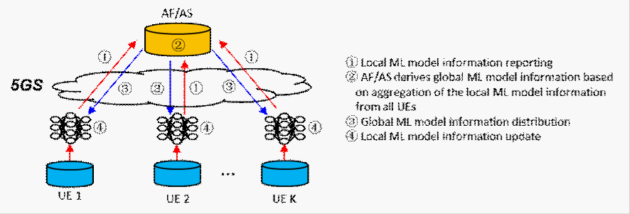
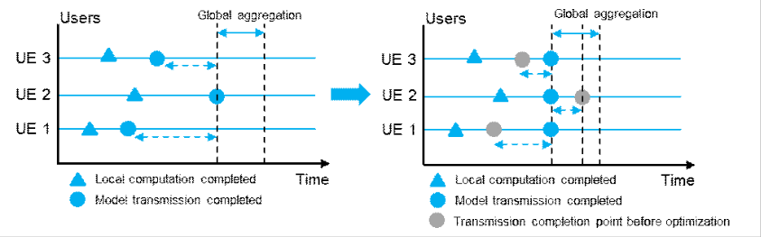
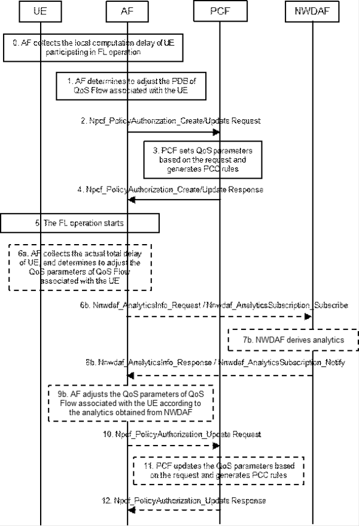

# 6.20 Solution \#20: 5GS assistance to reduce the latency divergence

## 6.20.1 Description

This solution addresses Key Issue \#7 "5GS Assistance to Federated Learning Operation" on FL performance.

As shown in Figure 6.20.1-1, one iterator process for the FL model training phase is as follows:

\- Step 1: Each UE in the FL group derives the local ML model information based on the its own raw data and sends the local ML model information to the AF/AS.

\- Step 2: When the local ML model information from all the UEs in the FL group are received, the AF/AS aggregates all the local ML model information into a global ML model information.

\- Step 3: The AF/AS feedbacks the global ML model information to each UE.

\- Step 4: Each UE in the FL group derives the update local ML model information based on the global ML model information.

Figure 6.20.1-1: Training process of application level Federated Learning

The selected UEs to participate in FL operation may have different local computing capabilities and 5GS communication capabilities, which affects the efficiency of FL operation (e.g. FL model training). Specifically, the local computation delay and the model transmission delay of different UEs may be quite different. However, if some security aggregation algorithms are used, the AF/AS cannot update the global model information until all UE transmissions are completed, resulting in a longer overall training delay.

To solve this problem, as shown in Figure 6.20.1-2, the transmission delay of different UEs can be set or adjusted so that the sum of local computation delay and model transmission delay of different UEs can be nearly the same.

Figure 6.20.1-2: Optimization of UE transmission delay

Before FL operation starts, the AF can collect the local computation delay of UE participating in FL operation, and the AF may request PCF to set different PDB according to the local computation delay of different UEs.

NOTE: The AF may obtain the data volume to be transmitted of different UEs via application layer, and the AF may request PCF to set different PDB according to the local computation delay and data volume to be transmitted of different UEs.

During the FL operation, the AF may calculate the mean value of the sum of local computation and transmission delay of different UEs as the expected FL updating delay for UL (i.e. the sum of local computation delay and UL transmission delay). If the actual FL updating delay for UL of UE is lower or higher than a threshold related to the expected FL updating delay for UL, the AF may request PCF to adjust the QoS parameters (e.g. 5QI, ARP, GFBR) of QoS flow associated with the UE.

NOTE: The resource type of QoS Flow may change from Non-GBR to GBR or Delay-critical GBR based on the requirements provided by the AF.

In addition, during the FL model training, the AF may subscribe the predicted UE transmission delay to NWDAF, then the AF can calculate the predicted FL updating delay for UL of different UEs based on the local computation delay and the predicted UE transmission delay from NWDAF. Then the AF can adjust the QoS parameters (e.g. 5QI, ARP, GFBR) of QoS Flow for the UE if the predicted FL updating delay for UL of UE is lower or higher than a threshold.

## 6.20.2 Procedures

Figure 6.20.2-1: Procedures of 5GS assistance to reduce the latency divergence

0\. Before FL operation starts, AF can collect the local computation delay of UE participating in FL operation.

NOTE 1: Step 0 is application layer operation, which is not within the scope of 3GPP.

1\. The AF determines to adjust the PDB of QoS Flow according to the local computation delay of different UEs.

2\. The AF sends the QoS parameters (i.e. PDB) to be modified to the PCF using Npcf_PolicyAuthorization_Create/Update Request service operation.

3\. The PCF sets QoS parameters based on the request from the AF and generates PCC rules, and then SMF binds the PCC rules to the corresponding QoS flow as defined in clause 6.1.3.2.4 of TS 23.503 \[5\].

4\. The PCF instructs the AF policy establishment success or failure using Npcf_PolicyAuthorization_Create/Update Response service operation.

5\. The application layer FL operation between UE and AF starts.

NOTE 2: Step 5 is application layer operation, which is not within the scope of 3GPP.

6a. The AF collects the actual FL updating delay for UL (i.e. the sum of local computation and UL transmission delay) of UE, and may calculate the mean value of actual FL updating delay for UL lay of different UEs as the expected FL updating delay for UL. The AF determines to adjust the QoS parameters (e.g. 5QI, ARP, GFBR) of QoS Flow associated with the UE whose actual FL updating delay for UL is lower or higher than a threshold related to the expected FL updating delay for UL.

NOTE 3: The AF collects the actual FL updating delay for UL and calculate the expected FL updating delay for UL of different UEs are application layer operations, which are not within the scope of 3GPP.

NOTE 4: The AF may also tell the UE to wait (if it is too fast) or remove the UE from FL group (if it is too slow), but this solution out the scope of 3GPP and will not be discussed here.

6b-9b. The AF subscribes the predicted UE transmission delay to NWDAF for the UE participating in FL operation, then the AF can adjust the QoS parameters of QoS Flow for the UE according to the UE Communication Predictions obtained from NWDAF.

10\. The AF sends the QoS parameters (e.g. 5QI, ARP, GFBR) to be modified to the PCF using Npcf_PolicyAuthorization_Update Request service operation.

11\. The PCF updates QoS parameters based on the request from the AF and generates PCC rules, and then SMF binds the PCC rules to the corresponding QoS flow as defined in clause 6.1.3.2.4 of TS 23.503 \[5\].

12\. The PCF instructs the AF policy establishment success or failure using Npcf_PolicyAuthorization_Update Response service operation.

## 6.20.3 Impacts on services, entities and interfaces

AF:

\- Subscribes the predicted UE transmission delay to NWDAF for the UE participating in FL operation.

NWDAF:

\- Provides the predicted UE transmission delay to AF.
