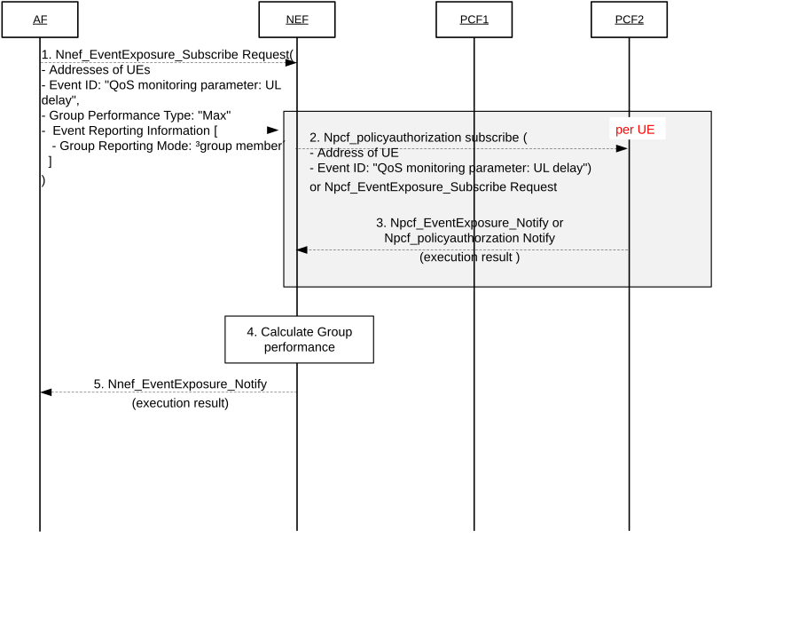

# 6.21 Solution \#21: Exposure of UE performance or a group of UEs performance

## 6.21.1 Description

This solution aims to address the key issue \#7, it addresses how to monitor and expose a UE or a group of UEs performance (e.g. aggregated QoS parameters). To address how to monitor and expose a UE or a group of UEs performance (e.g. aggregated QoS parameters), this solution follows the principles below:

\- The group of UEs performance are defined by the combination of event parameters that are defined in table 6.1.3.18-1 in TS 23.503 \[5\] and supported by Nnef_EventExposure service and the group performance type (i.e. min value, max value, mean value, sum of values). For instance, the combination for representing "longest UL delay in UEs" can be represented by (Event ID: "QoS Monitoring parameters", QoS parameter to be monitored: "UL packet delay", Group Performance Type: "max").

\- Enhanced NEF event exposure service by adding "Group Performance Type" (i.e. max, min, mean, sum) as a new optional input parameter of Nnef_EventExposure_Suscribe service operation. For instance, when AF want to know the longest UL delay among UEs in the group, AF sends event exposure request message with \[Addresses of UEs, Event ID: "QoS Monitoring parameters", QoS parameter to be monitored: "UL packet delay", Group Performance Type: "max", Group Reporting Mode: "Group Member"\] to NEF.

\- Enhanced Event Reporting Information by adding the "Group Reporting mode" parameter (i.e. "Group Member", "Group Reporting Guard Time") as an optional parameter to represent how NEF aggregates the event reports from other NFs (e.g. PCF(s)). When the "Group Reporting mode" parameter is requested as "Group Reporting Guard Time", NEF aggregates the event reports until the Group Reporting Guard timer is expired. On the other hand, when the "Group Reporting mode" parameter is requested as "Group Member", NEF aggregates the event reports of all UEs in the group.

\- New functionality of NEF to calculate the group performance based on the aggregated event reports and the requested "Group Performance Type" parameter.

## 6.21.2 Procedures

Figure 6.21.2-1 outlines the procedure of exposing UE performance and a group of UEs performance.

Figure 6.21.2-1: Procedure of exposing UE performance and a group of UEs performance

1\. The AF sends Nnef_EventExposure_Subscribe Request to NEF to subscribe target group performance.

If AF needs to obtain "the worst UL packet delay among that of UEs", AF sends request message with \[Addresses of UEs, Event ID: "QoS Monitoring parameters", QoS parameter to be monitored: "UL packet delay", Group Performance Type: "max", Group Reporting Mode: "Group Member"\]. On the other hand, if AF want to monitor whether "the UL delay of UEs in the target group is can no longer (or can again) be fulfilled", AF sends request message with \[Addresses of UEs, Event ID: "QoS targets can no longer (or can again) be fulfilled", QoS parameter to be monitored: "UL packet delay", Target QoS: UL delay (e.g. 1msec)\]. Note that the above Event IDs (i.e. "QoS Monitoring parameters" and "QoS targets can no longer (or can again) be fulfilled") are defined by Table 6.1.3.18-1 in TS 23.503 \[5\] and also these events are supported by Nnef_EventExposure, Npcf_EventExposure and Npcf_PolicyAuthorization services.

2\. NEF sends Npcf_EventExposure_Subscribe request (or Npcf_PolicyAuthorization_Subscribe request) with \[target UE, Event ID parameter\] to each PCF per UEs.

3\. PCF(s) sends Npcf_EventExposure_Notify (or Npcf_PolicyAuthorization_Notify) message with execution results (e.g. the UL packet delay of UE) to NEF.

4\. The NEF aggregates the event reports from PCF(s) based on "Group Reporting Mode" parameters. If "Group Reporting Mode" is set to "Group Member", NEF aggregates the event reports of all UEs in the target group. If "Group Reporting Mode" is set to "Group Reporting Guard Time", NEF aggregates the monitoring reports until Group Reporting Guard timer is expired.

Then, NEF calculate the group performance according to "Group Performance Type" and the aggregated event reports. For instance, if "Group Performance Type" is set to "max", and the monitoring results (e.g. \[UE1, "UL packet delay": 1msec\] and \[UE2, "UL packet delay": 2msec\] are reported by PCF(s) at step 3, NEF calculates the group of UEs performance as "2msec".

5\. The NEF sends the group performance to AF via Nnef_EventExposure_Notify.

## 6.21.3 Impacts on services, entities and interfaces

NEF:

\- Enhanced Nnef_EventExposure_Subscribe service operation by adding "Group Performance Type" parameter (i.e. "worst", "mean", "best", "sum") as a new optional input parameter and by supporting enhanced Event Reporting Information. The enhanced Event Reporting Information is included by new optional parameter (i.e. "Group Reporting Mode" parameter (i.e. "Group Member", "Group Reporting Guard Time")).

\- Enhanced NEF operations to request the event report per UE to PCF(s) (i.e. Npcf_EventExposure_Subscribe request or Npcf_PolicyAuthorization_Subscribe request) according to requested Event ID from AF and to aggregate the event reports of each UE according to "Group Reporting mode" parameter.

\- Enhanced NEF operations to aggregate the event report (i.e. performance) of UEs in the group and calculate the group performance from the aggregated UEs' performance based on the requested "Group Reporting mode" and Group Performance Type", respectively.
