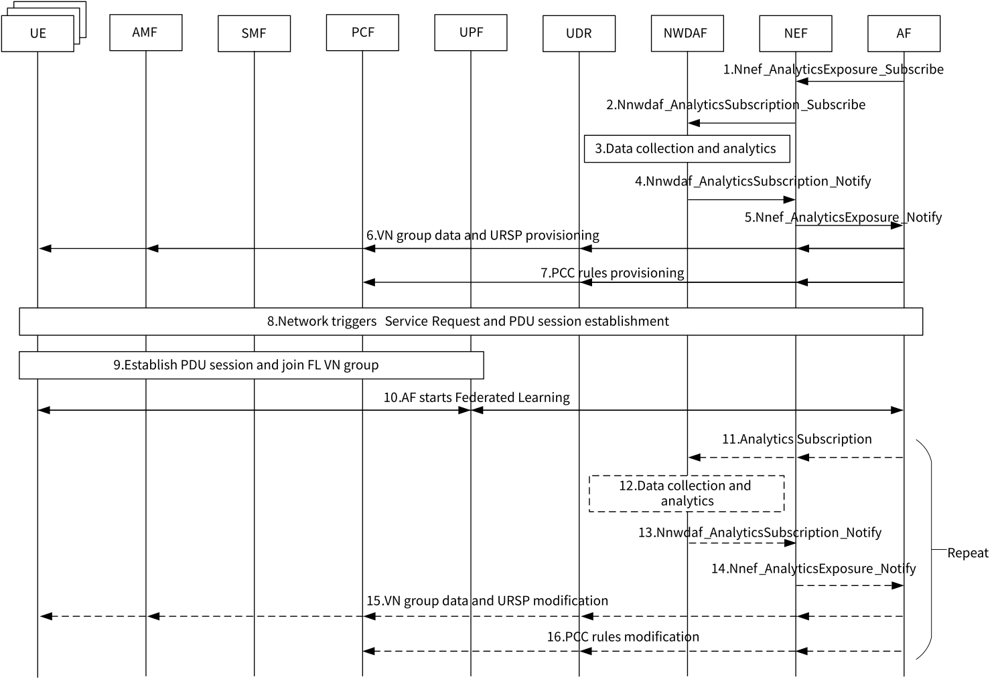

# 6.22 Solution \#22: 5GC-assisted Federated Learning over 5G VN group

## 6.22.1 Description

This solution addressed Key Issue \#7 "5GS Assistance to Federated Learning Operation".

In federated learning (FL), multiple rounds of training and interactions are required between central server and edge nodes (e.g. edge servers or UEs). It can be considered that federated learning is a kind of group training that does not reveal the privacy of edge nodes. In order to improve the efficiency of federated learning, it is necessary to ensure a more stable connection between edge nodes and central server, and a consistency of the communication characteristics and requirements of each edge node, such as the requirement of resources, bandwidth, delay, and the unified start and termination of training.

This solution proposes to form the edge nodes and central server of federated learning into a 5G VN group in order to facilitate unified management of member in the LAN group, allocation of resources, adding and removing FL members flexibly, group-level rules management, adjustment of Access and mobility related and Session management related policies.

NWDAF provides suggestions to AF to establish VN group with the related policies, and may also include the suggested FL member list if member selection is required by AF.

## 6.22.2 Procedures

### 6.22.2.1 Procedure of VN group establishment by AF

Figure 6.22.2.1-1 shows the procedure for VN group establishment initiated by AF.

Figure 6.22.2.1-1: Procedure of VN group establishment by AF

1\. The AF subscribes to receive analytics via NEF by invoking Nnef_AnalyticsExposure_Subscribe service operation as defined in TS 23.502 \[4\]. The parameters includes:

\- Analytics ID.

\- Member selection flag: A flag indicating whether member selection is required.

\- Analytics Filter Information including:

\- Members list (a list of SUPIs or group ID, if member selection flag is 0), candidate members list (a list of SUPIs or Group ID, if member selection flag is 1) or any UE (if member selection flag is 1).

\- \[Optional\] Maximum and/or minimum number of members (if member selection flag is 1).

\- Area of Interest.

\- S-NSSAI or DNN.

\- Expected time period.

\- \[Optional\] Information of ML model to be trained (e.g. model size).

\- \[Optional\] The requirements of performance (e.g. bandwidth, time delay etc.).

2\. Based on the subscription from the AF, the NEF subscribes to NWDAF by invoking the Nnwdaf_AnalyticsSubscription_Subscribe service operation.

3\. The NWDAF collects data and do the analytics. If the member selection flag is 1 and the user consent is granted, NWDAF may begin to select members from the list of candidate UE provided by AF. NWDAF may conduct "UE mobility analytics", "abnormal behaviour related network data analytics", "Network Performance Analytics", "NF load analytics", "User Data Congestion Analytics", "DN performance analytics" and other Analytics ID to select the appropriate members. Based on the analytics results, the NWDAF may also suggest a VN group data and assistant information for the related policies..

Editor's note: Whether the NWDAF can provide such information is FFS.

4\. NWDAF sends the analytics results to NEF by invoking Nnwdaf_AnalyticsSubscription_Notify service operation.

5\. The NEF notifies the analytics information to AF by invoking Nnef_AnalyticsExposure_Notify service operation.

6\. AF sends VN group data as defined in clause 4.15.6.3b of TS 23.502 \[4\] via UDR using the procedure specified in clause 4.15.6.7 of TS 23.502 \[4\]. PCF generates URSP rules based on VN group data and delivers it to UE using the procedure specified in clause 4.2.4.3 of TS 23.502 \[4\].

7\. AF sends the exclusive PCC rules for the VN group as defined in TS 23.503 \[5\] clause 6.3 to PCF via UDR using the procedure specified in clause 4.15.6.7 of TS 23.502 \[4\].

8\. AF may trigger PDU session establishment.

9\. UEs that have previously received URSP rules establish PDU session using the procedure in clause 4.3.2.2.1 of TS 23.502 \[4\] and join the VN group.

10\. AF starts Federated Learning with selected UEs over the established VN group.

11\. During the learning, the AF may sends subscription of network performance monitoring analytics of member UE list to NWDAF that may include "Network Performance Analytics", "UE mobility analytics", "User Data Congestion Analytics", "DN performance analytics", etc.. The AF may also modify the candidate UE list, and subscribe analytics of the new candidate UE list that may include the Analytics IDs in step 3.

12\. The NWDAF collects data and do the analytics based on the AF's subscription.

13\. NWDAF notifies the updated suggested member list (if required), and the analytics results to NEF by invoking Nnwdaf_AnalyticsSubscription_Notify service operation.

14\. The NEF notifies the analytics information to AF by invoking Nnef_AnalyticsExposure_Notify service operation.

15\. AF modifies VN group data and/or members via UDR using the procedure specified in clause 4.15.6.7 of TS 23.502 \[4\]. The AF can change the candidate UE list based on internal decision or analytics result. The AF can send request to add or remove FL members at any time. The PCF modifies URSP rules based on VN group data and delivers it to UE using the procedure specified in clause 4.2.4.3 of TS 23.502 \[4\].

16\. AF modifies the PCC rules for the VN group using the procedure specified in clause 4.15.6.7 of TS 23.502 \[4\]. A FL task contains multiple rounds of training. Steps 14-19 may be repeated for multiple times based on the requirements of subscription from AF to NWDAF.

## 6.22.3 Impacts on services, entities and interfaces

NWDAF:

\- Supports application federated learning related analytics (e.g. a new Analytics ID);

NEF:

\- Supports receiving application federated learning related subscription.
