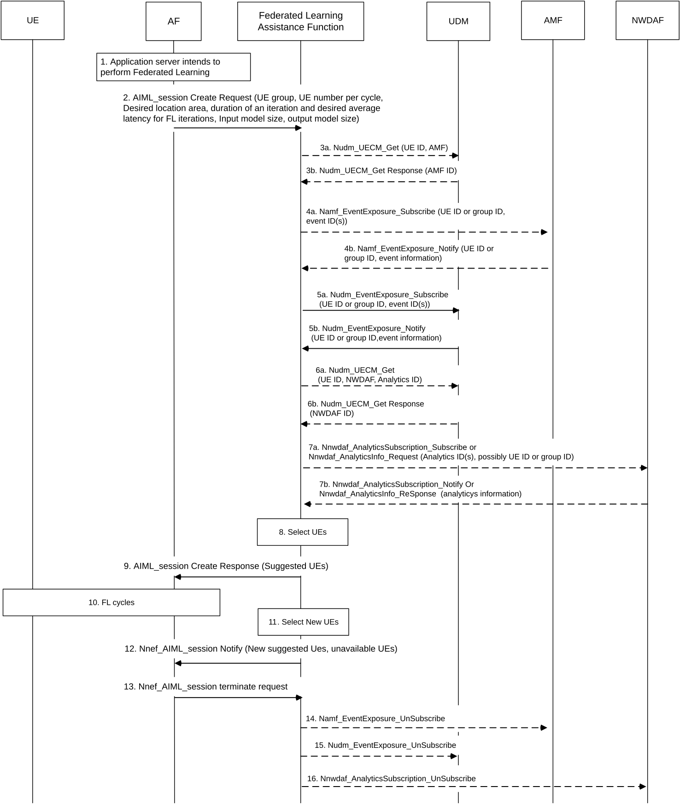

# 6.23 Solution \#23: Federated Learning Assistance Function assisting on federated learning members selection

## 6.23.1 Description

This solution addresses aspects of key issue \#7 on 5GS Assistance to Federated Learning Operation and key issue \#3 on 5GC Information Exposure to authorized 3rd party for Application Layer AI / ML Operation.

The solution allows the 5GS to suggest devices that should be part of FL operation, based on requirements expressed by the AI/ML application server.

The solution relies on introduction of a Federated Learning Assistance Function which, when receiving a request from the AI/ML application server (acting as AF), helps to select UEs suitable to participate to the FL operation. The AI/ML application Server tasks the Federated Learning Assistance Function to propose UEs for FL operation. Based on suggestion from the Federated Learning Assistance Function, the AI/ML application server can trigger FL operations. The Federated Learning Assistance Function can be integrated in NEF, in NWDAF or be standalone.

Further, the Federated Learning Assistance Function monitors whether suggested UEs remain available (e.g. registered, active, reachable), or still meet other selection criteria e.g. are still in the area of interest as proposed by the AI/ML application server. If UEs become unavailable or no longer meet selection criteria, the Federated Learning Assistance Function notifies the AF and may suggests new UEs. The AF then sends to suggested UEs a request to start federated learning cycle(s) and provides input model and receives output model from each UE for each learning cycle.

The Federated Learning Assistance Function may inquire or subscribe to UE locations (e.g. via AMF) and predictions (e.g. from NWDAF) about network load at UE locations and select the UEs located in network areas with lower load.

The Federated Learning Assistance Function may inquire analytics about UE or network serving the UE (e.g. from NWDAF, e.g. Observed Service Experience related network data analytics, Network Performance Analytics, UE related analytics e.g. UE mobility analytics, User Data Congestion Analytics, and/or Dispersion Analytics as defined in TS 23.288 \[6\]) and may preferably select UEs served by less loaded network components.

The Federated Learning Assistance Function may query or subscribe at AMF to UE related events such as connectivity state, UE loss of communication, UE reachability status, registration state changes, UE location, or UE moving in or out of area of interest, to inquire or monitor availability of UEs and preferably select connected, active, registered, and/or reachable UEs, and/or UEs within a desired area.

The Federated Learning Assistance Function may query or subscribe at UDM for UE reachability and preferably select reachable UEs. The Federated Learning Assistance Function shall query or subscribe at UDM for roaming status and shall only select non-roaming UEs.

## 6.23.2 Procedures

The procedure for Federated Learning Assistance Function assisting on federated learning members selection is depicted in figure 6.23.2-1.

Figure 6.23.2-1: Federated Learning Assistance Function provides suggestions for UEs that can participate to FL operation

NOTE 1: For simplicity, NEF is not shown in the figure, however, the 3rd party AF would first interact with NEF which then would in turn interact with the Federated Learning Assistance Function.

1\. The AI/ML application server (acting as AF) prepares for running FL training by collecting information such as potential FL members, FL aggregated model size, local model size, model aggregation average latency target for FL iterations, and duration of an iteration, time window when FL training needs to be performed. It determines an initial list for candidate FL members.

2\. The AF tasks Federated Learning Assistance Function (which could be integrated in NEF, NWDAF or be standalone) to propose UEs for FL operation.

The AF indicates a list or group of UEs to choose from, the number of UEs required to perform federated learning cycle, possibly a desired location of UEs in a form of a target area for FL, duration of an iteration and desired average latency for FL iterations. When providing a target area for FL, the AF may provide sub-areas, and provide a percentage of UEs that should take part in FL from each sub-area, and/or a minimum number of UEs and /or a maximum number of UEs that should take part in FL from each sub-area.

Optionally, the AF may provide time when to start federated learning, duration of federated learning, size of input model and/or output model.

NOTE 2: Step 2 is shown as AIML_session Create Request, but step 2 could also be realized via an analytics request / subscription with new analytics type.

3-4. The Federated Learning Assistance Function may query or subscribe at AMF to UE related events such as connectivity state, UE loss of communication, UE reachability status, registration state changes, UE location, or UE moving in or out of area of interest, to inquire or monitor availability of UEs and preferably select connected, active, registered, and/or reachable UEs and/or UEs within a desired region.

5\. The Federated Learning Assistance Function may query or subscribe at UDM for UE reachability and preferably select reachable UEs. The Federated Learning Assistance Function shall query or subscribe at UDM for roaming status and shall only select non-roaming UEs.

6-7. The Federated Learning Assistance Function may inquire analytics about UE or network serving the UE (e.g. from NWDAF, e.g. Observed Service Experience related network data analytics, Network Performance Analytics, UE related analytics, UE mobility analytics, User Data Congestion Analytics, and/or Dispersion Analytics as defined in TS 23.288 \[6\]) and may preferably select UEs served by less loaded network components.

NOTE 3: Steps 3-4, 5 and 6-7 can happen in parallel. Federated Learning Assistance Function can decide to apply steps 3-4 only, or step 5 only, instead of applying both steps 3-4 and step 5.

8\. The Federated learning Assistance Function select UEs for the federated learning from the group of UEs. The Federated Learning Assistance Function may select more UEs than requested to prepare for unresponsive UEs.

9\. The Federated Learning Assistance Function provides a list of suggested UEs to the AF, possibly containing more UEs than requested by the AF at step 2. The Federated Learning Assistance Function can provide different lists of UEs for different time windows.

10\. The AF sends to suggested UEs a request to start federated learning cycle(s) with input model and receives output model from each UE for each learning cycle.

11-12. The Federated Learning Assistance Function monitors whether suggested UEs remain available (registered, active, reachable), or still meet other selection criteria e.g. area of interest. If UEs become unavailable or no longer meet selection criteria the Federated Learning Assistance Function notifies the AF, together with time information when the UEs become unavailable. The Federated Learning Assistance Function may also suggest new UEs for FL operation together with related time window(s).

13-16. When the AF requests termination of federated learning session from Federated Learning Assistance Function, the Federated Learning Assistance Function terminates related events subscriptions and analytics subscriptions at AMF, UDM, and/or NWDAF.

## 6.23.3 Impacts on services, entities and interfaces

Federated Learning Assistance Function providing suggestions to the AI/ML application server on UEs that should take part of FL operation.

NEF services to allow AI/ML application server to use the Federated Learning Assistance Function services.

New analytics from NWDAF if the Federated Learning Assistance Function is located in NWDAF.

Editor's note: Where the Federated Learning Assistance Function is located, e.g. at NEF, or NWDAF or standalone, is to be decided during the evaluation and conclusion phase. If standalone, whether the function will only assist FL operation or assist also other AI/ML operations is to be decided during the evaluation and conclusion phase..
