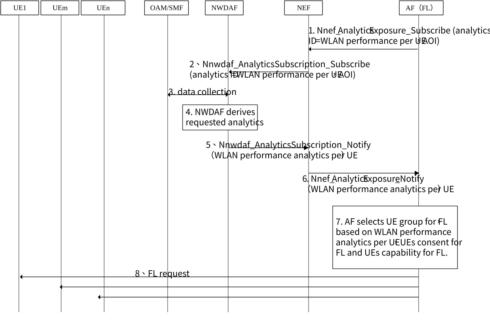

# 6.24 Solution \#24: 5GS Assistance to Federated Learning

## 6.24.1 Description

This solution is about KI# 7 to address how and what information provided by 5GC to the AF to select the group of UEs which will be part of FL operation.

Due to large model files transmission between server and clients and multi times interactions in the FL process, it will lead to heavy data traffic if FL interaction data is transferred between AF server and UE client(s) via 5GS. As a consequence, the UE selection and data transmission for FL training should be more careful in 5G. To ensure that the training process of FL not lead network performance degrading and traffic/fee for clients increasing substantially, one criterion is to choose those UEs who are in WLAN and the signal quality is good enough.

The AF can consume WLAN performance analytics per UE from the NWDAF for candidate UE list or for any UE in the AOI. Then take the WLAN performance analytics per UE, UE consent for FL and UE capability for FL of each UE into account, the AF determines the UE group for FL.

## 6.24.2 Procedures

Figure 6.24.2-1: Procedure for 5GS Assistance to Federated Learning

1\. To select UE group to participate in Federated Leaning procedure, the AF for Federated Leaning subscribes to WLAN Performance analytics per UE list from the NWDAF via NEF by invoking the Nnef_AnalyticsExposure_Subscribe service operation, including Analytics ID=WLAN Performance, Analytics filter=AOI, Target of analytics=candidate UE list and preferred reporting granularity=per UE.

2\. Based on the request from the AF, the NEF subscribes to WLAN Performance analytics by invoking the Nnwdaf_AnalyticsSubscription_Subscribe service operation. Wherein, the NEF may map the AOI e.g. geographical area provided by the AF to the area e.g. TA or cell list inside network, and map the candidate UE ID list to the UE ID list used inside the network.

3-4. The NWDAF collects related data from data providers, e.g. OAM, UPF and SMF, and derives requested analytics with the collected data as defined TS 23.288 \[6\] and UE ID. The detailed operations are similar as the steps 2-5 defined in clause 6.11.4 of TS 23.288 \[6\]. The outputs of the WLAN performance analytics is per UE granularity, which contains the start time, duration, quality and performance of WLAN connection (e.g. the proportion of time the signal quality is above the threshold) per UE location.

NOTE: How to collect data from UPF should depend on the conclusion of FS_UPEAS.

5\. NWDAF notifies the NEF with the analytics information by invoking Nnwdaf_AnalyticsSubscription_Notify service operation.

6\. The NEF notifies the AF with the analytics information by invoking Nnef_AnalyticsExposure_Notify service operation defined in TS 23.502 \[4\].

7\. After receiving the WLAN performance analytics per UE, the AF for Federated Leaning selects the UE group to participate in Federated Leaning procedure, taking the WLAN performance analytics per UE, UE consent for FL and UE capability for FL of each UE into account.

## 6.24.3 Impacts on services, entities and interfaces

NWDAF:

\- Enhances the existing WLAN performance analytics to WLAN performance analytics per UE granularity, which contains the start time, duration, quality and performance of WLAN connection (e.g. the proportion of time the signal quality is above the threshold) per UE location, and reports it per UE granularity according to the request from the AF.

\- Collects data from corresponding data provider(s) to derive the enhanced WLAN performance analytics.

AF:

\- Requests WLAN performance analytics per UE granularity from the NWDAF.

\- Selects the UE group to participate Federated Leaning based on the WLAN performance analytics per UE, UE consent for FL and UE capability for FL of each UE.
