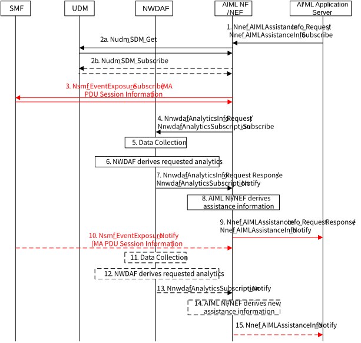

# 6.25 Solution \#25: Providing 5GS Assistance Information to AF for Federated Learning Operation

## 6.25.1 Description

This is a solution for key issue \#7 "5GS Assistance to Federated Learning Operation".

The outline of the proposed solution for providing 5GS assistance information to AF for Federated Learning operation is as below:

\- This solution introduces an AIML NF, which may be co-located with NEF and used for external exposure to assist 5G AIML services. (e.g. receives request from AF (i.e. AI/ML Application Server) and response/notify with 5GS assistance information for AIML operation).

\- AI/ML Application Server requests assistance information with input parameters for FL operation. (e.g. UE list, QoS references, geographic area, minimum number of UEs for FL operation, Preferred AIML time periods, whether to request the lists of candidate UEs for FL operation, preferred time periods for AIML operation, Wireless Access technology, the quality of signal, etc.). For example, some FL operation should be performed during a certain time or some FL operations may not need to be performed immediately. In this case, AI/ML Application Server can provide preferred AIML operation time period. Also, based on the training data size, AI/ML Application Server can provide expected AIML operation time duration. The AIML NF/NEF can derive recommended time periods for AIML operation by considering the preferred AIML operation time periods and the expected AIML operation time duration, and by predicting the network condition such as user data congestion time.

\- AI/ML Application Server can subscribe for AIML assistance information for FL operation. For example, AI/ML Application Server may want to update FL member UEs for FL operation after starting the FL operation if it is expected that the member UE's threshold for QoS references or QoS Requirements cannot be met or new candidate UE can meet the threshold due to changed network condition. In this case, AIML NF/NEF can provide updated assistance information (e.g. new recommended UEs) to AI/ML Application Server so that it can reselect the FL member UEs that can satisfy the QoS requirements based on the assistance information.

AI/ML Application Server can manage the subscription with a Subscription Correlation ID. It can update the subscription (e.g. a new list of UEs, QoS requirements) or unsubscribe to AIML NF/NEF using Subscription Correlation ID.

\- AIML NF/NEF processes the request from AI/ML Application Server by interacting with other NFs such as NWDAF, UDM, SMF, UPF, OAM, etc. and generates assistance information (e.g. lists of candidate UEs for recommended time periods) for FL operation based on the collected information, and provides the assistance information for FL operation requested by AI/ML Application Server.

## 6.25.2 Procedures

### 6.25.2.1 Procedure for Providing 5GS Assistance Information for Federated Learning Operation

Figure 6.25.2.1-1 shows the procedure for providing 5GS assistance information to AI/ML Application Server for Federated Learning operation.

Figure 6.25.2.1-1: Procedure for providing 5GS assistance information for Federated Learning operation

1\. AI/ML Application Server invokes Nnef_AIMLAssistanceInfo_Request/Nnef_AIMLAssistanceInfo_Subscribe to request/subscribe 5G assistance information with specific conditions for FL operation. The AI/ML Application Server requests FL assistance information for the UE list included in the request. It also indicates that these UEs are authorized by AI/ML Application Server (application side) for FL operation.

The input parameters of the Nnef_AIMLAssistanceInfo_Request service operation can be as below:

\- AF Identifier.

\- UE List (GPSIs, External Group ID, or IP addresses).

\- AF-Service-Identifier.

\- External Application Identifier.

\- QoS References or QoS requirements.

\- Whether to request the list of candidate UEs (If indicated, AIML NF/NEF provides candidate UE list in the response).

\- Time when assistance information is needed (Indicates to the AIML NF/NEF the latest time the analytics consumer expects to receive assistance data provided by AIML NF/NEF).

\- Expected AIML operation time duration (Expected time duration by AI/ML Application Server based on the training information such as training model and training data size).

\- Preferred AIML operation time periods (Time periods that the AI/ML Application Server want to perform AIML operation).

\- Whether to request the recommended AIML operation time periods (If indicated, AIML NF/NEF provides recommended AIML operation time periods in the response).

\- Traffic volume for downloading global model and uploading training results.

\- DNN and S-NSSAI.

\- Expected UE Moving Trajectory for each UE in the UE list (e.g. A planned path of movement).

\- Area of Interest (AIML operation for the UEs in the area of interest).

\- Minimum number of UEs needed for FL operation.

\- Preferred Wireless Access technology (Access type/RAT type, e.g. WLAN, 5G, Multi-Access, where the AI/ML Application Server expects the UE to stay for FL operation).

\- Preferred quality of signal (Requirement of UE radio signal for FL operation, e.g. average RSSI (received Signal Strength Indication) and RTT (round trip time)) for WLAN.

\- UE traffic usage (the expected range of UE traffic usage or remaining traffic for FL operation).

\- Whether to request Multi-Access PDU Session Information of the UE (Whether the UE have established MA PDU Session, UE is allowed/capable to have MA PDU Session for AIML FL application, which access type the PDU Session is connected to).

Additional input parameters for the Nnef_AIMLAssistanceInfo_Subscribe service operation can be as below:

\- Notification Target Address (+ Notification Correlation ID), when the AI/ML Application Server subscribe to AIML NF/NEF.

\- Reporting Parameters (e.g. periodic reporting, Reporting Thresholds (QoS References or QoS requirements)).

2-3. If the request from AI/ML Application Server is authorized, AIML NF/NEF determines whether the UEs provided by AI/ML Application Server are authorized by 5GC to support AIML operations and whether each UE consents to participate in the FL operation from UDM, which is stored in the UE subscription information, by invoking Nudm_SDM_Get service operation. After successful response is received, the AIML NF/NEF may subscribe to be notified of the Subscription data modification using Nudm_SDM_Subscribe.

If AI/ML Application server requested for MA PDU Session Information of UEs or the network is configured to collect MA PDU Session information although the application server did not explicitly request, AIML NF/NEF collects MA PDU Session Information of the PDU session of DNN/S-NSSAI for FL operation from the SMF. The AIML NF/NEF may subscribe to be notified of the MA PDU Session information.

4\. For the authorized UEs for AIML operation by 5GC, AIML NF/NEF determines appropriate analytics information and input parameters to be collected based on the requested inputs in step 1 to derive assistance information such as lists of candidate UEs or recommended areas with recommended time periods that can satisfy the request from AI/ML Application Server.

The inputs from step 1 can be used for input parameters to request/subscribe analytics information to NWDAF. For example, QoS reference, Expected AIML operation time duration and Preferred AIML operation time periods can be used to request QoS Sustainability Analytics at that time. Also, "Time when assistance information is needed" can be used as an input for "Time when analytics information is needed" to NWDAF as clause 6.1.3 in TS 23.288 \[6\]. Traffic volume for downloading global model and uploading training results can be used to predict the time duration for downloading global model and uploading training result.

AIML NF/NEF may request/subscribe analytics information to NWDAF in order to collect analytics information of the requested UEs (e.g. UE Communication analytics, UE Mobility analytics, User Data Congestion analytics, QoS Sustainability analytics, WLAN performance analytics per UE). If the AI/ML Application Server did not provide some of input parameters, AIML NF/NEF can derive them based on local configuration or based on analytics such as UE Mobility analytics and WLAN performance analytics per UE. If "Preferred AIML operation time periods" and "Time when assistance information is needed" are not provided as input parameters, it can be regarded as the immediate AIML operation will be performed.

NOTE: The output of WLAN performance analytics per UE will be decided by FS_eNA_Ph3.

5\. The NWDAF collects the data for the requested Analytics IDs as specified in TS 23.288 \[6\].

6\. The NWDAF derives the requested analytics as specified TS 23.288 \[6\].

7\. The NWDAF provides analytics response to the AIML NF/NEF.

8\. AIML NF/NEF collects all the analytics information from NWDAF and derives assistance information that can satisfy the request from AI/ML Application Server taking into account, e.g. the QoS, User Data Congestion, UE mobility, the preferred AIML time periods for FL operation, preferred Wireless Access technology, preferred quality of signal, and UE traffic usage, MA PDU Session information, etc.

9\. AIML NF/NEF responds/notifies to the AI/ML Application Server with the derived assistance information.

The output parameters of the Nnef_AIMLAssistanceInfo_Request service operation can be as below:

\- Set of the 5GS Assistance information requested by AI/ML Application Server. Each 5GS Assistance information can contain:

\- List of candidate UEs for FL operation.

\- Recommended time period to perform AIML operation.

\- Recommended area for AIML operation.

\- Recommended Access type/RAT type to perform AIML operation.

\- Multi Access PDU Session information of the UE.

Each of above information can be provided in a prioritized order to help the AI/ML Application Server to select the UEs.

The lists of candidate UEs for recommended FL operation can be different according to the recommended time period and/or the recommended area for AIML operation.

If the "time when assistance information is needed" was provided in step 1, AIML NF/NEF takes this into account in responding to the AI/ML Application Server.

Multi-Access PDU Session information can be provided with candidate UEs or the list of candidate UEs can be generated taking into account the MA PDU Session information (e.g. suggest for the UEs have MA PDU Session).

Based on the received the 5GS assistance information, the AI/ML Application Server can select and manage the group of UEs, and determine the start time for FL operation.

10\. If AIML NF/NEF subscribed for MA PDU Session information at step 3 and the MA PDU Session information of the UEs are changed (e.g. the UE previously connected with 3GPP access, additionally connected with non-3GPP access), SMF notifies the changed MA PDU Session of the UE to AIML NF/NEF.

11-15. If AI/ML Application server and AIML NF/NEF subscribed for AIML assistance information at step 1/step 4 when NWDAF generates new analytics, AIML NF/NEF notifies new assistance information to AI/ML Application server.

After the start of FL operation, AIML NF/NEF can notify new AIML assistance information (e.g. new recommended UEs) due to the changed network condition and AI/ML Application Server can reselect FL members based on the information.

## 6.25.3 Impacts on services, entities and interfaces

UDM:

\- New subscription information whether the UE is authorized for 5G AI/ML operation.

AIML NF/NEF:

\- AIML NF may be co-located with NEF.

\- New service operation to assist application AI/ML operation.

NWDAF:

\- Supports WLAN performance analytics per UE.

SMF:

\- Provides UE's MA PDU Session information of DNN/S-NSSAI used for AIML operation.
